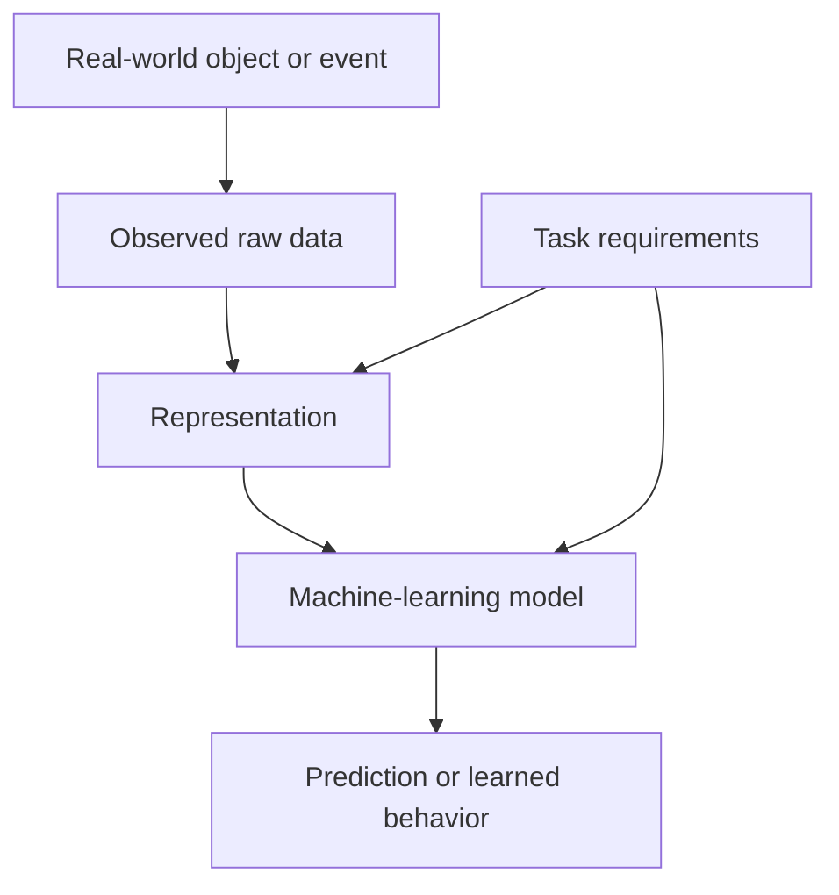
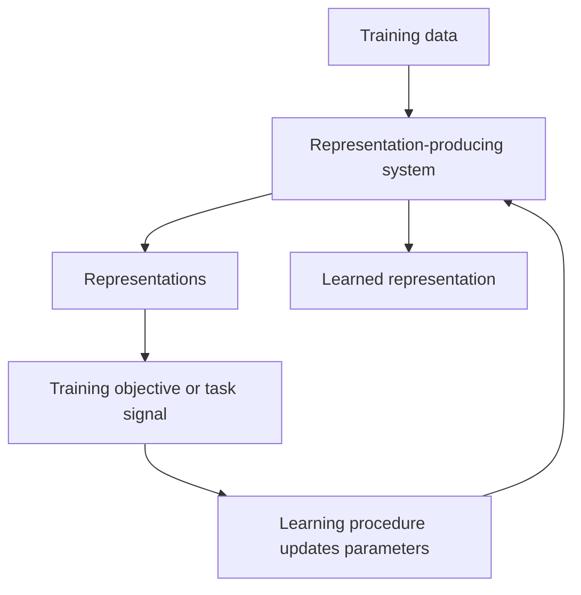

# 01 — Feature Engineering and Representation Learning

## 1. Purpose

Machine-learning models do not directly understand real-world objects, events, or concepts in the way humans do. They operate on representations of data that make relevant information available for computation and learning.

A representation determines how information about an input is expressed to a model. It can preserve useful patterns, hide important distinctions, introduce unwanted assumptions, or make a learning problem unnecessarily difficult.

For example, consider a model that predicts whether a customer will leave a subscription service. The raw input may contain a subscription date, a plan name, monthly usage records, support interactions, and payment history. The model needs these inputs expressed in a form suitable for its learning procedure.

An engineer might manually construct features such as customer tenure, average monthly usage, and number of support requests. Alternatively, a learning system might discover useful representations from the original data.

Both approaches address the same fundamental question:

**How should information about the real world be represented so that a model can learn something useful from it?**

This chapter establishes the foundation for answering that question.

## 2. Learning Objectives

After completing this chapter, you should be able to:

- Explain what a data representation is and why machine-learning models need one.
- Distinguish raw data, features, engineered features, and learned representations.
- Explain the differences between feature selection, feature transformation, feature engineering, and representation learning.
- Identify the strengths and limitations of manually designed and learned representations.
- Analyze representation choices using tabular, text, and image examples.
- Explain how a representation can make a prediction task easier or harder.
- Recognize that a representation can introduce information loss, bias, or misleading patterns.
- Connect representation learning to the machine-learning foundations in AIF-03 and deep-learning foundations in AIF-04.

## 3. What Is a Data Representation?

A **data representation** is a form in which information about an object, observation, or event is expressed so that a computational system can process it.

The original data may be a sentence, an image, a customer record, an audio signal, or a collection of events. A model generally requires this information to be encoded in a form supported by its computation and learning procedure.

A representation may contain:

- Numerical values describing measurable properties.
- Encoded categories describing discrete attributes.
- Counts or statistics derived from observations.
- Structured combinations of multiple features.
- Vectors learned from data during model training.

The appropriate representation depends on the data, the model, and the task.

### 3.1 Raw Data Is Not the Same as a Representation Designed for a Task

Consider the following customer record:

```text
Customer ID: C1042
Subscription start: 2025-01-15
Plan: Premium
Monthly usage: 18 hours
Support requests: 4
Subscription status: Active
```

This record contains useful information, but not every field is equally useful for every prediction task.

If the task is to estimate customer tenure, the subscription start date may be transformed into a duration relative to a reference date.

If the task is to predict subscription cancellation, usage patterns, support interactions, and plan information may be relevant.

If the task is to detect duplicate customer records, the customer identifier and selected identity attributes may matter more.

The same underlying record can therefore support different representations for different tasks.

A representation is not automatically useful merely because it preserves the original data. Its usefulness depends on whether it exposes information relevant to the objective.

### 3.2 A Representation as an Interface Between Data and a Model

Think of a representation as an interface between the real-world input and the learning system.



The representation determines what information is exposed and how that information is organized. The model then learns from the available representation according to its learning procedure and objective.

The task requirements matter because information useful for one task may be irrelevant to another.

For example, image color may be important for identifying plant diseases but irrelevant to a task concerned only with counting objects when shape and boundaries are sufficient.

**Engineering implication:** representation design is part of problem solving, not merely a formatting step performed before modeling.

## 4. Why Do Models Need Representations?

Representations make information computationally accessible. They can also encode useful assumptions about the problem.

There are several reasons this matters.

### 4.1 Models Operate on Specific Computational Forms

A model's input interface accepts particular data types and structures. A conventional tabular model may expect numerical feature columns, while an image model may accept an array of pixel values with a defined shape.

A representation bridges the gap between the original data and the model's expected input.

This does not mean all information must be manually converted into numerical columns. Some model architectures and learning procedures can learn useful representations from relatively direct inputs. The important point is that the model still operates on a computational representation.

### 4.2 Representations Can Expose Useful Information

Suppose a model predicts whether a delivery will be late.

The raw data contains:

```text
Order placed: 09:00
Expected delivery: 17:00
Current estimated delivery: 19:30
```

An engineer could construct a feature representing the difference between the estimated and expected delivery times.

That feature directly exposes a potentially relevant signal: the delivery is currently estimated to be late by 2.5 hours.

A representation that exposes a meaningful relationship can make a learning problem easier than one that requires the model to discover that relationship from an inconvenient encoding.

This is not a guarantee of better performance. The feature may be inaccurate, unavailable at prediction time, or redundant with other inputs. Its value must be evaluated in the context of the task.

### 4.3 Representations Can Remove Irrelevant Complexity

Raw inputs often contain details that are unnecessary for the task.

For example, a document may contain formatting differences, repeated boilerplate, and other details that do not matter for a particular classification problem.

A suitable representation may reduce the influence of these details while retaining useful information.

However, removing detail always involves assumptions. A feature that appears irrelevant for one task may be important for another.

### 4.4 Representations Influence What Can Be Learned

A model cannot reliably learn a distinction that its input representation consistently erases.

Suppose an image-processing pipeline converts every image to grayscale. If the task depends on distinguishing objects solely by their color, that conversion removes potentially essential information.

Similarly, if customer records are reduced to only total spending, a model cannot distinguish two customers with the same spending total but very different purchasing patterns unless other information is available.

This leads to a fundamental principle:

**A model's learning capability depends not only on the learning algorithm, but also on the information and structure provided by its representation.**

A powerful model cannot automatically recover information that has been irreversibly discarded.

## 5. Features and Feature Engineering

A **feature** is an attribute or measurable signal used to describe an observation for a machine-learning task.

Examples include:

- Customer age.
- Product price.
- Number of transactions.
- Average daily temperature.
- Word occurrence counts.
- Pixel intensity.
- Time elapsed between two events.

Features may be observed directly, selected from existing data, transformed from raw inputs, or constructed by combining multiple attributes.

### 5.1 Feature Engineering

**Feature engineering** is the process of designing, constructing, or transforming input features using domain knowledge, data analysis, and task requirements.

For example, an e-commerce dataset may contain individual purchase timestamps. An engineer could derive:

- Number of purchases in the last 30 days.
- Average time between purchases.
- Total spending in a defined period.
- Days since the last purchase.

These features express patterns that may be more useful than the original timestamps when predicting future purchasing behavior.

Feature engineering can range from simple arithmetic transformations to domain-specific representations that require substantial expertise.

### 5.2 Why Feature Engineering Exists

Feature engineering addresses a practical challenge: useful information is not always presented in the most convenient form for a learning algorithm.

A raw field may contain the information needed for a task, but a derived feature may expose the relevant relationship more directly.

For example, the raw fields `distance_km` and `duration_minutes` can be used to calculate average travel speed. If speed is relevant to a prediction task, the derived feature may provide a more direct signal.

Feature engineering can also incorporate established domain knowledge. A medical risk model, for example, may use a clinically meaningful ratio rather than treating two measurements as unrelated inputs.

The benefit depends on whether the engineered feature captures a useful relationship and whether the assumptions behind it are justified.

### 5.3 Strengths of Feature Engineering

Feature engineering can provide several advantages:

- **Domain knowledge:** Experts can encode known relationships into the input.
- **Interpretability:** Features such as account age or transaction count may have clear meanings.
- **Efficiency:** Well-designed features may reduce the complexity of patterns the model must learn.
- **Data efficiency:** Useful prior structure can sometimes reduce the amount of data needed to learn a task.
- **Debuggability:** Engineers can inspect feature values and investigate suspicious behavior.

These advantages are especially useful when the data is structured, domain knowledge is strong, or the model and dataset benefit from explicit signals.

### 5.4 Limitations of Feature Engineering

Manual feature design also introduces costs and risks:

- It requires engineering time and domain expertise.
- It may encode incorrect or outdated assumptions.
- It may fail to capture complex relationships.
- It can be difficult to maintain as data sources and business requirements change.
- It may unintentionally discard information.
- It can create leakage if a feature uses information unavailable at prediction time.

Feature engineering is therefore neither universally necessary nor universally superior to learned representations.

It is an engineering choice that should be justified by the task, data, constraints, and evidence.

## 6. Learned Representations

A **learned representation** is a representation whose useful structure or parameters are learned from data rather than being specified entirely through manual feature design.

The learning process adjusts the representation according to a training objective, data distribution, and learning procedure.

For example, a system trained to classify images may learn internal representations that make relevant visual patterns easier to distinguish. A language model may learn representations that encode useful regularities in language.

In these cases, engineers still make design decisions. They choose the data, model structure, objective, and training procedure. The representation itself is not necessarily designed dimension by dimension by a human.

### 6.1 How Learned Representations Differ from Hand-Crafted Features

Consider a task that classifies images of cats and dogs.

A manually engineered approach might compute selected properties such as:

- Average color in an image region.
- Edge counts.
- Texture statistics.
- Shape-related measurements.

These properties may provide useful signals, but their effectiveness depends on the selected measurements and how well they capture the task.

A learned approach can use training examples to develop internal representations that support the classification objective. Depending on the model and data, those representations may capture combinations of visual patterns that are difficult to specify manually.

The key distinction is not simply whether the input is numerical. Both approaches can produce numerical inputs.

The distinction is **where the representation's useful structure comes from**:

- In hand-crafted features, humans explicitly design much of the representation.
- In learned representations, a learning procedure discovers useful structure from data.
- In hybrid systems, humans design some features while a model learns additional representations.

### 6.2 Learned Representations Are Not Automatically Better

Learning a representation from data does not guarantee that it captures the information needed by every downstream task.

A learned representation can:

- Overemphasize patterns that help the training objective but are irrelevant elsewhere.
- Encode spurious correlations present in the training data.
- Fail on data that differs from the training distribution.
- Require substantial data or computation.
- Be difficult to interpret at the level of individual dimensions.
- Reflect biases in the data or objective.

A representation that performs well for one task may transfer poorly to another.

For example, a representation optimized to distinguish product categories may not be the best representation for estimating product similarity according to customer preferences.

The objective and evaluation context matter.

### 6.3 How Representations Are Learned

At a high level, representation learning involves a learning procedure that adjusts a system using data and an objective.



This diagram is conceptual. Different systems use different objectives and training procedures, and not all representation-learning methods use the same feedback mechanism.

For example, representations may be learned through supervised tasks, self-supervised objectives, or other learning approaches. The details of those learning paradigms belong to the broader machine-learning foundations in AIF-03, while the internal mechanisms of neural-network training belong to AIF-04.

For this chapter, the important idea is that **the data and learning objective influence which patterns the system learns to represent**.

## 7. Selecting, Transforming, Engineering, and Learning Features

These terms describe related but distinct operations. Treating them as interchangeable can lead to unclear system designs.

### 7.1 Feature Selection

**Feature selection** chooses which existing features to retain.

Suppose a customer dataset contains 80 columns. An engineer determines that a subset of 25 columns is appropriate for a particular task.

The selected features retain their existing meaning, although some columns may also undergo transformations elsewhere in the pipeline.

Feature selection focuses on *which features are used*.

### 7.2 Feature Transformation

**Feature transformation** changes the form of an existing feature or set of features.

Examples include:

- Scaling numerical values.
- Converting a timestamp into a duration.
- Applying a logarithmic transformation to a skewed measurement.
- Encoding a category into a model-compatible form.

Transformation focuses on *how existing information is expressed*.

Some transformations preserve most of the original information, while others discard or combine information. Their effects depend on the operation.

### 7.3 Feature Engineering

**Feature engineering** constructs or designs features using raw data, existing features, or domain knowledge.

For example, combining purchase count and customer tenure to calculate purchase frequency creates a new feature with a specific interpretation.

Feature engineering focuses on *designing useful input signals*.

It can include selection and transformation, but it is broader than either operation alone.

### 7.4 Representation Learning

**Representation learning** uses a learning procedure to discover useful representations from data.

Rather than requiring every useful feature or dimension to be manually specified, the system learns representational structure according to its training objective.

It focuses on *learning how information should be represented*.

### 7.5 Comparison

| Operation | Main question | Example |
|---|---|---|
| Feature selection | Which existing features should be used? | Retain customer tenure and purchase count |
| Feature transformation | How should an existing feature be expressed? | Convert a timestamp into elapsed days |
| Feature engineering | What useful features can be constructed? | Calculate average purchase frequency |
| Representation learning | What representation can be learned from data? | Learn a vector representation from training examples |

These operations are not mutually exclusive. A production system can select and transform raw features, construct domain-specific features, and use a learned representation within the same overall workflow.

The correct choice depends on the task and the system's constraints.

## 8. Three Examples Across Data Types

The principles of representation learning apply to many data types, although the appropriate representations differ.

### 8.1 Tabular Data: Predicting Customer Churn

Imagine a dataset containing:

| Raw field | Possible representation |
|---|---|
| Subscription start date | Customer tenure in days |
| Monthly usage records | Average usage over a defined period |
| Support interactions | Number of recent support requests |
| Plan name | An appropriate categorical encoding |
| Payment history | Relevant counts, totals, or derived indicators |

The engineer chooses or constructs features that may expose relationships relevant to cancellation.

A manually designed feature such as recent usage decline may be useful if falling usage is associated with churn. A learned representation may also capture patterns across multiple inputs, depending on the model and training setup.

**Engineering question:** Does the representation expose meaningful signals without using information that would be unavailable when the prediction is made?

For tabular problems, clear domain-specific features can be highly effective. Learned representations are useful in some settings, but they should not be adopted simply because they are more sophisticated.

### 8.2 Text Data: Representing Customer Feedback

Consider two customer comments:

```text
"The delivery arrived late."
"My package was delivered after the expected date."
```

The sentences use different words, but they express similar ideas.

A simple representation based on exact word occurrences may treat them as quite different because many tokens do not overlap.

A more expressive representation may encode linguistic regularities so that related statements have similar or otherwise useful representations.

Possible approaches include:

- Word counts or term-based features.
- Sparse numerical representations of text.
- Dense learned word or sentence embeddings.
- Representations that depend on the surrounding context.

Each approach makes different assumptions about what information should be preserved.

The details of embeddings and distributed representations are developed in Chapter 02. Transformer-specific mechanisms are outside the scope of this chapter.

**Engineering question:** Does the text representation capture the distinctions and similarities required by the task, or does it mainly capture surface-level word overlap?

### 8.3 Image Data: Identifying Plant Diseases

An image contains pixel values, but a plant-disease classifier typically needs to learn patterns associated with disease categories.

A simple manually designed representation might include selected color statistics or texture measurements.

A learned representation may capture combinations of visual patterns that support classification, such as features associated with spots, leaf structure, or discoloration.

However, it can also learn misleading shortcuts. If all images of one disease were photographed under a particular background or lighting condition, the model might rely on those conditions instead of disease-related visual patterns.

A representation can therefore be predictive on training data while failing to capture the intended underlying signal.

**Engineering question:** Is the representation capturing the property relevant to the task, or a correlated detail that happens to occur in the dataset?

This is a general risk across data types, not a problem unique to images.

## 9. What Makes a Representation Useful?

A useful representation should preserve or expose information relevant to the intended task while avoiding unnecessary dependence on irrelevant variation.

Several properties help explain representation quality.

### 9.1 Task Relevance

A representation should contain information that helps solve the target problem.

For a fraud-detection task, transaction behavior may be relevant. For a document-language classification task, linguistic structure may be more relevant.

There is no single representation that is optimal for all tasks.

### 9.2 Preservation of Important Distinctions

A representation should retain distinctions that matter to the task.

Suppose two customers have the same total spending but very different purchase histories. If the task depends on purchasing consistency, representing both customers only by total spending loses an important distinction.

This does not mean every detail of the original input must be preserved. The objective is to preserve task-relevant distinctions.

### 9.3 Invariance to Irrelevant Variation

Sometimes, a useful representation should treat different observations as equivalent with respect to irrelevant changes.

For example, a visual recognition task may need to recognize the same object under different lighting conditions.

However, invariance must be chosen carefully. A transformation irrelevant to one task may be critical to another. Color might be incidental for identifying some objects but essential for identifying certain plant diseases.

The engineering question is not whether a representation should be invariant to change in general. It is **which changes should matter for the task**.

### 9.4 Generalization

A representation should ideally remain useful beyond the specific examples used to develop or train it.

If a model depends on accidental patterns in the training data, the representation may not support reliable behavior on new examples.

This connects to the generalization principles covered in AIF-03. Here, the focus is on how the representation itself can help or hinder generalization.

### 9.5 Appropriate Complexity

A representation that is too simple may discard useful information. One that is unnecessarily complex may increase computational cost, introduce noise, or make the system harder to maintain.

The appropriate complexity depends on the available data, task requirements, model capabilities, and operational constraints.

These properties often involve trade-offs. A representation should therefore be evaluated against the actual problem rather than an abstract ideal of maximum complexity or maximum information.

## 10. Representation Choices Can Introduce Failure Modes

Representation design is a source of both leverage and risk. Several failure patterns deserve particular attention.

### 10.1 Information Loss

Information loss occurs when a representation discards details that turn out to be important.

**Example:** A customer is represented only by total annual spending. The model cannot distinguish a customer who purchases steadily from one who made a single unusually large purchase if both have the same total.

**Lesson:** Check whether aggregation or transformation removes distinctions required by the task.

### 10.2 Spurious Correlations

A representation may preserve signals that correlate with the target in the training data but do not express a stable relationship.

**Example:** A model learns to associate a certain background color with a disease label because the dataset was collected from different laboratories with different image backgrounds.

**Lesson:** Evaluate whether the representation captures the intended signal or an accidental property of the dataset.

### 10.3 Poor Transfer to a New Task

A representation learned for one objective may not be suitable for another.

**Example:** A representation optimized to classify product categories may not distinguish products according to subtle stylistic preferences.

**Lesson:** Relevance depends on the task. Reuse of a learned representation should be supported by evidence for the intended downstream use.

### 10.4 Sensitivity to Irrelevant Changes

A representation may change substantially when an input changes in a way that should not affect the prediction.

**Example:** A text classifier changes its prediction because of harmless formatting differences that do not alter the message's meaning.

**Lesson:** Determine which variations should be ignored and evaluate whether the representation behaves accordingly.

### 10.5 Bias in Represented Information

Representations learned from historical data can reflect its imbalances and biases.

**Example:** A hiring-related model may encode historical patterns that disadvantage certain groups if those patterns are present in its training data and reinforced by its objective.

**Lesson:** Representation learning does not remove the need for data-quality checks, fairness analysis, and task-specific evaluation.

These failure modes overlap in practice. A model may simultaneously discard useful information, rely on a spurious correlation, and behave poorly on a new data distribution.

## 11. A Practical Engineering Method for Representation Decisions

When working on a new machine-learning task, use the following reasoning process before choosing a representation strategy.

### Step 1: Define the Task

State what the model must predict, classify, rank, or otherwise accomplish.

Avoid selecting features or embeddings before clarifying the target problem.

### Step 2: Inspect the Available Information

Identify the input data, its structure, its limitations, and the time at which each field becomes available.

Separate information that is genuinely available for the intended decision from information that appears only after the outcome is known.

### Step 3: Identify Task-Relevant Distinctions

Ask what differences between examples should affect the model's output.

For customer churn, recent behavior may matter more than a customer's identifier. For image recognition, visual structure may matter more than the filename.

This step makes the assumptions behind a representation explicit.

### Step 4: Establish a Reasonable Baseline

Use a simple, understandable representation where appropriate.

For tabular data, this may mean a small set of well-understood features. For text, it may involve a basic term-based representation. For images, it may involve an established image-input representation.

A baseline provides a reference point for deciding whether a more complex representation is justified.

### Step 5: Consider Alternatives

Compare manual feature design, transformations, and learned representations according to the task.

Consider:

- Expected predictive usefulness.
- Data requirements.
- Computational cost.
- Interpretability and debugging.
- Maintenance burden.
- Robustness to changes in the input distribution.
- Risks of losing information or encoding unwanted correlations.

Do not assume that a learned representation is necessarily superior to a carefully designed feature set.

### Step 6: Evaluate Against the Intended Task

Use an appropriate evaluation approach to determine whether the representation supports the required behavior.

Follow the general evaluation and data-splitting principles established in AIF-03. Avoid drawing conclusions from training performance alone.

Where possible, investigate failures by input type, subgroup, or relevant data condition rather than relying only on one aggregate result.

### Step 7: Document the Decision

Record why the representation was chosen, what assumptions it makes, what information it may discard, and where it may fail.

This is especially important when the representation is reused across multiple models or downstream tasks.

The result should be a defensible engineering decision, not simply a preference for manual features or learned embeddings.

## 12. Relationship to Other Curriculum Topics

Representation learning connects several areas of the AI Foundations curriculum, but each topic has a distinct responsibility.

### AIF-01 — Mathematics Foundation

AIF-01 establishes the general mathematical foundations needed to understand vectors, matrices, and related operations.

AIF-05 applies these ideas to the problem of representing data for learning. Detailed mathematical instruction belongs in AIF-01.

### AIF-03 — Machine Learning Foundations

AIF-03 covers the general machine-learning workflow, feature and label preparation, learning paradigms, generalization, and model evaluation.

AIF-05 builds on that foundation to explain how the representation of an input influences the learning problem. It does not replace the broader treatment of data preparation or evaluation protocols.

### AIF-04 — Deep Learning Foundations

AIF-04 explains neural networks and the mechanisms involved in training them.

AIF-05 focuses on the representations that learning systems can develop and on the consequences of those representations. It does not re-teach forward propagation, backpropagation, activation functions, or optimization.

### AIF-06 — Sequence Modeling

AIF-06 focuses on modeling sequential data and the architectures designed for it.

AIF-05 provides foundational concepts that can later be applied to representations of words, sequences, and other structured inputs, without teaching sequence-modeling architectures.

### AIF-07 — Transformer Foundations

AIF-07 covers attention and transformer architecture.

AIF-05 introduces the broader representation concepts needed to reason about embeddings but does not explain transformer internals.

### RET — Retrieval Engineering

Retrieval Engineering applies representations and similarity concepts to retrieval systems.

AIF-05 establishes the conceptual foundation. Indexing, vector databases, nearest-neighbor search, retrieval pipelines, and retrieval-specific evaluation belong to RET.

## 13. Key Takeaways

- A representation expresses information in a form a model can process.
- The same raw data can support different representations depending on the task.
- Feature engineering uses human reasoning and domain knowledge to construct useful input signals.
- Representation learning uses data and a learning procedure to discover useful representational structure.
- Feature selection, feature transformation, feature engineering, and representation learning describe different but compatible operations.
- Neither manually engineered features nor learned representations are universally superior.
- Representation choices affect which distinctions a model can learn, which patterns it may exploit, and how it behaves on new data.
- A representation can lose important information or encode spurious correlations and bias.
- The usefulness of a representation must be judged against the intended task and supported by evaluation.
- Engineering quality comes from understanding and validating the assumptions behind a representation, not from choosing the most complex approach.

## 14. Knowledge Check

Answer these questions in your own words before moving to Chapter 02.

1. What is a data representation, and why is it important even when a model can accept relatively raw inputs?
2. Explain the difference between feature selection, feature transformation, feature engineering, and representation learning.
3. Give an example where a manually engineered feature could make a learning task easier.
4. Describe a situation where a learned representation could perform poorly despite strong training performance.
5. How can reducing an input to a simpler representation cause information loss?
6. Why might a representation that works well for one task fail on another?
7. What is a spurious correlation, and how could it influence the usefulness of a representation?
8. For a new machine-learning problem, what evidence would you gather before deciding to use learned representations instead of manually engineered features?

## 15. Practical Exercise

### Scenario: Predicting Customer Churn

You have a dataset containing:

- Customer tenure.
- Subscription plan.
- Monthly usage for the past six months.
- Number of support requests.
- Total spending.
- Cancellation status.

Design two possible representation strategies.

**Strategy A — Manually engineered features**

Propose a small set of features that you believe could help predict cancellation. For each feature, explain what information it exposes and why it might be useful.

**Strategy B — Learned representation**

Describe, at a conceptual level, how a learning system might learn a representation from the available data. Identify what the system would need to learn from data rather than having each feature explicitly designed by you.

Then compare both strategies:

1. Which assumptions does each strategy make?
2. What information could each strategy lose?
3. What are the likely costs in data, computation, interpretability, and maintenance?
4. How would you determine whether either strategy is useful?
5. What information would be unavailable at prediction time and therefore inappropriate to use?

Do not assume that one strategy must win. Your goal is to produce a reasoned engineering comparison and identify what evidence would support the decision.

## 16. Exit Criteria

You are ready to continue when you can:

- Explain the difference between engineered features and learned representations without relying on terminology alone.
- Give practical examples across at least two data types.
- Identify how a representation could help or hinder a model.
- Explain why representation choices must be evaluated against a specific task.
- Defend a basic representation decision and describe its assumptions and likely failure modes.

If you cannot yet explain these ideas clearly, revisit Sections 5–11 and complete the practical exercise before proceeding.

---

**Next chapter:** [02 — Distributed Representations and Embeddings](02-Distributed-Representations-and-Embeddings.md)

**Scope:** This lesson covers the conceptual distinction between feature engineering and representation learning. Detailed embedding geometry is in Lesson 03; metric selection and representation-quality evaluation are in Lesson 04. General preprocessing, neural-network internals, and retrieval implementation remain in their respective topics.
