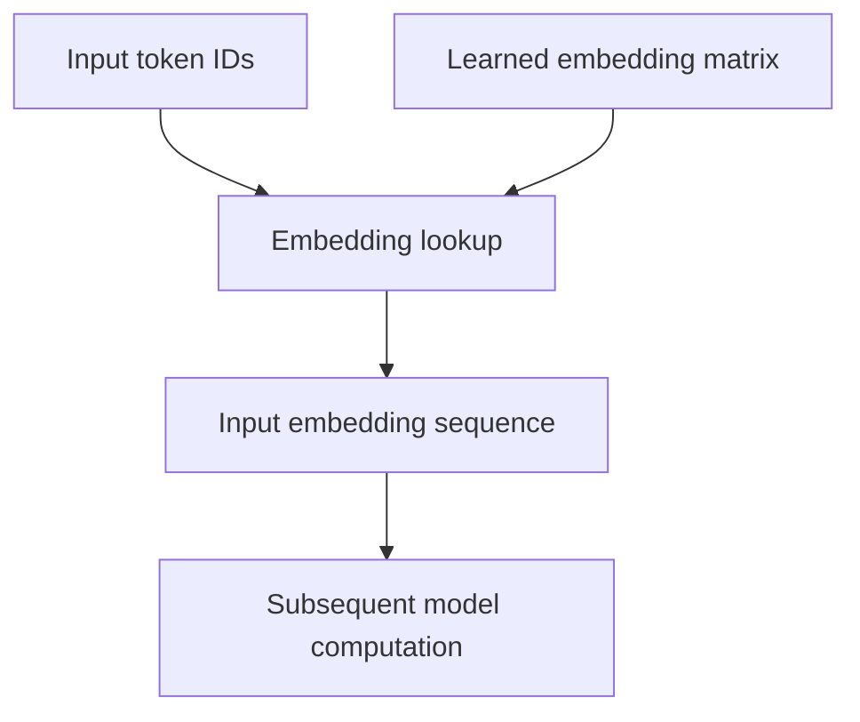

# From Token IDs to Learned Embeddings

## Learning Objectives

By the end of this chapter, you should be able to:

- Explain why token IDs are identifiers rather than meaningful numerical measurements.
- Distinguish token IDs from learned vector representations.
- Explain how an embedding table maps token IDs to vectors.
- Trace the transformation from token IDs to an input embedding sequence.
- Interpret basic embedding tensor shapes.
- Distinguish input token embeddings from contextual hidden states.
- Identify the assumptions and limitations of embedding lookup.

## Prerequisites

You should understand:

- Basic Python and numerical arrays.
- The difference between an integer and a vector.
- The idea of learned model parameters.
- The purpose of tokenization and token IDs.

Tokenization algorithms, vocabulary construction, and tokenizer behavior belong to **LLM-03 — Tokenization and Language Representation**. This chapter begins after token IDs are available.

**Estimated reading time:** 10 minutes

## 1. Why Language Models Need Embeddings

Consider the sentence:

> The model understands language.

A tokenizer converts text into a sequence of token IDs. For illustration, suppose the result is:

```python
token_ids = [42, 817, 291, 936]
```

These IDs are placeholders, not actual IDs from a particular tokenizer.

Token IDs identify vocabulary entries. Their numerical values do not inherently express linguistic relationships.

For example, suppose a vocabulary contains:

| Token | Token ID |
|---|---:|
| `cat` | 12 |
| `dog` | 13 |
| `airplane` | 900 |

The difference between IDs 12 and 13 is 1, while the difference between IDs 13 and 900 is 887. These arithmetic differences do not establish that `cat` and `dog` are more linguistically related.

Token IDs are identifiers, not measurements of meaning.

Neural language models therefore use learned vector representations as inputs to their numerical computations. An embedding layer provides a mechanism for mapping token IDs to those vectors.

**Core distinction:** A token ID identifies a vocabulary entry; an embedding provides a learned numerical representation associated with that entry.

## 2. Mental Model: A Learned Lookup Table

An embedding layer can be understood as an indexed table of vectors. Each valid token ID selects a row from the table.



The matrix contains learned parameters. During training, those parameters can be updated as part of the model's learning process.

The diagram describes the conceptual flow. Actual architectures may apply positional information or other transformations as part of the transition to subsequent model computation.

## 3. Core Concepts

### 3.1 The embedding matrix

Let:

- \(V\) be the vocabulary size.
- \(d\) be the embedding dimension.
- \(E\) be the input embedding matrix.

A conventional embedding matrix has shape:

\[
E \in \mathbb{R}^{V \times d}
\]

There are \(V\) rows, with each row containing \(d\) numerical values.

For a small illustrative model with vocabulary size \(V=10\) and embedding dimension \(d=4\), the matrix shape is:

\[
(10,4)
\]

Each valid token ID indexes a row and retrieves a vector containing four values.

Real models may use much larger vocabularies and embedding dimensions. Detailed parameter counts, memory requirements, and dimension-related trade-offs are covered in **Chapter 2 — Embedding Matrices, Parameters, and Tensor Shapes**.

### 3.2 Embedding lookup

Suppose token ID \(i\) indexes row \(i\) of the embedding matrix. The corresponding vector can be written as:

\[
\mathbf{e}_i = E[i]
\]

Here:

- \(i\) is a valid token ID.
- \(E[i]\) is the selected row.
- \(\mathbf{e}_i\) is the resulting vector of dimension \(d\).

For a sequence of token IDs,

\[
[i_1,i_2,\ldots,i_L]
\]

the lookup produces:

\[
[\mathbf{e}_{i_1},\mathbf{e}_{i_2},\ldots,\mathbf{e}_{i_L}]
\]

where \(L\) is the number of token positions.

The order of the tokens is preserved. Each token position receives the vector selected by its ID.

This operation is a lookup, not a fresh calculation of the token's meaning. The IDs must be valid indices for the embedding table being used.

### 3.3 Token IDs and input embeddings are different

| Property | Token ID | Input token embedding |
|---|---|---|
| Representation | Discrete integer | Vector of numerical values |
| Primary purpose | Identifies a vocabulary entry | Supplies a learned input representation |
| Typical structure | One integer per token position | One vector per token position |
| Learned model parameters? | The ID itself is not a model parameter | The vector values are stored as model parameters |
| Direct human-readable meaning? | No | Not guaranteed |

Embedding coordinates should not automatically be interpreted as explicit, human-readable properties. The vector is a learned representation used by the model, not a manually written definition of the token.

## 4. Internal Working: From IDs to Vectors

The basic transformation has four stages:

1. **Receive token IDs.** The model receives integer identifiers produced by the tokenizer.
2. **Select embedding rows.** Each valid ID indexes the corresponding row of the embedding matrix.
3. **Assemble the sequence.** The selected vectors are arranged in the original token order.
4. **Continue model computation.** The resulting input representations enter subsequent model components.

This lesson covers the embedding lookup and initial representation. Detailed Transformer architecture and positional-information mechanisms belong primarily to AIF-07.

### 4.1 Understanding tensor shapes

Suppose an input sequence contains \(L=3\) token positions and the embedding dimension is \(d=4\).

The token ID sequence has shape:

\[
(3)
\]

After embedding lookup, the sequence of vectors has shape:

\[
(3,4)
\]

This means there are three vectors, each containing four values.

For a batch containing \(B\) sequences, each with \(L\) token positions, a common shape convention is:

\[
(B,L,d)
\]

For example:

\[
(2,3,4)
\]

represents two sequences, three token positions per sequence, and four values per token representation.

This is a common convention, not a universal interface guarantee. Model APIs may use different dimension orders or expose additional dimensions. Inspect the actual tensor shape when working with a particular model.

## 5. Practical Example: Embedding Lookup from Scratch

The following NumPy example demonstrates the lookup mechanism without a deep-learning framework.

The values are manually specified for illustration. They are not trained embeddings and do not demonstrate representation quality.

```python
import numpy as np

# Five vocabulary entries, each represented by three values.
# These are illustrative values, not trained parameters.
embedding_matrix = np.array(
    [
        [0.1, 0.2, 0.3],   # Token ID 0
        [0.4, 0.5, 0.6],   # Token ID 1
        [0.7, 0.8, 0.9],   # Token ID 2
        [1.0, 1.1, 1.2],   # Token ID 3
        [1.3, 1.4, 1.5],   # Token ID 4
    ],
    dtype=np.float32,
)

token_ids = np.array([2, 0, 3])

# Select one row for each token ID.
input_embeddings = embedding_matrix[token_ids]

print("Embedding matrix shape:", embedding_matrix.shape)
print("Token IDs shape:", token_ids.shape)
print("Input embeddings shape:", input_embeddings.shape)
print(input_embeddings)
```

Expected shapes:

```text
Embedding matrix shape: (5, 3)
Token IDs shape: (3,)
Input embeddings shape: (3, 3)
```

The input sequence selects rows 2, 0, and 3, in that order. The result contains three vectors, each with three values.

### 5.1 Verify repeated-token behavior

Change the token IDs to:

```python
token_ids = np.array([2, 2, 3])
input_embeddings = embedding_matrix[token_ids]
```

The first two output vectors will be identical because both positions select row 2 from the same embedding matrix.

This behavior applies to the lookup operation when the same table and indexing configuration are used. It does not imply that the token's representations remain identical throughout the model.

## 6. Engineering Considerations

### 6.1 Why not explicitly construct one-hot vectors?

A token can also be represented by a one-hot vector containing one nonzero entry at the position corresponding to its vocabulary index.

A one-hot vector identifies a vocabulary entry, but it does not itself provide learned relationships between tokens. Multiplying a one-hot row vector by an embedding matrix can produce the same result as selecting the corresponding row.

Implementations can perform the lookup directly without explicitly constructing a one-hot vector.

### 6.2 Vocabulary and model compatibility

An embedding matrix's rows have meaning relative to the vocabulary and token-ID mapping expected by the model.

If a tokenizer or vocabulary configuration changes, token IDs may no longer correspond to the rows expected by the model. Such changes require appropriate handling of the tokenizer/model interface and relevant model parameters.

Detailed tokenizer behavior and compatibility belong to LLM-03. The engineering principle here is that **the lookup table and the token-ID mapping must agree**.

### 6.3 Internal embeddings versus retrieval embeddings

An input embedding belongs to a language model's internal computation. A retrieval embedding is produced or selected for a retrieval task, such as matching queries with documents.

Both are vectors, but their purposes and evaluation requirements may differ. A language model's input embedding should not automatically be treated as a ready-made retrieval representation.

Retrieval-specific embedding models, query-document pipelines, and vector databases belong to RET.

## 7. Common Mistakes and Misconceptions

### Mistake 1: Treating token IDs as meaningful numerical measurements

**Incorrect:** Token ID 100 must be more similar to token ID 101 than to token ID 900.

**Correction:** Token IDs identify vocabulary entries. Their numerical distances do not establish linguistic similarity.

### Mistake 2: Treating embeddings as human-readable definitions

**Incorrect:** Every coordinate directly represents a property such as sentiment, tense, or object type.

**Correction:** Embedding coordinates are learned parameters. Their interpretation is not generally a direct, stable mapping to human-readable features.

### Mistake 3: Assuming the input embedding is the final representation

**Incorrect:** The vector retrieved from the embedding table is everything the model represents about the token.

**Correction:** The input embedding is an early representation. Subsequent computation can produce contextual hidden states that depend on the surrounding sequence.

### Mistake 4: Assuming repeated tokens remain identical throughout the model

**Incorrect:** Two occurrences of the same token must have identical representations at every layer.

**Correction:** They may retrieve the same initial vector but acquire different contextual hidden states.

### Mistake 5: Treating illustrative vectors as evidence of quality

**Incorrect:** A manually specified matrix demonstrates that a model has learned useful linguistic relationships.

**Correction:** A lookup example demonstrates indexing and tensor shapes, not representation quality.

### Mistake 6: Confusing internal embeddings with retrieval embeddings

**Incorrect:** Any vector from a language model can automatically be used for semantic retrieval.

**Correction:** Suitability depends on the representation, task, and evaluation. Retrieval-specific engineering belongs to RET.

## 8. Interview Questions with Expected Answers

### Question 1: Why does a language model use an embedding layer?

**Expected answer:** Token IDs are discrete identifiers, not learned numerical representations. An embedding layer maps each valid ID to a trainable vector that can be processed by subsequent model components.

### Question 2: What is the shape of a conventional embedding matrix?

**Expected answer:** For vocabulary size \(V\) and embedding dimension \(d\), the matrix has shape \((V,d)\). Each row contains one token's vector.

### Question 3: What happens when the same token ID occurs twice in a sequence?

**Expected answer:** The same embedding table returns the same row for both occurrences. Subsequent model computation can produce different contextual hidden states.

### Question 4: Does an embedding vector directly define a token's meaning?

**Expected answer:** No. It is a learned numerical representation. Its dimensions are not generally guaranteed to correspond to individually interpretable linguistic properties.

### Question 5: Why must the tokenizer and model remain compatible?

**Expected answer:** The token ID indexes a row in the model's embedding table. If the token-ID mapping and model parameters disagree, the selected row may not represent the intended token.

### Question 6: Are input token embeddings and retrieval embeddings interchangeable?

**Expected answer:** Not automatically. They serve different roles and may be trained or evaluated differently. Retrieval representations must be suitable for the intended retrieval task.

## 9. Quick Revision

- Token IDs identify vocabulary entries; their numerical distances do not express meaning.
- An embedding lookup selects a learned vector using a token ID as an index.
- A conventional embedding matrix has shape \((V,d)\).
- A sequence of \(L\) token IDs produces \(L\) input vectors.
- A common batched representation shape is \((B,L,d)\).
- The same ID retrieves the same row when the same embedding table and lookup configuration are used.
- Subsequent model computation can produce context-dependent hidden states.
- Input embeddings, contextual hidden states, and retrieval embeddings are distinct concepts.
- Demonstrating lookup mechanics does not establish representation quality.

## 10. Key Takeaways

The essential engineering model is:

**Token IDs provide identity → embedding lookup provides learned input vectors → subsequent model computation produces contextual representations.**

This distinction is foundational for understanding how language models represent input and process sequences.

The next chapter examines the embedding matrix as a model component, including its dimensions, parameter counts, storage requirements, and relationship to output vocabulary projections.

## Further Reading

- [LLM-04 README — Embedding Systems in Language Models](README.md)
- [Chapter 2 — Embedding Matrices, Parameters, and Tensor Shapes](02-Embedding-Matrices-Parameters-and-Tensor-Shapes.md)

Related curriculum topics include LLM-03 (tokenization and language representation), AIF-05 (representation learning), AIF-07 (Transformer foundations), LLM-02 (language-model training), and RET (retrieval engineering).

Verify the repository paths for adjacent curriculum documents before adding direct links to them.
