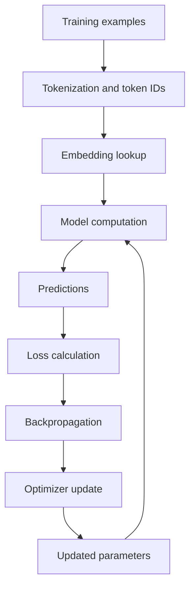

# How Embedding Representations Are Learned

## Learning Objectives

By the end of this chapter, you should be able to:

- Explain how token embedding vectors become learned parameters rather than manually assigned features.
- Describe how embedding parameters are updated through gradient-based training.
- Explain how training objectives influence the representations a model learns.
- Distinguish gradient calculation, gradient values, and optimizer-driven parameter updates.
- Explain why token embeddings are shaped by training data and objectives rather than predefined semantic rules.
- Understand how pretraining and subsequent training stages can influence embedding representations.
- Inspect gradients and parameter changes in a trainable embedding table using PyTorch.

**Estimated reading time:** 14–17 minutes

## 1. From a Lookup Table to Learned Representations

The previous chapters established that a token embedding matrix maps vocabulary IDs to vectors and that its entries are model parameters.

The next question is: **Where do the embedding values come from, and why should they be useful?**

Embedding parameters are initialized before meaningful training begins. During training, the model repeatedly processes examples, produces predictions, evaluates a learning objective, and updates parameters to improve that objective.

A token embedding table is not a dictionary of manually written definitions. Its values are numerical parameters shaped by training.

For example, a model may learn useful relationships between tokens such as `doctor` and `hospital` because they participate in related contexts and prediction patterns. No explicit rule requires those tokens to receive particular vectors or to become nearest neighbors.

The representations that emerge depend on the training data, objective, architecture, and optimization process.

## 2. How Embedding Parameters Begin

For vocabulary size \(V\) and embedding dimension \(d\), a conventional embedding matrix has shape:

\[
E \in \mathbb{R}^{V \times d}
\]

Each row corresponds to a vocabulary entry. Initially, the values are generally initialized using a method chosen for the model and its architecture.

Initialization provides starting values for optimization. It does not, by itself, establish the useful linguistic relationships that the model is expected to learn.

### 2.1 Why learn embeddings instead of manually defining them?

Manually designing meaningful numerical features for every token would be difficult to scale and would require someone to anticipate the relationships useful across many tasks and contexts.

Learned embeddings provide a different approach:

1. Initialize trainable vectors.
2. Process training examples.
3. Calculate how well the model performs its objective.
4. Compute gradients indicating how the loss depends on parameters.
5. Apply optimizer updates.
6. Repeat across training steps.

This process allows representations to develop from data instead of relying entirely on manually specified token features.

## 3. The Learning Loop

Embedding learning is part of the broader model-training process. The embedding table is normally trained alongside other parameters that participate in the model's computation.



The diagram shows the conceptual flow. In an actual training implementation, gradients may be accumulated across multiple batches before the optimizer updates parameters.

### 3.1 Forward computation

The model receives token IDs, looks up the corresponding embeddings, and processes them through subsequent model components.

It produces predictions relevant to the training objective.

### 3.2 Loss calculation

A loss function measures the discrepancy between the model's predictions and the training targets or another specified learning signal.

The loss provides a numerical objective that optimization attempts to improve. A low training loss does not automatically guarantee good generalization.

### 3.3 Backpropagation

Backpropagation calculates gradients that describe how the loss changes with respect to trainable parameters.

For the embedding matrix, the gradient indicates how changes to its values would affect the loss under the current computation.

### 3.4 Optimizer update

The optimizer uses the gradients and its configured update rule to adjust parameters.

**Gradient calculation and parameter updating are separate operations.** A parameter can receive a gradient without changing—for example, if its gradient is zero, the parameter is frozen, or it is excluded from the optimizer. Some optimizer configurations can also change parameters through mechanisms such as weight decay.

This distinction matters when debugging a model whose embedding weights appear not to change during training.

## 4. Understanding the Gradient

Let the model's loss be represented by \(\mathcal{L}\), and let \(E\) be its embedding matrix.

Backpropagation computes:

\[
\frac{\partial \mathcal{L}}{\partial E}
\]

The gradient has the same shape as the embedding matrix:

\[
\frac{\partial \mathcal{L}}{\partial E}
\in \mathbb{R}^{V \times d}
\]

Each element describes the local sensitivity of the loss to the corresponding embedding parameter.

A simple gradient-descent update is:

\[
E_{\text{new}} =
E_{\text{old}} -
\eta \frac{\partial \mathcal{L}}{\partial E}
\]

where \(\eta\) is the learning rate.

This equation illustrates the basic principle. Production training commonly uses optimizers such as Adam or AdamW, which can maintain additional state and apply more sophisticated update rules.

### 4.1 A numerical example

Suppose a single embedding parameter has the current value:

\[
e=0.40
\]

Its gradient is:

\[
\frac{\partial \mathcal{L}}{\partial e}=0.20
\]

The learning rate is:

\[
\eta=0.10
\]

A simple gradient-descent update gives:

\[
e_{\text{new}}=0.40-(0.10 \times 0.20)=0.38
\]

The parameter decreases from \(0.40\) to \(0.38\).

This example illustrates the arithmetic of gradient descent. It does not imply that every parameter decreases, that every individual update improves performance on every example, or that a production optimizer must use this exact rule.

The optimizer attempts to improve the chosen objective across training, not to move each parameter in a predetermined direction.

## 5. How Token Embeddings Receive Learning Signals

An embedding vector affects the model's output through the computations that follow the lookup.

If a token embedding contributes to a prediction, the loss can generate a gradient that propagates backward through those computations to the embedding parameters.

The resulting gradient depends on the complete computation path, including the other tokens, model parameters, and training objective.

The core mental model is:

**An embedding is learned because it participates in a trainable computation whose objective supplies a learning signal.**

### 5.1 Repeated occurrences

If a token appears multiple times in a training batch, the same embedding row can contribute to multiple positions in the forward computation.

The gradient contributions from those occurrences are combined by the backward computation. The exact aggregation depends on the loss reduction, framework, and training implementation.

The vocabulary entry shares its parameters across occurrences. The model does not normally create a separate permanent embedding row for each occurrence.

### 5.2 Rows unused by a batch

An embedding table can contain many vocabulary entries, while a particular batch uses only a subset.

With a standard embedding lookup and dense gradients, rows not selected by the batch typically receive zero lookup-derived gradient contributions from that batch. Sparse-gradient configurations and other computation paths can change how gradients are represented.

A row receiving a gradient also does not guarantee that its parameters will change: the gradient may be zero, or the parameter may not be updated by the configured training process.

## 6. The Training Objective Shapes What Is Learned

The training objective is one of the main influences on learned representations.

An embedding table does not have a universal, predefined definition of what each vector must mean. Its representations develop in the context of the objective the model is trained to optimize.

Different objectives can encourage different properties, even when models use similar dimensions or architectures.

### 6.1 Next-token prediction

Many autoregressive language models are trained to predict the next token given preceding tokens.

For example:

```text
Input context: The engineer opened the
Target token: laptop
```

The model attempts to assign an appropriate probability to the next token given the available context.

Across many examples, the model learns representations and other parameters that support next-token prediction. Embedding updates are part of this process: their useful properties emerge through their contribution to the model's predictions.

This is an illustrative example. Real training sequences commonly contain multiple prediction positions and targets.

### 6.2 Other learning objectives

Other objectives can encourage different representational properties. Examples include masked-token prediction, supervised classification, and contrastive learning.

These objectives do not optimize the same quantity or provide identical learning signals. A representation learned under one objective should not automatically be assumed to have the same properties as a representation learned under another.

Detailed training paradigms belong to the broader language-model training curriculum. The key point here is that the objective influences which representations become useful to the model.

## 7. Why Related Tokens May Develop Related Representations

Tokens appear in statistical patterns. During training, the model encounters words and subword units in different contexts and must use their representations to support the objective.

Tokens that occur in related contexts can develop related representations because those relationships may help the model perform its task.

For example, tokens associated with medical settings may appear in contexts involving patients, treatment, diagnosis, and hospitals. A model trained on informative data may learn relationships among those tokens.

However:

- Related context does not guarantee that two vectors will be nearest neighbors.
- Similarity depends on the learned geometry and the metric used.
- A token can have multiple meanings depending on context.
- The initial token embedding differs from the contextual representation produced later in the model.
- Learned relationships can reflect noise, biases, or limitations in training data.

Avoid interpreting every geometric relationship as a clean, human-readable semantic fact.

The training process optimizes the chosen objective; human interpretability is not guaranteed.

## 8. Token Embeddings and Contextual Representations

A token embedding table normally provides a shared initial vector for each vocabulary entry.

For a given token ID, lookup retrieves the corresponding vector regardless of where that token occurs. Subsequent model computation can incorporate surrounding sequence information and produce contextual representations.

Consider `bank`:

- “She deposited money at the bank.”
- “They sat on the river bank.”

If both occurrences use the same token ID, the initial embedding lookup is shared. Subsequent computation can produce different contextual representations because the surrounding tokens differ.

| Representation | How it is obtained | What influences it |
|---|---|---|
| Token embedding | Lookup from the embedding table | Learned parameters associated with the token ID |
| Contextual hidden state | Computation through subsequent model layers | Initial embeddings, context, positions, and model computation |

A contextual hidden state is not simply another name for the embedding-table row.

The architectural details of this transformation belong to Chapter 4.

## 9. How Later Training Can Change Embeddings

Embedding representations are not necessarily fixed after initial pretraining.

During additional training, embedding parameters can change if they are trainable, participate in the computation, and are updated by the training process.

For example, supervised fine-tuning may adjust parameters to improve performance on a particular set of tasks or instructions. Depending on the configuration, some parameters may be frozen while others are updated.

The embedding table therefore reflects the model's training history rather than a single universal source of semantic truth.

Two models can use the same tokenizer and embedding dimension yet have different embedding values because of differences in data, objectives, initialization, and optimization.

Matching tensor shapes alone does not establish that two embedding tables are interchangeable. The tokenizer and model must be compatible, and the learned parameters must have the expected meaning within the model's computation.

Detailed fine-tuning and alignment strategies belong to LLM-02. This chapter focuses on how training influences embedding representations.

## 10. Practical Experiment: Gradient Flow and Parameter Updates

The following PyTorch experiment demonstrates that embedding parameters can receive gradients and change after an optimizer step.

The toy objective encourages selected vector values toward zero. It is deliberately simple so that gradient flow is easy to inspect; it is not a suitable general-purpose language-model training objective.

```python
import torch
import torch.nn as nn

torch.manual_seed(7)

vocab_size = 6
embedding_dim = 4

embedding = nn.Embedding(vocab_size, embedding_dim)
optimizer = torch.optim.SGD(embedding.parameters(), lr=0.1)

token_ids = torch.tensor([1, 3, 1], dtype=torch.long)

# Snapshot the parameter values before the update.
weights_before = embedding.weight.detach().clone()

# Forward computation.
vectors = embedding(token_ids)
loss = vectors.pow(2).mean()

print("Embedding table shape:", embedding.weight.shape)
print("Selected vectors shape:", vectors.shape)
print("Loss before update:", loss.item())

# Compute gradients.
optimizer.zero_grad()
loss.backward()

gradient = embedding.weight.grad

print("Gradient exists:", gradient is not None)
print("Gradient shape:", gradient.shape)
print("Row 1 gradient norm:", gradient[1].norm().item())
print("Row 3 gradient norm:", gradient[3].norm().item())
print("Row 0 gradient norm:", gradient[0].norm().item())

# Apply the optimizer update.
optimizer.step()

# Verify which parameter values changed.
weights_after = embedding.weight.detach()
row_change = (weights_after - weights_before).norm(dim=1)

print("Row-wise parameter changes:", row_change)
print("Row 1 changed:", row_change[1].item() > 0)
print("Row 3 changed:", row_change[3].item() > 0)
print("Row 0 changed:", row_change[0].item() > 0)
```

### 10.1 What the experiment should demonstrate

With this standard dense-gradient embedding layer and the stated loss:

- The embedding table has shape `(6, 4)`.
- The selected-vector tensor has shape `(3, 4)`.
- Token ID `1` occurs twice, so its row contributes at two positions.
- Token ID `3` occurs once, so its row contributes at one position.
- Rows `1` and `3` receive gradient contributions from this lookup.
- Row `0`, which is not selected, receives no direct gradient contribution from this batch.
- The optimizer updates the selected rows when their gradients are nonzero.

The numerical values depend on the initialization, but the expected gradient and update behavior follows from the example's computation.

This experiment distinguishes three things that should not be conflated:

1. **Gradient existence:** a gradient tensor was produced.
2. **Gradient contribution:** a particular row received a nonzero gradient.
3. **Parameter change:** the optimizer actually changed that row's values.

In real systems, inspect all three when debugging training behavior. A non-null gradient tensor alone does not prove that every parameter received a useful gradient or changed.

## 11. Common Misconceptions

### Misconception 1: Embedding vectors are manually assigned meanings

**Correction:** Their values are learned through training. A dimension does not normally correspond to a manually defined feature such as “professionalism” or “friendliness.”

### Misconception 2: Similar words must always have nearby token embeddings

**Correction:** Related usage patterns can influence learned relationships, but nearest-neighbor structure is not guaranteed to match human intuition.

### Misconception 3: The embedding table alone understands context

**Correction:** The table supplies initial token representations. Contextual information is incorporated through subsequent model computation.

### Misconception 4: Every embedding row changes on every training step

**Correction:** A batch typically uses only some vocabulary entries. Unused rows generally receive no direct lookup-derived gradient contribution from that batch.

### Misconception 5: Every nonzero gradient guarantees a parameter change

**Correction:** Parameters can be frozen, excluded from the optimizer, or affected by update configuration. Inspect the optimizer and actual parameter values.

### Misconception 6: Any loss function will produce useful language representations

**Correction:** Optimization follows the chosen objective. Minimizing a loss does not guarantee representations suitable for every downstream application.

### Misconception 7: Fine-tuning always changes every embedding parameter

**Correction:** Updates depend on trainability, gradient flow, and optimizer configuration.

### Misconception 8: The embedding dimension determines semantic quality

**Correction:** Dimension is one architectural choice. Quality depends on interacting factors such as data, objective, architecture, and optimization.

## 12. Engineering Questions

Use these questions to test your reasoning rather than memorize terminology.

### Question 1: Gradient aggregation

A token appears three times in a training batch. Explain how those occurrences can contribute to updates of the same embedding row. What happens to a row that is not used by the batch?

### Question 2: Objective dependence

Two models use the same vocabulary and embedding dimension but are trained with different objectives. Explain why their embedding tables may differ and why identical shapes do not imply interchangeable representations.

### Question 3: Debugging unchanged weights

A developer observes that an embedding table's values never change during training.

Describe what you would inspect to determine whether the table is trainable, receives gradients, and is included in the optimizer's update process. Explain why checking only whether `.grad` is non-null is insufficient.

### Question 4: Context

Explain how the same token can use the same initial embedding vector in two different sentences yet produce different contextual hidden states.

### Question 5: Experimental design

Design a small experiment that compares embedding weights before and after an optimizer step. State what you would hold constant and what evidence would convince you that the update occurred.

## 13. Quick Revision

- Embedding vectors are trainable parameters, not manually assigned definitions.
- Initialization provides starting values; training shapes the learned representations.
- The training loop connects examples, predictions, loss, backpropagation, and optimizer updates.
- The embedding gradient has the same shape as the embedding matrix.
- A shared embedding row can receive gradient contributions from multiple occurrences of its token.
- Unused rows generally receive no direct lookup-derived gradient contribution from that batch.
- A gradient being present does not guarantee a parameter update.
- Training objectives influence which representations become useful.
- Initial token embeddings and contextual hidden states are different representations.
- Fine-tuning can modify embedding parameters when they are trainable and updated.
- Learned geometric relationships are not guaranteed to be human-interpretable semantic definitions.

## 14. Key Takeaways

An embedding table becomes useful through learning. Its initial values are only a starting point; the training objective and gradient-based optimization shape those values over time.

The learning signal reaches embedding parameters through the model computations that depend on them. Repeated token occurrences share vocabulary-indexed parameters, while context influences the gradients generated by the overall training process.

The central engineering distinction is between the **parameter being learned**, the **objective supplying the learning signal**, the **gradient calculated by backpropagation**, and the **optimizer update applied to the parameter**.

Understanding these relationships is necessary before reasoning about embedding geometry or the role of embeddings in the complete model architecture.

## Further Reading

- [LLM-04: Embedding Systems in Language Models — Overview](README.md)
- [Chapter 1: From Token IDs to Learned Embeddings](01-From-Token-IDs-to-Learned-Embeddings.md)
- [Chapter 2: Embedding Matrices, Parameters, and Tensor Shapes](02-Embedding-Matrices-Parameters-and-Tensor-Shapes.md)
- [Chapter 4: Embeddings in Model Architecture and Representation Flow](04-Embeddings-in-Model-Architecture-and-Representation-Flow.md)

## Completion Criteria

- [ ] Explain how initialization differs from learning.
- [ ] Trace the training loop from examples to parameter updates.
- [ ] Explain what the embedding gradient represents.
- [ ] Describe how repeated token occurrences contribute to shared embedding parameters.
- [ ] Explain why the training objective influences learned representations.
- [ ] Distinguish initial token embeddings from contextual hidden states.
- [ ] Demonstrate gradient flow to a trainable embedding table in PyTorch.
- [ ] Verify parameter changes by comparing weights before and after an optimizer step.
- [ ] Explain why a representation's learned geometry is not guaranteed to be a human-readable semantic definition.
