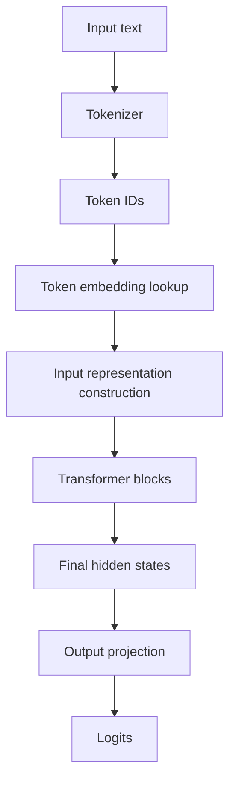
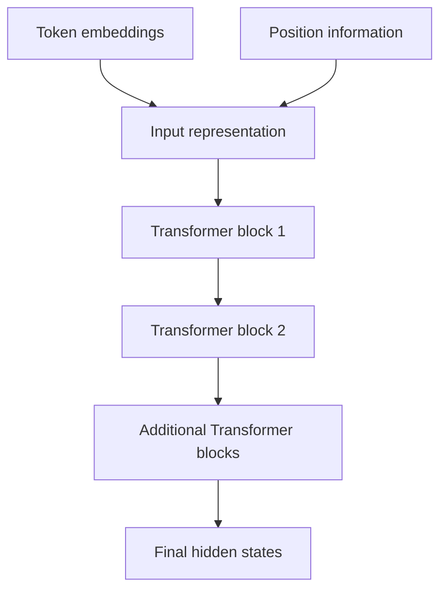

# Embeddings in Model Architecture and Representation Flow

## Learning Objectives

By the end of this chapter, you should be able to:

- Explain where token embeddings enter a language model's computation pipeline.
- Trace the transformation from token IDs to input representations, hidden states, and model outputs.
- Distinguish token embeddings, positional information, contextual hidden states, and output logits.
- Explain why embedding dimensions must be compatible with subsequent model components.
- Understand how token representations evolve through a Transformer.
- Recognize architectural variations without assuming every language model uses an identical embedding pipeline.
- Inspect representation shapes and intermediate outputs in a small PyTorch model.

**Estimated reading time:** 14–17 minutes

## 1. Why Embeddings Must Be Understood in Context

An embedding table is not the entire language model. It is an early component in a larger computation pipeline.

Chapter 1 established how token IDs select learned vectors. Chapter 2 examined embedding dimensions and parameter costs. Chapter 3 explained how training shapes embedding values.

This chapter connects those ideas to model architecture.

The central question is:

**What happens to a token embedding after the model retrieves it?**

In a typical Transformer-based language model, token embeddings become input representations that subsequent components transform into hidden states. Those hidden states are used to produce predictions appropriate to the model's objective or inference interface.

A simplified view is:



This describes a common language-model pipeline. Exact components, tensor layouts, and processing steps vary by architecture.

## 2. From Token IDs to Input Representations

The tokenizer converts input text into token IDs. The embedding layer maps those discrete IDs to learned vectors.

Let:

- \(B\) be batch size.
- \(L\) be sequence length.
- \(V\) be vocabulary size.
- \(d\) be the token embedding dimension.

For a batch-first implementation, the token-ID tensor commonly has shape:

\[
X \in \mathbb{Z}^{B \times L}
\]

The embedding matrix has shape:

\[
E \in \mathbb{R}^{V \times d}
\]

Looking up the token IDs produces:

\[
X_{\text{emb}} \in \mathbb{R}^{B \times L \times d}
\]

Each token position now has a vector of width \(d\).

The embedding layer changes the input representation, but it does not by itself perform the full contextual processing of a language model.

### 2.1 Why the embedding output is not the final representation

Consider the sentence:

> The engineer deployed the model.

At lookup time, each token ID retrieves its corresponding embedding vector. The initial lookup represents each token through its learned vocabulary entry.

The lookup alone has not incorporated the complete sentence context through Transformer self-attention. Subsequent components transform the sequence representations so that each position can incorporate information from other positions according to the architecture's attention and masking rules.

This distinguishes an initial token representation from a contextual hidden state produced by later computation.

## 3. Position Information and Sequence Order

Token embeddings identify learned representations associated with token IDs. A sequence model must also represent the order in which tokens occur.

Consider:

- `The dog chased the cat.`
- `The cat chased the dog.`

The same vocabulary entries may appear in both sentences, but their order changes the meaning.

A model therefore needs a mechanism for incorporating positional or sequence-order information.

Depending on the architecture, position information can be represented through mechanisms such as:

- Absolute positional embeddings.
- Relative positional representations.
- Rotary positional embeddings.
- Other architecture-specific mechanisms.

These mechanisms are not interchangeable implementations of one identical operation. They incorporate positional information in different ways.

### 3.1 Combining token and position representations

Some architectures construct input representations by adding token embeddings and learned or fixed positional embeddings.

In a simplified additive implementation:

\[
H^{(0)} = E_{\text{token}} + E_{\text{position}}
\]

For this addition to work directly, the tensors must have compatible shapes and broadcasting behavior.

This is an architectural example, not a universal rule. Some models incorporate positional information inside attention computations rather than adding a separate positional vector to every token embedding.

The important principle is that **token identity and sequence position are distinct sources of information**, even when an architecture combines them within a representation.

### 3.2 Position mechanisms affect implementation choices

Do not assume that a separate positional embedding table must exist.

For example, a model using rotary positional embeddings may apply positional transformations within attention computations. Looking only for a learned position-embedding matrix would therefore give an incomplete view of how position is represented.

Detailed positional encoding mathematics belongs to the Transformer architecture foundations in AIF-07. Here, the focus is on how position mechanisms relate to the embedding stage.

## 4. From Input Representations to Transformer Hidden States

After input representations are constructed, the model processes them through its architectural components.

In a typical Transformer language model, these components include multiple Transformer blocks. Each block transforms sequence representations using attention, feed-forward computation, and associated normalization or residual pathways.

The exact ordering and implementation details vary across architectures.

A simplified representation flow is:



### 4.1 Hidden states

Let the initial representation sequence be:

\[
H^{(0)} \in \mathbb{R}^{B \times L \times d}
\]

For an architecture that preserves hidden width through its Transformer blocks, the representations may be expressed as:

\[
H^{(1)} = \operatorname{Block}_1(H^{(0)})
\]

\[
H^{(2)} = \operatorname{Block}_2(H^{(1)})
\]

and, more generally:

\[
H^{(k)} = \operatorname{Block}_k(H^{(k-1)})
\]

These equations describe the conceptual transformation from one block to the next. Actual implementations may include masks, caches, normalization steps, or specialized operations.

In many standard decoder-only Transformers, sequence and hidden dimensions remain compatible across blocks. Other architectures may use projections or different internal dimensions.

### 4.2 What changes through the layers?

The initial embedding provides a learned representation associated with the token ID. Subsequent computation can incorporate information from other tokens, position mechanisms, and learned model transformations.

As a result, hidden states can reflect contextual relationships that are not present in the initial embedding lookup alone.

For example, the representation of `bank` may differ after contextual processing in:

- `She deposited money at the bank.`
- `They sat beside the river bank.`

The initial lookup can be shared if both occurrences use the same token ID. The later hidden states can differ because the model processes different contexts.

This does not imply that every hidden-state dimension has a simple, human-interpretable meaning. These are learned internal representations, not necessarily explicit symbolic features.

## 5. The Relationship Between Hidden Width and Embedding Dimension

In many language models, the token embedding dimension matches the hidden-state dimension used by the Transformer blocks.

If both dimensions equal \(d\), the embedding output can feed directly into the first block without a width-changing projection.

However, matching dimensions are an architectural choice rather than a universal law.

An architecture can use an embedding dimension \(d_e\) and a hidden dimension \(d_h\), with a projection connecting them:

\[
H^{(0)} = X_{\text{emb}} W
\]

where, for a simplified linear projection:

\[
W \in \mathbb{R}^{d_e \times d_h}
\]

The resulting representation has shape:

\[
H^{(0)} \in \mathbb{R}^{B \times L \times d_h}
\]

This illustrates one possible architecture. It does not imply that every model with different dimensions uses exactly this projection or parameterization.

### 5.1 Why engineers should inspect this boundary

A model integration can fail if one component produces a representation with a width that the next component does not accept.

For example, a component expecting vectors of width 1,024 cannot directly consume vectors of width 768 through an operation that requires matching feature dimensions.

The correct solution depends on the architecture. It may involve using the intended model component, applying the expected projection, or correcting a configuration mismatch.

Do not resolve a dimension mismatch by arbitrarily reshaping a tensor. Reshaping changes how values are arranged; it does not automatically implement the intended learned transformation.

## 6. From Hidden States to Logits

For a language model that predicts vocabulary tokens, final hidden states are typically transformed into vocabulary-sized scores called logits.

A simplified output projection is:

\[
Z = HW_{\text{out}} + b
\]

where:

- \(H\) represents the relevant final hidden states.
- \(W_{\text{out}}\) represents output-projection weights.
- \(b\) is an optional bias.
- \(Z\) represents the logits.

If the hidden width is \(d_h\) and the output vocabulary has size \(V\), the mathematical projection can be written with weights shaped:

\[
W_{\text{out}} \in \mathbb{R}^{d_h \times V}
\]

For a batch-first sequence representation, the logits commonly have shape:

\[
Z \in \mathbb{R}^{B \times L \times V}
\]

Each position has a score for every vocabulary entry.

### 6.1 Mathematical orientation versus framework storage

The matrix orientation in the equation above is a mathematical convention: hidden vectors multiply the output-projection matrix to produce vocabulary-sized scores.

Frameworks can store a linear layer's parameters using a different orientation. For example, PyTorch's `nn.Linear(in_features=d_h, out_features=V)` stores its weight tensor with shape:

\[
(V,d_h)
\]

PyTorch applies the equivalent linear transformation using that storage convention.

Therefore, a stored weight shape of \((V,d_h)\) does not contradict the mathematical projection written with a matrix shaped \((d_h,V)\). When inspecting a model, distinguish the mathematical operation from the framework's parameter-storage layout.

The exact output interface depends on the model. Some models expose logits directly, while task-specific architectures may use different output heads.

### 6.2 Logits are not probabilities

Logits are unnormalized scores. They are not probabilities and are not embedding vectors.

A probability distribution can be derived from logits using a normalization operation such as softmax when appropriate:

\[
p_i = \frac{\exp(z_i)}{\sum_j \exp(z_j)}
\]

The resulting probabilities can be used by a decoding procedure to select or sample a token.

Detailed generation, decoding strategies, and inference behavior belong to LLM-05. Here, the important architectural boundary is that the output projection transforms hidden representations into prediction scores.

## 7. Input Embeddings and Output Embeddings

The input embedding table and output vocabulary projection serve different architectural roles.

- **Input embedding table:** maps token IDs to learned vectors.
- **Output projection:** maps hidden states to vocabulary-sized scores.

Some language models tie the input embedding weights to the output projection weights. Weight tying can reduce the number of independent parameters and impose a shared parameterization between input representations and output scoring.

Other architectures use separate parameters.

Weight tying is an architectural choice, not a requirement of embedding lookup.

When inspecting a model, verify whether the weights are shared rather than assuming that the input and output components must be identical or independent.

This distinction also prevents a common mistake: interpreting an output vocabulary score vector as if it were the token's input embedding.

## 8. A Practical Representation-Flow Experiment

The following small PyTorch model demonstrates the shapes at three stages:

1. Token IDs.
2. Token embeddings.
3. Vocabulary logits.

It is deliberately simplified. It does not implement a Transformer, attention, or positional encoding. Its purpose is to make the dimensional relationships explicit.

```python
import torch
import torch.nn as nn

torch.manual_seed(7)

vocab_size = 20
embedding_dim = 8
batch_size = 2
sequence_length = 4

embedding = nn.Embedding(vocab_size, embedding_dim)
output_projection = nn.Linear(embedding_dim, vocab_size)

token_ids = torch.tensor(
    [
        [1, 5, 7, 2],
        [3, 4, 8, 6],
    ],
    dtype=torch.long,
)

# Stage 1: discrete token IDs.
print("Token IDs:", token_ids.shape)

# Stage 2: initial token representations.
token_embeddings = embedding(token_ids)
print("Token embeddings:", token_embeddings.shape)

# Stage 3: vocabulary-sized prediction scores.
logits = output_projection(token_embeddings)
print("Logits:", logits.shape)

print("Stored output weight:", output_projection.weight.shape)
```

Expected shapes:

```text
Token IDs: torch.Size([2, 4])
Token embeddings: torch.Size([2, 4, 8])
Logits: torch.Size([2, 4, 20])
Stored output weight: torch.Size([20, 8])
```

### 8.1 Interpreting the output

The token-ID tensor contains two sequences with four positions each.

The embedding layer maps every ID to a vector of width eight, producing shape \((2,4,8)\).

The linear output layer maps each eight-dimensional vector to 20 scores, producing shape \((2,4,20)\).

The stored PyTorch weight shape \((20,8)\) is consistent with `nn.Linear(in_features=8, out_features=20)`.

The model demonstrates the interface between embedding lookup and a vocabulary-sized output projection. Because it has no contextual layers, each position's output depends only on its corresponding initial embedding and the output projection.

A real autoregressive language model uses contextual processing and appropriate attention constraints before producing next-token logits.

### 8.2 Inspecting a standard Transformer model

When inspecting a pretrained model, use its supported model interface and configuration rather than assuming all internal modules share identical names.

Useful questions include:

- What is the vocabulary size?
- What is the input embedding dimension?
- What hidden width do the Transformer blocks expect?
- How does the architecture incorporate positional information?
- Does the model use a projection between embedding and hidden dimensions?
- What shape does the model return for logits?
- Are input and output embedding weights tied?

These questions establish the representation-flow contract before modifying or integrating a model.

## 9. Architecture Variations and Their Implications

Not all language models follow exactly the same internal path.

### 9.1 Decoder-only models

Many autoregressive language models use token embeddings, positional mechanisms, decoder Transformer blocks, and an output projection for vocabulary prediction.

Their attention configuration ensures that predictions respect the model's autoregressive constraints during ordinary causal language modeling.

### 9.2 Encoder-based models

Encoder architectures also use token embeddings and position information, but their outputs may be consumed by task-specific heads or other components rather than a next-token generation head.

For example, encoder representations may be used for classification or token-level prediction.

The input embedding concept is shared, but the downstream purpose differs.

### 9.3 Models with different embedding and hidden dimensions

Some architectures use distinct embedding and hidden dimensions, potentially with projections connecting them.

This affects parameter counts, tensor shapes, and component compatibility. The model configuration and actual module interfaces should be treated as the source of truth.

### 9.4 Multimodal models

Multimodal models can combine text with representations produced from images, audio, or other modalities. The architecture may include modality-specific encoders, projection layers, or mechanisms for integrating different representation types.

Do not assume that every input to a multimodal model begins as a row lookup from a text-token embedding table. The broader multimodal model landscape is covered elsewhere in the LLM curriculum.

## 10. Common Engineering Mistakes

1. Treating embedding lookup as the complete model representation.
2. Assuming position is always represented by a separate embedding table.
3. Assuming embedding dimension must equal hidden dimension.
4. Reshaping tensors to hide dimension mismatches.
5. Confusing hidden states with logits.
6. Treating logits as probabilities.
7. Assuming input and output embedding weights are always tied.
8. Assuming all models return the same internal tensors.
9. Confusing token embeddings with retrieval embeddings.
10. Inferring semantic meaning from individual hidden-state dimensions without evidence.
11. Confusing a framework's stored parameter orientation with the mathematical orientation of an operation.

## 11. Engineering Questions

### Question 1: Trace the representation flow

A model receives a batch of 12 sequences, each with 64 token positions. Its embedding dimension is 768, and its output vocabulary has 32,000 entries.

Assuming batch-first tensors and a conventional vocabulary projection, derive the shapes of:

- The token-ID tensor.
- The embedding output.
- The logits tensor.

Explain why the vocabulary dimension appears in the logits but not in the embedding output.

### Question 2: Position handling

A developer cannot find a separate learned positional embedding table in a pretrained model.

Explain why this does not prove that the model lacks positional information. What architectural mechanisms would you investigate?

### Question 3: Dimension mismatch

An embedding layer outputs vectors of width 768, but the next component expects width 1,024.

Explain why reshaping the output to width 1,024 is not a generally valid fix. What architectural information would you inspect before choosing a solution?

### Question 4: Input and output weights

A model's input embedding table and output projection appear to share parameters.

Explain the distinction between their functional roles and why an architecture might tie their weights.

### Question 5: Debugging

A model returns logits shaped \((4,16,50{,}000)\). A developer claims that its embedding dimension must be 50,000.

Explain why the claim is incorrect and identify the configuration details needed to determine the embedding and hidden dimensions.

### Question 6: Framework parameter orientation

A PyTorch output layer is defined as `nn.Linear(768, 32000)`.

Explain why its stored weight has shape `(32000, 768)` even though the mathematical output projection can be expressed using a matrix shaped `(768, 32000)`.

## 12. Quick Revision

- Token IDs are mapped to vectors by the input embedding table.
- The embedding output commonly has shape \((B,L,d)\).
- Positional information is distinct from token identity, although implementations incorporate it in different ways.
- Transformer components transform initial representations into hidden states.
- The hidden dimension may equal the embedding dimension, but this is not universal.
- Output projections transform hidden states into vocabulary-sized logits for language-model prediction.
- Logits are scores, not probabilities or input embedding vectors.
- Mathematical matrix orientation can differ from a framework's stored parameter orientation.
- Input and output embedding weights may be tied or separate.
- Architecture and configuration determine the actual representation flow.
- Tensor shapes should be verified at component boundaries instead of inferred from assumptions.

## 13. Key Takeaways

Token embeddings are the entry point for vocabulary-indexed text representations, not the endpoint of language-model computation.

After lookup, positional mechanisms and subsequent model components transform the representations. In a typical Transformer, these computations produce contextual hidden states that support the model's downstream task. For a language model with a vocabulary prediction head, the output projection maps hidden states to vocabulary-sized logits.

Understanding these boundaries lets an engineer reason about shape compatibility, positional information, weight sharing, and model outputs without confusing the responsibilities of individual components.

## Further Reading

- [LLM-04: Embedding Systems in Language Models — Overview](README.md)
- [Chapter 1: From Token IDs to Learned Embeddings](01-From-Token-IDs-to-Learned-Embeddings.md)
- [Chapter 2: Embedding Matrices, Parameters, and Tensor Shapes](02-Embedding-Matrices-Parameters-and-Tensor-Shapes.md)
- [Chapter 3: How Embedding Representations Are Learned](03-How-Embedding-Representations-Are-Learned.md)
- [Chapter 5: Embedding Geometry, Interpretation, and Quality](05-Embedding-Geometry-Interpretation-and-Quality.md)

## Completion Criteria

- [ ] Trace the path from token IDs to embeddings, hidden states, and logits.
- [ ] Explain the difference between token identity and positional information.
- [ ] Distinguish initial token embeddings from contextual hidden states.
- [ ] Explain why embedding and hidden dimensions may differ.
- [ ] Describe the functional roles of input embedding tables and output projections.
- [ ] Explain the difference between logits and probabilities.
- [ ] Distinguish mathematical projection orientation from framework parameter storage.
- [ ] Identify architectural questions to investigate when inspecting a pretrained model.
- [ ] Diagnose a representation-width mismatch without arbitrarily reshaping tensors.
