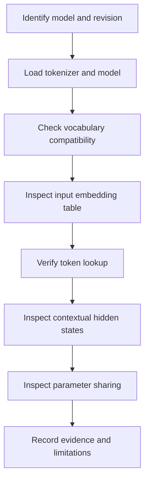

# Inspecting Embedding Systems in Practice

## 1. Purpose and Scope

Understanding embedding systems requires more than knowing that a token ID maps to a vector. An engineer must be able to inspect a real model, verify its embedding components, interpret tensor shapes, and distinguish observable facts from assumptions about representation quality.

This chapter brings the concepts from the preceding LLM-04 chapters into one practical inspection workflow.

By the end, you should be able to:

- Identify a model's input embedding component.
- Inspect vocabulary and embedding dimensions.
- Verify token-to-vector lookup behavior.
- Compare input embeddings with contextual hidden states.
- Estimate embedding parameter counts and raw tensor storage.
- Investigate whether input embeddings and output weights share parameters.
- Document findings with explicit evidence and limitations.

**Scope boundary:** This chapter concerns embeddings used internally by language models. Embeddings produced for retrieval systems, vector databases, or RAG pipelines belong to Retrieval Engineering (RET).

The examples use Python, PyTorch, and Hugging Face Transformers. Model APIs and structures vary across architectures; treat each inspection as model-specific rather than assuming every language model exposes identical components.

## 2. The Inspection Workflow

Use a sequence of checks that progresses from model identity to component inspection and then to interpretation.



Each stage answers a different engineering question:

| Stage | Question |
|---|---|
| Model identity | Which exact model configuration and revision are being inspected? |
| Compatibility | Are the tokenizer and model vocabulary dimensions consistent? |
| Embedding table | What are the table's shape and parameter count? |
| Lookup | Does an input token ID retrieve the expected row? |
| Hidden states | How do representations differ after contextual processing? |
| Parameter sharing | Is there evidence that input and output weights share parameters? |
| Reporting | Which conclusions are supported by the observations? |

The workflow is diagnostic, not a benchmark. It does not establish that a model's representations are useful for a particular task.

## 3. Establish Model Identity and Reproducibility

Inspection results are meaningful only when the model being inspected is identifiable.

Record at least:

- Model repository or identifier.
- Exact model revision, where reproducibility matters.
- Tokenizer revision.
- Library versions and execution environment when results must be reproduced.
- Relevant model configuration and any loading options.

### 3.1 Exploratory loading

The following example is suitable for an initial local inspection. It uses the repository's default revision, which may change over time.

```python
import torch
from transformers import AutoModel, AutoTokenizer

model_id = "distilbert/distilbert-base-uncased"

tokenizer = AutoTokenizer.from_pretrained(model_id)
model = AutoModel.from_pretrained(model_id)

device = torch.device(
    "cuda" if torch.cuda.is_available() else "cpu"
)

model = model.to(device)
model.eval()

print("Model:", model_id)
print("Device:", device)
print("Tokenizer vocabulary:", len(tokenizer))
print("Model type:", model.config.model_type)
```

This is an exploratory setup, not a revision-pinned reproducibility guarantee. A model identifier alone does not necessarily identify an immutable set of files.

### 3.2 Revision-pinned loading

For repeatable investigations, pin the model and tokenizer to a verified revision. Replace the placeholder below with a real commit hash from the model repository before running the example.

```python
import torch
from transformers import AutoModel, AutoTokenizer

model_id = "distilbert/distilbert-base-uncased"
verified_revision = "REPLACE_WITH_VERIFIED_COMMIT_HASH"

if verified_revision == "REPLACE_WITH_VERIFIED_COMMIT_HASH":
    raise ValueError(
        "Replace the placeholder with a verified model revision."
    )

tokenizer = AutoTokenizer.from_pretrained(
    model_id,
    revision=verified_revision,
)

model = AutoModel.from_pretrained(
    model_id,
    revision=verified_revision,
)

device = torch.device(
    "cuda" if torch.cuda.is_available() else "cpu"
)

model = model.to(device)
model.eval()

print("Model:", model_id)
print("Revision:", verified_revision)
print("Device:", device)
```

The placeholder is intentional; no particular commit hash is asserted to have been verified here.

Pinning model and tokenizer revisions improves reproducibility, but it does not automatically capture every dependency. For stricter experiments, also record package versions, hardware details where relevant, configuration changes, and any external artifacts.

The weight-tying investigation in Section 8 loads a separate model interface. Use the **same verified commit hash** for that example if you want its findings to correspond to the same model revision. The code snippets intentionally remain independently runnable rather than relying on variables created in another section.

## 4. Inspect the Embedding Table

A language model commonly maps token IDs to vectors through a learned embedding table.

For models supported by the Hugging Face base-model interface, `get_input_embeddings()` provides a convenient way to access the input embedding component.

```python
input_embeddings = model.get_input_embeddings()

if input_embeddings is None:
    raise RuntimeError(
        "This model does not expose input embeddings "
        "through get_input_embeddings()."
    )

embedding_weights = input_embeddings.weight

print("Embedding component:", type(input_embeddings).__name__)
print("Weight shape:", tuple(embedding_weights.shape))
print("Parameter count:", embedding_weights.numel())
print("Data type:", embedding_weights.dtype)
print("Device:", embedding_weights.device)
```

For a conventional embedding table:

\[
E \in \mathbb{R}^{V \times d}
\]

where:

- \(V\) is the number of embedding rows.
- \(d\) is the embedding dimension.
- Each valid token ID selects one row.

The reported parameter count is the number of scalar elements in this weight tensor. It does not necessarily represent the model's total parameter count.

### 4.1 Check vocabulary compatibility

Compare the tokenizer's vocabulary size with the embedding table's number of rows.

```python
tokenizer_size = len(tokenizer)
embedding_rows, embedding_dim = embedding_weights.shape

print("Tokenizer size:", tokenizer_size)
print("Embedding rows:", embedding_rows)
print("Embedding dimension:", embedding_dim)

if tokenizer_size != embedding_rows:
    print(
        "Investigate vocabulary compatibility, added tokens, "
        "model resizing, and architecture-specific conventions."
    )
else:
    print("Tokenizer size matches embedding-table row count.")
```

A mismatch is a diagnostic signal, not proof of a defect. Added tokens, resized embeddings, specialized vocabulary arrangements, or architecture-specific conventions can explain differences. Investigate the model configuration and tokenizer behavior before concluding that the components are incompatible.

A matching row count is also not a complete compatibility guarantee: the tokenizer and model must agree on the meaning of token IDs, not merely the number of entries.

## 5. Verify Token-to-Vector Lookup

The next step is to check whether the model's embedding component retrieves the expected row for a token ID.

```python
text = "Embedding systems transform token IDs into vectors."

encoded = tokenizer(
    text,
    return_tensors="pt",
    add_special_tokens=True,
)

input_ids = encoded["input_ids"].to(device)

with torch.no_grad():
    looked_up_vectors = input_embeddings(input_ids)

print("Input ID shape:", tuple(input_ids.shape))
print("Lookup output shape:", tuple(looked_up_vectors.shape))
```

For a batch containing one sequence of length \(L\), the usual shapes are:

- Token IDs: \((1, L)\)
- Input embeddings: \((1, L, d)\)

The batch dimension is retained even when only one sequence is supplied.

Verify one position directly:

```python
batch_index = 0
position = 0

token_id = input_ids[batch_index, position]
lookup_vector = looked_up_vectors[batch_index, position]

table_vector = embedding_weights[token_id]

torch.testing.assert_close(
    lookup_vector,
    table_vector,
)

token_string = tokenizer.convert_ids_to_tokens(
    int(token_id.item())
)

print("Token:", token_string)
print("Token ID:", int(token_id.item()))
print("Vector shape:", tuple(lookup_vector.shape))
print("Lookup matches embedding-table row.")
```

This check verifies the basic lookup relationship for the inspected token and model component. It does not prove that the tokenizer is semantically appropriate for the text, or that the resulting representation is useful for a downstream task.

## 6. Estimate Embedding Parameter Storage

Embedding tables can be a meaningful part of a model's parameter and memory budget, especially when vocabulary size or embedding dimension is large.

For a dense tensor, the nominal byte count of its elements can be estimated as:

\[
\text{Tensor bytes}
=
\text{numel} \times \text{element size in bytes}
\]

```python
parameter_count = embedding_weights.numel()
bytes_per_element = embedding_weights.element_size()
raw_tensor_bytes = parameter_count * bytes_per_element

print("Parameters:", parameter_count)
print("Bytes per element:", bytes_per_element)
print("Raw tensor bytes:", raw_tensor_bytes)
print("Raw tensor MiB:", raw_tensor_bytes / (1024 ** 2))
```

This estimates the storage represented by the tensor's elements. It is not a measurement of total process memory or GPU memory usage.

Actual memory requirements may also depend on:

- Other model parameters and buffers.
- Temporary activations and intermediate tensors.
- Gradients and optimizer states during training.
- Tensor duplication, parameter sharing, or views.
- Quantization, sharding, offloading, and specialized storage formats.
- Framework and allocator overhead.

Use this calculation as a component-level estimate. Use appropriate runtime profiling when the engineering question concerns actual system memory.

## 7. Inspect Contextual Hidden States

An input embedding is not the same thing as a contextual hidden representation.

The input embedding table initially retrieves a vector based on token ID. Subsequent model computation can transform that vector using surrounding tokens and model parameters. The resulting hidden representation can therefore depend on context.

For the supported encoder-model interface used in this example:

```python
texts = [
    "The bank approved the loan.",
    "They sat on the bank of the river.",
]

encoded_batch = tokenizer(
    texts,
    padding=True,
    truncation=True,
    return_tensors="pt",
).to(device)

with torch.no_grad():
    outputs = model(
        **encoded_batch,
        output_hidden_states=True,
    )

initial_embeddings = model.get_input_embeddings()(
    encoded_batch["input_ids"]
)

final_hidden_states = outputs.last_hidden_state

print("Input IDs:", tuple(encoded_batch["input_ids"].shape))
print("Initial embeddings:", tuple(initial_embeddings.shape))
print("Final hidden states:", tuple(final_hidden_states.shape))
```

For many encoder models, both tensors have the shape:

\[
(B, L, d_h)
\]

where \(B\) is batch size, \(L\) is sequence length, and \(d_h\) is the hidden dimension.

The shapes can match without the tensors containing the same representations. Input embeddings and final hidden states occupy different stages of the model's computation.

The example illustrates representation flow; it does not demonstrate that the model correctly distinguishes the two meanings of “bank.” Establishing task-specific behavior requires a suitable evaluation method, which belongs to LLM-08.

**Architecture caution:** `last_hidden_state` and `output_hidden_states` are common interfaces, not universal guarantees for every model family. Some architectures use different output conventions, embedding arrangements, or hidden dimensions. Consult the specific model's documentation before generalizing.

## 8. Investigate Input/Output Weight Tying

Some language models share parameters between the input embedding table and the output vocabulary projection. This is commonly called *weight tying*. Other architectures maintain separate parameters.

A base encoder model may not expose an output vocabulary projection at all. Therefore, use a model interface that includes a language-modeling head when the purpose of the inspection is to investigate input/output weight sharing.

The following is a **separate diagnostic example**. It uses a masked-language-modeling model class rather than the base `AutoModel` instance used in earlier sections. Set `verified_revision` to the same verified commit hash used in Section 3.2 before running it.

```python
import torch
from transformers import AutoModelForMaskedLM

model_id = "distilbert/distilbert-base-uncased"
verified_revision = "REPLACE_WITH_VERIFIED_COMMIT_HASH"

if verified_revision == "REPLACE_WITH_VERIFIED_COMMIT_HASH":
    raise ValueError(
        "Replace the placeholder with a verified model revision."
    )

mlm_model = AutoModelForMaskedLM.from_pretrained(
    model_id,
    revision=verified_revision,
)

device = torch.device(
    "cuda" if torch.cuda.is_available() else "cpu"
)

mlm_model = mlm_model.to(device)
mlm_model.eval()

input_component = mlm_model.get_input_embeddings()
output_component = mlm_model.get_output_embeddings()

if input_component is None:
    raise RuntimeError("No input embedding component was exposed.")

if output_component is None:
    print(
        "This model interface does not expose an output "
        "embedding component for inspection."
    )
else:
    input_weight = input_component.weight
    output_weight = output_component.weight

    print("Input weight shape:", tuple(input_weight.shape))
    print("Output weight shape:", tuple(output_weight.shape))
    print(
        "Same parameter object:",
        input_weight is output_weight,
    )

    same_storage_start = (
        input_weight.device == output_weight.device
        and input_weight.data_ptr() == output_weight.data_ptr()
    )

    print("Same storage start:", same_storage_start)
```

This code provides diagnostics, not a universal weight-tying test. The fact that a model is a masked-language model does **not** guarantee that its input and output weights are tied. The architecture, configuration, and implementation determine whether sharing occurs.

Interpret the observations carefully:

- **Object identity:** If `input_weight is output_weight` is true, both attributes reference the same parameter object.
- **Storage start:** Matching starting storage addresses provide evidence of shared storage, but do not independently establish identical shapes, strides, storage offsets, or logical relationships.
- **Different storage starts:** These do not rule out every architecture-specific form of parameter sharing or transformation.
- **Missing output component:** This may reflect the model interface rather than a model defect.

When the result is ambiguous, inspect the model's documented tying implementation and compare tensor shapes, strides, storage offsets, and storage relationships. Treat these diagnostics as implementation-specific.

For a conventional vocabulary projection, the logical matrix multiplication may be written as:

\[
\text{logits} = H W_{\text{out}}
\]

with \(H\) shaped \((B, L, d_h)\) and \(W_{\text{out}}\) shaped \((d_h, V)\). A PyTorch `nn.Linear(d_h, V)` stores its weight in the transposed layout, \((V, d_h)\), because of the layer's implementation convention. Do not infer weight tying solely from a pair of dimensions.

## 9. Perform Bounded Geometric Checks

Basic vector calculations can help detect unexpected numerical values or illustrate geometric relationships. They cannot establish representation quality by themselves.

For example, compare two input embedding vectors:

```python
import torch.nn.functional as F

with torch.no_grad():
    sample_vectors = embedding_weights[:2].float()

    if sample_vectors.shape[0] < 2:
        raise ValueError(
            "At least two embedding rows are required."
        )

    vector_a = sample_vectors[0]
    vector_b = sample_vectors[1]

    if not (
        torch.isfinite(vector_a).all()
        and torch.isfinite(vector_b).all()
    ):
        raise ValueError("Embedding vectors contain non-finite values.")

    norm_a = torch.linalg.vector_norm(vector_a)
    norm_b = torch.linalg.vector_norm(vector_b)

    if norm_a.item() == 0 or norm_b.item() == 0:
        raise ValueError(
            "Cosine similarity is not meaningful for zero vectors."
        )

    cosine_similarity = F.cosine_similarity(
        vector_a.unsqueeze(0),
        vector_b.unsqueeze(0),
        dim=1,
    ).item()

    euclidean_distance = torch.linalg.vector_norm(
        vector_a - vector_b
    ).item()

    if not (
        torch.isfinite(torch.tensor(cosine_similarity))
        and torch.isfinite(torch.tensor(euclidean_distance))
    ):
        raise ValueError(
            "Similarity or distance calculation produced "
            "a non-finite result."
        )

print("Cosine similarity:", cosine_similarity)
print("Euclidean distance:", euclidean_distance)
```

These calculations are illustrative diagnostics. The first two rows may correspond to special tokens or other vocabulary entries that are not meaningful for the question being investigated.

Before interpreting geometric results, check:

- Which tokens the vectors represent.
- Whether the vectors are finite and nonzero.
- Whether normalization was applied.
- Whether the metric matches the intended analysis.
- Whether the result is supported by a task-specific evaluation.

Nearest-neighbor examples and low-dimensional visualizations can be useful exploratory tools, but neither alone establishes that a representation system performs well. Foundational geometry is covered in AIF-05; rigorous evaluation methodology belongs to LLM-08.

## 10. Reproducible Inspection Checklist

Before recording or sharing findings, verify the following:

- [ ] Model identifier and revision are recorded.
- [ ] Tokenizer identity and revision are recorded.
- [ ] The execution environment and relevant library versions are documented.
- [ ] The input embedding component is identified.
- [ ] Vocabulary size and embedding-row count are compared.
- [ ] Token lookup is verified for at least one valid input.
- [ ] Tensor shapes and data types are recorded.
- [ ] Parameter counts are distinguished from total model parameters.
- [ ] Raw tensor storage is distinguished from actual process memory.
- [ ] Input embeddings are distinguished from contextual hidden states.
- [ ] Parameter-sharing conclusions are supported by appropriate evidence.
- [ ] Geometric observations are not presented as proof of task quality.
- [ ] Architecture-specific assumptions and limitations are documented.

A checklist improves repeatability, but it does not replace an explicit account of what was tested and what the evidence supports.

## 11. Common Inspection Failures

| Failure | Why it matters | Engineering response |
|---|---|---|
| Treating token IDs as meaningful numerical coordinates | IDs are identifiers, not semantic measurements | Inspect the embedding lookup rather than interpreting ID magnitude |
| Assuming tokenizer size alone proves compatibility | Equal sizes do not guarantee matching token-to-row assignments | Check tokenizer identity, model configuration, and special-token behavior |
| Comparing tensors only by shape | Equal dimensions do not imply equal representations | Identify each tensor's position in the computation pipeline |
| Reporting raw tensor bytes as total memory | Runtime memory includes additional allocations and overhead | Separate component estimates from runtime profiling |
| Assuming every model ties its weights | Parameter sharing is architecture-dependent | Inspect the actual model implementation |
| Treating nearest neighbors as proof of quality | Local examples may not reflect task performance or coverage | Define a relevant evaluation question and method |
| Using a mutable model reference for repeatable findings | A later download may resolve to different files | Pin and record a verified revision |
| Assuming every model uses the same API | Model families expose different components and outputs | Check the model-specific interface and documentation |

## 12. Integrated Engineering Exercise

Inspect a language model and produce a short evidence-based report. Use a model and revision that are available in your environment; do not fabricate measurements or claim results that were not observed.

### Tasks

1. Record the model and tokenizer identifiers, revisions, and relevant environment details.
2. Identify the input embedding component and report its shape, data type, parameter count, and raw tensor storage estimate.
3. Compare tokenizer size with the embedding table's row count and explain any discrepancy.
4. Verify that one token lookup matches the corresponding table row.
5. Compare initial embedding and final hidden-state shapes for a short input.
6. Investigate whether the model exposes tied input/output weights and document the evidence.
7. State what your observations establish and what they cannot establish.

Use this report structure:

| Observation | Evidence | Interpretation | Limitation |
|---|---|---|---|
| Embedding shape | Actual reported tensor shape | What the dimensions indicate | Does not establish task quality |
| Lookup consistency | Numerical comparison result | Whether the lookup matches the selected row | Does not validate all token mappings |
| Weight sharing | Object identity and storage diagnostics | What the checks support | May require architecture-specific inspection |

Replace the example rows with your own observations. If a check cannot be performed, explain why rather than inventing a result.

### Completion Criteria

The exercise is complete when another engineer can reproduce your setup, understand each reported measurement, distinguish evidence from interpretation, and identify the remaining uncertainties.

## 13. Connections to the Wider Engineering System

This chapter provides practical inspection skills that connect to several areas of the curriculum:

- **LLM-03 — Tokenization:** Supplies the token IDs and tokenizer compatibility context required for lookup.
- **LLM-02 — Training:** Explains how learned parameters arise from training objectives; this chapter inspects the resulting components.
- **AIF-05 — Representation Learning:** Owns foundational representation-space and similarity concepts.
- **AIF-07 — Transformer Foundations:** Owns the detailed mechanics of attention, positional encoding, and Transformer blocks.
- **LLM-08 — Evaluation and Benchmarking:** Owns rigorous methodology for determining whether representations support a task.
- **RET — Retrieval Engineering:** Covers retrieval-specific embeddings, vector search, and RAG pipelines.
- **PROD — Production AI Engineering:** Covers operational profiling, serving, monitoring, and reliability.
- **ENT — Enterprise AI Systems:** Covers enterprise architecture, governance, security, and risk.

The key distinction is between inspecting an internal model component and evaluating or operating a complete AI system. Each requires different evidence and different engineering methods.

## 14. Quick Revision

- Token IDs select rows from an embedding table; their numeric values are not semantic coordinates.
- Inspect the actual model component rather than assuming every architecture uses the same structure.
- Verify lookup behavior and tensor dimensions instead of relying on assumptions.
- Distinguish parameter count, raw tensor storage, and total runtime memory.
- Input embeddings and contextual hidden states represent different stages of model computation.
- Weight tying must be investigated through architecture-aware diagnostics.
- Geometric measurements are exploratory evidence, not proof of task quality.
- Reproducible conclusions require recorded model identity, environment, observations, and limitations.

## 15. Key Takeaways

A capable engineer does not stop at printing an embedding matrix's shape. They verify the relationship between the tokenizer, model parameters, and representation flow; understand what each measurement means; and avoid drawing conclusions that the evidence cannot support.

The practical objective is not to inspect every possible internal detail. It is to choose checks that answer a specific engineering question, execute them reproducibly, and communicate the result with appropriate limitations.
