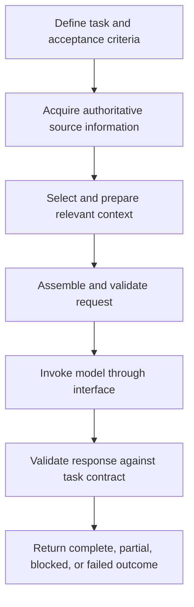

# Context Engineering Workflows and Practical Lab

## 1. Purpose

The previous chapters established the major components of context engineering:

- What enters a model invocation and how context differs from the underlying model.
- How to select and compose task-relevant information.
- How to reason about context capacity and token budgets.
- How ordering and information utilization affect interpretation.
- How to maintain context state across long conversations.
- How to reduce context while preserving task-relevant information.
- How to identify and handle context constraints and failure modes.

This chapter combines those concepts into an engineering workflow.

In a real application, context engineering is not a single prompt-writing operation. It is a sequence of decisions about information sources, selection, representation, validation, invocation, and response handling. Defects introduced at any stage can affect the final result.

A production-oriented workflow must make context construction explicit, define validation criteria, preserve the distinction between known and unresolved information, and provide a way to investigate failures.

The practical lab applies this workflow to a reimbursement assistant. The application must use policy information and transaction evidence to determine what can be concluded about an expense without inventing missing approval evidence.

The objective is not to produce the longest prompt or the most sophisticated framework implementation. It is to design a context pipeline whose behavior can be explained, tested, and improved.

### Learning objectives

By the end of this chapter, you should be able to:

- Design a repeatable context-engineering workflow for a defined task.
- Separate source acquisition, selection, transformation, assembly, validation, invocation, and response handling.
- Define task-specific context requirements and validation criteria.
- Construct context that preserves source authority, scope, conditions, and uncertainty.
- Establish context budgets without treating allocated capacity as actual usage.
- Validate context structure and content before model invocation.
- Handle missing evidence, conflicting sources, oversized inputs, and incomplete tool results.
- Implement a small context-engineering pipeline without coupling the logic to a particular LLM framework.
- Explain the production trade-offs of a context-engineering design.

## 2. The End-to-End Context Engineering Workflow

A context-engineering workflow transforms task requirements and available information into a validated model invocation and a controlled application response.



The diagram describes logical stages, not a requirement to implement seven separate services. A small application may implement several stages in one module. A larger system may distribute them across services.

The important property is that each stage has a defined responsibility and produces information that the next stage can inspect.

### 2.1 Define the task

Start by establishing what the model must accomplish.

Specify:

- The operation to perform.
- The required output.
- The evidence needed to support the output.
- The conditions that must remain explicit.
- The situations in which a definitive answer is not permitted.
- The criteria used to determine whether the task succeeded.

For example, "assess a reimbursement expense" is underspecified. A more useful requirement is:

> Identify the applicable policy, calculate the amount above the standard limit, consider any documented exception, and distinguish established facts from unresolved conditions.

This definition guides source acquisition and context construction.

### 2.2 Acquire, select, and prepare source information

Identify sources that can establish the facts needed for the task. Depending on the application, these may include user-provided information, authoritative documents, database records, retrieved passages, tool results, and current conversation state.

The application should preserve enough source metadata to establish where a claim originated and whether it is applicable.

Preparation may include removing irrelevant material, deduplicating genuinely repeated content, preserving qualifications, structuring stable fields, summarizing background, or retaining references to authoritative sources.

These operations should not be applied indiscriminately. Exact values, policy conditions, and unresolved conflicts may require stronger preservation than general background descriptions.

Chapter 06 covers the distinction between context selection and compression, including information-fidelity validation.

### 2.3 Assemble and validate

Construct the actual request representation using the target model interface's requirements.

Validate that:

- Required information is present.
- Source versions and scope are applicable.
- Contradictions are resolved or explicitly represented.
- Required fields and message structures are valid.
- The request fits applicable capacity constraints.
- Instructions remain distinguishable from source evidence.
- Unresolved conditions remain explicit.

A request that fails a required validation should not silently proceed as if it were complete.

### 2.4 Invoke, validate, and respond

Submit the validated request through the selected model interface. Distinguish a valid model response from a rejected request, a transient service failure, an output-contract violation, or an unsupported conclusion.

Validate the response against the task's requirements, including structural validity, evidence consistency, and completion status.

The application should distinguish these outcomes:

- **Complete:** The required task has been completed and its acceptance criteria have passed.
- **Partial:** Some requested work is complete, but a dependency remains unresolved.
- **Blocked:** The task cannot proceed without additional evidence, clarification, or authorization.
- **Failed:** The request or processing operation did not complete successfully.

These are logical outcome categories. An implementation may need additional states for retries, cancellation, timeouts, or asynchronous work.

## 3. Define the Context Contract

A context contract specifies what information a task requires and what conditions must hold before the application invokes the model.

It turns context construction from an informal prompt-writing activity into a testable engineering responsibility.

### 3.1 Contract components

| Component | Purpose |
|---|---|
| Task specification | Describes the operation and intended behavior |
| Required evidence | Identifies facts and sources needed for the task |
| Source requirements | Establishes authority, freshness, version, and scope requirements |
| Information invariants | Identifies values, conditions, and relationships that must survive transformations |
| Context budget | Defines applicable input and output constraints |
| Representation rules | Defines message structure, fields, and source boundaries |
| Validation criteria | Specifies conditions that must pass before invocation |
| Failure behavior | Defines what happens when prerequisites are missing or invalid |

Not every task requires a large formal specification. A lightweight contract may be sufficient for a simple application. Consequential workflows benefit from more explicit contracts because incorrect assumptions can have greater costs.

### 3.2 Example contract for reimbursement assessment

The task is to assess a hotel expense against the applicable reimbursement policy, calculate the amount above the standard limit, preserve any exception, and avoid a definitive eligibility decision without sufficient evidence.

The context contract requires:

- The transaction amount and currency.
- The transaction date and duration.
- The policy version applicable to the transaction.
- The standard limit and its unit.
- Any relevant exception and its conditions.
- Evidence concerning whether the exception's conditions were satisfied.
- Explicit representation of any unresolved condition.

Before invoking the model, the application should verify that the information needed for the requested conclusion is available.

If approval status is missing, the application may still calculate the amount above the standard limit. It should not treat the missing approval record as proof that approval was denied.

### 3.3 Separate mandatory and optional information

Not every context component should have the same validation requirement.

- Transaction amount: mandatory for calculating the excess.
- Applicable policy limit: mandatory for comparing against the limit.
- Policy applicability: mandatory for selecting the governing rule.
- Approval evidence: required for a definitive exception-dependent eligibility decision.
- General travel background: potentially optional.
- Historical discussion unrelated to the current expense: normally unnecessary.

This distinction allows the application to support partial completion without pretending that the full task is complete.

### 3.4 Make failure behavior part of the contract

| Condition | Expected behavior |
|---|---|
| Transaction amount missing | Request the amount or retrieve it from an authorized source |
| Applicable policy unavailable | Retrieve the policy or block the definitive assessment |
| Policy versions conflict | Resolve applicability using supported rules or preserve the conflict |
| Approval status unresolved | Report the calculation but leave eligibility unresolved |
| Request exceeds supported capacity | Reconstruct or reduce context safely, then revalidate |
| Request structure invalid | Reject or repair the request before model invocation |

These rules should be enforced by the application where deterministic enforcement is possible. Do not rely exclusively on the model to discover missing prerequisites.

## 4. Context Construction as a Pipeline

The context contract defines the requirements. The construction pipeline implements them.

### 4.1 Keep source data and prepared context distinct

Consider three conceptual objects:

1. **Source material:** Authoritative documents, records, and tool outputs.
2. **Prepared context:** Selected and transformed information intended for the task.
3. **Invocation request:** The final interface-specific representation submitted to the model.

Source material supports traceability and verification. Prepared context supports task-specific information selection. The invocation request conforms to the model interface.

Keeping them conceptually separate helps diagnose where a defect entered the pipeline. If the original policy contains an exception but the prepared context omits it, the defect occurred during selection or transformation. If the prepared context contains the exception but the final request does not, the defect occurred during assembly.

### 4.2 Use explicit intermediate representations

An intermediate representation makes context preparation inspectable.

```python
from dataclasses import dataclass

@dataclass(frozen=True)
class EvidenceItem:
    source_id: str
    source_version: str
    content: str
    authoritative: bool
    applicable: bool

@dataclass(frozen=True)
class ContextRequirements:
    required_evidence: tuple[str, ...]
    allow_partial_result: bool
    task_name: str

@dataclass(frozen=True)
class PreparedEvidenceContext:
    task_name: str
    evidence: tuple[EvidenceItem, ...]
    unresolved_conditions: tuple[str, ...]
    status: str
```

This example illustrates a design direction rather than a complete production schema.

The exact representation should reflect the application's sources, validation rules, and task types. A small application may use dictionaries or existing domain models instead of introducing new classes.

The important property is that the representation makes required evidence, provenance, applicability, and unresolved conditions explicit enough to validate.

### 4.3 Make stages independently testable

A pipeline is easier to maintain when its responsibilities can be tested separately.

Examples:

- Source selection tests verify that required evidence is included.
- Transformation tests verify that critical conditions survive summarization.
- Applicability tests verify that the correct policy version is selected.
- Assembly tests verify message structure and field placement.
- Budget tests verify that requests remain within supported limits.
- Output tests verify task-specific response requirements.

This separation reduces the temptation to solve every defect by changing the prompt.

## 5. Context Budgeting Within the Workflow

Context budgeting belongs in request construction, not as an afterthought. Chapter 03 provides the detailed treatment of context capacity, token accounting, and budgeting.

### 5.1 Define the budget before assembly

The application should know the applicable limits and the resources that must be reserved for the invocation.

Depending on the model interface, relevant constraints may include maximum input capacity, output allowance, combined input/output constraints, provider-specific restrictions, multimodal input accounting, and application-level safety margins.

The application should not assume that all interfaces use identical accounting rules.

### 5.2 Distinguish allocations from actual usage

Suppose an application allocates an input planning limit of 12,000 tokens:

| Component | Planned allocation |
|---|---:|
| Instructions and output contract | 900 |
| Current user request | 300 |
| Conversation state | 1,500 |
| Retrieved evidence | 8,000 |
| Unallocated input allowance | 1,300 |
| **Input planning limit** | **12,000** |

These figures describe planning allocations, not guaranteed token usage.

Actual usage depends on the content supplied and the model interface's accounting. The application should measure or estimate usage using the appropriate mechanism rather than treating the allocation table as an exact measurement.

### 5.3 Handle budget pressure deliberately

When the assembled request exceeds the applicable limit:

1. Identify which component caused the growth.
2. Reassess whether all included information is relevant.
3. Remove genuinely redundant or unnecessary material.
4. Apply task-appropriate reduction while preserving required information.
5. Recalculate the request size.
6. Revalidate the required evidence and information invariants.
7. Proceed only when the resulting request satisfies the contract.

If the required information cannot fit without unacceptable loss, split the task, retrieve information incrementally, or report that the task cannot proceed under the current constraints.

The objective is not to fill the context window or minimize token count at all costs. It is to supply enough relevant, reliable information to support the task while respecting capacity, latency, cost, and correctness requirements.

## 6. Context Validation Before Invocation

Validation should establish that the context is suitable for the task before the application submits it to the model.

### 6.1 Structural validation

Check that required fields exist, values have expected types, message structures are valid, tool-call messages conform to the interface, required content parts are present, and the request satisfies supported interface constraints.

These checks are often deterministic and should be automated where feasible.

### 6.2 Evidence and applicability validation

Check whether the context contains the required source information and whether that information applies to the task.

Examples include:

- Required source identifiers are present.
- The selected policy version is applicable to the transaction.
- The transaction amount and duration are known.
- Required exceptions are included.
- Tool results are complete enough for the intended conclusion.
- Missing dependencies are represented explicitly.
- Evidence used to establish an exception satisfies the relevant validation requirements.

The presence of a field does not prove that its value is accurate. Where necessary, compare it against the authoritative source.

### 6.3 Semantic validation

Check whether preparation or transformation preserved the meaning required by the task.

Examples include:

- Qualifications remain attached to relevant rules.
- Exact values remain unchanged where required.
- Negation and conditional requirements remain intact.
- Conflicting claims remain distinguishable.
- Uncertainty and provenance are preserved.
- Relationships between facts remain correct.

Chapter 06 explains these fidelity requirements in more detail.

### 6.4 Budget and boundary validation

Budget validation checks the request against applicable capacity and interface rules. The application should use appropriate token accounting or provider-supported validation rather than treating character count as a universal substitute for token count.

Boundary validation checks that instructions, evidence, and untrusted content retain their intended roles. Prompt-level boundaries help guide behavior but do not replace application-level security controls.

### 6.5 Allow partial progress where the contract permits it

Not every validation failure must block the entire task.

For example, missing approval status may block a definitive eligibility decision but still allow calculation of the amount above the standard limit.

The application should define which failures prevent all progress and which allow a qualified partial result. This is more useful than either accepting every incomplete context or rejecting every request with any missing information.

## 7. Model Invocation and Result Handling

Once the context has passed the required pre-invocation checks, the application can submit the request. Invocation and result handling remain separate from context preparation because a valid context can still encounter service failures or produce an unsuitable response.

### 7.1 Define and validate the output contract

Specify the form and meaning of the expected response. Depending on the task, this may include required fields, allowed status values, numeric fields and units, evidence references, unresolved conditions, and restrictions on unsupported definitive conclusions.

Validate both structure and substance. A reimbursement response could contain all required fields while incorrectly stating that approval was denied.

Not every check can be fully automated. Enforce deterministic rules in code where possible; use task-specific tests or additional review for more complex semantic requirements.

### 7.2 Handle invocation errors separately

| Failure | Appropriate investigation |
|---|---|
| Invalid request structure | Repair request construction |
| Capacity violation | Reduce or restructure context safely |
| Transient service failure | Apply an appropriate retry policy |
| Unsupported response structure | Handle the output-contract failure |
| Unsupported conclusion | Inspect evidence, context construction, and model behavior |

The recovery path should reflect the observed failure category.

### 7.3 Preserve completion status

The application should not report a task as complete merely because the model returned text.

For example, the model may have calculated the excess amount but failed to resolve eligibility. The application should preserve the partial result and unresolved condition.

Similarly, an attempted configuration change should not be reported as verified success until the required check has passed.

## 8. Practical Lab: Build a Reimbursement Context Pipeline

This lab applies the workflow to a realistic business scenario. The objective is to build a small, testable pipeline that prepares and validates context before connecting to a real model API.

**Baseline environment:** Python 3.10 or later. The deterministic baseline uses only the Python standard library and does not require an LLM framework.

The code below implements the core deterministic path: constructing the input records, selecting an applicable policy from a catalog, calculating the excess, validating approval evidence, preparing context, validating prerequisites, and assembling a model request. The actual model API call and full semantic response evaluation remain interface and assignment work.

### 8.1 Scenario

An employee submits a hotel expense. The application must compare the transaction with the applicable reimbursement policy.

**Transaction record**

- Transaction date: 12 March 2026.
- Hotel expense: ₹8,000.
- Duration: one night.

**Policy version 4**

- Effective from 10 March 2026.
- Standard hotel reimbursement limit: ₹7,000 per night.
- A higher amount may be permitted when documented prior approval exists.

**Additional evidence**

- The supplied transaction record does not establish whether prior approval was obtained.
- The original policy source is available to the application.
- No additional approval record has yet been retrieved.

For the initial baseline, assume the employee group, jurisdiction, and transaction type satisfy the policy's scope requirements. The implementation checks the modeled scope and effective-date range and rejects ambiguous policy selection. In a real application, all scope assumptions must be established from authoritative sources.

The application must:

1. Identify the applicable policy version.
2. Calculate the amount above the standard limit.
3. Preserve the prior-approval exception and its condition.
4. Distinguish known facts from unresolved evidence.
5. Avoid a definitive eligibility conclusion without sufficient evidence.

### 8.2 Define the invariants

| Invariant | Required behavior |
|---|---|
| Transaction amount | Preserve ₹8,000 exactly |
| Currency | Preserve INR |
| Duration | Preserve one night |
| Policy version | Select version 4 under the stated scope assumptions |
| Policy effective date | Preserve 10 March 2026 |
| Standard limit | Preserve ₹7,000 per night |
| Exception | Preserve the documented-prior-approval condition |
| Approval evidence | Represent status as unknown until validated evidence establishes otherwise |
| Excess calculation | Calculate ₹1,000 above the standard limit |
| Eligibility conclusion | Remain unresolved absent sufficient evidence for the exception-dependent decision |

These invariants provide concrete acceptance criteria.

### 8.3 Distinguish evidence, condition, eligibility, and completion states

The pipeline must not collapse four different questions into one Boolean:

- **Evidence state:** What do the available records establish about approval?
- **Condition state:** Has the required documented prior-approval condition been verified as satisfied?
- **Eligibility state:** Have all applicable policy conditions for reimbursement been established?
- **Task completion state:** Can the application provide the requested conclusion from the available information?

For example, missing approval evidence means the evidence state is unknown. It does not prove that approval was denied. Even verified approval does not automatically prove overall reimbursement eligibility because other policy requirements may apply.

The baseline models evidence status explicitly and prevents a definitive exception-dependent conclusion while approval status is unknown. A production implementation must also validate the approval record against the transaction and policy requirements.

### 8.4 Create the data model

```python
from dataclasses import dataclass
from datetime import date, datetime
from decimal import Decimal
from enum import Enum

class ApprovalStatus(Enum):
    APPROVED = "approved"
    NOT_APPROVED = "not_approved"
    UNKNOWN = "unknown"

@dataclass(frozen=True)
class Transaction:
    transaction_id: str
    transaction_date: date
    transaction_at: datetime | None
    amount: Decimal
    currency: str
    nights: int
    employee_group: str
    jurisdiction: str
    transaction_type: str

@dataclass(frozen=True)
class Policy:
    version: str
    effective_from: date
    effective_to: date | None
    standard_limit_per_night: Decimal
    currency: str
    employee_group: str
    jurisdiction: str
    transaction_type: str
    exception_condition: str

@dataclass(frozen=True)
class ApprovalEvidence:
    status: ApprovalStatus
    source_id: str | None
    transaction_id: str | None
    approved_at: datetime | None
    validated: bool

@dataclass(frozen=True)
class PreparedContext:
    transaction: Transaction
    policy: Policy
    approval: ApprovalEvidence
    excess: Decimal
    unresolved_conditions: tuple[str, ...]
```

The representation makes several distinctions explicit:

- Financial amounts use `Decimal` rather than binary floating-point arithmetic.
- Dates and timestamps use typed objects.
- Policy scope and transaction attributes can be compared deterministically.
- Approval evidence has fields that can be checked against the transaction.
- The approval status is not inferred from the transaction amount.
- Unresolved conditions are represented explicitly.

The `validated` field is a simplified fixture attribute, not a security boundary or proof of authenticity. In production, trusted application logic must establish validation from the authoritative record and enforce the required approval constraints. An untrusted caller must not be able to set this field and bypass those checks.

### 8.5 Instantiate the baseline data

```python
from datetime import date
from decimal import Decimal

transaction = Transaction(
    transaction_id="TX-1042",
    transaction_date=date(2026, 3, 12),
    transaction_at=None,
    amount=Decimal("8000"),
    currency="INR",
    nights=1,
    employee_group="standard",
    jurisdiction="IN",
    transaction_type="hotel",
)

policy_v3 = Policy(
    version="3",
    effective_from=date(2025, 1, 1),
    effective_to=date(2026, 3, 9),
    standard_limit_per_night=Decimal("6500"),
    currency="INR",
    employee_group="standard",
    jurisdiction="IN",
    transaction_type="hotel",
    exception_condition=(
        "A higher amount may be permitted with documented prior approval."
    ),
)

policy_v4 = Policy(
    version="4",
    effective_from=date(2026, 3, 10),
    effective_to=None,
    standard_limit_per_night=Decimal("7000"),
    currency="INR",
    employee_group="standard",
    jurisdiction="IN",
    transaction_type="hotel",
    exception_condition=(
        "A higher amount may be permitted with documented prior approval."
    ),
)

approval = ApprovalEvidence(
    status=ApprovalStatus.UNKNOWN,
    source_id=None,
    transaction_id=None,
    approved_at=None,
    validated=False,
)

policy_catalog = (policy_v3, policy_v4)
```

The policy catalog contains two versions so the selection logic can be tested rather than assuming that a supplied policy is already correct.

The transaction timestamp is intentionally unknown because the scenario supplies only a transaction date. Consequently, the baseline cannot establish whether an approval made on the same calendar date preceded the expense. A definitive prior-approval decision requires sufficient temporal evidence.

### 8.6 Select an applicable policy

Policy selection and policy validation are distinct operations. A candidate policy may have a valid effective date but still be inapplicable because of its scope or because another version is also applicable.

This lab uses a deliberately simple rule: exactly one policy must match the transaction's modeled scope and effective-date range.

```python
def policy_matches_transaction(
    transaction: Transaction,
    policy: Policy,
) -> bool:
    if transaction.transaction_date < policy.effective_from:
        return False

    if (
        policy.effective_to is not None
        and transaction.transaction_date > policy.effective_to
    ):
        return False

    return (
        transaction.employee_group == policy.employee_group
        and transaction.jurisdiction == policy.jurisdiction
        and transaction.transaction_type == policy.transaction_type
    )

def select_applicable_policy(
    transaction: Transaction,
    catalog: tuple[Policy, ...],
) -> Policy:
    matches = [
        policy
        for policy in catalog
        if policy_matches_transaction(transaction, policy)
    ]

    if len(matches) == 0:
        raise ValueError("No applicable policy was found.")

    if len(matches) > 1:
        raise ValueError(
            "Policy selection is ambiguous; multiple versions match."
        )

    return matches[0]
```

Select and verify the baseline policy:

```python
policy = select_applicable_policy(transaction, policy_catalog)

assert policy.version == "4"
```

This is a minimal unique-match selector, not a general policy-resolution engine. Real systems may need explicit precedence, supersession metadata, policy status, or additional scope attributes. If multiple policies match, the application must either resolve them through an authoritative, explicitly defined rule or reject the ambiguity. It must not assume that the highest version number always takes precedence.

### 8.7 Implement deterministic calculations

The amount above the standard limit can be calculated independently of the model:

```python
def calculate_excess(
    amount: Decimal,
    nightly_limit: Decimal,
    nights: int,
) -> Decimal:
    if amount < 0:
        raise ValueError("Amount cannot be negative.")

    if nightly_limit < 0:
        raise ValueError("Nightly limit cannot be negative.")

    if nights <= 0:
        raise ValueError("Nights must be positive.")

    standard_total = nightly_limit * nights
    return max(Decimal("0"), amount - standard_total)
```

Test the supplied scenario:

```python
excess = calculate_excess(
    amount=transaction.amount,
    nightly_limit=policy.standard_limit_per_night,
    nights=transaction.nights,
)

assert excess == Decimal("1000")
```

The calculation is deterministic. It should not be delegated to an LLM when the application can perform it reliably in code.

This separation also makes the task easier to diagnose. If the excess amount is wrong, inspect the inputs and calculation before investigating model behavior.

### 8.8 Validate approval evidence

A status label alone does not establish whether the underlying fact is true. The baseline therefore requires verified evidence for both positive and negative claims.

The evidence record must identify its source, correspond to the transaction, and be marked validated by trusted application logic. For an approval claim, the timestamp must also be available so the prior-approval condition can be checked.

```python
def approval_evidence_is_valid(
    transaction: Transaction,
    approval: ApprovalEvidence,
) -> bool:
    if approval.status == ApprovalStatus.UNKNOWN:
        return (
            not approval.validated
            and approval.approved_at is None
        )

    if not approval.validated:
        return False

    if not approval.source_id:
        return False

    if approval.transaction_id != transaction.transaction_id:
        return False

    if approval.status == ApprovalStatus.APPROVED:
        return approval.approved_at is not None

    if approval.status == ApprovalStatus.NOT_APPROVED:
        # A trusted source must establish that the required approval
        # was not granted for this transaction.
        return approval.approved_at is None

    return False
```

The negative-evidence case requires particular care. A `NOT_APPROVED` status must come from a source that can establish the absence or denial of the required approval. A missing record in an incomplete system is not enough. The fixture's `validated` flag stands in for this trusted verification procedure; it does not implement the procedure itself.

Next, determine whether the approval condition is established as satisfied:

```python
def approval_condition_satisfied(
    transaction: Transaction,
    approval: ApprovalEvidence,
) -> bool:
    if not approval_evidence_is_valid(transaction, approval):
        return False

    if approval.status != ApprovalStatus.APPROVED:
        return False

    # The policy requires prior approval. Without the transaction
    # timestamp, temporal precedence cannot be established.
    if transaction.transaction_at is None:
        return False

    if approval.approved_at is None:
        return False

    if transaction.transaction_at.tzinfo is None:
        return False

    if approval.approved_at.tzinfo is None:
        return False

    return approval.approved_at < transaction.transaction_at
```

This implementation compares timestamps rather than calendar dates, so it can distinguish an approval earlier on the same day from one granted after the expense, provided both timestamps include valid time-zone information.

If the transaction timestamp is unknown, the condition is not established as satisfied. That does not automatically prove that approval was denied; it means the available evidence is insufficient to establish temporal precedence.

The actual policy and source systems must define timestamp semantics, including the relevant event time and any required time-zone normalization.

### 8.9 Prepare and validate the context

Preparation preserves uncertainty rather than resolving it by assumption.

```python
def prepare_reimbursement_context(
    transaction: Transaction,
    policy: Policy,
    approval: ApprovalEvidence,
) -> PreparedContext:
    excess = calculate_excess(
        amount=transaction.amount,
        nightly_limit=policy.standard_limit_per_night,
        nights=transaction.nights,
    )

    unresolved = []

    if not approval_evidence_is_valid(transaction, approval):
        unresolved.append(
            "Approval evidence has not been validated."
        )
    elif approval.status == ApprovalStatus.UNKNOWN:
        unresolved.append(
            "Whether documented prior approval was obtained."
        )
    elif approval.status == ApprovalStatus.APPROVED:
        if not approval_condition_satisfied(transaction, approval):
            unresolved.append(
                "The evidence does not establish that approval "
                "preceded the transaction."
            )

    return PreparedContext(
        transaction=transaction,
        policy=policy,
        approval=approval,
        excess=excess,
        unresolved_conditions=tuple(unresolved),
    )
```

The validator checks the deterministic requirements implemented in this lab:

```python
def validate_reimbursement_context(
    context: PreparedContext,
) -> list[str]:
    errors = []

    transaction = context.transaction
    policy = context.policy
    approval = context.approval

    if transaction.currency != policy.currency:
        errors.append("Transaction and policy currencies differ.")

    if transaction.amount < 0:
        errors.append("Transaction amount cannot be negative.")

    if policy.standard_limit_per_night < 0:
        errors.append("Policy limit cannot be negative.")

    if transaction.nights <= 0:
        errors.append("Transaction must have a positive night count.")

    if not policy.exception_condition.strip():
        errors.append("Policy exception condition is missing.")

    if not policy_matches_transaction(transaction, policy):
        errors.append("Policy is not applicable to the transaction.")

    if not approval_evidence_is_valid(transaction, approval):
        errors.append("Approval evidence is invalid or contradictory.")

    if (
        approval.status == ApprovalStatus.APPROVED
        and not approval_condition_satisfied(transaction, approval)
        and not context.unresolved_conditions
    ):
        errors.append(
            "Unestablished prior approval must remain unresolved."
        )

    expected_excess = calculate_excess(
        transaction.amount,
        policy.standard_limit_per_night,
        transaction.nights,
    )

    if context.excess != expected_excess:
        errors.append("Prepared excess amount does not match the calculation.")

    return errors
```

Run the baseline:

```python
context = prepare_reimbursement_context(
    transaction=transaction,
    policy=policy,
    approval=approval,
)

errors = validate_reimbursement_context(context)

assert errors == []
assert context.excess == Decimal("1000")
assert context.approval.status == ApprovalStatus.UNKNOWN
assert context.unresolved_conditions
```

The baseline intentionally permits an unknown approval state because the task contract permits partial progress. The context retains the unresolved condition, and the request must not present eligibility as established.

**Implemented baseline checks:** modeled policy scope and effective dates, basic numeric constraints, exception presence, approval-evidence consistency, and calculation consistency.

**Not implemented:** authoritative source authentication, the completeness of negative approval evidence, every policy-specific requirement, and the full eligibility decision. Those controls must be designed around the actual source systems and business rules.

Invalid or contradictory evidence must fail pre-invocation validation even if the preparation stage records an unresolved condition. An unresolved condition permits a qualified partial result; it does not authorize the application to submit invalid evidence as if it were trustworthy.

### 8.10 Build the model request from prepared context

The request should be constructed from the validated object rather than maintained as a separate hard-coded copy of the transaction and policy values.

```python
def build_model_request(context: PreparedContext) -> str:
    transaction = context.transaction
    policy = context.policy
    approval = context.approval

    unresolved = (
        "\n".join(f"- {item}" for item in context.unresolved_conditions)
        if context.unresolved_conditions
        else "- No unresolved approval condition was recorded."
    )

    return f"""Task:
Assess the reimbursement evidence.

Transaction:
- ID: {transaction.transaction_id}
- Date: {transaction.transaction_date.isoformat()}
- Amount: {transaction.currency} {transaction.amount}
- Duration: {transaction.nights} night(s)

Applicable policy:
- Version: {policy.version}
- Effective from: {policy.effective_from.isoformat()}
- Standard limit: {policy.currency} {policy.standard_limit_per_night} per night
- Exception: {policy.exception_condition}

Approval evidence:
- Status: {approval.status.value}
- Source ID: {approval.source_id or "Not established"}

Calculated amount above the standard limit:
- {transaction.currency} {context.excess}

Unresolved conditions:
{unresolved}

Required behavior:
- Report the calculated amount above the standard limit.
- Preserve the policy exception and its condition.
- Distinguish established facts from unresolved evidence.
- Do not make a definitive eligibility decision while a required condition remains unresolved.
"""
```

Build and inspect the request:

```python
request_text = build_model_request(context)

assert "INR 1000" in request_text
assert "documented prior approval" in request_text
assert "unknown" in request_text
```

This example uses a plain-text request body to demonstrate assembly. A real adapter must convert the content into the selected model interface's supported request structure and handle token accounting, message roles, structured outputs, and provider-specific constraints.

The request builder does not invoke a model. That boundary is intentional: deterministic preparation and validation can be tested without API credentials, network access, or nondeterministic model behavior.

### 8.11 Define and validate the response

A suitable result should establish:

- The applicable policy version under the stated assumptions.
- The ₹1,000 excess above the standard limit.
- The existence of the prior-approval exception.
- The unresolved approval status.
- The absence of sufficient evidence for a definitive eligibility decision.

A suitable response could be:

> The hotel expense is ₹1,000 above the standard limit of ₹7,000 for one night. The applicable policy permits a possible exception when documented prior approval exists, but the supplied evidence does not establish whether that condition was met. Eligibility cannot be determined conclusively from the available information.

This is an example of expected behavior, not a claim that every model will produce it.

Where possible, calculate numeric results in application code and validate them independently. Use the model for the interpretation and explanation the application actually requires.

**Implementation boundary:** The deterministic baseline runs through request construction. Connecting to a real model, parsing the returned response, and implementing full semantic response validation remain assignment tasks. Do not treat the illustrative response as an actual model invocation or as proof of end-to-end correctness.

## 9. Lab Extension: Failure Injection

A pipeline is not production-ready simply because the normal scenario works. It must also handle defects deliberately introduced into its inputs.

Run each case separately and record the observed behavior.

### 9.1 Missing exception

**Change:** Remove the exception condition from the prepared policy context.

**Expected behavior:** Validation should detect the missing required information if the task contract requires the exception. The application should retrieve the authoritative policy or block a definitive eligibility assessment.

**Failure to watch for:** The model treats the standard limit as unconditional even though the original source contains an exception.

### 9.2 Missing approval evidence

**Change:** Keep the policy exception but remove any evidence establishing approval status.

**Expected behavior:** The context should explicitly represent the status as unknown. The application may report the excess amount but must not convert the missing record into proof that approval was denied.

**Failure to watch for:** The model makes a definitive eligibility decision.

### 9.3 Unverified negative approval claim

**Change:** Set the status to `NOT_APPROVED` without a valid source identifier, matching transaction association, and trusted validation.

**Expected behavior:** The evidence validator should reject the record. The application must not present the denial as established fact.

**Failure to watch for:** A caller-provided status label is accepted as authoritative evidence.

### 9.4 Prior approval on the same date

**Change:** Supply an approval timestamp and transaction timestamp on the same calendar date.

**Expected behavior:** Compare the timestamps, including their time zones. Approval earlier than the transaction may satisfy the temporal requirement. Approval after the transaction must not satisfy it. If the transaction timestamp is unavailable, temporal precedence remains unresolved.

**Failure to watch for:** The application rejects every same-day approval solely because the calendar dates match, or accepts an approval without establishing that it occurred first.

### 9.5 Conflicting policy versions

**Change:** Supply two policy versions whose effective-date ranges and scope both match the transaction.

**Expected behavior:** The selector should reject ambiguous selection unless an explicit, authoritative precedence rule resolves it.

**Failure to watch for:** The model selects a version based only on which limit appears first or seems more plausible.

### 9.6 Incorrect currency

**Change:** Make the transaction currency differ from the policy currency.

**Expected behavior:** The deterministic validator should reject the context or require an explicit, valid currency-conversion step if the application supports one.

**Failure to watch for:** The application compares values as though their units were interchangeable.

### 9.7 Oversized supporting material

**Change:** Add large amounts of irrelevant historical conversation or unrelated policy material.

**Expected behavior:** The application should select task-relevant information and apply a controlled reduction strategy if necessary. It must revalidate the resulting context before invocation.

**Failure to watch for:** Blind truncation removes the exception or other decision-critical evidence.

### 9.8 Stale source

**Change:** Supply a policy version that is no longer applicable to the transaction date.

**Expected behavior:** Source-applicability validation should reject the stale version or require retrieval of the correct policy.

**Failure to watch for:** The model uses the supplied policy simply because it is present in the context.

### 9.9 Invalid request structure

**Change:** Construct an invalid message or payload representation in a controlled test.

**Expected behavior:** Request validation should identify the interface defect before submission where feasible.

**Failure to watch for:** The application classifies a request-construction error as a model reasoning failure.

### 9.10 Failure-injection record

For each test, record:

| Field | What to capture |
|---|---|
| Test identifier | Unique case name |
| Injected defect | The exact change introduced |
| Expected behavior | The acceptance criterion |
| Observed behavior | What the pipeline actually did |
| Failure stage | Source, selection, transformation, assembly, interface, model, or response validation |
| Corrective action | The change needed to address the cause |
| Regression test | The assertion that will prevent recurrence |

Do not mark a case as passing merely because the model returns a plausible explanation. Verify the required behavior.

## 10. Regression Tests and Acceptance Criteria

Convert each discovered defect into a test that can run after future changes to the pipeline.

### 10.1 Test deterministic behavior

```python
assert calculate_excess(
    Decimal("8000"),
    Decimal("7000"),
    1,
) == Decimal("1000")

assert select_applicable_policy(
    transaction,
    policy_catalog,
).version == "4"
```

Also verify that the unknown approval status remains unresolved:

```python
assert context.approval.status == ApprovalStatus.UNKNOWN
assert context.unresolved_conditions
```

These tests validate calculation, policy selection, and state preparation. They do not validate model interpretation.

### 10.2 Test unverified negative evidence

```python
def test_unverified_denial_is_rejected():
    unverified_denial = ApprovalEvidence(
        status=ApprovalStatus.NOT_APPROVED,
        source_id=None,
        transaction_id=transaction.transaction_id,
        approved_at=None,
        validated=False,
    )

    assert not approval_evidence_is_valid(
        transaction,
        unverified_denial,
    )
```

This regression test ensures that the `NOT_APPROVED` label cannot bypass evidence validation.

A corresponding test should verify that a validated denial is accepted only when it comes from an authoritative source that can establish the relevant fact. The simplified baseline models this source-validation result through `validated`; a production implementation must enforce the verification itself.

### 10.3 Test prior-approval timing

```python
from datetime import datetime, timezone

def test_same_day_prior_approval_is_supported():
    transaction_with_time = Transaction(
        transaction_id="TX-1042",
        transaction_date=date(2026, 3, 12),
        transaction_at=datetime(
            2026, 3, 12, 15, 0, tzinfo=timezone.utc
        ),
        amount=Decimal("8000"),
        currency="INR",
        nights=1,
        employee_group="standard",
        jurisdiction="IN",
        transaction_type="hotel",
    )

    same_day_approval = ApprovalEvidence(
        status=ApprovalStatus.APPROVED,
        source_id="APR-42",
        transaction_id="TX-1042",
        approved_at=datetime(
            2026, 3, 12, 14, 0, tzinfo=timezone.utc
        ),
        validated=True,
    )

    assert approval_condition_satisfied(
        transaction_with_time,
        same_day_approval,
    )
```

This test uses illustrative timestamps to establish the ordering rule. It does not add a timestamp to the original reimbursement scenario; that scenario's transaction timestamp remains unknown.

Also test the inverse: an approval timestamp later than the transaction timestamp must not satisfy the prior-approval condition.

### 10.4 Test critical invariants after context transformation

A transformation test should verify the facts and conditions that must survive request construction or later summarization.

```python
def test_request_preserves_decision_critical_context():
    request_text = build_model_request(context)

    assert "INR 1000" in request_text
    assert "documented prior approval" in request_text
    assert "Whether documented prior approval was obtained." in request_text
    assert "unknown" in request_text
```

This test protects against accidental omission of the exception, the calculated excess, and the unresolved approval condition in the current plain-text request builder.

If a compression or summarization stage is introduced later, run equivalent assertions against its output. These checks do not prove that the model will interpret the preserved information correctly; model behavior must be tested separately.

### 10.5 Test policy-selection failure

The selector should reject multiple matching policies rather than silently choosing one.

```python
def test_ambiguous_policy_selection_is_rejected():
    overlapping_policy = Policy(
        version="4B",
        effective_from=date(2026, 3, 11),
        effective_to=None,
        standard_limit_per_night=Decimal("7200"),
        currency="INR",
        employee_group="standard",
        jurisdiction="IN",
        transaction_type="hotel",
        exception_condition=(
            "A higher amount may be permitted with documented prior approval."
        ),
    )

    catalog = policy_catalog + (overlapping_policy,)

    try:
        select_applicable_policy(transaction, catalog)
    except ValueError as exc:
        assert "ambiguous" in str(exc).lower()
    else:
        raise AssertionError("Ambiguous policy selection was not rejected.")
```

This test checks the baseline selection rule. It does not replace tests for a production policy engine's precedence and supersession rules.

### 10.6 Enforce the correct decision boundary

The application should distinguish whether the evidence satisfies the approval condition from whether the overall expense is eligible.

The `approval_condition_satisfied()` helper answers only whether the approval condition is established as satisfied. It does **not** determine overall reimbursement eligibility.

A production eligibility decision requires the complete applicable policy, validated transaction evidence, and all required conditions. If approval is unknown, the application must not finalize an exception-dependent decision. If approval is verified absent, it must apply the actual policy rule rather than assuming that every expense is automatically ineligible.

### 10.7 Test the real model separately

Once the deterministic pipeline and response-handling rules pass, test the actual model invocation.

Evaluate whether the model:

- Identifies the correct policy and transaction.
- Preserves the exception.
- Reports the excess correctly.
- Maintains unresolved status.
- Avoids unsupported definitive claims.

Model tests should use explicit acceptance criteria. Where outputs vary, use representative cases and repeated trials when warranted.

A passing response demonstrates behavior for the tested conditions. It does not prove universal reliability.

### 10.8 Separate test layers

| Test layer | Primary purpose |
|---|---|
| Unit tests | Validate calculations, transformations, and deterministic rules |
| Context-contract tests | Verify required evidence and invariants |
| Assembly tests | Verify the final request structure |
| Interface tests | Verify supported request and response formats |
| Model behavior tests | Evaluate task-specific interpretation and output |
| Regression tests | Prevent previously discovered defects from returning |
| End-to-end tests | Verify the complete application workflow |

The test layers complement each other. A single end-to-end test may reveal a failure but often cannot identify which stage caused it.

## 11. Production Design Decisions

The lab uses a simple, synchronous pipeline. A production system may require additional decisions based on throughput, reliability, data sensitivity, and operational constraints.

### 11.1 Where should validation occur?

Validating only before model invocation can prevent invalid requests but cannot guarantee that the response follows the output contract.

Validating both before invocation and after response generation provides stronger control over the supplied context and returned result, at the cost of additional code and potentially additional latency.

For tasks where incorrect conclusions have meaningful consequences, validating both stages is generally the more defensible design.

### 11.2 What should be logged?

Logging every source document and intermediate prompt may simplify debugging but can create unnecessary privacy, retention, and security risks.

A deliberate design records the metadata needed to reconstruct the processing path, such as source identifiers, versions, validation results, and transformation decisions. Access to original evidence can be controlled separately.

### 11.3 What belongs in application code?

A useful division of responsibility is:

- Application code enforces deterministic rules and required state transitions.
- Source systems establish authoritative facts.
- The model performs the language and reasoning tasks for which it is being used.
- Output validation checks whether the result meets the task contract.

A model can help identify missing information, but it should not be the sole mechanism responsible for deterministic prerequisites, numeric calculations, source-version rules, or application permissions.

### 11.4 When should a workflow be split?

Splitting a task can help when the required evidence is too large, the work has clear stages, or different operations require different information.

For example, an application might first establish the applicable policy, then calculate the excess deterministically, and finally generate a user-facing explanation.

Additional stages create orchestration complexity and may introduce state-transfer defects. Use a multi-step workflow when its benefits justify those costs, not merely because it appears more sophisticated.

### 11.5 How should unresolved evidence be handled?

For the reimbursement example, the application can return the amount above the standard limit while leaving eligibility unresolved. If the task requires a definitive eligibility decision, it should request or retrieve the missing approval evidence before finalizing that decision.

This is more reliable than forcing every invocation into a binary success/failure result.

## 12. Common Engineering Mistakes and Prevention Checklist

Common mistakes include treating context engineering as prompt writing, relying on the model to enforce every prerequisite, combining source acquisition and transformation without traceability, optimizing only for token count, treating validation as a single Boolean, treating generated text as proof of task completion, overengineering simple workflows, and failing to retain regression cases.

Before considering the baseline pipeline complete, verify:

- [ ] Required context invariants are explicit and testable.
- [ ] Policy selection establishes a unique applicable version under the modeled rules.
- [ ] Scope assumptions not implemented in the baseline are explicit.
- [ ] Deterministic calculations are implemented outside the LLM.
- [ ] The prior-approval exception and its condition are preserved.
- [ ] Unknown approval status cannot silently become approved or not approved.
- [ ] A verified denial requires authoritative evidence rather than a status label alone.
- [ ] Prior approval is compared using an explicitly defined temporal rule.
- [ ] Request validation is distinct from response validation.
- [ ] Failure-injection tests produce observable, explainable outcomes.
- [ ] Regression tests cover discovered defects.
- [ ] The application does not treat a model response as proof that the context was correct.
- [ ] Observability is sufficient for diagnosis and proportionate to data sensitivity.

## 13. Final Engineering Assignment

Design and implement a small, testable context-engineering pipeline for the reimbursement scenario.

The assignment is intended to demonstrate independent engineering judgment, not merely the ability to reproduce the examples.

### Required deliverables

**1. Context contract**

Define the task, required evidence, information invariants, validation criteria, and failure behavior.

**2. Data representation**

Implement structured representations for the transaction, policy, approval evidence, and prepared context.

**3. Preparation pipeline**

Implement policy selection, applicability checks, context preparation, deterministic calculations, and pre-invocation validation.

**4. Request construction**

Build the final model request using a clearly defined interface contract. Keep governing instructions distinct from policy evidence.

**5. Response handling**

Define how the application handles complete, partial, blocked, and failed outcomes. Include checks that prevent unsupported definitive eligibility decisions.

**6. Test suite**

Include tests for:

- The valid baseline scenario.
- Missing approval evidence.
- An unverified denial claim.
- Approval before and after the transaction timestamp.
- Missing policy exception.
- Conflicting policy versions.
- Invalid currency.
- Stale policy data.
- Context-budget pressure.
- Invalid request structure.
- A model response that violates the output contract.

**7. Failure report**

Inject at least two defects and document the observed behavior, root-cause reasoning, corrective action, and regression test.

**8. Design explanation**

Explain the boundaries between deterministic application logic and model responsibilities. Justify the trade-offs in your implementation.

### Acceptance criteria

The assignment is complete when:

- Required context invariants are explicit and testable.
- Deterministic calculations are implemented outside the LLM.
- Policy applicability is checked rather than assumed silently.
- Ambiguous policy selection is rejected or resolved by explicit, authoritative rules.
- Inapplicable or insufficient evidence is handled according to the contract.
- The prior-approval exception and its condition are preserved.
- Unknown approval status is not confused with verified absence of approval.
- Negative approval claims require appropriate source validation.
- Temporal precedence is evaluated using a defined rule and sufficient evidence.
- Request validation is distinct from response validation.
- Failure-injection tests produce observable, explainable outcomes.
- Regression tests cover the defects discovered.
- The design can be explained without relying on a particular framework's abstractions.

### Extension challenges

After completing the baseline implementation, consider these extensions:

1. Add a source adapter that retrieves policy versions from a database.
2. Add provenance references to every decision-critical evidence item.
3. Introduce a controlled summarization stage and test information invariants before and after transformation.
4. Add a budget estimator for the actual model interface and reserve an output allowance.
5. Compare a single-invocation design with a staged workflow.
6. Add structured model output and deterministic response validation.
7. Add trace identifiers and privacy-aware diagnostic metadata.
8. Measure latency, token usage, failure rates, and recovery costs.

Choose extensions that address a concrete requirement and explain why they justify the added complexity.

## 14. Knowledge Check

Answer these questions in your own words.

1. Explain why context engineering should be designed as a pipeline rather than a single prompt-construction function.
2. What should a context contract establish, and how does it differ from a prompt template?
3. Why should source material, prepared context, and the final invocation request be conceptually distinct?
4. Which checks should occur before model invocation, and which must occur after the response?
5. Why should deterministic calculations remain in application code when they can be performed reliably there?
6. How would you handle a request that exceeds the context budget without removing a decision-critical qualification?
7. A request passes structural validation but contains a stale policy. Which stage should detect the defect, and what should happen next?
8. Why is a successful model response insufficient proof that the context pipeline is correct?
9. How would you design tests that distinguish a context-construction defect from a model-utilization failure?
10. Under what conditions would you choose a staged workflow instead of a single invocation?
11. How would you preserve observability while minimizing sensitive-data retention?
12. Explain the reimbursement pipeline to another engineer, including the boundary between deterministic rules, source evidence, model reasoning, and application validation.
13. Why is a `NOT_APPROVED` status insufficient unless its source and verification procedure establish that the required approval was not granted?
14. What evidence is needed to establish that an approval occurred before a transaction when only the transaction date is initially available?

A strong answer should explain the responsibility of each stage, identify the assumptions on which the design depends, and justify how the pipeline behaves when those assumptions fail.

## 15. Closing

A reliable context-engineering workflow combines explicit requirements, inspectable transformations, testable invariants, and controlled failure behavior.

The central engineering lesson is that **context engineering is a controlled information pipeline whose quality must be established through requirements, validation, and testing—not inferred from a well-written prompt or a plausible model response**.

This completes the LLM-06 workflow and practical-lab chapter. The next curriculum stage should build on these skills without repeating the detailed mechanics of budgeting, ordering, state management, compression, or context-failure diagnosis.
