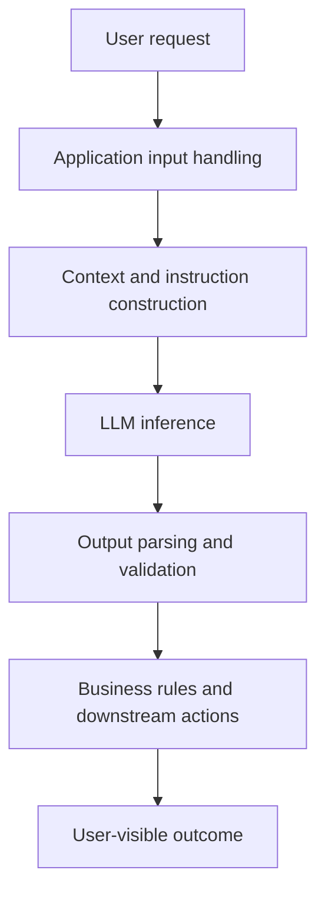

# 01 — Model Behavior Fundamentals

## 1. Learning Objectives

By the end of this chapter, you should be able to:

- Define observable model behavior and distinguish it from assumptions about internal processes.
- Explain why a model's apparent capability does not guarantee reliable performance on a particular task.
- Identify the major dimensions used to describe the quality of an LLM response.
- Explain how inputs, instructions, context, execution settings, and application logic influence outcomes.
- Distinguish model-generated output from the final behavior of a complete AI application.
- Make an initial engineering assessment of an observed behavior without prematurely attributing its cause.

## 2. Prerequisites

This chapter builds on concepts introduced in LLM-01 through LLM-06.

| Topic | Relevant background |
|---|---|
| LLM-01 — Language Model Landscape | What language models are and their broad capabilities |
| LLM-02 — Training and Learned Behavior | How training influences learned patterns and behavior |
| LLM-03 — Tokenization | How text is represented at the model interface |
| LLM-04 — Embedding Systems | High-level understanding of learned representations |
| LLM-05 — Inference and Text Generation | How model responses are produced |
| LLM-06 — Context Engineering | How supplied context and instructions shape model inputs |

These are recommended background topics, not strict prerequisites for every section. Detailed mechanics remain in their respective chapters.

## 3. Estimated Reading Time

**15–20 minutes**, excluding practical exercises and assessment.

## 4. Before We Start

Consider an AI assistant used by a financial support team.

A customer asks:

> Why was my payment rejected?

The assistant responds:

> Your payment was rejected because your account has insufficient funds.

However, the application has not supplied the customer's balance, and no payment-system evidence supports the explanation.

The response is plausible, but plausibility is not evidence.

Before deciding that the model hallucinated, investigate the complete request path:

- What information was supplied to the model?
- What did the model actually return?
- Did the application add, remove, or transform information?
- Was a tool or external system involved?
- What evidence would establish the actual reason for rejection?

These questions establish the central discipline of this chapter: **describe the observed behavior first, then investigate its cause.**

## 5. Why Model Behavior Matters

An LLM can produce fluent, relevant, and well-structured text without satisfying the actual requirements of a task.

For engineering purposes, the important question is not simply whether a model can produce a convincing response. It is whether the observed behavior is suitable for the intended use, under the conditions in which the system operates.

Consider three different tasks:

- Generating alternative names for a product.
- Summarizing a supplied technical document.
- Deciding whether a financial transaction should be approved.

The consequences of an incorrect response differ substantially. A weak product name may be harmless; an unsupported transaction decision may cause financial loss.

Therefore, model behavior must be interpreted in relation to task requirements, available evidence, and the consequences of failure.

This chapter establishes the vocabulary and mental model needed to reason about that behavior. Subsequent chapters examine reasoning limitations, factuality, instruction compliance, behavioral variation, failure attribution, and mitigation in greater depth.

## 6. Mental Model: Observe Before Explaining

### 6.1 What is observable model behavior?

**Observable model behavior** is the response or action that can be examined at a defined model interface under specified input and execution conditions.

Examples include:

- The text generated for a question.
- Whether a requested output format was followed.
- Whether a response contains an unsupported claim.
- Whether two equivalent requests receive materially different answers.
- Whether a model-generated tool-call request contains the required arguments.

An observation describes what happened. It does not, by itself, explain why it happened.

### 6.2 A conceptual model

A useful conceptual representation is:

\[
\text{Observed Behavior}
=
f(\text{Input Conditions},\text{Execution Conditions})
\]

This is a reasoning aid, not a complete mathematical specification of a language model.

**Input conditions** may include the user's request, supplied context, system and developer instructions, and conversation history.

**Execution conditions** may include the selected model version, inference settings, and other conditions under which the request is processed.

The surrounding application may additionally transform inputs, validate outputs, call external services, or determine what the user ultimately sees.

These categories help structure an investigation. They do not imply that every factor can be independently isolated or that every behavioral outcome has a single cause.

### 6.3 Capability versus observed performance

A model may demonstrate a capability in one situation and fail to use it reliably in another.

For example, a model might correctly solve several arithmetic problems but make an arithmetic error in a longer word problem.

The successful examples provide evidence that the model can solve those instances. They do not establish that it will solve every instance correctly.

An engineering assessment must therefore distinguish:

- **Capability evidence:** Examples showing that a model can perform a task.
- **Observed performance:** Results from specified instances and conditions.
- **Reliability evidence:** Evidence collected across a relevant range of cases and conditions.

Formal measurement and benchmarking belong to LLM-08. Here, the essential principle is that isolated demonstrations should not be mistaken for universal guarantees.

## 7. Core Concept: Observable Outputs Versus Internal Processes

### 7.1 An answer does not reveal everything about how it was produced

Suppose an LLM is asked whether 91 is a prime number.

It answers:

> Yes, 91 is prime.

The answer is incorrect because:

\[
91 = 7 \times 13
\]

The observable fact is that the model returned an incorrect answer. The response alone does not establish the precise internal process that produced the error.

Similarly, a correct answer does not prove that every intermediate step in its accompanying explanation was valid.

This distinction matters because explanations, confidence, formatting, and fluency are properties of the output. They are not direct, complete measurements of the model's internal computation.

### 7.2 What different forms of evidence establish

| Evidence | What it can support | What it does not establish by itself |
|---|---|---|
| The generated response | What the model returned at the observed interface | The complete internal process that produced it |
| Repeated outputs under recorded conditions | Whether observed behavior varies across those runs | General reliability across all inputs and environments |
| Relevant implementation details and logs | How parts of the system were configured or executed | Complete knowledge of every internal model process |
| An independent calculation or authoritative source | Whether a particular claim is supported | Whether the model will always make the same claim correctly |
| Controlled comparisons | Whether behavior changes when specified conditions change | That all other possible explanations have been eliminated |

The appropriate strength of a conclusion depends on the quality and scope of the evidence.

### 7.3 Production example: Unsupported payment classification

Return to the payment-support example.

The assistant claims that insufficient funds caused a rejection, but the supplied request contains no evidence of the customer's balance.

A careful investigation separates three statements:

1. **Observation:** The assistant attributed the rejection to insufficient funds.
2. **Evidence assessment:** The available request and response records do not support that explanation.
3. **Cause hypothesis:** The model may have supplied a plausible explanation without sufficient evidence, or the application may have omitted relevant information.

The first two statements can be established from the available records. The third requires further investigation.

This approach avoids confusing a visible symptom with a proven root cause. Detailed failure classification and attribution are developed in Chapter 06.

## 8. Core Concepts: Dimensions of Model Behavior

Model behavior is not adequately described by a single label such as “good,” “bad,” or “intelligent.” Different tasks require different dimensions of quality.

| Dimension | Engineering question | Example failure |
|---|---|---|
| Factual correctness | Are the claims supported and accurate? | Inventing a payment rejection reason |
| Reasoning quality | Does the conclusion follow from the relevant premises and constraints? | Reaching an invalid conclusion from supplied facts |
| Instruction compliance | Did the response satisfy the actual task requirements? | Returning prose when valid JSON was required |
| Consistency | Does behavior remain sufficiently stable across relevant equivalent conditions? | Giving incompatible answers to equivalent requests |
| Calibration | Does expressed certainty appropriately reflect the available evidence? | Presenting an unsupported guess as certain |
| Completeness | Are all required parts of the response present? | Omitting a mandatory field |
| Task relevance | Does the response address the user's actual objective? | Providing background information instead of solving the requested problem |

These dimensions are related, but they are not interchangeable.

A response may be factually correct yet incomplete. It may follow the requested format while containing false claims. It may provide a correct conclusion with a weak explanation.

Later chapters examine these dimensions individually where they require their own diagnostic methods.

### Example: JSON compliance

Suppose an application requires:

- `status`: one of `approved`, `rejected`, or `review`.
- `reason`: a non-empty string.
- No additional fields.

A response can contain a reasonable decision and still fail the contract if it omits `reason`, uses an invalid status, or adds unexpected fields.

In production, the application should validate the output against the actual contract rather than assuming that well-formed-looking text is compliant. Detailed structured-generation mechanics belong to LLM-05; the relevant point here is that behavioral quality must be judged against explicit requirements.

## 9. Factors That Influence Observable Behavior

Several factors can influence the response an engineer observes. They often interact, so a symptom should not automatically be attributed to one factor.

### 9.1 Learned parameters

The model's learned parameters influence the patterns and capabilities it can express.

Training processes shape learned behavior; LLM-02 owns their detailed explanation. This chapter treats learned parameters as one influence on observed behavior rather than re-teaching training.

### 9.2 Supplied context

The model's response depends partly on the information available in its input context.

Missing, ambiguous, irrelevant, or conflicting information can affect the answer. Context construction and context-window constraints belong to LLM-06.

### 9.3 Instructions and task formulation

Instructions influence what the model is being asked to do and which constraints it should follow.

Ambiguous requirements can make it difficult to determine whether an answer satisfies the intended task. Chapter 04 examines instruction following and constraint compliance in detail.

### 9.4 Inference configuration and model version

The selected model version and execution settings can affect generated responses.

Inference and decoding mechanics belong to LLM-05. The relationship between settings, repeated outputs, and behavioral variation is examined in Chapter 05.

### 9.5 Task characteristics

Tasks differ in their demands. Some require direct extraction from supplied text; others require multi-step reasoning, uncertainty management, or the integration of incomplete evidence.

A model's success on one task type should not be treated as sufficient evidence of success on another. Chapter 02 examines reasoning capabilities and limitations.

### 9.6 Surrounding application

An application can change the outcome before and after model inference.

Examples include:

- Removing relevant information before constructing the request.
- Supplying incorrect or outdated context.
- Truncating or transforming the model's output.
- Parsing an output incorrectly.
- Applying business rules inconsistently.
- Displaying a result that differs from the model's raw response.

This is why the final user-visible outcome must be distinguished from the raw model response.

## 10. System Flow: Model Output and Application Execution

A simplified AI application may follow this flow:

This is a conceptual architecture, not a claim that every application follows exactly these stages. Some systems omit stages, repeat them, or invoke external tools between them.

The key distinction is between **model computation** and **system execution**.

- The model produces an output at its interface.
- The application may validate, transform, reject, or act on that output.
- The user sees the final result produced by the complete system.

For example, a model may return a valid classification, but the application might map that classification to the wrong business action. Conversely, the application might correctly reject an invalid model response before it reaches the user.

When investigating a failure, identify the boundary at which the behavior first diverged from the requirement. This is a starting point for diagnosis, not proof of the underlying root cause.

## 11. Production Perspective

A production system should not rely on the assumption that a model's response is correct merely because it is fluent or plausible.

Engineering controls should be proportionate to the task's consequences.

### 11.1 Validate inputs and outputs

Define what valid inputs and acceptable outputs look like.

Depending on the application, this may include required fields, permitted values, length limits, evidence requirements, or explicit rejection conditions.

### 11.2 Verify consequential claims independently

Where correctness matters, use appropriate independent evidence, deterministic computation, authoritative records, or domain-specific validation.

For the payment example, the actual payment-system record is more suitable evidence of a rejection reason than an unsupported model-generated explanation.

### 11.3 Maintain useful observability

Record enough information to investigate failures, such as model version, relevant configuration, request identifiers, validation outcomes, and appropriate input/output records.

Logging must respect privacy, data-retention, access-control, and security requirements. More logging is not automatically better.

### 11.4 Attribute failures carefully

A failed user-visible outcome may originate in model behavior, context construction, application code, an external dependency, or an interaction among components.

Collect evidence before assigning ownership or implementing a fix. Production deployment and monitoring practices belong to PROD; formal evaluation methodology belongs to LLM-08.

## 12. Engineering Decisions and Trade-offs

Model behavior must be assessed in the context of an application's requirements and risks.

Three questions are particularly useful:

**What evidence is sufficient for this decision?**

A brainstorming assistant may tolerate unverified suggestions. A financial or safety-critical workflow requires stronger controls and authoritative evidence.

**What should happen when confidence or evidence is insufficient?**

Depending on the task, the system may ask for clarification, request additional evidence, abstain, return a review status, or route the case to a human.

**What is the cost of preventing or detecting an error?**

Stronger validation and independent checks can improve reliability, but they may increase latency, cost, complexity, or operational effort. The appropriate design depends on the consequences of failure.

These decisions should be made against explicit requirements rather than an assumption that one level of model reliability is suitable for every application.

## 13. Common Mistakes and Misconceptions

### Mistake 1: Treating fluency as evidence of correctness

A polished response can contain false claims. Check claims against the task requirements and relevant evidence.

### Mistake 2: Assuming one successful example proves general capability

One result establishes what happened in that instance. Broader claims require evidence from relevant conditions and cases.

### Mistake 3: Treating an explanation as a complete record of internal computation

An explanation is part of the generated output. It should not automatically be treated as a faithful trace of every internal process.

### Mistake 4: Blaming the model for every system failure

Trace the complete request and execution path before assigning a cause.

### Mistake 5: Using a single quality score for every task

Correctness, completeness, instruction compliance, consistency, and calibration describe different properties. Determine which ones matter for the intended application.

### Mistake 6: Assuming a fix for one failure generalizes to all failures

A change that improves one observed case may introduce regressions elsewhere. Validate the fix against the relevant requirements and cases; systematic evaluation belongs to LLM-08.

### Mistake 7: Treating observed variation as proof of a specific cause

Variation is an observation. Determining its cause requires investigating the model version, inputs, configuration, and surrounding system.

## 14. Interview Questions with Expected Answers

### Q1. What is observable model behavior?

**Expected answer:** It is the response or action that can be examined at a defined model interface under specified input and execution conditions. It describes what happened, not necessarily why it happened.

### Q2. Why does a correct answer not prove that the model is reliable?

**Expected answer:** A correct result demonstrates success on that instance. Reliability claims require evidence relevant to the intended range of tasks and conditions.

### Q3. What is the difference between model behavior and system behavior?

**Expected answer:** Model behavior concerns the model's output at its interface. System behavior includes application input handling, context construction, validation, business logic, external dependencies, and the final user-visible outcome.

### Q4. How would you investigate an unsupported claim made by an LLM?

**Expected answer:** Preserve the relevant request and response, inspect the supplied context and execution conditions, identify what evidence supports the claim, and investigate possible application-level transformations. Treat a proposed root cause as a hypothesis until evidence supports it.

### Q5. Why are multiple dimensions needed to assess response quality?

**Expected answer:** A response can be factually correct but incomplete, correctly formatted but false, or relevant but noncompliant with an explicit requirement. Different dimensions expose different failure types.

### Q6. What controls would you consider before using an LLM in a consequential workflow?

**Expected answer:** Define acceptance criteria, validate inputs and outputs, independently verify consequential claims, establish safe handling for insufficient evidence, and retain appropriate observability. Controls should reflect the task's risks and operational constraints.

## 15. Quick Revision

- Observable behavior describes what happened at a defined interface.
- A model's demonstrated capability does not guarantee reliable performance in every situation.
- Output quality has multiple dimensions; correctness alone is insufficient.
- Inputs, context, instructions, execution settings, and application logic can influence outcomes.
- The model's raw output and the final system result are different observation points.
- Failure attribution requires evidence, not just a plausible explanation.
- Production controls should be proportionate to the consequences of failure.

## 16. Key Takeaways

The central engineering discipline is to separate **observation, interpretation, and attribution**.

First, record the behavior against a clear requirement. Next, determine what the available evidence supports. Only then investigate the factors that may have caused the result.

This approach provides a foundation for the next chapters, which examine reasoning limitations, factuality, instruction compliance, consistency, and practical failure investigation.

## 17. Further Reading

These resources provide broader background; they are not substitutes for the chapter's engineering concepts.

- Vaswani et al., [Attention Is All You Need](https://arxiv.org/abs/1706.03762) — Transformer architecture background.
- Brown et al., [Language Models are Few-Shot Learners](https://arxiv.org/abs/2005.14165) — Language-model capabilities and few-shot behavior.
- Bender et al., [On the Dangers of Stochastic Parrots](https://dl.acm.org/doi/10.1145/3442188.3445922) — Critical discussion of language-model limitations and risks.
