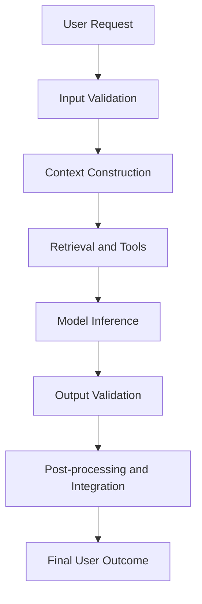

# 06 — Observable Failure Patterns and Attribution

## 1. Purpose

An LLM system can produce an incorrect answer, ignore a constraint, select an inappropriate tool, misuse retrieved evidence, or return an output that breaks a downstream workflow.

Observing a failure is only the beginning of the investigation. The difficult engineering question is determining **what failed, where the failure originated, which components contributed, and what evidence supports those conclusions**.

A plausible explanation is not necessarily a correct diagnosis. A model-generated answer may be wrong because the model mishandled valid evidence, because the application supplied incorrect context, because retrieval selected an unsuitable document, or because a downstream component transformed an otherwise correct result.

This chapter establishes a practical framework for identifying observable failure patterns and attributing them to the most defensible system component.

The goal is not to classify every failure into a universal taxonomy. It is to develop an evidence-driven method for investigating failures in real LLM applications.

## 2. Learning Objectives

By the end of this chapter, you should be able to:

- Distinguish an observable failure from a hypothesized cause.
- Classify common failure patterns by their observable symptoms.
- Identify the components that may introduce, propagate, or fail to contain an error.
- Distinguish model-level failures from application-level failures.
- Use traces, prompts, retrieved evidence, tool results, and outputs to reconstruct an execution.
- Avoid premature attribution and unsupported causal conclusions.
- Form and test competing hypotheses.
- Separate root-cause investigation from mitigation selection.
- Produce a concise, evidence-supported failure analysis.

## 3. Prerequisites and Scope

This chapter builds on previous LLM engineering topics:

- **LLM-01 — Model Behavior Fundamentals:** observable behavior is evidence; internal explanations require caution.
- **LLM-02 — Training and Learned Behavior:** learned behavior influences capabilities and limitations.
- **LLM-03 — Tokenization:** input representation can affect how technical text and structured inputs are processed.
- **LLM-04 — Embeddings and Representations:** representations affect similarity-based retrieval and related workflows.
- **LLM-05 — Inference and Generation:** generation behavior can contribute to incorrect or malformed outputs.
- **LLM-06 — Context Engineering:** prompt construction and supplied context influence model behavior.
- **LLM-07, Chapters 03–05:** factuality, instruction compliance, consistency, and calibration provide useful lenses for interpreting failures.

This chapter focuses on failure observation and causal attribution.

It does not attempt to provide a complete benchmark methodology, a universal failure-rate calculation, or a full production incident-management process. Formal evaluation belongs in LLM-08; deployment operations and monitoring belong in production engineering; enterprise risk and governance belong in the enterprise systems domain.

## 4. The Fundamental Distinction: Symptom, Failure Location, Mechanism, and Root Cause

Engineers frequently jump from an observed symptom to a proposed fix without establishing the causal path.

Consider an assistant that returns an incorrect reimbursement limit.

The following statements describe different levels of understanding:

- **Symptom:** The response contains the wrong reimbursement limit.
- **Failure location:** The retrieval stage selected an inapplicable policy.
- **Contributing mechanism:** The retrieved document was supplied to the model as relevant evidence.
- **Underlying cause:** The employee-category filter was missing or ineffective because of a configuration defect, implementation error, or another condition that still requires investigation.

These distinctions matter because identifying where a failure becomes visible does not necessarily explain why it occurred.

A useful investigation separates four questions:

| Level | Question | Example |
|---|---|---|
| Symptom | What went wrong? | The reimbursement amount was incorrect. |
| Failure location | Where did behavior first diverge from the expected contract? | Retrieval selected the wrong policy. |
| Mechanism | How did that divergence contribute to the outcome? | The model received an inapplicable policy as evidence. |
| Underlying cause | Why did the system permit that condition? | The metadata filter was missing, incorrectly configured, or ineffective. |

The first three may be established by execution evidence even when the underlying cause remains unknown.

For example, a trace might establish that the retrieval stage returned the wrong document. It does not automatically establish why the filter failed. Determining that may require examining configuration, code, deployment history, or source metadata.

In distributed systems, the underlying cause may also involve multiple contributing defects rather than one isolated fault.

Use the strongest conclusion supported by the evidence. If the investigation identifies the failure location but not the underlying cause, report that distinction explicitly.

**Engineering principle:** Describe the observed failure first, locate the divergence, establish the contributing mechanism, and claim an underlying cause only when the evidence supports it.

## 5. A Practical Taxonomy of Observable Failure Patterns

Failure categories are diagnostic aids, not mutually exclusive labels. A single incident may involve several patterns.

### 5.1 Factual error

**Observable symptom:** The response contains a claim that conflicts with reliable evidence or an established ground truth.

Examples:

- An incorrect date or numerical value.
- A false description of a product feature.
- A policy statement that contradicts the applicable source.
- An incorrect summary of a supplied document.

Possible contributing components include the model, source material, retrieval, context construction, and post-processing.

The presence of a factual error does not by itself identify which component caused it. See LLM-07 Chapter 03 for the distinction between factuality, evidence, and grounding.

### 5.2 Unsupported claim

**Observable symptom:** The response states something as fact without sufficient supporting evidence in the available sources.

Examples:

- A numerical estimate appears without a traceable basis.
- A response cites a document that does not support the associated claim.
- The model supplies a missing detail that the source never established.

A claim can be true by coincidence and still be unsupported by the evidence used in the task.

Investigation should examine the claim, its cited or supplied evidence, and whether the evidence actually supports the claim.

### 5.3 Instruction or constraint violation

**Observable symptom:** The response fails to satisfy an explicit requirement.

Examples:

- Returning prose when machine-readable JSON is required.
- Omitting a mandatory field.
- Providing recommendations when the task requires only extraction.
- Disclosing information that the application should not expose.
- Exceeding a specified limit.

The failure may originate in model behavior, conflicting instructions, an inadequate output contract, missing validation, or a downstream component.

Before attributing the failure to the model, verify that the requirement was present, applicable, and unambiguous.

### 5.4 Context misuse

**Observable symptom:** The response ignores relevant supplied information, relies on irrelevant information, or interprets context incorrectly.

Examples:

- Using an outdated policy passage when a current passage is also supplied.
- Treating an illustrative example as a binding instruction.
- Confusing information about two different users.
- Overlooking an explicit constraint in the conversation history.

Possible contributors include context selection, ordering, truncation, ambiguity, and model interpretation.

The investigation should reconstruct the actual context received by the model, not merely the context the application intended to send.

### 5.5 Retrieval failure

**Observable symptom:** A retrieval-augmented system fails to supply suitable evidence for the question.

Common patterns include:

- No relevant document is retrieved.
- A relevant document exists but is not selected.
- A stale or superseded document is selected.
- A document for the wrong entity or category is retrieved.
- A relevant result is ranked below the context-selection cutoff.

Retrieval failure and model failure must be distinguished.

If the model receives no relevant evidence, an unsupported answer may reflect a retrieval problem, a generation problem, or both. If retrieval supplies correct evidence and the response contradicts it, the investigation shifts toward context handling, model behavior, or subsequent transformations.

Neither conclusion should be made without inspecting the actual retrieved results and final context.

### 5.6 Tool-selection or tool-use failure

**Observable symptom:** The application chooses an inappropriate tool, supplies invalid arguments, misinterprets a result, or fails to handle a tool error.

Examples:

- Selecting a web search tool when an authoritative internal policy lookup is required.
- Calling an API with an invalid identifier.
- Passing a date in an unsupported format.
- Treating a failed API response as a successful result.
- Using stale tool output after the underlying state changes.

Tool-related failures may originate in model decisions, tool descriptions, argument schemas, orchestration logic, permissions, external services, or error handling.

Inspect the tool call and its result separately from the final natural-language response.

### 5.7 Structured-output failure

**Observable symptom:** The generated or returned data violates the required structure or semantics.

Examples:

- Invalid JSON.
- Missing required fields.
- A string returned where a number is required.
- A syntactically valid object containing an invalid category.
- Fields that satisfy the schema individually but violate a cross-field business rule.

Different checks detect different problems:

- Syntax validation checks whether the representation can be parsed.
- Schema validation checks declared structural requirements.
- Semantic validation checks whether values and relationships satisfy application rules.

A response can pass one check and fail another. The investigation must identify which contract was violated and at which stage.

### 5.8 Unsupported inference

**Observable symptom:** The system draws a conclusion that does not follow from the available facts or assumptions.

Examples:

- Assuming correlation establishes causation.
- Treating a missing field as proof that a condition is false.
- Inferring a user's eligibility from an attribute that is not part of the policy.
- Combining individually correct facts into an invalid conclusion.

The problem may lie in missing assumptions, invalid intermediate steps, ambiguous requirements, or a model's interpretation of the task.

Trace the conclusion back to its premises. Determine which premise is unsupported or which inference step fails before deciding on a mitigation.

### 5.9 Inconsistent behavior

**Observable symptom:** Comparable executions produce materially different outcomes.

Examples:

- The same classification changes between runs.
- Equivalent requests receive conflicting policy answers.
- The model applies a constraint in one run but omits it in another.

Variation alone is not always a failure. Different requests, evidence, or valid interpretations can justify different responses.

The important question is whether the variation violates an explicitly defined invariant under comparable conditions.

See LLM-07 Chapter 05 for repeatability, calibration, and behavioral variation.

### 5.10 Workflow or integration failure

**Observable symptom:** An otherwise useful model output does not produce the intended application outcome.

Examples:

- A validated response is associated with the wrong user record.
- The application silently drops a required field.
- A retry causes an operation to execute twice.
- A successful model response is returned before a required database update completes.
- A correct result is transformed incorrectly by middleware.

These failures are particularly important because the user experiences the entire application, not the model call in isolation.

Investigate the complete execution path and identify the first component whose behavior diverged from the expected contract.

## 6. Failure Categories Can Overlap

A single incident can involve multiple failure patterns.

Consider an internal policy assistant:

1. Retrieval selects a policy for the wrong employee category.
2. The context builder includes the incorrect policy but omits the employee-category metadata.
3. The model returns a confident reimbursement limit.
4. The response includes a citation, but the cited policy does not apply to the user.
5. The application returns the answer without validating source applicability.

The incident includes:

- A retrieval failure.
- A context-construction failure.
- An unsupported or incorrectly grounded claim.
- A validation gap.

It would be misleading to classify the entire incident as simply "hallucination" or "the model made a mistake."

The taxonomy describes the observed patterns. Attribution explains how the failure arose, which components contributed, and which control failed to prevent the user-visible outcome.

A useful incident record may therefore contain one primary failure category and several contributing factors.

## 7. Attribution Across the LLM Application Stack

A practical LLM application can be inspected as a sequence of components.

This diagram is a diagnostic model, not a requirement that every application use this exact architecture. Some systems retrieve before context construction, invoke tools iteratively, or contain multiple model calls.

### 7.1 Input validation

Inspect whether the request was parsed and normalized correctly.

Questions:

- Were required fields present?
- Were values interpreted using the correct types and units?
- Was relevant user or tenant identity preserved?
- Were ambiguous requests handled according to the intended contract?

### 7.2 Context construction

Inspect the actual instructions, conversation history, retrieved content, and metadata sent to the model.

Questions:

- Were required instructions included?
- Was context truncated?
- Was the correct user or entity represented?
- Were conflicting or stale passages included?
- Did formatting obscure important distinctions?

### 7.3 Retrieval and tools

Inspect the actual queries, candidates, selected results, arguments, and returned values.

Questions:

- Did the relevant source exist?
- Was it eligible for retrieval?
- Did filters and ranking behave as intended?
- Did a tool return an error or partial result?
- Was the returned data interpreted correctly?

### 7.4 Model inference

Inspect the model input and output while holding other variables in view.

Questions:

- Did the response contradict explicit evidence?
- Did it omit a required instruction?
- Did it introduce unsupported claims?
- Did it return an invalid format despite a clear contract?
- Were multiple outputs compared under genuinely equivalent conditions?

Attributing a failure to model behavior is strongest when the investigation establishes the exact effective input, relevant execution configuration, and raw model output; rules out plausible application-level explanations; and demonstrates that the output violates the expected behavior.

Even then, the evidence may establish that the model output is where the failure occurred without identifying a unique internal mechanism. Serving behavior, nondeterministic execution details, or incomplete traces may leave uncertainty. Report those limitations rather than claiming that the model's internal cause is known.

### 7.5 Output validation

Inspect which checks were applied and what they actually guaranteed.

Questions:

- Was the output parsed successfully?
- Were required fields present?
- Were allowed values enforced?
- Were business rules checked?
- Did a validator incorrectly accept an invalid result?

A validator's success is meaningful only relative to the rules it implements. Passing a schema does not establish factual correctness.

### 7.6 Post-processing and integration

Inspect transformations between model output and final user-visible output.

Questions:

- Was the model output modified?
- Were fields renamed, dropped, or incorrectly mapped?
- Was the result associated with the correct request?
- Did retries or asynchronous processing alter the outcome?
- Was an earlier result overwritten by a later step?

A correct intermediate result can become an incorrect final result after integration.

### 7.7 Error introduction, propagation, and containment

Three different events may occur during one failure:

- **Error introduction:** A component first produces or selects an incorrect value.
- **Error propagation:** A later component passes that value forward or uses it as an input.
- **Containment failure:** A control that should have detected, rejected, or safely handled the invalid value does not do so.

For example, retrieval may select an obsolete policy, context construction may pass it to the model, and output validation may check only JSON syntax. Retrieval introduces the unsuitable evidence; context construction propagates it; validation fails to contain the resulting incorrect answer.

These roles can belong to different components. A component that fails to contain an error may contribute to the user-visible incident without having introduced the original defect.

Identifying all three helps engineers design a targeted fix rather than assuming that only one component needs attention.

## 8. An Evidence-Driven Attribution Workflow

Use this workflow when investigating a failure in an LLM application.

### Step 1: State the observed failure

Describe what happened without naming a cause.

Weak statement:

> The model ignored the policy.

Better statement:

> The returned answer stated a reimbursement limit that conflicts with the applicable policy.

The second statement is directly testable.

### Step 2: Define the expected behavior

Identify the requirement, source of truth, or contract that establishes what should have happened.

Examples:

- An approved policy document.
- A known test label.
- A schema definition.
- A documented tool contract.
- A business rule.
- An expected state transition.

If the expected behavior is ambiguous, resolve that ambiguity before claiming a failure.

### Step 3: Preserve the execution evidence

Capture the information needed to reconstruct the relevant execution, subject to privacy and security requirements.

Useful evidence may include:

- Request and trace identifiers.
- Input and conversation history.
- Prompt or template version.
- Actual model input.
- Model and generation configuration.
- Retrieved document identifiers and versions.
- Tool arguments and results.
- Intermediate outputs.
- Validation results.
- Post-processing steps.
- Final user-visible output.

Do not assume that logging only the final answer is sufficient to diagnose the failure.

### Step 4: Reconstruct the execution

Follow the path from request to final outcome.

Compare what each component received, what it produced, and what contract it was expected to satisfy.

The goal is to identify the earliest meaningful divergence from expected behavior, then determine whether later components propagated or failed to contain it.

### Step 5: Form competing hypotheses

Avoid committing to the first plausible explanation.

For an incorrect policy answer, possible hypotheses might include:

- The wrong document was retrieved.
- The correct document was retrieved but excluded from the final context.
- The model received correct evidence but produced a contradictory answer.
- The output was correct initially but altered during post-processing.
- The policy itself was outdated or ambiguous.

These hypotheses imply different investigations and different fixes.

### Step 6: Test hypotheses against evidence

Use the least expensive test that meaningfully distinguishes the hypotheses.

Examples:

- Inspect retrieval candidates to determine whether the correct document was available.
- Compare retrieved results with the exact model context.
- Replay a controlled test with fixed evidence.
- Compare the intermediate model output with the final application output.
- Validate the policy's applicability and version.

A successful replay can support a hypothesis, but it does not automatically prove the same mechanism caused the original incident. Preserve the distinction between reproduction and original-incident attribution.

### Step 7: Assign a confidence level to the attribution

Use language that matches the evidence.

- **Confirmed:** Direct evidence establishes the failure mechanism within the scope of the investigation.
- **Strongly supported:** Multiple pieces of evidence support the explanation, though some uncertainty remains.
- **Plausible:** The explanation fits the symptoms but has not been adequately distinguished from alternatives.
- **Unknown:** Available evidence does not support a defensible causal conclusion.

These are practical reporting labels, not a formal statistical scale. If the underlying cause remains unknown, an investigation may still confirm the failure location and identify contributing mechanisms.

### Step 8: Record contributing factors and unresolved questions

Real failures often have multiple contributors.

For example, retrieval may select a less relevant document, while output validation fails to detect that the response violates a policy requirement.

Record the primary failure, contributing conditions, evidence, and unresolved questions separately.

### Step 9: Select a mitigation after attribution

Choose a change that addresses the supported mechanism.

Examples:

- Fix retrieval metadata filters.
- Correct context assembly.
- Clarify the task contract.
- Add deterministic validation.
- Improve tool error handling.
- Correct a post-processing mapping.
- Add an escalation path for unresolved ambiguity.

Avoid applying a prompt change simply because the final answer came from an LLM. The prompt may not be the component responsible for the failure.

### Step 10: Verify the mitigation

Re-run the failing case and relevant neighboring cases.

Check whether:

- The original failure is prevented.
- The intended behavior is preserved.
- Other valid cases still work.
- The mitigation creates new failure modes.
- The evidence supports the claimed improvement.

A fix that makes the example pass once is not sufficient evidence of general reliability.

## 9. Practical Example: Incorrect Policy Answer

### Scenario

A company assistant must answer reimbursement questions using the approved internal policy.

A full-time employee asks:

> What is my maximum reimbursement for a domestic hotel stay?

The application returns a limit that belongs to contractors.

The final answer cites a policy document, but the citation does not apply to the employee.

### Initial observation

The response contains an incorrect policy value for the request's employee category.

Do not yet conclude that the model hallucinated or that retrieval caused the failure.

### Evidence to inspect

1. The employee category stored for the request.
2. The original retrieval query and filters.
3. The retrieved candidate documents.
4. The document identifiers and versions selected for context.
5. The exact context passed to the model.
6. The model's raw output.
7. Citation and policy-applicability validation.
8. The final response after post-processing.

### Possible investigation outcomes

**Outcome A: The wrong document was retrieved.**

The retrieval trace shows that the contractor policy was selected because the employee-category filter was missing.

Supported attribution: retrieval selected an inapplicable policy and contributed to the failure.

Potential mitigation: enforce the correct metadata filter and test cases for each employee category.

The underlying reason the filter was missing still requires investigation.

**Outcome B: The correct document was retrieved, but context construction replaced it.**

The retrieval results contain the correct policy, but the final model context contains a different passage.

Supported attribution: context construction contributed to the failure.

Potential mitigation: correct selection or assembly logic and add tests that verify the actual model context.

**Outcome C: Correct evidence reached the model, but the response contradicted it.**

The captured model input contains the applicable policy and its correct limit. The raw model output supplies a different value, and post-processing does not alter it.

Supported attribution: the model output is where the observed contradiction appears. If the relevant execution conditions are captured and plausible application-level explanations have been investigated, this supports a model-behavior diagnosis. It still does not establish a unique internal cause.

Potential mitigation: consider evidence-constrained response handling, deterministic extraction for the required value, or validation against the applicable policy.

**Outcome D: The model output was correct, but the final response was wrong.**

The raw model output contains the correct limit, but a downstream mapping substitutes the contractor limit.

Supported attribution: post-processing or integration introduced the incorrect value.

Potential mitigation: fix the mapping and add regression tests around the transformation.

### Lesson

The same user-visible symptom can result from different failure mechanisms.

The mitigation should follow the evidence, not the assumption that every incorrect answer is a generation failure.

## 10. Attribution Pitfalls

### 10.1 Blaming the model because the application uses an LLM

An LLM application is a system with multiple components. A model can be the point where an error becomes visible without being the component that introduced the underlying defect.

**Better approach:** Reconstruct the execution and compare intermediate inputs and outputs.

### 10.2 Treating correlation as causation

A failure occurring after a prompt change does not prove the prompt change caused it. Other variables may have changed at the same time.

**Better approach:** Control relevant variables and test whether the proposed mechanism explains the observed difference.

### 10.3 Treating a successful replay as proof of the original cause

A replay may reproduce the symptom under controlled conditions, but the original execution could have involved different context, external results, or state.

**Better approach:** Compare original traces with replay evidence and state exactly what the replay establishes.

### 10.4 Confusing a failed check with the underlying defect

A validator may detect an invalid output, but the validator is not necessarily the source of the invalid output. Conversely, a validator that passes an invalid result may have an inadequate contract.

**Better approach:** Distinguish error introduction from error detection and containment.

### 10.5 Using vague labels

Terms such as "hallucination," "reasoning issue," or "agent failure" may describe a broad symptom without identifying the mechanism.

**Better approach:** State the violated requirement, the observed output, and the evidence-supported component attribution.

### 10.6 Fixing symptoms without addressing the mechanism

Adding a prompt instruction may hide one manifestation while leaving a faulty retrieval filter or invalid state transition unchanged.

**Better approach:** Address the diagnosed mechanism and test for recurrence.

## 11. Failure Records and Engineering Communication

A useful failure report should allow another engineer to understand what happened without relying on the original investigator's intuition.

A compact report should include:

| Field | What to record |
|---|---|
| Incident or test ID | A stable reference to the execution |
| Expected behavior | The requirement or trusted source |
| Observed behavior | What the system actually returned or did |
| Failure category | The primary observable pattern |
| Failure location | The component where the first meaningful divergence was observed |
| Evidence | Relevant traces, inputs, outputs, and checks |
| Attribution | The mechanism or component supported by evidence |
| Confidence | Confirmed, strongly supported, plausible, or unknown |
| Contributing factors | Additional conditions that affected the outcome |
| Mitigation | The change proposed or applied |
| Verification | Tests and evidence showing the result after the change |
| Remaining uncertainty | Questions that the available evidence cannot resolve |

### Example

**Failure:** The response returned the contractor reimbursement limit for a full-time employee.

**Evidence:** The request metadata identifies the employee as full-time. The retrieval trace selected the contractor policy, and the final model context contains that policy.

**Failure location:** Retrieval selected an inapplicable policy.

**Attribution:** The retrieved evidence contributed to the incorrect answer. The current evidence does not establish why the metadata filter failed.

**Mitigation:** Correct the employee-category filter and add tests covering both employee categories.

**Verification:** Confirm that the correct document is selected for each category, then test that the resulting answer uses the applicable limit.

**Remaining uncertainty:** The precise reason the original filter was absent or ineffective requires inspection of the retrieval configuration and deployment history.

This format separates established observations from the causal question that remains open.

## 12. Trade-offs in Failure Investigation

### 12.1 Investigation depth versus time to recovery

During a high-impact incident, restoring a safe service may take priority over establishing the complete root cause.

An immediate mitigation may be justified while the deeper investigation continues. Record which conclusions are provisional and do not confuse service restoration with root-cause resolution.

### 12.2 More logging versus privacy

Detailed traces improve diagnosability but may capture personal data, confidential documents, credentials, or sensitive tool results.

Apply data minimization, access controls, redaction, and appropriate retention. Capture the evidence required for diagnosis rather than indiscriminately logging every available field.

### 12.3 Broad mitigation versus targeted correction

A broad fallback may reduce some visible failures but can also suppress valid behavior, increase latency, or route too many requests to human review.

A targeted correction is preferable when the mechanism is well understood. Broader safeguards may be appropriate when the failure is high-impact and the mechanism remains uncertain.

### 12.4 Single-cause explanations versus contributing factors

Some failures have one clear defect; others emerge from interactions among components.

Forcing every incident into a single-cause explanation can hide meaningful contributors. Conversely, listing many speculative causes without evidence weakens the investigation.

Report the primary supported attribution and separate confirmed contributing factors from untested hypotheses.

## 13. Practical Exercise: Investigate a Multi-Component Failure

### Scenario

An internal knowledge assistant answers questions about employee leave policies.

A user asks about the carry-forward limit. The assistant returns a plausible numerical limit and cites an internal policy document.

An investigation reveals the following:

- The policy repository contains two documents with similar titles.
- One document is current; the other is obsolete.
- Retrieval selected the obsolete document.
- The obsolete document was included in the model context.
- The model generated an answer consistent with the obsolete document.
- The final response passed JSON schema validation.
- No check verified whether the cited document was current.

### Tasks

1. State the observable failure without assigning blame.
2. Identify the primary failure pattern and any contributing patterns.
3. Explain what the evidence establishes about retrieval and model behavior.
4. Explain why successful JSON validation does not establish factual correctness.
5. Propose at least two competing explanations for why retrieval selected the obsolete document.
6. Identify the additional evidence needed to distinguish those explanations.
7. Distinguish the component that introduced the unsuitable evidence from the component that failed to contain its effects.
8. Propose a mitigation that addresses the supported mechanism.
9. Define regression cases for current and obsolete policy documents.
10. Describe how you would verify that the final response cites an applicable source.
11. Write a concise incident report that distinguishes confirmed facts from unresolved questions.

### Teaching check

Explain why the statement "the model hallucinated because it gave the wrong limit" is not sufficiently supported by the scenario.

A strong answer should distinguish the incorrect user-visible result, the obsolete evidence supplied to the model, the role of schema validation, and the unresolved cause of the retrieval selection.

## 14. Interview Questions

Use these questions to assess your ability to investigate unfamiliar failures.

1. What is the difference between an observable symptom, a failure location, and an underlying cause?
2. Why can the same incorrect answer originate from different components?
3. How would you distinguish a retrieval failure from a model failure?
4. What evidence would support attributing an incorrect final answer to post-processing?
5. Why does successful schema validation not establish factual correctness?
6. How would you investigate a tool call that returned a plausible but incorrect result?
7. What does a successful replay establish, and what does it not establish about the original incident?
8. How should an engineer report a likely cause when the evidence is incomplete?
9. Why might an incident have multiple contributing factors?
10. How would you choose between a targeted correction and a temporary broad safeguard?
11. What is the difference between introducing an error, propagating it, and failing to contain it?
12. How would you verify that a proposed fix addresses the diagnosed mechanism rather than merely hiding the symptom?

For each answer, explain what evidence you would collect, which alternative hypotheses you would test, and what uncertainty would remain.

## 15. Revision Checklist

Before considering this topic understood, verify that you can explain:

- [ ] A failure symptom does not uniquely identify its cause.
- [ ] Common observable patterns include factual errors, unsupported claims, constraint violations, context misuse, retrieval failures, tool failures, structured-output failures, unsupported inferences, inconsistent behavior, and integration failures.
- [ ] Failure categories can overlap.
- [ ] Model behavior must be investigated alongside retrieval, context construction, tools, validation, and post-processing.
- [ ] Actual execution evidence is more useful than assumptions about intended execution.
- [ ] The component where a failure appears is not necessarily the component that introduced it.
- [ ] Errors can be introduced, propagated, and left uncontained by different components.
- [ ] Competing hypotheses should be tested before making strong causal claims.
- [ ] Attribution confidence should match the available evidence.
- [ ] Mitigation selection should follow diagnosis.
- [ ] Verification should test the original failure and relevant regression cases.
- [ ] Incident reports should separate observations, evidence, attribution, mitigation, and unresolved questions.

If you cannot explain why an incorrect answer may originate outside the model, revisit Sections 4, 7, and 8.

## 16. Key Takeaways

- Observable failures describe what went wrong; attribution explains which components contributed and why.
- The same symptom can arise from different mechanisms across the LLM application stack.
- A failure taxonomy supports diagnosis but should not replace evidence.
- The actual execution path—including context, retrieval, tool results, model output, validation, and post-processing—must be inspected when relevant.
- The component where a failure becomes visible may not be the component that introduced it.
- Error introduction, propagation, and containment are distinct roles that can belong to different components.
- A successful replay supports a hypothesis but does not automatically prove the cause of the original incident.
- Root-cause claims should be proportional to the strength of the evidence.
- Mitigations should address the diagnosed mechanism and be verified against the original failure and neighboring cases.
- Good engineering communication distinguishes established facts, supported attribution, contributing factors, and unresolved questions.

The central engineering principle is:

**Do not stop at identifying what failed. Reconstruct the execution, test competing explanations, and attribute the failure only as strongly as the evidence allows.**

## 17. Further Reading

These resources provide broader context for language-model reliability and retrieval-augmented systems. They do not prescribe the exact diagnostic workflow used in this chapter.

1. Ji et al., *Survey of Hallucination in Natural Language Generation*  
   https://arxiv.org/abs/2202.03629

2. Lewis et al., *Retrieval-Augmented Generation for Knowledge-Intensive NLP Tasks*  
   https://arxiv.org/abs/2005.11401

3. Liang et al., *Holistic Evaluation of Language Models (HELM)*  
   https://arxiv.org/abs/2211.09110

## 18. Document Boundary

This chapter teaches observable failure classification, evidence collection, and causal attribution within LLM applications.

It does not define a comprehensive benchmark suite, statistical evaluation methodology, or operational incident-management standard. Those concerns belong in formal evaluation, production engineering, and enterprise governance modules.
