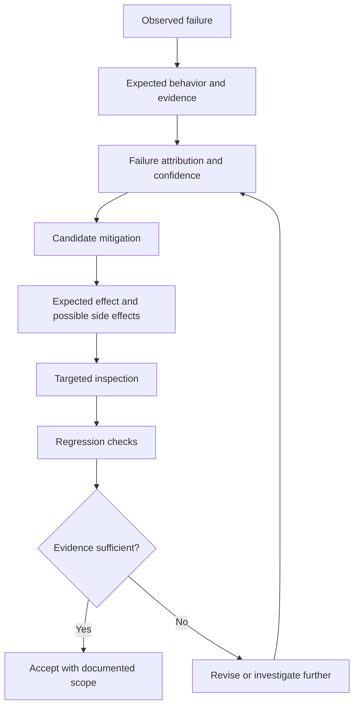
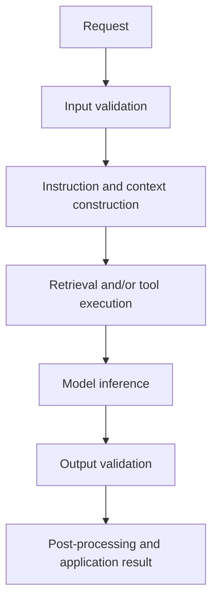

# Failure Mitigation and Practical Inspection

## 1. Purpose

Identifying a model failure is only the beginning of engineering work. A useful diagnosis must lead to a mitigation that addresses the failure mechanism, preserves required behavior, and can be verified against observable evidence.

This chapter develops a disciplined approach to mitigating LLM behavior failures and inspecting the resulting system. It focuses on selecting interventions, understanding their limitations, testing representative failure cases, and determining whether an observed improvement is credible.

The central principle is:

> A mitigation is an engineering hypothesis until evidence shows that it improves the intended behavior without introducing unacceptable regressions.

Adding a prompt instruction, retrieving more documents, changing a model, or introducing another validation step may appear reasonable. None is automatically effective. The appropriate intervention depends on the failure attribution, the strength of the supporting evidence, and the application's requirements.

### Learning objectives

By the end of this chapter, you should be able to:

- Map observed failure patterns to candidate mitigation strategies.
- Distinguish prompt-level, context-level, retrieval-level, tool-level, validation-level, and workflow-level interventions.
- Select an intervention that adequately addresses a supported failure mechanism.
- Inspect model behavior using controlled inputs, captured execution evidence, and representative failure cases.
- Identify regressions, compensating failures, and misleading improvements.
- Document mitigation decisions, verification evidence, and residual risks.

## 2. Prerequisites and Scope

This chapter builds on the previous chapters in LLM-07:

- **Model behavior fundamentals:** Distinguish observable outputs from assumptions about internal processes.
- **Reasoning capabilities and limitations:** Inspect intermediate claims and conclusions without treating plausible explanations as proof.
- **Factuality, hallucination, and grounding:** Distinguish supported claims from plausible but unsupported language.
- **Instruction-following and constraint compliance:** Preserve task requirements and output constraints.
- **Consistency, calibration, and behavioral variation:** Distinguish repeatability from correctness.
- **Observable failure patterns and attribution:** Separate symptoms, failure locations, mechanisms, and underlying causes.

The focus here is mitigation and practical inspection, not formal model benchmarking.

### Scope boundaries

| Area | Primary responsibility |
|---|---|
| This chapter | Mitigation selection, targeted inspection, regression checks, and evidence-based verification |
| LLM-08 | Formal evaluation design, benchmark construction, metrics, and systematic comparative evaluation |
| LLM-09 | Model adaptation, fine-tuning, and optimization techniques |
| PROD | Deployment, serving, operational reliability, monitoring, and incident management |
| ENT | Enterprise security, governance, compliance, and risk controls |

These areas are connected. A production mitigation may require deployment changes, and an enterprise system may require additional security controls. Those concerns should be referenced where relevant rather than retaught here.

## 3. From Failure Diagnosis to Mitigation

A mitigation should follow a defensible chain of reasoning.

The quality of the decision depends on every stage. If the initial diagnosis is weak, a mitigation may treat a symptom rather than the mechanism producing it. If verification is weak, a change may appear successful simply because the engineer tested a favorable example.

Before choosing an intervention, establish five things:

1. **Failure statement:** What observable behavior violated the requirement?
2. **Evidence:** Which input, context, intermediate artifact, tool result, or output demonstrates the failure?
3. **Attribution:** Which component or interaction most plausibly produced it?
4. **Desired change:** What observable behavior should differ after the intervention?
5. **Preservation requirements:** What existing behavior must not regress?

For example, suppose an assistant gives an outdated refund policy despite receiving policy information in its context. The initial observation does not establish whether the model ignored the policy, the context contained conflicting versions, or post-processing substituted an older answer.

A prompt change may be worth testing, but it should not be treated as the default solution before inspecting the supplied context and the executed workflow.

## 4. Selecting the Right Mitigation

Mitigations should target the component or interaction implicated by the evidence. The following categories are practical intervention points, not mutually exclusive classes. A single failure may require changes across several components.

### 4.1 Input and task-contract mitigation

**Use when:** The request is malformed, ambiguous, incomplete, or incompatible with the application's supported operation.

Possible interventions:

- Validate required input fields before inference.
- Ask a targeted clarification question when a missing detail changes the correct action.
- Normalize supported input formats.
- Reject unsupported operations explicitly.
- Separate user-provided data from trusted instructions and application-generated context.

Example: A request asks for a refund decision but contains no order identifier. Guessing an order or inventing missing details is not a valid mitigation. The system should request the missing identifier or follow its defined unsupported-input behavior.

**Trade-off:** Strict validation can prevent invalid operations but may also reject inputs that could safely be interpreted. Validation rules should reflect actual requirements rather than arbitrary formatting preferences.

### 4.2 Prompt and instruction mitigation

**Use when:** Evidence suggests that task instructions are unclear, competing requirements are poorly expressed, or the expected response behavior is insufficiently specified.

Possible interventions:

- Make the task and success criteria explicit.
- Separate mandatory constraints from stylistic preferences.
- Specify how to handle missing evidence or unsupported requests.
- Clarify instruction precedence where the application controls that precedence.
- Provide a compact output contract or a relevant example.

Example: An assistant is expected to summarize only supplied documents but repeatedly introduces outside claims. The instructions can explicitly limit factual assertions to supplied evidence and require the assistant to identify when the evidence is insufficient.

Clearer wording cannot guarantee compliance. If the application requires a hard guarantee, enforce it with an appropriate external control rather than relying exclusively on natural-language instructions.

**Trade-off:** More instructions consume context, may compete with other requirements, and can introduce new ambiguities. Add only the instruction needed to address the observed failure.

### 4.3 Context-construction mitigation

**Use when:** The required information is absent, stale, contradictory, poorly organized, or obscured by irrelevant content in the model's actual input.

Possible interventions:

- Remove obsolete or duplicated context.
- Resolve conflicting versions using an explicit source-selection rule.
- Place relevant evidence near the task that depends on it.
- Include provenance, timestamps, and applicability information when they affect interpretation.
- Preserve the distinction between trusted instructions, source material, and untrusted user content.

Example: A policy assistant receives both a superseded policy and the current policy. Adding another instruction to "follow the policy carefully" does not resolve which policy applies. The context builder should select the applicable version or explicitly label the documents and their effective dates.

**Trade-off:** Reducing context can remove useful evidence; adding context can increase noise and conflict. The objective is not maximum context volume but sufficient, relevant, and correctly scoped information.

Context construction belongs to the broader context-engineering concerns covered in LLM-06. Here, it is treated specifically as a mitigation for observed behavior failures.

### 4.4 Retrieval mitigation

**Use when:** Inspection shows that retrieval returned missing, irrelevant, outdated, or insufficient evidence for the task.

Possible interventions:

- Correct metadata filters and access constraints.
- Improve query construction when the query fails to express the information need.
- Include the relevant document version or effective-date filter.
- Correct document segmentation or indexing defects.
- Add a fallback when retrieved evidence is insufficient.
- Preserve source identity so retrieved claims can be traced to supporting material.

Example: A support assistant retrieves an old pricing page because the index contains multiple versions without effective-date metadata. The appropriate fix may be document lifecycle handling and retrieval filtering, not a more forceful prompt.

**Trade-off:** More permissive retrieval may improve recall while introducing irrelevant or conflicting evidence. Tighter filters may remove the document needed to answer an unusual query. Verify the actual retrieved material rather than inferring retrieval quality from the final answer alone.

Retrieval algorithms, ranking design, and indexing internals are owned by Retrieval Engineering. This chapter addresses retrieval only as a potential source of behavior failure and mitigation.

### 4.5 Tool-selection and execution mitigation

**Use when:** The model selects an inappropriate tool, constructs invalid arguments, fails to interpret a tool result, or proceeds despite an execution error.

Possible interventions:

- Make tool descriptions and applicability conditions precise.
- Validate arguments against the tool's input schema.
- Restrict tool availability to operations relevant to the current task.
- Check execution status before treating a call as successful.
- Distinguish an empty result from an execution failure.
- Require confirmation or authorization before consequential actions where the application demands it.

Example: A scheduling assistant claims that an appointment was booked even though the calendar API returned an error. A prompt asking the model to be accurate is insufficient. The workflow should prevent the system from reporting success unless the execution result confirms it.

**Trade-off:** Additional validation and confirmation can increase latency and friction. For consequential actions, these costs may be justified by the need to prevent unsupported claims of completion.

### 4.6 Output-validation mitigation

**Use when:** The output violates a machine-readable schema, required fields are missing, values are invalid, or application logic cannot safely consume the response.

Possible interventions:

- Parse and validate output against a schema.
- Validate field types, allowed values, and cross-field conditions.
- Reject or safely handle malformed responses.
- Use bounded repair or retry behavior where appropriate.
- Keep validation failures distinct from successful empty results.

Example: A model returns a syntactically valid JSON object containing an invalid account status. Parsing succeeds, but semantic validation fails. Both syntax and business-rule validation are necessary.

**Trade-off:** A valid schema does not establish factual correctness. A response can satisfy every field requirement and still contain fabricated claims. Use the validation layer that corresponds to the actual requirement.

### 4.7 Workflow and integration mitigation

**Use when:** Individual components appear reasonable, but their interaction produces incorrect or misleading behavior.

Possible interventions:

- Correct ordering and dependencies between workflow steps.
- Preserve identifiers and state across component boundaries.
- Prevent failed intermediate operations from being treated as successful.
- Make retries safe and idempotent where repeated execution could cause side effects.
- Define explicit fallback and termination conditions.
- Ensure post-processing does not overwrite valid model output with stale or unrelated data.

Example: The model generates the correct answer, but an application layer replaces it with a cached response from a previous request. Changing the model prompt would not address the failure. The cache key, invalidation behavior, or integration logic must be inspected.

**Trade-off:** Workflow controls can reduce failure propagation but introduce more state, branches, and testing requirements. Keep the workflow as simple as the reliability requirements permit.

### 4.8 Model or generation configuration mitigation

**Use when:** Evidence indicates that model capability, model compatibility, or generation settings contribute to the failure after upstream inputs and workflow behavior have been inspected.

Possible interventions:

- Compare a model better suited to the task.
- Verify compatibility with the required input and output formats.
- Adjust generation settings when the failure plausibly relates to generation variability or output length.
- Use a model with suitable tool-use or structured-output support.
- Consider a more capable model when the task requires capabilities the current model consistently lacks.

A model change is not automatically the best first intervention. If the correct evidence never reaches the model, replacing the model may leave the root cause unchanged.

Likewise, lowering sampling randomness may improve repeatability in some situations but does not guarantee truth, instruction compliance, or correct reasoning.

**Trade-off:** A different model or configuration can change latency, cost, output style, compatibility, and other behaviors. Inspect the target failure and representative existing behaviors before accepting the change.

Model adaptation and optimization techniques belong primarily to LLM-09. This section covers model or configuration changes only as one possible mitigation category.

## 5. Choose the Narrowest Adequate Intervention

A useful engineering default is to choose the least complex intervention that addresses the supported failure mechanism and satisfies the system's requirements.

This is not a rule to always choose the smallest code change. A small prompt edit may be inadequate if the requirement is a strict authorization boundary. The intervention must avoid unnecessary side effects while being strong enough to meet the requirement.

Consider an assistant that sometimes invents a refund deadline.

| Evidence found | Candidate intervention | Why it fits |
|---|---|---|
| The current policy is missing from the context | Fix context construction or retrieval | The necessary evidence never reaches the model |
| The context contains two conflicting policy versions | Resolve version selection and provenance | The system supplies ambiguous evidence |
| The policy is present, but the answer makes an unsupported claim | Clarify evidence requirements and test model behavior | The failure may involve unsupported generation or instruction noncompliance |
| The output claims a refund was processed when the API failed | Enforce execution-result checks in the workflow | The success claim is not grounded in the actual action result |
| The answer is correct but has invalid required fields | Add or repair schema validation | The failure concerns output-contract compliance |

The table identifies candidate interventions, not definitive diagnoses. Evidence can support more than one mechanism, and multiple mitigations may be needed.

### 5.1 A mitigation decision record

Before implementing a nontrivial mitigation, record:

- **Observed failure:** A concise statement of what went wrong.
- **Evidence:** The exact request, context, execution trace, tool result, or output that supports the diagnosis.
- **Attribution confidence:** Confirmed, strongly supported, plausible, or unknown.
- **Proposed intervention:** The component or behavior to change.
- **Expected effect:** The observable behavior expected to improve.
- **Regression risks:** Existing behavior or constraints that might be harmed.
- **Verification cases:** The examples and conditions that will be inspected.
- **Acceptance condition:** What evidence would justify accepting the change.
- **Residual uncertainty:** What the inspection cannot establish.

This record discourages solution-first debugging, in which an engineer changes a prompt or model and then searches for examples that make the change appear successful.

## 6. Practical Inspection: Observe Before and After

Practical inspection examines actual system behavior and the evidence associated with it. It is not merely reading a final response and deciding whether it sounds good.

For a model-backed application, relevant evidence may include:

- The original request and validated input.
- The effective instructions supplied to the model.
- The constructed context and retrieved evidence.
- Tool selection, arguments, execution results, and errors.
- Model configuration and the returned output.
- Parsing, validation, post-processing, and final application behavior.

Collect only the information needed for diagnosis, subject to applicable privacy, access-control, and data-retention requirements.

### 6.1 Establish a baseline

Before applying a change, preserve a representative example of the failure.

A useful baseline contains:

1. The input that triggered the failure.
2. The expected behavior and the requirement it violates.
3. The actual output or incorrect action.
4. The relevant execution evidence.
5. The model and configuration identifiers where available.
6. Any relevant context, retrieval, tool, or workflow state.

Without a baseline, engineers may remember the failure inaccurately, compare different inputs, or mistake unrelated output variation for an improvement.

For example, if the original request used a particular policy version but the revised test uses a newer policy, the comparison does not isolate the mitigation.

### 6.2 Inspect the complete relevant execution path

Trace the behavior through the components that could plausibly explain the failure.

This is a conceptual inspection map, not a requirement that every application contain these exact components or execute them in this order.

For a particular incident, inspect the relevant path and preserve the boundaries between stages. If the final answer is incorrect, determine whether the incorrect claim was already present in the model output or was introduced later. If the tool result is missing, determine whether the tool was never called, failed, or returned a valid empty result.

The objective is to locate the earliest supported point at which the behavior diverged from the expected contract, while also checking whether later components amplified or failed to contain the problem.

### 6.3 Change one meaningful variable at a time

When practical, change one intervention at a time so that the effect is interpretable.

For example:

- First correct the policy-version filter.
- Inspect the retrieved documents and resulting answer.
- Then, if necessary, test a targeted prompt adjustment.
- Compare the result while holding other relevant conditions constant.

Changing the prompt, retrieval logic, model, and output parser simultaneously may produce a better result, but it makes attribution difficult. You will not know which change mattered or which change introduced a regression.

This is a diagnostic principle, not an absolute prohibition. Some fixes must be implemented together because they form one safety or correctness requirement. In that case, record the combined intervention and inspect its individual components where possible.

### 6.4 Repeat the inspection when behavior can vary

LLM outputs may vary across runs because of sampling, nondeterministic execution, prompt sensitivity, changing external state, or other factors.

For a variable behavior:

- Repeat relevant tests under comparable conditions.
- Record configuration and external state that could affect the result.
- Distinguish an isolated success from a recurring improvement.
- Investigate remaining failures instead of discarding them as noise.

The number and diversity of tests should be proportionate to the consequences of failure and the uncertainty being investigated. Formal sample-size selection and statistical evaluation belong to LLM-08.

## 7. Verify Improvements and Detect Regressions

A mitigation should be checked against both the failure it targets and the behavior it must preserve.

### 7.1 Targeted verification

A targeted test checks whether the specific observed failure has changed as expected.

Example:

- **Before:** The assistant states a refund deadline unsupported by the current policy.
- **Intervention:** Correct the policy-version selection.
- **After:** The retrieved context contains the current policy, and the answer uses its actual deadline.

This provides evidence of improvement for the inspected case. It does not establish that every policy question is now correct.

### 7.2 Regression inspection

A change can fix one case while damaging another.

Examples include:

- A stricter grounding instruction causes the assistant to abstain even when evidence is sufficient.
- A retrieval filter removes obsolete documents but also excludes a still-applicable exception.
- A schema validator rejects valid optional fields.
- A retry mechanism repeats an external action that was already completed.
- A model change improves one task while degrading tool arguments or output compatibility.

Inspect representative cases that exercise the constraints and behaviors most likely to be affected by the change.

A practical regression set may contain:

- The original failing case.
- A nearby case that should be handled similarly.
- A valid case that must continue to succeed.
- An edge case involving missing or conflicting information.
- A negative case where the system must refuse, abstain, or avoid an action.
- A case that checks an important workflow or integration boundary.

These are practical test-design suggestions, not a substitute for the formal evaluation methodology covered in LLM-08.

### 7.3 Check for compensating failures

A mitigation may make the visible symptom disappear by creating another problem.

For example, an assistant that previously fabricated a policy deadline may stop doing so by refusing every policy question. The unsupported answer has disappeared, but the system may now fail its intended task.

Therefore, inspect both:

- **Target outcome:** Did the original failure decrease or disappear?
- **Preserved behavior:** Can the system still perform valid tasks and respect its other requirements?

A mitigation should not be accepted merely because the original error is no longer visible.

### 7.4 Distinguish observed success from a general guarantee

Use language that matches the evidence:

- **Observed in this case:** The tested input produced the expected behavior.
- **Repeatedly observed under tested conditions:** The behavior persisted across the inspected runs.
- **Supported by targeted regression checks:** The change also passed the relevant additional cases.
- **Not established:** Broader reliability, all-input correctness, or a universal guarantee.

Finite inspection cannot prove that an open-ended language model will behave correctly on every possible input.

## 8. Worked Example: Unsupported Policy Answer

Consider a customer-support assistant that answers questions about a refund policy.

### 8.1 Observed incident

The assistant states that a customer can request a refund within 45 days. The current policy permits requests within 30 days, subject to specified exceptions.

The final answer is incorrect, but that observation alone does not identify the cause.

### 8.2 Inspection evidence

Suppose inspection reveals:

- The user's question was valid.
- The context contained an archived policy stating 45 days.
- The current policy stating 30 days was also available in the document store.
- Retrieval selected the archived policy.
- The model's answer matched the archived policy.
- No component checked whether the retrieved policy was current.

This evidence strongly supports retrieval or document-version selection as the primary failure mechanism. It also identifies a missing containment control.

### 8.3 Proposed mitigation

The team proposes:

1. Add or correct effective-date metadata for policy documents.
2. Ensure retrieval selects the policy applicable to the requested date and customer context.
3. Preserve policy version and source identity in the retrieved context.
4. Inspect the resulting answer against the selected policy.
5. Add a targeted regression case for the archived policy and another for a valid policy exception.

The team does not begin by changing the model because the observed answer is consistent with the stale evidence supplied to it.

### 8.4 Verification

After the change, inspect:

- Whether retrieval selects the current policy.
- Whether the current policy reaches the model.
- Whether the response states the correct deadline.
- Whether exception conditions remain available and are handled correctly.
- Whether a request concerning a historical policy can still be answered when historical applicability is explicitly required.

If all inspected cases pass, the evidence supports the mitigation for those cases. It does not prove that all policy retrieval failures have been eliminated.

### 8.5 Residual risk

The system may still retrieve incomplete evidence, misinterpret a policy exception, or produce unsupported claims under other conditions.

A suitable engineering conclusion is:

> The stale-policy failure was addressed in the inspected cases by correcting policy-version selection. Targeted regression checks passed. Broader policy-answer reliability has not been established by these checks alone.

The conclusion describes what the evidence supports without overstating the result.

## 9. Common Mitigation Mistakes

### 9.1 Prompt patching without diagnosis

**Mistake:** Add increasingly forceful instructions whenever the assistant fails.

**Why it fails:** The underlying problem may be missing evidence, incorrect retrieval, tool failure, or post-processing.

**Better approach:** Inspect the effective input and execution path before choosing a prompt-level intervention.

### 9.2 Treating retrieval as an automatic factuality solution

**Mistake:** Assume that adding RAG guarantees factual answers.

**Why it fails:** Retrieval can return irrelevant, stale, contradictory, or insufficient evidence. The model may also misinterpret the retrieved material.

**Better approach:** Inspect the retrieved sources, their applicability, and the correspondence between evidence and final claims.

### 9.3 Treating validation as proof of correctness

**Mistake:** Assume that valid JSON or a successful schema check means the answer is correct.

**Why it fails:** Syntax and structural constraints do not establish factual support or correct decisions.

**Better approach:** Validate structure separately from factual, semantic, and workflow requirements.

### 9.4 Changing too many components at once

**Mistake:** Modify the prompt, retrieval system, model, and post-processing in a single experiment without recording the individual effects.

**Why it fails:** The result is difficult to attribute, and regressions may remain hidden.

**Better approach:** Isolate interventions where practical. If changes must be combined, document the dependency and inspect the components separately where possible.

### 9.5 Accepting a favorable example as sufficient evidence

**Mistake:** Stop testing after one correct response.

**Why it fails:** The result may reflect output variability, favorable context, or an unrepresentative input.

**Better approach:** Repeat the relevant inspection and check representative regression cases according to the risk.

### 9.6 Overcorrecting into excessive abstention

**Mistake:** Prevent hallucination by refusing every question involving uncertainty.

**Why it fails:** The system may abandon valid tasks even when sufficient evidence is available.

**Better approach:** Define when evidence is sufficient, when clarification is required, and when abstention is appropriate. Inspect both unsupported-answer and valid-answer cases.

### 9.7 Confusing correlation with mechanism

**Mistake:** A new model produces a better answer, so conclude that model capability caused the original failure.

**Why it fails:** Other conditions may have changed, and the improvement does not establish the original failure mechanism.

**Better approach:** Preserve relevant conditions, compare evidence at component boundaries, and state attribution confidence accurately.

### 9.8 Ignoring residual risk

**Mistake:** Mark the issue resolved without recording what remains unknown.

**Why it fails:** Engineers and downstream users may interpret a narrow test result as a broad reliability guarantee.

**Better approach:** Document what was verified, which cases remain untested, and which uncertainties require further evaluation.

## 10. Practical Exercise

### Scenario

You are inspecting an internal HR assistant. An employee asks:

> What is the current deadline for submitting travel expenses?

The current company policy requires submission within 20 days of the trip. The assistant answers, "You have 30 days."

Your initial inspection finds the following:

- The document store contains a current policy and an archived policy.
- The retrieved context contains the archived 30-day policy.
- The model output states 30 days.
- The application returns the model output without additional policy validation.
- No evidence has yet been collected about how the retrieval filter selected the archived document.

### Tasks

1. **State the failure precisely.** Separate the observable symptom from a proposed explanation.
2. **Identify the strongest current attribution.** Which failure mechanism is supported by the available evidence? Which details remain unknown?
3. **Propose a mitigation.** Explain which component you would change first and why.
4. **Define the expected effect.** State what should change in the retrieved context and final answer.
5. **Design targeted inspection cases.** Include the original case, a valid case, and a case involving historical policy applicability.
6. **Identify regression risks.** Explain how your mitigation could exclude valid information or affect other policy questions.
7. **Define acceptance evidence.** What would you need to observe before claiming that the incident was addressed?
8. **Record residual uncertainty.** What broader claims would remain unsupported even if every proposed test passed?

### Submission format

Write a short engineering note with these headings:

- Failure statement
- Evidence and attribution confidence
- Proposed mitigation
- Expected behavior
- Verification cases
- Regression risks
- Acceptance evidence
- Residual uncertainty

Do not jump directly to a prompt change. The objective is to demonstrate that the intervention follows from the evidence.

## 11. Interview and Design Discussion

### Q1. How do you choose between a prompt change and a retrieval change?

Inspect where the required information and instructions enter the execution path. If the required evidence is absent or the wrong document is retrieved, correct the evidence path first. If the evidence is present and applicable but the response still violates the task requirements, investigate instruction handling and model behavior. Multiple causes can coexist.

### Q2. Why is a successful before-and-after example not enough to establish reliability?

A single example demonstrates behavior under one set of conditions. It does not show how the change behaves across relevant input variations, edge cases, or repeated runs. Additional targeted checks and systematic evaluation are needed for broader claims.

### Q3. When is a hard validation rule preferable to a prompt instruction?

When the requirement must be enforced independently of the model's willingness or ability to follow natural-language instructions. For example, a required field type or authorization condition should be checked by application logic when the consequences of violation require enforcement.

### Q4. Why should you inspect intermediate artifacts rather than only the final response?

Intermediate artifacts help locate where the expected behavior diverged. They distinguish, for example, an incorrect retrieved document from a correct document that the model misinterpreted, or a correct model output from an incorrect post-processed result.

### Q5. What does it mean to choose the narrowest adequate mitigation?

It means selecting an intervention that addresses the supported failure mechanism and meets the actual requirement without introducing unnecessary complexity or avoidable side effects. It does not mean preferring a small but inadequate fix over a stronger control.

### Q6. How should an engineer communicate mitigation results?

State the intervention, the behavior observed before and after it, the cases inspected, the regression checks performed, and the remaining uncertainty. Do not generalize beyond the evidence.

### Q7. What should happen when attribution remains uncertain?

Record the competing hypotheses and identify what evidence would distinguish them. Choose a safe, reversible mitigation when appropriate, or collect more evidence before making a high-impact change. Avoid presenting a plausible cause as confirmed.

## 12. Revision Checklist

Before considering a behavior mitigation adequately inspected, ask:

- [ ] Is the original failure described in observable terms?
- [ ] Is the expected behavior tied to a clear requirement?
- [ ] Is the attribution supported by evidence rather than intuition alone?
- [ ] Does the mitigation target the implicated component or interaction?
- [ ] Are expected effects and regression risks documented?
- [ ] Was the relevant execution path inspected?
- [ ] Were the original failing case and representative neighboring cases checked?
- [ ] Were valid behaviors that must be preserved also inspected?
- [ ] Were repeated runs considered where behavior can vary?
- [ ] Does the conclusion distinguish observed success from a general guarantee?
- [ ] Are residual uncertainty and untested conditions documented?

A checked list is a practical aid, not a substitute for judgment. The depth of inspection should reflect the consequences of failure and the strength of the evidence needed for the decision.

## 13. Key Takeaways

- Mitigation should follow diagnosis, not replace it.
- Different failure mechanisms require different interventions.
- Prompt changes are one option among input, context, retrieval, tool, validation, workflow, and model-level changes.
- The narrowest adequate intervention is preferable to an unnecessarily broad change.
- Inspect intermediate artifacts and component boundaries to understand how behavior was produced.
- Targeted regression checks help identify compensating failures.
- Valid output structure does not guarantee factual correctness.
- Lower variability does not guarantee better correctness.
- A mitigation should be judged against both its target failure and the behavior it must preserve.
- Engineering conclusions must state what was verified and what remains uncertain.

The goal is not to make an LLM appear reliable in a few examples. It is to build a defensible understanding of its observed behavior, select interventions for evidence-based reasons, and verify that the resulting system satisfies its intended requirements.

## 14. Further Reading

The following references provide background for the engineering practices discussed here. They do not replace application-specific inspection, and their inclusion does not imply that every mitigation described in this chapter is guaranteed to work.

1. **Ji et al. — Survey of Hallucination in Natural Language Generation.** A survey of hallucination patterns and research directions.  
   https://arxiv.org/abs/2202.03629

2. **Lewis et al. — Retrieval-Augmented Generation for Knowledge-Intensive NLP Tasks.** Foundational work on combining parametric language models with retrieved knowledge.  
   https://arxiv.org/abs/2005.11401

3. **Liang et al. — Holistic Evaluation of Language Models (HELM).** A framework for evaluating language models across multiple scenarios and dimensions.  
   https://arxiv.org/abs/2211.09110

4. **Ouyang et al. — Training Language Models to Follow Instructions with Human Feedback.** Research on instruction-following behavior and its limitations.  
   https://arxiv.org/abs/2203.02155
