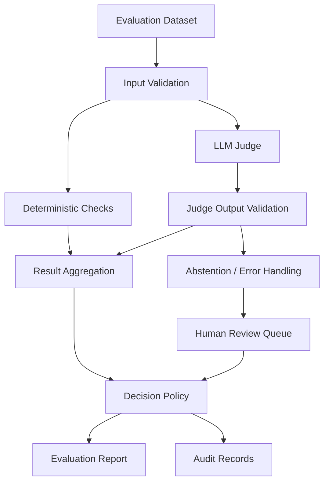

# Automated Evaluation and LLM-as-a-Judge

## 1. Purpose

Automated evaluation uses software-based evaluators to assess model outputs against explicit requirements, expected results, reference data, or defined quality criteria.

Some evaluation tasks can be checked deterministically. Others require interpreting meaning, relevance, factual support, or adherence to nuanced instructions. Large language models can serve as evaluators for certain tasks, but their judgments are themselves model outputs and therefore require validation.

This chapter examines how to design, validate, and operate automated evaluation systems, with particular attention to **LLM-as-a-judge**.

The central engineering principle is:

> An automated evaluator is a measurement component, not an unquestionable source of truth. Its reliability must be established for the decisions it supports.

This chapter builds on the metrics introduced in Chapter 03 and the rubric-design principles introduced in Chapter 04. It focuses on implementing evaluators, validating their behavior, and understanding their operational limitations.

## 2. Learning Objectives

After completing this chapter, you should be able to:

- Distinguish deterministic evaluation from model-based evaluation.
- Select appropriate evaluation mechanisms for different quality requirements.
- Design an LLM judge with explicit inputs, criteria, and structured outputs.
- Identify common sources of evaluator bias and inconsistency.
- Validate automated judgments against independently established reference judgments.
- Interpret agreement measurements without confusing agreement with correctness.
- Design evaluator pipelines that support abstention, escalation, and human review.
- Evaluate the operational trade-offs of automated evaluation, including cost, latency, throughput, and reliability.
- Explain why an LLM judge must be evaluated independently of the system it evaluates.

## 3. Why Automated Evaluation Exists

Manual evaluation can provide nuanced judgments, but it becomes expensive and slow when an application produces thousands or millions of outputs.

Consider a customer-support assistant that generates 50,000 answers each day. An organization may need to determine whether each answer:

- Addresses the user's question.
- Follows the applicable instructions.
- Contains unsupported factual claims.
- Uses the required response format.
- Remains within an acceptable latency and cost budget.

A person can assess individual answers, but manually inspecting every response may be impractical.

Automated evaluation offers several advantages:

- **Scale:** Evaluate large datasets and recurring test suites.
- **Speed:** Obtain feedback during development and experimentation.
- **Consistency:** Apply the same programmed checks across a defined evaluation set.
- **Repeatability:** Re-run evaluations when models, prompts, or application components change.
- **Operational integration:** Use evaluation results in regression testing and release decisions.

These benefits do not guarantee reliable measurement. An automated evaluator can consistently apply the wrong rule, miss important failures, or produce biased judgments at scale.

The goal is not to automate every judgment. It is to automate the judgments that can be measured reliably enough for their intended use.

## 4. Types of Automated Evaluators

Automated evaluation is not one technique. Different evaluators make different assumptions and provide different kinds of evidence.

### 4.1 Deterministic evaluators

A deterministic evaluator applies explicit rules to produce a result.

Examples include:

- Exact-match comparison against a reference answer.
- Checking whether a response parses as valid JSON.
- Validating required fields against a schema.
- Checking whether a required phrase or identifier is present.
- Comparing a numeric prediction with a known target.
- Measuring response latency or token consumption.

For a structured-output task, an evaluator might check:

```python
import json

def evaluate_json_response(response: str) -> dict:
    try:
        parsed = json.loads(response)
    except json.JSONDecodeError:
        return {
            "valid_json": False,
            "has_required_fields": False,
        }

    required_fields = {"status", "message"}

    return {
        "valid_json": True,
        "has_required_fields": required_fields.issubset(parsed),
    }
```

This evaluator answers two specific questions: whether the output is valid JSON and whether required fields are present.

It does not establish that the field values are correct, that the response is useful, or that the answer follows the intended business policy.

Deterministic checks are particularly useful when the expected condition can be expressed unambiguously.

### 4.2 Reference-based evaluators

Reference-based evaluators compare an output with a known target or reference.

Examples include:

- Exact match for classification labels.
- Numeric error for forecasting.
- Token-overlap metrics for generated text.
- Comparison of extracted fields against labeled records.

Their reliability depends on the suitability of the reference and the metric. A reference answer may not be the only valid answer, and surface-level similarity may not reflect semantic correctness.

The metric-selection questions belong to Chapter 03; this chapter focuses on how these evaluators fit into a larger automated evaluation system.

### 4.3 Model-based evaluators

A model-based evaluator uses a learned model to assess an output.

This can include:

- A trained classifier that predicts whether an answer satisfies a criterion.
- A reward model trained to score outputs.
- An embedding-based comparison system.
- An LLM prompted to judge another model's response.

Model-based evaluation can handle patterns that are difficult to encode as simple rules. However, it introduces model-specific assumptions, failure modes, and validation requirements.

A model-based evaluator is not automatically more accurate or more general than a deterministic evaluator.

### 4.4 LLM-as-a-judge

LLM-as-a-judge uses a language model to assess another model's output against a task, rubric, reference, or other evaluation context.

For example, a judge may receive:

- The user's question.
- The assistant's response.
- The source material the response was expected to use.
- A criterion for determining whether the response is supported by those sources.

The judge then returns a structured assessment.

This approach is useful when evaluating semantic properties that cannot be reliably checked using simple rules alone. It is not a substitute for deterministic checks when the requirement is objectively testable.

### 4.5 Choosing the evaluation mechanism

| Evaluation requirement | Preferred starting point | Main limitation |
|---|---|---|
| Valid JSON | Deterministic parser | Valid syntax does not imply correct content |
| Required fields | Schema validation | Required fields may contain incorrect values |
| Exact classification label | Reference comparison | Requires trustworthy labels |
| Numeric prediction error | Numeric metric | Depends on the target and selected metric |
| Semantic relevance | Validated semantic or model-based evaluator | Similarity may not imply relevance |
| Support from supplied sources | Source-aware evaluator, often with human validation | The judge may miss unsupported claims |
| Nuanced answer quality | LLM judge or human evaluation | Judgment can be biased or inconsistent |
| High-impact decision | Multiple independent checks with appropriate human oversight | Automation can still produce correlated errors |

The preferred design is often **hybrid evaluation**: use deterministic checks for objective constraints and model-based or human judgments for aspects that require interpretation.

## 5. Designing an LLM Judge

An LLM judge should be treated as a software component with a defined contract.

A prompt that simply asks, "Is this answer good?" leaves important behavior unspecified. Different interpretations of "good" can produce inconsistent results and make evaluation difficult to debug.

A useful judge design defines its inputs, evaluation criteria, decision rules, output schema, and failure-handling behavior.

### 5.1 Define the evaluation question

Begin with one clearly scoped question.

Weak criterion:

> Is the answer good?

More precise criterion:

> Does the answer address the user's question using only facts supported by the supplied reference material?

The second criterion narrows the intended judgment. It does not, by itself, guarantee that the judge will apply it correctly.

Avoid combining unrelated properties into one score unless there is a deliberate reason to aggregate them. An answer can be relevant but factually unsupported, or factually correct but incomplete.

Separate criteria make failures easier to interpret.

### 5.2 Define the input contract

A judge needs enough context to assess the criterion.

A typical evaluation request may include:

| Input | Purpose |
|---|---|
| Evaluation item ID | Links the judgment to the evaluated example |
| User request | Establishes what the answer should accomplish |
| Model response | Provides the output being evaluated |
| Reference material | Supplies evidence when the criterion depends on grounding |
| Evaluation rubric | Defines acceptable and unacceptable behavior |
| Reference answer, if applicable | Provides a target for tasks where a reference is meaningful |
| Context metadata, if relevant | Identifies constraints such as output format or task type |

Only provide context that is relevant to the evaluation. Missing context can make a valid response appear incorrect; excessive or irrelevant context can distract the judge or introduce unwanted influence.

The reference material must be available to the evaluator if the evaluation criterion requires checking support from that material. Asking a judge to verify grounding without supplying the evidence is a contract failure.

### 5.3 Write operational criteria

A criterion should describe observable evidence, not just a desirable quality.

For example:

**Criterion:** The answer is supported by the supplied material.

- **Pass:** The material directly supports the answer's material factual claims.
- **Fail:** At least one material claim contradicts the material or lacks the required support.
- **Insufficient evidence:** The available material does not permit a reliable determination.

The distinction between failure and insufficient evidence matters. An answer should not automatically fail simply because the evaluator lacks enough information to assess it.

Also distinguish between a claim that is **unsupported by the supplied source** and one that is **factually false in the real world**. A source may omit a true fact. Conversely, a source may be incomplete or outdated. A source-support judge can assess what the supplied evidence establishes; it cannot establish broader factual truth unless the evaluation design provides suitable evidence for that task.

For multi-dimensional evaluation, define separate criteria for properties such as factual support, relevance, instruction compliance, and completeness. Use Chapter 04 for the broader principles of rubric construction and evaluator calibration.

### 5.4 Choose the judgment format

The output format should make the judgment easy to validate, store, analyze, and audit.

A useful structure is:

```json
{
  "criterion": "source_support",
  "verdict": "fail",
  "reason": "The answer makes a material claim not supported by the supplied source.",
  "evidence": [
    {
      "claim": "The service guarantees delivery within one hour.",
      "source_support": "No such guarantee appears in the supplied material."
    }
  ],
  "needs_human_review": true
}
```

This is an illustrative schema, not a universal standard. Its verdict and evidence fields must be defined consistently for the task.

For production use:

- Restrict verdicts to an explicit allowed set.
- Validate the output against a schema.
- Require evidence or explanations where they are useful for auditability.
- Treat malformed output as an evaluation failure, not as an implicit pass.
- Define what happens when the judge cannot make a reliable decision.
- Avoid treating the judge's explanation as proof that its verdict is correct.

Structured output makes the evaluator easier to integrate, but schema validity only establishes that the output follows the expected format. It does not establish judgment quality.

### 5.5 Pointwise and pairwise judging

Two common evaluation modes are pointwise and pairwise judging.

**Pointwise judging** evaluates one response independently against a criterion or scale.

Example:

> Does this response satisfy the stated requirements? Return pass, fail, or insufficient evidence.

Advantages:
- Suitable for evaluating a single candidate.
- Supports absolute criteria.
- Can be applied independently to many examples.

Limitations:
- Scores may be inconsistently calibrated across examples.
- The judge may interpret rating levels differently in different contexts.

**Pairwise judging** compares two responses to the same task.

Example:

> Which response better addresses the user's request while remaining supported by the supplied material?

Advantages:
- Direct comparisons can make subtle quality differences easier to identify.
- Useful when comparing alternative prompts or model versions.

Limitations:
- Results can depend on presentation order.
- A winner can still be poor if both responses are poor.
- Pairwise preferences do not automatically provide an absolute quality score.
- A small preference difference may not be meaningful.

Use the mode that matches the decision. Comparing two candidates is not the same problem as deciding whether either candidate meets a release requirement.

## 6. Constructing a Judge Prompt

A judge prompt should establish the evaluation contract clearly enough that its behavior can be tested.

A practical structure is:

1. Role and task.
2. Criterion definition.
3. Input context.
4. Decision rules.
5. Allowed verdicts.
6. Output schema.
7. Instructions for insufficient evidence.
8. Constraints against irrelevant preferences.

An illustrative template follows.

```text
Task:
Evaluate whether the assistant response is supported by the
supplied reference material.

Inputs:
- User request
- Assistant response
- Reference material

Decision rules:
1. Assess the response against the supplied material.
2. Identify material claims that contradict the material or
   lack required support.
3. Do not infer that a claim is supported merely because it
   sounds plausible.
4. If the supplied material is insufficient to decide, return
   "insufficient_evidence".
5. Do not reward verbosity, persuasive wording, or presentation
   style unless the criterion explicitly requires them.

Allowed verdicts:
- pass
- fail
- insufficient_evidence

Output:
Return a JSON object containing:
- verdict
- reason
- evidence
- needs_human_review
```

The prompt defines intended behavior, not guaranteed behavior. The judge may ignore a rule, misinterpret a criterion, or produce a plausible but incorrect assessment.

Therefore, prompt design must be followed by empirical validation.

### 6.1 Keep criteria aligned with the intended decision

Suppose the actual release requirement is that a response must not contain unsupported material claims.

A judge that scores overall helpfulness may pass an answer that is friendly, detailed, and useful despite one serious unsupported claim.

The evaluation objective and the release decision are misaligned.

The evaluator must assess the property that matters to the decision. General quality scores should not replace explicit constraints when those constraints are mandatory.

### 6.2 Avoid hidden assumptions

A judge should not need to guess:

- Whether external knowledge is permitted.
- Whether every claim must be supported or only material claims.
- Whether a partial answer can pass.
- Whether a refusal is acceptable.
- Whether formatting errors are relevant to the criterion.
- Whether uncertainty should result in failure or abstention.

These assumptions should be explicit when they affect the evaluation.

## 7. Validating Judge Reliability

The judge must be evaluated independently of the model or application it assesses.

Without validation, a high pass rate could mean that the evaluated system performs well, that the judge is too permissive, or both.

### 7.1 Build an independently labeled validation set

Create a set of examples with judgments established through an appropriate independent process, such as expert review or a human evaluation workflow.

The set should include:

- Clear positive examples.
- Clear negative examples.
- Borderline cases.
- Examples with incomplete or conflicting evidence.
- Common failure patterns.
- Different task types and response styles expected in the target environment.

The validation labels should not simply be copied from the same judge being tested. Doing so creates circular validation.

If the intended use is narrow, validate within that scope. Evidence that a judge works well for short customer-support answers does not establish that it works well for legal analysis, code generation, or long-document synthesis.

### 7.2 Compare judgments with reference judgments

Compare the judge's verdicts with the independently established judgments.

For a binary judge, the results can be summarized using a confusion matrix:

| | Reference pass | Reference fail |
|---|---:|---:|
| Judge pass | True pass | False pass |
| Judge fail | False fail | True fail |

The terminology here describes agreement with the reference judgment, not an assertion that the reference is infallible.

Two error types are particularly important:

- **False pass:** The judge accepts an answer that should fail. This can allow a defect to escape evaluation.
- **False fail:** The judge rejects an answer that should pass. This can create unnecessary rework, false alarms, or unjustified release blocks.

The relative cost of these errors depends on the use case. A release gate for a high-impact constraint may need to be much more sensitive to false passes than a tool used for exploratory ranking.

### 7.3 Measure relevant aspects of agreement

The metric should reflect the intended use.

Potential measures include:

- **Accuracy:** The fraction of judgments matching the reference.
- **Precision for the fail class:** Among cases the judge flags as failures, the fraction that are reference failures.
- **Recall for the fail class:** Among reference failures, the fraction the judge identifies.
- **F1:** A combined measure of precision and recall for the selected class.
- **Agreement statistics:** Measures such as Cohen's kappa when assessing agreement between two categorical raters beyond the agreement expected under its assumptions.

For ordinal scores or continuous ratings, use measures suited to their scale and interpretation rather than automatically treating them as binary labels.

Agreement statistics have assumptions and can be affected by factors such as the distribution of labels. No single agreement statistic or universal cutoff establishes judge reliability for every task. A high aggregate accuracy can conceal poor performance on rare but important failures.

Report performance by relevant failure category, task type, and severity when the dataset supports that analysis. Interpret the measurements in light of the intended decision and the cost of evaluator errors.

For metric definitions and interpretation, see Chapter 03. For more detailed statistical interpretation, see Chapter 08.

### 7.4 Evaluate the cost of judge errors

Consider a judge that passes 98% of all examples correctly. That figure may appear strong.

However, suppose most examples are safe, straightforward responses and the judge misses a large proportion of the few severe failures. The overall accuracy may conceal an unacceptable weakness.

Evaluation should consider:

- The prevalence of important failure types.
- The cost of false passes and false fails.
- Whether the validation dataset reflects expected production cases.
- Whether errors cluster around specific task categories.
- Whether the judge is being used to rank candidates or to enforce a hard constraint.

For release-critical decisions, choose acceptance criteria based on the risk of the decision rather than a convenient aggregate score.

### 7.5 Separate judge development from judge validation

Repeatedly adjusting a judge prompt against the same validation examples can overfit the prompt to that set.

A stronger workflow separates:

- **Development set:** Used to improve the judge prompt, schema, and decision rules.
- **Validation set:** Used to compare candidate judge configurations during development.
- **Held-out test set:** Reserved for a final assessment after the design has been selected.

This is the same general principle used to reduce overfitting in model development. Judge prompts and evaluator configurations are part of the system being developed; they can overfit too.

The dataset-design and integrity principles in Chapter 02 apply here as well.

### 7.6 Test repeatability

Run the same evaluation examples more than once under the intended operating configuration.

Observe whether verdicts change when the evaluator is expected to behave consistently.

Potential causes of variation include:

- Sampling settings.
- Nondeterministic generation.
- Changes to the model version or serving configuration.
- Prompt changes.
- Input-order effects.
- Differences in context construction.

If repeated judgments disagree, determine whether the variation is acceptable for the intended decision. A noisy evaluator may still be useful for exploratory ranking but unsuitable for a strict release gate.

Repeatability is not the same as correctness. A judge that always produces the same incorrect verdict is repeatable but unreliable.

## 8. Common LLM-Judge Biases and Failure Modes

LLM judges inherit limitations from their models and prompts. They can also introduce new errors through the way comparisons and evaluation context are presented.

### 8.1 Position bias

In pairwise comparison, the judge may favor the response appearing first or second, regardless of its actual quality.

**Detection:** Evaluate a set of response pairs in both orders and compare the resulting preferences.

**Mitigation:** Randomize presentation order, use a consistent comparison format, and measure how often reversing the order changes the decision.

A reversal test is diagnostic, not a guarantee that the judge is unbiased.

### 8.2 Verbosity and presentation bias

A judge may prefer a longer, more polished, or more confidently worded response even when a shorter response is more accurate.

**Detection:** Construct examples where response length and presentation quality vary independently of substantive correctness.

**Mitigation:** Define the evaluation criterion precisely and instruct the judge to ignore presentation features unless they matter to the task.

Do not assume that including such an instruction eliminates the bias. Test whether the instruction works.

### 8.3 Model-family and self-preference bias

A judge may favor outputs that resemble its own style, training preferences, or model-family conventions.

This can distort comparisons between models with different writing styles or response formats.

**Detection:** Compare judgment patterns across candidate model families and diverse response styles. Where practical, compare more than one judge.

**Mitigation:** Use explicit criteria, validate on outputs from the models being compared, and avoid assuming that a judge's preferences are neutral.

A different judge model may have different biases, but it is not automatically an unbiased judge.

### 8.4 Prompt sensitivity

Small changes in judge instructions, formatting, or surrounding context may change its verdict.

**Detection:** Test controlled variations in judge prompts and input formatting while holding the underlying evaluation example constant.

**Mitigation:** Version prompts, keep the evaluation contract stable, and test proposed changes on the validation suite before adopting them.

If a small irrelevant wording change frequently reverses judgments, the evaluator is not sufficiently robust for decisions that require stable results.

### 8.5 Unsupported explanations

A judge may produce a plausible explanation that does not accurately justify its verdict. It may misread the reference, overlook a contradiction, or invent evidence.

**Detection:** Inspect the claimed evidence against the actual input and compare verdicts with independent judgments.

**Mitigation:** Request specific evidence, validate citations or source spans when applicable, and treat explanations as auditable artifacts rather than proof of correctness.

A detailed rationale is not necessarily a reliable rationale.

### 8.6 Context and instruction failures

A judge can evaluate the wrong property because it misses a requirement, ignores relevant context, or follows distracting instructions contained in the evaluated text.

**Detection:** Include examples with competing instructions, missing evidence, irrelevant content, and borderline compliance.

**Mitigation:** Separate trusted evaluation instructions from untrusted evaluated content, clearly delimit inputs, and test the evaluator against adversarial and ambiguous examples relevant to the task.

The evaluated response should be treated as data, not as an authority that can redefine the judge's evaluation rules.

### 8.7 Correlated evaluator errors

Using multiple judges does not necessarily produce independent evidence.

Two judges may share a model family, training preferences, prompt design, or blind spots. They can therefore make the same mistake.

**Detection:** Examine disagreement and shared failure cases against independently labeled examples.

**Mitigation:** Select judges with a reasoned diversity strategy, validate their combined behavior, and use human review where the consequences justify it.

Do not assume that majority voting eliminates systematic error.

### 8.8 Data contamination and feedback loops

An evaluator can appear strong if it has been tuned against examples that are later reused to demonstrate its quality. Development teams may also gradually adapt outputs to what the judge rewards rather than what the actual user needs.

**Detection:** Maintain held-out evaluation data, audit changes to prompts and evaluators, and inspect whether improved judge scores correspond to improved outcomes under independent criteria.

**Mitigation:** Keep validation data controlled, use independent evaluation where possible, and periodically check whether the scoring objective still reflects the real task.

A model that learns to satisfy the evaluator without satisfying the underlying requirement creates a measurement failure.

## 9. Operationalizing an Automated Evaluator

A production evaluation system needs more than a prompt and a score. It needs input validation, error handling, traceability, and a defined policy for uncertain results.

### 9.1 A reference architecture



The architecture separates the evaluator's judgment from the decision made using it.

For example, an LLM judge may return `pass`, but a deterministic schema check may fail. If schema validity is a mandatory requirement, the overall result should not be converted to pass merely because the judge liked the response.

### 9.2 Define fail, pass, and abstain behavior

A useful evaluator contract distinguishes:

- **Pass:** The available evidence satisfies the criterion.
- **Fail:** The available evidence demonstrates that the criterion is not satisfied.
- **Abstain:** The evaluator cannot make a reliable decision.

Abstention can be appropriate when the reference is incomplete, the output is malformed, the case is outside the validated scope, or the judge is uncertain.

The system must define how abstentions affect the workflow. For example, an abstention may trigger human review or be excluded from a particular automated decision until resolved.

Do not silently convert abstentions into passes. That would make uncertainty look like success.

### 9.3 Separate scores from decision policies

An evaluator produces evidence; a decision policy determines what to do with it.

For example:

- A research workflow may use judge scores to rank candidate responses.
- A regression test may fail when a required constraint is violated.
- A quality-assurance workflow may send uncertain cases to a human reviewer.
- A release gate may require all mandatory deterministic checks to pass and a validated quality threshold to be met.

These policies have different risk profiles. A score that is useful for ranking may be unsuitable for a binary release decision.

Define thresholds and escalation rules explicitly. Validate the resulting decision process, not just the judge's raw outputs.

### 9.4 Log enough information to investigate failures

For each evaluation run, retain the information needed to reproduce or interpret the result, subject to applicable data-retention and privacy requirements.

Useful fields include:

- Evaluation item identifier.
- Evaluated model and version.
- Evaluated response or a controlled reference to it.
- Judge model and version.
- Judge prompt and rubric version.
- Relevant reference material identifiers.
- Structured verdict and score.
- Evidence or rationale returned by the judge.
- Deterministic check results.
- Timestamp and run identifier.
- Validation errors, abstentions, and human adjudication outcomes.

Do not log sensitive data indiscriminately. Store only what is justified, apply access controls, and follow the relevant retention policy.

Reproducibility workflows and evaluation artifact management are covered in Chapter 09.

## 10. Cost, Latency, and Throughput Trade-offs

Automated evaluation has an operational cost of its own.

If a system evaluates every generated response using a large LLM judge, evaluation may add significant token usage, latency, and infrastructure cost.

A practical design considers:

| Strategy | Benefit | Trade-off |
|---|---|---|
| Deterministic checks first | Cheap and fast for objective constraints | Cannot assess every semantic property |
| Evaluate a representative sample | Reduces cost while supporting quality estimation | May miss rare failures |
| Apply LLM judging to selected cases | Focuses expensive evaluation on ambiguous or important outputs | Requires reliable case-selection logic |
| Use a smaller judge | May reduce latency and cost | May reduce judgment quality for some tasks |
| Use multiple judges | Can reveal disagreement and some evaluator-specific failures | Increases cost and does not guarantee independence |
| Route uncertain cases to humans | Adds oversight where automation is less reliable | Adds review effort and operational delay |
| Cache results for identical inputs and versions | Avoids redundant evaluation | Requires careful cache keys and invalidation when inputs or configurations change |

A common pattern is a tiered evaluator:

1. Run inexpensive deterministic checks.
2. Use a validated model-based judge for criteria requiring interpretation.
3. Escalate uncertain or high-risk cases to human review.
4. Periodically sample automated decisions for independent audit.

Sampling and routing rules must be designed carefully. If the system routes only cases the judge already considers difficult, it may never discover the judge's confidently incorrect decisions. Include some random or risk-based audit sampling to inspect those cases.

### 10.1 When not to use LLM-as-a-judge

Avoid relying on an LLM judge as the sole evaluator when:

- The requirement is fully deterministic and can be checked directly.
- A wrong judgment would create unacceptable risk without an independent control.
- The judge cannot access the evidence required for the decision.
- The evaluation task lies outside the judge's validated scope.
- The expected judgments are too subtle or ambiguous for the available validation evidence.
- The judge's cost or latency exceeds the value of the additional assessment.
- The decision requires a form of accountable human judgment that cannot be delegated to the automated system.

These are not blanket prohibitions against automation. They are reasons to choose a different evaluation method or to introduce additional safeguards.

## 11. Practical Lab: Build a Source-Support Judge

### 11.1 Scenario

You are evaluating a customer-support assistant that answers questions using supplied product documentation.

The assistant receives:

**User question**

> Does the service guarantee delivery within one hour?

**Reference material**

> Standard delivery usually takes one to two business days. Express delivery options may be available for eligible orders. Delivery times vary by destination and order conditions.

**Candidate response A**

> The service guarantees delivery within one hour.

**Candidate response B**

> Standard delivery usually takes one to two business days. Express delivery may be available for eligible orders, but the documentation does not establish a one-hour guarantee.

The evaluation objective is to determine whether the candidate response is supported by the supplied reference material. This is a source-support assessment, not an independent verification of the provider's real-world delivery policy.

### 11.2 Step 1: Define the contract

Specify:

- Inputs: question, candidate response, reference material.
- Criterion: support for material factual claims.
- Allowed verdicts: `pass`, `fail`, `insufficient_evidence`.
- Output: structured JSON.
- Escalation: human review for insufficient evidence or malformed judge output.

Do not use a vague overall-quality score for this task.

### 11.3 Step 2: Implement deterministic output validation

Before trusting a judge result, validate its structure.

```python
import json

ALLOWED_VERDICTS = {
    "pass",
    "fail",
    "insufficient_evidence",
}

def validate_judge_output(raw_output: str) -> dict:
    try:
        result = json.loads(raw_output)
    except json.JSONDecodeError as exc:
        raise ValueError("Judge returned invalid JSON") from exc

    if not isinstance(result, dict):
        raise ValueError("Judge output must be a JSON object")

    if result.get("verdict") not in ALLOWED_VERDICTS:
        raise ValueError("Judge returned an unsupported verdict")

    if not isinstance(result.get("reason"), str):
        raise ValueError("Judge output must include a textual reason")

    if not isinstance(result.get("needs_human_review"), bool):
        raise ValueError("Judge output must specify human-review status")

    return result
```

This code validates the returned structure. It does not validate whether the verdict is semantically correct.

In a real implementation, add appropriate schema validation, timeouts, retries, input-size controls, and logging. Retries should be bounded, and repeated malformed outputs should not silently become passes.

### 11.4 Step 3: Evaluate both responses

Run the judge against candidate A and candidate B using the same criterion and reference material.

Expected behavior:

- Candidate A should fail because its one-hour guarantee is not supported by the reference.
- Candidate B should pass the source-support criterion because it accurately summarizes the supplied delivery information and acknowledges that the reference does not establish a one-hour guarantee.

These expected outcomes are limited to the supplied source and the stated criterion. They do not prove that the source is complete or that either response has been independently verified against the provider's actual policy.

### 11.5 Step 4: Construct a validation set

Create additional examples containing:

- Correctly supported claims.
- Direct contradictions of the reference.
- Unsupported claims phrased confidently.
- Responses containing several claims, only one of which is unsupported.
- Incomplete references.
- Ambiguous or conditional statements.
- Long answers with mostly correct content but one material unsupported claim.

Establish reference judgments independently of the judge being tested.

### 11.6 Step 5: Measure and inspect errors

Run the judge over the validation set and compare its verdicts with the reference judgments.

Calculate appropriate agreement and error measures. Inspect false passes and false fails individually, paying particular attention to material unsupported claims.

Do not stop after obtaining one aggregate score. Determine which failure categories the judge misses and whether those errors are acceptable for the intended application.

### 11.7 Step 6: Test robustness

Repeat selected cases with controlled variations:

- Change the order of reference passages.
- Use shorter and longer candidate responses with the same substantive claim.
- Change irrelevant presentation details.
- Include borderline evidence.
- Repeat evaluations under the intended model configuration.

Record any changes in verdict. Investigate whether those changes indicate a real difference in the evidence or instability in the judge.

### 11.8 Step 7: Define the decision policy

Specify what the application does when the judge returns:

- `pass`
- `fail`
- `insufficient_evidence`
- Invalid output
- Timeout or unavailable evaluator

For example, a failed source-support check may block an answer from being considered acceptable, while an abstention may be sent to a human reviewer. The correct policy depends on the use case and the cost of errors.

### 11.9 Lab deliverables

Produce:

1. A documented judge contract.
2. A versioned judge prompt and output schema.
3. A validation dataset with independent reference judgments.
4. A report of agreement measures and error categories.
5. A robustness-test report.
6. An explicit pass/fail/abstain decision policy.
7. A record of known limitations and conditions that require human review.

The lab is complete when you can explain not only how the judge works, but also what evidence supports using it and what it is not reliable enough to decide.

## 12. Common Engineering Mistakes

### Mistake 1: Treating the judge as ground truth

**Why it fails:** The judge can make confident, systematic errors.

**Better approach:** Validate it against independent reference judgments and inspect important error categories.

### Mistake 2: Using one vague quality score

**Why it fails:** A single score can conceal failures in specific dimensions that matter to the application.

**Better approach:** Define explicit criteria and keep mandatory constraints separate from general quality preferences.

### Mistake 3: Validating only on easy examples

**Why it fails:** Straightforward cases may not reveal failures on borderline, contradictory, or adversarial examples.

**Better approach:** Include representative cases, known failure patterns, and difficult examples.

### Mistake 4: Confusing agreement with correctness

**Why it fails:** Two judges can agree and still be wrong, especially when their errors are correlated.

**Better approach:** Compare judgments with independently established references and investigate shared failure patterns.

### Mistake 5: Trusting the explanation instead of checking evidence

**Why it fails:** A judge can provide a plausible explanation for an incorrect verdict.

**Better approach:** Inspect the evidence and validate the relationship between the claim, source, and decision.

### Mistake 6: Ignoring abstention and execution failures

**Why it fails:** Missing or malformed judgments may be silently interpreted as acceptable outcomes.

**Better approach:** Define explicit handling for uncertainty, schema errors, timeouts, and unavailable evaluators.

### Mistake 7: Optimizing the judge on the final test set

**Why it fails:** Repeated tuning can make the test set part of the development process.

**Better approach:** Separate development, validation, and held-out testing.

### Mistake 8: Assuming more judges always means more reliability

**Why it fails:** Multiple evaluators may share the same blind spots, and majority voting can amplify a shared mistake.

**Better approach:** Validate the combined system, study disagreement, and use independent evidence where possible.

### Mistake 9: Measuring the judge but not the decision system

**Why it fails:** A good evaluator can still be used with inappropriate thresholds, escalation rules, or release policies.

**Better approach:** Validate the full workflow from input through evaluation to final decision.

## 13. Summary

Automated evaluation makes it possible to assess model outputs at scale, but the choice of evaluator must match the property being measured.

Deterministic checks are preferred for objective constraints. Reference-based metrics are useful when suitable targets exist. Model-based evaluators and LLM judges can assess more nuanced properties, but their outputs introduce additional uncertainty and must be validated.

Reliable LLM-as-a-judge systems require:

- A clearly scoped evaluation objective.
- A defined input and output contract.
- Operational criteria and explicit decision rules.
- Independent validation against reference judgments.
- Tests for bias, repeatability, and robustness.
- Explicit handling of uncertainty and execution failures.
- Appropriate separation between evaluator scores and application decisions.
- Traceability, cost controls, and ongoing audits.

The key distinction is between **producing a judgment** and **establishing that the judgment is reliable enough to use**. An LLM judge does the first by default; the engineering work is required to support the second.

## 14. Connections to Other Chapters

- **Chapter 01 — Evaluation Foundations and Objectives:** Defines the purpose of evaluation and the relationship between requirements and evidence.
- **Chapter 02 — Evaluation Dataset Design and Data Integrity:** Covers dataset quality, leakage, contamination, and test-set independence. These principles also apply to judge validation.
- **Chapter 03 — Metrics for Language Model Evaluation:** Defines metrics used to summarize evaluator performance and model quality.
- **Chapter 04 — Human Evaluation and Rubric Design:** Covers human rubrics, annotation guidelines, calibration, and adjudication. These principles inform the construction of reference judgments for judge validation.
- **Chapter 06 — Task-Specific and Application-Level Evaluation:** Applies evaluation methods to particular tasks and end-to-end application outcomes.
- **Chapter 07 — Benchmarking and Controlled Model Comparison:** Uses evaluation methods to compare models under controlled conditions.
- **Chapter 08 — Experimental Design and Statistical Interpretation:** Covers uncertainty, experimental comparisons, and interpretation of evaluation results.
- **Chapter 09 — Reproducible Evaluation Workflows and Practical Lab:** Covers repeatable runs, versioning, and evaluation artifacts.

Specialized evaluation of retrieval and RAG belongs primarily to the RET domain. Agent and tool-use evaluation belongs primarily to the AGT domain. This chapter provides the general evaluator-engineering principles used by those specialized systems without replacing their domain-specific methods.

## 15. Knowledge Check

Answer in your own words. Focus on engineering reasoning rather than memorizing definitions.

1. A response must contain valid JSON and must also provide a factually supported answer. Which parts should be checked deterministically, which may require a judge, and why?
2. Why is evaluating an LLM judge against examples it helped label a weak validation strategy?
3. A judge has high overall accuracy but misses many rare, serious failures. Why can its aggregate score be misleading?
4. Two different judges agree on an answer, but both were built from similar model families and prompts. What can you conclude, and what remains unproven?
5. When is pairwise judging more appropriate than pointwise judging? What additional biases must you test?
6. Why should an evaluator distinguish `fail` from `insufficient_evidence`?
7. How would you determine whether a judge is reliable enough to gate a production release?
8. A judge's verdict changes when the order of two reference passages changes. What would you investigate before using the judge in production?
9. How could a team improve judge scores while making the evaluated product worse?
10. Design a validation plan for an LLM judge that checks whether customer-support answers are grounded in supplied documentation. Identify the dataset, reference judgments, metrics, failure categories, and escalation policy you would use.

