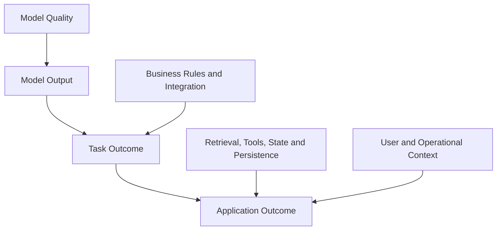

# Task-Specific and Application-Level Evaluation

## 1. Purpose

Language model evaluation becomes meaningful when it reflects the actual task and the application in which the model operates.

A model can produce fluent responses, achieve strong benchmark scores, and satisfy generic quality criteria while still failing to accomplish the user's goal. A classification model may misclassify important cases despite high overall accuracy. A structured extraction system may produce valid JSON containing incorrect values. A customer-support assistant may generate a correct explanation but fail to resolve the user's issue.

These failures demonstrate an important distinction:

**Evaluating a model's output is not the same as evaluating the outcome of the task or application.**

This chapter examines how to translate task requirements into measurable outcomes, evaluate application behavior across multiple components, and connect evaluation evidence to operational decisions.

It builds on the general evaluation foundations, dataset-design principles, metrics, human evaluation, and automated evaluation methods introduced in Chapters 01–05. The focus here is choosing and combining those methods for specific tasks and complete applications.

## 2. Learning Objectives

After completing this chapter, you should be able to:

- Distinguish model-output evaluation from task-level and application-level evaluation.
- Translate business or user requirements into observable task outcomes.
- Select evaluation dimensions appropriate to different task types.
- Design evaluation strategies for classification, extraction, summarization, question answering, and conversational applications.
- Identify failures that emerge from interactions between application components.
- Evaluate end-to-end behavior rather than relying exclusively on isolated component metrics.
- Define task-specific acceptance criteria and failure severity.
- Use error analysis to identify systematic weaknesses and prioritize improvements.
- Explain the relationship between offline evaluation, online product outcomes, and operational monitoring.

## 3. Three Perspectives on Evaluation

A useful application-evaluation strategy distinguishes three related perspectives: model-output evaluation, task-level evaluation, and application-level evaluation.

These perspectives are complementary rather than universally exclusive layers. A task-level metric may assess an individual model output or an entire workflow, depending on the task contract and the intended decision.

### 3.1 Model-output evaluation

Model-output evaluation examines the response or prediction produced by a model.

Examples include:

- Whether a classification label matches the expected label.
- Whether a generated answer follows a specified format.
- Whether a summary preserves important information.
- Whether a response satisfies a defined instruction.
- Whether a generated claim is supported by supplied evidence.

The unit of analysis is usually an individual model output.

This perspective is useful for diagnosing model behavior, but it may not reveal whether the surrounding application successfully completed its task.

### 3.2 Task-level evaluation

Task-level evaluation measures whether the model output or workflow accomplishes a specific, well-defined task.

Examples include:

- Whether an extracted invoice total matches the labeled total.
- Whether a support response correctly identifies the user's issue.
- Whether a classification system identifies the intended category.
- Whether a summary preserves the information needed by its intended reader.
- Whether a question-answering system provides a correct answer for the given question and available evidence.

Task-level evaluation connects output properties to the purpose of the task.

A response can be well written but fail the task. Conversely, a concise response with little stylistic polish may succeed if it accurately completes the required operation.

### 3.3 Application-level evaluation

Application-level evaluation examines the behavior of the complete system that delivers the user-facing capability.

A production application may combine:

- Input validation.
- Business rules.
- Retrieval or database access.
- Model inference.
- Tool execution.
- Output parsing and validation.
- Authorization checks.
- Retry and fallback logic.
- Response formatting.
- Persistence and external side effects.

A defect in any of these components can cause the overall task to fail even when the model itself behaves correctly.

For example, an extraction model may identify the correct invoice total, but a database mapping defect may store the value in the wrong field. Model-output evaluation passes; the application-level task fails.

### 3.4 How the perspectives relate

These perspectives overlap, but success in one does not guarantee success in another.

A strong evaluation program selects the perspective that corresponds to the decision being made. Model-output evaluation helps diagnose components, task-level evaluation checks functional success, and application-level evaluation determines whether the complete system behaves as intended.

## 4. Translate Requirements into Evaluation Criteria

Evaluation should begin with the intended outcome rather than a convenient metric.

Consider the requirement:

> The assistant should help users resolve account-access problems.

This requirement is too broad to evaluate directly. It must be translated into observable conditions.

Possible conditions include:

- The assistant identifies the relevant access problem.
- The response provides steps appropriate to the reported issue.
- The steps are supported by the applicable product documentation.
- The assistant does not request credentials that the user should not disclose.
- The instructions do not violate the user's authorization boundaries.
- The application correctly handles escalation when self-service resolution is not possible.

Each condition represents a distinct property that may need a different evaluation method.

### 4.1 Define the task contract

A task contract specifies what the system is expected to receive, produce, and accomplish.

A useful contract includes:

| Element | Question to answer |
|---|---|
| Input | What information does the task receive? |
| Expected behavior | What must the system do? |
| Output | What form should the result take? |
| Success condition | What observable evidence establishes success? |
| Failure conditions | Which outcomes make the task unsuccessful? |
| Constraints | What must never happen, or what must always hold? |
| Evaluation context | Which reference data, business rules, or external state are relevant? |

The contract should be precise enough that evaluators can distinguish success from failure without inventing assumptions.

### 4.2 Separate required conditions from quality preferences

Not every evaluation dimension has the same importance.

For example, a financial-document extraction system may have:

- A mandatory requirement to extract the correct total.
- A mandatory requirement to preserve currency.
- A formatting preference for consistent decimal precision.
- An efficiency objective to reduce processing time.

A response with attractive formatting but an incorrect total is not acceptable merely because its overall score is high.

Use hard constraints for mandatory conditions and separate metrics for preferences or optimization objectives.

### 4.3 Define the unit of evaluation

The unit of evaluation affects what the results mean.

Possible units include:

- Individual model output.
- Individual extracted field.
- Complete document.
- Conversation.
- User task.
- Complete application workflow.
- Session or user journey.

For example, evaluating each message in a support conversation may miss the fact that the assistant never resolves the issue by the end of the conversation.

Choose a unit that matches the intended outcome. Multiple units may be necessary when diagnosing component failures and measuring overall success.

## 5. Task-Specific Evaluation Strategies

Different task types have different failure modes. They should not all be evaluated using one generic quality score.

### 5.1 Classification

Classification maps an input to one or more predefined labels.

Examples include:

- Routing a support request.
- Categorizing a document.
- Assigning a risk category.
- Detecting a specified content category.

Relevant evaluation dimensions include:

- Agreement with labeled targets.
- Performance for individual classes.
- Confusion between important categories.
- Performance on rare but consequential classes.
- Calibration, when confidence estimates are used in downstream decisions.
- Compliance with class-specific constraints.

A classification system with high overall accuracy may still perform poorly on a rare class that matters most to the application.

Evaluation should reflect class distribution and error costs rather than treating every mistake as equally consequential.

The definitions and interpretation of classification metrics belong to Chapter 03. This chapter's concern is choosing and interpreting them in the context of the task.

### 5.2 Structured information extraction

Information extraction identifies fields or records from unstructured or semi-structured inputs.

Examples include:

- Extracting invoice numbers and totals.
- Identifying entities in contracts.
- Extracting dates from correspondence.
- Converting documents into a predefined JSON structure.

Relevant dimensions include:

- Field-level correctness.
- Required-field coverage.
- Missing-field behavior.
- Incorrect extractions.
- Type and schema validity.
- Record-level correctness.
- Preservation of relationships between fields.

Consider an invoice containing a subtotal, tax amount, and final total. A response may contain valid JSON and all three fields while assigning the subtotal to the total field.

Schema validation alone would not catch this error.

Evaluate individual fields when diagnosing extraction quality, and evaluate complete records when the relationships between fields matter.

### 5.3 Summarization

Summarization condenses source information while preserving information relevant to the intended purpose.

Relevant dimensions include:

- Coverage of important information.
- Factual support from the source.
- Preservation of meaning.
- Omission of critical details.
- Inclusion of unsupported claims.
- Suitability for the intended audience and use.

The appropriate criteria depend on the task.

An executive summary may prioritize decisions, risks, and key outcomes. A clinical-document summary may require preservation of specific details and uncertainty. A meeting summary may prioritize decisions, action items, and owners.

A generic similarity score cannot establish that a summary preserves the information that matters to a particular user.

Define the intended use before selecting the evaluation criteria.

### 5.4 Question answering

Question answering generates responses to questions using some combination of model knowledge, supplied context, retrieved documents, or external tools.

Relevant dimensions include:

- Correctness of the answer.
- Relevance to the question.
- Support from required evidence.
- Completeness relative to the task.
- Appropriate uncertainty or abstention.
- Compliance with constraints on permitted information sources.

The evaluation must reflect the answer's expected evidence source.

If the application is required to answer only from supplied documents, correctness based on unrelated external knowledge may not satisfy the task contract. Conversely, an application designed for general knowledge questions should not automatically be judged by a source-grounding requirement it was never given.

RAG-specific retrieval and grounding evaluation belongs primarily to the RET domain. Here, the emphasis is on defining the question-answering task and measuring whether its intended outcome is achieved.

### 5.5 Code generation

Code generation produces executable or modifiable artifacts.

Relevant dimensions may include:

- Syntactic validity.
- Compilation or execution success.
- Functional correctness against tests.
- Edge-case behavior.
- Compliance with required interfaces.
- Resource usage.
- Security and maintainability constraints.

A code response can look plausible while failing to compile. Code that passes a small set of tests may still fail untested edge cases.

Where practical, use execution-based evaluation with controlled environments and explicit test cases. Passing those tests provides evidence of functional correctness for the tested cases; it does not prove general correctness, security, or maintainability.

The scope of the evaluation must also be explicit: passing functional tests does not establish that code is secure, maintainable, or correct for every possible input.

### 5.6 Conversational applications

Conversational applications often require multiple turns to complete a task.

Relevant dimensions include:

- Correct interpretation of the user's goal.
- Appropriate use of conversation context.
- Consistency across turns.
- Correct handling of corrections and changing requirements.
- Completion of the requested task.
- Appropriate clarification when required information is missing.
- Safe and correct handling of escalation.

Evaluating isolated responses may miss failures that emerge over time.

For example, an assistant may ask a relevant clarification question in one turn but fail to incorporate the answer in the next. Each message may appear reasonable in isolation, yet the overall interaction fails.

Use conversation-level evaluation when the task depends on state, context retention, or multi-turn coordination.

## 6. Evaluate the Complete Application Workflow

Application-level evaluation tests the behavior users actually experience.

Consider a document-processing application:

1. A user uploads a document.
2. The application validates the file.
3. The system extracts its contents.
4. A model identifies relevant fields.
5. Business rules validate the extracted values.
6. The application stores the results.
7. The user receives a confirmation.

A model-only test might evaluate step 4. An end-to-end test must establish whether the intended result is correctly produced and made available to the user.

### 6.1 Component-level versus end-to-end evaluation

Component-level evaluation isolates a subsystem and measures its behavior under controlled conditions.

It is useful for diagnosing failures because it narrows the possible causes.

End-to-end evaluation tests the complete workflow, including integration and state transitions.

It is useful for establishing whether the application satisfies the overall requirement.

Neither approach replaces the other.

| Approach | Strength | Limitation |
|---|---|---|
| Component-level evaluation | Isolates individual failure sources | May miss integration failures |
| End-to-end evaluation | Measures complete workflow behavior | Can make root-cause diagnosis difficult |
| Combined evaluation | Supports both diagnosis and outcome assessment | Requires more carefully designed tests |

A mature evaluation strategy uses component-level tests to locate problems and end-to-end tests to verify that the integrated system works.

### 6.2 Evaluate integration boundaries and state changes

Many application failures occur between components rather than inside a single component.

Examples include:

- A retrieved document is relevant but is not passed to the generation step.
- A model produces valid structured output, but the application interprets a field incorrectly.
- A tool returns an error, but the application treats the result as successful.
- A retry repeats an external action that has already succeeded.
- A valid response is generated but not persisted.
- A user receives a success message before the requested operation has completed.

These failures require tests that inspect data flow, state transitions, and the relationship between component outputs and downstream behavior.

For state-changing operations, evaluate more than the returned response. Verify the **actual resulting state**, whether the intended change occurred, and whether it occurred the correct number of times. This is particularly important for retries, duplicate writes, payments, notifications, and other external actions.

A success message does not establish that an operation succeeded. Similarly, a failed response does not necessarily mean that no side effect occurred; the operation may have completed before a later component failed.

### 6.3 Evaluate negative paths

Testing only successful scenarios provides incomplete evidence.

Include cases where:

- Required input is missing.
- A dependency is unavailable.
- A document cannot be parsed.
- A tool call fails.
- The model returns malformed output.
- The user's request is ambiguous.
- The application lacks sufficient evidence.
- A downstream operation fails after the model produces a valid answer.

The expected behavior may be a controlled error, clarification request, fallback, or escalation rather than task completion.

Evaluation should measure whether the application handles failure according to its contract—not whether it always returns a successful-looking response.

## 7. Task Success and Business Outcomes

Application evaluation may extend beyond technical correctness to user and business outcomes.

Examples include:

- Whether users successfully complete a workflow.
- Whether support issues are resolved without unnecessary escalation.
- Whether extracted records require less manual correction.
- Whether a document-processing task finishes within an acceptable time.
- Whether users can recover from errors without restarting the process.

These outcomes are influenced by more than model quality. User behavior, interface design, business rules, and external dependencies can all affect the result.

### 7.1 Distinguish offline evaluation from online outcomes

**Offline evaluation** assesses a system against a prepared dataset, recorded interactions, or controlled test scenarios. It supports repeatable comparison and diagnosis without requiring every experiment to affect live users.

**Online evaluation** examines behavior in a deployed environment, using measurements such as successful task completion, user feedback, operational cost, or intervention rates.

The two perspectives answer different questions. Offline evaluation can help establish whether a change improves performance on a defined test set. Online evaluation helps determine whether the change has the intended effect under real usage conditions.

Online outcomes may be influenced by changes in user mix, traffic volume, interface design, external dependencies, or other simultaneous releases. A change in a business metric therefore does not, by itself, establish that the model change caused the difference.

### 7.2 Distinguish proxy metrics from actual outcomes

A proxy metric is an observable measurement used as an approximation for a goal that may be difficult to measure directly.

For example:

- Response relevance may be a proxy for usefulness.
- A successful tool call may be a proxy for task completion.
- A high judge score may be a proxy for answer quality.
- Reduced handling time may be a proxy for operational efficiency.

Proxies are useful, but they can become misleading when treated as the objective itself.

An assistant may achieve high relevance scores while failing to resolve users' problems. A workflow may become faster because it skips a necessary validation step.

Validate whether the proxy actually tracks the intended outcome.

### 7.3 Avoid optimizing one metric in isolation

Suppose a support assistant is optimized to minimize the number of turns per conversation.

It may learn to give short answers quickly, even when users need clarification or additional guidance.

The metric improves, but the underlying experience may worsen.

Evaluate multiple dimensions when they represent genuine trade-offs. Examples include:

- Correctness and completion rate.
- Quality and latency.
- Automation rate and error rate.
- Cost and successful task completion.
- Speed and the need for human intervention.

Do not combine all dimensions into a single score without a clear justification. Some requirements should remain hard constraints.

### 7.4 Attribution requires care

A change in business outcomes does not automatically prove that the model change caused it.

For example, an increase in successful task completion might coincide with a new model release, a user-interface redesign, and a change in customer traffic.

When causal attribution matters, use a controlled experimental design appropriate to the decision. Account for the evaluation population, assignment method, sample size, and relevant external changes.

The detailed principles of experimental design and statistical interpretation belong to Chapter 08.

## 8. Build a Task-Specific Evaluation Dataset

An evaluation dataset should represent the situations the task is expected to handle and the failures the organization needs to detect.

Chapter 02 covers dataset design and integrity in detail. For task-specific evaluation, the main requirement is to ensure that the test cases represent meaningful application behavior.

### 8.1 Cover normal and difficult cases

A task-specific dataset should include appropriate examples of:

- Common, straightforward inputs.
- Boundary conditions.
- Ambiguous requests.
- Missing or contradictory information.
- Rare but consequential cases.
- Invalid or malformed inputs.
- Expected failure and recovery paths.

The exact distribution should reflect the task and evaluation purpose.

A dataset that contains only easy examples can make a system appear reliable while hiding important weaknesses.

### 8.2 Distinguish representative tests from enriched failure tests

A production-representative dataset approximates the cases the application is expected to encounter. It is useful for estimating performance under the intended workload and input distribution.

An enriched failure dataset deliberately includes more difficult, rare, or high-impact cases than would normally appear in production. It is useful for testing known weaknesses and verifying that safeguards work.

These datasets answer different questions. An enriched failure set can reveal important weaknesses, but its aggregate failure rate should not be interpreted as the expected production failure rate unless the sampling design supports that inference.

Use both when appropriate, and label their purposes clearly.

### 8.3 Include application context

When evaluating a complete workflow, preserve the context required to reproduce the intended behavior.

Depending on the application, this may include:

- Initial state.
- User input.
- Relevant documents or records.
- Business-rule configuration.
- Tool responses.
- Expected state changes.
- Expected final output.
- Conditions that require an error or escalation.

Without this context, a failed test may be ambiguous: the system could be incorrect, or the test may have omitted information the application was expected to receive.

### 8.4 Define expected outcomes explicitly

An expected outcome should specify what success means for the task.

For a document-extraction workflow, it might include both the expected field values and the expected persistence result.

For a multi-turn assistant, it might specify the final task state rather than requiring one exact sequence of messages.

Where multiple valid outcomes exist, the evaluation design should describe acceptable alternatives. Exact-match comparison is appropriate only when exact matching reflects the task contract.

## 9. Error Analysis and Failure Attribution

An aggregate metric indicates how a system performs overall. Error analysis helps explain where and why it fails.

### 9.1 Categorize failures

Useful failure categories include:

- Incorrect interpretation of the input.
- Missing or incorrect context.
- Incorrect model output.
- Unsupported claims.
- Constraint violation.
- Output-format or parsing failure.
- Business-rule failure.
- Integration or state-management failure.
- Dependency failure.
- Incorrect success reporting.
- Failure to recover or escalate.

These categories should be adapted to the application rather than adopted as a universal taxonomy.

### 9.2 Separate observed symptoms from root causes

Suppose an application stores an incorrect invoice total.

The observed symptom is an incorrect stored value. Possible causes include:

- The extraction model identified the wrong number.
- The post-processing layer mapped the wrong field.
- A conversion routine changed the value.
- The persistence layer wrote to an incorrect column.
- The displayed value came from a stale record.

The symptom alone does not establish the root cause.

Use intermediate outputs, traces, and component-level tests to identify where the behavior diverged from the expected workflow.

### 9.3 Prioritize failures by impact

Not every failure deserves the same engineering priority.

Consider:

- Severity of the incorrect outcome.
- Frequency of occurrence.
- Number of users or workflows affected.
- Detectability before the user is affected.
- Cost of recovery.
- Availability of a safe fallback.

A rare but severe failure may deserve higher priority than a frequent, low-impact formatting issue.

Prioritization should reflect the application's actual requirements and risks, not merely the number of failures observed.

### 9.4 Use failure patterns to guide improvements

Once failures are categorized, choose the intervention that addresses the likely cause.

Examples:

- Incorrect field extraction may require better task examples, model changes, or validation rules.
- Missing evidence may require changes to context construction or retrieval.
- Invalid output may require stricter output contracts and deterministic validation.
- Integration failures may require changes to application code rather than model prompts.
- Repeated failures on ambiguous requests may require clarification behavior.
- Unreliable judgments may require changes to the evaluation process itself.

Do not automatically respond to every failure by changing the prompt. The model may not be the component responsible for the defect.

## 10. Practical Lab: Evaluate a Document-Extraction Application

### 10.1 Scenario

You are building an application that extracts invoice information and stores it in a database.

The application must:

1. Accept an invoice document.
2. Extract the invoice number, currency, subtotal, tax, and total.
3. Validate the extracted structure.
4. Apply business rules.
5. Store the result.
6. Return a success confirmation only when the required operation has completed successfully.

Your task is to design an evaluation strategy for both the extraction task and the complete application.

### 10.2 Step 1: Define success

Specify the observable conditions for successful completion.

At minimum, consider:

- Whether the required fields are correct.
- Whether currency and numeric values are preserved correctly.
- Whether missing or unreadable fields are handled appropriately.
- Whether business-rule violations are detected.
- Whether the persisted record matches the accepted extraction result.
- Whether failure cases produce an accurate error or escalation outcome.

Define expected behavior for missing required fields separately from unreadable documents. For example, a document with a clearly missing required field may need a validation failure, while an unreadable document may require a processing error or manual review. The correct outcome depends on the application's task contract.

Do not define success solely as valid JSON or a model-generated confirmation.

### 10.3 Step 2: Design the dataset

Create a representative dataset containing:

- Straightforward invoices.
- Different invoice layouts.
- Missing optional fields.
- Missing required fields.
- Ambiguous numeric formats.
- Multiple currency formats.
- Inconsistent totals.
- Unreadable or malformed documents.
- Cases where extraction succeeds but persistence fails.

Record the expected extracted values and expected application outcome for each case.

### 10.4 Step 3: Define separate evaluation layers

Design at least three layers.

**Layer A — Extraction evaluation**

Measure whether the model identifies the correct field values.

**Layer B — Validation evaluation**

Measure whether the application correctly checks the extracted structure and applies business rules.

**Layer C — End-to-end evaluation**

Measure whether the correct record is persisted and whether the user receives an accurate final status.

Explain which failures each layer can detect and which failures require another layer.

### 10.5 Step 4: Define metrics and constraints

Choose metrics appropriate to the task, referring to Chapter 03 for their formal definitions.

Separate:

- Field-level correctness.
- Complete-record correctness.
- Structural validity.
- Business-rule compliance.
- Successful persistence.
- Appropriate handling of failures.

Identify any mandatory conditions that cannot be offset by a high average score.

### 10.6 Step 5: Perform failure analysis

For each failed test, record:

- Expected outcome.
- Actual outcome.
- First point of divergence.
- Likely root cause.
- Impact and severity.
- Proposed corrective action.
- Regression test needed to prevent recurrence.

Avoid assigning root cause from the final symptom alone. Use component-level evidence to support the diagnosis.

### 10.7 Step 6: Design the regression suite

Convert the discovered failures into repeatable tests.

Include both the original failing case and relevant neighboring cases. For example, correcting a currency-conversion defect should not break invoices that use the default currency.

The suite should test the component being changed and the end-to-end behavior that depends on it.

For state-changing operations, verify the persisted result and confirm that retries do not create duplicate records or unintended side effects.

### 10.8 Lab deliverables

Produce:

1. A task contract with explicit success and failure conditions.
2. An evaluation dataset with expected outcomes.
3. A layered evaluation plan.
4. A metric-selection rationale.
5. A failure taxonomy and severity scheme.
6. An example failure-analysis report.
7. A regression-test plan.
8. A list of known limitations and untested scenarios.

The lab is complete when you can explain how the evaluation identifies failures, helps locate their causes, and establishes whether a proposed fix improves the application without introducing unacceptable regressions.

## 11. Common Engineering Mistakes

### Mistake 1: Using generic model quality as a proxy for task success

**Why it fails:** A fluent or relevant response may not accomplish the required operation.

**Better approach:** Define task-specific success conditions and evaluate them directly.

### Mistake 2: Testing only isolated model outputs

**Why it fails:** Integration, state-management, persistence, and recovery failures may remain undetected.

**Better approach:** Combine component-level tests with end-to-end workflow tests.

### Mistake 3: Relying on one aggregate score

**Why it fails:** Important failure categories can disappear inside an overall average.

**Better approach:** Analyze relevant dimensions, failure categories, and high-impact cases separately.

### Mistake 4: Evaluating only successful paths

**Why it fails:** Real applications also receive invalid inputs, encounter unavailable dependencies, and experience partial failures.

**Better approach:** Define and test negative paths, recovery behavior, and escalation conditions.

### Mistake 5: Treating proxy metrics as the actual objective

**Why it fails:** Improvements in relevance, speed, or automation rate may not improve the user's outcome.

**Better approach:** Validate proxies against the intended task or business outcome.

### Mistake 6: Blaming the model for every failure

**Why it fails:** Application code, business rules, integrations, and persistence can cause failures independently of model behavior.

**Better approach:** Trace the workflow and identify the first point of divergence before selecting an intervention.

### Mistake 7: Requiring one exact output when multiple outcomes are valid

**Why it fails:** Exact-match evaluation can reject valid responses that differ in wording or representation.

**Better approach:** Use exact matching only when the task contract requires it. Otherwise, define acceptable alternatives and suitable evaluation criteria.

### Mistake 8: Changing prompts without adding regression tests

**Why it fails:** A fix for one example can create regressions elsewhere.

**Better approach:** Preserve failing cases, test neighboring scenarios, and evaluate the complete affected workflow.

## 12. Summary

Task-specific and application-level evaluation connects model behavior to the outcomes that matter to users and organizations.

Model-output evaluation examines individual predictions or responses. Task-level evaluation determines whether an output or workflow accomplishes a defined operation. Application-level evaluation tests whether the complete integrated system delivers the intended outcome under both normal and failure conditions. These are complementary perspectives, and the appropriate evaluation unit depends on the decision being made.

A reliable strategy requires:

- Explicit task contracts.
- Observable success and failure conditions.
- Evaluation methods suited to the task type.
- Component-level and end-to-end tests.
- Representative datasets that include difficult cases and failure paths.
- Metrics aligned with actual requirements.
- Error analysis that distinguishes symptoms from root causes.
- Regression tests that protect against recurring defects.
- Careful separation of technical proxies from user and business outcomes.
- Verification of actual state changes for operations with side effects.

The central principle is simple: **evaluate the system at the level where the decision or outcome matters, then use lower-level evaluation to explain and improve its behavior.**

## 13. Connections to Other Chapters

- **Chapter 01 — Evaluation Foundations and Objectives:** Establishes the relationship between requirements, evaluation objectives, and evidence.
- **Chapter 02 — Evaluation Dataset Design and Data Integrity:** Covers representative datasets, data quality, leakage, and test-set independence.
- **Chapter 03 — Metrics for Language Model Evaluation:** Defines the metrics that can be selected for task-specific evaluation.
- **Chapter 04 — Human Evaluation and Rubric Design:** Provides methods for evaluating qualities that require human judgment.
- **Chapter 05 — Automated Evaluation and LLM-as-a-Judge:** Covers model-based evaluators and their validation requirements.
- **Chapter 07 — Benchmarking and Controlled Model Comparison:** Uses evaluation evidence to compare systems under controlled conditions.
- **Chapter 08 — Experimental Design and Statistical Interpretation:** Covers controlled experiments and interpretation of observed differences.
- **Chapter 09 — Reproducible Evaluation Workflows and Practical Lab:** Covers repeatable evaluation runs, artifacts, and versioning.

Specialized RAG evaluation remains primarily in the RET domain. Agent orchestration and tool-use evaluation remain primarily in the AGT domain. This chapter establishes the general principles for evaluating the tasks and complete applications that use those systems.

## 14. Knowledge Check

Answer in your own words. Focus on engineering reasoning rather than memorizing definitions.

1. Explain the difference between model-output evaluation, task-level evaluation, and application-level evaluation using one example.
2. A model extracts all invoice fields correctly, but the application stores the total in the wrong database column. Which evaluation perspectives should detect this failure, and why?
3. Why might a high classification accuracy score be insufficient for an application with a rare but consequential class?
4. How would you evaluate a summarization task when multiple summaries can be valid?
5. Why should an evaluation suite include negative paths and recovery behavior?
6. An application's task-completion rate improves while user satisfaction declines. What hypotheses would you investigate?
7. How would you distinguish a model failure from a business-rule or integration failure?
8. What is the risk of optimizing a proxy metric without checking whether it tracks the actual outcome?
9. Design a layered evaluation strategy for a conversational application that must resolve user requests across multiple turns.
10. After fixing one application failure, how would you establish that the fix did not introduce regressions in other workflows?

