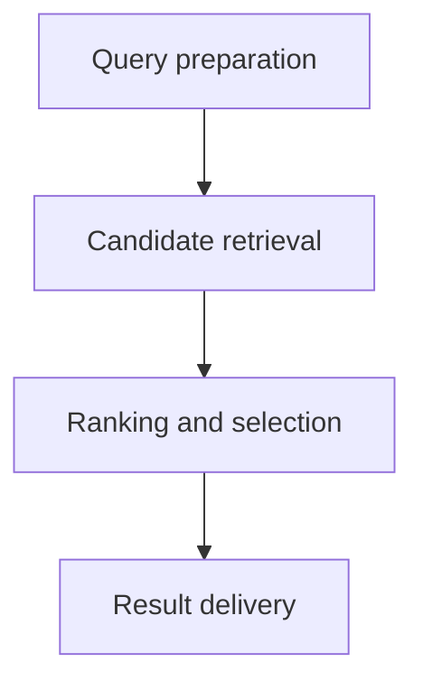
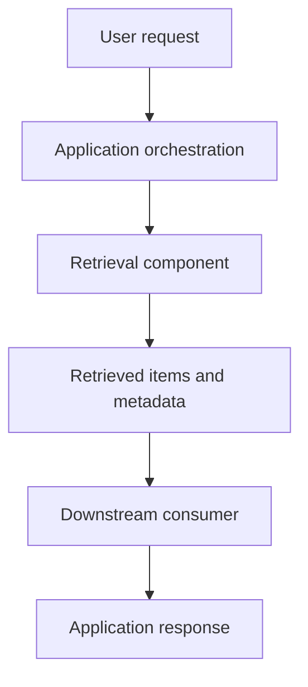

# Retrieval Pipeline and System Boundaries

## 1. Retrieval Is Part of a Larger System

A retrieval system finds candidate information items that can support a user's task. In a production GenAI application, retrieval operates within a broader workflow that may include query preparation, application orchestration, and downstream generation.

Understanding these responsibilities matters because a failure that appears to be a retrieval problem may originate elsewhere. The query might omit important context, the corpus might lack the required information, or the downstream application might mishandle retrieved evidence.

This chapter focuses on the **query-time retrieval flow** and its boundary with downstream components. Document ingestion and index construction are separate concerns covered in later RET chapters.

## 2. Understand the Query-Time Retrieval Pipeline

The query-time pipeline describes the logical stages involved in finding and returning information for a request.

- **Query preparation:** Produces the retrieval input and applicable constraints from the incoming request.
- **Candidate retrieval:** Finds potential matches in the searchable corpus.
- **Ranking and selection:** Orders candidates or selects a subset when required.
- **Result delivery:** Returns selected items and associated information to the caller.

These stages represent logical responsibilities, not necessarily separate services. A simple application may implement several stages in one function, while a larger system may distribute them across components. Some systems combine retrieval and ranking or perform multiple retrieval passes.

The diagram establishes a conceptual model, not a mandatory implementation sequence.

## 3. Define the Retrieval Boundary

The **retrieval boundary** is the interface at which a retrieval component returns results to its caller. Its exact location depends on the component contract, not on how services are deployed.

The broader application flow includes responsibilities outside retrieval. In a retrieval-augmented generation (RAG) application:

- **Retrieval** supplies candidate evidence.
- **Generation** uses supplied evidence to produce a response.
- **Application orchestration** coordinates the interaction and handles the response.

Retrieval alone does not guarantee that the generated answer is correct or that all required evidence was found. Conversely, a poor answer does not automatically prove that retrieval failed.

Clear boundaries let engineers inspect intermediate results and investigate the component responsible for a failure instead of treating the entire application as one opaque system.

## 4. Diagnose Failures at the Correct Boundary

Consider an internal engineering assistant that answers questions using approved runbooks.

| Observed failure | Possible area to investigate |
|---|---|
| The query omits the product version | Query preparation |
| The required runbook is absent from the searchable collection | Corpus scope or preparation |
| The runbook exists, but useful passages are not retrieved | Retrieval behavior |
| Useful passages appear too low in the results | Ranking or selection |
| Correct evidence is retrieved, but the answer contradicts it | Downstream generation or application handling |

These are diagnostic starting points, not definitive conclusions. A symptom can have multiple causes, so engineers should test hypotheses against evidence before assigning responsibility.

Changing the retrieval algorithm before locating the failure can add complexity without addressing the underlying problem.

## 5. Use Boundaries to Guide Engineering Decisions

When designing a retrieval component, identify its inputs, outputs, dependencies, and responsibilities before deciding how to deploy it.

For example, a retrieval component's contract might specify the accepted query and constraints, the returned items and metadata, and how an empty result is represented. This makes the component easier to test independently and helps downstream consumers handle its outputs consistently.

Detailed ingestion, retrieval algorithms, ranking methods, and formal evaluation belong to their respective RET chapters.

## Knowledge Check

1. Why can a poor generated answer occur even when retrieval returns useful evidence?
2. Why are conceptual pipeline stages not necessarily separate services?
3. What evidence would you gather before deciding that retrieval caused a failure?

## Practical Exercise

Extend the retrieval specification from Lesson 01 into a conceptual design for an internal engineering assistant. Identify the input and output of each retrieval stage, mark the retrieval boundary, and describe one possible failure in two different components.

**Completion criterion:** Another engineer should be able to distinguish retrieval responsibilities from downstream application responsibilities and identify where an observed failure should be investigated first.
