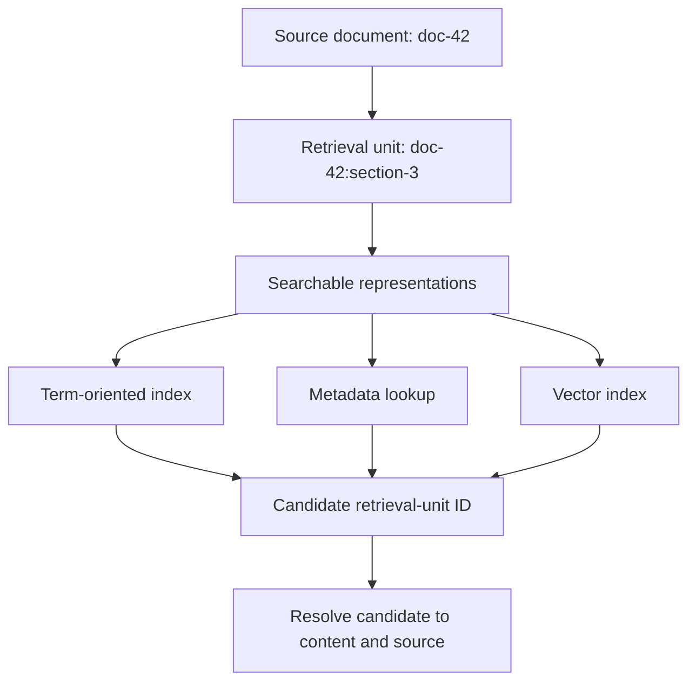

# Searchable Representations and Index Structures

## 1. Why Retrieval Systems Need Searchable Representations

Source documents are not automatically searchable in every way a retrieval system requires. Their content and attributes must be exposed in forms that retrieval mechanisms can access.

Keep four concepts distinct:

- **Source document:** The original information and its identity.
- **Retrieval unit:** A portion of content that can become a retrieval candidate, such as a section or chunk.
- **Searchable representation:** Content or attributes prepared for a retrieval operation.
- **Index:** A structure that organizes searchable information for lookup or candidate discovery.

A retrieval operation uses these structures to discover candidates. An index does not replace the source content, and an index entry is not necessarily the content returned to the user.

## 2. From Source Documents to Searchable Representations

Consider a product manual identified as `doc-42`. Its connection-pool section becomes retrieval unit `doc-42:section-3`.

| Field | Example | Purpose |
|---|---|---|
| `retrieval_unit_id` | `doc-42:section-3` | Identifies the candidate |
| `source_document_id` | `doc-42` | Preserves source association |
| `content` | Section text | Supplies returnable content |
| `product_version` | `v3` | Supports version constraints |
| `content_type` | `configuration-guide` | Supports structured lookup |
| `terms` | `pool_size`, `timeout` | Supports term-oriented retrieval |
| `embedding` | Vector representation | Supports vector-oriented retrieval |

This is a conceptual schema, not a requirement to store every field in one physical record.

A field's presence does not guarantee that it is searchable. The field must be exposed to an appropriate retrieval mechanism and remain associated with the correct retrieval-unit identifier. For example, `content` may support term lookup while `product_version` supports filtering. Some stored fields may be used only for display or traceability.

## 3. Types of Searchable Representations

### 3.1 Term-oriented

Term-oriented representations expose textual terms for lookup. A query containing `pool_size` can discover units associated with that term. This is useful for identifiers, configuration keys, and other exact terminology. Text analysis and lexical scoring belong to RET-05.

### 3.2 Metadata-oriented

Metadata-oriented representations expose structured attributes such as product version, content type, or publication status. A request constrained to version `v3` requires an accessible representation of that attribute. Metadata can constrain candidate discovery but does not, by itself, establish content relevance.

### 3.3 Vector-oriented

Vector-oriented representations associate a retrieval unit with a vector that supports semantic candidate discovery. This can help when relevant content uses different wording from the query. Embedding foundations belong to AIF; vector-search execution and approximate-nearest-neighbor mechanisms belong to RET-06.

A system can use multiple representation types for the same retrieval unit.

## 4. Index Structures and Their Responsibilities

### 4.1 Inverted-index structure

An inverted index conceptually maps terms to the retrieval-unit identifiers associated with them.

| Term | Associated retrieval-unit IDs |
|---|---|
| `pool_size` | `doc-42:section-3`, `doc-57:section-1` |
| `connection` | `doc-42:section-3`, `doc-51:section-2` |
| `timeout` | `doc-51:section-2` |

A lookup for `pool_size` can discover its associated candidates. This illustrates the mapping, not the full index implementation or ranking algorithm.

### 4.2 Vector-index structure

A vector index organizes vector representations for vector-based candidate discovery.

| Illustrative vector-entry label | Associated retrieval-unit ID |
|---|---|
| `vector-A` | `doc-42:section-3` |
| `vector-B` | `doc-51:section-2` |
| `vector-C` | `doc-57:section-1` |

These labels stand for vector entries; they are not actual vector values. The essential relationship is between a searchable entry and the retrieval-unit identifier it represents.

### 4.3 Representation versus index organization

A **representation** determines what searchable information is available. An **index structure** organizes that information for lookup.

For example, term-oriented representation exposes terms, while an inverted index organizes term-to-unit associations. Vector-oriented representation supplies vectors, while a vector index organizes them for vector search. Choosing a representation does not, by itself, determine the index implementation.

## 5. End-to-End Trace

Trace the responsibilities:

1. Identify the source document and retrieval unit.
2. Expose the unit's terms, structured attributes, and vector where required.
3. Associate each searchable representation with the retrieval-unit identifier.
4. Use the appropriate index or lookup mechanism to discover candidate IDs.
5. Resolve each candidate to its content while preserving source association.

The core invariant is that searchable entries must remain correctly associated with the retrieval units they represent.

## 6. Searchability Limitations

| Limitation | Consequence |
|---|---|
| Required information is absent from the representation | Relevant units may not be discoverable through that mechanism |
| Representation loses important information | Relevant candidates may become indistinguishable |
| A required field is not available to the lookup mechanism | The intended lookup or constraint cannot be applied |
| An index entry points to the wrong identifier | Unrelated content may be returned |
| Some retrieval units are missing from the searchable structure | Candidate coverage is incomplete |
| A structured attribute is missing or incorrect | Filtering may exclude valid candidates or admit invalid ones |

Adding an index cannot recover information discarded during representation. Likewise, a correct representation cannot compensate for an incorrect identifier association. Candidate discovery is also distinct from relevance ranking: finding a candidate does not establish that it is the best result.

## 7. Practical Exercise: Trace a Retrieval Unit

Choose a technical document and one retrieval unit. Produce a short trace that:

1. Identifies the source document and retrieval unit.
2. Lists the relevant content and metadata fields.
3. Identifies the searchable representations.
4. Shows an example index entry or structured lookup association.
5. Explains how a query discovers the candidate identifier.
6. Identifies one limitation that could prevent discovery.
7. Explains how the candidate resolves to the correct content and source.

**Completion criterion:** The trace distinguishes source content, retrieval unit, representation, index, and candidate discovery, while preserving the identifier association through resolution.

## Further Reading

- [RET-02 — Document Ingestion and Retrieval-Oriented Processing](../RET-02-Document-Ingestion-and-Retrieval-Oriented-Processing/README.md)
- [RET-03 — Chunking and Document Structure](../RET-03-Chunking-and-Document-Structure/README.md)
- [RET-05 — Lexical Retrieval and Sparse Search](../RET-05-Lexical-Retrieval-and-Sparse-Search/README.md)
- [RET-06 — Dense Retrieval and Vector Search](../RET-06-Dense-Retrieval-and-Vector-Search/README.md)
- [Lesson 02 — Index Lifecycle, Freshness, and Consistency](02-Index-Lifecycle-Freshness-and-Consistency.md)
- [Lesson 03 — Index Design and Engineering Trade-offs](03-Index-Design-and-Engineering-Trade-offs.md)
