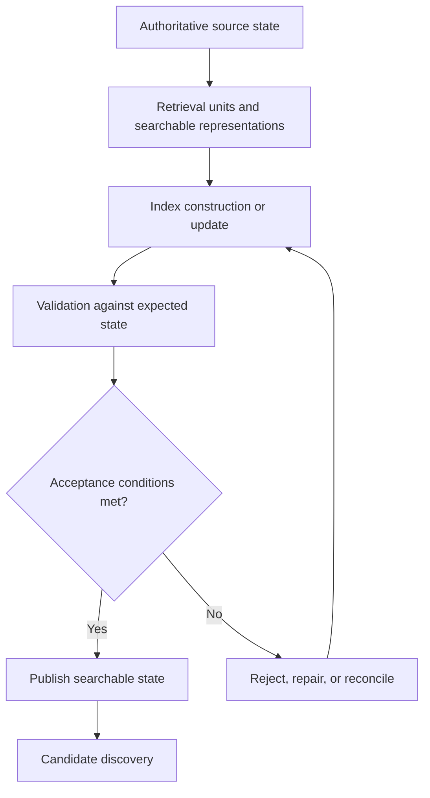

# Index Lifecycle, Freshness, and Consistency

## 1. Why Index Lifecycle Matters

A retrieval index is derived searchable state, not the authoritative source of information. Its correctness depends on whether it represents the intended source state and whether readers can observe that state under the system's declared consistency guarantees.

An indexing operation can complete successfully while producing incorrect retrieval behavior. Records may be missing, obsolete representations may remain searchable, or readers may observe incompatible versions.

Index lifecycle engineering defines how searchable state is constructed, updated, published, verified, and recovered after failure.

This chapter focuses on the lifecycle of representations and indexes. Source-corpus lifecycle and provenance belong to RET-02; retrieval-unit construction and structural boundaries belong to RET-03.

## 2. Expected State and Initial Construction

Before constructing an index, the system must define the state it intends to make searchable.

That definition should identify:

- The authoritative inputs included in the operation.
- The retrieval units and representations expected from those inputs.
- The identities and versions required to associate indexed entries with their source records.
- The treatment of replacement, deletion, and obsolete entries.
- The conditions that must hold before the resulting state is accepted.

Version identification depends on the source system. A system may use a corpus-wide snapshot or generation, individual record versions, retrieval-unit versions, or a combination. The key requirement is that the intended state can be identified and validated.

The lifecycle can be represented as:

Initial construction normally involves six stages:

1. **Establish the input boundary.** Determine which source records, versions, or snapshot the build represents.
2. **Obtain retrieval units and required metadata.** Confirm that the build uses the intended inputs.
3. **Produce searchable representations.** Generate the terms, metadata fields, embeddings, or other representations required by the index design.
4. **Create index entries.** Associate entries with stable identities and relevant source or retrieval-unit versions.
5. **Validate the result.** Check expected coverage, identity associations, required representations, and representative lookup behavior.
6. **Accept and publish the result.** Make the searchable state available only when the defined readiness conditions are satisfied.

If the source changes while construction is running, the system must define whether the build represents a fixed snapshot, a known version boundary, or a state requiring reconciliation before publication.

The central invariant is that successful indexing does not, by itself, prove that the intended source state is searchable.

## 3. Updates, Replacement, and Deletion

An index must preserve the relationship between authoritative records and their searchable representations as the source changes.

| Source change | Required lifecycle behavior |
|---|---|
| New record | Create the expected searchable entries and verify their discoverability. |
| Content update | Make the current content and representations searchable according to the declared consistency guarantee. |
| Metadata correction | Update affected searchable fields or representations so retrieval uses the intended metadata. |
| Retrieval-unit replacement | Introduce new units and handle obsolete units according to the publication and consistency policy. |
| Record deletion | Prevent deleted content from remaining retrievable beyond the applicable deletion guarantee. |

Replacement requires particular care. Suppose a record changes from version `v2` to `v3`. If the system adds `v3` but never retires `v2`, both versions may remain discoverable. If it removes `v2` before `v3` is ready, the record may temporarily become unavailable.

Neither sequence is universally correct. The acceptable transition depends on the system's availability, freshness, and consistency requirements.

### 3.1 Deletion Guarantees

Deletion is more than issuing a removal operation. A system must define:

- Which index entries and derived representations are affected.
- When deletion becomes effective for retrieval and access control.
- How successful removal is verified.
- What happens if cleanup fails or is interrupted.
- Whether retries and reconciliation are required.

For sensitive or access-controlled content, index cleanup and access revocation must be treated as separate guarantees. An authoritative access check may need to deny access immediately, even if physical index cleanup is asynchronous.

**Eventual index cleanup does not imply immediate access revocation.** The required guarantee must be explicit, and the retrieval path must enforce it.

## 4. Freshness and Publication

Freshness describes how closely searchable state reflects the intended authoritative state. A useful operational measure is the delay between a source change and the intended update becoming discoverable through the actual retrieval path.

\[
\text{Visibility delay}
=
t_{\text{searchable}}-t_{\text{source change}}
\]

Here:

- \(t_{\text{source change}}\) is the timestamp of the relevant authoritative change.
- \(t_{\text{searchable}}\) is the earliest verified time the intended update can be discovered through the retrieval path under the declared consistency guarantee.

An indexing API returning success is not sufficient evidence of search visibility. An entry may have been written but may not yet be queryable, may be excluded by publication rules, or may resolve to an obsolete version.

For a corpus-wide publication model, the measurement may need to reflect when the relevant corpus generation becomes visible. For a per-record model, it may measure visibility of the individual updated record. The metric must match the system's actual freshness guarantee.

Two common refresh strategies are:

- **Incremental refresh:** Apply changes to existing searchable state. This can reduce work and visibility delay but requires correct handling of retries, replacements, deletions, and interrupted operations.
- **Full rebuild:** Construct a new index state from a defined input boundary. This can simplify reconciliation against that boundary but consumes additional resources and still requires validation and safe publication.

Neither strategy automatically guarantees freshness or correctness.

### 4.1 Preparation and Publication

A robust lifecycle distinguishes preparing candidate state from making that state visible to readers.

1. **Prepare:** Generate the required representations and index entries.
2. **Validate:** Check the identities, versions, coverage, and acceptance conditions appropriate to the consistency model.
3. **Publish:** Make the accepted state available to retrieval.
4. **Reconcile:** Detect and resolve incomplete, failed, or obsolete state according to policy.

Publication may use versioned index state, an atomic alias switch, a transaction where supported, or another controlled transition. The mechanism depends on the underlying system's capabilities.

The required guarantee is not necessarily that every intermediate operation is invisible. It is that readers observe only states permitted by the declared consistency model.

Two consistency scopes should be distinguished:

- **Per-record consistency:** Each record's visible representation follows its versioning and replacement policy. Different records may reflect different source-update times.
- **Corpus-level consistency:** The visible index corresponds to a defined corpus snapshot or generation, where the application requires a coherent corpus-wide state.

A system may need one guarantee without needing the other. A per-record indexing workflow should not claim corpus-level snapshot consistency unless it can establish that guarantee.

A bounded-staleness system may permit readers to see an older complete representation briefly. A system requiring corpus-level consistency may need to prevent readers from observing a mixture of incompatible generations. If temporary inconsistency is permitted, its duration and consequences must be defined.

## 5. Partial Failure, Consistency, and Recovery

Index lifecycle operations can fail after only part of the intended work has completed. Recovery must preserve the required invariants rather than merely retrying the last operation.

| Failure scenario | Required invariant | Possible recovery approach |
|---|---|---|
| Partial initial build | An incomplete build must not be accepted as complete. | Track build state and validate coverage before publication. |
| Repeated update or retry | Repeated processing must not create conflicting or unintended searchable state. | Use retry-safe operations where available and verify the resulting state. |
| Old-entry removal fails | Obsolete entries must be handled according to the declared consistency and deletion policy. | Retry removal, reconcile affected identities, or apply an appropriate retrieval-time guard. |
| New-entry creation fails | The system must not claim the new version is searchable when it is not. | Record the incomplete update and retry, repair, or restore the required state. |
| Source changes during construction | The published state must satisfy the intended version or snapshot requirement. | Reconcile later changes or reject the candidate state and rebuild. |
| Publication is interrupted | Readers must not be exposed to a state that violates the publication guarantee. | Determine which state became visible, verify it, and complete or reverse the transition safely. |

These recovery approaches are implementation options, not universal requirements. Atomic publication, for example, may not be supported by every index system. The engineering specification must identify the actual mechanism that preserves each invariant.

Version-aware indexing helps establish correctness by associating searchable entries with identifiable source or retrieval-unit versions. The validation process should check the version scope relevant to the guarantee: individual records, a corpus snapshot, or both.

Consistency does not necessarily mean that every reader sees the newest source state immediately. It means the system defines what readers are allowed to observe, how stale that state may be, and how violations or interrupted transitions are detected and recovered.

## 6. Verification and Acceptance Criteria

Lifecycle correctness must be observable. Acceptance should be based on the expected searchable state and explicit verification, not solely on successful API responses or completed jobs.

| Operation | Acceptance condition |
|---|---|
| Initial construction | Expected retrieval units and required representations are present and resolvable. |
| Addition | New content becomes discoverable within the declared freshness target. |
| Update or replacement | The intended version is available under the declared consistency guarantee, and obsolete state is handled according to policy. |
| Deletion | Deleted content is no longer retrievable within the applicable deletion guarantee. |
| Publication | The exposed state satisfies the required version, coverage, and identity conditions for the selected consistency scope. |
| Recovery | Interrupted work is detected and reconciled before the affected state is accepted. |
| Freshness | Measured source-change-to-search-visibility delay meets the declared target. |

Verification should compare expected state with actual searchable state. Coverage checks can detect missing entries; identity and version checks can detect stale or incorrectly associated entries; representative lookups can verify visibility through the retrieval path.

Each acceptance criterion should define:

1. **Expected state:** What must be searchable, absent, or version-consistent?
2. **Verification method:** How will the system establish that the condition holds?
3. **Failure response:** What happens when verification fails?

The exact checks depend on the index design and consistency guarantee. They should establish both that the intended state is present and that prohibited obsolete state is handled as specified.

## 7. Practical Exercise: Write an Index Lifecycle Specification

Choose a retrieval system and document its lifecycle without assuming that a successful indexing call proves correctness.

Include:

1. The authoritative source, indexed entities, and version or snapshot model.
2. Initial-build inputs, readiness conditions, and publication criteria.
3. Required behavior for additions, updates, replacements, and deletions.
4. The freshness target, timestamp definitions, and method for measuring source-change-to-search-visibility delay.
5. The consistency guarantees readers receive, distinguishing per-record consistency from corpus-level consistency where relevant.
6. At least two partial-failure scenarios, the invariant each must preserve, and the recovery mechanism.
7. Verification for coverage, identity, versions, deletion, publication, and final searchable state.

**Completion criterion:** You can explain what searchable state is expected, when it is safe to publish, what readers may observe during transitions, how freshness is measured, and how the system detects and recovers from incomplete or inconsistent indexing work.

## Further Reading

- [01 — Searchable Representations and Index Structures](01-Searchable-Representations-and-Index-Structures.md)
- [03 — Index Design and Engineering Trade-offs](03-Index-Design-and-Engineering-Trade-offs.md)
- [RET-02 — Document Ingestion and Retrieval-Oriented Processing](../RET-02-Document-Ingestion-and-Retrieval-Oriented-Processing/README.md)
- [RET-03 — Chunking and Document Structure](../RET-03-Chunking-and-Document-Structure/README.md)
