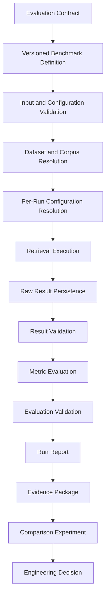
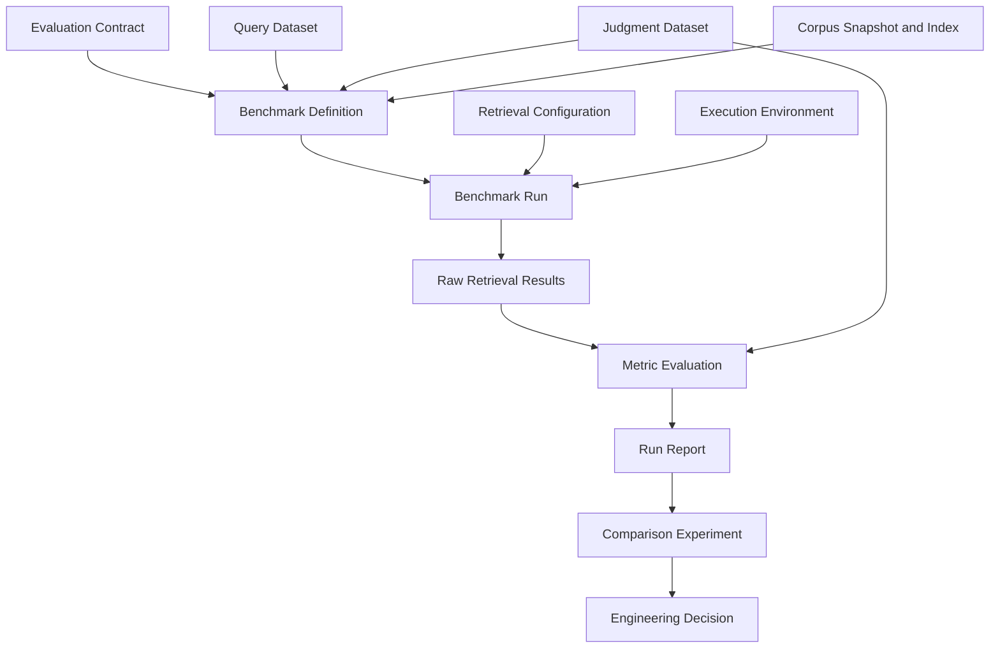
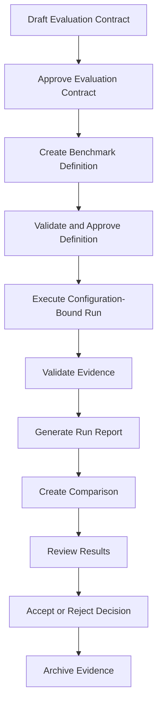
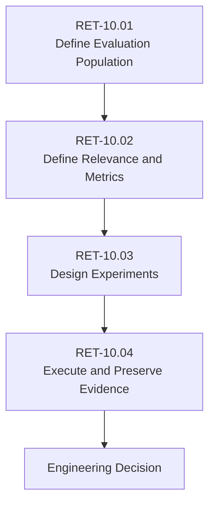

# RET-10.04 — Reproducible Retrieval Benchmark and Report

## 1. Purpose and Scope

A retrieval benchmark provides a controlled and repeatable way to evaluate retrieval-system behavior.

Earlier chapters established the foundations:

- RET-10.01 established evaluation questions, test queries, workload selection, and evaluation-set construction.
- RET-10.02 established relevance judgments, judgment policies, and retrieval metrics.
- RET-10.03 established baselines, controlled experiments, ablations, and experimental interpretation.

This chapter addresses the engineering problem that follows:

**How do we implement, execute, preserve, validate, and report retrieval experiments so that their results can be reproduced and independently inspected?**

A benchmark must preserve more than the final metric values.

It must establish the exact relationship between:

- Evaluation queries.
- Relevance judgments.
- Corpus snapshot.
- Retrieval configuration.
- Model and index versions.
- Execution environment.
- Raw retrieval outputs.
- Metric calculations.
- Validation results.
- Final engineering conclusions.

Without this relationship, a benchmark report can contain correct-looking numbers that cannot be independently verified.

### 1.1 Learning objectives

After completing this chapter, an engineer should be able to:

1. Design a reproducible retrieval benchmark.
2. Define evaluation contracts and versioned benchmark definitions.
3. Identify benchmark inputs and their version identities.
4. Preserve retrieval configuration and environment information.
5. Implement a deterministic benchmark execution pipeline where determinism is achievable.
6. Separate retrieval execution from metric computation.
7. Preserve raw outputs and derived evaluation artifacts.
8. Validate benchmark completeness and integrity.
9. Detect configuration drift and incomplete execution.
10. Generate an evidence-backed benchmark report.
11. Compare runs across benchmark-definition versions when the experiment explicitly permits it.
12. Trace an engineering decision to the exact benchmark evidence supporting it.

### 1.2 Scope boundaries

This lesson covers benchmark engineering, execution, artifact management, validation, comparison evidence, and reporting.

It does not reteach:

- Evaluation population and test-query design from RET-10.01.
- Relevance-judgment construction and metric definitions from RET-10.02.
- Experimental hypotheses, baselines, and ablation design from RET-10.03.

Those concepts are inputs to the benchmark process.

Similarly, RET-11 owns retrieval failure diagnosis and optimization, while RET-12 owns integrated retrieval-system architecture.

RET-10.04 establishes the infrastructure for producing trustworthy evaluation evidence.

---

## 2. What Makes a Retrieval Benchmark Reproducible?

A benchmark is reproducible when another execution can use the same defined inputs and configuration to verify the reported behavior within explicitly documented tolerances.

Reproducibility does not necessarily mean that every execution produces byte-identical output.

Different benchmark dimensions have different reproducibility requirements.

For example:

- Query identities should remain fixed.
- Corpus identity should remain fixed within a particular benchmark-definition version.
- Relevance judgments should remain fixed within a particular benchmark-definition version.
- Retrieval configuration should remain fixed within a particular run.
- Metric definitions should remain fixed within an evaluation contract.
- Approximate retrieval may introduce implementation-dependent variation.
- Runtime latency will naturally vary between executions.

The benchmark must distinguish exact reproducibility from bounded or statistical repeatability.

### 2.1 Four dimensions of reproducibility

**A. Data reproducibility**

The benchmark must identify the exact data used.

Examples:

- Query-set version.
- Relevance-judgment version.
- Corpus snapshot.
- Document preprocessing version.
- Metadata snapshot.
- Document identity mapping.

A dataset filename alone is not a reliable identity.

A file named `queries.csv` can be replaced while retaining the same name.

The benchmark should identify the exact content through immutable versions or content checksums.

**B. Configuration reproducibility**

The benchmark must preserve the configuration that produced the results.

Examples:

- Retrieval algorithm.
- Embedding model.
- Embedding dimensions.
- Similarity metric.
- Index parameters.
- Metadata filters.
- Candidate depth.
- Fusion configuration.
- Reranking configuration.
- Score calibration.
- Deduplication behavior.

A configuration name such as `hybrid-v2` is insufficient unless it resolves to an immutable configuration definition.

**C. Execution reproducibility**

The benchmark must preserve how the experiment was executed.

Examples:

- Software versions.
- Runtime environment.
- Hardware information.
- Random seeds where applicable.
- Concurrency settings.
- Warm-up policy.
- Cache policy.
- Timeout configuration.
- Execution timestamps.
- Failure and retry records.

Execution conditions are particularly important when evaluating latency and approximate retrieval behavior.

**D. Evaluation reproducibility**

The benchmark must preserve how outputs were evaluated.

Examples:

- Metric definitions.
- Metric parameters.
- Relevance-judgment policy.
- Eligibility policy.
- Treatment of unjudged documents.
- Aggregation method.
- Query weighting.
- Evaluation implementation version.

A retrieval output can produce different reported results if the metric configuration changes.

Therefore, evaluation configuration is part of the evaluation contract.

### 2.2 Reproducibility versus repeatability

These concepts should not be treated as identical.

Repeatability concerns obtaining consistent results when the same procedure is executed again under sufficiently similar conditions.

Reproducibility concerns whether another execution can reconstruct and verify the experiment from its preserved inputs, configuration, and execution specification.

For example:

A benchmark might produce similar latency measurements over five executions. That demonstrates some degree of repeatability.

But if its corpus version, index parameters, and environment are not recorded, the benchmark is not adequately reproducible.

### 2.3 Exact versus bounded reproducibility

Some benchmark artifacts should be identical.

Examples:

- Query identifiers.
- Judgment records.
- Configuration definitions.
- Metric parameters.
- Corpus manifest.
- Evaluation membership.

Other outputs may require tolerances.

Examples:

- ANN retrieval results under nondeterministic execution.
- GPU inference outputs affected by implementation details.
- Runtime latency.
- Distributed execution timing.

For every nondeterministic component, document:

1. Why exact determinism is unavailable.
2. Which source of variation is expected.
3. Which parameters can reduce variation.
4. Which output properties must remain stable.
5. How variation is measured.
6. What constitutes an unacceptable deviation.

Do not label a benchmark reproducible merely because it records a random seed. A seed cannot control every source of nondeterminism.

---

## 3. Benchmark Architecture

A reproducible benchmark should be designed as a pipeline of independently identifiable stages.

A useful high-level architecture is:



Each stage should have a clearly defined input, output, and failure condition.

### 3.1 Evaluation contract

The evaluation contract defines the stable evaluation question and the rules that should remain consistent across the runs intended to answer that question.

It identifies:

- Evaluation-contract identity and version.
- Intended evaluation population.
- Query and judgment semantics.
- Metric definitions and parameters.
- Eligibility rules.
- Treatment of unjudged documents.
- Aggregation semantics.
- Required evaluation outputs.

The evaluation contract describes what is being measured and how the results are interpreted.

It does not necessarily identify one particular corpus snapshot or one retrieval configuration.

For example, an experiment may intentionally investigate whether a new corpus snapshot improves retrieval quality. The evaluation question, query population, judgments, and metric semantics can remain stable while the corpus changes.

The evaluation contract must therefore be independently identifiable from the benchmark definition that pins the actual inputs.

### 3.2 Versioned benchmark definition

The benchmark definition is an immutable, versioned execution package.

It references:

- Evaluation-contract identity and version.
- Exact query-set version.
- Exact judgment-set version.
- Corpus snapshot.
- Required index and input identities where applicable.
- Benchmark-specific execution requirements.
- Validation and completeness requirements.
- Acceptance criteria.

A benchmark definition pins the exact inputs and policies for a particular benchmark version.

Changing a pinned input or benchmark policy requires a new benchmark-definition version.

A new benchmark-definition version does not automatically mean that the evaluation question has changed. It may represent a new corpus snapshot, a revised query dataset, or another explicitly versioned input change.

### 3.3 Input validation

Before execution, validate that all required artifacts are available and compatible.

Examples:

- Every query has a valid identifier.
- Required query fields are present.
- Judgment records reference valid query identifiers.
- Judgment document identifiers belong to the expected document identity space.
- Corpus snapshot is available.
- Model and index versions are compatible.
- Required metric configurations exist.

Invalid inputs should stop execution before retrieval begins.

### 3.4 Dataset and corpus resolution

Resolve immutable input versions.

Do not allow the benchmark to silently use:

- The latest query dataset.
- The latest corpus.
- The latest embedding model.
- The latest index.
- The current production configuration.

A benchmark must execute against explicitly selected versions.

### 3.5 Per-run configuration resolution

For each benchmark run, resolve its retrieval-configuration reference into a concrete immutable configuration artifact.

The benchmark definition supplies the shared evaluation inputs and requirements. The run supplies the system-under-test configuration and records the actual execution profile.

For example:

```yaml
retrieval:
  algorithm: hybrid
  dense:
    enabled: true
    model_version: embedding-model-v3
    candidate_depth: 500
  lexical:
    enabled: true
    candidate_depth: 500
  fusion:
    method: weighted_score
    weights:
      dense: 0.5
      lexical: 0.5
  reranking:
    enabled: true
    model_version: reranker-v2
    candidate_depth: 100
```

This is an illustrative configuration.

The actual configuration must contain every parameter that can materially affect retrieval output.

### 3.6 Retrieval execution

The retrieval engine receives the resolved benchmark inputs and the single retrieval configuration bound to the current run.

One run must not switch retrieval configurations partway through execution. A different configuration requires a different run ID.

For each query, it executes the configured retrieval pipeline and produces a structured result.

The execution layer should not silently calculate final benchmark conclusions.

Its primary responsibility is to produce retrieval evidence.

### 3.7 Raw result persistence

Persist the retrieval output before metric evaluation.

This separation allows metric calculations to be repeated without executing retrieval again.

For example, if the team changes the metric implementation or investigates an aggregation defect, it should be possible to reevaluate preserved retrieval results under a new explicitly versioned evaluation configuration.

### 3.8 Result validation

Check that retrieval execution produced a complete and structurally valid result set.

Examples:

- Every expected query has an execution record.
- Result ranks are valid.
- Document identifiers are valid.
- No result exceeds the configured retrieval limit.
- Scores use the expected representation.
- Failed queries are explicitly recorded.
- Duplicate document behavior follows the declared policy.

### 3.9 Metric evaluation

The evaluation layer consumes validated retrieval results and the selected relevance-judgment version.

It calculates configured metrics and produces query-level and aggregate outputs.

It must not silently change judgment policies or eligibility rules.

### 3.10 Report generation

The reporting layer consumes validated metric results and execution evidence.

It produces a report that explains:

- What was evaluated.
- Which configuration was used.
- What was measured.
- What the results show.
- What limitations affect interpretation.
- Which decision the evidence supports.

### 3.11 Evidence package

The final package should allow another engineer to trace a reported result to:

1. Its metric record.
2. Its query-level evaluation records.
3. Its raw retrieval outputs.
4. Its retrieval configuration.
5. Its input datasets.
6. Its corpus and model identities.
7. Its execution record.
8. Its evaluation contract and benchmark-definition version.

The evidence package is the durable output of the benchmark.

---

## 4. Evaluation Contract, Benchmark Definition, and Identity

A reproducible benchmark requires multiple identities.

Treating all evaluation inputs and execution details as one undifferentiated benchmark identity makes cross-version experiments difficult to represent correctly.

Distinguish four concepts:

**Evaluation contract:** What evaluation question and measurement rules are shared.

**Benchmark definition:** Which exact inputs and benchmark policies are pinned for a particular benchmark version.

**Benchmark run:** One actual execution of one benchmark definition against one retrieval configuration.

**Comparison experiment:** An independently identified experiment that references two or more runs and explains which differences are intentional, controlled, or potentially confounding.

### 4.1 Evaluation contract

An illustrative evaluation contract:

```yaml
evaluation_contract:
  contract_id: RET-EVAL-CONTRACT-001
  contract_version: "1.0"
  description: "Enterprise knowledge retrieval quality evaluation"

  evaluation_population:
    query_population: enterprise-retrieval-workload
    query_identity_policy: stable-query-id-v1

  judgment_policy:
    judgment_semantics: graded-relevance-v1
    unjudged_document_policy: configured-per-metric

  metric_policy:
    metric_config_id: retrieval-quality-v1
    metric_config_version: "1.0"
    aggregation: macro_average

  eligibility:
    eligibility_policy_id: retrieval-eligibility-v1
    eligibility_policy_version: "1.0"
```

The evaluation contract should identify the rules that determine whether results from different runs are answering the same evaluation question.

Changing metric semantics, query-population meaning, judgment interpretation, or eligibility rules requires a new evaluation-contract version.

A change to the implementation of an unchanged metric policy does not automatically require a new evaluation-contract version. It requires a new evaluator implementation identity and evaluation artifact.

### 4.2 Versioned benchmark definition

An illustrative benchmark definition:

```yaml
benchmark:
  benchmark_id: RET-BENCH-001
  benchmark_version: "1.0"
  description: "Enterprise knowledge retrieval benchmark"

evaluation_contract:
  contract_id: RET-EVAL-CONTRACT-001
  contract_version: "1.0"
  contract_checksum: "sha256:..."

inputs:
  query_set:
    dataset_id: enterprise-query-set
    version: "3.0"
    checksum: "sha256:..."

  judgments:
    dataset_id: enterprise-relevance-judgments
    version: "2.0"
    checksum: "sha256:..."

  corpus:
    snapshot_id: enterprise-corpus-2026-10
    checksum: "sha256:..."

  index:
    index_id: enterprise-index-2026-10
    version: "1.0"
    checksum: "sha256:..."

execution_requirements:
  required_query_completeness: 1.0

  retry_policy:
    mode: automatic
    max_additional_attempts: 1
    retryable_error_categories:
      - timeout
      - transient_network_error
    backoff:
      strategy: exponential
      initial_delay_ms: 500
      maximum_delay_ms: 5000

validation:
  require_input_validation: true
  require_result_validation: true
  require_artifact_integrity: true

acceptance_criteria:
  criteria_id: RET-ACCEPTANCE-001
  version: "1.0"
```

The values are illustrative.

The benchmark definition must not contain mutable references whose meaning can change without changing the benchmark identity.

For example, `latest` is not an acceptable corpus version for a reproducible benchmark.

The definition intentionally does not contain a retrieval-configuration identity. A baseline run and a candidate run must be separate executions of this same benchmark definition, each bound to its own immutable retrieval configuration.

### 4.3 Benchmark run identity

Each execution of a benchmark definition against one retrieval configuration needs a unique run identifier.

Example:

```yaml
run:
  run_id: RET-BENCH-001-RUN-005

  benchmark:
    benchmark_id: RET-BENCH-001
    benchmark_version: "1.0"
    benchmark_definition_checksum: "sha256:..."

  evaluation_contract:
    contract_id: RET-EVAL-CONTRACT-001
    contract_version: "1.0"
    contract_checksum: "sha256:..."

  retrieval_configuration:
    configuration_id: hybrid-retrieval
    configuration_version: "2.1"
    manifest_path: "configuration-manifest.json"
    checksum: "sha256:..."

  resolved_artifacts:
    input_manifest_path: "input-manifest.json"
    input_manifest_checksum: "sha256:..."
    environment_manifest_path: "environment-manifest.yaml"
    environment_manifest_checksum: "sha256:..."
    execution_profile_path: "execution-profile.yaml"
    execution_profile_checksum: "sha256:..."

  started_at: "2026-11-03T09:00:00Z"
  completed_at: "2026-11-03T09:08:42Z"

  execution_status: completed
  evaluation_status: complete
  overall_validation_status: passed
  acceptance_eligibility: eligible
```

The retrieval-configuration reference and checksum are run-level bindings.

A baseline configuration therefore receives its own run ID and run manifest; the candidate configuration receives another.

Both runs may reference the same benchmark definition and evaluation contract.

A run should also identify the exact resolved inputs and configuration.

Do not assume that the benchmark definition alone captures execution-time information.

### 4.4 Stable identity versus content identity

A human-readable identifier and a content checksum serve different purposes.

Example:

- Dataset ID: `enterprise-query-set`
- Dataset version: `3.0`
- Dataset checksum: `sha256:...`

The identifier supports navigation and organization.

The checksum verifies content identity.

Both are useful.

### 4.5 Immutable benchmark definitions

Once a benchmark definition is used for a completed run, preserve its exact content.

Apply these versioning rules:

- If the query set changes, create a new dataset version and a new benchmark-definition version.
- If the judgment set changes, create a new judgment-dataset version and a new benchmark-definition version.
- If the corpus snapshot changes, create a new benchmark-definition version.
- If the index identity or pinned preprocessing changes, create a new benchmark-definition version.
- If benchmark execution requirements or validation policies change, create a new benchmark-definition version.
- If the evaluation contract changes, create a new evaluation-contract version and a benchmark-definition version that references it.
- If the retrieval configuration changes, create a new configuration version and a new run bound to that configuration.
- If metric semantics change, create a new evaluation-contract version and benchmark-definition version.
- If evaluator code changes while metric semantics remain fixed, create a new evaluator implementation version and evaluation artifact while retaining the same evaluation contract, benchmark definition, and raw retrieval evidence.

Do not overwrite the historical definition or artifacts of a completed run.

A new benchmark-definition version can still belong to the same evaluation contract.

This distinction is essential for experiment-aware comparison.

### 4.6 Execution requirements versus execution profile

The benchmark definition should specify required execution rules, not pretend that every actual runtime condition is permanently fixed.

Separate:

**Execution requirements**

Rules that the run must satisfy.

Examples:

- Maximum permitted retry attempts.
- Required query completeness.
- Required result persistence.
- Required timeout policy.
- Mandatory validation checks.

**Execution profile**

The actual resolved conditions used by a particular run.

Examples:

- Actual concurrency.
- Worker count.
- Hardware allocation.
- Cache state.
- Request ordering.
- Actual timeout configuration.
- Load profile.
- Runtime service versions.

The execution profile belongs to the run evidence.

If two runs use different execution profiles, the comparison must determine whether the difference is an intentional intervention, a controlled variation, or a confounder.

Do not silently treat different execution profiles as equivalent.

---

## 5. Dataset, Corpus, and Model Versioning

A benchmark result is meaningful only when its input identities are preserved.

### 5.1 Query-set versioning

A query set should preserve:

- Dataset ID.
- Dataset version.
- Query identifiers.
- Query text.
- Query metadata.
- Query-category membership.
- Sampling provenance.
- Inclusion and exclusion information.
- Content checksum.

Query text should be stored as part of the immutable dataset version.

If a query is edited, that change should produce a new dataset version or an explicitly versioned transformation.

Do not reuse an existing query identifier for a materially different query without recording the change.

### 5.2 Relevance-judgment versioning

A judgment dataset should preserve:

- Judgment dataset ID.
- Version.
- Query-document relationship.
- Relevance grade.
- Judgment status.
- Judgment provenance.
- Rubric version.
- Adjudication history where applicable.
- Judgment policy.

A change in relevance judgment can change benchmark metrics even if retrieval output remains identical.

Therefore, judgment version is a first-class benchmark input.

The benchmark should also preserve the treatment of:

- Unjudged documents.
- Incomplete judgment coverage.
- Ineligible queries.
- Queries without judged relevant documents.

These policies come from RET-10.02 and must be referenced by an explicit evaluation contract.

### 5.3 Corpus snapshot versioning

A corpus snapshot should identify the exact searchable document population.

Record:

- Snapshot identifier.
- Snapshot creation time.
- Document identity rules.
- Document count.
- Document manifest.
- Document content checksums where available.
- Metadata snapshot.
- Preprocessing version.
- Deletion and exclusion policy.

A corpus version should not be inferred from a collection name or a database connection string.

For a mutable production database, the benchmark should resolve a stable snapshot or a documented immutable export.

Otherwise, the corpus may change while the benchmark is running.

A deliberate corpus-change experiment creates or references a new benchmark-definition version. It may still use the same evaluation contract as the baseline.

### 5.4 Document identity stability

Document identity is important for comparing retrieval outputs and relevance judgments.

A document ID should identify the same logical document across the relevant benchmark artifacts.

If document identifiers are regenerated during indexing, maintain an explicit mapping between:

- Source document identity.
- Indexed document identity.
- Judgment document identity.

Without this mapping, a retrieved document may appear unjudged or incorrect simply because identity mapping changed.

### 5.5 Model and embedding versioning

Record:

- Model provider or source.
- Model identifier.
- Model version or immutable revision.
- Model artifact checksum where available.
- Embedding dimensions.
- Tokenizer version.
- Relevant inference parameters.
- Preprocessing and normalization behavior.

For hosted models, an alias may not provide sufficient version stability.

If an immutable model revision is unavailable, record that limitation and preserve additional execution metadata.

### 5.6 Index versioning

The retrieval index is part of the benchmark input.

Record:

- Index identifier.
- Index build version.
- Source corpus snapshot.
- Embedding model version.
- Vector dimensions.
- Similarity metric.
- ANN implementation and version.
- Index parameters.
- Metadata index configuration.
- Build timestamp.
- Build artifact identity.

Two indexes created from the same corpus may behave differently because their embedding models, preprocessing, or index parameters differ.

The index must therefore be explicitly identified.

### 5.7 Version compatibility validation

Before execution, validate the compatibility relationships.

| Component | Compatibility requirement |
|---|---|
| Query set | Matches the intended evaluation population and query identity policy |
| Judgments | Reference valid query and document identities |
| Corpus | Matches the selected corpus snapshot |
| Embeddings | Compatible with the index dimensions and model |
| Index | Built from the intended corpus and embedding version |
| Retrieval configuration | Compatible with selected retrievers |
| Evaluation contract | Compatible with judgment representation |
| Metric configuration | Implements the contract's metric semantics |

A benchmark should fail early when an incompatible combination is detected.

---

## 6. Retrieval Configuration and Execution Environment

Configuration drift is a major source of irreproducible results.

A benchmark must preserve both the logical retrieval configuration and the environment in which it executes.

### 6.1 Retrieval configuration manifest

An example manifest:

```yaml
retrieval_configuration:
  configuration_id: hybrid-retrieval
  version: "2.1"

  query_processing:
    normalization_version: "1.0"

  dense:
    enabled: true
    embedding_model: embedding-model-v3
    embedding_dimensions: 768
    similarity: cosine
    candidate_depth: 500

  lexical:
    enabled: true
    analyzer_version: "2.0"
    candidate_depth: 500

  filters:
    configuration_version: "1.3"

  fusion:
    method: weighted_score
    weights:
      dense: 0.5
      lexical: 0.5
    normalization_version: "1.0"

  reranking:
    enabled: true
    model: reranker-v2
    candidate_depth: 100

  output:
    final_top_k: 10
```

This example is illustrative.

The configuration must include relevant defaults that would otherwise be easy to overlook.

A missing field can be as important as an explicitly configured value.

### 6.2 Resolve defaults explicitly

Suppose a retrieval library has a default candidate depth of 100.

A later library release changes the default to 200.

If the benchmark does not explicitly record the value, two executions can use different retrieval behavior despite having the same visible configuration file.

Resolve and record effective configuration values.

Do not rely on undocumented or version-dependent defaults.

### 6.3 Environment manifest

Preserve the execution environment.

An illustrative environment record:

```yaml
environment:
  application:
    version: "2.4.1"
    git_commit: "abc123"

  runtime:
    language: python
    version: "3.12.2"

  dependencies:
    lockfile_checksum: "sha256:..."

  infrastructure:
    cpu: "8 vCPU"
    memory_gb: 32
    accelerator: null

  retrieval:
    vector_database: qdrant
    vector_database_version: "1.x"

  execution:
    operating_system: linux
    concurrency: 4

  latency_measurement:
    measurement_spec_id: retrieval-latency-v1
    measurement_boundary: client_observed_end_to_end
    observation_unit: one_observation_per_query_per_repetition
    warmup_policy: "100 requests excluded from measurement"
    cache_policy: warm
    load_profile_id: fixed-concurrency-4
    request_order: randomized_per_repetition
    request_order_seed: 41027
    repetitions: 3
    percentile_population: pooled_valid_successful_query_repetition_observations
    per_repetition_percentiles: required
    percentile_estimator: versioned-quantile-implementation
    timeout_and_failure_policy: retain_as_separate_outcomes
```

The values are illustrative.

The observation unit means that each query can contribute one measured observation in each repetition. The primary p50, p95, and p99 values are calculated over the pooled valid successful query-repetition observations. Also report the same percentiles separately for each repetition so that run-to-run variation is visible rather than hidden by pooling.

Keep the query-to-repetition mapping in the measurement artifact.

Warm-up requests are excluded from the measured population.

Timeouts and other failed requests are retained as separate outcomes and reported through completion and failure rates; they must not silently disappear from the report.

Baseline and candidate runs must use the same measurement specification and equivalent declared load, cache, warm-up, and request-order policies for a controlled latency comparison.

For production-grade benchmarking, preserve enough information to reconstruct the environment or explain why exact reconstruction is unavailable.

### 6.4 Dependency locking

Dependency specifications should resolve to reproducible versions.

A loose dependency declaration such as:

```text
qdrant-client>=1.0
```

does not identify the actual library version used by a completed benchmark.

A lockfile or equivalent dependency manifest should capture resolved package versions.

Preserve its checksum with the benchmark run.

### 6.5 Code identity

The benchmark should identify the exact source-code revision.

Useful identifiers include:

- Git commit.
- Release version.
- Container image digest.
- Build artifact checksum.

A branch name such as `main` is not an immutable code identity.

The branch can move after the benchmark has executed.

### 6.6 Runtime configuration

Preserve execution settings that affect behavior:

- Worker count.
- Concurrency.
- Timeout.
- Retry policy.
- Request batching.
- Cache policy.
- Warm-up procedure.
- Connection-pool configuration.
- Hardware allocation.

These settings can affect both performance and, in some systems, retrieval behavior.

Record the actual resolved settings in the run's execution profile, even when the benchmark definition also establishes requirements or permitted ranges.

### 6.7 Secret handling

Do not include credentials or secrets in benchmark artifacts.

Instead, record non-sensitive identifiers such as:

- Credential reference.
- Service identity.
- Deployment environment.
- Permission profile version.

The benchmark needs enough information to identify the execution context without exposing authentication material.

### 6.8 Latency measurement contract

Latency percentiles are meaningful only when the measurement population and procedure are defined. A run that reports p95 or p99 without this contract is not sufficiently reproducible for operational comparison.

The benchmark or its referenced runtime-measurement specification should record:

- Measurement boundary: client-observed end-to-end latency, service-side retrieval latency, or a named pipeline-stage duration. Do not mix boundaries in one percentile.
- Observation unit: one observation per logical query, per repeated request, or another explicitly defined request sample.
- Warm-up policy: warm-up request count or duration, whether warm-up observations are excluded, and the readiness condition that ends warm-up.
- Cache policy: cold, warm, disabled, or mixed; identify which cache layers are included and whether cache state is reset between runs.
- Load profile: concurrency, request arrival pattern, offered load, worker count, and rate limits.
- Ordering policy: whether requests are sequential, randomized, interleaved, or run in separate blocks; document controls for time-related drift.
- Repetition policy: number of repetitions and whether repetitions reuse the same queries; preserve the mapping from each observation to query, repetition, and run.
- Percentile estimator: the exact quantile convention or implementation/version used to calculate p50, p95, and p99.
- Exclusions: timeout, failed request, warm-up, cancellation, and invalid-measurement treatment. Never silently remove slow or failed observations.
- Measurement window and environment: timestamps, hardware/service allocation, dependency versions, and relevant background-load conditions.
- Uncertainty: the applicable confidence interval, repeated-run variation, or other uncertainty summary required by the experiment policy.

Baseline and candidate measurements must use equivalent measurement boundaries, load profiles, cache policies, warm-up rules, and percentile estimators unless one of those is the explicit intervention.

If conditions differ, the comparison must be qualified or rejected for the stated operational question.

RET-10.03 owns the broader design of controlled runtime experiments and interpretation of uncertainty. This subsection defines the measurement metadata RET-10.04 must preserve; it does not replace that experimental-design guidance.

---

## 7. Benchmark Execution Pipeline

The benchmark-run runner should execute one retrieval configuration against one defined benchmark definition.

To compare a baseline and candidate, invoke it separately for each configuration, producing separate run IDs.

A comparison process consumes those run artifacts afterward; it does not execute retrieval.

### 7.1 Execution lifecycle

A practical lifecycle:

1. Resolve evaluation contract and version.
2. Resolve benchmark definition and version.
3. Resolve the single retrieval-configuration reference for this run.
4. Resolve immutable dataset versions.
5. Resolve corpus and index identities.
6. Validate benchmark inputs and configuration compatibility.
7. Capture environment and execution-profile information.
8. Create a run record binding the benchmark definition to this one retrieval configuration.
9. Execute retrieval queries.
10. Persist every attempt, one final query-execution record per expected query, and accepted raw results.
11. Validate execution completeness using distinct query IDs with accepted successful results.
12. Evaluate metrics according to the execution-completeness policy.
13. Validate evaluation results.
14. Generate the run report.
15. Finalize the run evidence package.

The order matters.

For example, metric calculation should not begin if required retrieval outputs are missing or malformed, unless the benchmark explicitly permits provisional evaluation over partial evidence.

### 7.2 Pre-execution validation

Before running retrieval, validate:

- Evaluation-contract integrity.
- Query-set integrity.
- Judgment-set integrity.
- Corpus availability.
- Index compatibility.
- Model compatibility.
- Configuration completeness.
- Metric configuration.
- Environment requirements.
- Execution-profile requirements.
- Output storage availability.

The runner should fail before execution if required inputs are invalid.

### 7.3 Per-query execution

Each expected query should have one final query-execution record.

Each worker attempt should have a separate attempt record, and a successful attempt may produce one accepted query result.

An illustrative final query-execution record:

```json
{
  "run_id": "RET-BENCH-001-RUN-004",
  "query_id": "HR-0011",
  "final_status": "success",
  "accepted_result_id": "RESULT-HR-0011",
  "attempt_count": 2,
  "attempt_ids": ["ATTEMPT-001", "ATTEMPT-002"]
}
```

An illustrative accepted query result:

```json
{
  "result_id": "RESULT-HR-0011",
  "run_id": "RET-BENCH-001-RUN-004",
  "query_id": "HR-0011",
  "accepted_attempt_id": "ATTEMPT-002",
  "retrieval_configuration_id": "hybrid-retrieval",
  "retrieval_configuration_version": "2.1",
  "retrieved_documents": [
    {"document_id": "DOC-104", "rank": 1, "score": 0.91},
    {"document_id": "DOC-207", "rank": 2, "score": 0.87}
  ],
  "latency_ms": 42.8
}
```

An illustrative attempt record:

```json
{
  "attempt_id": "ATTEMPT-001",
  "run_id": "RET-BENCH-001-RUN-004",
  "query_id": "HR-0011",
  "attempt_number": 1,
  "attempt_status": "failed",
  "started_at": "2026-11-03T09:01:00Z",
  "completed_at": "2026-11-03T09:01:30Z",
  "error_category": "timeout"
}
```

The examples are illustrative. The actual schema should preserve all fields needed for downstream evaluation, recovery, and diagnosis.

The attempt history is not itself the query-coverage denominator.

### 7.4 Separate retrieval and evaluation

The retrieval execution layer should produce raw ranked results.

The evaluation layer should consume those results and calculate configured metrics.

This separation provides several benefits:

- Metric calculations can be repeated without rerunning retrieval.
- Metric implementation defects can be investigated independently.
- Different explicitly versioned metric configurations can evaluate the same retrieval output.
- Retrieval failures can be separated from evaluation failures.
- Raw evidence remains available after report generation.

A benchmark that stores only aggregate metric values loses much of this value.

### 7.5 Idempotency and accepted-result semantics

Benchmark execution should handle retries safely.

Suppose a worker executes query HR-0011 and successfully writes its result, but loses its connection before acknowledging completion.

The orchestration layer may retry the query.

Without idempotency, the retry could create duplicate records or overwrite a valid result unpredictably.

A logical execution key can be constructed from:

\[
ExecutionKey =
(run\_id,\ query\_id,\ configuration\_identity)
\]

The storage model must distinguish three related but different records:

1. **Execution attempt:** One actual worker attempt to execute a query. It has its own `attempt_id`, attempt number, timestamps, status, and optional error details.
2. **Accepted query result:** The single retrieval output selected as the authoritative result for that query in that run. It references the successful attempt that produced it.
3. **Final query execution record:** One record per expected query, summarizing its terminal status and pointing to the accepted result when one exists.

A query can have several failed attempts followed by one successful attempt. Preserve every attempt, but count the query only once in execution coverage when it has one accepted successful result.

The storage layer should enforce at most one accepted result per `(run_id, query_id)`. This must be an atomic invariant, not only an application-level check: use a database uniqueness constraint, conditional object creation, compare-and-swap, or an equivalent transactional mechanism so concurrent workers cannot both accept results.

A retry must not create a second accepted result or silently replace an existing accepted result.

If an accepted result must be superseded under an explicit recovery policy, preserve the prior result, record the supersession event and reason, and make the final accepted-result pointer unambiguous.

Do not silently overwrite historical attempts.

### 7.6 Retry policy

Retries should be explicit.

Record:

- Attempt number.
- Failure reason.
- Retry timestamp.
- Retry policy.
- Final accepted attempt.
- Whether the failure affected benchmark completeness.

A retry should not make an execution appear as though it never failed.

The benchmark definition must state whether retries are automatic, manually initiated, or disabled; which error categories are retryable; the maximum number of additional attempts; and the backoff policy.

`max_additional_attempts` counts retries after the initial attempt.

For example, `max_additional_attempts: 1` permits at most two total attempts when the first attempt fails with a retryable error.

A manual recovery attempt must still be recorded and must be permitted by the run's declared recovery policy; it must not silently exceed the configured limit.

The final query-execution record should point to the accepted result or state why no accepted result exists.

A failed attempt followed by a successful accepted attempt means the query is successful for final coverage, while the failed attempt remains visible in attempt-level reliability and operational analysis.

Execution coverage is calculated over distinct expected query IDs, not attempt rows:

\[
\text{ExecutionCoverage} =
\frac{
\text{Distinct expected queries with accepted successful results}
}{
\text{Distinct expected query IDs}
}
\]

A query with three attempts and one accepted result contributes one successful query, not three.

A query with only failed attempts contributes zero successful queries.

### 7.7 Timeout and failure handling

A query can fail because of:

- Retrieval service timeout.
- Model inference failure.
- Index unavailability.
- Invalid input.
- Network error.
- Resource exhaustion.
- Unexpected response structure.

Record the failure category and execution status.

Do not convert failed queries into empty retrieval results without an explicit evaluation policy.

A failed execution and a successful execution returning zero candidates are different outcomes.

### 7.8 Partial execution

A benchmark may execute only part of its expected workload.

For example:

- Expected queries: 1,000.
- Successful queries: 970.
- Failed queries: 20.
- Not executed: 10.

The run must not be reported as a fully completed benchmark.

Possible statuses include:

- `created`
- `validating`
- `running`
- `completed`
- `completed_with_errors`
- `failed`
- `cancelled`

The exact status vocabulary is implementation-specific, but it must distinguish complete and incomplete execution.

Define terminal semantics rather than relying on names alone:

- `completed`: every required query has exactly one accepted successful result, all required execution-level checks pass, and the run can be finalized. Recovered attempt failures do not prevent this status; they remain visible in attempt history and operational reporting.
- `completed_with_errors`: the runner reached a terminal state but one or more queries have terminal failures, or a permitted execution-level error remains. The run may retain usable partial evidence, but it is incomplete and is not automatically eligible for benchmark acceptance.
- `failed`: the run could not produce a usable terminal execution record, or a mandatory execution invariant failed such that the evidence cannot be safely finalized.
- `cancelled`: execution was intentionally stopped; unfinished queries remain explicitly represented.

A failed attempt followed by an accepted successful retry is a recovered attempt failure, not a terminal query failure.

If all expected queries ultimately have accepted successful results and all required execution checks pass, the run is `completed`, even though its attempt history contains failures.

A query with no accepted result is a terminal query failure for that run.

A policy may permit a partial run to be retained as `completed_with_errors`, but it must remain marked incomplete and ineligible wherever the benchmark's acceptance policy requires full coverage.

A run can have `execution_status: completed` while evaluation or artifact validation fails. Therefore, run status, evaluation status, and overall validation status must remain separate fields.

### 7.9 Recovery and reconciliation after partial persistence

Accepted-result persistence and final query-execution-record persistence may be separate operations.

Consider this failure sequence:

1. A worker completes retrieval successfully.
2. The accepted result is persisted.
3. The worker crashes before the final query-execution record is persisted.
4. The runner restarts.

The system must not treat this query as unexecuted merely because its final query-execution record is missing.

It must also not execute another attempt and accidentally create a second accepted result.

Implement a reconciliation operation that inspects durable attempt and accepted-result records and repairs the missing terminal record.

The recovery procedure should:

1. Load the expected query identity from the benchmark input manifest.
2. Check whether an accepted result already exists for `(run_id, query_id)`.
3. If one exists, verify its checksum and referenced successful attempt.
4. Reconstruct or verify the final query-execution record using the accepted result and durable attempt history.
5. If no accepted result exists, inspect the latest attempt and determine whether execution should resume under the declared retry policy.
6. Persist the final record idempotently.
7. Record the recovery or reconciliation event.

The reconciliation operation must not invent a successful result from an incomplete attempt.

It must preserve the distinction between an accepted retrieval result and an execution attempt that merely started or partially completed.

An implementation can use a transactional database, a durable event log, or an equivalent recovery mechanism. The essential requirement is that accepted-result uniqueness and final-record reconciliation remain correct after process crashes.

### 7.10 Benchmark execution pseudocode

An illustrative orchestration design:

```python
def execute_benchmark_run(
    benchmark_id: str,
    benchmark_version: str,
    retrieval_configuration_ref: str,
):
    specification = load_benchmark_definition(
        benchmark_id,
        benchmark_version,
    )

    evaluation_contract = load_evaluation_contract(
        specification.evaluation_contract
    )

    validate_benchmark_inputs(
        specification=specification,
        evaluation_contract=evaluation_contract,
    )

    resolved_inputs = resolve_immutable_inputs(specification)

    resolved_config = resolve_retrieval_configuration(
        retrieval_configuration_ref
    )

    environment = capture_execution_environment()
    execution_profile = capture_execution_profile()

    run = create_benchmark_run(
        specification=specification,
        evaluation_contract=evaluation_contract,
        inputs=resolved_inputs,
        configuration=resolved_config,
        environment=environment,
        execution_profile=execution_profile,
    )

    for query in resolved_inputs.queries:
        # Reconcile any durable records left by an earlier worker.
        reconcile_query_execution(
            run_id=run.run_id,
            query_id=query.query_id,
        )

        if query_has_accepted_result(
            run_id=run.run_id,
            query_id=query.query_id,
        ):
            continue

        execution = execute_query_with_retry_policy(
            query=query,
            configuration=resolved_config,
            retry_policy=specification.execution_requirements.retry_policy,
        )

        persist_attempt_records_idempotently(
            run_id=run.run_id,
            query_id=query.query_id,
            attempts=execution.attempts,
        )

        if execution.accepted_result is not None:
            persist_accepted_result_atomically(
                run_id=run.run_id,
                query_id=query.query_id,
                result=execution.accepted_result,
            )

        # Reconcile from durable records rather than assuming that
        # the in-memory execution object is the only source of truth.
        reconcile_query_execution(
            run_id=run.run_id,
            query_id=query.query_id,
        )

    execution_validation = validate_execution_completeness(
        run.run_id
    )

    if execution_validation.is_complete:
        metrics = evaluate_retrieval_results(
            retrieval_results=load_accepted_results(run.run_id),
            judgments=resolved_inputs.judgments,
            metric_config=evaluation_contract.metric_policy,
            eligibility_policy=evaluation_contract.eligibility,
            execution_validation=execution_validation,
        )

        evaluation_completeness = "complete"

    elif specification.evaluation_policy.allow_provisional_evaluation:
        metrics = evaluate_retrieval_results(
            retrieval_results=load_accepted_results(run.run_id),
            judgments=resolved_inputs.judgments,
            metric_config=evaluation_contract.metric_policy,
            eligibility_policy=evaluation_contract.eligibility,
            execution_validation=execution_validation,
        )

        evaluation_completeness = "incomplete"

    else:
        metrics = None
        evaluation_completeness = "not_evaluated"

    if metrics is not None:
        evaluation_validation = validate_metric_results(metrics)
        persist_metric_results(
            run_id=run.run_id,
            metrics=metrics,
            completeness=evaluation_completeness,
        )
    else:
        evaluation_validation = record_evaluation_not_performed(
            run_id=run.run_id,
            reason="Execution completeness policy prevented evaluation",
        )

    run_report = generate_run_report(run.run_id)

    validate_report_evidence(run_report)

    finalize_benchmark_run(
        run_id=run.run_id,
        report=run_report,
    )

    return run.run_id

def compare_benchmark_runs(
    comparison_specification_id: str,
    baseline_run_id: str,
    candidate_run_id: str,
):
    baseline = load_validated_run_artifacts(baseline_run_id)
    candidate = load_validated_run_artifacts(candidate_run_id)

    comparison_specification = load_comparison_specification(
        comparison_specification_id
    )

    compatibility = validate_comparison_compatibility(
        baseline=baseline,
        candidate=candidate,
        comparison_specification=comparison_specification,
    )

    comparison = calculate_paired_and_aggregate_differences(
        baseline=baseline,
        candidate=candidate,
        compatibility=compatibility,
    )

    persist_comparison_artifact(comparison)
    return comparison.comparison_id
```

This is conceptual orchestration pseudocode, not a complete production implementation.

The pseudocode illustrates three distinct evaluation paths:

- Complete execution permits normal evaluation.
- Incomplete execution permits provisional evaluation only when the declared policy allows it.
- Incomplete execution without provisional permission records that evaluation was not performed.

Provisional metrics must remain explicitly incomplete and must not be promoted to accepted benchmark results.

Finalization is a sealing boundary.

Before sealing, the runner must persist the terminal query-execution records, accepted-result manifest, evaluation artifacts, validation artifacts, report, and checksums, then verify their cross-artifact references.

The finalized run manifest is immutable and records the final execution, evaluation, and validation states plus the checksums of the sealed artifacts.

Do not update a finalized manifest in place.

A correction or reevaluation creates a new versioned evaluation/report artifact or, if run-level evidence itself must change, a new superseding run with explicit lineage to the original; historical artifacts remain preserved.

Operational events and attempt history should be append-only throughout execution.

A production runner also needs transaction boundaries, durable execution state, concurrency control, cancellation handling, observability, and recovery behavior.

---

## 8. Benchmark Artifact Model

A reproducible benchmark produces multiple artifacts with different responsibilities.

These artifacts should be logically separated even if they are stored in the same object-storage system.

### 8.1 Core artifact categories

| Artifact | Responsibility |
|---|---|
| Evaluation contract | Defines the stable evaluation question and measurement semantics |
| Benchmark specification | Pins exact benchmark inputs and benchmark execution requirements |
| Input manifest | Identifies datasets, corpus, index, and other resolved inputs |
| Configuration manifest | Captures retrieval behavior |
| Environment manifest | Captures execution environment |
| Execution-profile manifest | Captures actual run-level execution conditions |
| Run manifest | Identifies one execution and binds one retrieval configuration |
| Final query-execution records | Records one terminal status per expected query and accepted-result pointer |
| Execution-attempt records | Preserves every attempt, retry, and error |
| Accepted raw retrieval results | Preserves authoritative retrieved candidates and ranks |
| Metric results | Stores query-level and aggregate evaluation |
| Validation results | Records integrity and completeness checks |
| Run report | Communicates findings for one configuration-bound run |
| Comparison specification | Defines the comparison question and permitted interventions |
| Comparison artifact and report | References two or more runs and records compatibility, paired results, and differences |
| Decision record | Connects comparison evidence to an engineering decision |

### 8.2 Suggested artifact structure

A practical directory structure:

```text
retrieval-benchmarks/
│
├── evaluation-contracts/
│   └── RET-EVAL-CONTRACT-001/
│       └── 1.0/
│           └── contract.yaml
│
├── benchmark-definitions/
│   └── RET-BENCH-001/
│       ├── 1.0/
│       │   ├── benchmark.yaml
│       │   ├── query-manifest.json
│       │   ├── judgment-manifest.json
│       │   ├── corpus-manifest.json
│       │   ├── index-manifest.json
│       │   └── acceptance-criteria.yaml
│       │
│       └── 2.0/
│           ├── benchmark.yaml
│           ├── query-manifest.json
│           ├── judgment-manifest.json
│           ├── corpus-manifest.json
│           ├── index-manifest.json
│           └── acceptance-criteria.yaml
│
├── configurations/
│   └── hybrid-retrieval/
│       └── 2.1/
│           └── retrieval.yaml
│
├── runs/
│   └── RET-BENCH-001-RUN-005/
│       │
│       ├── run-manifest.json
│       ├── input-manifest.json
│       ├── environment-manifest.json
│       ├── execution-profile.yaml
│       ├── configuration-manifest.json
│       │
│       ├── query-executions/
│       │   └── final-status.jsonl
│       │
│       ├── attempts/
│       │   ├── attempts.jsonl
│       │   └── events.jsonl
│       │
│       ├── raw-results/
│       │   ├── accepted-part-0001.jsonl
│       │   ├── accepted-part-0002.jsonl
│       │   └── accepted-part-0003.jsonl
│       │
│       ├── metrics/
│       │   ├── per-query.jsonl
│       │   ├── per-category.json
│       │   └── aggregate.json
│       │
│       ├── validation/
│       │   ├── input-validation.json
│       │   ├── execution-validation.json
│       │   └── evaluation-validation.json
│       │
│       ├── reports/
│       │   └── benchmark-report.md
│       │
│       └── checksums.json
│
├── comparisons/
│   └── RET-COMP-001/
│       ├── comparison-specification.yaml
│       ├── comparison.json
│       ├── compatibility-validation.json
│       ├── per-query.jsonl
│       ├── aggregate.json
│       ├── operational.json
│       ├── uncertainty-analysis.json
│       ├── artifact-manifest.json
│       └── report.md
│
└── decisions/
    └── DEC-RET-001.md
```

This structure is illustrative.

Storage layout may differ across local development, cloud object storage, and enterprise benchmark infrastructure.

The important requirement is logical separation and traceable identity.

### 8.3 Why raw results must be preserved

Consider a benchmark that stores only:

```json
{
  "ndcg_at_10": 0.82,
  "recall_at_20": 0.91
}
```

These values do not explain:

- Which queries were evaluated.
- Which documents were retrieved.
- What their ranks were.
- Which scores were assigned.
- Which queries failed.
- Which relevance judgments were applied.

Without raw retrieval results, independent metric verification is difficult.

A stronger benchmark preserves query-level ranked outputs and their relationship to the exact input and configuration versions.

### 8.4 Preserve original and derived artifacts

Do not overwrite raw retrieval results when generating new metric outputs.

For example:

- Raw retrieval results remain immutable.
- Metric results reference the raw-result version and the exact judgment-set version.
- Each evaluation artifact has its own `evaluation_id` and records its metric-policy and evaluator-implementation identities.
- A revised metric implementation creates a new evaluation artifact.
- The original evaluation artifact remains available.

This makes it possible to investigate whether a difference came from retrieval behavior or evaluation logic.

---

## 9. Benchmark Result Schemas

A benchmark should define stable schemas for its main artifacts.

The exact implementation may use JSON, Parquet, relational tables, or another structured format.

The logical contracts matter more than the serialization format.

### 9.1 Query execution, attempt, and accepted-result schemas

These are separate logical records. They may be stored in separate tables or files.

Final query-execution record:

```json
{
  "run_id": "RET-BENCH-001-RUN-004",
  "query_id": "HR-0011",
  "final_status": "success",
  "attempt_count": 2,
  "accepted_result_id": "RESULT-HR-0011"
}
```

Execution-attempt record:

```json
{
  "attempt_id": "ATTEMPT-002",
  "run_id": "RET-BENCH-001-RUN-004",
  "query_id": "HR-0011",
  "attempt_number": 2,
  "attempt_status": "success",
  "started_at": "2026-11-03T09:01:31Z",
  "completed_at": "2026-11-03T09:01:32Z",
  "error_category": null
}
```

Accepted raw retrieval result:

```json
{
  "result_id": "RESULT-HR-0011",
  "run_id": "RET-BENCH-001-RUN-004",
  "query_id": "HR-0011",
  "accepted_attempt_id": "ATTEMPT-002",
  "configuration_id": "hybrid-retrieval",
  "configuration_version": "2.1",
  "retrieval_results": [
    {
      "document_id": "DOC-104",
      "rank": 1,
      "score": 0.91,
      "retrieval_channels": ["dense", "lexical"]
    }
  ],
  "execution_metadata": {
    "latency_ms": 42.8
  }
}
```

The examples are illustrative.

Attempt history must be retained even when a later attempt succeeds.

Only the accepted result is evaluated as the query's retrieval output.

The final query-execution record makes missing, failed, and successful queries explicit without counting retries as additional queries.

Depending on the retrieval architecture, channel provenance and intermediate scores may be preserved in additional fields or separate artifacts.

Avoid storing sensitive query or document content unnecessarily.

### 9.2 Per-query metric result

An illustrative schema:

```json
{
  "evaluation_id": "RET-BENCH-001-RUN-004-EVAL-001",
  "run_id": "RET-BENCH-001-RUN-004",
  "query_id": "HR-0011",
  "raw_result_id": "RESULT-HR-0011",
  "raw_result_artifact_checksum": "sha256:...",
  "evaluation_contract_id": "RET-EVAL-CONTRACT-001",
  "evaluation_contract_version": "1.0",
  "metric_config_id": "retrieval-quality-v1",
  "metric_config_version": "1.0",
  "evaluator_implementation_version": "retrieval-evaluator-2.3.1",
  "evaluation_scope": "query",
  "metrics": {
    "precision_at_10": 0.8,
    "recall_at_10": 0.5,
    "mrr": 1.0,
    "ndcg_at_10": 0.91
  },
  "calculation_status": "calculated",
  "evaluation_completeness": "complete",
  "acceptance_eligibility": "eligible",
  "evaluation_status": "valid"
}
```

In this example, `evaluation_scope: query` means `evaluation_completeness` and `acceptance_eligibility` are assessed for this individual query.

They must not be interpreted as the completeness or acceptance status of the entire run.

The actual schema should include enough metadata to determine:

- Evaluation-artifact identity.
- Evaluation-contract identity and version.
- Metric-policy identity and version.
- Evaluator implementation version and build identity.
- Exact accepted raw-result artifact identity and checksum.
- Judgment dataset identity and version.
- Metric cutoff.
- Query eligibility and exclusion reason where applicable.
- Evaluation completeness and acceptance eligibility.
- Evaluation status.

Do not assume that a metric name alone identifies its complete definition.

### 9.3 Aggregate metric result

An aggregate result should preserve:

- Metric identity.
- Aggregation method.
- Number of expected queries.
- Number with accepted retrieval results.
- Number eligible for the metric.
- Number actually evaluated.
- Number not evaluated because execution failed or did not occur.
- Number excluded by evaluation eligibility or judgment policy.
- Exclusion reasons, separated by execution and evaluation cause.
- Metric value.
- Evaluation contract and configuration identity.
- Evaluator identity.
- Source query-level result artifact.

For example:

```json
{
  "evaluation_id": "RET-BENCH-001-RUN-004-EVAL-001",
  "run_id": "RET-BENCH-001-RUN-004",
  "evaluation_contract_id": "RET-EVAL-CONTRACT-001",
  "evaluation_contract_version": "1.0",
  "metric_config_id": "retrieval-quality-v1",
  "metric_config_version": "1.0",
  "evaluator_implementation_version": "retrieval-evaluator-2.3.1",
  "source_per_query_artifact": "metrics/per-query.jsonl",
  "source_per_query_artifact_checksum": "sha256:...",
  "source_raw_results_manifest": "raw-results/manifest.json",
  "judgment_dataset_id": "enterprise-relevance-judgments",
  "judgment_dataset_version": "2.0",
  "metric": "ndcg_at_10",
  "aggregation": "macro_average",
  "value": 0.82,
  "queries_expected": 1000,
  "queries_with_accepted_results": 970,
  "queries_eligible_for_metric": 970,
  "queries_evaluated": 970,
  "queries_not_evaluated_due_to_execution": 30,
  "queries_excluded_by_evaluation_policy": 0,
  "calculation_status": "calculated",
  "evaluation_completeness": "incomplete",
  "acceptance_eligibility": "ineligible",
  "evaluation_status": "incomplete"
}
```

The metric value is a calculated result over the 970 queries with accepted results that were eligible and successfully evaluated.

The remaining 30 queries were not evaluated because retrieval execution did not produce accepted results; they were not excluded by the evaluation policy.

For population accounting, classify each expected query once using a documented precedence:

- Queries without an accepted result are counted as not evaluated due to execution.
- Only queries with accepted results can be counted as excluded by evaluation policy.

These categories must not overlap.

This is not an accepted benchmark metric under a policy requiring 100% query completeness.

Keep three dimensions separate:

- `calculation_status`: whether a numeric metric was successfully calculated.
- `evaluation_completeness`: whether the required evaluation population was fully covered.
- `acceptance_eligibility`: whether the result satisfies the benchmark's acceptance policy.

A value can be calculated while the evaluation is incomplete and the result is ineligible for acceptance.

Reports must label such values as provisional and must not present them as a passed benchmark result.

### 9.4 Execution event

An execution event records an operational occurrence.

Example:

```json
{
  "run_id": "RET-BENCH-001-RUN-004",
  "query_id": "HR-0012",
  "event_type": "retrieval_timeout",
  "attempt": 1,
  "timestamp": "2026-11-03T09:02:00Z",
  "duration_ms": 30000,
  "error_category": "timeout"
}
```

Events should use structured fields rather than relying entirely on free-text logs.

### 9.5 Schema evolution

Schemas will change as benchmark requirements evolve.

Version schemas explicitly.

A schema change should define:

- Schema version.
- Changed fields.
- Compatibility expectations.
- Migration behavior.
- Whether historical artifacts remain readable.
- Whether a new benchmark definition or evaluation contract is required.

Avoid silently interpreting old artifacts using new schema semantics.

---

## 10. Integrity, Checksums, and Evidence Lineage

A benchmark needs mechanisms to verify that its artifacts have not changed unexpectedly.

### 10.1 Content checksums

A checksum can identify the content of a file or artifact.

For example:

```text
query-set-v3.jsonl
sha256: 7d3a...
```

The checksum should be calculated from the exact bytes of the stored artifact.

Record:

- Algorithm.
- Artifact identifier.
- Artifact size.
- Checksum.
- Creation or verification time.

A checksum detects content changes. It does not establish that the original content was correct or trustworthy.

### 10.2 Canonical serialization

Structured data can produce different byte representations despite having equivalent logical content.

For example, two JSON documents can contain the same fields in different orders.

If checksums are intended to represent logical structured content, define a canonical serialization procedure.

Possible requirements include:

- Deterministic key ordering.
- Explicit encoding.
- Consistent number representation.
- Consistent newline handling.
- Defined treatment of null values.
- Defined treatment of Unicode.

Alternatively, preserve and checksum the exact original artifact bytes.

The benchmark must state which identity is being verified.

Do not compare checksums generated from inconsistent serialization procedures.

### 10.3 Manifest-based integrity

A benchmark run can contain an artifact manifest:

```json
{
  "run_id": "RET-BENCH-001-RUN-004",
  "artifacts": [
    {
      "path": "run-manifest.json",
      "sha256": "..."
    },
    {
      "path": "raw-results/part-0001.jsonl",
      "sha256": "..."
    },
    {
      "path": "metrics/aggregate.json",
      "sha256": "..."
    }
  ]
}
```

The manifest allows artifact verification.

A manifest should itself be protected against unauthorized modification.

For stronger audit requirements, use immutable or versioned object storage and appropriate access controls.

### 10.4 Evidence lineage

Evidence lineage connects downstream results to upstream inputs.

A simplified relationship:



The benchmark report should reference the exact artifacts that support its conclusions.

For example:

A reported nDCG@10 value should trace to:

- The aggregate metric artifact.
- The per-query metric artifact.
- The raw retrieval output.
- The query dataset.
- The judgment dataset.
- The evaluation contract.
- The metric configuration.

### 10.5 Integrity versus authenticity

A checksum verifies that content matches a previously recorded checksum.

It does not prove who created the artifact.

For environments with stronger audit requirements, also preserve:

- Artifact producer identity.
- Execution service identity.
- Access-control history.
- Approval identity.
- Signature or trusted provenance where required.

Integrity and authenticity are related but different properties.

---

## 11. Benchmark Validation and Quality Gates

A benchmark can execute successfully and still produce invalid evidence.

Validation must therefore occur at multiple stages.

### 11.1 Input validation

Check:

- Required fields.
- Unique query identifiers.
- Valid document identities.
- Judgment consistency.
- Dataset version compatibility.
- Corpus availability.
- Index compatibility.
- Metric configuration validity.
- Evaluation-contract compatibility.

Input validation prevents malformed evaluation data from entering the execution pipeline.

### 11.2 Execution completeness validation

For a benchmark expecting \(N\) queries, compare the expected query identities with the actual execution records.

Define:

\[
ExecutionCoverage =
\frac{\text{Distinct expected queries with accepted successful results}}
{\text{Distinct expected query IDs}}
\]

For example:

- Distinct expected query IDs: 1,000.
- Distinct queries with one accepted successful result: 970.
- Failed attempts followed by success are counted once among those 970 queries.
- Queries with only failed attempts or no execution are not counted as successful.

\[
ExecutionCoverage=\frac{970}{1000}=0.97
\]

The execution coverage is 97%.

Attempt rows must never be used as the numerator: retries are execution history, not additional completed queries.

This does not mean the benchmark is automatically acceptable.

Its acceptance policy must determine whether failed or missing queries are allowed.

A benchmark requiring complete execution should fail its completeness quality gate if even one required query lacks an accepted successful result.

A policy may still permit provisional metric calculation over the available accepted results, but that calculation must remain marked incomplete and ineligible for benchmark acceptance.

### 11.3 Query-set identity validation

Verify that execution records correspond to the intended query identities.

Detect:

- Missing query executions.
- Unexpected query executions.
- Duplicate accepted records.
- Unknown query identifiers.
- Query text mismatches where content identity is available.

Do not validate only the total record count.

A benchmark can contain 1,000 records and still have the wrong query identities.

### 11.4 Result integrity validation

Validate:

- Rank ordering.
- Unique document identity within the result list, according to policy.
- Valid document identifiers.
- Score representation.
- Candidate-depth limits.
- Final top-K limits.
- Expected result structure.
- Channel provenance consistency.

A malformed result should not silently enter metric evaluation.

### 11.5 Evaluation validation

Check:

- Evaluation-contract identity.
- Metric configuration identity.
- Judgment-set identity.
- Query eligibility.
- Treatment of unjudged documents.
- Missing judgments.
- Undefined metric conditions.
- Expected aggregation behavior.
- Metric output ranges where mathematically applicable.

Do not replace undefined values with zero unless the evaluation policy explicitly requires that behavior.

### 11.6 Cross-artifact validation

Validate relationships across artifacts.

Examples:

- Every raw-result query belongs to the selected query set.
- Every metric record references a valid raw-result record.
- Every judged document uses the expected identity mapping.
- Every report metric references an aggregate result artifact.
- Every artifact checksum matches the manifest.
- The configuration checksum matches the configuration used by the run.
- The run references the correct benchmark-definition version.
- The benchmark definition references the intended evaluation contract.

This catches errors that individual artifact validation cannot detect.

### 11.7 Quality gates

A benchmark should define explicit quality gates.

Illustrative gates:

| Gate | Example requirement |
|---|---|
| Input validity | All required inputs pass validation |
| Query completeness | 100% of required queries have accepted execution records |
| Result integrity | No invalid document identifiers |
| Configuration integrity | All required configuration identities present |
| Evaluation integrity | All required metric records valid |
| Artifact integrity | All required checksums verified |
| Report integrity | All reported metrics trace to validated artifacts |

These are illustrative requirements.

Different benchmarks may allow partial execution or particular failure categories, but such exceptions must be explicit and must not be hidden.

### 11.8 Benchmark status versus quality-gate status

Execution completion and benchmark validity should remain separate.

For example:

A benchmark can finish all retrieval requests but fail evaluation validation because the judgment dataset is incompatible.

Similarly, a benchmark can have valid results for 99% of queries but fail a 100% completeness requirement.

Represent these states separately:

- Execution status.
- Input-validation status.
- Result-validation status.
- Evaluation-validation status.
- Artifact-integrity status.
- Overall benchmark status.

A single completed flag is insufficient to communicate all these conditions.

---

## 12. Metric Evaluation and Reporting Discipline

The benchmark should make metric evaluation reproducible and independently inspectable.

### 12.1 Separate metric implementation from retrieval execution

Metric calculation should consume:

- Raw retrieval results.
- Query-set identity.
- Relevance-judgment version.
- Evaluation-contract identity.
- Metric configuration.
- Eligibility policy.
- Aggregation policy.

It should produce:

- Per-query metrics.
- Per-category metrics.
- Aggregate metrics.
- Exclusion records.
- Evaluation validation results.

The evaluation implementation should have its own version identity.

Keep three identities distinct:

- **Metric-policy identity:** metric definitions, cutoffs, judgment treatment, eligibility rules, and aggregation semantics pinned by the evaluation contract.
- **Evaluator-implementation identity:** the exact code/build that implements those semantics.
- **Evaluation-artifact identity:** one immutable calculation over a specific run's accepted raw-result artifact using a particular metric policy and evaluator implementation.

Changing metric semantics requires a new evaluation-contract version and a new benchmark definition that references it.

Fixing an implementation defect without changing intended metric semantics requires a new evaluator implementation version and evaluation artifact; it does not by itself require a new evaluation-contract or benchmark-definition version.

Preserve the original evaluation artifact and report, and link the corrected evaluation to the same raw-result artifact.

If the defect reveals that the metric specification itself was ambiguous or wrong, revise the metric policy and evaluation contract as well.

### 12.2 Preserve per-query results

An aggregate value hides individual behavior.

For example:

```json
{
  "query_id": "HR-0011",
  "ndcg_at_10": 0.91
}
```

Preserving per-query values makes it possible to:

- Investigate regressions.
- Compare systems on paired queries.
- Inspect category-specific behavior.
- Recalculate aggregates.
- Identify unusual or invalid results.

This is particularly important when a benchmark is used for a production decision.

### 12.3 Preserve category-level results

If the query set includes categories, report metrics by category where appropriate.

Examples:

- Exact-identifier queries.
- Semantic paraphrase queries.
- Long-form queries.
- Multilingual queries.
- Ambiguous queries.
- Domain-specific queries.

Category-level results help identify workload-specific regressions.

The category definitions and memberships should come from the versioned query-set artifacts, not be recreated informally during report generation.

### 12.4 Preserve aggregation policy

An aggregate metric is meaningful only with its aggregation definition.

For example:

Macro aggregation: Calculate the metric per eligible query and average across the selected query population.

Other aggregation approaches may use explicitly defined workload or business-priority weights.

The report must state which policy was used.

Do not compare aggregate values generated under different aggregation policies as though they were directly interchangeable.

### 12.5 Exclusion reporting

A benchmark should preserve the identity and reason for every excluded query.

Examples:

- No judged relevant documents under the selected eligibility policy.
- Invalid input.
- Missing judgment coverage.
- Execution failure.
- Explicitly excluded query category.

The exclusion policy must remain consistent with RET-10.01 and RET-10.02.

Never silently remove difficult queries because they produce poor results.

### 12.6 Metric implementation verification

Metric code is software and can contain defects.

Validation should include:

- Unit tests for known examples.
- Boundary conditions.
- Empty-result cases.
- Tie-handling behavior.
- Cutoff behavior.
- Eligibility behavior.
- Judgment-policy behavior.
- Comparison with a trusted reference implementation where appropriate.

A benchmark should identify the metric implementation version used by each evaluation artifact.

---

## 13. Benchmark Comparison and Report Generation

A benchmark report should communicate evidence rather than merely display numbers.

### 13.1 Report objectives

A useful report should answer:

1. What was evaluated?
2. Why was it evaluated?
3. Which systems were compared?
4. Which inputs and configurations were used?
5. Was the benchmark valid and complete?
6. What improved?
7. What regressed?
8. What operational trade-offs occurred?
9. What limitations remain?
10. What engineering decision does the evidence support?

### 13.2 Recommended report structure

A benchmark report should contain the following sections:

1. Executive summary.
2. Evaluation-contract identity.
3. Benchmark-definition identity.
4. Evaluation objective.
5. Input dataset and corpus versions.
6. Retrieval configuration.
7. Execution environment.
8. Benchmark validity and completeness.
9. Aggregate metric results.
10. Query-category results.
11. Query-level regressions and improvements.
12. Runtime and resource results.
13. Comparison with baselines.
14. Limitations and assumptions.
15. Engineering interpretation.
16. Recommendation.
17. Evidence references.

### 13.3 Example report

**Retrieval Benchmark Report**

*Illustrative report — not an actual benchmark execution.*

**A. Evaluation and benchmark identity**

| Field | Value |
|---|---|
| Evaluation contract ID | RET-EVAL-CONTRACT-001 |
| Evaluation contract version | 1.0 |
| Comparison ID | RET-COMP-001 |
| Baseline run ID | RET-BENCH-001-RUN-003 |
| Candidate run ID | RET-BENCH-001-RUN-005 |
| Baseline benchmark version | 1.0 |
| Candidate benchmark version | 1.0 |
| Query-set version | 3.0 |
| Judgment-set version | 2.0 |
| Corpus snapshot | enterprise-corpus-2026-10 |
| Metric configuration | retrieval-quality-v1 |
| Evaluator implementation | retrieval-evaluator-2.3.1 |
| Baseline evaluation ID | RET-BENCH-001-RUN-003-EVAL-001 |
| Candidate evaluation ID | RET-BENCH-001-RUN-005-EVAL-001 |
| Latency measurement specification | retrieval-latency-v1 |
| Uncertainty analysis artifact | RET-COMP-001/uncertainty-analysis.json |
| Acceptance criteria | RET-BENCH-001 acceptance-criteria v1 |
| Execution status | completed |
| Evaluation status | complete |
| Overall validation status | passed |

**B. Evaluation objective**

Evaluate whether the hybrid retrieval configuration improves retrieval quality over the existing dense retrieval baseline while remaining within the operational latency threshold.

**C. Configurations compared**

This report compares two independent runs of the same benchmark definition. Each run has its own run manifest, configuration checksum, raw outputs, metrics, and validation artifacts.

| Property | Baseline | Candidate |
|---|---|---|
| Run ID | RET-BENCH-001-RUN-003 | RET-BENCH-001-RUN-005 |
| Configuration identity | dense-retrieval@1.4 | hybrid-retrieval@2.1 |
| Configuration manifest checksum | sha256:baseline-example | sha256:candidate-example |
| Dense retrieval | Enabled | Enabled |
| Lexical retrieval | Disabled | Enabled |
| Fusion | Dense only | Hybrid |
| Reranking | Enabled | Enabled |
| Candidate-depth policy | Fixed | Fixed |

All other intended experimental controls should be identified in the resolved configuration manifests.

The baseline and candidate run IDs are distinct.

**D. Aggregate quality results**

| Metric | Baseline | Candidate | Difference |
|---|---:|---:|---:|
| nDCG@10 | 0.70 | 0.75 | +0.05 |
| Recall@20 | 0.82 | 0.89 | +0.07 |
| MRR | 0.76 | 0.80 | +0.04 |

These values are illustrative.

**E. Runtime results**

| Metric | Baseline | Candidate |
|---|---:|---:|
| p50 latency | 95 ms | 120 ms |
| p95 latency | 160 ms | 235 ms |
| p99 latency | 220 ms | 310 ms |

The percentiles use measurement specification `retrieval-latency-v1`; the associated measurement artifact preserves query-to-repetition observations, per-repetition percentiles, pooled percentiles, completion rates, and timeout/failure counts.

The report must also reference the measurement artifact checksum and uncertainty analysis.

Assume the p95 threshold is 250 ms.

The candidate satisfies the p95 threshold but increases p99 latency.

The p99 result requires additional operational interpretation.

**F. Execution validity**

The illustrative candidate run RET-BENCH-001-RUN-005 has accepted successful results for all 1,000 expected query IDs.

| Validation | Result |
|---|---|
| Input validation | Passed |
| Query execution completeness | Passed |
| Result integrity | Passed |
| Evaluation validation | Passed |
| Artifact checksum validation | Passed |

**G. Interpretation**

The candidate has higher observed aggregate quality metrics in this illustrative comparison.

This observed difference alone does not establish statistical reliability, practical significance, or causality. Those conclusions require the experiment's paired-query and uncertainty analysis.

Its p95 latency remains within the illustrative threshold, but p99 latency increases materially.

The aggregate improvement does not establish that every query category benefits.

Query-level and category-level analysis is required before production adoption.

**H. Recommendation**

Proceed to the next evidence stage only if:

- Query-category regressions are acceptable.
- The p99 increase is compatible with service objectives.
- Production-like execution confirms the operational behavior.
- The experiment's acceptance conditions remain satisfied.

**I. Evidence references**

The final report should reference the exact:

- Evaluation contract.
- Baseline and candidate benchmark definitions.
- Baseline and candidate run manifests.
- Input manifests.
- Configuration manifests.
- Environment manifests.
- Baseline and candidate evaluation IDs and evaluation-artifact checksums.
- Raw retrieval result artifacts.
- Per-query metric artifacts.
- Aggregate metric artifacts.
- Evaluator implementation identities and build identities.
- Latency measurement-specification identity and measurement artifact.
- Uncertainty-analysis artifact and acceptance criteria.
- Validation artifacts.

A report should never rely on a manually copied metric value without a traceable source artifact.

### 13.4 Comparison reports and experiment-aware compatibility

When comparing two benchmark runs, validate compatibility against the question the experiment is intended to answer.

Compatibility is experiment-aware.

A field that must match for a model-only experiment may be an intentional intervention in a corpus-change experiment.

The comparison process must not assume that two runs share the same benchmark-definition version.

Instead, it should inspect the exact benchmark definition and evaluation contract referenced by each run.

#### A. Comparison specification

Every comparison should have an explicit specification containing:

- Comparison identity and version.
- Comparison question.
- Baseline and candidate run identities.
- Intended intervention dimensions.
- Required shared evaluation contract.
- Permitted benchmark-definition differences.
- Controlled execution conditions.
- Known confounders.
- Compatibility policy.
- Acceptance criteria.

The comparison specification defines what differences are acceptable for the stated experiment.

#### B. Compatibility dimensions

Classify comparison dimensions explicitly:

| Compatibility class | Examples | Policy behavior |
|---|---|---|
| Must match for a controlled quality comparison | Evaluation-contract identity and version, query population, query identity mapping, judgment semantics, metric semantics, eligibility policy, aggregation policy | Reject a controlled comparison when these differ, unless the experiment explicitly defines a valid alternative |
| May differ intentionally as the system-under-test intervention | Dense/lexical enablement, embedding model, fusion, reranker, retrieval parameters | Record as the intervention; do not treat the difference as a compatibility defect |
| May differ intentionally in a declared benchmark-input experiment | Corpus snapshot, index build, preprocessing version, document population | Permit only when the comparison question explicitly studies that difference and the evaluation contract remains suitable |
| May differ only with qualification | Hardware, runtime version, concurrency, cache state, load profile | Determine whether the difference confounds the stated question; qualify or reject accordingly |
| Must always be recorded | All resolved input, configuration, environment, benchmark-definition, and evaluator identities | Preserve exact values and checksums in the comparison evidence |

A changed corpus snapshot does not automatically make a comparison invalid.

It does mean that the baseline and candidate belong to different benchmark-definition versions if their pinned corpus inputs differ.

The comparison must reference both versions and state whether corpus change is the intended intervention.

#### C. Comparison compatibility outcomes

The compatibility validator should return one of three outcomes:

- `compatible`: the runs satisfy the policy for the stated comparison question.
- `qualified`: the comparison is useful, but one or more differences limit causal or operational interpretation.
- `incompatible`: the runs cannot support the stated comparison under the selected policy.

For example, comparing a model on corpus version 1 with another model on corpus version 2 is not a clean model-only comparison.

It may still support a broader system-version comparison if that is the declared question, but the report must state that corpus and retrieval changes are jointly represented.

#### D. Example: comparing different corpus snapshots

Suppose the baseline and candidate use:

| Property | Baseline | Candidate |
|---|---|---|
| Evaluation contract | RET-EVAL-CONTRACT-001 v1.0 | RET-EVAL-CONTRACT-001 v1.0 |
| Benchmark definition | RET-BENCH-001 v1.0 | RET-BENCH-001 v2.0 |
| Query set | enterprise-query-set v3.0 | enterprise-query-set v3.0 |
| Judgment set | enterprise-relevance-judgments v2.0 | enterprise-relevance-judgments v2.0 |
| Corpus snapshot | corpus-v1 | corpus-v2 |
| Retrieval configuration | hybrid-retrieval v2.0 | hybrid-retrieval v2.1 |

The two runs do not share one benchmark-definition version.

They do share the same evaluation contract and the same query and judgment identities.

If the comparison question is:

"Does the new corpus snapshot improve retrieval quality under the same evaluation contract?"

then corpus change is an intentional intervention.

The comparison can be valid for that question if the remaining requirements are satisfied.

It must not be described as a controlled comparison of retrieval configuration alone.

If the question instead is:

"Does hybrid-retrieval v2.1 improve quality over v2.0 independently of corpus changes?"

then the corpus difference is a confounder. The comparison must be qualified or rejected for that question.

This distinction prevents benchmark-version differences from being hidden inside a supposedly identical benchmark.

#### E. Comparison artifact

A comparison is a separate artifact, not another retrieval execution.

It references completed run artifacts and records:

- Experiment question.
- Evaluation-contract identity.
- Each run's benchmark-definition identity and checksum.
- Each run's retrieval-configuration identity.
- Intervention dimensions.
- Confounders.
- Compatibility policy.
- Evaluation artifacts.
- Paired results.
- Aggregate differences.
- Operational differences.
- Uncertainty analysis.
- Acceptance criteria.
- Validation outcome.

An illustrative comparison artifact:

```json
{
  "comparison_id": "RET-COMP-001",
  "comparison_version": "1.0",

  "comparison_question": "Does enabling lexical retrieval improve quality under the same evaluation contract?",

  "evaluation_contract": {
    "contract_id": "RET-EVAL-CONTRACT-001",
    "contract_version": "1.0",
    "contract_checksum": "sha256:..."
  },

  "runs": [
    {
      "role": "baseline",
      "run_id": "RET-BENCH-001-RUN-003",
      "benchmark_id": "RET-BENCH-001",
      "benchmark_version": "1.0",
      "benchmark_definition_checksum": "sha256:...",
      "run_manifest_checksum": "sha256:...",
      "configuration_id": "dense-retrieval",
      "configuration_version": "1.4",
      "evaluation_id": "RET-BENCH-001-RUN-003-EVAL-001",
      "evaluation_artifact_checksum": "sha256:...",
      "evaluator_implementation_version": "retrieval-evaluator-2.3.1"
    },
    {
      "role": "candidate",
      "run_id": "RET-BENCH-001-RUN-005",
      "benchmark_id": "RET-BENCH-001",
      "benchmark_version": "1.0",
      "benchmark_definition_checksum": "sha256:...",
      "run_manifest_checksum": "sha256:...",
      "configuration_id": "hybrid-retrieval",
      "configuration_version": "2.1",
      "evaluation_id": "RET-BENCH-001-RUN-005-EVAL-001",
      "evaluation_artifact_checksum": "sha256:...",
      "evaluator_implementation_version": "retrieval-evaluator-2.3.1"
    }
  ],

  "intervention_dimensions": [
    "lexical_retrieval_enabled",
    "fusion_method"
  ],

  "compatibility_validation": {
    "status": "compatible",
    "policy_version": "comparison-compatibility-v2",
    "validation_artifact": "compatibility-validation.json",
    "qualified_differences": []
  },

  "evaluator_validation": {
    "mechanism": "common_reevaluation",
    "common_evaluator_implementation_version": "retrieval-evaluator-2.3.1",
    "validation_artifact": "evaluator-validation.json"
  },

  "latency_measurement": {
    "measurement_spec_id": "retrieval-latency-v1",
    "measurement_artifact": "operational.json",
    "measurement_artifact_checksum": "sha256:..."
  },

  "uncertainty_analysis_artifact": "uncertainty-analysis.json",
  "uncertainty_analysis_checksum": "sha256:...",

  "acceptance_criteria_ref": "acceptance-criteria.yaml",

  "paired_results_artifact": "per-query.jsonl",
  "aggregate_differences_artifact": "aggregate.json",
  "operational_differences_artifact": "operational.json",

  "status": "compatible"
}
```

The example shows two runs from the same benchmark-definition version. A cross-version comparison uses the same schema but records each run's actual benchmark-definition version and checksum.

The comparison package should also have its own artifact manifest and checksums.

The paired query artifact must preserve query identity and the corresponding per-query result from each run; aggregate differences must be derived from those preserved records.

The compatibility policy must define which differences are allowed, rejected, or require qualification.

#### F. Evaluator implementation compatibility

The comparison must reference the exact `evaluation_id` and evaluation-artifact checksum for each run, not merely the run ID.

A matching metric-policy ID alone does not prove that two evaluator implementations calculate it identically.

When evaluator implementations differ, the comparison must use one of two explicitly recorded validation mechanisms.

**Mechanism 1 — Common evaluator reevaluation**

Reevaluate both runs' preserved raw retrieval results using the same evaluator implementation and metric policy.

The comparison artifact should record:

- Common evaluator implementation identity and build.
- New evaluation IDs for both runs.
- Checksums of both new evaluation artifacts.
- The original evaluation IDs retained for historical lineage.
- The common reevaluation procedure.

This produces directly comparable evaluation artifacts under one implementation.

**Mechanism 2 — Evaluator-equivalence validation**

If common reevaluation is unavailable, provide an explicit evaluator-equivalence validation artifact.

It should identify:

- Both evaluator implementations and builds.
- The reference test dataset.
- The test cases and boundary conditions.
- The comparison procedure.
- The accepted equivalence criteria.
- Observed differences.
- Validation outcome.

This is weaker than common reevaluation because it establishes equivalence only to the extent demonstrated by the validation procedure.

The comparison must be qualified when policy requires it.

Do not treat a shared metric-policy ID as proof of implementation equivalence.

#### G. Uncertainty and acceptance evidence

The comparison should reference the uncertainty analysis produced under RET-10.03, including paired-query analysis or other appropriate uncertainty evidence, and the acceptance criteria used for the decision.

An observed aggregate difference is descriptive evidence; it does not by itself establish statistical reliability, practical significance, or causality.

Report those conclusions only to the extent supported by the experiment design and uncertainty analysis.

A comparison should not execute retrieval, rewrite either run, or replace the underlying run evidence.

A `compatible` comparison may be presented under its declared question.

A `qualified` comparison must prominently state its limitations.

An `incompatible` comparison must be marked invalid for that question and must not be presented as a controlled comparison.

### 13.5 Report generation should be automated

The report should be generated from validated benchmark artifacts.

Avoid manually copying metrics into documents.

Manual copying creates risks:

- Typographical errors.
- Stale values.
- Incorrect run selection.
- Mismatched configuration labels.
- Missing validation status.
- Unsupported conclusions.

Automation should produce the report from immutable result references.

Human interpretation may still be required for limitations, recommendations, and engineering decisions.

### 13.6 Distinguish facts from interpretation

A report should distinguish:

**Observed evidence:**

Candidate nDCG@10 was 0.75, compared with 0.70 for the baseline.

**Interpretation:**

The candidate improved the measured aggregate ranking quality on the selected evaluation population.

**Limitation:**

The result does not establish that all workload categories improved.

**Recommendation:**

Proceed to shadow evaluation after reviewing category-level regressions.

This separation prevents an observed metric difference from being presented as a stronger causal or business conclusion than the experiment supports.

---

## 14. Benchmark Operations and Lifecycle Management

A reproducible benchmark is a maintained engineering asset.

Its lifecycle continues after the first successful run.

### 14.1 Benchmark lifecycle

A practical lifecycle:



An evaluation contract can be reused while its semantics remain unchanged.

A benchmark definition can be reused while its pinned inputs and policies remain unchanged.

Each run still binds exactly one retrieval configuration.

A new corpus snapshot, query-set version, or other pinned input change requires a new benchmark-definition version.

A comparison artifact can reference two or more runs, including runs from different benchmark-definition versions, when its declared experiment permits those differences.

### 14.2 Approval and ownership

Define responsibility for:

- Evaluation-contract creation.
- Benchmark-definition creation.
- Dataset approval.
- Judgment approval.
- Retrieval configuration approval.
- Execution ownership.
- Result validation.
- Report review.
- Final engineering decision.

An engineer who executes a benchmark should not necessarily be the only person who validates its evidence or approves a high-impact production change.

The approval model depends on organizational risk and governance requirements.

### 14.3 Access control

Different benchmark artifacts may have different sensitivity levels.

For example:

- Query datasets may contain sensitive user information.
- Corpus snapshots may contain confidential enterprise documents.
- Raw retrieval outputs may expose document metadata.
- Reports may be safe for broader internal distribution.

Use appropriate access controls for each artifact category.

Do not assume that benchmark outputs are automatically safe to share simply because they are evaluation artifacts.

### 14.4 Data retention

Define retention policies for:

- Raw retrieval results.
- Execution logs.
- Intermediate artifacts.
- Metric results.
- Reports.
- Dataset manifests.
- Historical benchmark definitions.
- Evaluation contracts.
- Comparison artifacts.

Retention should account for:

- Audit requirements.
- Reproducibility needs.
- Storage cost.
- Data sensitivity.
- Legal and organizational policies.

Deleting raw results while retaining only aggregate metrics can reduce the ability to investigate historical decisions.

### 14.5 Storage design

Object storage is often appropriate for immutable benchmark artifacts.

A relational database can store:

- Evaluation-contract metadata.
- Benchmark metadata.
- Run status.
- Configuration references.
- Artifact references.
- Validation results.
- Comparison metadata.
- Decision records.

A practical architecture can combine both:

- Relational storage for searchable benchmark metadata.
- Object storage for large immutable artifacts.
- A reporting layer for benchmark comparison.

The storage design should reflect artifact size, access patterns, retention requirements, and audit needs.

### 14.6 Observability

The benchmark execution service should expose operational telemetry.

Useful measurements include:

- Total benchmark duration.
- Query execution duration.
- Successful query count.
- Failed query count.
- Retry count.
- Timeout count.
- Worker utilization.
- Storage write failures.
- Evaluation duration.
- Report generation duration.
- Reconciliation operations.
- Recovered accepted-result records.

Operational telemetry helps distinguish retrieval behavior from benchmark infrastructure failures.

### 14.7 Cost tracking

For large benchmarks, execution cost can become significant.

Record relevant resource usage:

- Model inference usage.
- Vector database operations.
- CPU and memory consumption.
- Storage consumption.
- Network transfer.
- External service usage.

Cost should be linked to the benchmark run and its configuration.

This makes it possible to compare the engineering value of different evaluation strategies.

### 14.8 Reproducibility limitations

Some components may not support exact reconstruction.

Examples:

- Hosted model aliases without immutable revisions.
- External data sources that cannot be snapshotted.
- Distributed infrastructure with changing hardware.
- Approximate algorithms with nondeterministic execution.
- Third-party services whose internal implementations are not exposed.

Document these limitations.

A benchmark should not claim stronger reproducibility than its dependencies permit.

---

## 15. Common Benchmark Engineering Mistakes

### 15.1 Storing only aggregate metrics

Aggregate metrics cannot reconstruct the underlying retrieval behavior.

Preserve raw retrieval outputs and per-query evaluation records.

### 15.2 Using mutable input references

References such as `latest`, `production`, or `main` can change.

Resolve immutable versions before execution.

### 15.3 Ignoring index identity

The same model and corpus do not guarantee identical index behavior.

Record index construction and implementation details.

### 15.4 Relying on implicit defaults

Library defaults can change across versions.

Record effective configuration values.

### 15.5 Mixing retrieval and evaluation logic

When retrieval and metric calculation are tightly coupled, evaluation defects can require expensive retrieval reruns.

Separate the stages and preserve raw outputs.

### 15.6 Silently dropping failed queries

Missing executions can make aggregate results misleading.

Preserve expected query identities, failures, and completeness status.

### 15.7 Treating a checksum as proof of correctness

A checksum proves content consistency with a recorded checksum.

It does not prove the content was valid or correctly produced.

### 15.8 Overwriting historical artifacts

Overwriting old configuration or metric files destroys historical reproducibility.

Use immutable versions and new artifacts for changed definitions.

### 15.9 Generating reports from manually copied values

Manual report assembly introduces avoidable errors.

Generate reports from validated artifacts.

### 15.10 Confusing execution completion with benchmark validity

All queries may have executed while evaluation validation still fails.

Track execution and validation statuses separately.

### 15.11 Ignoring environment identity

Different hardware, dependency versions, concurrency, and cache conditions can influence results.

Preserve relevant execution metadata.

### 15.12 Claiming exact reproducibility without evidence

A recorded random seed does not control every source of nondeterminism.

State exactly which outputs are deterministic and which require tolerances or repeated measurements.

### 15.13 Treating reports as the source of truth

A report is a presentation layer.

The underlying benchmark artifacts are the evidence source.

The report should reference them rather than replace them.

### 15.14 Treating benchmark-definition identity as evaluation-contract identity

A benchmark definition pins particular input versions and execution requirements.

An evaluation contract defines the shared evaluation question and measurement semantics.

Changing a corpus snapshot requires a new benchmark-definition version, but it does not necessarily require a new evaluation-contract version.

Confusing these identities can make valid cross-version experiments impossible to represent clearly.

### 15.15 Treating different benchmark versions as automatically comparable

Two benchmark runs can reference different benchmark-definition versions.

That does not automatically make them compatible.

The comparison must inspect the exact differences, identify the intended intervention, and validate the runs against the declared experiment question.

### 15.16 Ignoring recovery after partial persistence

A worker can persist an accepted result and crash before writing the final query-execution record.

A naive restart may execute the query again or incorrectly classify it as missing.

Use idempotent persistence and reconciliation from durable attempt and accepted-result records.

---

## 16. Engineering Exercise: Build a Reproducible Retrieval Benchmark

### 16.1 Scenario

An enterprise knowledge retrieval team has two configurations:

- Baseline: dense retrieval with reranking.
- Candidate: hybrid retrieval with dense retrieval, lexical retrieval, fusion, and reranking.

The team needs to evaluate whether the candidate should replace the baseline.

The benchmark uses:

- 1,000 evaluation queries.
- A versioned relevance-judgment dataset.
- A fixed enterprise corpus snapshot.
- A defined evaluation contract.
- A latency acceptance threshold.

You are responsible for designing the benchmark infrastructure and evidence package.

### 16.2 Design the evaluation contract and benchmark definition

Specify:

1. Evaluation-contract ID and version.
2. Benchmark ID and version.
3. Query-set identity.
4. Judgment-set identity.
5. Corpus snapshot identity.
6. Metric and eligibility configuration.
7. Aggregation policy.
8. Execution requirements and completeness requirement.
9. Validation requirements.
10. Acceptance criteria.

Then define two separate run manifests:

- One binding the baseline retrieval configuration.
- One binding the candidate retrieval configuration.

Finally define a comparison artifact that references both run IDs and its compatibility policy.

Explain:

- Which identities must remain immutable.
- Why the retrieval configuration belongs to a run rather than the shared benchmark definition.
- Why the evaluation contract is distinct from the benchmark definition.
- When a new corpus snapshot requires a new benchmark-definition version.
- How a comparison can legitimately reference two different benchmark-definition versions.

### 16.3 Design the artifact structure

Define the artifacts needed to preserve:

- Evaluation contract.
- Benchmark definition.
- Input identities.
- Retrieval configurations.
- Environment information.
- Execution profile.
- Run metadata.
- Raw retrieval outputs.
- Metric results.
- Validation results.
- Comparison specification.
- Comparison artifact.
- Benchmark report.
- Final decision.

Explain why each artifact is necessary.

### 16.4 Design execution recovery

Suppose:

- 1,000 queries are expected.
- 700 queries execute successfully.
- 100 queries time out.
- The benchmark worker crashes.
- The run is restarted.

Explain:

1. How you identify queries with accepted successful results from their final query-execution records.
2. How you prevent more than one accepted result per `(run_id, query_id)`.
3. How each retry receives a distinct attempt ID and how all attempts are retained.
4. How failed queries are recovered.
5. How reconciliation handles an accepted result whose final query-execution record was not persisted.
6. How final completeness is validated.
7. Whether the original run can be marked completed.
8. Why attempts do not increase the distinct-query coverage numerator.

### 16.5 Design metric reproducibility

Suppose the metric implementation contains a defect discovered after the benchmark completes.

Explain how you would:

1. Preserve the original retrieval outputs.
2. Version the corrected metric implementation.
3. Recalculate metric results.
4. Preserve the original metric results.
5. Generate a corrected report.
6. Maintain traceability between both reports.
7. Decide whether the evaluation contract or benchmark definition also needs a new version.

### 16.6 Design integrity validation

Explain how you would detect:

- A modified query dataset.
- A changed retrieval configuration.
- A corrupted raw-result artifact.
- A report referencing the wrong run.
- A metric artifact generated from an unexpected judgment version.
- A run referencing the wrong benchmark-definition version.
- A comparison claiming a shared evaluation contract when the contract checksums differ.

### 16.7 Design the final engineering decision

Suppose the candidate improves nDCG@10 but increases p99 latency and has regressions in one important query category.

Describe the evidence you would require before accepting the candidate.

Your recommendation must distinguish:

- Observed benchmark results.
- Evaluation limitations.
- Operational risks.
- Remaining uncertainty.
- The next engineering action.

### 16.8 Design a cross-version comparison

The team wants to determine whether a new corpus snapshot improves retrieval quality.

The baseline uses:

- Evaluation contract v1.0.
- Benchmark definition v1.0.
- Corpus snapshot v1.

The candidate uses:

- Evaluation contract v1.0.
- Benchmark definition v2.0.
- Corpus snapshot v2.

The query set, judgments, metric semantics, and eligibility policy remain unchanged.

Explain:

1. Why the benchmark-definition versions differ.
2. Why the evaluation-contract version can remain the same.
3. Which comparison dimensions must match.
4. Why corpus change is an intentional intervention rather than an unnoticed configuration difference.
5. Which additional changes would make the comparison qualified or incompatible.
6. How the report should describe the scope of the conclusion.

---

## 17. Interview and Engineering Discussion Perspective

An engineer responsible for retrieval benchmarks should be able to explain the architecture and defend its reliability.

Typical questions include:

**Why is an evaluation contract different from a benchmark definition?**

The evaluation contract specifies the shared evaluation question and measurement semantics. The benchmark definition pins exact input versions and benchmark execution requirements for a particular benchmark version.

**Why is a benchmark run different from a benchmark definition?**

The definition specifies what should be evaluated and which inputs are pinned. The run records one actual execution, including its environment, retrieval configuration, execution events, and produced artifacts.

**Why must raw retrieval results be preserved?**

They allow independent metric recalculation, query-level investigation, and verification of reported aggregate results without rerunning retrieval.

**Why is a model version insufficient to identify a retrieval experiment?**

Retrieval behavior also depends on the corpus, index, preprocessing, filters, candidate depth, fusion, reranking, and runtime configuration.

**Why should retrieval and metric calculation be separate stages?**

This makes it possible to investigate evaluation defects independently, reproduce metric calculations, and preserve retrieval evidence.

**Why is a completed benchmark not necessarily valid?**

Execution may finish while input, result, evaluation, or artifact validation fails.

**What does a checksum prove?**

It verifies that artifact content matches the recorded checksum. It does not prove that the artifact is correct or authentic.

**Why should benchmark reports be generated from structured artifacts?**

This reduces manual transcription errors and ensures that reported values remain traceable to validated results.

**Can an ANN benchmark be perfectly reproducible?**

Not necessarily. Nondeterministic execution, implementation differences, and infrastructure variation may prevent byte-identical results. The benchmark must document these limitations and define acceptable reproducibility properties.

**What should happen when a metric implementation defect is discovered?**

Preserve the original raw results, version the corrected evaluator, regenerate derived metric artifacts, and retain both the original and corrected reports with explicit lineage.

**Can two different benchmark-definition versions be compared?**

Yes, when the comparison question explicitly permits their differences and the compatibility policy validates the relevant inputs and evaluation semantics. A comparison must identify each run's actual benchmark-definition version and explain intentional interventions and confounders.

**Why is a shared evaluation contract important in a cross-version comparison?**

It establishes that the runs are answering the same evaluation question under the same metric and judgment semantics, even when a deliberately changed benchmark input such as the corpus snapshot requires a new benchmark-definition version.

**What happens if a worker crashes after persisting an accepted result but before persisting the final query-execution record?**

The runner should reconcile durable attempt and accepted-result records, verify the accepted result, and reconstruct the missing final record idempotently. It should not create a duplicate accepted result or assume that the query was never executed.

---

## 18. Summary, Self-Assessment, and RET Domain Completion

### 18.1 Key engineering principles

- A benchmark is an evaluation system, not merely a metric script.
- Evaluation contracts, benchmark definitions, individual configuration-bound runs, and comparison artifacts have different identities.
- The evaluation contract defines the shared evaluation question and measurement semantics.
- A benchmark definition pins exact input versions and benchmark policies.
- A benchmark run binds exactly one immutable retrieval configuration.
- Baseline and candidate comparisons reference separate runs.
- Comparisons may reference different benchmark-definition versions when the declared experiment permits those differences.
- Cross-version comparisons must identify intentional interventions and confounders.
- Data, configuration, execution, and evaluation identities must be preserved.
- Mutable references are unsuitable as reproducible benchmark inputs.
- Corpus and index identities are first-class benchmark dependencies.
- Effective defaults must be captured.
- Retrieval execution and metric evaluation should be separate.
- Raw retrieval outputs should be preserved.
- Per-query and aggregate metrics should both be available.
- Failed and missing queries must remain visible.
- Attempts, accepted query results, and final query-execution records are distinct; retries do not inflate query coverage.
- Accepted-result uniqueness must be enforced atomically.
- Recovery must reconcile durable results and execution records after partial persistence.
- Calculated metrics, evaluation completeness, and acceptance eligibility are separate reporting dimensions.
- Execution completeness and benchmark validity are separate.
- Checksums establish content integrity relative to recorded values, not correctness.
- Artifact lineage must connect reports to original evidence.
- Reports should be generated from validated artifacts.
- Reproducibility limitations must be stated honestly.
- Engineering decisions should reference immutable benchmark evidence.

### 18.2 Self-assessment

You should be able to:

1. Design an evaluation contract.
2. Design a versioned benchmark definition.
3. Distinguish evaluation-contract identity from benchmark-definition identity.
4. Distinguish benchmark identity from run identity.
5. Version queries, judgments, corpus, models, and indexes.
6. Bind one retrieval configuration to each benchmark run and compare configurations through a separate comparison artifact.
7. Design experiment-aware compatibility rules.
8. Compare runs across benchmark-definition versions without hiding intentional interventions.
9. Define a retrieval configuration manifest.
10. Capture execution environment information.
11. Design a resumable benchmark runner.
12. Implement safe retry and idempotency behavior.
13. Reconcile partially persisted execution records.
14. Separate retrieval execution from metric evaluation.
15. Design attempt, accepted-result, final query-execution, and metric artifact schemas.
16. Validate benchmark completeness and integrity.
17. Preserve evidence lineage.
18. Generate a reproducible benchmark report.
19. Explain reproducibility limitations.
20. Defend an engineering decision using benchmark evidence.

### 18.3 RET-10 knowledge ownership

| Chapter | Primary responsibility |
|---|---|
| RET-10.01 | Evaluation questions and test-query construction |
| RET-10.02 | Relevance judgments and retrieval metrics |
| RET-10.03 | Baselines, controlled experiments, and ablations |
| RET-10.04 | Reproducible benchmark execution, evidence, comparison, and reporting |

The four chapters form one connected evaluation workflow:



### 18.4 Connections to other RET chapters

| Related chapter | Connection |
|---|---|
| RET-06 | Dense retrieval and ANN configurations become benchmark inputs |
| RET-07 | Query processing and filtering configurations must be versioned |
| RET-08 | Candidate generation and fusion behavior must be captured |
| RET-09 | Ranking and reranking configurations must be preserved |
| RET-10.01 | Evaluation populations and query identities provide benchmark inputs |
| RET-10.02 | Relevance judgments and metric policies determine evaluation behavior |
| RET-10.03 | Experimental specifications determine benchmark comparisons |
| RET-11 | Valid benchmark evidence supports retrieval failure diagnosis |
| RET-12 | Reproducible evaluation becomes part of end-to-end retrieval engineering |

### 18.5 RET-10 completion criteria

RET-10 is complete when an engineer can independently:

- Define an evaluation workload.
- Establish trustworthy relevance judgments.
- Select and interpret appropriate metrics.
- Design controlled retrieval experiments.
- Define evaluation contracts and versioned benchmark definitions.
- Execute reproducible benchmarks.
- Preserve and validate benchmark evidence.
- Compare runs under explicit compatibility policies.
- Produce reports that support defensible engineering decisions.

Understanding metric definitions alone is insufficient.

The engineer must be able to construct and operate the complete evaluation workflow.

### 18.6 Transition to RET-11

Next domain responsibility: **RET-11 — Retrieval Failure Diagnosis and Optimization.**

RET-10 establishes how to measure retrieval behavior and generate trustworthy evidence.

RET-11 uses that evidence to investigate failures, identify root causes, prioritize improvements, and validate optimizations.

The transition is important:

- RET-10 asks: How do we know how the retrieval system performs?
- RET-11 asks: Why is the retrieval system failing, and how should we improve it?

A production retrieval engineer must be capable of answering both questions.
