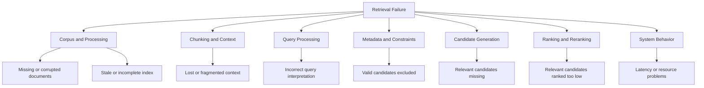
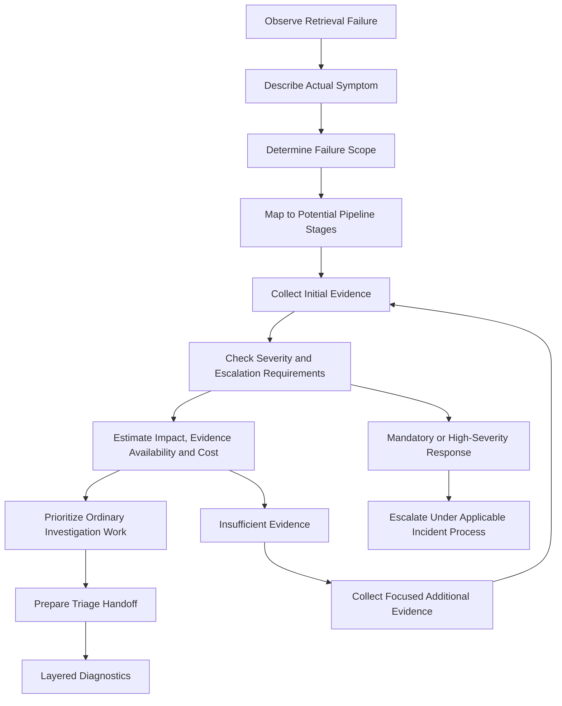

# RET-11.01 — Retrieval Failure Taxonomy and Triage

## 1. Learning Objectives

After completing this chapter, you should be able to:

1. Explain what constitutes a retrieval failure.
2. Distinguish symptoms, failure modes, contributing factors, and root causes.
3. Classify retrieval failures across different pipeline layers.
4. Recognize corpus, indexing, chunking, query, filtering, candidate-generation, and ranking symptoms.
5. Identify quality, latency, resource, and constraint-related problems.
6. Map observed symptoms to potentially affected retrieval stages.
7. Collect the initial evidence required for investigation.
8. Prioritize investigations based on impact, evidence availability, and investigation cost.
9. Recognize when multiple retrieval stages may contribute to one failure.
10. Prepare a structured triage handoff for detailed diagnosis.

## 2. Prerequisites

This chapter builds on concepts developed in earlier Retrieval Engineering chapters.

- RET-02: Document ingestion and corpus quality.
- RET-03: Chunking and context preservation.
- RET-04: Retrieval representations and indexing.
- RET-05: Lexical retrieval.
- RET-06: Dense retrieval and ANN.
- RET-07: Query processing and metadata constraints.
- RET-08: Hybrid retrieval and candidate generation.
- RET-09: Ranking and reranking.
- RET-10: Retrieval evaluation and benchmarking.

**Primary prerequisite:** RET-10.

You should understand how retrieval is evaluated and how benchmark results represent retrieval-system behavior.

This chapter uses existing evaluation evidence. It does not reteach evaluation metrics or benchmark construction.

## 3. Estimated Reading Time

Approximately 20–25 minutes.

Practical investigation and experimentation require additional time.

## 4. Why Retrieval Failures Need Systematic Classification

Imagine that you operate a document retrieval system for an enterprise knowledge platform.

A user asks:

> What is the company's parental leave policy for employees with less than one year of service?

The retrieval system returns several documents, but none contains the correct policy.

The evaluation benchmark also shows that retrieval quality has decreased.

A common reaction is to increase the number of retrieved candidates, change the embedding model, or modify the reranking configuration.

But these actions assume that the problem exists inside the retrieval algorithm.

The actual problem might be simpler:

- The policy document was never ingested.
- Document extraction removed an important section.
- The document was processed but never successfully indexed.
- Chunking separated the eligibility condition from the policy statement.
- Query transformation removed the employment-duration constraint.
- A metadata filter excluded the correct document.
- Candidate generation failed to retrieve the relevant chunk.
- The correct chunk was retrieved but ranked outside the final result limit.

These failures can produce similar user-visible symptoms while requiring completely different engineering interventions.

Changing the wrong component can increase complexity without fixing the actual problem.

This is why retrieval engineering requires a systematic failure-classification process.

### 4.1 The Retrieval Pipeline

A simplified retrieval pipeline looks like this:

```text
Documents
    |
    v
Ingestion and Processing
    |
    v
Chunking and Representation
    |
    v
Indexing
    |
    v
Query Processing
    |
    v
Filtering
    |
    v
Candidate Generation
    |
    v
Ranking and Reranking
    |
    v
Final Retrieved Results
```

Each stage depends on the correctness of earlier stages.

For example, a ranking model cannot retrieve a document that candidate generation never supplied.

Similarly, an embedding model cannot compensate for a document that was never indexed.

**A failure observed at the end of a retrieval pipeline does not necessarily originate at the final stage.**

An incorrect final result may be caused by an earlier processing defect.

### 4.2 Symptom, Failure Mode, Contributing Factor, and Root Cause

Consider this observation:

The correct document does not appear in the final retrieval results.

This describes what happened, not why it happened.

Possible explanations include:

- The document is missing from the corpus.
- The document exists but was incorrectly processed.
- The document was processed but is absent from the search index.
- Its relevant content was lost during chunking.
- Query processing changed the search intent.
- A filter excluded the document.
- Candidate generation failed to retrieve it.
- The document was retrieved but ranked outside the final result limit.

The same symptom can have multiple explanations.

| Concept | Meaning | Example |
|---|---|---|
| Symptom | Observable behavior indicating something may be wrong | Relevant document is missing from final results |
| Failure mode | The way the system fails | Relevant document is absent from the candidate set |
| Contributing factor | A condition that helps produce the failure | Candidate limit is too restrictive |
| Root cause | An established underlying reason supported by evidence | The relevant document is consistently excluded by an incorrect metadata constraint |

A contributing factor does not automatically represent the root cause.

Multiple contributing factors may also exist.

### 4.3 Why Premature Diagnosis Is Dangerous

Suppose retrieval quality decreases after a new embedding model is deployed.

An engineer immediately concludes that the new model is responsible.

However, the deployment also included:

- A changed chunking configuration.
- A rebuilt vector index.
- A modified metadata filter.
- A different candidate limit.

There are now several possible explanations.

Without isolating the relevant behavior, blaming the embedding model is speculation.

Premature diagnosis creates several risks:

1. Unnecessary model changes.
2. Increased infrastructure costs.
3. Additional configuration complexity.
4. Regression in previously successful query categories.
5. Longer debugging cycles.
6. Incorrect engineering conclusions.

The objective of initial triage is not to prove the cause.

It is to classify the observed failure and identify the most appropriate investigation direction.

## 5. Retrieval Failure Taxonomy

A retrieval failure taxonomy is a structured classification of ways in which a retrieval system can produce incorrect, incomplete, inefficient, or invalid results.

The following taxonomy organizes failures according to their likely pipeline location.



### 5.1 Understanding the Taxonomy's Boundaries

The taxonomy is a practical classification aid, not a strictly exclusive partition of retrieval pipeline stages.

Two different classification dimensions are involved:

**Failure category:** What kind of problem is being observed?

Examples include missing documents, incomplete context, incorrect filtering, poor candidate coverage, ranking errors, and excessive latency.

**Pipeline stage:** Where does the relevant behavior occur?

Examples include document processing, indexing, query transformation, filtering, candidate generation, and reranking.

These dimensions are related but not identical.

For example:

- An indexing failure may produce a candidate-coverage failure.
- A metadata-filtering problem may appear as an empty candidate set.
- A chunking defect may produce poor ranking because retrieved chunks contain incomplete context.
- A reranking configuration may improve relevance while increasing latency.

A single incident can therefore belong to multiple failure categories.

The engineer should identify the observed symptom first and then investigate the stages that may contribute to it.

Do not force every failure into exactly one category before collecting evidence.

## 6. Major Retrieval Failure Categories

### 6.1 Corpus and Document-Processing Failures

Corpus-related failures occur when the source documents available to the retrieval system do not accurately represent the intended knowledge.

Typical symptoms include:

- Expected documents are missing.
- Search results contain outdated information.
- Extracted text is incomplete.
- Document metadata is incorrect.
- Duplicate documents appear frequently.
- Important tables or sections are missing.
- Search results reference an incorrect source version.
- A document exists in the source repository but is absent from processed storage.

**Example**

An enterprise policy document is updated from version 2 to version 3.

However, the retrieval system continues returning information from version 2.

Potential explanations include:

- The updated document was never ingested.
- The previous version was not invalidated.
- The ingestion process failed.
- Document freshness metadata was not updated.
- Both versions remain available without appropriate version handling.

**Initial evidence to collect:**

- Source-document inventory.
- Document identifiers and version information.
- Ingestion status.
- Extraction output.
- Document timestamps.
- Metadata values.
- Processed-document inventory.
- Source-to-processed-document mapping.

**First investigation direction:** Verify whether the expected source document and its correct content exist in the processed corpus.

Do not immediately assume that the retrieval algorithm is responsible.

Detailed ingestion and extraction behavior belongs to RET-02.

### 6.2 Indexing-Related Failure Symptoms

Indexing-related failures occur when correctly processed documents are not represented correctly or consistently in the retrieval index.

A document can exist in processed storage without being available to the search system.

Typical symptoms include:

- A processed document is absent from search results across relevant queries.
- Index records contain outdated document representations.
- Document updates appear in source storage but not in retrieval results.
- Some records are indexed while others from the same processing batch are missing.
- A document identifier in processed storage does not match its indexed representation.
- Deleted or replaced documents remain searchable.

**Example**

Suppose an ingestion pipeline successfully processes 500 policy documents.

However, only 470 documents become available in the retrieval index.

The processed corpus appears complete, but retrieval cannot access the remaining 30 documents through that index.

Potential explanations include:

- Indexing failures.
- Failed or partially completed batch operations.
- Incorrect document identifiers.
- Failed update operations.
- Stale index state.

**Initial evidence to collect:**

- Processed-document identifiers.
- Indexed-document identifiers.
- Indexing job status.
- Failed or partially completed batch records.
- Source-to-index identifier mapping.
- Document update timestamps.
- Index freshness information.

**First investigation direction:** Compare the processed-document inventory with the records available in the relevant retrieval index.

Do not confuse document-processing success with indexing success.

There is another important distinction: a document may exist in the physical index but remain unavailable to a particular retrieval request.

For example, the request may target:

- The wrong collection.
- An incorrect namespace.
- An unintended tenant partition.
- An incompatible index version.
- A different logical dataset.

Consider a system with separate collections for different business units.

A document can be indexed successfully in the Finance collection but remain unavailable to a query targeting the HR collection.

In this situation, comparing processed and indexed document counts alone is insufficient.

The engineer must also verify that the retrieval request targets the correct index, collection, namespace, or partition.

A count mismatch is a useful signal, but it does not automatically prove that searchable documents are missing. The counts may represent different units, such as source documents, chunks, vector records, or logical document groups. One source document may produce several indexed chunks, and some index structures may contain auxiliary records.

Before interpreting a mismatch, establish that both inventories use comparable document granularity, identity rules, and scope.

**Example diagnostic record:**

```python
index_diagnostic = {
    "document_id": "policy-1042",
    "source_version": "v3",
    "processed": True,
    "indexed": True,
    "target_collection": "hr-policies",
    "actual_collection": "finance-policies",
    "expected_collection": "hr-policies"
}
```

This example illustrates how an indexed document can still be unavailable through the intended retrieval path.

Detailed indexing architecture and implementation belong to RET-04.

### 6.3 Chunking and Context-Preservation Failures

Chunking failures occur when document content is divided in a way that damages the context required for retrieval.

A document may exist correctly in the corpus while its individual chunks fail to preserve meaningful information.

Typical symptoms include:

- Relevant information is divided across separate chunks.
- Eligibility conditions become separated from policy statements.
- Tables lose their associated headings.
- Important definitions are separated from their explanations.
- Retrieved chunks contain incomplete sentences.
- Search results contain relevant keywords but insufficient context.

**Example**

Consider the following source text:

```text
Employees become eligible for parental leave after
completing twelve months of continuous employment.

The leave duration is 20 weeks.
```

Suppose chunking produces:

```text
Chunk A:
Employees become eligible for parental leave after
completing twelve months of continuous employment.

Chunk B:
The leave duration is 20 weeks.
```

A query asking:

> How many weeks of parental leave are available?

may retrieve Chunk B successfully.

However, the retrieved result does not communicate the eligibility condition.

The retrieval system may appear successful because it found the correct duration, while the retrieved context remains incomplete for the actual information need.

**Initial evidence to collect:**

- Original source text.
- Generated chunks.
- Chunk identifiers and source relationships.
- Chunk boundaries.
- Retrieved chunk content.
- Parent-document context, where available.

**First investigation direction:** Compare the original document with the generated chunks and determine whether the information required by the query remains available.

Detailed chunking strategies and implementation belong to RET-03.

### 6.4 Query Interpretation and Query-Transformation Failures

Query-processing failures occur when the user's information need is incorrectly represented before retrieval.

A system may receive a valid query but transform it into a representation that loses important intent.

Typical symptoms include:

- Important query terms disappear.
- A query rewrite changes the intended meaning.
- Synonyms introduce irrelevant concepts.
- Language normalization damages important terminology.
- Query expansion produces excessive ambiguity.
- The original query and transformed query behave differently.

**Example**

Original query:

```text
Find employees eligible for parental leave
after six months of service.
```

Transformed query:

```text
Find employees eligible for parental leave.
```

The employment-duration condition has disappeared.

The resulting retrieval behavior may return general parental leave documents without the required eligibility information.

**Initial evidence to collect:**

- Original query.
- Normalized query.
- Rewritten or expanded query.
- Query-processing configuration.
- Intermediate transformation outputs.
- Retrieved results for the original and transformed queries, where available.

**First investigation direction:** Compare the original query with every available transformed representation and identify whether important intent was lost or changed.

Query processing and transformation techniques belong to RET-07.

### 6.5 Metadata Filtering and Constraint Failures

Metadata filtering failures occur when structured constraints incorrectly include or exclude documents.

Unlike ordinary relevance problems, these failures may violate explicit retrieval requirements.

Typical symptoms include:

- Expected documents disappear when filters are enabled.
- Filtered searches return zero results.
- Results contain documents from the wrong department.
- Documents from the wrong region appear.
- Valid documents are excluded because metadata is missing.
- Unfiltered searches work while filtered searches fail.

**Example**

An employee asks:

> Find parental leave policies applicable to employees in India.

The retrieval request includes:

```python
filters = {
    "country": "India",
    "document_type": "policy"
}
```

However, the relevant document contains:

```python
metadata = {
    "country": "IN",
    "document_type": "policy"
}
```

The country values do not match.

The document may be relevant and correctly indexed, but the structured filter excludes it.

**Initial evidence to collect:**

- Original filter conditions.
- Actual document metadata.
- Metadata schema.
- Filtered and unfiltered result counts.
- Filter execution output, where available.
- Documents excluded by the constraint.

**First investigation direction:** Verify whether the expected documents satisfy the actual filter conditions.

Do not assume that an empty result means the corpus contains no relevant documents.

Detailed filtering semantics belong to RET-07.

### 6.6 Candidate-Generation and Coverage Failures

Candidate-generation failures occur when relevant documents are not included in the initial retrieval candidate set.

A reranker cannot promote a document that never entered its input set.

Typical symptoms include:

- Relevant documents are absent from retrieved candidates.
- Relevant documents appear in the corpus but not in search results.
- Candidate coverage decreases for certain query categories.
- Hybrid retrieval misses documents found by an individual retriever.
- Increasing ranking quality does not resolve missing candidates.

**Example**

Suppose a retrieval pipeline produces 100 candidates.

The relevant document is present in the indexed corpus but absent from all 100 candidates.

The ranking stage receives:

```text
Candidate 1
Candidate 2
Candidate 3
...
Candidate 100
```

The correct document is not included.

Even a highly effective reranker cannot select it.

**Candidate count versus candidate coverage**

Candidate count describes how many results the retrieval stage produced.

Candidate coverage describes whether the relevant documents were included in those results.

These are not interchangeable.

Consider three hypothetical retrieval configurations evaluated against the **same query**, using the **same corpus scope** and the **same complete relevance-judgment set**:

| Retrieval configuration | Candidate count | Relevant documents retrieved |
|---|---:|---:|
| Configuration A | 100 | 8 |
| Configuration B | 50 | 10 |
| Configuration C | 200 | 5 |

Configuration C produces the largest candidate set but retrieves fewer known relevant documents than Configuration B.

The comparison is meaningful because the query and relevance-judgment set are held constant.

The number of relevant documents retrieved is still only a count. Candidate coverage must be interpreted relative to the complete set of known relevant documents for that query.

This chapter does not introduce the formal recall calculation. The evaluation methodology and metrics belong to RET-10.

Coverage conclusions also depend on the completeness and quality of the relevance judgments.

If relevant documents have not been identified in the evaluation set, their absence from a candidate set cannot reliably be interpreted as a measured coverage failure.

**Initial evidence to collect:**

- Candidate identifiers.
- Candidate source information.
- Candidate counts.
- Individual retriever outputs.
- Combined candidate-set output.
- Filtered candidate counts.
- Relevant document identifiers from existing judgments.
- Candidate-set differences across query categories.

**First investigation direction:** Determine whether the relevant document is absent before ranking or merely appears too low in the final results.

For a hybrid retrieval system, inspect the outputs of individual retrievers as well as the combined candidate set.

For example, a system may use lexical retrieval, dense retrieval, and a fusion stage. If a relevant document is missing from the final candidates, investigate whether:

- The lexical retriever missed the document.
- The dense retriever missed the document.
- Both retrievers missed it.
- An individual retriever found it but the combination process excluded it.
- An upstream filter or request constraint prevented it from reaching the retrievers.

Comparing individual outputs with the combined output helps distinguish retriever-level omissions from candidate-combination problems.

A missing candidate does not automatically prove a candidate-generation defect. An upstream metadata filter, query transformation, corpus defect, indexing problem, or incorrect collection selection may have prevented the document from reaching candidate generation.

Candidate generation and hybrid retrieval belong to RET-08. Detailed lexical and dense retrieval behavior belongs to RET-05 and RET-06.

### 6.7 Ranking and Reranking Failures

Ranking failures occur when relevant candidates are available but the system assigns them an inappropriate ordering.

Typical symptoms include:

- Relevant documents appear near the bottom.
- Irrelevant documents rank above relevant documents.
- Reranking decreases relevance quality.
- Certain query categories experience poor ordering.
- The initial candidate set is adequate, but final results are weak.

**Example**

Initial candidates:

| Document | Relevance | Initial rank |
|---|---|---:|
| A | Relevant | 1 |
| B | Partially relevant | 2 |
| C | Highly relevant | 3 |

After reranking:

| Document | Relevance | Final rank |
|---|---|---:|
| B | Partially relevant | 1 |
| C | Highly relevant | 2 |
| A | Relevant | 3 |

The relevant documents were available before reranking.

The observed problem concerns ordering rather than candidate coverage.

**Initial evidence to collect:**

- Initial candidate order.
- Final ranked order.
- Initial scores.
- Reranking scores.
- Candidate content.
- Existing relevance judgments.
- Ranking behavior across affected query categories.

**First investigation direction:** Compare candidate availability and ordering before and after the ranking stage.

Detailed ranking and reranking algorithms belong to RET-09.

### 6.8 Quality, Latency, Resource, and Constraint-Related Outcomes

Not every retrieval failure produces an obviously irrelevant result.

A system can return relevant documents and still be unsuitable for production because of operational or correctness problems.

This section introduces a second classification dimension: observable system outcomes and operational characteristics.

These are cross-cutting dimensions, not additional mutually exclusive pipeline stages.

For example:

- A quality regression may originate in corpus processing, query transformation, candidate generation, or ranking.
- A latency increase may originate in query processing, filtering, retrieval, reranking, or infrastructure behavior.
- A constraint violation may originate in metadata, filter execution, or request construction.
- Resource consumption may increase across several stages after a configuration change.

Therefore, Section 6.8 should be read alongside Sections 6.1–6.7, not as a separate set of pipeline stages.

#### Quality-related symptoms

- Evaluation quality decreases.
- Some query categories perform significantly worse.
- Relevant documents are consistently absent.
- Results are unstable across similar queries.
- Retrieval performance changes after configuration updates.

#### Latency-related symptoms

- Retrieval takes longer than the acceptable service budget.
- p95 latency increases significantly.
- Certain query types are much slower.
- Filtered retrieval becomes unexpectedly expensive.
- Reranking introduces excessive additional latency.

Initial investigation directions include:

| Observed latency symptom | Potential stage to inspect |
|---|---|
| High query-processing latency | Query transformation |
| High filtering latency | Filter execution and selectivity |
| High retrieval latency | Search execution and index behavior |
| High reranking latency | Candidate count and reranking stage |
| High end-to-end latency | Combined stage timings and request execution |

These mappings indicate where to investigate, not proven causes.

When comparing stage-level latency, use consistent timing boundaries.

For example, decide whether each measurement includes queueing, network transfer, serialization, and result post-processing. Do not compare one stage's server-side execution time with another stage's end-to-end time and interpret the difference as a meaningful performance comparison.

Also account for concurrency and asynchronous execution. In a parallel retrieval pipeline, individual stage durations may overlap, so their sum may not equal end-to-end request latency.

High retrieval latency may also result from resource contention, workload changes, or infrastructure conditions.

**Understanding p95 latency**

p95 latency is the 95th percentile of observed request latencies.

It means that approximately 95% of measured requests completed at or below that latency, while approximately 5% took longer.

It does not represent the slowest request.

Consider these illustrative measurements:

```text
p50 latency:  120 ms
p95 latency:  450 ms
p99 latency:  900 ms
Maximum:    1,800 ms
```

The median request is relatively fast, but a significant tail of requests takes longer.

This is why average or median latency alone may not reveal an unacceptable retrieval experience.

#### Resource-related symptoms

- Memory consumption increases.
- CPU utilization becomes excessive.
- Vector-search resource consumption increases.
- Larger candidate sets create substantial processing overhead.
- Retrieval improvements require disproportionate infrastructure resources.

Initial investigation should identify the resource being consumed, the affected workload, the relevant retrieval stage, and whether the increase appeared after a particular configuration or data change.

#### Constraint-related symptoms

- Results violate required metadata constraints.
- Unauthorized or out-of-scope documents appear.
- Required filters eliminate valid results unexpectedly.
- Empty results occur for queries that should have valid matches.

Constraint correctness must be treated independently from relevance quality.

A result can be highly relevant and still be invalid because it violates an explicit constraint.

For example, returning a highly relevant policy belonging to the wrong country is not a successful retrieval outcome when country applicability is mandatory.

## 7. Symptom-to-Investigation Mapping

The following table provides an initial triage reference.

It maps observed symptoms to potentially involved stages and the first evidence worth collecting.

| Observed symptom | Potentially involved stages | Initial evidence | First investigation |
|---|---|---|---|
| Relevant documents are missing from candidates | Corpus, processing, indexing, query, filtering, candidate generation | Source inventory, processed documents, index membership, filters, candidate IDs | Verify document existence and trace its availability |
| Relevant documents exist but are not retrieved | Query, filtering, candidate generation | Query transformations, metadata, intermediate results | Compare original query, constraints, and candidate output |
| Relevant candidates rank too low | Ranking, reranking | Candidate order, scores, relevance judgments | Compare pre-ranking and post-ranking outputs |
| Filters unexpectedly eliminate valid candidates | Metadata and constraints | Filter conditions, metadata values, result counts | Verify actual filter-to-metadata compatibility |
| Results are relevant but too slow | Query, filtering, retrieval, reranking | Stage-level latency, candidate counts, resource measurements | Identify where latency accumulates |
| Quality improves but resource consumption increases excessively | Candidate generation, dense retrieval, reranking | Before-and-after resource measurements and candidate counts | Identify the resource cost of the changed behavior |
| Quality varies across query categories | Any retrieval stage | Segment-level benchmark results and representative queries | Identify which query segments are affected |
| Old or outdated information is retrieved | Corpus, processing, indexing | Source versions, timestamps, ingestion status, index freshness | Verify freshness and document-version handling |
| Relevant content appears incomplete | Chunking and context preservation | Original document, chunks, retrieved content | Compare source context with retrieved chunks |
| Reranking decreases final relevance | Candidate generation, ranking, reranking | Pre-ranking and post-ranking outputs | Verify candidate coverage and ordering changes |
| Processed documents are missing from search results | Indexing, identifiers, indexing updates | Processed and indexed identifiers, job status | Compare processed and indexed inventories |

This table identifies investigation directions, not proven root causes.

For example, missing candidates may originate from the corpus, indexing, query transformation, filtering, or candidate-generation behavior.

The first investigation must establish where the relevant document becomes unavailable.

### 7.1 Aggregate Results and Segment-Level Regressions

Aggregate benchmark results are useful for understanding overall system behavior, but they can hide localized failures.

For example:

- Overall retrieval quality may improve while one language performs worse.
- Average latency may decrease while p95 latency increases.
- Most document categories may improve while policy documents regress.
- Unfiltered retrieval may perform well while constrained retrieval deteriorates.

Therefore, initial triage should identify whether the observed problem is concentrated in particular query segments, languages, document types, tenant scopes, or constraint combinations.

This does not introduce a new evaluation methodology. It uses the evaluation evidence and workload segmentation established in RET-10.

## 8. Initial Retrieval Failure Triage

Triage is the process of determining which failure should be investigated first and where the investigation should begin.

It is not the complete diagnostic process.

A useful triage workflow contains five steps.

### Step 1: Establish the Observed Symptom

Describe the actual behavior without adding an assumed explanation.

Weak observation:

```text
The embedding model is performing poorly.
```

Better observation:

```text
Relevant documents are absent from the top-20
retrieval candidates for 18% of queries in the
parental-leave query category.
```

The second observation identifies:

- What is wrong.
- Where the behavior is observed.
- The affected query category.
- The relevant result boundary.

Whenever possible, connect the observation to existing RET-10 benchmark evidence.

### Step 2: Determine the Scope

Establish whether the failure affects:

- One query or many queries.
- One query category or multiple categories.
- One document or an entire document collection.
- One language or multiple languages.
- Filtered or unfiltered retrieval.
- A particular retrieval configuration or all configurations.

A failure affecting one document may require a different investigation from a failure affecting every query.

Query-category segmentation is especially useful because aggregate results can hide localized problems.

Scope helps prevent engineers from treating a localized defect as a system-wide problem.

### Step 3: Identify Potentially Involved Stages

Use the failure taxonomy to identify plausible stages.

For example:

```text
Observation:
Filtered queries return zero results.

Potential stages:
- Corpus metadata
- Query processing
- Metadata constraints
- Candidate generation

Initial investigation:
Compare filtered and unfiltered behavior.
```

Do not assign a root cause at this point.

A single failure can involve multiple stages.

For example, an outdated document may also contain inconsistent metadata. The document-processing problem and filtering problem may interact to produce an empty result.

Initial triage should preserve these possibilities rather than force the failure into only one category.

### Step 4: Collect Initial Evidence

Collect only evidence relevant to the observed failure.

Depending on the problem, this may include:

- Original documents.
- Processed text.
- Generated chunks.
- Processed-document identifiers.
- Indexed-document identifiers.
- Original and transformed queries.
- Metadata values.
- Applied filters.
- Candidate identifiers.
- Individual retriever outputs.
- Combined candidate outputs.
- Ranking outputs.
- Existing benchmark results.
- Stage-level latency.
- Resource measurements.

Evidence collection should be focused.

Collecting every available log and output without a diagnostic question creates noise rather than clarity.

### Step 5: Prioritize the Investigation

Not every failure deserves equal investigation effort.

For ordinary investigation work, consider three dimensions:

1. Impact.
2. Evidence availability.
3. Investigation cost.

A practical prioritization model is:

\[
P = \frac{I \times A}{C}
\]

Where:

- \(P\) = Investigation priority.
- \(I\) = Impact of the failure.
- \(A\) = Availability of relevant initial evidence.
- \(C\) = Estimated investigation cost.

This is an illustrative prioritization heuristic, not a standardized retrieval metric or an industry-wide formula.

**Evidence availability versus evidence strength**

Evidence availability describes whether the engineer can access the information needed to investigate.

Examples:

- Diagnostic logs exist.
- Intermediate candidate outputs are available.
- Metadata records can be inspected.
- Benchmark results are accessible.

Evidence strength describes how strongly the collected evidence supports a particular explanation.

At the initial triage stage, the engineer usually assesses evidence availability.

Evidence strength and causal confidence are developed during detailed investigation in RET-11.02.

A high availability score must never be interpreted as proof that a suspected root cause is correct.

**Scoring guidance**

For consistent use, define impact, evidence availability, and investigation cost on a scale from 1 to 5.

| Score | Impact interpretation | Evidence availability | Investigation cost |
|---|---|---|---|
| 1 | Very low | Almost no relevant evidence accessible | Very low effort |
| 2 | Low | Limited evidence accessible | Low effort |
| 3 | Moderate | Some useful evidence accessible | Moderate effort |
| 4 | High | Most relevant evidence accessible | High effort |
| 5 | Critical | Extensive relevant evidence accessible | Very high effort |

The exact scoring policy should be defined consistently for the engineering team.

Impact, evidence availability, and investigation cost should be assessed independently.

Example:

| Failure | Impact | Availability | Cost | Priority |
|---|---:|---:|---:|---:|
| Incorrect country metadata | 5 | 5 | 1 | 25 |
| Slow reranking | 3 | 3 | 3 | 3 |
| Possible embedding degradation | 4 | 2 | 4 | 2 |

The metadata problem deserves earlier investigation because it has high impact, strong evidence availability, and low investigation cost.

The scores are illustrative and depend on the organization's scoring policy.

**Critical limitation of the formula**

The formula is intended to help order ordinary investigation work. It must not determine whether a high-severity incident receives attention.

A severe production outage, major customer-impacting retrieval failure, applicable SLA violation, or mandatory security, privacy, or compliance violation may require immediate escalation even when evidence availability is low and investigation cost is high.

A high-impact failure with limited evidence should trigger focused evidence acquisition and appropriate escalation, not automatic deprioritization.

For example, if a potentially severe failure has impact 5, evidence availability 1, and cost 5, the resulting score is low. That score does not mean the incident is unimportant. It indicates that the investigation may require additional evidence-gathering effort.

The formula should never override incident severity, organizational escalation policies, or mandatory response requirements.

### Triage Workflow



The output of triage is a clearly described failure, its scope, potentially involved stages, available evidence, severity considerations, and a prioritized investigation direction.

The next chapter, RET-11.02, develops the full diagnostic and root-cause analysis process.

## 9. Triage Handoff Record

Triage should produce a concise record that allows another engineer to continue the investigation without reconstructing the initial observation.

The record is not a root-cause report. It captures what is currently known and what remains uncertain.

A practical handoff structure is:

```python
triage_handoff = {
    "incident_id": "retrieval-incident-1042",
    "observed_symptom": (
        "Expected policy document missing from top-20 candidates"
    ),
    "affected_scope": {
        "query_category": "policy_eligibility",
        "document_type": "policy",
        "query_segment": "parental_leave"
    },
    "confirmed_observations": [
        "Document exists in processed storage",
        "Document is absent from the observed candidate output"
    ],
    "hypotheses": [
        "Document may be absent from the targeted index",
        "Document may be excluded by a filter",
        "Candidate generation may not retrieve the document"
    ],
    "potential_stages": [
        "indexing",
        "metadata_filtering",
        "candidate_generation"
    ],
    "initial_evidence": [
        "processed_document_inventory",
        "indexed_document_inventory",
        "query_filter_record",
        "candidate_identifiers"
    ],
    "severity": "high",
    "investigation_priority": {
        "impact": 5,
        "evidence_availability": 3,
        "investigation_cost": 3,
        "score": 5
    },
    "root_cause_status": "unresolved",
    "next_action": (
        "Verify document membership in the targeted index "
        "and inspect filter behavior"
    )
}
```

This is an illustrative structure, not a prescribed production incident schema.

A useful handoff should distinguish:

**Confirmed observations:** Facts directly established by the evidence already collected.

**Hypotheses:** Plausible explanations that still require investigation.

For example, "the document is absent from the observed candidate output" may be confirmed by inspecting that output. "The metadata filter caused the omission" remains a hypothesis until the filter behavior is verified.

Do not record an assumption as a confirmed observation.

A useful handoff should preserve:

- A clear symptom statement.
- The affected query and document scope.
- Confirmed observations.
- Potentially involved stages.
- Evidence already collected.
- Plausible alternative explanations.
- Severity and escalation considerations.
- Investigation priority for ordinary work.
- Current root-cause status.
- The next concrete investigation action.

**Identifier traceability**

Candidate and document identifiers should be compared using stable identities rather than display text alone.

For example, two chunks may have identical text but belong to different source documents, versions, or tenants. Conversely, the same document may have different display titles across processing stages.

Use stable document and chunk identifiers, with appropriate source-version or tenant context, when tracing records across stages.

Avoid treating matching display text as proof that two records represent the same underlying document.

Production systems should avoid recording sensitive query content or document information unnecessarily. Use stable identifiers, appropriate access controls, and redaction where required.

Production observability architecture, incident management, and logging-platform design remain outside RET-11's scope.

## 10. Avoiding Premature Optimization

One of the most common retrieval engineering mistakes is modifying a component before understanding the failure.

Consider this scenario:

A benchmark shows that retrieval quality has decreased.

An engineer immediately increases the candidate limit from 20 to 100.

This might help if relevant documents are being excluded because the candidate depth is insufficient.

However, it might not help if:

- Relevant documents are missing from the corpus.
- Documents are absent from the search index.
- The retrieval request targets the wrong collection.
- Metadata filters exclude the documents.
- Query transformation damages the search intent.
- The relevant candidates are already present but ranked incorrectly.

Increasing candidate depth in these situations may increase latency and resource consumption without addressing the failure.

A disciplined engineer separates three decisions:

| Decision | Question |
|---|---|
| Observation | What is happening? |
| Diagnosis | Why is it happening? |
| Intervention | What change should address it? |

These decisions must not be collapsed into a single assumption.

### 10.1 Retrieval Correctness Versus Answer-Generation Correctness

Retrieval and answer generation are different stages in a retrieval-augmented application.

A retrieval system supplies documents or chunks to a downstream application or language model.

The downstream application uses that retrieved context to construct an answer.

```text
User Query
    |
    v
Retrieval System
    |
    v
Retrieved Documents
    |
    v
Context Construction
    |
    v
Language Model
    |
    v
Final Answer
```

Suppose the retrieval system returns the correct policy document, but the final answer incorrectly states the eligibility period.

This is not automatically a retrieval failure.

Possible downstream problems include:

- Relevant retrieved content was omitted during context construction.
- The application supplied incomplete context.
- The language model misinterpreted the retrieved content.
- The final answer contradicted the supplied evidence.

Conversely, if the correct policy document was never retrieved, the failure may originate in the retrieval pipeline.

**Initial engineering distinction:**

- Correct evidence is missing from retrieval output: investigate retrieval.
- Correct evidence exists in retrieval output but is missing or misrepresented downstream: investigate the application or generation stage.

This is an initial boundary distinction, not a complete downstream debugging procedure.

RET-11 focuses on retrieval behavior and does not replace the relevant application or generation engineering responsibilities.

### 10.2 A Practical Engineering Rule

Before changing a retrieval component, write down:

1. The observed symptom.
2. The affected query or document scope.
3. The suspected pipeline stage.
4. The available supporting evidence.
5. At least one plausible alternative explanation.
6. The next investigation required.

If these cannot be stated clearly, the investigation is not ready for an optimization decision.

## 11. Production Perspective

In a production retrieval system, failures rarely appear as isolated algorithmic problems.

They can emerge from changes in source documents, ingestion processes, indexing updates, metadata conventions, query patterns, retrieval configurations, or system workload.

A retrieval engineer should therefore preserve the context surrounding an observed failure.

For example, when a query produces unexpected results, the following information may be useful:

```python
diagnostic_record = {
    "query_id": "query-1042",
    "query_category": "policy_eligibility",
    "original_query": (
        "Parental leave eligibility after six months"
    ),
    "filter_applied": {
        "country": "India"
    },
    "candidate_count": 20,
    "final_result_count": 5,
    "observed_symptom": (
        "Expected policy document missing"
    ),
    "suspected_stages": [
        "metadata_filtering",
        "candidate_generation"
    ]
}
```

This is an illustrative diagnostic record, not a complete production logging implementation.

For reliable traceability, diagnostic records should use stable identifiers that connect the relevant stages.

For example:

```python
diagnostic_context = {
    "query_id": "query-1042",
    "document_id": "policy-1042",
    "chunk_id": "chunk-1042-03",
    "retrieval_run_id": "run-2026-001",
    "index_version": "index-v3",
    "query_category": "policy_eligibility"
}
```

These identifiers help engineers correlate:

- The original source document.
- Its processed representation.
- The generated chunks.
- Its indexed representation.
- The retrieval request.
- The resulting candidates.

The identifiers should remain consistent across relevant diagnostic records.

However, stable identifiers should not expose sensitive information or become substitutes for appropriate access controls.

In particular, production systems should avoid unnecessarily recording sensitive query content or document information. Use access controls, appropriate redaction, and stable identifiers where needed.

The purpose is to preserve enough context to reproduce and investigate the failure.

Production monitoring architecture, log-platform design, and incident management remain outside RET-11's scope.

## 12. Engineering Decisions and Trade-offs

Initial triage involves balancing investigation speed against the risk of reaching incorrect conclusions.

| Approach | Benefit | Risk |
|---|---|---|
| Immediately modify a suspected component | Fast initial action | May address the wrong problem |
| Investigate every pipeline stage equally | Broad coverage | High investigation cost |
| Start from the observed symptom and narrow the scope | Focused investigation | Requires disciplined evidence collection |
| Prioritize high-impact, evidence-rich failures | Efficient use of engineering time | Some lower-priority failures may wait |
| Rely only on aggregate benchmark results | Easy comparison | Localized failures may remain hidden |

A good engineer does not always investigate every component.

The objective is to select the smallest investigation that can meaningfully distinguish the plausible explanations.

### When Initial Triage Is Complete

Triage is ready to hand off when:

- The failure is clearly described.
- The affected scope is understood.
- Potentially involved stages are identified.
- Relevant initial evidence is available or its absence is documented.
- Severity and escalation requirements have been considered.
- Investigation priority is established for ordinary work.
- Confirmed observations are distinguished from hypotheses.
- Plausible alternative explanations are recorded.
- No unsupported root-cause conclusion has been recorded.

The next stage is systematic layered diagnosis.

## 13. Common Mistakes and Misconceptions

### Mistake 1: Treating Every Missing Result as a Ranking Problem

A missing document may never have entered the candidate set.

**Correction:** Establish candidate availability before investigating ranking behavior.

### Mistake 2: Assuming a Relevant Document Exists Because It Exists in the Source Repository

Source availability does not prove successful ingestion, extraction, chunking, or indexing.

**Correction:** Verify the document's actual representation in the processed corpus and retrieval index.

### Mistake 3: Treating Empty Filtered Results as an Empty Corpus

A valid document may have been excluded by incorrect metadata or filter conditions.

**Correction:** Compare filtered and unfiltered behavior and inspect actual metadata.

### Mistake 4: Assuming Higher Similarity Scores Mean Better Relevance

Scores depend on the retrieval model and scoring function. They are not automatically calibrated relevance probabilities.

**Correction:** Interpret scores alongside candidate content, existing relevance judgments, and system behavior. Detailed score diagnosis belongs to RET-11.02.

### Mistake 5: Increasing Candidate Depth for Every Retrieval Failure

More candidates may increase retrieval coverage, but they cannot repair missing documents or incorrect filters.

**Correction:** Determine whether the failure concerns candidate coverage or another stage.

### Mistake 6: Using Aggregate Quality to Represent Every Query Category

An overall score can hide severe regressions in a smaller category.

**Correction:** Identify affected query segments using existing benchmark evidence.

### Mistake 7: Declaring Root Cause During Initial Triage

A suspected stage is not necessarily the actual cause.

**Correction:** Record investigation hypotheses and verify them in RET-11.02.

### Mistake 8: Confusing Retrieval Failures with Answer-Generation Failures

An incorrect final answer does not automatically indicate incorrect retrieval.

**Correction:** Inspect the retrieved evidence before deciding whether the failure belongs to retrieval or downstream application processing.

### Mistake 9: Treating Every Failure as an Isolated Component Defect

Multiple stages can contribute to the same retrieval failure.

**Correction:** Preserve alternative explanations during triage and allow the diagnostic process to identify interacting causes.

### Mistake 10: Treating Candidate Count as Candidate Coverage

A larger candidate set does not automatically contain more relevant documents.

**Correction:** Inspect candidate identities and existing relevance judgments rather than relying exclusively on candidate counts.

### Mistake 11: Treating the Investigation-Priority Score as Incident Severity

A low score may result from limited evidence availability or high investigation cost.

**Correction:** Use the heuristic only to order ordinary investigation work. Apply incident severity and mandatory escalation requirements independently.

### Mistake 12: Treating Display Text as a Stable Document Identity

Two records can have identical display text while representing different documents, versions, or tenants.

**Correction:** Compare stable document and chunk identifiers with the appropriate source and scope context.

## 14. Interview Preparation

### 14.1 Conceptual Questions

**Q1. What is a retrieval failure?**

A retrieval failure is an incorrect, incomplete, invalid, or operationally unacceptable retrieval outcome relative to the intended information need and system requirements.

It can originate in document processing, query processing, filtering, candidate generation, ranking, or system behavior.

**Q2. What is the difference between a symptom and a root cause?**

A symptom describes observable behavior. A root cause explains why that behavior occurs and must be supported by appropriate evidence.

For example, a missing relevant document is a symptom. An incorrect metadata constraint that excludes the document may be a root cause if verified.

**Q3. Why is retrieval failure classification important?**

Different pipeline failures can produce similar user-visible symptoms. Classification helps narrow the investigation and prevents engineers from modifying unrelated components.

**Q4. What is the difference between candidate-generation and ranking failures?**

Candidate-generation failures occur when relevant documents are absent from the candidate set.

Ranking failures occur when relevant documents are available but ordered incorrectly.

A ranking stage cannot recover a document that was never supplied to it.

### 14.2 Engineering Trade-off Questions

**Q5. Why should engineers avoid immediately increasing the candidate limit when retrieval quality decreases?**

Increasing candidate depth may help when relevant documents are being excluded due to insufficient candidate coverage.

However, it may increase latency and resource consumption without helping when the problem originates in corpus quality, indexing, query transformation, metadata filtering, or ranking.

The engineer should first establish which failure mode is occurring.

**Q6. How should an engineer prioritize several simultaneous retrieval failures?**

Consider their impact, evidence availability, and investigation cost for ordinary investigation work.

However, incident severity and mandatory escalation requirements must be considered independently. A critical production failure must not be deprioritized merely because evidence is difficult to obtain.

**Q7. Why should constraint failures be treated separately from relevance failures?**

Relevance measures whether retrieved content addresses the information need. Constraints determine whether the content is permitted or applicable under explicit requirements.

A relevant document can still be invalid if it violates a mandatory constraint.

### 14.3 Scenario-Based Questions

**Q8. A relevant document exists in the source repository but is absent from retrieval results. What would you investigate first?**

First verify that the document exists in the processed retrieval corpus and the relevant search index.

Inspect its extraction output, chunks, indexing status, query transformations, applied filters, and candidate output as necessary.

Also verify that the retrieval request targets the correct collection or namespace.

Do not immediately blame the embedding model.

**Q9. Unfiltered retrieval returns relevant documents, but adding a country filter produces zero results. What does this suggest?**

It suggests that metadata filtering or constraint compatibility deserves early investigation.

Compare actual metadata values against the applied filter conditions. Also verify that query processing and the retrieval request have not changed in other ways.

The symptom alone does not prove a metadata defect.

**Q10. Relevant documents appear in the initial candidate list but disappear from the final top-five results. Where should you investigate?**

Investigate ranking and reranking behavior.

Compare the initial and final ordering, candidate content, and existing relevance judgments.

Also verify that the final result limit and any subsequent filtering have not affected the output.

**Q11. Overall retrieval quality improves after a configuration change, but customer complaints increase. How would you approach the situation?**

Do not assume that the aggregate improvement represents an improvement for every query category.

Identify affected query segments, inspect representative queries, and determine whether specific languages, document types, or constraint combinations have regressed.

Also inspect latency distributions rather than relying only on aggregate or average latency.

This should lead into the diagnostic and regression-validation processes in RET-11.02 and RET-11.03.

**Q12. A retrieval system returns the correct policy document, but the final generated answer contains an incorrect eligibility period. Is this necessarily a retrieval failure?**

No.

The engineer should first inspect the retrieved content and the context supplied to the downstream application.

If the correct evidence was retrieved but omitted or misinterpreted later, the problem may belong to context construction or answer generation rather than retrieval.

### 14.4 Advanced Questions

**Q13. Can a single retrieval symptom have multiple root causes?**

Yes.

For example, missing relevant candidates may result from incomplete indexing combined with restrictive metadata filtering.

The investigation must identify the individual causes and understand how they interact.

**Q14. Can a retrieval system return relevant results and still be considered incorrect?**

Yes.

Results may violate required constraints, use outdated information, exceed acceptable latency, or consume resources beyond the operational budget.

Retrieval correctness is broader than semantic relevance alone.

**Q15. What evidence is required before calling a retrieval failure a ranking problem?**

At minimum, the engineer should establish that relevant documents are available in the candidate set and inspect their ordering before and after the relevant ranking stage.

Existing relevance judgments and intermediate outputs should support the conclusion.

**Q16. Why is processed-document existence insufficient to establish indexing correctness?**

A processed document may not have been successfully written to the search index.

The engineer should compare processed-document identifiers against indexed-document identifiers and inspect relevant indexing outcomes.

The comparison must also use compatible document granularity and identity rules.

**Q17. Can a document be indexed successfully but remain unavailable to a retrieval request?**

Yes.

The request may target a different collection, namespace, tenant partition, or index version.

The engineer must verify both indexing success and retrieval-target compatibility.

**Q18. Why is p95 latency more informative than average latency in some retrieval investigations?**

Average latency can hide a long tail of slow requests.

p95 shows the latency below which approximately 95% of requests complete. It helps reveal whether a meaningful portion of the workload experiences significantly slower retrieval.

**Q19. Why should investigation priority and incident severity be treated separately?**

Investigation priority estimates how efficiently an ordinary investigation can be pursued using available evidence and effort.

Incident severity reflects the seriousness of the impact and the required response.

A severe failure with little available evidence may receive a low heuristic investigation score but still require immediate escalation and evidence acquisition.

**Q20. Why should a hybrid retrieval failure be investigated at both individual-retriever and combined-candidate levels?**

A relevant document may be missed by one retriever, found by another, or removed during candidate combination.

Inspecting only the final candidate set does not reveal where the document disappeared.

Comparing individual retriever outputs with the combined candidate set helps distinguish retriever-level omissions from combination-stage problems.

### 14.5 Practical Debugging Exercise

Consider this retrieval output:

```python
retrieval_result = {
    "query": "India parental leave policy",
    "filters": {
        "country": "India"
    },
    "candidates": [],
    "result_count": 0
}
```

The same query without filters returns 12 candidates.

**Question:** What are the possible explanations, and what should you inspect first?

**Expected approach:**

1. Compare the filtered and unfiltered requests.
2. Inspect the metadata of the 12 unfiltered candidates.
3. Compare actual metadata values with the filter condition.
4. Check whether missing or inconsistent metadata exists.
5. Verify that no additional request transformation differs between the two executions.

A mismatch between stored country values and the filter is one possible explanation, but it must be verified.

### 14.6 Common Interview Traps

- Assuming every retrieval failure originates in embeddings.
- Confusing candidate coverage with ranking quality.
- Treating a high similarity score as proof of relevance.
- Assuming source-document existence guarantees corpus availability.
- Confusing processed-document availability with successful indexing.
- Treating an empty filtered result as proof that no relevant document exists.
- Declaring a root cause without testing alternatives.
- Treating aggregate benchmark improvements as universal improvements.
- Blaming retrieval when the correct evidence was already retrieved but mishandled downstream.
- Treating investigation-priority scores as replacements for incident severity.
- Comparing hybrid candidate outputs without inspecting individual retriever results.
- Treating display text as a reliable substitute for stable document identity.

A strong answer identifies the observed behavior, explains the possible pipeline stages, and describes the evidence needed before reaching a conclusion.

## 15. Self-Assessment

The following exercises test whether you can apply the failure taxonomy independently.

### Exercise 1 — Failure Classification

Classify each scenario by its most relevant failure category.

1. A document exists in the source repository but is absent from the processed corpus.
2. A processed document is absent from the search index.
3. A policy condition is separated from its corresponding policy statement.
4. A query rewrite removes an important date constraint.
5. A valid document is excluded because its country metadata does not match the filter.
6. A relevant document is missing from the initial candidate set.
7. A relevant candidate is ranked below irrelevant candidates.
8. Retrieval quality improves, but p95 latency exceeds the acceptable budget.

**Expected answers:**

1. Corpus and document-processing failure.
2. Indexing failure.
3. Chunking and context-preservation failure.
4. Query interpretation and transformation failure.
5. Metadata filtering and constraint failure.
6. Candidate-generation failure as an initial classification, subject to checking upstream stages.
7. Ranking or reranking failure.
8. Latency-related operational failure.

### Exercise 2 — Symptom Versus Cause

A retrieval benchmark shows that relevant documents are missing from the final results.

An engineer reports:

"The embedding model is the root cause."

Explain why this conclusion is insufficient.

**Evaluation criteria:**

A satisfactory answer should explain that:

- The observation describes a symptom.
- Multiple pipeline stages could produce the same outcome.
- The relevant document may be missing from the corpus.
- The document may be missing from the index.
- Query processing or filtering may exclude it.
- Candidate generation may fail to retrieve it.
- Intermediate candidate evidence is required before blaming embeddings.

### Exercise 3 — Investigation Prioritization

Consider these three failures:

- Failure A: Incorrect metadata values are confirmed in several high-impact policy documents.
- Failure B: A possible reranking issue affects a small number of queries, but supporting evidence is limited.
- Failure C: Retrieval latency has increased, but no stage-level measurements are available.

Which should you investigate first, and why?

**Evaluation criteria:**

A strong answer should prioritize Failure A initially for ordinary investigation because its impact and supporting evidence availability are high and its investigation direction is relatively clear.

However, the engineer must also consider business urgency, incident severity, and whether Failure C presents an operational risk requiring immediate attention.

There is no universally correct ordering without those additional conditions.

### Exercise 4 — Scenario Analysis

A retrieval system behaves as follows:

```text
Original query:
"Find parental leave policies for India."

Unfiltered retrieval:
20 candidates.

Filtered retrieval:
0 candidates.

Expected document:
Present in the original unfiltered results.
```

Answer:

1. What is the observed symptom?
2. Which stages are potentially involved?
3. What evidence should be collected?
4. What should not be concluded yet?

**Evaluation criteria:**

A strong answer identifies a filtered-retrieval failure, considers metadata constraints and request transformation, and proposes inspecting actual metadata, filter conditions, and filtered execution output.

The engineer must not declare a confirmed metadata root cause until the evidence supports it.

### Exercise 5 — Engineering Judgment

An engineer proposes increasing the candidate limit from 20 to 100 after observing a retrieval-quality decrease.

Explain:

- When this intervention might help.
- When it would not help.
- What risks it introduces.
- What evidence should be collected before making the change.

**Evaluation criteria:**

The answer should distinguish candidate-coverage failures from corpus, indexing, query, filtering, and ranking failures.

It should also mention potential latency and resource costs and the need to validate the change using the existing RET-10 benchmark.

### Exercise 6 — Multi-Stage Failure

A document exists in processed storage but is missing from the search index. At the same time, another relevant document is indexed but excluded by a country filter.

Explain why these should not be treated as one identical failure.

**Evaluation criteria:**

A strong answer should distinguish:

- The indexing availability problem.
- The metadata constraint problem.
- Their different evidence requirements.
- Their different likely engineering interventions.

It should also recognize that both may contribute to the broader symptom of missing relevant results.

### Exercise 7 — Retrieval Versus Generation

A retrieval system supplies the correct policy document to the language model. However, the final answer gives an incorrect eligibility period.

What should the engineer establish before classifying this as a retrieval failure?

**Evaluation criteria:**

The answer should inspect the actual retrieved content, context construction, and information supplied downstream.

It should distinguish retrieval correctness from final answer correctness.

### Exercise 8 — Severity Versus Investigation Priority

A suspected retrieval failure affects a critical production workflow. However, the available evidence is limited and investigating it will require significant effort.

The investigation-priority formula produces a low score.

Should the incident be deprioritized?

**Expected answer:**

No.

The formula is only a heuristic for ordering ordinary investigation work. Incident severity, customer impact, operational requirements, and escalation policies must be considered independently.

A potentially critical incident may require immediate escalation and focused evidence acquisition even when its investigation-priority score is low.

### Exercise 9 — Hybrid Candidate Investigation

A hybrid retrieval system combines lexical and dense retrieval.

A relevant document is absent from the final candidate set.

Describe how you would investigate the failure without immediately changing either retriever.

**Evaluation criteria:**

A strong answer should:

1. Inspect the request and upstream constraints.
2. Inspect the individual lexical retriever output.
3. Inspect the individual dense retriever output.
4. Verify whether the document appears in either output.
5. Compare the individual outputs with the combined candidate set.
6. Determine whether the document was missed by retrieval or excluded during candidate combination.
7. Preserve uncertainty until the evidence establishes the failure location.

### Exercise 10 — Identity and Index Inventory

A processed-document inventory contains 500 records, while an index inventory contains 1,400 records.

An engineer reports that the index has 900 unexpected documents.

Explain why that conclusion is not yet justified.

**Expected answer:**

The two inventories may count different units.

One source document may produce several chunks or vector records. The index may also contain multiple representations or auxiliary records.

The engineer must establish comparable granularity, identity rules, versions, and scope before interpreting the count difference.

## 16. Quick Revision

A retrieval failure is an incorrect, incomplete, invalid, or operationally unacceptable retrieval outcome.

The same symptom can originate from different pipeline stages.

The major failure categories are:

1. Corpus and document processing.
2. Indexing.
3. Chunking and context preservation.
4. Query interpretation and transformation.
5. Metadata filtering and constraints.
6. Candidate generation and coverage.
7. Ranking and reranking.
8. Quality, latency, resource, and constraint outcomes.

Initial triage follows five steps:

```text
Describe the symptom
        |
Determine the scope
        |
Identify potential stages
        |
Collect initial evidence
        |
Prioritize investigation
```

Remember:

- A symptom is not a root cause.
- Processed-document existence does not prove indexing success.
- Indexed-document existence does not prove retrieval-target compatibility.
- Index inventory counts require compatible granularity and identity rules.
- Relevant documents must exist in the candidate set before ranking can promote them.
- Candidate count does not establish candidate coverage.
- Candidate coverage conclusions depend on relevance-judgment quality and completeness.
- Hybrid retrieval diagnosis should inspect individual retrievers and the combined candidate set.
- Missing candidates may originate from upstream filtering or other earlier stages.
- Constraints must be evaluated independently from relevance.
- Aggregate quality can hide localized failures.
- Average latency can hide tail-latency problems.
- Stage-level latency comparisons require consistent measurement boundaries.
- p95 latency represents a percentile, not the slowest request.
- Increasing candidate depth cannot repair every retrieval problem.
- Correct retrieval evidence does not guarantee a correct generated answer.
- Investigation priority is not incident severity.
- Confirmed observations must be distinguished from hypotheses.
- Stable identifiers are more reliable than display text for tracing records.
- Initial triage identifies where to investigate, not what has been proven.

## 17. Key Takeaways

1. Retrieval failures must be classified before optimization decisions are made.
2. Similar symptoms can originate from different pipeline stages.
3. Corpus availability, indexing, query interpretation, filtering, candidate coverage, and ranking must be considered separately.
4. Initial evidence should guide investigation rather than confirm assumptions prematurely.
5. Investigation priority should consider impact, evidence availability, and cost for ordinary investigation work.
6. Incident severity and mandatory escalation requirements must remain independent of the prioritization heuristic.
7. Operational correctness extends beyond retrieval relevance.
8. Triage should produce a structured handoff for detailed diagnosis.
9. Stable identifiers and comparable measurement boundaries improve diagnostic reliability.
10. RET-11.01 owns failure classification and initial triage; detailed root-cause analysis belongs to RET-11.02.

## 18. Further Reading

Refer to the corresponding RET chapters for detailed technical explanations.

The approved RET Phase 1 Documentation Plan v1.4.1 determines the exact chapter destinations. The repository folder names have not been independently verified in the current working context, so no unverified relative links are provided here.

- RET-02 — Document Ingestion and Corpus Quality.
- RET-03 — Chunking and Context Preservation.
- RET-04 — Retrieval Representations and Indexing.
- RET-05 — Lexical Retrieval.
- RET-06 — Dense Retrieval.
- RET-07 — Query Processing and Metadata Constraints.
- RET-08 — Hybrid Retrieval and Candidate Generation.
- RET-09 — Ranking and Reranking.
- RET-10 — Retrieval Evaluation and Benchmarking.

**Next chapter:** `02-Layered-Diagnostics-and-Root-Cause-Analysis.md`

# End of Document

This completes the Markdown file: `01-Retrieval-Failure-Taxonomy-and-Triage.md`

All parts can now be combined into a single production-ready Markdown document for the GitHub repository.
