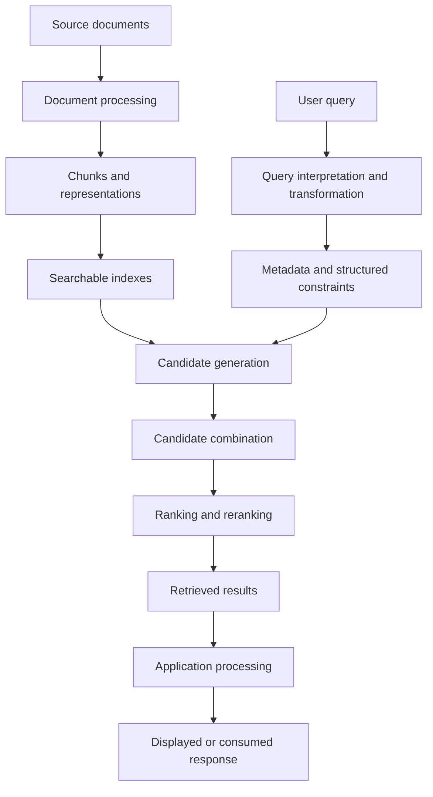
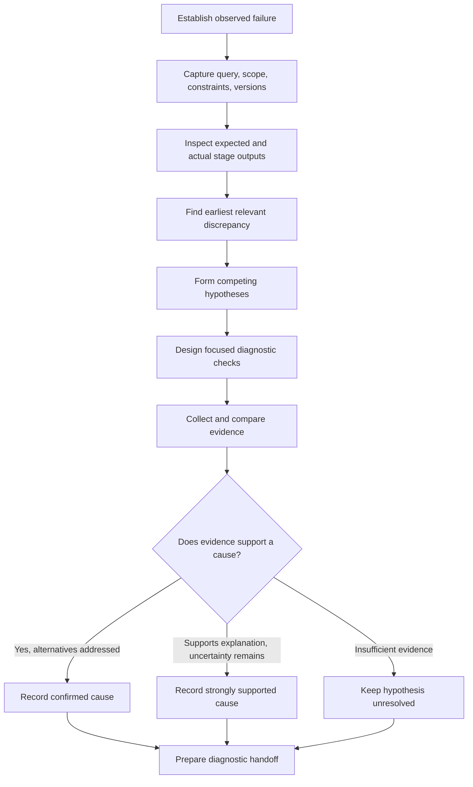

# RET-11.02 — Layered Diagnostics and Root-Cause Analysis

## 1. Purpose and Scope

Classifying a retrieval failure identifies where an investigation may need to begin. It does not establish why the failure occurred.

A retrieval system is a sequence of dependent transformations. Documents are ingested and processed, representations are created, queries are interpreted, candidates are generated, constraints are applied, and results are ranked. An incorrect result at the end of this process may originate much earlier than the stage where it becomes visible.

This file establishes a systematic method for tracing retrieval failures across those stages and determining which explanations are supported by evidence.

The central engineering principle is:

> A root cause is not the component that appears suspicious. It is the explanation that survives focused investigation and is supported by evidence connecting it to the observed failure.

This file covers:

- Establishing and reproducing the observed failure.
- Investigating retrieval behavior layer by layer.
- Inspecting corpus, document-processing, chunking, query, filter, candidate, scoring, and reranking evidence.
- Separating retrieval failures from downstream application behavior.
- Forming and comparing competing hypotheses.
- Designing focused diagnostic checks that confirm or reject hypotheses.
- Distinguishing correlation from causal evidence.
- Recording uncertainty and assigning root-cause confidence.

**Scope boundary:** RET-11.01 owns failure classification and initial triage. This file owns detailed investigation and root-cause analysis. RET-11.03 owns targeted interventions and regression validation. RET-10 remains the authority for evaluation methodology, relevance judgments, metrics, and reproducible benchmarks.

## 2. Learning Objectives

After completing this file, you should be able to:

1. Establish a reproducible retrieval failure with clearly defined conditions.
2. Trace a failure across dependent retrieval stages.
3. Inspect source documents, processed content, chunks, queries, filters, candidates, and ranking evidence.
4. Identify competing explanations instead of accepting the first plausible cause.
5. Design focused diagnostic checks that distinguish between hypotheses.
6. Interpret retrieval scores without treating them as calibrated relevance probabilities.
7. Separate retrieval-stage defects from downstream application behavior.
8. Recognize multiple contributing causes.
9. Record evidence, limitations, and uncertainty.
10. Communicate a defensible root-cause conclusion.

## 3. Prerequisites and Reading Time

**Prerequisites:**

- RET-02: Document ingestion, extraction, normalization, metadata, and corpus quality.
- RET-03: Chunking, document structure, and context preservation.
- RET-04: Retrieval representations and indexing.
- RET-05: Lexical retrieval.
- RET-06: Dense retrieval, embeddings, vector search, and ANN.
- RET-07: Query processing and metadata constraints.
- RET-08: Hybrid retrieval and candidate generation.
- RET-09: Ranking and reranking.
- RET-10: Evaluation methodology, relevance judgments, metrics, and reproducible benchmarks.
- RET-11.01: Retrieval failure taxonomy and triage.

**Estimated reading time:** 30 minutes. Practical investigation, debugging, and experimentation require additional time.

## 4. The Layered Diagnostic Mental Model

A retrieval result is the output of multiple transformations. Diagnosing only the final result is similar to debugging a software application by inspecting its final response while ignoring the internal operations that produced it.

A useful diagnostic model is:



The diagram represents logical responsibilities rather than a mandatory execution order. Depending on the retrieval architecture, metadata constraints may be applied before candidate generation, during search execution, or after an initial candidate set is produced. Establish the actual execution path from the system implementation before drawing conclusions.

### 4.1 Why layered investigation matters

Consider a user asking:

> "What is the employee reimbursement limit for international travel?"

The application returns an outdated reimbursement policy.

Several explanations are possible:

- The current policy was never ingested.
- Extraction omitted the updated reimbursement section.
- The current policy was indexed under unexpected metadata.
- The query was transformed incorrectly.
- A filter excluded the current policy.
- Candidate generation did not retrieve the relevant document.
- The current document was retrieved but ranked below an older version.
- The retrieval result was correct, but downstream application logic selected or displayed an older document.

All these explanations can produce a similar final symptom. Investigating the wrong layer can waste engineering time and lead to ineffective changes.

The diagnostic task is therefore to identify the earliest point at which actual system behavior diverges from expected behavior.

### 4.2 Expected versus actual pipeline behavior

For each relevant stage, define:

- **Expected input:** What should enter the stage?
- **Actual input:** What did the system receive?
- **Expected output:** What should the stage produce?
- **Actual output:** What did it produce?
- **Evidence:** Which record, trace, artifact, or measurement supports the comparison?

A stage-level discrepancy narrows the investigation. It does not automatically prove the underlying cause.

For example, if a relevant document is absent from the candidate set, that establishes a candidate-generation outcome. It does not yet establish whether the cause is missing indexing, query transformation, filtering, retrieval configuration, or candidate-combination behavior.

## 5. Establish the Observed Failure

Before investigating individual components, establish exactly what failed.

A vague report such as "search is returning bad results" is insufficient for a reliable investigation. It lacks the query, expected behavior, actual behavior, scope, and reproduction conditions.

### 5.1 Capture the reproduction conditions

Record the following where available:

| Evidence | What to capture | Why it matters |
|---|---|---|
| Query | Original user query | Establishes the input |
| Query transformation | Rewritten or normalized query | Reveals changes before retrieval |
| Corpus scope | Tenant, collection, namespace, or document scope | Prevents comparisons across different search spaces |
| Constraints | Filters and structured conditions | Reveals eligibility restrictions |
| Configuration | Retriever, model, index, and relevant settings | Makes behavior interpretable |
| Candidate output | Results from individual retrievers and combined retrieval | Locates candidate-generation differences |
| Final output | Ranked results actually consumed by the application | Establishes the observed outcome |
| Benchmark reference | Relevant RET-10 query and judgments | Provides an existing evaluation reference |
| Runtime context | Relevant timestamps, versions, and stage measurements | Helps reproduce the same behavior |
| Correlation identifiers | Request ID, trace ID, or equivalent stable identifier | Connects evidence collected across pipeline stages |

Capture sensitive information according to the organization's data-handling policies. Diagnostic evidence should not unnecessarily expose personal, confidential, or regulated data.

### 5.2 Establish a stable comparison

Comparisons are meaningful only when their scope is understood.

For example, comparing candidate sets from two different tenant scopes or index versions may produce a difference that has nothing to do with the retrieval behavior under investigation.

Record relevant identifiers such as:

- Query or benchmark case ID.
- Request or trace ID.
- Tenant or namespace identifier.
- Source-document ID and version.
- Chunk ID, where applicable.
- Index or collection version.
- Retrieval configuration version.
- Model and transformation version, where available.

Avoid using document display text as the primary identity. Text can change, be duplicated, or be truncated. Stable identifiers make it possible to trace the same document and chunk across processing and retrieval stages.

A request or trace identifier is particularly useful when evidence is collected from different components. For example, a query transformation log, dense retrieval trace, reranking output, and application response should be correlatable to the same request. Without that correlation, an engineer may accidentally compare records from different executions.

### 5.3 Reproduction does not require identical output in every system

Some retrieval systems have nondeterministic behavior or depend on changing data, approximate search, concurrent updates, or dynamic configuration.

When exact reproduction is not possible, record:

- Which inputs and configurations were held constant.
- Which environmental conditions could not be controlled.
- How often the behavior occurred.
- Whether the same pattern appeared across repeated executions.
- Whether the evidence supports a deterministic defect or a probabilistic behavior.

Do not describe an intermittent observation as a guaranteed system behavior.

## 6. Investigating the Retrieval Pipeline

Investigate stages in dependency order. The objective is not to inspect every component blindly, but to follow evidence toward the earliest relevant discrepancy.

### 6.1 Corpus and document-processing evidence

Begin by checking whether the expected source document exists and whether its processed representation preserves the information required for retrieval.

Inspect:

1. Source-document identity and version.
2. Ingestion status and processing timestamps.
3. Extraction output.
4. Normalized content.
5. Metadata values.
6. Freshness and version-selection behavior.
7. Expected document presence in the searchable index.

**Example: An outdated policy is retrieved**

Suppose a current policy document exists in the source repository, but retrieval repeatedly returns an older version.

Potential hypotheses include:

| Hypothesis | Evidence to inspect |
|---|---|
| Current version was not ingested | Ingestion records and source-document inventory |
| Extraction failed | Extracted text and processing errors |
| Normalization removed relevant content | Source content compared with normalized output |
| Metadata identifies the wrong version | Version and effective-date metadata |
| Current version is absent from the index | Index inventory and document-level lookup |
| Query or filtering behavior excludes the current version | Transformed query and filter execution evidence |

A useful diagnostic comparison is:

```text
Source document
      |
      v
Extracted content
      |
      v
Normalized content
      |
      v
Chunk records
      |
      v
Index entries
      |
      v
Retrieved candidates
```

Find the earliest point where the expected document or relevant information disappears.

#### Freshness and update-propagation defects

Document freshness is not established merely because a source repository contains the latest version.

A retrieval system may maintain multiple representations of document state:

- Source document.
- Extracted or normalized document.
- Generated chunks.
- Embedding records.
- Searchable index entries.
- Cached retrieval results.

An update must propagate through the relevant processing and indexing stages. A failure or delay in any stage can leave an older representation searchable.

For example:

1. The source policy is updated from version 4 to version 5.
2. Extraction successfully processes version 5.
3. Chunk generation fails for one section.
4. Existing version 4 chunks remain searchable.
5. Retrieval returns version 4 because version 5 is incomplete or unavailable.

Investigate version identifiers, processing timestamps, update status, and deletion or replacement behavior. Determine whether stale records remain active alongside new records, or whether the new version never became searchable.

Also inspect deletion consistency. A document removed from the source system may remain in a searchable index if deletion propagation fails. Conversely, an index cleanup operation may remove an entry before its replacement is successfully published.

Do not assume that the latest source version is the version actually used by retrieval.

#### Index inventory requires comparable units

Suppose an ingestion report shows 500 source documents processed, while an index inventory shows 470 entries.

That difference is not automatically proof that 30 documents are missing. The index may store multiple chunks per document, multiple representations, or entries with a different granularity.

For a valid document-level comparison, assume the example uses one searchable index entry per source document, with matching document identifiers and the same corpus scope. Under those assumptions, 30 expected document-level entries are missing.

In a real system, first normalize the comparison to a common identity and granularity. A source-document count and a chunk-entry count are not directly comparable.

**Diagnostic conclusion:** Missing or outdated results may originate before retrieval begins. Do not tune search parameters to compensate for an ingestion or freshness defect.

### 6.2 Chunk boundaries, granularity, and context loss

A source document can be present and correctly extracted while the information needed to answer a query is poorly represented in its chunks.

Inspect:

- Source-document content around the relevant passage.
- Generated chunk boundaries.
- Chunk size and overlap as configured.
- Whether headings and section context are preserved.
- Whether related statements were separated.
- Chunk metadata and parent-document references.
- Whether the expected chunk was indexed and searchable.

**Example: A reimbursement amount is missing from retrieved context**

A policy contains the statement:

> "For international travel, the standard reimbursement limit is USD 2,500 per trip."

The amount appears in one chunk, while the phrase "international travel" appears in another. A query may retrieve the first chunk without enough context to establish what the amount applies to.

Possible explanations include:

- The chunk boundary separated the condition from the amount.
- The relevant section heading was not preserved.
- The chunk was not indexed.
- Query interpretation did not represent the user's intent.
- Candidate generation did not retrieve the relevant chunk.

Inspect the source document and its actual generated chunks before concluding that the embedding model or retrieval algorithm is responsible.

Detailed chunking design belongs to RET-03. This investigation focuses on identifying whether chunk structure or context loss explains the observed retrieval behavior.

### 6.3 Query interpretation and transformation

The query received by the application may differ from the query used by the retrieval component.

Inspect:

1. Original user input.
2. Normalized query.
3. Rewritten or expanded query, if used.
4. Extracted entities, dates, or intent signals.
5. Language or terminology transformations.
6. Structured conditions derived from the query.
7. Actual query passed to each retriever.

**Example: A specific product query retrieves generic documentation**

Original query:

```text
What is the retention period for archived customer records?
```

Transformed query:

```text
customer record retention
```

The transformation may have removed the important distinction "archived." If the corpus contains separate policies for active and archived records, this loss can change the candidate set.

Compare original and transformed queries. Inspect the retriever inputs rather than assuming that the search component received the user's original wording.

A transformation that appears linguistically reasonable may still remove information that is operationally important.

Detailed query-processing behavior belongs to RET-07.

### 6.4 Metadata filters and structured constraints

A relevant document may exist, be correctly processed, and be searchable, but still be excluded by a constraint.

Inspect:

- The intended filter conditions.
- The actual filter passed to the retrieval system.
- Field names and data types.
- Stored metadata values.
- Null or missing values.
- Tenant, namespace, and collection scope.
- Filter placement and execution behavior.
- Candidate counts before and after applicable constraints, where available.

**Example: Current policies disappear from filtered results**

A query requests the current policy for a particular department. The expected document exists, but the search returns no candidates.

The investigation reveals that the document stores:

```json
{
  "department": "Finance",
  "status": "active"
}
```

The application generates:

```json
{
  "department": "finance",
  "status": "active"
}
```

If the underlying filter comparison is case-sensitive, the department condition may exclude the document.

The mismatch is evidence of a filter-value inconsistency. Confirm it by inspecting the stored value, the actual filter, and the behavior of a focused query under controlled conditions.

Do not assume that an empty result means the corpus contains no relevant documents.

Detailed filter semantics and query-constraint design belong to RET-07.

### 6.5 Candidate generation and candidate coverage

Once the earlier inputs and constraints have been checked, inspect the candidates produced by the retrieval system.

For hybrid retrieval, inspect each retriever independently before inspecting the combined candidate set:

- Lexical retriever output.
- Dense retriever output.
- Combined or fused candidate output.
- Candidate exclusions and deduplication.
- Final candidate depth passed to ranking.

This separates several different problems:

- A relevant item is absent from the lexical output.
- A relevant item is absent from the dense output.
- Both retrievers find it, but combination or deduplication removes it.
- The item is excluded by an applicable constraint.
- The candidate depth is insufficient for the relevant item to reach later stages.

Candidate count alone does not establish candidate coverage.

Coverage requires a reference set of relevant items for the query. Use the existing RET-10 relevance judgments and benchmark scope when available. If the judgments are incomplete, explicitly record that limitation.

For example, a candidate set of 100 documents may contain all known relevant documents, or it may miss most of them. The count does not tell you which situation applies.

**Diagnostic comparison:**

```python
def inspect_candidate_presence(
    relevant_ids: set[str],
    lexical_ids: set[str],
    dense_ids: set[str],
    combined_ids: set[str],
) -> dict[str, set[str]]:
    """Compare relevant-item presence across retrieval stages."""
    return {
        "missing_from_lexical": relevant_ids - lexical_ids,
        "missing_from_dense": relevant_ids - dense_ids,
        "missing_from_combined": relevant_ids - combined_ids,
        "found_by_both_retrievers": relevant_ids & lexical_ids & dense_ids,
    }
```

This is an inspection helper, not a retrieval algorithm or a substitute for RET-10 evaluation. It assumes the IDs refer to the same item granularity and the sets use the same query and corpus scope.

If a relevant item appears in an individual retriever's output but disappears from the combined set, investigate candidate combination, deduplication, constraints, or candidate-depth behavior before changing the retriever itself.

Detailed candidate-generation and hybrid retrieval theory belongs to RET-08.

### 6.6 Similarity scores, lexical scores, and ranking behavior

When relevant candidates are present but the final results are poor, inspect how the system scores and orders those candidates.

Useful evidence includes:

- Candidate identity.
- Retriever or ranking stage that produced the candidate.
- Raw score and score type.
- Rank before and after combination.
- Rank before and after reranking.
- Whether the candidate was retained or removed.
- Relevant benchmark judgments for the query.

#### Score interpretation requires context

Retrieval scores are not universal measures of relevance.

Keep these constraints in mind:

1. Raw scores from different retrieval models or scoring functions are not necessarily directly comparable.
2. Similarity scores must not automatically be interpreted as calibrated relevance probabilities.
3. Score distributions depend on the retrieval method, model, index, and configuration.
4. A higher lexical or similarity score does not independently prove better relevance.
5. Score changes alone do not establish retrieval-quality improvements.
6. Candidate and ranking evidence must be interpreted alongside relevant judgments and system behavior.

For example, a dense retriever may return a score of `0.82` while a lexical retriever returns a score of `14.6`. These values do not establish that one candidate is more relevant than the other. Their scoring functions have different meanings and scales.

Even within the same retriever, a score distribution may change after a model, index, or configuration update. Interpret the scores in the context of the exact system version and compare them with relevant judgments.

Do not invent a universal score threshold during diagnosis.

#### Practical score-distribution inspection

Score inspection should be performed within a defined retrieval method and scoring configuration.

Use the following procedure:

1. Group results by retrieval method and score type.
2. Record the model, index, and retrieval configuration versions.
3. Collect scores for individual queries rather than immediately combining all queries into one distribution.
4. Inspect the score range, median, spread, and distribution shape.
5. Compare relevant and non-relevant candidates using existing RET-10 judgments.
6. Inspect candidate rank positions and score gaps within the same scoring method.
7. Compare affected and unaffected query segments.
8. Record distribution changes without assuming that a score increase means relevance improved.

A small example illustrates why score changes require context.

Suppose the same dense retriever is evaluated on a benchmark query before and after a configuration update:

| Candidate | Relevance judgment | Before: score / rank | After: score / rank |
|---|---|---:|---:|
| Document A | Relevant | 0.82 / 1 | 0.88 / 1 |
| Document B | Non-relevant | 0.78 / 2 | 0.85 / 2 |
| Document C | Relevant | 0.74 / 3 | 0.80 / 3 |
| Document D | Non-relevant | 0.69 / 4 | 0.76 / 4 |

The average score increases after the configuration update. However, the relevant candidates retain the same rank positions, and the ordering of relevant and non-relevant candidates has not changed.

The observed score increase alone does not demonstrate a retrieval-quality improvement. It may reflect a shift in the score distribution rather than better discrimination between relevant and non-relevant candidates.

A useful diagnostic report should therefore distinguish:

- Score-scale changes.
- Candidate-order changes.
- Relevant-candidate rank changes.
- Relevant versus non-relevant score separation.
- Changes isolated to particular query groups.

For a larger benchmark, aggregate score distributions can help reveal broad shifts, but they should not replace query-level inspection. A global distribution can hide a problem affecting only a small but important query segment.

Detailed ranking and scoring behavior belongs to RET-09.

### 6.7 Reranking-stage diagnosis

A reranker receives an existing candidate set and produces a revised ordering or selection. A failure at this stage can make a previously useful candidate less visible.

Inspect:

- Candidates entering the reranker.
- Candidates leaving the reranker.
- Input ordering and identifiers.
- Reranker configuration and version.
- Scores or ranking signals produced by the stage.
- Whether the expected relevant item was retained.
- Latency and resource measurements for the stage.

**Example: A relevant candidate disappears after reranking**

The initial candidate set contains the current policy, but the final results contain only older policies.

Compare the candidate list before and after reranking. If the current policy is present before the stage but absent afterward, the reranking boundary is a strong investigation target.

However, do not immediately conclude that the reranker is defective. Check whether:

- The candidate was already below the configured selection depth.
- The reranker received the expected text and metadata.
- The correct model and configuration were used.
- An application-side transformation changed the candidate.
- The observed output was truncated or filtered after reranking.

This establishes where the candidate disappeared. Additional focused evidence is needed to establish why.

### 6.8 Latency and resource measurements

A retrieval request may be slow even when its results are relevant. Investigate measurements at the stages that contribute to the request's observed latency.

Inspect, where available:

- Request queueing and scheduling delay.
- Query transformation time.
- Metadata-filter execution time.
- Individual retriever latency.
- Candidate-combination time.
- Reranking time.
- Network and storage time.
- Serialization and application post-processing time.
- Resource consumption associated with relevant stages.

Use consistent timing boundaries. For example, do not compare a retriever's internal execution time with an end-to-end request duration and treat the difference as unexplained retriever latency.

Parallel stages also require care: their durations may overlap, so adding every stage duration may overstate the request's critical-path latency.

#### Example: Interpreting a stage-level trace

Consider a request with the following simplified trace:

```text
Request received                 0 ms
Queueing                         8 ms
Query transformation            12 ms
  Lexical retrieval              35 ms  ─┐
  Dense retrieval                92 ms   ├─ Parallel execution
  Filter processing              7 ms  ─┘
Candidate combination            9 ms
Reranking                       110 ms
Serialization and response       14 ms
```

The lexical and dense retrieval stages execute concurrently. Their durations should not be added as if they were sequential operations.

The retrieval portion of the critical path is influenced by the slowest parallel branch, followed by candidate combination and reranking. The trace suggests that dense retrieval and reranking deserve closer inspection for this request.

However, a single trace does not establish that either component is consistently responsible for high latency. Compare multiple requests, relevant query segments, and consistent measurement boundaries before drawing a broader conclusion.

If the end-to-end duration differs from the sum of visible stages, investigate uninstrumented work, overlapping execution, queueing, network activity, or measurement-boundary differences. Do not automatically assign unexplained time to the nearest retrieval component.

Use existing traces, logs, and measurements as diagnostic evidence. Designing a complete observability platform or monitoring architecture is outside RET-11 and belongs to PROD.

### 6.9 Distinguishing retrieval failures from downstream application failures

The final user-visible response may not represent the retrieval output accurately.

A retrieval system can return the correct candidate set while downstream application logic:

- Selects a different document.
- Applies an additional filter.
- Truncates or reorders results.
- Uses stale cached results.
- Maps a candidate ID to the wrong source document.
- Passes incomplete context to a later processing stage.

Compare the output at the retrieval boundary with the output consumed by the next application component.

If the correct candidate is present at the retrieval boundary but absent from the application response, the investigation should move downstream rather than continuing to tune retrieval.

This distinction prevents retrieval components from being changed to compensate for defects they did not cause.

## 7. Forming and Testing Root-Cause Hypotheses

A hypothesis is a testable explanation for an observed failure. It should identify a plausible mechanism and predict evidence that would be expected if the explanation were true.

A weak hypothesis is:

> "The embedding model is bad."

A stronger hypothesis is:

> "The current policy is absent from dense-retrieval candidates because its indexed representation was generated using an older embedding model than the query representation."

The stronger hypothesis identifies:

- The affected stage.
- The suspected mechanism.
- The expected evidence.
- A focused way to investigate it.

### 7.1 Use competing hypotheses

Avoid investigating only the explanation that first comes to mind.

For a relevant document missing from the final result, a hypothesis set might be:

| Hypothesis | Evidence that would support it | Evidence that would weaken it |
|---|---|---|
| Document was not indexed | Expected document absent from index inventory | Document is present and searchable |
| Query transformation removed key intent | Transformed query omits an important term or condition | Original and transformed inputs preserve the relevant intent |
| Filter excludes the document | Actual filter conflicts with stored metadata | Document satisfies the exact executed filter |
| Candidate generation misses it | Document absent from relevant candidate outputs | Document appears in candidate output |
| Ranking demotes it | Candidate exists before ranking but is ordered poorly afterward | Candidate is already absent before ranking |
| Application discards it | Retrieval output contains the document but downstream output does not | The document is absent at the retrieval boundary |

The objective is not to prove every alternative false. It is to investigate the alternatives that could reasonably explain the observation and distinguish among them with available evidence.

### 7.2 Design focused diagnostic checks

A good diagnostic check gathers evidence or isolates a suspected condition without unnecessarily changing system behavior.

Distinguish four activities:

**1. Observational checks**

Inspect existing evidence without changing inputs or system behavior.

Examples:

- Read an existing retrieval trace.
- Inspect stored metadata.
- Compare source content with extracted content.
- Inspect the candidates already produced by each retriever.
- Compare existing pre-ranking and post-ranking outputs.

**2. Comparative checks**

Compare two or more existing artifacts or executions under understood conditions.

Examples:

- Compare original and transformed query text.
- Compare document versions.
- Compare candidate membership across retrievers.
- Compare the same query against two known index versions.
- Compare retrieval output with application-consumed output.

**3. Controlled diagnostic tests**

Isolate a suspected condition in an authorized test environment or controlled diagnostic execution. These tests may use a modified input or configuration, but their purpose is to determine whether a hypothesis explains the observed behavior.

Examples:

- Execute a diagnostic query with and without a suspected filter in a test scope.
- Inspect behavior using a known-good query transformation.
- Compare candidate generation with a controlled candidate-depth setting.
- Reproduce the suspected representation mismatch using isolated test data.

Record the exact test conditions and avoid treating a test-environment result as automatic proof of production behavior.

**4. Engineering interventions**

Change the system to improve its behavior, such as changing a production configuration, modifying query transformation logic, rebuilding an index, or changing chunking behavior.

These are optimization activities and belong to RET-11.03. They should follow a sufficiently supported diagnosis and an explicit engineering decision.

A diagnostic check should state:

- What evidence is being collected.
- Which hypothesis it examines.
- What result would support the hypothesis.
- What result would weaken it.
- What conditions must remain comparable.
- Whether the check is observational, comparative, or a controlled diagnostic test.

Avoid changing multiple components during diagnosis. If the query transformation, filter, and candidate depth all change simultaneously, an improved output cannot reliably identify which change mattered.

### 7.3 Correlation is not causation

Two events occurring together do not establish that one caused the other.

Suppose retrieval quality declines after a new embedding model is deployed. The timing makes the model change a reasonable hypothesis, but other changes may have occurred at the same time:

- A corpus refresh.
- An index rebuild.
- A metadata migration.
- A query-transformation update.
- A change in candidate depth.

A causal conclusion requires evidence connecting the suspected change to the observed failure.

Stronger evidence may include:

- The failure is reproducible under the affected configuration.
- The expected intermediate behavior differs at the relevant stage.
- A focused comparison isolates the suspected mechanism.
- Alternative explanations have been investigated.
- The observed behavior is consistent with the predicted effect.

Where the system does not permit controlled isolation, record the limitation and avoid overstating confidence.

### 7.4 Compare behavior across query segments

A retrieval system may behave correctly for one query category and fail for another. Investigating only a single query can therefore produce an incomplete understanding of the failure.

Use existing RET-10 benchmark queries and their established classifications or judgments where available. Compare behavior across relevant query segments.

Possible segments include:

| Query segment | Example | Diagnostic question |
|---|---|---|
| Exact terminology | "employee reimbursement limit" | Are expected terms preserved and matched? |
| Semantic or paraphrased | "How much can staff claim back?" | Does the retrieval behavior change when terminology differs? |
| Long natural-language question | "What amount can an employee claim for a single international trip?" | Does the query transformation preserve important conditions? |
| Multilingual | Equivalent question in another supported language | Does the failure occur only for a language or transformation path? |
| Structured constraints | "Current policy for the Finance department" | Do metadata constraints behave as expected? |

#### Example: Exact terminology works, paraphrased queries fail

Suppose exact terminology queries retrieve the current policy, but paraphrased queries do not.

Investigate:

1. Whether both queries are processed by the same query-transformation path.
2. Whether important intent and entities are preserved.
3. Whether the resulting retriever inputs differ as expected.
4. Whether the relevant document appears in lexical and dense outputs.
5. Whether the candidate combination behaves differently.
6. Whether ranking evidence explains the difference.

If the paraphrased query loses the concept "international travel" during transformation, that is a concrete observation that supports a query-processing hypothesis.

If the transformed query preserves the intent but the document is missing only from dense candidates, the investigation should move toward dense-retrieval evidence instead.

Do not conclude that the entire retrieval system is defective merely because one query segment fails. Equally, do not assume that successful exact-term queries establish that the system works for all query types.

Segment comparison is a diagnostic technique here. Formal benchmark segmentation, metric selection, and evaluation methodology remain owned by RET-10.

## 8. Multiple Contributing Causes

A retrieval failure does not always have one independent root cause.

For example:

1. A document-processing defect removes a section heading.
2. The resulting chunks lose important context.
3. Candidate generation retrieves a related but incomplete chunk.
4. Reranking places a different document above it.

The user sees one incorrect answer, but several stages contribute to the outcome.

Distinguish:

- **Primary cause:** The defect that most directly explains the failure being investigated.
- **Contributing cause:** Another defect or condition that makes the failure more likely or severe.
- **Downstream manifestation:** Where the problem becomes visible.
- **Independent cause:** A separate defect that can produce a similar symptom.

### 8.1 Example: Two independently supported contributing causes

**Observed symptom**

A policy query retrieves an incomplete passage that does not contain the eligibility condition associated with a reimbursement amount.

**Evidence**

- The source document contains the eligibility condition and reimbursement amount.
- The extraction output contains both statements.
- The generated chunks place the amount in one chunk and the eligibility condition in another.
- The relevant condition chunk is not present in the candidate output.
- The amount-only chunk is retrieved and appears relevant based on its isolated text.

**Competing explanations**

1. Extraction removed the eligibility condition.
2. Chunk generation separated the condition from the amount.
3. Candidate generation failed to retrieve the condition chunk.
4. Ranking demoted the condition chunk.

**Diagnostic results**

- Extraction comparison shows that both statements were preserved. This weakens the extraction hypothesis.
- Chunk inspection confirms that the statements were separated. This supports a context-preservation defect.
- Index inspection confirms that the condition chunk exists and is searchable.
- Candidate inspection shows that the condition chunk is absent from the candidate output. This establishes an additional retrieval-stage failure, although the precise candidate-generation mechanism remains unresolved.
- Ranking inspection shows that the condition chunk never entered the ranking stage.

**Conclusion**

Two contributing problems are supported:

- The chunk representation separates information that needs to be interpreted together.
- Candidate generation does not retrieve the condition-bearing chunk for the investigated query.

The evidence does not yet establish why candidate generation misses that chunk. The context-preservation problem is strongly supported, while the candidate-generation mechanism remains unresolved.

This example demonstrates why one visible failure can have multiple contributing causes with different confidence levels. Record each conclusion separately rather than assigning one confidence label to the entire investigation.

## 9. Root-Cause Confidence and Diagnostic Evidence

A diagnostic report must communicate not only the suspected cause but also the strength of the evidence.

Use three confidence categories.

| Confidence | Meaning | Appropriate language |
|---|---|---|
| **Confirmed cause** | Strong evidence and appropriate verification support the causal conclusion | "The investigation confirmed that..." |
| **Strongly supported cause** | Evidence supports the explanation, but uncertainty or an alternative explanation remains | "The evidence strongly supports..." |
| **Unresolved hypothesis** | Available evidence is insufficient to establish the cause | "One plausible explanation is..." |

These categories describe the strength of the diagnostic conclusion. They are not statistical probabilities and should not be represented as percentages unless a separate, justified statistical method is being used.

### 9.1 What supports a confirmed cause?

A confirmed cause generally requires:

- A clearly established observed failure.
- Evidence at the relevant pipeline boundary.
- A plausible mechanism connecting the defect to the failure.
- A focused diagnostic check with an appropriate result.
- Consideration of credible alternative explanations.
- Enough reproducibility or traceability to support the conclusion.

Confirmation is scoped to the investigated failure, system version, query, corpus scope, and reproduction conditions. It does not prove that the same defect is present in every tenant, query category, index version, or execution path.

Not every production investigation can meet every condition. When evidence is incomplete, lower the confidence category rather than filling gaps with assumptions.

### 9.2 Maintain an evidence record

A useful diagnostic record separates observations from interpretations.

```yaml
investigation_id: RET-DIAG-042
request_id: req-8f2a
trace_id: trace-91c4
query_id: benchmark-query-018

scope:
  tenant: tenant-test
  index_version: policy-index-v7
  retrieval_config: hybrid-config-v3

observed_symptom:
  description: Current policy is absent from final results

confirmed_observations:
  - Current source document exists
  - Current document is present in the searchable index
  - Current document is absent from dense candidates
  - Current document is present in lexical candidates

hypotheses:
  - id: H1
    description: Dense retrieval representation is incompatible
    status: unresolved
  - id: H2
    description: Query transformation removes relevant intent
    status: under_investigation

diagnostic_checks:
  - Compare indexed and query representation versions
  - Inspect original and transformed query inputs

conclusion:
  confidence: unresolved_hypothesis
  explanation: More evidence is required

remaining_uncertainty:
  - Representation compatibility has not been verified

next_action:
  description: Inspect representation and query transformation evidence
```

The example is an investigation record, not a production logging schema. Use identifiers and field names appropriate to the system. Do not include secrets or unnecessary personal data.

Keep these distinctions explicit:

- **Observation:** Directly visible evidence.
- **Hypothesis:** An explanation that could account for the observation.
- **Diagnostic check:** An action designed to distinguish explanations.
- **Result:** What the check actually showed.
- **Conclusion:** The explanation supported by the combined evidence.
- **Uncertainty:** What remains unknown.

## 10. Practical Diagnostic Case Studies

### Case Study A — Relevant policy is absent from final results

**Observed symptom**

A user asks for the current international travel reimbursement policy. The expected policy is not present in the final retrieved results.

**Scope and reproduction conditions**

- Same benchmark query and tenant scope.
- Same index version and retrieval configuration.
- Same metadata constraints.
- Repeated query executions show the same missing document.
- The expected policy has a stable source-document ID.

**Reference relevance evidence**

The existing RET-10 benchmark judgment identifies the current policy document as relevant for this query. The investigation uses that established judgment as the reference rather than assuming relevance merely because the document contains similar words.

The judgment supports the expected-document comparison. It does not by itself explain why retrieval failed.

**Initial hypotheses**

1. The policy is absent from the searchable index.
2. The query transformation removes the international-travel condition.
3. A metadata constraint excludes the policy.
4. Candidate generation misses the policy.
5. The policy is retrieved but removed downstream.

**Evidence collected**

- The source document exists.
- Extracted and normalized content contain the relevant reimbursement section.
- The expected chunks are present in the index.
- The actual query transformation preserves the important intent.
- The document satisfies the executed metadata constraints.
- The document appears in lexical candidates but not dense candidates.
- The combined candidate set does not contain it.

**Diagnostic checks and results**

| Check | Result | Diagnostic interpretation |
|---|---|---|
| Source and processed-document inspection | Relevant content is preserved | Weakens ingestion and extraction hypotheses |
| Index lookup by stable document and chunk IDs | Expected entries exist | Weakens missing-index hypothesis |
| Original versus transformed query comparison | Important intent is preserved | Weakens the query-transformation hypothesis |
| Stored metadata versus executed filter | Document satisfies the constraints | Weakens the filter-exclusion hypothesis |
| Lexical and dense candidate comparison | Present in lexical, absent from dense | Localizes the observed discrepancy to dense candidate output |
| Combined candidate inspection | Document remains absent | Confirms that the combined output does not recover it |
| Retrieval output versus application input | No document to pass downstream | Weakens the downstream-discard hypothesis |

**Competing hypotheses remaining**

- Dense representation incompatibility.
- Dense retrieval configuration or search behavior.
- Another dense-retrieval-specific condition not yet isolated.

**Conclusion and confidence**

**Unresolved hypothesis**

The observed failure is localized to dense candidate generation for the investigated query: the benchmark-relevant document is absent from dense output but present in lexical output.

The exact mechanism responsible for its absence has not been established. Representation incompatibility is one plausible hypothesis, not a confirmed root cause.

**Remaining uncertainty**

- Representation compatibility has not been verified.
- Other dense-retrieval configuration effects have not been excluded.
- The investigation does not establish whether the same behavior occurs across other query segments.

**Recommended next engineering action**

Continue the focused dense-retrieval investigation and collect the missing representation and configuration evidence. Do not change the reranker: the expected document is absent before ranking.

### Case Study B — Correct candidate is lost after retrieval

**Observed symptom**

The application displays an older policy even though the current policy is expected to be retrieved.

**Scope and reproduction conditions**

- Same query and tenant.
- Same index and retrieval configuration.
- Same application version.
- Retrieval output and application-consumed output are both captured.
- Request and trace identifiers correlate the records.

**Competing hypotheses**

1. Candidate generation does not retrieve the current policy.
2. Ranking removes or demotes the current policy.
3. Application post-processing selects an older policy.
4. A cache returns a stale result.

**Evidence collected**

- The current policy appears in the final retrieval output.
- The application input contains the current policy.
- The application response contains the older policy.
- The relevant application mapping selects a document using an outdated version field.

**Diagnostic check**

Trace the stable document identifier and version from retrieval output through application processing. Compare the selected ID with the ID in the final response.

**Conclusion and confidence**

**Confirmed cause**

The application selects an older document version after retrieval. The retrieval pipeline produced the expected candidate; the observed failure occurs downstream.

This conclusion is confirmed for the investigated request and application execution path. It does not establish that every application path uses the same incorrect mapping.

**Remaining uncertainty**

The investigation confirms the immediate selection defect. It does not establish whether other application paths contain the same defect.

**Recommended next engineering action**

Record the downstream defect and pass the evidence to the responsible application workflow. Retrieval tuning is not justified by this diagnosis.

## 11. Diagnostic Workflow Summary

Use this workflow when investigating a failure that has already been classified in RET-11.01.



The investigation should produce a defensible conclusion, not necessarily a confirmed cause. An unresolved hypothesis with clear evidence gaps is more useful than an unsupported declaration.

## 12. Diagnostic Trade-offs and Limitations

| Diagnostic approach | Benefit | Limitation |
|---|---|---|
| Query-by-query inspection | Makes individual failures understandable | Does not establish aggregate behavior |
| Stage-level output comparison | Helps locate where behavior diverges | Requires accessible intermediate outputs |
| Candidate-set comparison | Identifies candidate presence and exclusion patterns | Requires comparable identifiers and relevant judgments for coverage claims |
| Score-distribution inspection | Reveals ranking and scoring behavior | Scores are method- and configuration-dependent |
| Filter verification | Identifies unexpected exclusions | Filter placement and execution can vary |
| Stage-level latency analysis | Narrows performance investigation | Measurements can be incomplete or use inconsistent boundaries |
| Repeated reproduction | Helps distinguish stable from intermittent behavior | Some systems are nondeterministic or data-dependent |
| Query-segment comparison | Reveals failures isolated to specific query categories | Segment definitions and sample sizes affect interpretation |

A diagnostic method is only as reliable as the evidence it can observe. Missing traces, incomplete relevance judgments, inconsistent identifiers, or changing data can limit the strength of a conclusion.

State these limitations in the diagnostic report.

## 13. Common Diagnostic Mistakes

1. **Starting with the most visible component:** The final ranking may expose a problem that originated during ingestion or query transformation.
2. **Treating absence as proof of nonexistence:** A document may exist but be excluded by scope, metadata, indexing, or candidate-generation behavior.
3. **Inspecting only combined candidates:** Hybrid retrieval requires checking individual retriever outputs and the combined result.
4. **Treating candidate count as coverage:** Coverage requires a relevant reference set and comparable scope.
5. **Comparing unrelated scores:** Different scoring functions do not share a universal scale.
6. **Calling a score a probability:** Similarity scores are not automatically calibrated relevance probabilities.
7. **Assuming correlation proves causality:** A deployment and a quality decline occurring together do not establish the deployment as the cause.
8. **Changing several components during diagnosis:** Multiple simultaneous changes make causal attribution difficult.
9. **Ignoring downstream behavior:** The application may alter correct retrieval output.
10. **Forcing a confirmed conclusion:** Incomplete evidence should result in an unresolved or strongly supported conclusion.
11. **Ignoring multiple causes:** Several defects can contribute to one visible failure.
12. **Treating diagnostic traces as complete truth:** Logs and traces may be sampled, incomplete, delayed, or collected at inconsistent boundaries.
13. **Treating score increases as relevance improvements:** A distribution shift can increase raw scores without improving candidate ordering or relevance.
14. **Generalizing from one query:** A single query may not represent behavior across different query segments.

## 14. Interview Preparation

### Q1. Why should retrieval diagnosis follow pipeline stages?

**Model answer:**

Retrieval output is produced through dependent transformations. A defect in document processing, query transformation, or filtering can appear as a ranking problem at the end of the pipeline. Stage-by-stage investigation helps identify the earliest relevant discrepancy and prevents engineers from changing downstream components to compensate for upstream defects.

### Q2. How would you investigate a relevant document missing from the final results?

**Model answer:**

First establish the query, corpus scope, constraints, versions, and expected document identity. Verify the source document, processed content, chunks, and index presence. Inspect the actual transformed query and executed filters. Compare individual retriever outputs, combined candidates, and ranking output. Finally, compare retrieval output with downstream application input. The earliest stage where expected behavior diverges becomes the focus for competing hypotheses and targeted checks.

### Q3. Why is candidate count insufficient to establish candidate coverage?

**Model answer:**

Candidate count describes the size of a candidate set, not whether it contains the relevant items. Coverage requires a reference set of relevant items, usually based on the existing benchmark judgments. The query, corpus scope, identity granularity, and judgment completeness must be comparable.

### Q4. Why should raw scores from lexical and dense retrieval not be directly compared?

**Model answer:**

The scoring functions have different semantics and scales. A lexical score and a dense similarity score do not represent the same quantity. Neither should automatically be interpreted as a calibrated probability of relevance. Scores must be interpreted within their own retrieval method, model, index, and configuration, alongside relevance judgments and observed ranking behavior.

### Q5. What is the difference between a confirmed cause and a strongly supported cause?

**Model answer:**

A confirmed cause has strong evidence and appropriate verification supporting the causal conclusion. A strongly supported cause has meaningful supporting evidence, but some uncertainty or credible alternative explanation remains. The confidence label should reflect the evidence, not the engineer's preference for a definitive answer. Confirmation is also scoped to the investigated conditions and does not prove that the defect exists across every system execution path.

### Q6. How would you distinguish a retrieval defect from a downstream application defect?

**Model answer:**

Compare stable candidate identifiers at the retrieval output boundary with the identifiers consumed by the application and those included in the final response. If the correct candidate is already missing at the retrieval boundary, investigate retrieval stages. If it is present but discarded, reordered, or replaced downstream, investigate application processing.

### Q7. What makes a diagnostic check useful?

**Model answer:**

A useful check is focused on distinguishing plausible hypotheses. It identifies the evidence to inspect, the expected result if a hypothesis is true, and the result that would weaken it. A diagnostic check may be observational, comparative, or a controlled test in an authorized environment. It should not be confused with an engineering intervention that changes production behavior.

### Q8. Can one retrieval failure have multiple root causes?

**Model answer:**

Yes. A document-processing defect may remove context, candidate generation may retrieve incomplete evidence, and ranking may further reduce its visibility. The investigation should distinguish primary and contributing causes and record the evidence supporting each relationship rather than forcing a single-cause explanation.

### Q9. How would you diagnose a score-distribution change after a retrieval configuration update?

**Model answer:**

First group scores by retrieval method and scoring function, keeping model, index, and configuration versions identifiable. Inspect query-level distributions and compare relevant and non-relevant candidates using existing judgments. Examine rank positions and score gaps within the same scoring method. Then compare affected and unaffected query segments. A higher average score alone does not establish improved relevance, particularly if candidate ordering and relevant-candidate ranks remain unchanged.

### Q10. Why should exact-term and paraphrased queries be investigated separately?

**Model answer:**

They can exercise different retrieval behaviors. Exact terminology may be matched successfully while paraphrased queries fail because of query transformation, representation, or candidate-generation behavior. Comparing their actual inputs and stage outputs helps identify whether the problem is segment-specific and which stage explains the difference.

## 15. Self-Assessment

Answer each question in your own words before reading the expected answer.

### Question 1

A relevant source document exists, but it does not appear in the final retrieval output. What evidence should you collect before changing the retriever?

**Expected answer:**

Establish the query, scope, constraints, and configuration. Verify source-document ingestion, extraction, normalization, chunk creation, and index presence. Inspect the transformed query and executed filters. Compare individual retriever outputs, combined candidates, ranking output, and downstream application input. Identify the earliest stage where expected behavior diverges.

### Question 2

A dense retriever returns a score of `0.91` and a lexical retriever returns `18.4`. Can you conclude that the dense result is more relevant?

**Expected answer:**

No. The scoring functions have different semantics and scales. The values cannot be compared directly without a justified common calibration or evaluation approach. Inspect the candidates against the relevant RET-10 judgments and their behavior within each retrieval method.

### Question 3

A document appears in the lexical candidate set but not in the combined hybrid candidate set. What should you investigate?

**Expected answer:**

Inspect candidate-combination behavior, deduplication, constraints, candidate depth, and the actual identifiers passed between stages. Confirm that the document was not excluded by an upstream or post-retrieval constraint. Do not immediately change the lexical retriever because it already produced the candidate.

### Question 4

A quality decline begins immediately after an index rebuild. Is the index rebuild confirmed as the cause?

**Expected answer:**

No. The timing makes the rebuild a plausible hypothesis, but correlation is not causal evidence. Compare index versions, document inventories, representations, configuration, query inputs, and relevant stage outputs. Investigate other changes that occurred during the same period and design focused checks to isolate the suspected mechanism.

### Question 5

The retrieval output contains the correct policy, but the application displays an older policy. Which component should you investigate first?

**Expected answer:**

The downstream application path between retrieval output and the final response. Trace stable document identifiers and version metadata through selection, filtering, caching, mapping, and response construction. Do not tune retrieval unless evidence shows a retrieval-stage defect.

### Question 6

You have evidence that strongly suggests a metadata mismatch, but you cannot reproduce the filter behavior in the current environment. How should you report the conclusion?

**Expected answer:**

Use **strongly supported cause** or **unresolved hypothesis**, depending on the available evidence. Separate confirmed observations from assumptions, state the missing reproduction evidence, and explain what focused check is still needed. Do not label the cause confirmed.

### Question 7

A relevant chunk is retrieved, but it does not contain the condition that gives the retrieved value its meaning. What should you inspect?

**Expected answer:**

Inspect the source document, chunk boundaries, heading preservation, parent-document relationship, and neighboring chunks. Determine whether the condition was separated or lost during processing. Also verify whether the relevant contextual chunk was indexed and retrieved. The investigation should distinguish a chunk/context defect from a query or candidate-generation defect.

### Question 8

What should a diagnostic report contain when several causes contribute to one failure?

**Expected answer:**

It should contain the observed symptom and reproduction scope, confirmed observations, each hypothesis, evidence and diagnostic checks, results, primary and contributing causes, confidence for each conclusion, remaining uncertainty, and the next engineering action. Causal relationships should be stated only when supported by evidence.

### Question 9

After a configuration update, average dense-retrieval scores increase, but relevant candidates retain the same rank positions. What can you conclude?

**Expected answer:**

The score distribution has shifted, but the evidence does not establish improved relevance or ranking. Inspect relevant and non-relevant score distributions, rank positions, score gaps within the same scoring method, and RET-10 judgments. The score increase alone is insufficient to claim an improvement.

### Question 10

Exact terminology queries work, but paraphrased queries fail. What should you investigate?

**Expected answer:**

Compare original and transformed queries, identify whether important intent is preserved, inspect lexical and dense outputs separately, compare combined candidates, and examine ranking behavior. Determine whether the discrepancy is isolated to query transformation or another retrieval stage. Do not generalize from one query category to the entire system.

## 16. Quick Revision

- A final retrieval symptom does not identify its root cause.
- Establish the query, scope, constraints, versions, and expected behavior before investigating.
- Compare expected and actual inputs and outputs at relevant pipeline boundaries.
- Investigate corpus, processing, chunks, query transformations, filters, candidates, scores, ranking, and downstream behavior as evidence requires.
- Check freshness across source, processed content, chunks, and index records.
- Inspect individual retriever outputs as well as combined candidates in hybrid systems.
- Candidate count is not candidate coverage.
- Coverage claims require relevant judgments and comparable query and corpus scope.
- Raw scores from different retrieval methods are not necessarily comparable.
- Similarity scores are not automatically calibrated relevance probabilities.
- Inspect score distributions within the same method and configuration.
- A score increase alone does not establish a relevance improvement.
- Compare behavior across relevant query segments.
- Correlation does not establish causation.
- Use observational, comparative, and controlled diagnostic checks to distinguish competing hypotheses.
- Keep diagnostic checks separate from engineering interventions.
- Record observations separately from hypotheses and conclusions.
- Support multiple contributing causes when the evidence warrants them.
- Use confirmed, strongly supported, or unresolved confidence categories.
- Scope confirmed conclusions to the conditions actually investigated.
- Do not force certainty when evidence is incomplete.

## 17. Key Takeaways

Layered diagnostics turns retrieval troubleshooting from guesswork into evidence-based engineering.

The most important habit is to follow the data through the system. Establish what the system received, what each relevant stage produced, and where the observed behavior first diverged from expectations.

A defensible root-cause conclusion requires more than a plausible explanation. It requires evidence, focused checks, consideration of alternatives, and explicit uncertainty.

The output of this file is a diagnostic conclusion and evidence record. It is not yet an optimization decision. The next file, RET-11.03, uses these findings to select targeted interventions and validate their effects.

## 18. Further Reading and Curriculum References

**Related RET chapters:**

- RET-02 — Document ingestion, extraction, normalization, metadata, and corpus quality.
- RET-03 — Chunking, document structure, and context preservation.
- RET-04 — Retrieval representations and indexing.
- RET-05 — Lexical retrieval and sparse search.
- RET-06 — Dense retrieval, embeddings, vector search, and ANN.
- RET-07 — Query processing and metadata constraints.
- RET-08 — Hybrid retrieval and candidate generation.
- RET-09 — Ranking, reranking, relevance ordering, and top-K decisions.
- RET-10 — Evaluation methodology, relevance judgments, metrics, and reproducible benchmarks.
- RET-11.01 — Retrieval Failure Taxonomy and Triage.
- RET-11.03 — Targeted Optimization and Regression Validation.

Use the repository's approved chapter paths when linking these references. This document intentionally does not assume unverified relative paths.
