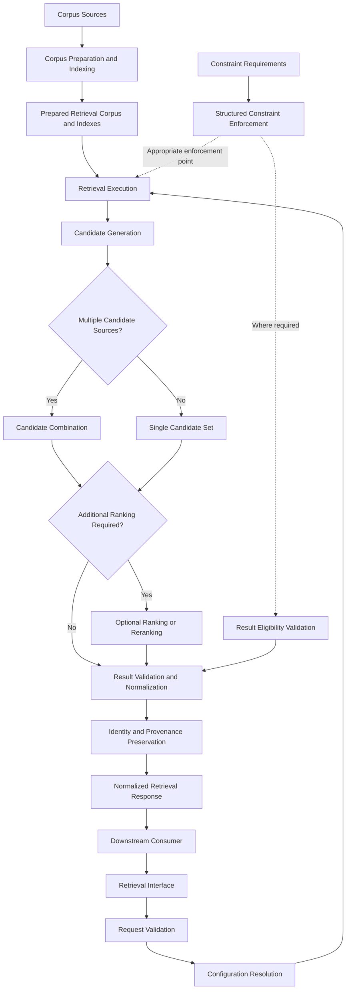

# RET-12.01 — End-to-End Retrieval Architecture and Acceptance Criteria

## 1. Purpose and Scope

A reusable retrieval system should be designed as an independent capability with clearly defined responsibilities, stable interfaces, and measurable acceptance criteria.

This file establishes the architecture that the remaining RET-12 files will implement and validate.

It focuses on:

- Why retrieval should be independent of downstream applications.
- Retrieval-system boundaries and component responsibilities.
- End-to-end information flow.
- Consumer-independent request and response contracts.
- Configuration and structured-constraint responsibilities.
- Identity, provenance, and traceability.
- Predictable error and partial-result behavior.
- Measurable architecture acceptance criteria.
- Architectural assumptions, constraints, and trade-offs.

The objective is not to prescribe one universal retrieval architecture. Different workloads may require different retrieval stages. The architecture must make those choices explicit and keep unnecessary complexity out of the system.

**Out of scope:** Re-teaching lexical retrieval, dense retrieval, hybrid retrieval, filtering algorithms, ranking algorithms, formal evaluation methodology, or detailed retrieval diagnostics. Those topics belong to RET-05 through RET-11. RET-12 integrates and applies them.

---

## 2. Why Retrieval Should Be an Independent Capability

Retrieval is frequently implemented as part of a specific application. For example, a RAG application may directly call a vector database, apply filters, rank results, and pass retrieved text to an LLM.

This approach can work for a small prototype. However, it creates tight coupling between retrieval behavior and application-specific requirements.

Consider an organization that needs to support:

- A RAG assistant that retrieves evidence before generation.
- A semantic search interface that displays matching documents.
- An internal knowledge lookup API.
- A research application that retrieves documents for human review.

If each application implements its own retrieval logic, the organization may end up maintaining multiple versions of query processing, filtering, retrieval execution, ranking, and provenance handling.

That creates inconsistent behavior and duplicated engineering effort.

### 2.1 Retrieval capability versus downstream application

These are separate responsibilities.

| Retrieval capability | Downstream application |
|---|---|
| Accepts retrieval requests | Defines application-specific user behavior |
| Executes configured retrieval stages | Decides how retrieved results are presented or consumed |
| Applies supported structured constraints | Supplies business context and application requirements |
| Produces normalized results | Decides whether results are displayed, summarized, or passed to another component |
| Preserves identity and provenance | Uses evidence according to application needs |
| Reports retrieval status and diagnostics | Handles application-level outcomes |

The retrieval capability should not need to know whether a consumer is an LLM, a search interface, or an analytics service.

A downstream application may influence retrieval through an explicit request or configuration. That does not mean application-specific orchestration belongs inside the retrieval implementation.

### 2.2 Architectural principle

The core design principle is:

> Retrieval owns finding, ordering where applicable, and returning relevant evidence. The downstream consumer owns what it does with that evidence.

This separation enables multiple consumers to reuse the same retrieval capability without duplicating retrieval logic.

It also improves testability. Retrieval behavior can be evaluated independently of generation or presentation behavior.

---

## 3. Retrieval System Boundary and Responsibilities

### 3.1 Distinguish the overall retrieval solution from the online capability

The **overall retrieval solution architecture** includes both the supporting corpus preparation and indexing capabilities and the online retrieval capability that consumes the prepared corpus.

These are related architectural responsibilities, but they do not have to share the same execution boundary, deployment unit, or lifecycle.

The distinction is important:

**Supporting corpus preparation and indexing capabilities**

These operate on source data and prepare the retrieval corpus. Their responsibilities may include:

- Source document ingestion and extraction.
- Content normalization and document structuring.
- Metadata preparation.
- Retrieval representation generation.
- Index creation and updates.
- Index readiness and consistency validation.

The detailed ownership of ingestion, document processing, chunking, representations, and indexing remains with RET-02 through RET-04. RET-12 treats these as upstream dependencies and defines how the online retrieval capability depends on their outputs.

**Online retrieval capability**

The online retrieval capability begins when its retrieval interface receives a submitted request and ends when it returns a normalized retrieval response or a defined failure outcome.

Request validation is the first responsibility performed inside this capability. The interface validates the incoming request before execution proceeds to retrieval stages.

Its responsibilities include:

- Request validation.
- Retrieval configuration resolution.
- Execution of the selected retrieval stages.
- Structured-constraint enforcement.
- Candidate generation and combination where appropriate.
- Ranking or reranking where appropriate.
- Result normalization.
- Identity and provenance preservation.
- Execution status and relevant diagnostics.

The boundary excludes application-specific presentation, generation, business workflows, and downstream decision-making.

This separation prevents the online retrieval interface from becoming responsible for the entire corpus lifecycle while still making its upstream dependencies explicit.

### 3.2 Major architectural responsibilities

The following table describes responsibilities in the overall retrieval solution. It distinguishes upstream corpus capabilities from the online retrieval capability.

| Responsibility | Architectural ownership | Purpose |
|---|---|---|
| Corpus preparation and indexing | Supporting upstream capabilities | Makes prepared source content available to retrieval components |
| Query handling | Online retrieval capability | Receives, validates, and prepares the submitted request |
| Retrieval execution | Online retrieval capability | Invokes configured retrieval sources |
| Structured constraints | Online retrieval capability | Ensures supported constraints are enforced according to their defined semantics |
| Candidate generation | Online retrieval capability | Produces candidate results from one or more retrieval sources |
| Candidate combination | Online retrieval capability, when needed | Combines candidate sets when multiple sources are used |
| Ranking or reranking | Online retrieval capability, when needed | Orders or refines candidates when required by the workload |
| Result normalization | Online retrieval capability | Produces a consistent response representation |
| Evidence and provenance preservation | Online retrieval capability | Retains source identity and traceability |
| Downstream interface | Online retrieval capability | Exposes normalized results independently of consumer implementation |

These are logical responsibilities, not mandatory classes, services, or deployment units. A small implementation may combine several responsibilities in one module. A larger implementation may separate them.

The architecture should preserve clear ownership even when responsibilities share an implementation boundary.

### 3.3 Architecture boundary diagram



The diagram represents logical responsibilities rather than a mandatory execution topology.

Important qualifications:

- Corpus preparation and indexing are upstream supporting capabilities. They do not have to execute as part of an online retrieval request.
- The online retrieval capability consumes the prepared corpus and indexes.
- Multiple candidate sources are optional.
- Candidate combination is required only when the selected design generates multiple candidate sets that need to be combined.
- Structured constraints are an explicit retrieval responsibility. Their enforcement point depends on constraint semantics and retrieval-source capabilities.
- A constraint may need to be enforced within a source query, at a trusted retrieval boundary, or through an additional eligibility-validation step. The diagram intentionally does not prescribe one universal execution location.
- Mandatory security constraints must be enforced before potentially unauthorized evidence can be returned to a consumer.
- A retrieval source may already return ordered results. A separate ranking component is not automatically required.
- Additional ranking or reranking is conditional on workload requirements.
- If no additional ranking stage is needed, results proceed directly to validation and normalization.

---

## 4. End-to-End Data Flow

A reusable retrieval architecture must define how information moves through the system, from source preparation to downstream response.

### 4.1 Offline corpus preparation

The retrieval system depends on prepared and indexed source data.

A typical upstream flow is:

1. Source documents are collected.
2. Content is extracted and normalized.
3. Documents are represented using the selected document structure and retrieval representations.
4. Required metadata and stable identifiers are preserved.
5. Retrieval indexes are created or updated.
6. Index readiness and consistency are validated.

The exact preparation steps depend on the corpus and selected retrieval technologies.

RET-02 through RET-06 own the detailed teaching of ingestion, chunking, representations, and indexing. RET-12 assumes those capabilities exist and focuses on how the online retrieval capability consumes their outputs.

The architecture should define the dependency between corpus readiness and retrieval availability. For example, the online capability should not claim that a newly ingested document is retrievable until the relevant index update has completed successfully.

This is an integration dependency, not a requirement to implement corpus ingestion inside the online retrieval request path.

### 4.2 Online retrieval flow

A typical request follows this logical sequence:

1. A downstream consumer submits a retrieval request.
2. The retrieval interface validates the request.
3. The system resolves the requested or default retrieval configuration.
4. Structured constraints are interpreted and enforced at appropriate execution boundaries.
5. Configured retrieval sources execute.
6. Candidate results are generated.
7. Candidate sets are combined when multiple sources are used.
8. Additional ranking or reranking is performed when justified.
9. Results are validated and normalized.
10. Stable identity and provenance are preserved.
11. The retrieval response is returned to the consumer.

Not every implementation needs every stage. The selected stages should be justified by the workload and documented in the architecture.

### 4.3 Preserve information across stages

A common integration defect occurs when a retrieval stage returns candidates but later stages lose important metadata.

For example, a candidate may initially contain:

- Document identifier.
- Chunk identifier.
- Source identifier.
- Retrieved text.
- Retrieval source.
- Retrieval score.
- Source metadata.

If candidate combination or ranking replaces the original candidate object with only text and a new score, the system may lose the ability to trace the result to its source.

The architecture must preserve the identity and provenance required by downstream consumers throughout the pipeline.

This does not require every internal field to be exposed publicly. It requires the retrieval system to retain enough information to construct a traceable response.

---

## 5. Consumer-Independent Retrieval Interface

A stable interface separates retrieval behavior from the implementation details of downstream consumers.

The interface should define what a consumer submits, what the retrieval system returns, and how execution outcomes are represented.

### 5.1 Interface design principles

A retrieval interface should:

1. Accept a clearly defined request.
2. Validate required fields and supported values.
3. Keep application-specific behavior outside the retrieval core.
4. Expose configuration through explicit parameters or named configurations.
5. Return normalized results.
6. Preserve stable identity and provenance.
7. Represent failures predictably.
8. Support controlled contract evolution.

The interface should not expose unnecessary internal details such as vector database-specific query objects or internal class names.

### 5.2 Conceptual request contract

The following example illustrates a possible request. It is not a universal schema.

```json id="eeo0l5"
{
  "request_id": "req-2026-001",
  "query": "How does document retention work?",
  "constraints": [
    {
      "field": "department",
      "operator": "equals",
      "value": "engineering",
      "requirement": "mandatory"
    },
    {
      "field": "document_status",
      "operator": "equals",
      "value": "approved",
      "requirement": "mandatory"
    }
  ],
  "retrieval_config": {
    "strategy": "configured_default",
    "candidate_depth": 50
  },
  "result_limit": 10,
  "consumer_context": {
    "consumer_type": "knowledge_search"
  }
}
```

### 5.3 Required and optional request fields

The contract must distinguish between fields required for every request and fields required only for particular retrieval configurations.

| Field | Typical requirement | Responsibility |
|---|---|---|
| Query text | Required for query-based retrieval | Defines the information need |
| Request ID | Recommended; may be required by operational policy | Correlates execution and diagnostics |
| Constraints | Optional | Expresses structured requirements |
| Constraint requirement | Required when constraints are supplied and the contract supports mandatory/optional semantics | Defines whether a constraint may be relaxed |
| Retrieval configuration | Optional if a documented default exists | Selects retrieval behavior |
| Candidate depth | Configuration-dependent | Controls the candidate retrieval limit |
| Result limit | Required or defaulted by contract | Controls the returned result count |
| Consumer context | Optional | Supplies justified consumer-specific context |

The interface must reject invalid or unsupported request values predictably.

Defaults should be documented. A consumer should not have to understand internal retrieval implementation details to submit a valid request.

### 5.4 Structured constraint semantics

Structured constraints express requirements such as department, document status, source type, date range, or access scope.

The architecture must distinguish between:

- **Mandatory constraints:** Conditions that must be satisfied for a result to be eligible.
- **Optional constraints:** Preferences that may be relaxed when the contract and workload explicitly permit it.

For example:

- `department = engineering` may be mandatory.
- `document_category = policy` may be optional.

If a mandatory constraint cannot be enforced correctly, the system must not silently ignore it and return results that violate the requirement.

If an optional constraint cannot be applied or is deliberately relaxed, the response must disclose that behavior. The consumer must be able to distinguish what was requested from what was actually executed.

A conceptual execution outcome for a constraint may include:

| Outcome | Meaning |
|---|---|
| `applied` | The constraint was enforced |
| `unsupported` | The retrieval capability or selected source cannot enforce it |
| `skipped` | The constraint was not executed |
| `relaxed` | The constraint was deliberately not enforced under an allowed policy |

These are illustrative status values, not a mandatory universal schema.

The response should identify the affected constraint and its outcome. For example, if the optional category preference was relaxed, the response should communicate that the results may include other categories.

The consumer must not infer that a requested constraint was enforced merely because it appeared in the request. The response must communicate the actual execution outcome.

**Security boundary:** Authorization and access-control constraints must never be treated as relaxable preferences. If a mandatory security constraint cannot be enforced, the system must fail closed rather than return potentially unauthorized evidence.

RET-07 owns detailed query processing and filter execution concepts. This section defines their architectural contract responsibilities, not their implementation algorithms.

### 5.5 Conceptual response contract

A retrieval response should provide enough information for a consumer to use the results without depending on internal retrieval implementation details.

```json id="9edgwt"
{
  "request_id": "req-2026-001",
  "status": "success",
  "results": [
    {
      "document_id": "doc-104",
      "chunk_id": "chunk-104-03",
      "source_id": "internal-policy-repository",
      "text": "The document retention policy defines...",
      "rank": 1,
      "score": 0.91,
      "score_type": "reranker_score",
      "provenance": {
        "retrieval_source": "dense",
        "document_version": "v3"
      }
    }
  ],
  "execution": {
    "constraints": [
      {
        "field": "department",
        "outcome": "applied"
      },
      {
        "field": "document_status",
        "outcome": "applied"
      }
    ],
    "stages": [
      "dense_retrieval",
      "result_normalization"
    ]
  }
}
```

This response is illustrative. An implementation may use a different structure as long as it provides equivalent, documented semantics.

### 5.6 Result identity, rank, and score

The response should distinguish between identity, ordering, and scoring.

- **Document ID:** Identifies the source document.
- **Chunk ID:** Identifies the retrieved segment when chunk-level retrieval is used.
- **Source ID:** Identifies the originating source or repository.
- **Rank:** Represents the result's position in the returned ordering.
- **Score:** Represents a value produced by a particular retrieval or ranking method.
- **Score type:** Identifies the meaning or origin of that score.

Rank and score are not interchangeable.

A rank of 1 means the result appears first in the returned ordering. It does not imply a score of 1.0 or a universally comparable relevance value.

Scores from different retrieval sources or ranking stages may have different meanings and scales. They must not be compared directly unless the system has an explicit, justified calibration or compatibility policy.

A consumer should rely on the returned ordering unless the response contract explicitly defines how scores can be interpreted.

### 5.7 Optional constraint execution outcomes

The response contract should make requested-versus-executed constraint behavior observable.

For example, a response may contain:

```json id="4pigsh"
{
  "constraints": [
    {
      "field": "department",
      "requested_value": "engineering",
      "requirement": "mandatory",
      "outcome": "applied"
    },
    {
      "field": "document_category",
      "requested_value": "policy",
      "requirement": "optional",
      "outcome": "relaxed",
      "reason": "The selected retrieval source could not apply this preference."
    }
  ]
}
```

The consumer can now distinguish a result set that satisfies both requested constraints from one that satisfies only the mandatory constraint.

The response should not imply that a relaxed optional constraint was applied. Likewise, a mandatory constraint must not be reported as successful if it was skipped or relaxed.

The exact representation may vary, but the execution outcome must be explicit whenever it affects result interpretation.

### 5.8 Contract stability and versioning

A reusable retrieval interface should evolve deliberately.

Consider:

- Which fields are required?
- Which fields are optional?
- What defaults are applied?
- How are unsupported values represented?
- Can new optional fields be introduced without breaking existing consumers?
- Which changes require a new contract version?
- How will deprecated fields be handled?

A practical contract policy should:

1. Document request and response schemas.
2. Validate requests at the interface boundary.
3. Avoid changing the meaning of existing fields silently.
4. Introduce breaking changes through an explicit versioning policy.
5. Preserve compatibility where feasible.
6. Test representative consumers against the contract.

Versioning should reflect actual compatibility requirements rather than adding complexity without a demonstrated need.

---

## 6. Configuration Boundaries and Consumer Independence

Retrieval behavior must be configurable without allowing each consumer to redefine the retrieval system.

Configuration may include:

- Selected retrieval sources.
- Candidate depth.
- Result limit.
- Optional ranking or reranking behavior.
- Supported constraint policies.
- Retrieval-specific timeouts.
- Relevant execution limits.

The retrieval capability owns the interpretation and validation of retrieval configuration.

A downstream consumer may request an approved configuration, but should not need to construct internal database queries or control private pipeline objects.

### 6.1 Separate retrieval configuration from application behavior

| Retrieval configuration | Application behavior |
|---|---|
| Candidate depth | Search-result presentation |
| Retrieval source selection | User-interface behavior |
| Ranking configuration | Application-specific explanation |
| Supported constraints | Business workflow decisions |
| Retrieval timeout | User-facing timeout messaging |
| Result limit | Application-specific pagination or display |

A consumer-specific configuration may be appropriate when it represents a genuine retrieval requirement. It should not become a mechanism for embedding application logic inside the retrieval core.

### 6.2 Configuration validation

The retrieval system should define behavior for:

- Missing configuration.
- Unknown configuration names.
- Invalid parameter values.
- Unsupported retrieval sources.
- Conflicting settings.
- Configuration values outside permitted limits.

The response should distinguish invalid requests from failures during execution.

Configuration defaults and limits should be explicit and testable.

---

## 7. Identity, Provenance, and Traceability Requirements

Retrieval results are useful only when consumers can identify where the evidence originated and how it was produced.

Identity and provenance must survive every stage that can transform, combine, or reorder candidates.

### 7.1 Stable identity

A result should retain identifiers that allow it to be traced to its source.

Depending on the system, these may include:

- Document ID.
- Chunk ID.
- Source ID.
- Document version.
- Source location or reference.
- Relevant metadata.

Identifiers should not depend solely on a result's current rank or array position. Ranking changes must not change the identity of the underlying evidence.

### 7.2 Provenance preservation

Provenance may record:

- The source that produced the candidate.
- The originating document and chunk.
- Relevant document version information.
- Retrieval-stage information.
- Ranking-stage information where useful.
- Source references needed by downstream consumers.

The architecture should preserve provenance when candidates are deduplicated, combined, or reranked.

For example, if two retrieval sources return the same chunk, the normalized result may represent one evidence item while retaining the source information required to explain its retrieval history.

### 7.3 Traceability

A request identifier should connect the incoming request with its execution and response.

Where appropriate, the system should retain enough execution metadata to investigate:

- Which retrieval configuration was used.
- Which sources executed.
- Which constraints were applied.
- Which stages completed or failed.
- Whether results were partial.
- Which evidence items were returned.

Traceability should support diagnosis without unnecessarily exposing internal implementation details to consumers.

---

## 8. Error Handling and Predictable Failure Contracts

A retrieval capability must define what happens when requests are invalid, retrieval sources fail, or execution produces incomplete results.

A consumer should not have to infer system state from an empty result list alone.

### 8.1 Distinguish failure categories

| Failure category | Example | Expected responsibility |
|---|---|---|
| Request validation | Missing query or invalid result limit | Reject the request with a clear validation outcome |
| Configuration | Unknown retrieval strategy | Return a configuration error |
| Mandatory constraint enforcement | Required constraint cannot be enforced | Fail closed and return a defined constraint-enforcement failure |
| Retrieval source | Dense retrieval source is unavailable | Apply documented failure policy |
| Candidate processing | Candidate combination fails | Report the affected execution stage |
| Ranking | Required ranking stage fails | Follow the documented stage-failure policy |
| Result normalization | Required result metadata is invalid | Reject or exclude invalid results according to policy |
| Internal execution | Unexpected retrieval error | Return a controlled failure outcome |

Error responses should include useful diagnostics while avoiding sensitive internal information.

### 8.2 Mandatory constraint enforcement failure

A mandatory constraint defines an eligibility condition that the retrieval system must guarantee before returning results.

Consider a request with:

- `department = engineering` as a mandatory constraint.
- A retrieval source that cannot enforce the department condition.
- No alternative trusted enforcement point that can guarantee the condition.

The system cannot safely assume that the returned candidates satisfy the request.

The required behavior is deterministic:

1. Do not return candidates that may violate the mandatory constraint.
2. Do not silently remove, skip, or downgrade the constraint.
3. Do not convert the mandatory constraint into an optional preference.
4. Return a defined constraint-enforcement failure outcome.
5. Identify the affected constraint and provide a safe diagnostic.
6. Preserve fail-closed behavior when the constraint protects authorization or restricted data.

A conceptual response is:

```json id="mcf001"
{
  "request_id": "req-2026-003",
  "status": "failed",
  "error": {
    "code": "MANDATORY_CONSTRAINT_NOT_ENFORCEABLE",
    "message": "A mandatory retrieval constraint could not be enforced."
  },
  "execution": {
    "failed_stage": "constraint_enforcement",
    "constraint_outcomes": [
      {
        "field": "department",
        "requirement": "mandatory",
        "outcome": "unsupported"
      }
    ]
  },
  "results": []
}
```

This is an illustrative contract, not a required universal schema.

The important guarantee is that no potentially ineligible result is returned as though the mandatory requirement had been satisfied.

The consumer must be able to distinguish this outcome from a successful request that simply found no matching documents.

If another trusted execution point can enforce the mandatory constraint correctly, the system may use that mechanism instead. The failure response applies when the system cannot establish enforcement.

### 8.3 Empty results versus failed execution

These are different outcomes.

- **Successful empty result:** Retrieval executed successfully, mandatory constraints were enforced, and no eligible results were found.
- **Failed retrieval:** The system could not complete a required retrieval operation.
- **Mandatory constraint enforcement failure:** The system could not guarantee that returned evidence would satisfy a mandatory condition. No potentially non-compliant results may be returned.
- **Partial retrieval:** Some permitted execution stages completed, but one or more stages failed or were unavailable.

The response contract should represent these outcomes distinctly.

An empty result list alone must not be used to represent all four cases.

### 8.4 Partial-result semantics

Partial results may be useful when the system has a documented policy that permits degraded execution.

For example, a system may allow lexical retrieval results to be returned when dense retrieval is unavailable.

However, partial results must not be represented as a fully successful execution.

A conceptual response:

```json id="7v04jn"
{
  "request_id": "req-2026-002",
  "status": "partial",
  "results": [
    {
      "document_id": "doc-208",
      "chunk_id": "chunk-208-01",
      "source_id": "internal-document-store",
      "text": "The approved process requires...",
      "rank": 1,
      "provenance": {
        "retrieval_source": "lexical"
      }
    }
  ],
  "execution": {
    "completed_stages": [
      "request_validation",
      "lexical_retrieval",
      "result_normalization"
    ],
    "failed_stages": [
      {
        "stage": "dense_retrieval",
        "reason": "retrieval source unavailable"
      }
    ],
    "warnings": [
      "Results are incomplete because dense retrieval did not execute."
    ]
  }
}
```

The example contains a lexical result because that stage completed successfully. It does not return an empty list merely because another retrieval source failed.

Partial execution is acceptable only when:

- The request's mandatory constraints remain enforced for every returned result.
- The remaining results are valid.
- The response clearly identifies incomplete execution.
- The consumer can distinguish partial results from complete results.
- The fallback behavior is explicitly permitted by the retrieval policy.

If a mandatory constraint cannot be enforced, returning partial results is not an acceptable fallback.

### 8.5 Failure policy belongs in the contract

The architecture should define which failures are:

- Fatal to the request.
- Eligible for a documented fallback.
- Eligible for partial-result return.
- Reported as warnings.
- Exposed as consumer-actionable errors.

The policy must be consistent and testable. A retrieval implementation should not silently change failure behavior based on incidental implementation details.

---

## 9. Measurable Acceptance Criteria

An architecture is not complete merely because its components are documented. It must define observable conditions that demonstrate whether the integrated retrieval capability meets its requirements.

Acceptance criteria should be derived from workload needs, not invented as universal thresholds.

### 9.1 Acceptance dimensions

| Dimension | What must be demonstrated |
|---|---|
| Functional correctness | Valid requests execute the intended retrieval workflow |
| Result validity | Returned results conform to the response contract |
| Constraint correctness | Mandatory constraints are enforced and optional outcomes are disclosed |
| Identity preservation | Document and chunk identifiers remain stable through the pipeline |
| Provenance | Returned evidence can be traced to its originating source |
| Retrieval quality | Results satisfy workload-specific relevance expectations |
| Latency | Execution meets the workload's latency objective |
| Resource constraints | Retrieval operates within documented resource limits |
| Interface consistency | Consumers receive predictable request and response behavior |
| Failure behavior | Invalid requests and execution failures produce defined outcomes |

### 9.2 Architecture acceptance matrix

The following criteria provide a starting point. Actual thresholds and test data must be selected for the workload.

| ID | Acceptance criterion | Condition | Expected observation | Evidence artifact |
|---|---|---|---|---|
| ARC-01 | Request contract validation | Submit valid and invalid requests | Valid requests proceed; invalid requests receive defined validation outcomes | Contract tests |
| ARC-02 | Consumer independence | Submit requests from different consumer types | Retrieval behavior does not depend on consumer-specific orchestration | Consumer integration tests |
| ARC-03 | Constraint correctness | Submit requests with mandatory and optional constraints | Mandatory constraints are enforced; optional outcomes are disclosed; unenforceable mandatory constraints fail closed | Constraint test results |
| ARC-04 | Candidate-stage correctness | Execute configured candidate sources | Candidate generation and combination follow the selected configuration | Stage-level integration tests |
| ARC-05 | Ranking behavior | Execute configurations with and without additional ranking | Additional ranking occurs only when configured and required | Ranking-stage test results |
| ARC-06 | Identity preservation | Trace results through candidate processing | Stable document and chunk identifiers remain available | Identity-integrity test results |
| ARC-07 | Provenance preservation | Inspect normalized results | Source and relevant retrieval provenance are retained | Provenance validation report |
| ARC-08 | Response consistency | Submit representative requests | Responses conform to the documented contract and status semantics | Contract validation report |
| ARC-09 | Failure behavior | Simulate invalid requests and retrieval-stage failures | Failures, fallbacks, and partial results follow documented policies | Failure-injection test results |
| ARC-10 | Workload performance | Execute the agreed workload | Latency and resource usage meet documented workload targets | Benchmark report |

### 9.3 Deriving thresholds

Do not assign arbitrary thresholds such as a universal 100 ms latency target or a universal retrieval-quality percentage.

Instead:

1. Identify the workload and expected query patterns.
2. Define the user or system requirement.
3. Select the relevant measurement.
4. Establish a representative test workload.
5. Define the acceptance threshold.
6. Record the assumptions and measurement conditions.
7. Validate the threshold using reproducible evidence.

For example, an interactive knowledge-search API may have a different latency objective from an asynchronous research workflow.

The acceptance threshold should reflect that difference.

### 9.4 Acceptance decision record

Every acceptance criterion should have an explicit decision:

| Status | Meaning |
|---|---|
| Pass | Evidence demonstrates that the criterion is satisfied |
| Fail | Evidence demonstrates that the criterion is not satisfied |
| Not evaluated | Required evidence has not yet been collected |

A criterion must not be marked as passed simply because the implementation appears correct.

A practical acceptance record should contain:

```text id="n8jqbh"
Criterion ID:
Requirement:
Workload assumption:
Measurement method:
Expected threshold:
Observed result:
Evidence reference:
Decision:
Known limitations:
Reviewer:
```

This creates a traceable link between architecture requirements, implementation behavior, and validation evidence.

---

## 10. Architectural Assumptions and Constraints

Architecture decisions are meaningful only when their assumptions and constraints are explicit.

An assumption is something the design expects to be true but has not necessarily guaranteed. A constraint is a boundary that limits the available design choices.

### 10.1 Typical assumptions

A retrieval architecture may assume:

- Source documents are available to the corpus preparation process.
- Documents have stable identifiers or can be assigned them.
- Required metadata is available or can be derived.
- Retrieval indexes are maintained by a defined process.
- Retrieval sources expose usable interfaces.
- Consumers can submit requests using the documented contract.
- Workload requirements and acceptance targets are known.

These assumptions should be validated. If an assumption is false, the architecture may need to change.

### 10.2 Typical constraints

Constraints may include:

| Constraint category | Example |
|---|---|
| Data | Sensitive documents cannot be exposed to unauthorized consumers |
| Technology | The selected retrieval source supports only specific filter operations |
| Performance | Retrieval must complete within a workload-defined latency budget |
| Resources | Candidate depth and ranking cost must remain within available compute limits |
| Interface | Existing consumers depend on a stable response contract |
| Operational | Index updates occur on a defined schedule |
| Security | Authorization must be enforced before restricted evidence is returned |

### 10.3 Assumptions versus constraints

The distinction matters.

For example:

- Assumption: Every document has a stable source identifier.
- Constraint: The retrieval response must preserve that identifier.
- Validation: A test confirms that identifiers remain available after candidate combination and normalization.

If the assumption is not true, the system needs an explicit identity-generation or data-quality strategy.

### 10.4 Security and constraint enforcement boundary

Security requirements must be enforced at a trusted boundary.

A mandatory access-control constraint must not be treated as an optional preference or applied only as an unreliable post-processing step when unauthorized evidence may already have been exposed.

The selected enforcement point depends on the retrieval source and the security model. The architecture must demonstrate that unauthorized results cannot escape the trusted boundary.

If the system cannot establish that a mandatory access constraint was enforced, it must fail closed and return the defined constraint-enforcement failure outcome.

---

## 11. Architectural Trade-offs and Design Constraints

A reusable retrieval capability should be flexible enough to serve different workloads without becoming unnecessarily complex.

### 11.1 Reuse versus specialization

A shared retrieval capability reduces duplicated implementation and promotes consistent behavior.

However, not every consumer requires identical retrieval behavior.

The architecture should provide explicit configuration boundaries rather than forcing all consumers through one fixed pipeline.

### 11.2 Simplicity versus modularity

Separating every logical responsibility into an independent service may introduce unnecessary operational and communication overhead.

Combining responsibilities into one module may be appropriate for a small system, provided the boundaries remain understandable and testable.

Choose the simplest architecture that satisfies the workload and preserves the required contracts.

### 11.3 Single-source versus multi-source retrieval

A single retrieval source may be sufficient when it meets the workload's relevance and operational requirements.

Multiple sources may improve coverage or complement different query types, but introduce candidate combination, duplicate handling, additional latency, and more complex failure behavior.

Use multiple sources when their complementary value can be demonstrated.

### 11.4 Ranking versus direct source ordering

A retrieval source may already provide an ordering that is sufficient for the workload.

An additional ranking or reranking stage may improve relevance, but it adds computation, latency, and another potential failure point.

Do not introduce an extra ranking stage without a measurable reason.

### 11.5 Flexibility versus contract stability

A highly configurable interface may support many use cases but can become difficult to validate and maintain.

A narrow interface is easier to understand but may require deliberate evolution as new consumers appear.

Keep the contract stable and introduce new capabilities through explicit, justified extensions.

### 11.6 Performance versus result depth

Increasing candidate depth may improve the chance of retrieving relevant evidence, but it may also increase query cost, ranking work, and latency.

The appropriate depth depends on the retrieval workload and the behavior of later stages.

Use measured evidence rather than assuming that larger candidate sets are always better.

---

## 12. Architecture Design Review Checklist

Before implementation begins, review the architecture against the following questions.

### System boundary

- Is retrieval independent of downstream application behavior?
- Is the overall retrieval solution distinguished from the online retrieval capability?
- Are corpus preparation and indexing represented as upstream supporting capabilities?
- Is the beginning and end of the online retrieval capability explicit?
- Is request validation owned by the retrieval interface?
- Are application-specific responsibilities excluded from the retrieval core?

### Component responsibilities

- Are the logical responsibilities clearly defined?
- Are optional stages distinguished from required responsibilities?
- Is candidate combination conditional on multiple candidate sources?
- Is structured-constraint enforcement represented without prescribing one universal execution point?
- Is additional ranking or reranking justified by the workload?
- Can a simple retrieval implementation avoid unnecessary components?

### Interface contracts

- Are required and optional request fields defined?
- Are defaults and validation rules documented?
- Are mandatory and optional constraints distinguished?
- Does the response expose stable identity and provenance?
- Are score and rank semantics clear?
- Are optional constraint execution outcomes disclosed?
- Is the mandatory constraint failure outcome deterministic?
- Are errors and partial results represented predictably?
- Is contract evolution addressed?

### Traceability and acceptance

- Can results be traced to their originating documents and chunks?
- Is provenance preserved through candidate processing?
- Are acceptance criteria measurable?
- Does every criterion have an evidence artifact?
- Are assumptions and constraints documented?
- Are security constraints enforced safely?

A design should not proceed to implementation with unresolved ambiguity in mandatory constraints, identity preservation, response semantics, or failure behavior.

---

## 13. Relationship with Remaining RET-12 Files

The four lessons form one implementation and validation sequence.

| File | Responsibility | Relationship to this file |
|---|---|---|
| File 01 — Architecture and Acceptance Criteria | Defines the system boundary, contracts, and acceptance criteria | Establishes the architecture and requirements |
| File 02 — Implementing the Retrieval Pipeline | Implements the modular retrieval pipeline | Turns the architecture into working components |
| File 03 — Evidence Packaging and Downstream Integration | Packages evidence and integrates downstream consumers | Demonstrates consumer-independent use |
| File 04 — End-to-End Evaluation and Design Review | Validates integrated behavior and reviews design decisions | Verifies the acceptance criteria established here |

File 01 defines what the architecture must satisfy. It does not implement the complete pipeline or teach downstream integration.

File 02 owns the practical pipeline implementation.

File 03 owns evidence packaging and downstream consumer integration, including at least one non-RAG consumer.

File 04 owns integrated evaluation and design review, reusing RET-10 evaluation assets and RET-11 diagnostic knowledge.

This separation prevents the same concept from being taught repeatedly across the chapter.

---

## 14. Engineering Takeaways and Interview Questions

### 14.1 Engineering takeaways

1. Retrieval should be designed as an independent capability rather than being embedded in one downstream application.
2. A reusable retrieval architecture needs explicit component responsibilities and a stable interface.
3. Logical responsibilities do not automatically require separate services or classes.
4. Corpus preparation and indexing are upstream supporting capabilities, not necessarily part of the online retrieval request path.
5. Candidate combination is conditional on the use of multiple candidate sources.
6. A separate ranking or reranking stage is conditional on workload requirements.
7. Structured constraints require explicit semantics, especially the distinction between mandatory and optional requirements.
8. Optional constraint relaxation must be disclosed to consumers.
9. Mandatory security constraints must never be silently skipped or relaxed.
10. Failure to enforce a mandatory constraint must produce a defined failure outcome, not an apparently successful empty or partial response.
11. Stable identity and provenance must survive every result-processing stage.
12. Empty, failed, and partial retrieval outcomes must be distinguishable.
13. Acceptance criteria must be measurable and supported by evidence.
14. Architecture decisions should be justified by workload requirements rather than technology preference.

### 14.2 Interview questions

1. Why should retrieval be designed as an independent capability instead of being embedded in a RAG application?
2. What responsibilities belong inside an online retrieval system boundary?
3. Why should corpus preparation and indexing be distinguished from online retrieval execution?
4. How would you define a consumer-independent retrieval request and response?
5. Which request fields should be mandatory, and how would you decide?
6. How should a retrieval system distinguish mandatory constraints from optional preferences?
7. What should happen when an optional constraint cannot be applied?
8. What should happen when a mandatory constraint cannot be enforced?
9. Why must authorization constraints fail closed?
10. Why should candidate generation and candidate combination be distinct logical responsibilities?
11. When is a separate ranking or reranking stage unnecessary?
12. How would you preserve document and chunk identity through candidate combination?
13. Why are rank and score not interchangeable?
14. How would you represent partial retrieval failure without misleading the consumer?
15. How would you derive measurable acceptance criteria for a retrieval API?
16. How would you prevent retrieval-specific implementation details from leaking into downstream consumers?
17. What trade-offs would you consider when deciding between a single-source and multi-source retrieval architecture?

---

## 15. Self-Assessment

Answer these questions using your own architecture decisions. Do not rely only on definitions.

### Exercise 1 — Architecture boundary

A team has implemented retrieval directly inside a RAG endpoint. The team now wants to support a semantic search interface using the same retrieval logic.

Explain how you would separate the retrieval capability from the RAG application.

**Evaluation criteria:**
- Identifies the responsibilities currently coupled together.
- Defines a retrieval capability boundary.
- Proposes a consumer-independent interface.
- Keeps generation and presentation outside the retrieval core.

### Exercise 2 — Interface contract

Design a conceptual retrieval request and response for an internal document-search system.

Identify:
- Required fields.
- Optional fields.
- Defaults.
- Validation rules.
- Error representation.
- Contract versioning considerations.

**Evaluation criteria:**
- Distinguishes required and optional fields.
- Explains why each field exists.
- Avoids exposing unnecessary backend-specific details.
- Defines predictable response semantics.

### Exercise 3 — Constraint behavior

A request includes:

- `department = engineering` as a mandatory constraint.
- `document_category = policy` as an optional preference.

The selected retrieval source cannot apply the category preference.

Explain what the system should do and what the consumer should receive.

**Evaluation criteria:**
- Does not relax the mandatory department constraint.
- Explains whether the optional preference is skipped or relaxed.
- Identifies the affected constraint in the response.
- Makes the actual execution behavior visible to the consumer.
- Does not treat authorization requirements as relaxable preferences.

### Exercise 4 — Mandatory constraint failure

A request requires `department = engineering` as a mandatory constraint. The selected retrieval source cannot enforce it, and no other trusted enforcement point is available.

Explain:
- Why returning the source's unfiltered results is unsafe.
- What response status and error information the consumer should receive.
- Why this outcome differs from a successful empty result.
- Why partial results are not permitted in this situation.

**Evaluation criteria:**
- Prevents potentially non-compliant results from being returned.
- Defines a deterministic constraint-enforcement failure.
- Identifies the affected constraint.
- Preserves fail-closed behavior.

### Exercise 5 — Ranking decision

A retrieval source already returns ordered results. The workload has no demonstrated need for additional reranking.

Would you introduce a separate ranking component?

**Evaluation criteria:**
- Recognizes that a separate ranking stage is not mandatory.
- Considers relevance requirements, latency, and complexity.
- Uses workload evidence to justify the decision.

### Exercise 6 — Partial failure

A retrieval system uses lexical and dense sources. Lexical retrieval succeeds, but dense retrieval fails.

Describe the conditions under which lexical results may be returned and define the response behavior.

**Evaluation criteria:**
- Distinguishes partial execution from complete success.
- Preserves valid lexical results.
- Reports the failed stage.
- Explains whether fallback is permitted.
- Ensures mandatory constraints remain enforced.

### Exercise 7 — Acceptance criteria

Define acceptance criteria for a retrieval capability that serves both a semantic search interface and a RAG consumer.

Include:
- Functional correctness.
- Constraint correctness.
- Identity and provenance.
- Retrieval quality.
- Latency.
- Failure behavior.
- Interface consistency.

**Evaluation criteria:**
- Defines observable pass/fail conditions.
- Derives thresholds from workload requirements.
- Identifies evidence artifacts.
- Avoids arbitrary universal thresholds.

### Exercise 8 — Design review

A proposed architecture introduces separate services for query processing, candidate generation, candidate combination, ranking, normalization, and provenance.

What questions would you ask before approving this design?

**Evaluation criteria:**
- Challenges whether each separation is justified.
- Distinguishes logical boundaries from deployment boundaries.
- Considers operational complexity and failure modes.
- Preserves clear ownership and testability.

### Teaching check

Explain the following statement in your own words:

> Retrieval is an independent capability. A downstream application consumes retrieval results, but it should not own the internal retrieval implementation.

Your explanation should include:
- A concrete non-RAG consumer.
- A concrete RAG consumer.
- One benefit of sharing retrieval logic.
- One risk of excessive coupling.
- One trade-off involved in making the capability reusable.

A topic is not complete merely because its terminology is familiar. You should be able to defend the architecture, explain its boundaries, and justify its trade-offs.
