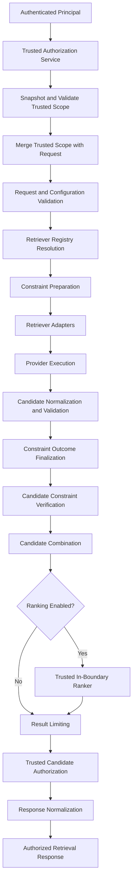

# RET-12.02 — Implementing the Retrieval Pipeline

## 1. Purpose and Scope

**Minimum Python version:** Python 3.10+. The reference implementation uses PEP 604 union syntax (for example, `str | None`) and built-in generic types. Examples should be assembled with the imports and definitions identified in their surrounding sections.

This file translates the architecture defined in **RET-12.01 — End-to-End Retrieval Architecture and Acceptance Criteria** into a practical, modular retrieval implementation.

The objective is to build a reusable retrieval pipeline that serves different downstream consumers without embedding application-specific behavior into its core.

Retrieval is an independent capability. A RAG application may consume retrieved evidence, but retrieval can also serve search interfaces, recommendation systems, research tools, analytics workflows, and other applications.

This implementation demonstrates how to:

- Define explicit request, response, candidate, and retriever contracts.
- Connect independently implemented retrieval sources.
- Apply structured constraints with explicit enforcement outcomes.
- Validate and normalize provider results.
- Combine candidates while preserving identity and provenance.
- Apply an optional ranking stage.
- Handle empty results and partial source failures.
- Separate configuration from pipeline logic.
- Test individual components and integrated behavior.
- Validate implementation behavior against architecture acceptance criteria.
- Establish a trusted authorization boundary for permission-sensitive retrieval.

### 1.1 Scope boundaries

This file owns the integrated implementation of the retrieval pipeline.

It does not reteach the detailed internal algorithms or design principles owned by earlier chapters.

| Chapter | Existing concept ownership                                                                           |
| ------- | ---------------------------------------------------------------------------------------------------- |
| RET-02  | Ingestion, extraction, normalization, metadata, and corpus lifecycle                                 |
| RET-03  | Chunking and document structure                                                                      |
| RET-04  | Representations and indexing                                                                         |
| RET-05  | Lexical and sparse retrieval                                                                         |
| RET-06  | Dense retrieval and vector search                                                                    |
| RET-07  | Query processing and metadata constraints                                                            |
| RET-08  | Candidate generation and retrieval fusion                                                            |
| RET-09  | Ranking and reranking                                                                                |
| RET-10  | Retrieval evaluation and experimental methodology                                                    |
| RET-11  | Retrieval diagnostics and targeted optimization                                                      |
| RET-12  | Integrated retrieval architecture, implementation, downstream integration, and end-to-end validation |

The implementation may use lexical retrieval, dense retrieval, hybrid candidate generation, or reranking when justified by the workload. None is mandatory in every deployment.

The examples use Python and provider-neutral interfaces. Provider-specific clients are injected through adapters rather than embedded in pipeline orchestration.

### 1.2 What this implementation does not attempt

The reference implementation does not attempt to provide:

- A universal retrieval framework.
- A complete ingestion or indexing system.
- A new filtering language.
- A new lexical or dense retrieval algorithm.
- A replacement for RET-10 evaluation methodology.
- A replacement for RET-11 diagnostic methodology.
- Full RAG orchestration or generation.
- Agent planning or agent-directed retrieval.
- Mandatory distributed infrastructure.
- Mandatory GraphRAG, multimodal retrieval, or learned sparse retrieval.
- A complete enterprise identity and authorization framework.

The purpose is to demonstrate sound integration contracts and predictable behavior, not to maximize architectural complexity.

---

## 2. Translating Architecture into Implementation Components

A retrieval architecture becomes useful only when its responsibilities can be represented through clear implementation boundaries.

The architecture from RET-12.01 can be translated into the following components.

| Component                      | Responsibility                                                               |
| ------------------------------ | ---------------------------------------------------------------------------- |
| Request validation             | Validate query, constraints, and execution configuration                     |
| Retriever registry             | Resolve configured retrieval sources                                         |
| Retriever adapter              | Translate common requests into provider-specific operations                  |
| Constraint preparation         | Determine which constraints are supported and passed to each source          |
| Constraint verification        | Check accepted candidates against exact-match requirements                   |
| Candidate validation           | Validate identity, content, metadata, and source observations                |
| Candidate normalization        | Produce a consistent candidate representation                                |
| Candidate combination          | Deduplicate candidates and preserve source observations                      |
| Optional ranker                | Reorder candidates without changing their identity or content                |
| Response normalization         | Produce a stable response independent of provider-specific result structures |
| Pipeline orchestration         | Coordinate stages, errors, and response status                               |
| Trusted authorization boundary | Establish access scope and prevent unauthorized evidence from being exposed  |

A practical module layout might look like this:

```
retrieval/
├── __init__.py
├── contracts.py
├── configuration.py
├── errors.py
├── validation.py
├── constraints.py
├── adapters/
│   ├── __init__.py
│   ├── lexical.py
│   └── dense.py
├── combination.py
├── ranking.py
├── pipeline.py
├── authorization.py
└── tests/
    ├── test_contracts.py
    ├── test_constraints.py
    ├── test_adapters.py
    ├── test_combination.py
    ├── test_ranking.py
    ├── test_pipeline.py
    └── test_authorization.py
```

This is an illustrative organization, not a mandatory directory structure. A smaller application may reasonably use fewer modules.

The important property is responsibility separation.

For example, a lexical adapter should understand its provider's query and response format. It should not decide how the complete retrieval pipeline handles partial failures. That policy belongs to orchestration.

Likewise, a downstream RAG application should not need to understand the provider-specific response format.

### 2.1 End-to-end implementation flow



The flow has four important properties:

1. Provider-specific behavior remains inside adapters.
2. The pipeline operates on normalized contracts rather than provider-specific records.
3. Security-sensitive access decisions are derived from trusted caller context.
4. The optional ranker is trusted to receive the pre-authorized candidate set within the retrieval security boundary; external rankers require pre-authorization before evidence transmission.
5. Evidence is not released to the downstream application consumer until the wrapper's candidate-level authorization checks have completed.

A pipeline should not need to know whether a candidate originated from a SQL search, a lexical engine, or a vector database.

### 2.2 Corpus preparation and indexing boundary

Corpus preparation and indexing happen before query-time retrieval.

The retrieval pipeline consumes the outputs of those processes:

- Stable document identifiers.
- Stable chunk identifiers.
- Source identifiers.
- Indexed content.
- Filterable metadata.
- Retrieval-specific index references.

It does not recreate those outputs during every search request.

The identifiers and metadata used at query time must remain consistent with trusted corpus and indexing records. Adapters must preserve that identity rather than silently generating replacement identifiers.

---

## 3. Define Explicit Retrieval Contracts

A shared retrieval interface is useful only when its contracts define what every component may assume.

The reference implementation uses explicit request, response, candidate, and execution-outcome models.

The models are intentionally provider-neutral.

### 3.1 Constraint and configuration models

```
from dataclasses import dataclass, field
from typing import Any

@dataclass(frozen=True)
class ConstraintSet:
    mandatory: dict[str, Any] = field(default_factory=dict)
    optional: dict[str, Any] = field(default_factory=dict)

@dataclass(frozen=True)
class RetrievalConfig:
    enabled_sources: tuple[str, ...]
    result_limit: int = 10
    default_candidate_limit: int = 50
    source_candidate_limits: dict[str, int] = field(
        default_factory=dict
    )
    maximum_candidate_limit: int = 500
    enable_reranking: bool = False
    allow_partial_results: bool = True
```

`ConstraintSet` separates requirements that must be enforced from preferences that may be unsupported.

For this reference implementation, a constraint value represents the exact value expected in trusted indexed metadata.

For example:

```
constraints = ConstraintSet(
    mandatory={
        "department": "engineering",
        "region": "apac",
    },
    optional={
        "language": "en",
    },
)
```

This does not implement a general expression language.

A value such as:

```
{"age": {"gte": 25, "lte": 35}}
```

is not interpreted as a range expression. It is treated as a value to compare for exact equality and therefore will not match an integer age value.

Range comparisons, membership operators, nested predicates, and other filter semantics require an explicitly extended contract and consistent semantics across provider-side enforcement and local verification. Their detailed design belongs to the relevant constraint-processing curriculum, not this integration example.

Constraint values must also satisfy the metadata value contract defined in Section 6.1. A valid field name does not make an arbitrary Python object a valid constraint value.

### 3.2 Execution outcomes

A retrieval pipeline must distinguish source execution from constraint enforcement.

```
from dataclasses import dataclass
from typing import Literal

ConstraintStatus = Literal[
    "applied",
    "unsupported",
    "failed",
]

@dataclass(frozen=True)
class ConstraintOutcome:
    retriever_name: str
    field: str
    requirement: Literal["mandatory", "optional"]
    status: ConstraintStatus
    enforcement_point: str
    diagnostic: str | None = None

@dataclass(frozen=True)
class SourceFailure:
    retriever_name: str
    error_type: str
    message: str
```

A source may successfully execute without returning candidates. That is different from a source failing to execute.

Likewise, a source may execute successfully but fail to confirm enforcement of a mandatory constraint. The pipeline must not silently treat that as successful enforcement.

`SourceFailure.message` is an externally returned diagnostic. It must not contain raw provider exception text because provider exceptions can expose endpoints, index names, query details, configuration, or sensitive infrastructure information.

### 3.3 Candidate and provenance contracts

```
@dataclass(frozen=True)
class SourceObservation:
    retriever_name: str
    source_rank: int
    source_score: float | None

@dataclass(frozen=True)
class Candidate:
    document_id: str
    chunk_id: str
    source_id: str
    text: str
    metadata: dict[str, Any]
    source_observations: tuple[SourceObservation, ...]
```

A candidate represents one retrieved evidence unit.

Its identity is the pair:

```
(document_id, chunk_id)
```

The identity must remain stable across retrieval stages.

`source_observations` records how retrieval sources contributed the candidate. It does not collapse different provider scores into one supposedly universal relevance probability.

The metadata in a candidate must be traceable to trusted corpus or index preparation records. Provider adapters may map provider fields into the shared contract, but must not invent or silently alter identity or filterable metadata.

This distinction is important:

- A provider response is an execution result.
- Trusted corpus metadata is the source of record for document attributes.
- A provider adapter is responsible for preserving the relationship between the two.
- A candidate metadata comparison is a consistency check, not independent authorization proof.

### 3.4 Request and response contracts

```
@dataclass(frozen=True)
class RetrievalRequest:
    query: str
    constraints: ConstraintSet
    config: RetrievalConfig
    request_id: str

@dataclass(frozen=True)
class RetrievalResponse:
    request_id: str
    status: Literal["success", "empty", "partial"]
    results: tuple[Candidate, ...]
    successful_sources: tuple[str, ...]
    failed_sources: tuple[SourceFailure, ...]
    constraint_outcomes: tuple[ConstraintOutcome, ...]
    warnings: tuple[str, ...]
```

The response is independent of the downstream consumer.

A RAG application may use `results` as evidence. A search interface may display them. A recommendation service may use them as candidate records.

The retrieval pipeline does not generate application-specific answers or make decisions on behalf of consumers.

### 3.5 Contract invariants and immutability

The implementation relies on these invariants:

1. A request has a non-empty query and request identifier.
2. Configured source names are explicit, unique, and non-empty.
3. Constraint values follow the agreed metadata value contract.
4. Candidate identity is stable.
5. Candidate content is non-empty.
6. Candidate metadata follows the agreed metadata contract.
7. Source observations identify the source that produced them.
8. Mandatory constraints must be confirmed for each successful source before its candidates can be accepted.
9. A source failure must not be represented as an empty successful result.
10. Partial results must identify failed sources.
11. Ranking must not change candidate identity, content, or provenance.

The dataclasses use `frozen=True`, but this provides only shallow immutability. A nested dictionary inside a frozen dataclass can still be modified.

Therefore, adapters and validation boundaries must create defensive copies of mutable metadata. Pipeline stages must treat accepted candidates as immutable values and must not mutate nested metadata.

Constraint values require the same treatment. A frozen `ConstraintSet` does not freeze its nested dictionaries or values. The pipeline must validate and copy those values before passing them to adapters.

For stronger isolation, a production implementation may use immutable metadata structures or serialize metadata into a validated immutable representation. That choice should be made consistently across the contract rather than assumed from `frozen=True`.

---

## 4. Define a Common Retriever Interface

The pipeline needs a common interface that allows different retrieval sources to participate without exposing provider-specific APIs.

### 4.1 Retriever protocol

```
from typing import Protocol, FrozenSet

@dataclass(frozen=True)
class RetrievalBatch:
    candidates: tuple[Candidate, ...]
    enforced_constraint_fields: frozenset[str]

class Retriever(Protocol):
    name: str

    # Fields for which this adapter guarantees provider-side
    # exact-match enforcement under its configured provider/index.
    supported_constraint_fields: FrozenSet[str]

    def search(
        self,
        query: str,
        constraints: dict[str, Any],
        limit: int,
    ) -> RetrievalBatch:
        ...
```

The interface establishes:

- A stable source name.
- A declared set of fields with guaranteed exact-match enforcement.
- A common search method.
- A normalized tuple-based batch response.
- Explicit reporting of fields enforced by the source.

The meaning of `supported_constraint_fields` is deliberately strict: a field may appear in this set only when the adapter can guarantee that the configured provider and index enforce the reference implementation's exact-match semantics for that field.

It must not mean merely that the provider accepts a filter parameter.

The protocol does not require lexical and dense retrievers to use the same internal algorithms.

### 4.2 Why adapters exist

A provider may return:

```
{
    "id": "chunk-123",
    "score": 0.87,
    "payload": {
        "document_id": "doc-12",
        "source_id": "source-4",
        "text": "Example evidence",
        "department": "engineering",
    },
}
```

Another provider may return a typed object with different field names.

The adapter translates both into the common `Candidate` contract.

This prevents provider-specific schemas from spreading into orchestration and downstream application code.

### 4.3 Error taxonomy

Errors must communicate whether a failure is caused by request input, configuration, a provider operation, an adapter contract, or an optional ranking stage.

```
class PipelineError(Exception):
    """Base class for expected retrieval pipeline errors."""

class RequestValidationError(PipelineError):
    pass

class PipelineConfigurationError(PipelineError):
    pass

class ConstraintEnforcementError(PipelineError):
    pass

class AdapterContractError(PipelineError):
    pass

class RetrieverExecutionError(PipelineError):
    """A known provider execution failure."""

class QueryEmbeddingError(PipelineError):
    """Query embedding failed before vector-provider execution."""

class RetrievalExecutionError(PipelineError):
    """The overall retrieval request cannot complete."""

class RankingContractError(PipelineError):
    pass

class RankingExecutionError(PipelineError):
    pass

class AuthorizationError(PipelineError):
    """Trusted authorization could not be established or verified."""
```

The distinction between `RetrieverExecutionError` and `AdapterContractError` is important.

- A known provider timeout or documented provider exception is a provider execution failure.
- A query-embedding dependency failure is a `QueryEmbeddingError`, distinct from vector-provider execution.
- A provider returning a malformed object is an adapter contract failure.
- An unexpected programming exception is not automatically a provider failure.

Only known provider execution failures are eligible for the partial-result policy. `QueryEmbeddingError` is a distinct dependency failure and is not treated as a recoverable source timeout by this reference pipeline.

### 4.4 Adapter contract

Every adapter is responsible for:

1. Calling its provider.
2. Passing only constraints whose exact-match semantics it can guarantee.
3. Applying the source-specific candidate limit.
4. Materializing provider results within the provider execution boundary, with a strict `limit + 1` consumption bound when iteration may be lazy.
5. Validating provider result containers and records.
6. Normalizing identifiers, text, metadata, and scores.
7. Reporting constraint enforcement honestly.
8. Returning a `RetrievalBatch`.

An adapter must not claim a constraint was enforced merely because it was included in a provider request.

The adapter's declared supported fields must be backed by documented provider behavior, the configured index schema, and real-provider contract tests. In this reference implementation, provider field names must match shared-contract field names; adapters do not perform field-name translation.

If a provider cannot guarantee a mandatory filter, the adapter must not advertise that field as supported. The pipeline must reject the request during mandatory-constraint preflight rather than proceed with an unverified filter.

### 4.5 Example lexical adapter

The following adapter is illustrative. The injected client and its result schema must be matched to the actual provider before deployment.

The constructor requires:

- A client exposing a callable `search` operation.
- An explicit set of fields for which the adapter has a documented exact-match enforcement guarantee.
- A set of provider-supported filter field names that match the shared metadata contract (defaulting conservatively to the guaranteed fields).
- Narrow, provider-specific exception types.

Generic built-in exception classes such as `Exception`, `RuntimeError`, or `OSError` are rejected. Otherwise, unrelated programming errors could be misclassified as provider outages and incorrectly permit partial results.

`provider_supported_filter_fields` is a capability declaration, not a field-mapping table. This implementation passes filter names unchanged, so the provider schema must use the same field names and equivalent exact-match semantics as the shared contract.

```
from collections.abc import Iterable
from itertools import islice
from typing import Any

class LexicalRetriever:
    name = "lexical"

    def __init__(
        self,
        client: Any,
        guaranteed_exact_match_fields: frozenset[str],
        provider_error_types: tuple[type[Exception], ...],
        provider_supported_filter_fields: frozenset[str] | None = None,
    ) -> None:
        if not callable(getattr(client, "search", None)):
            raise TypeError(
                "Provider client must expose a callable search method"
            )

        if not isinstance(guaranteed_exact_match_fields, frozenset):
            raise TypeError(
                "guaranteed_exact_match_fields must be a frozenset"
            )

        if any(
            not isinstance(field_name, str) or not field_name.strip()
            for field_name in guaranteed_exact_match_fields
        ):
            raise TypeError(
                "Guaranteed filter fields must be non-empty strings"
            )

        if provider_supported_filter_fields is None:
            provider_supported_filter_fields = guaranteed_exact_match_fields

        if (
            not isinstance(provider_supported_filter_fields, frozenset)
            or any(
                not isinstance(field_name, str) or not field_name.strip()
                for field_name in provider_supported_filter_fields
            )
        ):
            raise TypeError(
                "provider_supported_filter_fields must be a frozenset of "
                "non-empty strings"
            )

        if not guaranteed_exact_match_fields.issubset(
            provider_supported_filter_fields
        ):
            raise TypeError(
                "Guaranteed exact-match fields must be included in "
                "provider_supported_filter_fields"
            )

        if not isinstance(provider_error_types, tuple):
            raise TypeError(
                "provider_error_types must be a tuple"
            )

        if not all(
            isinstance(error_type, type)
            and issubclass(error_type, Exception)
            and error_type is not Exception
            and error_type.__module__ != "builtins"
            for error_type in provider_error_types
        ):
            raise TypeError(
                "provider_error_types must contain narrow, "
                "provider-specific Exception subclasses"
            )

        self.client = client
        self.supported_constraint_fields = (
            guaranteed_exact_match_fields
        )
        self.provider_supported_filter_fields = provider_supported_filter_fields
        self.provider_error_types = provider_error_types

    def search(
        self,
        query: str,
        constraints: dict[str, Any],
        limit: int,
    ) -> RetrievalBatch:
        if (
            isinstance(limit, bool)
            or not isinstance(limit, int)
            or limit <= 0
        ):
            raise AdapterContractError(
                "limit must be a positive integer"
            )

        unsupported = (
            constraints.keys()
            - self.supported_constraint_fields
        )

        if unsupported:
            raise AdapterContractError(
                "Adapter received unsupported filter fields: "
                f"{sorted(unsupported)}"
            )

        try:
            raw_result = self.client.search(
                query=query,
                filters=constraints,
                limit=limit,
            )

            if raw_result is None:
                raise AdapterContractError(
                    "Provider returned None instead of an iterable"
                )

            if isinstance(raw_result, (str, bytes, dict)):
                raise AdapterContractError(
                    "Provider returned an invalid result container"
                )

            if not isinstance(raw_result, Iterable):
                raise AdapterContractError(
                    "Provider result is not iterable"
                )

            # Consume at most limit + 1 records. The extra record
            # detects a provider limit violation without materializing
            # an unbounded or unexpectedly large iterator.
            records = list(islice(raw_result, limit + 1))

            if len(records) > limit:
                raise AdapterContractError(
                    "Provider returned more records than requested"
                )

        except AdapterContractError:
            raise
        except self.provider_error_types as exc:
            raise RetrieverExecutionError(
                "Lexical provider execution failed"
            ) from exc

        candidates = tuple(
            self._normalize_record(record, rank)
            for rank, record in enumerate(records, start=1)
        )

        # This is an adapter enforcement attestation, not a receipt
        # independently generated by the provider. The declared
        # guarantee must be backed by trusted deployment configuration,
        # provider documentation, index schema, and contract tests.
        enforced_fields = frozenset(constraints.keys())

        return RetrievalBatch(
            candidates=candidates,
            enforced_constraint_fields=enforced_fields,
        )

    def _normalize_record(
        self,
        record: Any,
        rank: int,
    ) -> Candidate:
        if not isinstance(record, dict):
            raise AdapterContractError(
                "Provider returned a non-dictionary record"
            )

        required_fields = {
            "document_id",
            "chunk_id",
            "source_id",
            "text",
            "metadata",
        }

        missing = required_fields - record.keys()

        if missing:
            raise AdapterContractError(
                f"Provider record is missing fields: {sorted(missing)}"
            )

        if not isinstance(record["metadata"], dict):
            raise AdapterContractError(
                "Provider metadata must be a dictionary"
            )

        score = normalize_source_score(record.get("score"))

        return Candidate(
            document_id=record["document_id"],
            chunk_id=record["chunk_id"],
            source_id=record["source_id"],
            text=record["text"],
            metadata=record["metadata"],
            source_observations=(
                SourceObservation(
                    retriever_name=self.name,
                    source_rank=rank,
                    source_score=score,
                ),
            ),
        )
```

The adapter's expected provider result shape is explicit:

- The search operation returns an iterable of records.
- Each record is a dictionary containing the required fields.
- Provider execution errors must be represented by explicitly supplied provider-specific exception classes.
- Errors raised while iterating the provider result are classified as provider execution failures only when they belong to those documented provider-specific exception classes.
- Invalid containers and malformed records are adapter contract failures.
- Unexpected exceptions are not silently reclassified as provider failures.

The exception allowlist is a classification boundary, not a substitute for provider error documentation. The adapter should list only exception types that its provider client actually uses for documented operational failures.

The filter guarantee declaration requires particular care. `enforced_constraint_fields` is an **adapter attestation** based on the adapter's verified contract and trusted deployment configuration. It is not an independent provider-generated receipt and does not prove that the provider applied a filter during an individual request.

The guarantee must be backed by provider documentation, the configured index schema, deployment-controlled configuration, and real-provider contract tests. It must never be request-controlled. If provider behavior or index mappings change, the guarantee must be reviewed and retested.

The constructors also accept `provider_supported_filter_fields`, the set of shared-contract field names accepted by the configured provider filter interface. This reference adapter does not translate field names: provider field names must match the shared retrieval metadata contract names, and the provider must use equivalent exact-match value semantics. The adapter forwards the supported constraint dictionary unchanged. `guaranteed_exact_match_fields` must be a subset of `provider_supported_filter_fields`. This declaration describes provider capability; it does not prove that a filter was correctly applied for an individual request. Provider documentation, index inspection, deployment-controlled configuration, and real-provider contract tests are still required. If the optional argument is omitted, it defaults to the guaranteed fields, which is a conservative compatibility default.

The client-interface check occurs during adapter construction. It catches a missing or non-callable `search` method before a retrieval request is executed. It does not prove that the client is connected or that the provider is healthy.

A dense adapter follows the same provider-neutral contract. The following compact example demonstrates the integration boundary without reteaching dense retrieval internals owned by RET-06.

The injected embedder and vector client are application/provider dependencies. Their concrete APIs must be verified against the selected implementation. The example assumes the client returns an iterable of hit objects represented here as dictionaries with a `payload` and `score`.

```
import math

def validate_query_vector(vector: Any) -> list[float]:
    if not isinstance(vector, (list, tuple)) or not vector:
        raise AdapterContractError(
            "Query embedder must return a non-empty numeric vector"
        )

    normalized: list[float] = []

    for component in vector:
        if isinstance(component, bool) or not isinstance(
            component,
            (int, float),
        ):
            raise AdapterContractError(
                "Query embedding contains a non-numeric component"
            )

        try:
            normalized_component = float(component)
        except (OverflowError, ValueError) as exc:
            raise AdapterContractError(
                "Query embedding contains a component outside the finite "
                "floating-point range"
            ) from exc

        if not math.isfinite(normalized_component):
            raise AdapterContractError(
                "Query embedding contains a non-finite component"
            )

        normalized.append(normalized_component)

    return normalized

class DenseRetriever:
    name = "dense"

    def __init__(
        self,
        client: Any,
        embed_query: Any,
        guaranteed_exact_match_fields: frozenset[str],
        provider_error_types: tuple[type[Exception], ...],
        provider_supported_filter_fields: frozenset[str] | None = None,
    ) -> None:
        if not callable(getattr(client, "search", None)):
            raise TypeError(
                "Vector client must expose a callable search method"
            )

        if not callable(embed_query):
            raise TypeError("embed_query must be callable")

        if not isinstance(guaranteed_exact_match_fields, frozenset):
            raise TypeError(
                "guaranteed_exact_match_fields must be a frozenset"
            )

        if any(
            not isinstance(field_name, str) or not field_name.strip()
            for field_name in guaranteed_exact_match_fields
        ):
            raise TypeError(
                "Guaranteed filter fields must be non-empty strings"
            )

        if provider_supported_filter_fields is None:
            provider_supported_filter_fields = guaranteed_exact_match_fields

        if (
            not isinstance(provider_supported_filter_fields, frozenset)
            or any(
                not isinstance(field_name, str) or not field_name.strip()
                for field_name in provider_supported_filter_fields
            )
        ):
            raise TypeError(
                "provider_supported_filter_fields must be a frozenset of "
                "non-empty strings"
            )

        if not guaranteed_exact_match_fields.issubset(
            provider_supported_filter_fields
        ):
            raise TypeError(
                "Guaranteed exact-match fields must be included in "
                "provider_supported_filter_fields"
            )

        if not isinstance(provider_error_types, tuple) or not all(
            isinstance(error_type, type)
            and issubclass(error_type, Exception)
            and error_type is not Exception
            and error_type.__module__ != "builtins"
            for error_type in provider_error_types
        ):
            raise TypeError(
                "provider_error_types must contain narrow, "
                "provider-specific Exception subclasses"
            )

        self.client = client
        self.embed_query = embed_query
        self.supported_constraint_fields = (
            guaranteed_exact_match_fields
        )
        self.provider_supported_filter_fields = provider_supported_filter_fields
        self.provider_error_types = provider_error_types

    def search(
        self,
        query: str,
        constraints: dict[str, Any],
        limit: int,
    ) -> RetrievalBatch:
        if (
            isinstance(limit, bool)
            or not isinstance(limit, int)
            or limit <= 0
        ):
            raise AdapterContractError(
                "limit must be a positive integer"
            )

        unsupported = (
            constraints.keys()
            - self.supported_constraint_fields
        )
        if unsupported:
            raise AdapterContractError(
                "Adapter received unsupported filter fields: "
                f"{sorted(unsupported)}"
            )

        try:
            vector = self.embed_query(query)
        except Exception as exc:
            # Embedding is a separate dependency boundary. Its failures
            # are not provider failures and are not eligible for the
            # provider partial-result policy.
            raise QueryEmbeddingError(
                "Dense query embedding failed"
            ) from exc

        # A malformed embedding result is an adapter contract failure,
        # not a vector-provider outage. Provider/index dimension
        # compatibility must still be verified by provider contract tests.
        vector = validate_query_vector(vector)

        try:
            raw_result = self.client.search(
                vector=vector,
                filters=constraints,
                limit=limit,
            )

            if raw_result is None or isinstance(
                raw_result, (str, bytes, dict)
            ):
                raise AdapterContractError(
                    "Vector provider returned an invalid result container"
                )

            if not isinstance(raw_result, Iterable):
                raise AdapterContractError(
                    "Vector provider result is not iterable"
                )

            hits = list(islice(raw_result, limit + 1))
            if len(hits) > limit:
                raise AdapterContractError(
                    "Vector provider returned more records than requested"
                )

        except AdapterContractError:
            raise
        except self.provider_error_types as exc:
            raise RetrieverExecutionError(
                "Dense provider execution failed"
            ) from exc

        candidates: list[Candidate] = []

        for rank, hit in enumerate(hits, start=1):
            if not isinstance(hit, dict):
                raise AdapterContractError(
                    "Vector provider returned a malformed hit"
                )

            payload = hit.get("payload")
            if not isinstance(payload, dict):
                raise AdapterContractError(
                    "Vector hit payload must be a dictionary"
                )

            required_fields = {
                "document_id",
                "chunk_id",
                "source_id",
                "text",
                "metadata",
            }
            missing = required_fields - payload.keys()
            if missing:
                raise AdapterContractError(
                    "Vector hit payload is missing fields: "
                    f"{sorted(missing)}"
                )

            metadata = payload["metadata"]
            if not isinstance(metadata, dict):
                raise AdapterContractError(
                    "Vector hit metadata must be a dictionary"
                )

            score = normalize_source_score(hit.get("score"))
            candidates.append(
                Candidate(
                    document_id=payload["document_id"],
                    chunk_id=payload["chunk_id"],
                    source_id=payload["source_id"],
                    text=payload["text"],
                    metadata=metadata,
                    source_observations=(
                        SourceObservation(
                            retriever_name=self.name,
                            source_rank=rank,
                            source_score=score,
                        ),
                    ),
                )
            )

        # This is an adapter attestation based on deployment-verified
        # provider and index behavior, not a provider-generated receipt.
        return RetrievalBatch(
            candidates=tuple(candidates),
            enforced_constraint_fields=frozenset(constraints.keys()),
        )
```

The dense adapter preserves the stable document and chunk identifiers supplied by the indexed payload, maps the provider score through the shared score normalizer, preserves metadata supplied by the indexed payload, and reports only the exact-match fields covered by its deployment-verified guarantee. Its `provider_supported_filter_fields` lists shared-contract field names that the provider accepts without renaming; this adapter forwards those names unchanged. Guaranteed fields must be a subset of that set. Exceptions raised while invoking the embedder become `QueryEmbeddingError`; malformed embedding values become `AdapterContractError`; vector-provider failures listed in `provider_error_types` become `RetrieverExecutionError`; malformed provider responses remain `AdapterContractError`. The same bounded-materialization rule applies: it consumes no more than `limit + 1` hits.

The adapter does not independently establish that payload metadata is authoritative. Its identity and metadata mapping must be verified through provider contract tests against the configured collection/index and trusted corpus records.

---

## 5. Implement Structured Constraint Handling

Structured constraints are part of the retrieval request contract. They must be handled consistently across source preparation, source execution, candidate verification, and response reporting.

This section implements only the exact-match semantics defined in Section 3. It does not introduce a general-purpose filtering language.

### 5.1 Validate constraint input

Constraint values must be validated before provider execution. Reusing the metadata validator ensures request-side values and candidate metadata follow the same supported value contract.

The metadata validator is defined in Section 6.1. Python resolves the function name when `validate_constraint_set()` is called, so the helper may be defined later in the assembled module.

```
def validate_constraint_set(
    constraints: ConstraintSet,
) -> None:
    if not isinstance(constraints, ConstraintSet):
        raise RequestValidationError(
            "constraints must be a ConstraintSet"
        )

    for group_name, group in (
        ("mandatory", constraints.mandatory),
        ("optional", constraints.optional),
    ):
        if not isinstance(group, dict):
            raise RequestValidationError(
                f"{group_name} constraints must be a dictionary"
            )

        for field_name, value in group.items():
            if (
                not isinstance(field_name, str)
                or not field_name.strip()
            ):
                raise RequestValidationError(
                    "Constraint field names must be "
                    "non-empty strings"
                )

            try:
                validate_metadata_value(value)
            except AdapterContractError as exc:
                raise RequestValidationError(
                    f"Invalid value for {group_name} constraint "
                    f"{field_name!r}"
                ) from exc

    overlap = (
        constraints.mandatory.keys()
        & constraints.optional.keys()
    )

    if overlap:
        raise RequestValidationError(
            "A field cannot be both mandatory and optional: "
            f"{sorted(overlap)}"
        )
```

Invalid request values are classified as `RequestValidationError`, not `AdapterContractError`. The value originates from the request, not from a provider response.

A field cannot be simultaneously mandatory and optional in the same request. This prevents ambiguous enforcement requirements.

### 5.2 Prepare constraints for a source

```
from copy import deepcopy

def prepare_source_constraints(
    constraints: ConstraintSet,
    retriever: Retriever,
) -> dict[str, Any]:
    supported = retriever.supported_constraint_fields
    combined = constraints.mandatory | constraints.optional

    # Copy nested values so adapters cannot mutate request-owned data.
    return {
        field: deepcopy(value)
        for field, value in combined.items()
        if field in supported
    }
```

The function returns only constraints that the source declares it can guarantee.

It also returns defensive copies of nested values. This prevents a provider adapter or client from mutating the request's constraint objects through shared references.

Mandatory support is checked separately before execution. Optional unsupported constraints may be omitted, but their omission must be visible in the response.

### 5.3 Verify candidate constraints

```
def verify_candidate_constraints(
    candidate: Candidate,
    constraints: ConstraintSet,
) -> None:
    metadata = candidate.metadata

    for field, expected_value in constraints.mandatory.items():
        if field not in metadata:
            raise ConstraintEnforcementError(
                f"Candidate is missing mandatory metadata field: {field}"
            )

        if not contract_values_equal(
            metadata[field],
            expected_value,
        ):
            raise ConstraintEnforcementError(
                f"Candidate violates mandatory exact-match "
                f"constraint: {field}"
            )
```

The key-existence check is intentional.

A missing metadata field is not equivalent to a field whose value is `None`.

This function verifies exact-match consistency between the candidate's metadata and the request. It does not independently prove that the provider applied the filter correctly.

Optional constraints are not locally verified by this function. Their outcomes have precise meanings:

| Outcome       | Meaning                                                                                     |
| ------------- | ------------------------------------------------------------------------------------------- |
| `applied`     | The adapter attests that provider-side enforcement was applied under its verified guarantee |
| `unsupported` | The source cannot enforce the optional preference                                           |
| `failed`      | Enforcement was not confirmed, or the source failed before confirmation                     |

An optional constraint does not become mandatory simply because it was supplied. Consumers must inspect `constraint_outcomes`; they must not assume that every returned candidate satisfies optional preferences.

Even an `applied` outcome represents the adapter's provider-enforcement contract. It is not independent proof that every returned record satisfies an optional preference.

### 5.4 Trusted metadata and authorization boundary

A critical security distinction must be maintained.

A candidate returned by a provider may contain metadata that appears to satisfy a mandatory constraint. That fact alone does not prove that the underlying indexed record satisfies the constraint.

For example, suppose a tenant-isolation requirement is:

```
{"tenant_id": "tenant-a"}
```

If a faulty or compromised adapter returns a candidate from `tenant-b` but attaches:

```
{"tenant_id": "tenant-a"}
```

the equality check will pass.

Therefore:

1. Stable document and chunk identifiers originate from trusted corpus preparation and indexing records.
2. Filterable metadata originates from trusted records or a controlled index representation.
3. Adapters preserve those fields and must not invent or silently modify them.
4. Provider-side filtering must use the corresponding indexed metadata with documented semantics.
5. Candidate verification is a consistency check, not an independent authorization proof.
6. Security-sensitive access constraints must be enforced at a trusted authorization boundary before evidence is exposed to downstream consumers.

#### Required integration boundary

The caller must not be allowed to construct or widen its own trusted access scope.

The required application-facing sequence is:

```
Authenticated principal
       |
       v
Validate request structure
       |
       v
Trusted authorization service
       |
       v
Derive and snapshot trusted access scope
       |
       v
Validate trusted scope and reject conflicts
       |
       v
Apply trusted scope as mandatory constraints
       |
       v
Execute retrieval pipeline
       |
       v
Verify returned candidates against authorization policy
       |
       v
Release authorized evidence to consumer
```

The reference pipeline is not an authorization mechanism. Permission-sensitive deployments must not expose its raw `retrieve()` interface directly to untrusted application callers.

#### Application-facing authorization contract

A minimal integration contract is:

```
from typing import Protocol

@dataclass(frozen=True)
class TrustedAccessScope:
    mandatory_constraints: dict[str, Any]

class AuthorizationService(Protocol):
    def derive_scope(
        self,
        principal: Any,
    ) -> TrustedAccessScope:
        ...

    def authorize_candidate(
        self,
        principal: Any,
        candidate: Candidate,
    ) -> bool:
        ...

class AuthorizedRetrievalService:
    def __init__(
        self,
        pipeline: "RetrievalPipeline",
        authorization: AuthorizationService,
    ) -> None:
        self.pipeline = pipeline
        self.authorization = authorization

    def retrieve(
        self,
        principal: Any,
        request: RetrievalRequest,
    ) -> RetrievalResponse:
        # Validate caller-controlled input before accessing nested fields.
        validate_request(request)

        if principal is None:
            raise AuthorizationError(
                "An authenticated principal is required"
            )

        # Keep authorization-service interaction and scope validation
        # separate from retrieval execution. Do not wrap the pipeline
        # call in this exception boundary.
        try:
            scope = self.authorization.derive_scope(principal)

            if not isinstance(scope, TrustedAccessScope):
                raise AuthorizationError(
                    "Authorization service returned an invalid access scope"
                )

            # Snapshot immediately. All subsequent operations use this
            # snapshot, never the authorization service's mutable object.
            trusted_constraints = deepcopy(
                scope.mandatory_constraints
            )

            if not isinstance(trusted_constraints, dict):
                raise AuthorizationError(
                    "Trusted access constraints must be a dictionary"
                )

            # Reuse the request value contract, but classify invalid
            # trusted authorization data as an authorization failure.
            validate_constraint_set(
                ConstraintSet(
                    mandatory=trusted_constraints,
                    optional={},
                )
            )

        except AuthorizationError:
            raise
        except Exception as exc:
            raise AuthorizationError(
                "Trusted authorization scope could not be established"
            ) from exc

        caller_constraints = (
            request.constraints.mandatory
            | request.constraints.optional
        )

        # A caller may repeat a trusted value, but may not conflict with it.
        for field, trusted_value in trusted_constraints.items():
            if (
                field in caller_constraints
                and not contract_values_equal(
                    caller_constraints[field],
                    trusted_value,
                )
            ):
                raise AuthorizationError(
                    "Caller constraints conflict with trusted access scope"
                )

        # Trusted values become mandatory. Remove those fields from the
        # optional group, including identical caller-supplied values.
        merged_mandatory = (
            deepcopy(request.constraints.mandatory)
            | deepcopy(trusted_constraints)
        )

        merged_optional = {
            field: deepcopy(value)
            for field, value in request.constraints.optional.items()
            if field not in trusted_constraints
        }

        authorized_request = RetrievalRequest(
            query=request.query,
            constraints=ConstraintSet(
                mandatory=merged_mandatory,
                optional=merged_optional,
            ),
            config=request.config,
            request_id=request.request_id,
        )

        # Validate the merged request before invoking the pipeline.
        validate_request(authorized_request)

        # Deliberately outside the authorization exception boundary.
        # Pipeline failures retain their original pipeline classification.
        response = self.pipeline.retrieve(authorized_request)

        # Candidate authorization is a separate, narrow boundary.
        # Require the literal Boolean True. Truthy values are not enough.
        for candidate in response.results:
            try:
                authorized = self.authorization.authorize_candidate(
                    principal,
                    candidate,
                )
            except Exception as exc:
                raise AuthorizationError(
                    "Candidate authorization verification failed"
                ) from exc

            if authorized is not True:
                raise AuthorizationError(
                    "Retrieved evidence failed authorization verification"
                )

        # No response containing candidates is released until every
        # candidate has passed the authorization check.
        return response
```

This wrapper establishes the minimum integration behavior:

- The principal comes from the authenticated application context.
- The incoming request is validated before nested fields are accessed.
- The authorization service derives scope; the caller does not supply it.
- The returned scope is defensively copied immediately.
- Invalid trusted scope is classified as `AuthorizationError`.
- Caller constraints cannot override or widen trusted scope.
- Identical caller optional constraints are promoted to mandatory.
- Trusted fields are removed from the optional group to avoid overlap.
- The merged request is validated before pipeline execution.
- Pipeline failures retain their original classification.
- Candidate authorization is checked before the response is returned.
- Only the literal Boolean `True` is accepted as authorization.
- Authorization-service failures fail closed.

The exception boundaries are deliberate. An exception from `derive_scope()` or `authorize_candidate()` is an authorization failure. An exception from `pipeline.retrieve()` is a retrieval or pipeline failure and must not be mislabeled as an authorization failure.

The example assumes that the authorization service itself is trusted, that its scope is derived from authenticated identity, and that its candidate authorization check consults an authoritative policy or trusted record. It does not implement identity authentication, policy storage, revocation, or a complete enterprise authorization framework.

For permission-sensitive systems, tests must prove that unauthorized evidence cannot leave this wrapper. Do not expose `RetrievalPipeline.retrieve()` as the public application endpoint.

### 5.5 Finalize constraint outcomes

```
def finalize_constraint_outcomes(
    retriever: Retriever,
    constraints: ConstraintSet,
    batch: RetrievalBatch,
) -> tuple[ConstraintOutcome, ...]:
    outcomes: list[ConstraintOutcome] = []

    enforced = batch.enforced_constraint_fields
    supported = retriever.supported_constraint_fields

    for field in constraints.mandatory:
        if field not in supported:
            raise ConstraintEnforcementError(
                f"{retriever.name} does not support mandatory "
                f"constraint: {field}"
            )

        if field not in enforced:
            raise ConstraintEnforcementError(
                f"{retriever.name} did not confirm enforcement "
                f"of mandatory constraint: {field}"
            )

        outcomes.append(
            ConstraintOutcome(
                retriever_name=retriever.name,
                field=field,
                requirement="mandatory",
                status="applied",
                enforcement_point="provider",
            )
        )

    for field in constraints.optional:
        if field not in supported:
            outcomes.append(
                ConstraintOutcome(
                    retriever_name=retriever.name,
                    field=field,
                    requirement="optional",
                    status="unsupported",
                    enforcement_point="none",
                    diagnostic="Source does not support this field",
                )
            )
        elif field not in enforced:
            outcomes.append(
                ConstraintOutcome(
                    retriever_name=retriever.name,
                    field=field,
                    requirement="optional",
                    status="failed",
                    enforcement_point="provider",
                    diagnostic="Source did not confirm enforcement",
                )
            )
        else:
            outcomes.append(
                ConstraintOutcome(
                    retriever_name=retriever.name,
                    field=field,
                    requirement="optional",
                    status="applied",
                    enforcement_point="provider",
                )
            )

    return tuple(outcomes)
```

This function is the authoritative mandatory-enforcement check for a successful source.

The pipeline must not repeat the same mandatory-field check after this function returns successfully.

Remember that `enforced_constraint_fields` is an adapter attestation based on a verified guarantee, not independent provider proof.

### 5.6 Finalize outcomes for failed sources

A source that fails before returning a valid batch cannot confirm constraint enforcement.

```
def finalize_failed_source_outcomes(
    retriever: Retriever,
    constraints: ConstraintSet,
) -> tuple[ConstraintOutcome, ...]:
    outcomes: list[ConstraintOutcome] = []

    for field in constraints.mandatory:
        outcomes.append(
            ConstraintOutcome(
                retriever_name=retriever.name,
                field=field,
                requirement="mandatory",
                status="failed",
                enforcement_point="unavailable",
                diagnostic="Source execution failed before enforcement "
                "could be confirmed",
            )
        )

    for field in constraints.optional:
        outcomes.append(
            ConstraintOutcome(
                retriever_name=retriever.name,
                field=field,
                requirement="optional",
                status="failed",
                enforcement_point="unavailable",
                diagnostic="Source execution failed before enforcement "
                "could be confirmed",
            )
        )

    return tuple(outcomes)
```

A failed outcome for a failed source describes unavailable execution. It does not mean that the pipeline accepted an unfiltered candidate from that source.

Only candidates from successfully executed sources are eligible for acceptance.

---

## 6. Validate and Normalize Candidate Contracts

A provider response must not be trusted simply because it can be converted into a Python object.

The pipeline validates candidates before they enter combination or ranking. Validation also produces a normalized candidate representation so later stages do not receive inconsistent score types or mutable provider-owned metadata.

### 6.1 Validate metadata values

The reference contract permits JSON-compatible metadata:

- `None`
- Strings
- Booleans
- Signed 64-bit integers
- Finite floating-point values
- Lists of valid metadata values
- Dictionaries with string keys and valid metadata values

Cyclic Python objects are not valid JSON-compatible metadata. Pathologically deep structures should also be rejected.

```
import math
from typing import Any

MAX_METADATA_DEPTH = 32

def validate_metadata_value(
    value: Any,
    *,
    active_container_ids: set[int] | None = None,
    depth: int = 0,
) -> None:
    if depth > MAX_METADATA_DEPTH:
        raise AdapterContractError(
            "Metadata exceeds maximum nesting depth"
        )

    if value is None or isinstance(value, (str, bool)):
        return

    if isinstance(value, int):
        if not -(2**63) <= value < 2**63:
            raise AdapterContractError(
                "Metadata integer is outside signed 64-bit range"
            )
        return

    if isinstance(value, float):
        if not math.isfinite(value):
            raise AdapterContractError(
                "Metadata float must be finite"
            )
        return

    if isinstance(value, (list, dict)):
        if active_container_ids is None:
            active_container_ids = set()

        container_id = id(value)

        if container_id in active_container_ids:
            raise AdapterContractError(
                "Cyclic metadata containers are not supported"
            )

        active_container_ids.add(container_id)

        try:
            if isinstance(value, list):
                for item in value:
                    validate_metadata_value(
                        item,
                        active_container_ids=active_container_ids,
                        depth=depth + 1,
                    )
            else:
                for key, item in value.items():
                    if not isinstance(key, str):
                        raise AdapterContractError(
                            "Metadata dictionary keys must be strings"
                        )

                    validate_metadata_value(
                        item,
                        active_container_ids=active_container_ids,
                        depth=depth + 1,
                    )
        finally:
            active_container_ids.remove(container_id)

        return

    raise AdapterContractError(
        f"Unsupported metadata value type: {type(value).__name__}"
    )
```

The active-container set detects cycles without rejecting valid repeated references that are not circular.

The depth limit protects the recursive validator from excessively nested input.

The limits are implementation policy and should be adjusted only when the agreed metadata contract requires a different bound.

### 6.2 Canonical source-score normalization

Source scores are provider-specific values. They must not be treated as directly comparable across retrieval sources unless an explicit normalization strategy establishes that comparability.

One canonical function handles score validation and normalization.

```
def normalize_source_score(
    value: Any,
) -> float | None:
    if value is None:
        return None

    if isinstance(value, bool):
        raise AdapterContractError(
            "Boolean values are not valid source scores"
        )

    if not isinstance(value, (int, float)):
        raise AdapterContractError(
            "Source score must be numeric or None"
        )

    try:
        normalized = float(value)
    except OverflowError as exc:
        raise AdapterContractError(
            "Source score cannot be represented as a finite float"
        ) from exc

    if not math.isfinite(normalized):
        raise AdapterContractError(
            "Source score must be finite"
        )

    return normalized
```

This function:

- Accepts `None`.
- Rejects booleans.
- Rejects non-numeric values.
- Converts valid integers and floats to `float`.
- Handles conversion overflow.
- Rejects NaN and infinity.

The same function must be used by provider normalization and candidate validation.

The reference contract does not impose a universal score range because provider score semantics differ. If a specific provider contract requires a range, enforce it in that provider adapter.

### 6.3 Normalize a candidate

Validation must not discard normalized values.

The following function validates the candidate and returns a new candidate containing normalized observations and defensive copies of metadata.

```
from copy import deepcopy

def normalize_candidate(candidate: Candidate) -> Candidate:
    if not isinstance(candidate, Candidate):
        raise AdapterContractError(
            "Candidate has an invalid type"
        )

    for field_name in (
        "document_id",
        "chunk_id",
        "source_id",
        "text",
    ):
        value = getattr(candidate, field_name)

        if not isinstance(value, str) or not value.strip():
            raise AdapterContractError(
                f"{field_name} must be a non-empty string"
            )

    if not isinstance(candidate.metadata, dict):
        raise AdapterContractError(
            "Candidate metadata must be a dictionary"
        )

    validate_metadata_value(candidate.metadata)

    if (
        not isinstance(candidate.source_observations, tuple)
        or not candidate.source_observations
    ):
        raise AdapterContractError(
            "Candidate must contain a non-empty tuple of observations"
        )

    normalized_observations: list[SourceObservation] = []

    for observation in candidate.source_observations:
        if not isinstance(observation, SourceObservation):
            raise AdapterContractError(
                "Source observation has an invalid type"
            )

        if (
            not isinstance(observation.retriever_name, str)
            or not observation.retriever_name.strip()
        ):
            raise AdapterContractError(
                "Observation retriever name must be non-empty"
            )

        if (
            isinstance(observation.source_rank, bool)
            or not isinstance(observation.source_rank, int)
            or observation.source_rank <= 0
        ):
            raise AdapterContractError(
                "Source rank must be a positive integer"
            )

        normalized_observations.append(
            SourceObservation(
                retriever_name=observation.retriever_name,
                source_rank=observation.source_rank,
                source_score=normalize_source_score(
                    observation.source_score
                ),
            )
        )

    try:
        copied_metadata = deepcopy(candidate.metadata)
    except Exception as exc:
        raise AdapterContractError(
            "Candidate metadata could not be defensively copied"
        ) from exc

    return Candidate(
        document_id=candidate.document_id,
        chunk_id=candidate.chunk_id,
        source_id=candidate.source_id,
        text=candidate.text,
        metadata=copied_metadata,
        source_observations=tuple(normalized_observations),
    )
```

The broad exception handler around `deepcopy` is deliberately restricted to the defensive-copy operation. It converts an inability to satisfy the candidate isolation contract into an adapter contract failure. It does not classify provider execution failures or suppress arbitrary pipeline execution errors.

The function returns a new candidate. It does not mutate the provider-owned candidate.

The normalized candidate is the value that must be passed to later pipeline stages.

The defensive copy isolates the pipeline from mutations to the original provider response. Because the metadata dictionary remains mutable, downstream code must still treat the normalized candidate as immutable. A frozen dataclass alone does not prevent nested mutation.

### 6.4 Validate a retrieval batch

The declared batch contract requires a tuple of candidates. The validator enforces that contract instead of accepting arbitrary sequences.

```
def validate_batch(
    batch: RetrievalBatch,
    retriever: Retriever,
    requested_limit: int,
    supplied_constraints: dict[str, Any],
) -> RetrievalBatch:
    if (
        isinstance(requested_limit, bool)
        or not isinstance(requested_limit, int)
        or requested_limit <= 0
    ):
        raise AdapterContractError(
            "candidate_limit must be a positive integer"
        )

    if not isinstance(batch, RetrievalBatch):
        raise AdapterContractError(
            "Retriever must return RetrievalBatch"
        )

    if not isinstance(batch.candidates, tuple):
        raise AdapterContractError(
            "Batch candidates must be a tuple"
        )

    if len(batch.candidates) > requested_limit:
        raise AdapterContractError(
            "Retriever returned more candidates than requested"
        )

    if not isinstance(
        batch.enforced_constraint_fields,
        frozenset,
    ):
        raise AdapterContractError(
            "enforced_constraint_fields must be a frozenset"
        )

    for field_name in batch.enforced_constraint_fields:
        if (
            not isinstance(field_name, str)
            or not field_name.strip()
        ):
            raise AdapterContractError(
                "Enforced constraint fields must be non-empty strings"
            )

    if not batch.enforced_constraint_fields.issubset(
        supplied_constraints.keys()
    ):
        raise AdapterContractError(
            "Retriever claimed enforcement of a constraint "
            "that was not supplied"
        )

    if not batch.enforced_constraint_fields.issubset(
        retriever.supported_constraint_fields
    ):
        raise AdapterContractError(
            "Retriever claimed enforcement of an unsupported field"
        )

    normalized_candidates: list[Candidate] = []

    for candidate in batch.candidates:
        normalized = normalize_candidate(candidate)

        if len(normalized.source_observations) != 1:
            raise AdapterContractError(
                "A source batch candidate must contain exactly "
                "one observation"
            )

        observation = normalized.source_observations[0]

        if observation.retriever_name != retriever.name:
            raise AdapterContractError(
                "Candidate observation does not match its retriever"
            )

        normalized_candidates.append(normalized)

    return RetrievalBatch(
        candidates=tuple(normalized_candidates),
        enforced_constraint_fields=batch.enforced_constraint_fields,
    )
```

The `supplied_constraints` argument represents the filters passed to the adapter. It does not prove that the provider actually applied them.

That guarantee must come from the provider's documented behavior, the adapter's declared exact-match capabilities, and deployment-specific contract tests.

The returned batch contains normalized candidates. Callers must use this returned batch rather than continuing to use the original provider batch.

---

## 7. Candidate Generation and Combination

Multiple retrieval sources may return the same evidence unit.

The pipeline must combine those observations without losing stable identity or provenance.

### 7.1 Candidate identity

The reference implementation uses:

```
def candidate_identity(
    candidate: Candidate,
) -> tuple[str, str]:
    return candidate.document_id, candidate.chunk_id
```

This identity assumes document and chunk identifiers are globally unique within the retrieval namespace.

If multiple tenants, collections, or corpora can reuse the same identifiers, include a stable namespace in the identity contract.

Do not silently rely on globally unique identifiers when the underlying data model does not guarantee them.

### 7.2 Deduplicate candidates

Ranking and deduplication require type-aware equality. Python's ordinary equality considers values such as `True` and `1` equal, even though they have different JSON types. The helper below preserves type distinctions recursively and is used for candidate contract comparisons.

```
from dataclasses import fields, is_dataclass

def contract_values_equal(left: Any, right: Any) -> bool:
    if type(left) is not type(right):
        return False

    if is_dataclass(left) and not isinstance(left, type):
        return all(
            contract_values_equal(
                getattr(left, field_info.name),
                getattr(right, field_info.name),
            )
            for field_info in fields(left)
        )

    if isinstance(left, dict):
        return (
            left.keys() == right.keys()
            and all(
                contract_values_equal(left[key], right[key])
                for key in left
            )
        )

    if isinstance(left, (list, tuple)):
        return (
            len(left) == len(right)
            and all(
                contract_values_equal(a, b)
                for a, b in zip(left, right)
            )
        )

    if isinstance(left, (set, frozenset)):
        return left == right

    return left == right
```

Exact type checks occur before equality. Dictionaries compare keys and recursively compare corresponding values; lists and tuples preserve both container type and order. Candidate and source-observation dataclasses are compared field by field.

```
def deduplicate_candidates(
    candidates: tuple[Candidate, ...],
) -> tuple[Candidate, ...]:
    merged: dict[tuple[str, str], Candidate] = {}

    for candidate in candidates:
        key = candidate_identity(candidate)
        existing = merged.get(key)

        if existing is None:
            merged[key] = candidate
            continue

        if not all(
            (
                contract_values_equal(
                    existing.source_id,
                    candidate.source_id,
                ),
                contract_values_equal(
                    existing.text,
                    candidate.text,
                ),
                contract_values_equal(
                    existing.metadata,
                    candidate.metadata,
                ),
            )
        ):
            raise AdapterContractError(
                "Conflicting candidates share the same identity"
            )

        observations = {
            (
                observation.retriever_name,
                observation.source_rank,
            ): observation
            for observation in existing.source_observations
        }

        for observation in candidate.source_observations:
            observation_key = (
                observation.retriever_name,
                observation.source_rank,
            )

            previous = observations.get(observation_key)

            if previous is None:
                observations[observation_key] = observation
            elif not contract_values_equal(previous, observation):
                raise AdapterContractError(
                    "Conflicting observations share the same "
                    "retriever and source rank"
                )

        merged[key] = Candidate(
            document_id=existing.document_id,
            chunk_id=existing.chunk_id,
            source_id=existing.source_id,
            text=existing.text,
            metadata=deepcopy(existing.metadata),
            source_observations=tuple(observations.values()),
        )

    return tuple(merged.values())
```

The implementation requires duplicate candidates with the same identity to have matching source identifiers, content, and metadata.

That comparison assumes those fields have already been mapped from trusted corpus or index records. It cannot establish trust if an adapter fabricates the same incorrect metadata consistently.

The observation key is `(retriever_name, source_rank)`. Conflicting scores for the same observation identity are rejected rather than silently overwritten.

### 7.3 Why combination is separate from retrieval

Retrieval sources generate candidates independently.

Combination is responsible for producing one coherent candidate collection while preserving the observations that explain how each candidate was retrieved.

This separation allows a simpler pipeline to use one source without introducing unnecessary fusion logic.

It also allows a multi-source pipeline to evolve without changing the downstream response contract.

---

## 8. Optional Ranking and Reranking

Ranking is an optional stage.

It should be enabled only when workload evidence justifies its additional cost, complexity, and latency.

The retrieval pipeline should not assume that every candidate collection requires reranking.

### 8.1 Ranker contract

```
class CandidateRanker(Protocol):
    def rank(
        self,
        query: str,
        candidates: tuple[Candidate, ...],
    ) -> tuple[Candidate, ...]:
        ...
```

The reference ranker is ordering-only.

It may reorder candidates, but it must not:

- Add candidates.
- Remove candidates.
- Duplicate candidates.
- Change candidate identity.
- Change retrieved text.
- Change source identifiers.
- Change metadata.
- Modify source observations.

This keeps ranking behavior separate from candidate generation and combination.

### 8.2 Validate ranking output

```
import copy

def validate_ranking_output(
    original: tuple[Candidate, ...],
    ranked: Any,
) -> tuple[Candidate, ...]:
    if (
        not isinstance(ranked, tuple)
        or any(
            not isinstance(candidate, Candidate)
            for candidate in ranked
        )
    ):
        raise RankingContractError(
            "Ranker must return a tuple of Candidate objects"
        )

    try:
        original_snapshot = copy.deepcopy(original)
        ranked_snapshot = copy.deepcopy(ranked)
    except Exception as exc:
        raise RankingContractError(
            "Ranker output could not be safely snapshotted"
        ) from exc

    original_by_identity = {
        candidate_identity(candidate): candidate
        for candidate in original_snapshot
    }

    ranked_by_identity = {
        candidate_identity(candidate): candidate
        for candidate in ranked_snapshot
    }

    if len(original_by_identity) != len(original_snapshot):
        raise RankingContractError(
            "Input candidates contain duplicate identities"
        )

    if len(ranked_by_identity) != len(ranked_snapshot):
        raise RankingContractError(
            "Ranker returned duplicate candidate identities"
        )

    if original_by_identity.keys() != ranked_by_identity.keys():
        raise RankingContractError(
            "Ranker changed the candidate set"
        )

    for identity, original_candidate in original_by_identity.items():
        if not contract_values_equal(
            ranked_by_identity[identity],
            original_candidate,
        ):
            raise RankingContractError(
                "Ranker mutated candidate content or provenance"
            )

    return ranked
```

The pipeline should pass a deep copy to the ranker and retain an independent snapshot for validation. Snapshotting failures are converted into `RankingContractError`; malformed ranker output must not leak an uncontrolled copy exception.

The ranker is an ordering component, not an authorization boundary. Mandatory constraints must already have been handled before ranking.

**Trust-boundary requirement:** In this reference architecture, a ranker that executes before the application authorization wrapper must be an explicitly trusted component inside the same security boundary as the retrieval pipeline. It may receive every candidate accepted by retrieval, including candidate text and metadata, before the wrapper performs its final candidate-level authorization check. Therefore, this design is suitable only when the ranker is a trusted in-process component or an equivalently protected service whose access to the full candidate set is explicitly authorized by the deployment's security model.

Do not send candidates to an external or separately administered reranking service under the assumption that the wrapper's later authorization check protects that service. If the ranker is outside the trusted boundary, the architecture must split retrieval from ranking: authorize candidates before transmission to the external ranker, then validate the returned ordering and re-check authorization before releasing results. That two-phase external-ranker integration is outside this reference implementation.

If a ranking implementation needs to add annotations or ranking scores, define a separate ranking-result contract rather than mutating the retrieval candidate.

### 8.3 Ranker error handling

`RankingContractError` retains its stable contract classification. Every exception raised during ranker invocation is wrapped as `RankingExecutionError` with a stable public message; the original exception remains chained for controlled internal diagnostics.

Unexpected ranker exceptions should be wrapped as `RankingExecutionError` without exposing raw exception text to downstream consumers.

```
def execute_ranker(
    ranker: CandidateRanker,
    query: str,
    candidates: tuple[Candidate, ...],
) -> tuple[Candidate, ...]:
    try:
        snapshot = copy.deepcopy(candidates)
        ranker_input = copy.deepcopy(candidates)
    except Exception as exc:
        raise RankingContractError(
            "Ranking input could not be safely snapshotted"
        ) from exc

    try:
        ranked = ranker.rank(query, ranker_input)
    except RankingContractError:
        raise
    except Exception as exc:
        # Every ranker execution exception, including a ranker-raised
        # RankingExecutionError, is rewrapped with a stable public message.
        # The original exception remains available through __cause__.
        raise RankingExecutionError(
            "Ranking execution failed"
        ) from exc

    return validate_ranking_output(snapshot, ranked)
```

This broad catch is deliberately limited to the ranker invocation boundary, where unexpected implementation or runtime failures must be converted into a ranking-stage failure. It must not be used to classify provider failures inside adapters.

The original exception remains chained at this boundary for controlled internal diagnostics. Its message must not be copied into an external response without sanitization.

### 8.4 Configuration validation

When ranking is enabled, configuration validation must ensure a ranker exists and exposes a callable `rank` method.

If ranking is disabled, the pipeline should not require a ranker.

---

## 9. Pipeline Orchestration

The pipeline coordinates request validation, source execution, candidate validation, combination, optional ranking, and response construction.

It should not contain provider-specific query logic.

### 9.1 Validate configuration and request

Runtime validation must check actual values, not rely on Python type annotations.

```
def validate_config(config: RetrievalConfig) -> None:
    if not isinstance(config, RetrievalConfig):
        raise RequestValidationError(
            "config must be a RetrievalConfig"
        )

    if (
        not isinstance(config.enabled_sources, tuple)
        or not config.enabled_sources
    ):
        raise RequestValidationError(
            "enabled_sources must be a non-empty tuple"
        )

    for source_name in config.enabled_sources:
        if (
            not isinstance(source_name, str)
            or not source_name.strip()
        ):
            raise RequestValidationError(
                "Every enabled source must be a non-empty string"
            )

    if len(set(config.enabled_sources)) != len(
        config.enabled_sources
    ):
        raise RequestValidationError(
            "Enabled source names must be unique"
        )

    for value_name, value in (
        ("result_limit", config.result_limit),
        ("default_candidate_limit", config.default_candidate_limit),
        ("maximum_candidate_limit", config.maximum_candidate_limit),
    ):
        if (
            isinstance(value, bool)
            or not isinstance(value, int)
            or value <= 0
        ):
            raise RequestValidationError(
                f"{value_name} must be a positive integer"
            )

    if (
        config.default_candidate_limit
        > config.maximum_candidate_limit
    ):
        raise RequestValidationError(
            "Default candidate limit exceeds maximum"
        )

    if not isinstance(config.enable_reranking, bool):
        raise RequestValidationError(
            "enable_reranking must be boolean"
        )

    if not isinstance(config.allow_partial_results, bool):
        raise RequestValidationError(
            "allow_partial_results must be boolean"
        )

    if not isinstance(config.source_candidate_limits, dict):
        raise RequestValidationError(
            "source_candidate_limits must be a dictionary"
        )

    for source_name, limit in config.source_candidate_limits.items():
        if (
            not isinstance(source_name, str)
            or not source_name.strip()
        ):
            raise RequestValidationError(
                "Source limit keys must be non-empty strings"
            )

        if (
            isinstance(limit, bool)
            or not isinstance(limit, int)
            or limit <= 0
            or limit > config.maximum_candidate_limit
        ):
            raise RequestValidationError(
                f"Invalid candidate limit for source: {source_name}"
            )

def validate_request(request: RetrievalRequest) -> None:
    if not isinstance(request, RetrievalRequest):
        raise RequestValidationError(
            "request must be a RetrievalRequest"
        )

    if not isinstance(request.query, str) or not request.query.strip():
        raise RequestValidationError(
            "Query must be a non-empty string"
        )

    if (
        not isinstance(request.request_id, str)
        or not request.request_id.strip()
    ):
        raise RequestValidationError(
            "request_id must be a non-empty string"
        )

    validate_constraint_set(request.constraints)
    validate_config(request.config)
```

This implementation rejects malformed source collections such as a string where a tuple is expected.

For example, `"lexical"` must not be accepted as an iterable of individual source names.

### 9.2 Resolve the retriever registry

The registry must be validated before any source is executed.

Malformed retriever objects should result in controlled configuration errors rather than raw attribute-access exceptions.

```
def validate_registry(
    registry: dict[str, Retriever],
) -> None:
    if not isinstance(registry, dict) or not registry:
        raise PipelineConfigurationError(
            "Retriever registry must be a non-empty dictionary"
        )

    for name, retriever in registry.items():
        if not isinstance(name, str) or not name.strip():
            raise PipelineConfigurationError(
                "Registry names must be non-empty strings"
            )

        # Injected properties and descriptors can raise arbitrary
        # ordinary exceptions during inspection. Treat those as
        # invalid dependency configuration at this boundary.
        try:
            retriever_name = retriever.name
            search_method = retriever.search
            supported = retriever.supported_constraint_fields
        except Exception as exc:
            raise PipelineConfigurationError(
                f"Retriever {name!r} does not satisfy the interface"
            ) from exc

        if (
            not isinstance(retriever_name, str)
            or not retriever_name.strip()
            or retriever_name != name
        ):
            raise PipelineConfigurationError(
                "Registry key must match a non-empty retriever name"
            )

        if not callable(search_method):
            raise PipelineConfigurationError(
                f"Retriever {name} has no callable search method"
            )

        if not isinstance(supported, frozenset):
            raise PipelineConfigurationError(
                f"Retriever {name} must declare supported fields "
                "as a frozenset"
            )

        if any(
            not isinstance(field_name, str)
            or not field_name.strip()
            for field_name in supported
        ):
            raise PipelineConfigurationError(
                f"Retriever {name} declares an invalid field name"
            )
```

The broad exception handler is restricted to the registry initialization boundary. It converts ordinary exceptions raised while inspecting injected retriever attributes into a controlled configuration error. It does not catch `BaseException` or suppress process-level interrupts.

The registry keys must match retriever names.

The registry is expected to contain stable retriever objects whose interface attributes do not change during a request. The constructor validates the registry once; implementations that mutate these attributes dynamically violate this reference contract.

### 9.3 Validate source-specific configuration

Source-specific candidate limits should refer only to enabled registry entries.

A configured limit for a registered but disabled source is still unused configuration. This reference implementation rejects it rather than silently accepting a setting that cannot affect the current request.

```
def validate_source_configuration(
    config: RetrievalConfig,
    registry: dict[str, Retriever],
) -> None:
    unknown_enabled = (
        set(config.enabled_sources) - registry.keys()
    )

    if unknown_enabled:
        raise PipelineConfigurationError(
            f"Unknown retrieval sources: {sorted(unknown_enabled)}"
        )

    unused_limit_sources = (
        config.source_candidate_limits.keys()
        - set(config.enabled_sources)
    )

    if unused_limit_sources:
        raise PipelineConfigurationError(
            "Candidate limits refer to disabled or unused sources: "
            f"{sorted(unused_limit_sources)}"
        )
```

This validation makes the configuration contract unambiguous:

- Enabled source names must exist in the registry.
- Per-source limits must belong to enabled sources.
- Limits for disabled sources are rejected.
- A source without an explicit limit uses `default_candidate_limit`.

### 9.4 Preflight mandatory constraints

Before executing sources, the pipeline should confirm that every selected source declares support for every mandatory field.

```
def validate_mandatory_support(
    retrievers: tuple[Retriever, ...],
    constraints: ConstraintSet,
) -> None:
    for retriever in retrievers:
        unsupported = (
            constraints.mandatory.keys()
            - retriever.supported_constraint_fields
        )

        if unsupported:
            raise ConstraintEnforcementError(
                f"{retriever.name} does not guarantee exact-match "
                f"enforcement for mandatory constraints: "
                f"{sorted(unsupported)}"
            )
```

This is a preflight capability check.

It does not prove that the provider will apply the filters correctly at execution time. The returned batch must still confirm enforcement, and the adapter's guarantee must be validated against the real provider and index.

### 9.5 Execute one source

```
def execute_source(
    retriever: Retriever,
    request: RetrievalRequest,
    candidate_limit: int,
) -> tuple[
    RetrievalBatch,
    tuple[ConstraintOutcome, ...],
]:
    source_constraints = prepare_source_constraints(
        request.constraints,
        retriever,
    )

    try:
        raw_batch = retriever.search(
            query=request.query,
            constraints=source_constraints,
            limit=candidate_limit,
        )
    except RetrieverExecutionError:
        raise
    except PipelineError:
        raise
    except Exception as exc:
        raise AdapterContractError(
            f"{retriever.name} raised an unexpected exception"
        ) from exc

    batch = validate_batch(
        batch=raw_batch,
        retriever=retriever,
        requested_limit=candidate_limit,
        supplied_constraints=source_constraints,
    )

    outcomes = finalize_constraint_outcomes(
        retriever=retriever,
        constraints=request.constraints,
        batch=batch,
    )

    for candidate in batch.candidates:
        verify_candidate_constraints(
            candidate,
            request.constraints,
        )

    return batch, outcomes
```

The order is intentional:

1. Prepare source filters.
2. Execute the source.
3. Validate and normalize the returned batch.
4. Confirm constraint enforcement.
5. Verify candidate metadata consistency.
6. Return accepted candidates and outcomes.

There is one authoritative mandatory-enforcement check in `finalize_constraint_outcomes()`. The pipeline does not repeat that check afterward.

Unexpected exceptions are not converted into `RetrieverExecutionError`. They become adapter contract or implementation failures and do not qualify for partial-result handling.

### 9.6 Partial execution semantics

A multi-source retrieval request may experience a failure in one source while another source succeeds.

The partial-result policy applies only to known `RetrieverExecutionError` failures.

It does not automatically suppress:

- Invalid adapter responses.
- Constraint enforcement failures.
- Request validation errors.
- Configuration errors.
- Unexpected adapter programming errors.
- Ranking contract violations.
- Query embedding failures represented by `QueryEmbeddingError`.

A partial response is valid only when at least one source completed successfully and partial results are enabled.

The semantics are:

| Source execution                                                 | Response behavior |
| ---------------------------------------------------------------- | ----------------- |
| All sources succeed with candidates                              | `success`         |
| All sources succeed with no candidates                           | `empty`           |
| One or more sources fail, at least one succeeds, partial enabled | `partial`         |
| One or more sources fail and partial disabled                    | Request fails     |
| All sources fail                                                 | Request fails     |

A successful source may return zero candidates. This is still a successful execution.

#### Per-source constraint outcomes under partial execution

Constraint outcomes are recorded per source.

For example:

| Source  | Execution | Mandatory outcome |
| ------- | --------- | ----------------- |
| Lexical | Succeeded | `applied`         |
| Dense   | Failed    | `failed`          |

This is not contradictory.

The dense source's failed outcome means that execution was unavailable before enforcement could be confirmed. It does not mean that an unfiltered dense candidate was accepted.

The following invariants apply:

1. Only candidates from successfully executed sources can enter combination.
2. Every accepted candidate must pass the mandatory constraint checks.
3. A failed source contributes no candidates.
4. A failed mandatory outcome for a failed source describes unavailable execution, not an accepted unfiltered result.
5. A partial response does not imply complete source coverage.
6. Downstream consumers must not interpret a partial response as equivalent to a complete successful response.

A downstream consumer may choose to reject partial responses when complete source coverage is a business requirement.

### 9.7 Orchestrator implementation

```
class RetrievalPipeline:
    def __init__(
        self,
        registry: dict[str, Retriever],
        ranker: CandidateRanker | None = None,
    ) -> None:
        validate_registry(registry)

        self.registry = dict(registry)
        self.ranker = ranker

    def retrieve(
        self,
        request: RetrievalRequest,
    ) -> RetrievalResponse:
        validate_request(request)

        config = request.config

        validate_source_configuration(
            config,
            self.registry,
        )

        if config.enable_reranking:
            if self.ranker is None:
                raise PipelineConfigurationError(
                    "Reranking is enabled but no ranker is configured"
                )

            if not callable(getattr(self.ranker, "rank", None)):
                raise PipelineConfigurationError(
                    "Configured ranker has no callable rank method"
                )

        selected_retrievers = tuple(
            self.registry[source_name]
            for source_name in config.enabled_sources
        )

        validate_mandatory_support(
            selected_retrievers,
            request.constraints,
        )

        candidates: list[Candidate] = []
        successful_sources: list[str] = []
        failed_sources: list[SourceFailure] = []
        constraint_outcomes: list[ConstraintOutcome] = []
        warnings: list[str] = []

        for retriever in selected_retrievers:
            candidate_limit = config.source_candidate_limits.get(
                retriever.name,
                config.default_candidate_limit,
            )

            try:
                batch, outcomes = execute_source(
                    retriever=retriever,
                    request=request,
                    candidate_limit=candidate_limit,
                )

                successful_sources.append(retriever.name)
                candidates.extend(batch.candidates)
                constraint_outcomes.extend(outcomes)

                for outcome in outcomes:
                    if outcome.status != "applied":
                        warnings.append(
                            f"{retriever.name}: {outcome.requirement} "
                            f"constraint {outcome.field} was "
                            f"{outcome.status}"
                        )

            except RetrieverExecutionError:
                failed_sources.append(
                    SourceFailure(
                        retriever_name=retriever.name,
                        error_type="provider_execution_error",
                        message="Provider execution failed",
                    )
                )

                constraint_outcomes.extend(
                    finalize_failed_source_outcomes(
                        retriever,
                        request.constraints,
                    )
                )

                if not config.allow_partial_results:
                    raise RetrievalExecutionError(
                        f"Source {retriever.name} failed and "
                        "partial results are disabled"
                    ) from None

            except PipelineError:
                raise

        if not successful_sources:
            raise RetrievalExecutionError(
                "All configured retrieval sources failed"
            )

        combined = deduplicate_candidates(tuple(candidates))

        if config.enable_reranking and combined:
            if self.ranker is None:
                raise PipelineConfigurationError(
                    "Reranking is enabled but no ranker is configured"
                )

            combined = execute_ranker(
                self.ranker,
                request.query,
                combined,
            )

        final_results = combined[:config.result_limit]

        if failed_sources:
            status = "partial"
        elif final_results:
            status = "success"
        else:
            status = "empty"

        return RetrievalResponse(
            request_id=request.request_id,
            status=status,
            results=final_results,
            successful_sources=tuple(successful_sources),
            failed_sources=tuple(failed_sources),
            constraint_outcomes=tuple(constraint_outcomes),
            warnings=tuple(warnings),
        )
```

The orchestrator deliberately catches only `RetrieverExecutionError` for partial-result handling.

An `AdapterContractError` or `ConstraintEnforcementError` is not a normal provider outage. Silently converting it into a partial response could conceal a correctness or security defect.

The adapter retains the original provider exception as its cause when it raises `RetrieverExecutionError`. At the pipeline boundary, the exception is converted into a sanitized `SourceFailure` response. **The original exception chain is not preserved in the returned response.**

If internal diagnostics are required, capture the exception through a controlled telemetry or logging hook at the point where the pipeline catches it. Apply redaction and access controls. Do not put raw exception objects or provider exception messages into `SourceFailure`, warnings, or downstream response fields.

The constructor copies the registry mapping so later mutation of the caller's dictionary does not silently change the pipeline's source resolution. The retriever objects themselves remain injected dependencies and should be managed according to the application's lifecycle and concurrency model.

The ranker is part of the trusted retrieval execution boundary in this reference design. The post-pipeline authorization wrapper protects evidence release to the application consumer; it does not retroactively protect data already supplied to the ranker. External rankers require the separate pre-authorization integration described in Section 8.2.

The authorization wrapper described in Section 5.4 must be used for permission-sensitive deployments. The reference orchestrator does not independently authenticate callers or authorize access to evidence.

### 9.8 Response status and source coverage

The response status describes the request's execution outcome, not merely whether results exist.

- `success`: all selected sources completed successfully and at least one result was returned.
- `empty`: all selected sources completed successfully, but no result was returned.
- `partial`: at least one selected source failed while at least one other source completed successfully.

A partial response may contain results or may be empty.

A consumer that requires full source coverage must inspect `status` and `failed_sources`; it must not infer completeness from a non-empty `results` tuple.

---

## 10. Configuration-Driven Pipeline Behavior

Configuration should describe deployment and workload choices without embedding them into the pipeline implementation.

For example:

```
config = RetrievalConfig(
    enabled_sources=("lexical", "dense"),
    result_limit=10,
    default_candidate_limit=50,
    source_candidate_limits={
        "lexical": 80,
        "dense": 60,
    },
    maximum_candidate_limit=200,
    enable_reranking=False,
    allow_partial_results=True,
)
```

This configuration expresses a workload decision:

- Both sources are enabled.
- Each source may use a different candidate depth.
- The final response contains at most ten results.
- Reranking is disabled.
- Partial results are allowed for known source execution failures.

A simpler workload may use one source:

```
config = RetrievalConfig(
    enabled_sources=("lexical",),
    result_limit=10,
    default_candidate_limit=40,
    maximum_candidate_limit=100,
)
```

There is no architectural requirement to enable dense retrieval or reranking simply because the pipeline supports them.

### 10.1 Keep configuration separate from application logic

The retrieval core should not contain conditions such as:

```
if consumer_name == "rag":
    ...
```

unless a genuine retrieval contract requirement justifies it.

A downstream application should decide what to do with retrieval results. The retrieval pipeline should decide how to retrieve and normalize evidence.

### 10.2 Configuration validation

Configuration should be validated before source execution.

Invalid source names, malformed source collections, candidate limits, missing rankers, and inconsistent settings should fail early.

Do not rely on provider APIs to discover invalid application configuration after a request has already started.

Per-source limits must refer to enabled sources. A configured limit for a disabled source is rejected rather than silently ignored.

### 10.3 Configuration and deployment boundaries

Environment-specific values such as provider endpoints, credentials, index names, and connection settings should be injected into adapter construction or deployment configuration.

They should not be hard-coded into shared orchestration logic.

Secret values must not appear in logs, error messages, or returned retrieval diagnostics.

---

## 11. Testing the Retrieval Pipeline

Testing must cover individual contracts as well as interactions between components.

The examples below are test specifications and illustrative Python test code. They have not been executed against a real provider.

The snippets are intended to be assembled into a single test module with the implementation imports and shared fixtures available. Helpers may be defined later in the document; their appearance order here does not imply that they must be defined after their first use in an executable module.

### 11.1 Unit tests for constraint validation

```
import pytest

def test_rejects_overlapping_constraints():
    constraints = ConstraintSet(
        mandatory={"department": "engineering"},
        optional={"department": "finance"},
    )

    with pytest.raises(RequestValidationError):
        validate_constraint_set(constraints)

def test_accepts_distinct_constraint_groups():
    constraints = ConstraintSet(
        mandatory={"department": "engineering"},
        optional={"language": "en"},
    )

    validate_constraint_set(constraints)

def test_rejects_non_dictionary_mandatory_constraints():
    constraints = ConstraintSet(mandatory=None)

    with pytest.raises(RequestValidationError):
        validate_constraint_set(constraints)

def test_rejects_non_dictionary_optional_constraints():
    constraints = ConstraintSet(optional=[])

    with pytest.raises(RequestValidationError):
        validate_constraint_set(constraints)

@pytest.mark.parametrize(
    "invalid_field",
    ["", "   ", 123, None],
)
def test_rejects_invalid_constraint_field_names(invalid_field):
    constraints = ConstraintSet(
        mandatory={invalid_field: "engineering"}
    )

    with pytest.raises(RequestValidationError):
        validate_constraint_set(constraints)

@pytest.mark.parametrize(
    "invalid_value",
    [
        object(),
        {1, 2},
        float("nan"),
        float("inf"),
    ],
)
def test_rejects_invalid_constraint_values(invalid_value):
    constraints = ConstraintSet(
        mandatory={"department": invalid_value}
    )

    with pytest.raises(RequestValidationError):
        validate_constraint_set(constraints)

def test_rejects_cyclic_constraint_values():
    cyclic_value = {}
    cyclic_value["self"] = cyclic_value

    constraints = ConstraintSet(
        mandatory={"metadata": cyclic_value}
    )

    with pytest.raises(RequestValidationError):
        validate_constraint_set(constraints)

def test_accepts_nested_json_compatible_constraint_values():
    constraints = ConstraintSet(
        mandatory={
            "classification": {
                "department": "engineering",
                "labels": ["internal", "approved"],
            }
        }
    )

    validate_constraint_set(constraints)

def test_rejects_excessively_nested_constraint_values():
    value = "engineering"

    for _ in range(MAX_METADATA_DEPTH + 1):
        value = [value]

    constraints = ConstraintSet(
        mandatory={"classification": value}
    )

    with pytest.raises(RequestValidationError):
        validate_constraint_set(constraints)
```

### 11.2 Unit tests for configuration validation

```
def test_rejects_string_as_enabled_sources():
    config = RetrievalConfig(
        enabled_sources="lexical",
    )

    with pytest.raises(RequestValidationError):
        validate_config(config)

def test_rejects_empty_source_name():
    config = RetrievalConfig(
        enabled_sources=("lexical", ""),
    )

    with pytest.raises(RequestValidationError):
        validate_config(config)

def test_rejects_non_dictionary_source_limits():
    config = RetrievalConfig(
        enabled_sources=("lexical",),
        source_candidate_limits=None,
    )

    with pytest.raises(RequestValidationError):
        validate_config(config)

def test_rejects_unknown_source_limit_key():
    config = RetrievalConfig(
        enabled_sources=("lexical",),
        source_candidate_limits={"lexcial": 20},
    )

    validate_config(config)

    with pytest.raises(PipelineConfigurationError):
        validate_source_configuration(
            config,
            {"lexical": object()},
        )

def test_rejects_limit_for_registered_but_disabled_source():
    config = RetrievalConfig(
        enabled_sources=("lexical",),
        source_candidate_limits={
            "lexical": 20,
            "dense": 40,
        },
    )

    validate_config(config)

    registry = {
        "lexical": object(),
        "dense": object(),
    }

    with pytest.raises(PipelineConfigurationError):
        validate_source_configuration(config, registry)
```

### 11.3 Unit tests for metadata and scores

```
def test_rejects_non_finite_metadata():
    with pytest.raises(AdapterContractError):
        validate_metadata_value(float("nan"))

def test_rejects_boolean_source_score():
    with pytest.raises(AdapterContractError):
        normalize_source_score(True)

def test_normalizes_integer_source_score():
    assert normalize_source_score(5) == 5.0

def test_accepts_missing_source_score():
    assert normalize_source_score(None) is None

def test_rejects_overflowing_source_score():
    with pytest.raises(AdapterContractError):
        normalize_source_score(10**10000)

def test_rejects_cyclic_metadata():
    metadata = {}
    metadata["self"] = metadata

    with pytest.raises(AdapterContractError):
        validate_metadata_value(metadata)

def test_rejects_excessively_nested_metadata():
    metadata = "value"

    for _ in range(MAX_METADATA_DEPTH + 1):
        metadata = [metadata]

    with pytest.raises(AdapterContractError):
        validate_metadata_value(metadata)
```

### 11.4 Test candidate normalization

```
def test_candidate_normalization_converts_integer_score():
    candidate = Candidate(
        document_id="doc-1",
        chunk_id="chunk-1",
        source_id="source-1",
        text="Example evidence",
        metadata={"department": "engineering"},
        source_observations=(
            SourceObservation("lexical", 1, 5),
        ),
    )

    normalized = normalize_candidate(candidate)

    assert normalized.source_observations[0].source_score == 5.0
    assert isinstance(
        normalized.source_observations[0].source_score,
        float,
    )

def test_candidate_normalization_copies_metadata():
    original_metadata = {
        "department": "engineering",
        "tags": ["retrieval"],
    }

    candidate = Candidate(
        document_id="doc-1",
        chunk_id="chunk-1",
        source_id="source-1",
        text="Example evidence",
        metadata=original_metadata,
        source_observations=(
            SourceObservation("lexical", 1, 0.9),
        ),
    )

    normalized = normalize_candidate(candidate)

    original_metadata["tags"].append("changed")

    assert normalized.metadata["tags"] == ["retrieval"]
```

### 11.5 Test constraint defensive copying

```
def test_prepared_constraints_do_not_share_nested_values():
    original_value = {"labels": ["engineering"]}

    constraints = ConstraintSet(
        mandatory={"classification": original_value}
    )

    retriever = FakeRetriever(
        name="lexical",
        candidates=(),
        supported_fields=frozenset({"classification"}),
    )

    prepared = prepare_source_constraints(
        constraints,
        retriever,
    )

    prepared["classification"]["labels"].append("mutated")

    assert original_value == {
        "labels": ["engineering"]
    }
```

### 11.6 Fake retriever

A fake retriever allows deterministic integration tests without requiring a live search provider.

```
class FakeRetriever:
    def __init__(
        self,
        name: str,
        candidates: tuple[Candidate, ...],
        supported_fields: frozenset[str],
        enforcement_mode: str = "correct",
        should_fail: bool = False,
    ) -> None:
        self.name = name
        self.candidates = candidates
        self.supported_constraint_fields = supported_fields
        self.enforcement_mode = enforcement_mode
        self.should_fail = should_fail

    def search(
        self,
        query: str,
        constraints: dict[str, Any],
        limit: int,
    ) -> RetrievalBatch:
        if self.should_fail:
            raise RetrieverExecutionError("Simulated provider failure")

        candidates = self.candidates

        if self.enforcement_mode == "correct":
            candidates = tuple(
                candidate
                for candidate in candidates
                if all(
                    field in candidate.metadata
                    and contract_values_equal(
                        candidate.metadata[field],
                        expected,
                    )
                    for field, expected in constraints.items()
                )
            )

            enforced = frozenset(constraints.keys())

        elif self.enforcement_mode == "ignore":
            enforced = frozenset()

        elif self.enforcement_mode == "lie":
            # Deliberately returns unfiltered candidates while claiming
            # that the filters were enforced.
            enforced = frozenset(constraints.keys())

        else:
            raise ValueError("Unknown enforcement mode")

        return RetrievalBatch(
            candidates=candidates[:limit],
            enforced_constraint_fields=enforced,
        )
```

The fake's `lie` mode is useful for testing the limits of the contract.

If the returned candidate metadata is inconsistent with a mandatory exact-match constraint, local verification rejects it.

However, if the fake or provider returns fabricated metadata that falsely matches the constraint, equality verification cannot independently establish authorization. That is why trusted metadata and authorization boundaries remain necessary.

### 11.7 Test mandatory enforcement

```
def test_rejects_source_that_does_not_confirm_mandatory_filter():
    candidate = Candidate(
        document_id="doc-1",
        chunk_id="chunk-1",
        source_id="source-1",
        text="Engineering evidence",
        metadata={"department": "engineering"},
        source_observations=(
            SourceObservation("lexical", 1, 0.9),
        ),
    )

    retriever = FakeRetriever(
        name="lexical",
        candidates=(candidate,),
        supported_fields=frozenset({"department"}),
        enforcement_mode="ignore",
    )

    request = RetrievalRequest(
        query="engineering",
        constraints=ConstraintSet(
            mandatory={"department": "engineering"}
        ),
        config=RetrievalConfig(
            enabled_sources=("lexical",)
        ),
        request_id="request-1",
    )

    pipeline = RetrievalPipeline({"lexical": retriever})

    with pytest.raises(ConstraintEnforcementError):
        pipeline.retrieve(request)
```

```python
def test_batch_rejects_enforcement_claim_outside_declared_capability():
    retriever = FakeRetriever(
        name="lexical",
        candidates=(),
        supported_fields=frozenset(),
    )
    malformed_batch = RetrievalBatch(
        candidates=(),
        enforced_constraint_fields=frozenset({"tenant_id"}),
    )

    with pytest.raises(AdapterContractError):
        validate_batch(
            batch=malformed_batch,
            retriever=retriever,
            requested_limit=10,
            supplied_constraints={"tenant_id": "tenant-a"},
        )
```

### 11.8 Test inconsistent candidate metadata

```
def test_rejects_candidate_violating_mandatory_constraint():
    candidate = Candidate(
        document_id="doc-1",
        chunk_id="chunk-1",
        source_id="source-1",
        text="Finance evidence",
        metadata={"department": "finance"},
        source_observations=(
            SourceObservation("lexical", 1, 0.9),
        ),
    )

    retriever = FakeRetriever(
        name="lexical",
        candidates=(candidate,),
        supported_fields=frozenset({"department"}),
        enforcement_mode="lie",
    )

    request = RetrievalRequest(
        query="engineering",
        constraints=ConstraintSet(
            mandatory={"department": "engineering"}
        ),
        config=RetrievalConfig(
            enabled_sources=("lexical",)
        ),
        request_id="request-2",
    )

    pipeline = RetrievalPipeline({"lexical": retriever})

    with pytest.raises(ConstraintEnforcementError):
        pipeline.retrieve(request)
```

#### Type-sensitive mandatory constraint verification

The following parameterized test exercises the complete pipeline path. The fake source deliberately claims that it applied the mandatory filter while returning the candidate unchanged, forcing the pipeline's local mandatory-constraint verification to decide whether the candidate is acceptable.

```python
@pytest.mark.parametrize(
    ("expected", "actual", "should_reject"),
    [
        (1, 1, False),
        (True, True, False),
        (1, True, True),
        (True, 1, True),
        (0, False, True),
        (False, 0, True),
        (2, 1, True),
        (
            {"flags": [1, 0]},
            {"flags": [1, 0]},
            False,
        ),
        (
            {"flags": [1, 0]},
            {"flags": [True, False]},
            True,
        ),
    ],
)
def test_mandatory_constraint_verification_is_type_sensitive(
    expected,
    actual,
    should_reject,
):
    candidate = Candidate(
        document_id="doc-type-check",
        chunk_id="chunk-type-check",
        source_id="source-1",
        text="Type-sensitive evidence",
        metadata={"policy": actual},
        source_observations=(
            SourceObservation("lexical", 1, 0.9),
        ),
    )
    retriever = FakeRetriever(
        name="lexical",
        candidates=(candidate,),
        supported_fields=frozenset({"policy"}),
        enforcement_mode="lie",
    )
    request = RetrievalRequest(
        query="policy",
        constraints=ConstraintSet(
            mandatory={"policy": expected}
        ),
        config=RetrievalConfig(
            enabled_sources=("lexical",)
        ),
        request_id="request-type-sensitive",
    )
    pipeline = RetrievalPipeline({"lexical": retriever})

    if should_reject:
        with pytest.raises(ConstraintEnforcementError):
            pipeline.retrieve(request)
    else:
        response = pipeline.retrieve(request)
        assert response.results == (candidate,)
```

This test covers both correctly typed matching values and mismatches that ordinary Python equality would incorrectly accept. The nested case proves that the type distinction is recursive rather than limited to top-level scalars.

---

### 11.9 Test candidate deduplication

```
def test_deduplicates_same_candidate_and_preserves_observations():
    lexical_candidate = Candidate(
        document_id="doc-1",
        chunk_id="chunk-1",
        source_id="source-1",
        text="Shared evidence",
        metadata={"department": "engineering"},
        source_observations=(
            SourceObservation("lexical", 1, 0.8),
        ),
    )

    dense_candidate = Candidate(
        document_id="doc-1",
        chunk_id="chunk-1",
        source_id="source-1",
        text="Shared evidence",
        metadata={"department": "engineering"},
        source_observations=(
            SourceObservation("dense", 2, 0.91),
        ),
    )

    result = deduplicate_candidates(
        (
            normalize_candidate(lexical_candidate),
            normalize_candidate(dense_candidate),
        )
    )

    assert len(result) == 1
    assert {
        observation.retriever_name
        for observation in result[0].source_observations
    } == {"lexical", "dense"}
```

### 11.10 Test conflicting duplicate identities

```
def test_rejects_conflicting_candidate_metadata():
    first = Candidate(
        document_id="doc-1",
        chunk_id="chunk-1",
        source_id="source-1",
        text="Evidence",
        metadata={"department": "engineering"},
        source_observations=(
            SourceObservation("lexical", 1, 0.8),
        ),
    )

    second = Candidate(
        document_id="doc-1",
        chunk_id="chunk-1",
        source_id="source-1",
        text="Evidence",
        metadata={"department": "finance"},
        source_observations=(
            SourceObservation("dense", 1, 0.9),
        ),
    )

    with pytest.raises(AdapterContractError):
        deduplicate_candidates(
            (
                normalize_candidate(first),
                normalize_candidate(second),
            )
        )
```

### 11.11 Test ranking contract

A ranker may reorder candidates but must not alter the candidate set.

Tests should cover:

- Valid reordering.
- Candidate removal.
- Candidate introduction.
- Candidate duplication.
- Metadata mutation.
- Text mutation.
- Provenance mutation.
- Invalid return type.

Example:

```
def test_rejects_ranker_that_removes_candidate():
    first = Candidate(
        document_id="doc-1",
        chunk_id="chunk-1",
        source_id="source-1",
        text="First",
        metadata={},
        source_observations=(
            SourceObservation("lexical", 1, 0.8),
        ),
    )

    second = Candidate(
        document_id="doc-2",
        chunk_id="chunk-2",
        source_id="source-2",
        text="Second",
        metadata={},
        source_observations=(
            SourceObservation("lexical", 2, 0.7),
        ),
    )

    with pytest.raises(RankingContractError):
        validate_ranking_output(
            (first, second),
            (first,),
        )

def test_ranking_validation_distinguishes_boolean_from_integer_metadata():
    original = Candidate(
        document_id="doc-1",
        chunk_id="chunk-1",
        source_id="source-1",
        text="Evidence",
        metadata={"approved": 1},
        source_observations=(
            SourceObservation("lexical", 1, 0.8),
        ),
    )
    mutated = Candidate(
        document_id="doc-1",
        chunk_id="chunk-1",
        source_id="source-1",
        text="Evidence",
        metadata={"approved": True},
        source_observations=(
            SourceObservation("lexical", 1, 0.8),
        ),
    )

    with pytest.raises(RankingContractError):
        validate_ranking_output((original,), (mutated,))

def test_ranking_validation_rejects_uninspectable_output_snapshot():
    class CannotDeepcopy:
        def __deepcopy__(self, memo):
            raise RuntimeError("copy blocked")

    original = Candidate(
        document_id="doc-1",
        chunk_id="chunk-1",
        source_id="source-1",
        text="Evidence",
        metadata={},
        source_observations=(
            SourceObservation("lexical", 1, 0.8),
        ),
    )
    malformed = Candidate(
        document_id="doc-1",
        chunk_id="chunk-1",
        source_id="source-1",
        text="Evidence",
        metadata={"unexpected": CannotDeepcopy()},
        source_observations=(
            SourceObservation("lexical", 1, 0.8),
        ),
    )

    with pytest.raises(RankingContractError):
        validate_ranking_output((original,), (malformed,))
```

#### Ranker input snapshot and execution boundaries

```python
class CannotDeepcopy:
    def __deepcopy__(self, memo):
        raise RuntimeError("copy blocked")

class NeverCalledRanker:
    def rank(self, query, candidates):
        raise AssertionError("rank must not run when snapshotting fails")

def test_execute_ranker_classifies_input_snapshot_failure():
    candidate = Candidate(
        document_id="doc-uncopyable",
        chunk_id="chunk-uncopyable",
        source_id="source-1",
        text="Evidence",
        metadata={"unsupported": CannotDeepcopy()},
        source_observations=(
            SourceObservation("lexical", 1, 0.8),
        ),
    )

    with pytest.raises(RankingContractError) as captured:
        execute_ranker(
            ranker=NeverCalledRanker(),
            query="example",
            candidates=(candidate,),
        )

    assert isinstance(captured.value.__cause__, RuntimeError)

def test_execute_ranker_wraps_unrelated_pipeline_error():
    class MisbehavingRanker:
        def rank(self, query, candidates):
            raise RequestValidationError("ranker leaked an unrelated error")

    candidate = Candidate(
        document_id="doc-1",
        chunk_id="chunk-1",
        source_id="source-1",
        text="Evidence",
        metadata={},
        source_observations=(
            SourceObservation("lexical", 1, 0.8),
        ),
    )

    with pytest.raises(RankingExecutionError) as captured:
        execute_ranker(
            ranker=MisbehavingRanker(),
            query="example",
            candidates=(candidate,),
        )

    assert isinstance(captured.value.__cause__, RequestValidationError)

def test_execute_ranker_sanitizes_ranker_raised_execution_error():
    class MisconfiguredRanker:
        def rank(self, query, candidates):
            raise RankingExecutionError(
                "provider endpoint https://internal.example?token=secret"
            )

    candidate = Candidate(
        document_id="doc-1",
        chunk_id="chunk-1",
        source_id="source-1",
        text="Evidence",
        metadata={},
        source_observations=(
            SourceObservation("lexical", 1, 0.8),
        ),
    )

    with pytest.raises(RankingExecutionError) as captured:
        execute_ranker(
            ranker=MisconfiguredRanker(),
            query="example",
            candidates=(candidate,),
        )

    assert str(captured.value) == "Ranking execution failed"
    assert "secret" not in str(captured.value)
    assert isinstance(captured.value.__cause__, RankingExecutionError)
```

The first test exercises `execute_ranker()` itself, not only `validate_ranking_output()`. It proves that input snapshot preparation is inside the ranking contract boundary and that the ranker is not invoked after snapshot preparation fails. The second test ensures an unrelated `PipelineError` raised by a ranker is not allowed to escape with a misleading request-validation classification.

---

### 11.12 Test partial execution

A useful integration test must prove that a successful source can contribute candidates while a failed source is represented explicitly.

```
def test_returns_partial_response_when_one_source_fails():
    candidate = Candidate(
        document_id="doc-1",
        chunk_id="chunk-1",
        source_id="source-1",
        text="Engineering evidence",
        metadata={"department": "engineering"},
        source_observations=(
            SourceObservation("lexical", 1, 0.9),
        ),
    )

    lexical = FakeRetriever(
        name="lexical",
        candidates=(candidate,),
        supported_fields=frozenset({"department"}),
    )

    dense = FakeRetriever(
        name="dense",
        candidates=(),
        supported_fields=frozenset({"department"}),
        should_fail=True,
    )

    request = RetrievalRequest(
        query="engineering",
        constraints=ConstraintSet(
            mandatory={"department": "engineering"}
        ),
        config=RetrievalConfig(
            enabled_sources=("lexical", "dense"),
            allow_partial_results=True,
        ),
        request_id="request-3",
    )

    pipeline = RetrievalPipeline({
        "lexical": lexical,
        "dense": dense,
    })

    response = pipeline.retrieve(request)

    assert response.status == "partial"
    assert len(response.results) == 1
    assert response.successful_sources == ("lexical",)
    assert len(response.failed_sources) == 1
    assert response.failed_sources[0].message == (
        "Provider execution failed"
    )

    dense_outcomes = [
        outcome
        for outcome in response.constraint_outcomes
        if outcome.retriever_name == "dense"
    ]

    assert dense_outcomes
    assert all(
        outcome.status == "failed"
        for outcome in dense_outcomes
    )
```

### 11.13 Test partial execution with an empty successful source

A successful source returning no candidates is still a successful execution.

```
def test_partial_response_can_have_empty_results():
    lexical = FakeRetriever(
        name="lexical",
        candidates=(),
        supported_fields=frozenset({"department"}),
    )

    dense = FakeRetriever(
        name="dense",
        candidates=(),
        supported_fields=frozenset({"department"}),
        should_fail=True,
    )

    request = RetrievalRequest(
        query="engineering",
        constraints=ConstraintSet(),
        config=RetrievalConfig(
            enabled_sources=("lexical", "dense"),
            allow_partial_results=True,
        ),
        request_id="request-4",
    )

    pipeline = RetrievalPipeline({
        "lexical": lexical,
        "dense": dense,
    })

    response = pipeline.retrieve(request)

    assert response.status == "partial"
    assert response.results == ()
    assert response.successful_sources == ("lexical",)
```

### 11.14 Test all-source failure

```
def test_fails_when_all_sources_fail():
    lexical = FakeRetriever(
        name="lexical",
        candidates=(),
        supported_fields=frozenset(),
        should_fail=True,
    )

    dense = FakeRetriever(
        name="dense",
        candidates=(),
        supported_fields=frozenset(),
        should_fail=True,
    )

    request = RetrievalRequest(
        query="example",
        constraints=ConstraintSet(),
        config=RetrievalConfig(
            enabled_sources=("lexical", "dense"),
        ),
        request_id="request-5",
    )

    pipeline = RetrievalPipeline({
        "lexical": lexical,
        "dense": dense,
    })

    with pytest.raises(RetrievalExecutionError):
        pipeline.retrieve(request)
```

### 11.15 Test partial results disabled

When partial results are disabled, a known source execution failure must fail the request even if another source has already returned candidates.

The implementation must not return a response that silently violates the configured completeness policy.

```
def test_partial_results_disabled_fails_after_source_failure():
    candidate = Candidate(
        document_id="doc-1",
        chunk_id="chunk-1",
        source_id="source-1",
        text="Engineering evidence",
        metadata={},
        source_observations=(
            SourceObservation("lexical", 1, 0.9),
        ),
    )

    lexical = FakeRetriever(
        name="lexical",
        candidates=(candidate,),
        supported_fields=frozenset(),
    )
    dense = FakeRetriever(
        name="dense",
        candidates=(),
        supported_fields=frozenset(),
        should_fail=True,
    )

    request = RetrievalRequest(
        query="engineering",
        constraints=ConstraintSet(),
        config=RetrievalConfig(
            enabled_sources=("lexical", "dense"),
            allow_partial_results=False,
        ),
        request_id="request-no-partial",
    )

    pipeline = RetrievalPipeline({
        "lexical": lexical,
        "dense": dense,
    })

    with pytest.raises(RetrievalExecutionError):
        pipeline.retrieve(request)
```

The assertion verifies the externally observable contract: the pipeline does not return the already-collected lexical candidate when the configured completeness policy forbids partial results.

### 11.16 Adapter contract and exception-classification tests

Dense query embedding and vector-provider execution are separate dependency boundaries. The embedder is not covered by `provider_error_types`. An embedder exception becomes `QueryEmbeddingError`, while a malformed returned vector becomes `AdapterContractError` before the vector client is called.

```python
class VectorProviderTimeout(Exception):
    pass

class FailingVectorClient:
    def search(self, **kwargs):
        raise VectorProviderTimeout("vector service timed out")

def test_dense_adapter_classifies_query_embedding_failure_separately():
    def failing_embedder(query):
        raise RuntimeError("embedding service unavailable")

    adapter = DenseRetriever(
        client=FakeProviderClient([]),
        embed_query=failing_embedder,
        guaranteed_exact_match_fields=frozenset(),
        provider_error_types=(),
    )

    with pytest.raises(QueryEmbeddingError) as captured:
        adapter.search(
            query="example",
            constraints={},
            limit=10,
        )

    assert isinstance(captured.value.__cause__, RuntimeError)

@pytest.mark.parametrize(
    "invalid_vector",
    [
        None,
        [],
        "not-a-vector",
        [0.1, True],
        [float("nan")],
        [float("inf")],
        [10**1000],
    ],
)
def test_dense_adapter_rejects_malformed_query_vector_before_provider_call(
    invalid_vector,
):
    class CountingVectorClient:
        def __init__(self):
            self.calls = 0

        def search(self, **kwargs):
            self.calls += 1
            return []

    client = CountingVectorClient()
    adapter = DenseRetriever(
        client=client,
        embed_query=lambda query: invalid_vector,
        guaranteed_exact_match_fields=frozenset(),
        provider_error_types=(),
    )

    with pytest.raises(AdapterContractError):
        adapter.search(
            query="example",
            constraints={},
            limit=10,
        )

    assert client.calls == 0

def test_dense_adapter_classifies_vector_provider_failure():
    adapter = DenseRetriever(
        client=FailingVectorClient(),
        embed_query=lambda query: [0.1, 0.2],
        guaranteed_exact_match_fields=frozenset(),
        provider_error_types=(VectorProviderTimeout,),
    )

    with pytest.raises(RetrieverExecutionError) as captured:
        adapter.search(
            query="example",
            constraints={},
            limit=10,
        )

    assert isinstance(
        captured.value.__cause__,
        VectorProviderTimeout,
    )
```

`QueryEmbeddingError` is a pipeline failure category, not a provider execution failure. It is therefore not eligible for the provider partial-result policy. A documented vector-provider exception remains a `RetrieverExecutionError` and follows the existing partial-result rules.

```python
def test_query_embedding_failure_is_not_treated_as_partial_provider_failure():
    dense = DenseRetriever(
        client=FakeProviderClient([]),
        embed_query=lambda query: (_ for _ in ()).throw(
            RuntimeError("embedding unavailable")
        ),
        guaranteed_exact_match_fields=frozenset(),
        provider_error_types=(),
    )
    lexical = FakeRetriever(
        name="lexical",
        candidates=(),
        supported_fields=frozenset(),
    )
    request = RetrievalRequest(
        query="example",
        constraints=ConstraintSet(),
        config=RetrievalConfig(
            enabled_sources=("dense", "lexical"),
            allow_partial_results=True,
        ),
        request_id="request-embedding-failure",
    )
    pipeline = RetrievalPipeline({
        "dense": dense,
        "lexical": lexical,
    })

    with pytest.raises(QueryEmbeddingError):
        pipeline.retrieve(request)
```

This verifies that enabling partial results does not suppress an embedding dependency failure or continue as though only a vector-provider source had timed out.

Adapter tests should cover:

- Provider returns `None`.
- Provider returns a dictionary instead of an iterable of records.
- Provider returns a string or bytes object.
- Provider returns a malformed record.
- Provider returns a record with missing required fields.
- Provider returns invalid metadata.
- Provider returns a boolean or non-finite score.
- Provider iterator raises a documented provider exception.
- Provider iterator raises an unexpected exception.
- Provider claims an unsupplied constraint was enforced.
- Provider claims an unsupported constraint was enforced.
- Provider returns more candidates than requested.
- Provider iterator is bounded to `limit + 1` records, including an unbounded iterator.
- Adapter construction receives a client without a callable `search` method.
- Adapter configuration attempts to advertise a field without a documented guarantee.
- Adapter configuration attempts to classify a generic built-in exception as a provider failure.

The expected classification must remain explicit:

| Condition                                               | Expected classification           |
| ------------------------------------------------------- | --------------------------------- |
| Documented provider-specific timeout                    | `RetrieverExecutionError`         |
| Documented provider-specific exception during iteration | `RetrieverExecutionError`         |
| Query embedder raises an exception                      | `QueryEmbeddingError`             |
| `None` result container                                 | `AdapterContractError`            |
| Invalid result container                                | `AdapterContractError`            |
| Malformed record                                        | `AdapterContractError`            |
| Unsupported enforcement claim                           | `AdapterContractError`            |
| Unexpected `RuntimeError`                               | Not a provider failure            |
| Generic `Exception` configured as provider error        | Constructor rejects configuration |

#### Reject a guarantee outside the provider's supported filter fields

```
def test_adapter_rejects_guarantee_outside_provider_supported_filter_fields():
    with pytest.raises(TypeError):
        LexicalRetriever(
            client=FakeProviderClient([]),
            guaranteed_exact_match_fields=frozenset({"tenant_id"}),
            provider_error_types=(),
            provider_supported_filter_fields=frozenset({"department"}),
        )
```

This validates that every guaranteed field is also declared as provider-supported. It does not exercise field translation: the adapter forwards shared-contract names unchanged, so the provider schema must use those same names. It does not replace real-provider tests of exact-match semantics.

```python
class CountingProviderClient:
    def __init__(self):
        self.calls = 0

    def search(self, **kwargs):
        self.calls += 1
        return []

def test_adapter_rejects_unverified_filter_before_provider_call():
    client = CountingProviderClient()
    adapter = LexicalRetriever(
        client=client,
        guaranteed_exact_match_fields=frozenset({"department"}),
        provider_error_types=(),
        provider_supported_filter_fields=frozenset(
            {"department", "tenant_id"}
        ),
    )

    with pytest.raises(AdapterContractError):
        adapter.search(
            query="example",
            constraints={"tenant_id": "tenant-a"},
            limit=10,
        )

    assert client.calls == 0
```

The provider may accept a field syntactically without the adapter having a verified exact-match guarantee for it. The adapter rejects such a request before the provider call rather than treating provider parameter acceptance as enforcement evidence.

#### Representative malformed-container test

```
class FakeProviderClient:
    def __init__(self, result):
        self.result = result

    def search(self, **kwargs):
        return self.result

def test_adapter_rejects_dictionary_result_container():
    adapter = LexicalRetriever(
        client=FakeProviderClient({"unexpected": "container"}),
        guaranteed_exact_match_fields=frozenset(),
        provider_error_types=(),
    )

    with pytest.raises(AdapterContractError):
        adapter.search(
            query="example",
            constraints={},
            limit=10,
        )
```

#### Bounded provider result materialization

```
def provider_record(index: int) -> dict[str, Any]:
    return {
        "document_id": f"doc-{index}",
        "chunk_id": f"chunk-{index}",
        "source_id": "source-1",
        "text": f"Evidence {index}",
        "metadata": {},
        "score": 0.8,
    }

class IterableProviderClient:
    def __init__(self, result):
        self.result = result

    def search(self, **kwargs):
        return self.result

def make_lexical_adapter(result):
    return LexicalRetriever(
        client=IterableProviderClient(result),
        guaranteed_exact_match_fields=frozenset(),
        provider_error_types=(ProviderTimeout,),
    )

def test_adapter_accepts_exactly_requested_limit():
    adapter = make_lexical_adapter(
        (provider_record(index) for index in range(3))
    )

    batch = adapter.search("example", {}, limit=3)

    assert len(batch.candidates) == 3

def test_adapter_rejects_limit_plus_one_records():
    adapter = make_lexical_adapter(
        (provider_record(index) for index in range(4))
    )

    with pytest.raises(AdapterContractError):
        adapter.search("example", {}, limit=3)

def test_adapter_bounds_consumption_of_unbounded_iterator():
    consumed = 0

    def endless_records():
        nonlocal consumed
        index = 0
        while True:
            consumed += 1
            yield provider_record(index)
            index += 1

    adapter = make_lexical_adapter(endless_records())

    with pytest.raises(AdapterContractError):
        adapter.search("example", {}, limit=3)

    assert consumed == 4

def test_adapter_classifies_provider_failure_during_bounded_iteration():
    def failing_records():
        yield provider_record(0)
        raise ProviderTimeout("Iterator timed out")

    adapter = make_lexical_adapter(failing_records())

    with pytest.raises(RetrieverExecutionError) as captured:
        adapter.search("example", {}, limit=3)

    assert isinstance(captured.value.__cause__, ProviderTimeout)
```

The adapter consumes at most `limit + 1` records. An iterator that yields the extra record is rejected without consuming the remainder. If a documented provider exception occurs before that bound is reached, it is classified as a provider execution failure.

#### Representative lazy-iteration failure test

```
class ProviderTimeout(Exception):
    pass

class LazyFailureClient:
    def search(self, **kwargs):
        def records():
            yield {
                "document_id": "doc-1",
                "chunk_id": "chunk-1",
                "source_id": "source-1",
                "text": "Example",
                "metadata": {},
                "score": 0.8,
            }
            raise ProviderTimeout("Iterator timed out")

        return records()

def test_adapter_classifies_documented_iterator_failure():
    adapter = LexicalRetriever(
        client=LazyFailureClient(),
        guaranteed_exact_match_fields=frozenset(),
        provider_error_types=(ProviderTimeout,),
    )

    with pytest.raises(RetrieverExecutionError) as captured:
        adapter.search(
            query="example",
            constraints={},
            limit=10,
        )

    assert isinstance(captured.value.__cause__, ProviderTimeout)
    assert str(captured.value) == "Lexical provider execution failed"
```

The adapter materializes the iterator inside the provider exception boundary, so the documented timeout is classified correctly.

#### Reject broad provider exception configuration

```
def test_adapter_rejects_generic_exception_classification():
    with pytest.raises(TypeError):
        LexicalRetriever(
            client=FakeProviderClient([]),
            guaranteed_exact_match_fields=frozenset(),
            provider_error_types=(Exception,),
        )

def test_adapter_rejects_builtin_runtime_error_classification():
    with pytest.raises(TypeError):
        LexicalRetriever(
            client=FakeProviderClient([]),
            guaranteed_exact_match_fields=frozenset(),
            provider_error_types=(RuntimeError,),
        )
```

#### Unexpected runtime error is not a provider failure

```
class UnexpectedRuntimeClient:
    def search(self, **kwargs):
        raise RuntimeError("Unexpected implementation defect")

def test_unexpected_runtime_error_is_not_provider_failure():
    adapter = LexicalRetriever(
        client=UnexpectedRuntimeClient(),
        guaranteed_exact_match_fields=frozenset(),
        provider_error_types=(),
    )

    with pytest.raises(RuntimeError):
        adapter.search(
            query="example",
            constraints={},
            limit=10,
        )

def test_pipeline_does_not_treat_unexpected_runtime_error_as_partial():
    adapter = LexicalRetriever(
        client=UnexpectedRuntimeClient(),
        guaranteed_exact_match_fields=frozenset(),
        provider_error_types=(),
    )

    request = RetrievalRequest(
        query="example",
        constraints=ConstraintSet(),
        config=RetrievalConfig(
            enabled_sources=("lexical",),
        ),
        request_id="request-runtime-error",
    )

    pipeline = RetrievalPipeline({"lexical": adapter})

    with pytest.raises(AdapterContractError):
        pipeline.retrieve(request)
```

This verifies that an unexpected programming error does not become a `RetrieverExecutionError` eligible for partial-result handling.

### 11.17 Test sanitized provider diagnostics

```
class SensitiveProviderError(Exception):
    pass

class SensitiveFailureClient:
    def search(self, **kwargs):
        raise SensitiveProviderError(
            "https://internal.example/index?token=secret"
        )

def test_provider_error_message_is_not_exposed():
    adapter = LexicalRetriever(
        client=SensitiveFailureClient(),
        guaranteed_exact_match_fields=frozenset(),
        provider_error_types=(SensitiveProviderError,),
    )

    with pytest.raises(RetrieverExecutionError) as captured:
        adapter.search(
            query="example",
            constraints={},
            limit=10,
        )

    assert "secret" not in str(captured.value)
    assert "internal.example" not in str(captured.value)
    assert isinstance(
        captured.value.__cause__,
        SensitiveProviderError,
    )
```

At the adapter boundary, the original provider exception remains chained. The pipeline intentionally converts that exception into a sanitized `SourceFailure` and does not preserve the original exception chain in the public response.

A pipeline-level test verifies that the sanitized representation reaches the response:

```
def test_source_failure_does_not_expose_provider_exception_text():
    adapter = LexicalRetriever(
        client=SensitiveFailureClient(),
        guaranteed_exact_match_fields=frozenset(),
        provider_error_types=(SensitiveProviderError,),
    )

    successful = FakeRetriever(
        name="dense",
        candidates=(),
        supported_fields=frozenset(),
    )

    request = RetrievalRequest(
        query="example",
        constraints=ConstraintSet(),
        config=RetrievalConfig(
            enabled_sources=("lexical", "dense"),
            allow_partial_results=True,
        ),
        request_id="request-sensitive-error",
    )

    pipeline = RetrievalPipeline({
        "lexical": adapter,
        "dense": successful,
    })

    response = pipeline.retrieve(request)
    failure = response.failed_sources[0]

    assert failure.error_type == "provider_execution_error"
    assert failure.message == "Provider execution failed"

    public_representation = repr(response)
    assert "secret" not in public_representation
    assert "internal.example" not in public_representation
```

If internal diagnostics are needed, capture the exception at the pipeline catch boundary through a controlled telemetry hook. Do not attempt to recover the discarded exception chain from the response object.

### 11.18 Test authorization boundary

The authorization wrapper must be tested independently from provider filtering.

Tests must cover:

- Missing principal is rejected.
- Malformed requests are rejected before authorization or provider execution.
- Trusted scope is derived from the principal.
- Trusted scope is snapshotted before subsequent authorization operations.
- Caller-supplied conflicting tenant scope is rejected.
- Caller cannot replace or widen mandatory trusted constraints.
- A matching caller optional constraint is promoted to mandatory without creating an overlap.
- Unrelated optional constraints remain optional.
- Trusted scope reaches the retrieval pipeline.
- Candidate authorization is checked before the response is returned.
- A non-boolean authorization decision fails closed.
- An authorization service exception fails closed.
- A pipeline exception retains its pipeline classification.
- No candidate text is returned when authorization fails.

A representative fake authorization service is:

```
class FakeAuthorizationService:
    def __init__(
        self,
        scope: TrustedAccessScope,
        allowed_document_ids: set[str],
        decision: Any = True,
    ) -> None:
        self.scope = scope
        self.allowed_document_ids = allowed_document_ids
        self.decision = decision

    def derive_scope(self, principal):
        return self.scope

    def authorize_candidate(self, principal, candidate):
        if self.decision is not True:
            return self.decision

        return candidate.document_id in self.allowed_document_ids
```

#### R01 — Matching optional trusted constraint is promoted

```
class CapturingPipeline:
    def __init__(self, response):
        self.response = response
        self.request = None

    def retrieve(self, request):
        self.request = request
        return self.response

def test_matching_optional_trusted_constraint_is_promoted():
    empty_response = RetrievalResponse(
        request_id="request-promoted-scope",
        status="empty",
        results=(),
        successful_sources=("lexical",),
        failed_sources=(),
        constraint_outcomes=(),
        warnings=(),
    )

    pipeline = CapturingPipeline(empty_response)

    authorization = FakeAuthorizationService(
        scope=TrustedAccessScope(
            mandatory_constraints={"tenant_id": "tenant-a"}
        ),
        allowed_document_ids=set(),
    )

    service = AuthorizedRetrievalService(
        pipeline=pipeline,
        authorization=authorization,
    )

    request = RetrievalRequest(
        query="example",
        constraints=ConstraintSet(
            optional={
                "tenant_id": "tenant-a",
                "language": "en",
            }
        ),
        config=RetrievalConfig(
            enabled_sources=("lexical",),
        ),
        request_id="request-promoted-scope",
    )

    response = service.retrieve(object(), request)

    assert response.status == "empty"
    assert pipeline.request.constraints.mandatory == {
        "tenant_id": "tenant-a"
    }
    assert pipeline.request.constraints.optional == {
        "language": "en"
    }
```

This verifies that an identical caller optional value does not create an overlap after promotion, while unrelated optional preferences remain optional.

#### Type-sensitive trusted-scope conflict checks

```python
@pytest.mark.parametrize(
    ("trusted_value", "caller_value"),
    [
        (1, True),
        (True, 1),
        (0, False),
        (False, 0),
        (
            {"flags": [1, 0]},
            {"flags": [True, False]},
        ),
    ],
)
def test_authorization_rejects_type_mismatched_trusted_scope(
    trusted_value,
    caller_value,
):
    pipeline = CapturingPipeline(
        RetrievalResponse(
            request_id="request-type-conflict",
            status="empty",
            results=(),
            successful_sources=("lexical",),
            failed_sources=(),
            constraint_outcomes=(),
            warnings=(),
        )
    )
    authorization = FakeAuthorizationService(
        scope=TrustedAccessScope(
            mandatory_constraints={"access_policy": trusted_value}
        ),
        allowed_document_ids=set(),
    )
    service = AuthorizedRetrievalService(
        pipeline=pipeline,
        authorization=authorization,
    )
    request = RetrievalRequest(
        query="example",
        constraints=ConstraintSet(
            mandatory={"access_policy": caller_value}
        ),
        config=RetrievalConfig(
            enabled_sources=("lexical",),
        ),
        request_id="request-type-conflict",
    )

    with pytest.raises(AuthorizationError):
        service.retrieve(object(), request)

    assert pipeline.request is None
```

This exercises the caller-versus-trusted-scope conflict check through the authorized service. It prevents Python's Boolean/integer equality from allowing a caller value with a different JSON type to be treated as identical to trusted scope.

#### R02 — Authorization must return literal Boolean True

```
@pytest.mark.parametrize("decision", ["false", None, 1, object()])
def test_authorization_rejects_non_boolean_or_false_decisions(decision):
    candidate = Candidate(
        document_id="doc-1",
        chunk_id="chunk-1",
        source_id="source-1",
        text="Sensitive evidence",
        metadata={"tenant_id": "tenant-a"},
        source_observations=(
            SourceObservation("lexical", 1, 0.9),
        ),
    )

    response = RetrievalResponse(
        request_id="request-auth-decision",
        status="success",
        results=(candidate,),
        successful_sources=("lexical",),
        failed_sources=(),
        constraint_outcomes=(),
        warnings=(),
    )

    pipeline = CapturingPipeline(response)

    authorization = FakeAuthorizationService(
        scope=TrustedAccessScope(
            mandatory_constraints={"tenant_id": "tenant-a"}
        ),
        allowed_document_ids={"doc-1"},
        decision=decision,
    )

    service = AuthorizedRetrievalService(pipeline, authorization)

    request = RetrievalRequest(
        query="example",
        constraints=ConstraintSet(),
        config=RetrievalConfig(
            enabled_sources=("lexical",),
        ),
        request_id="request-auth-decision",
    )

    with pytest.raises(AuthorizationError):
        service.retrieve(object(), request)
```

The contract is not “truthy means authorized.” It is “the authorization service must return the Boolean value `True`.”

#### R03 — Invalid trusted scope is classified as authorization failure

```
@pytest.mark.parametrize(
    "trusted_constraints",
    [
        None,
        {"": "tenant-a"},
        {"tenant_id": object()},
        {"tenant_id": float("nan")},
    ],
)
def test_invalid_trusted_scope_raises_authorization_error(
    trusted_constraints,
):
    authorization = FakeAuthorizationService(
        scope=TrustedAccessScope(
            mandatory_constraints=trusted_constraints
        ),
        allowed_document_ids=set(),
    )

    service = AuthorizedRetrievalService(
        pipeline=CapturingPipeline(
            RetrievalResponse(
                request_id="request-invalid-scope",
                status="empty",
                results=(),
                successful_sources=("lexical",),
                failed_sources=(),
                constraint_outcomes=(),
                warnings=(),
            )
        ),
        authorization=authorization,
    )

    request = RetrievalRequest(
        query="example",
        constraints=ConstraintSet(),
        config=RetrievalConfig(
            enabled_sources=("lexical",),
        ),
        request_id="request-invalid-scope",
    )

    with pytest.raises(AuthorizationError):
        service.retrieve(object(), request)
```

#### R04 — Validate malformed requests before authorization

```
class CountingAuthorizationService(FakeAuthorizationService):
    def __init__(self, scope):
        super().__init__(scope, set())
        self.derive_calls = 0

    def derive_scope(self, principal):
        self.derive_calls += 1
        return self.scope

def test_malformed_request_is_rejected_before_scope_derivation():
    authorization = CountingAuthorizationService(
        TrustedAccessScope(
            mandatory_constraints={"tenant_id": "tenant-a"}
        )
    )

    service = AuthorizedRetrievalService(
        pipeline=CapturingPipeline(None),
        authorization=authorization,
    )

    malformed_request = RetrievalRequest(
        query="example",
        constraints=None,
        config=RetrievalConfig(
            enabled_sources=("lexical",),
        ),
        request_id="request-malformed",
    )

    with pytest.raises(RequestValidationError):
        service.retrieve(object(), malformed_request)

    assert authorization.derive_calls == 0
```

#### R05 — Pipeline failures retain pipeline classification

```
class FailingPipeline:
    def retrieve(self, request):
        raise RuntimeError("Unexpected pipeline implementation failure")

def test_pipeline_exception_is_not_misclassified_as_authorization_error():
    authorization = FakeAuthorizationService(
        scope=TrustedAccessScope(
            mandatory_constraints={"tenant_id": "tenant-a"}
        ),
        allowed_document_ids=set(),
    )

    service = AuthorizedRetrievalService(
        pipeline=FailingPipeline(),
        authorization=authorization,
    )

    request = RetrievalRequest(
        query="example",
        constraints=ConstraintSet(),
        config=RetrievalConfig(
            enabled_sources=("lexical",),
        ),
        request_id="request-pipeline-failure",
    )

    with pytest.raises(RuntimeError):
        service.retrieve(object(), request)
```

#### R09 — Trusted scope is snapshotted before later authorization calls

```
def test_trusted_scope_snapshot_isolated_from_later_mutation():
    original_scope = {
        "tenant_id": "tenant-a",
    }

    candidate = Candidate(
        document_id="doc-1",
        chunk_id="chunk-1",
        source_id="source-1",
        text="Tenant A evidence",
        metadata={"tenant_id": "tenant-a"},
        source_observations=(
            SourceObservation("lexical", 1, 0.9),
        ),
    )

    response = RetrievalResponse(
        request_id="request-snapshot",
        status="success",
        results=(candidate,),
        successful_sources=("lexical",),
        failed_sources=(),
        constraint_outcomes=(),
        warnings=(),
    )

    class MutatingAuthorizationService:
        def derive_scope(self, principal):
            return TrustedAccessScope(original_scope)

        def authorize_candidate(self, principal, candidate):
            # Simulate mutation of the original authorization-owned
            # dictionary after retrieval has already started.
            original_scope["tenant_id"] = "tenant-b"
            original_scope["admin"] = True
            return True

    pipeline = CapturingPipeline(response)

    service = AuthorizedRetrievalService(
        pipeline=pipeline,
        authorization=MutatingAuthorizationService(),
    )

    request = RetrievalRequest(
        query="example",
        constraints=ConstraintSet(),
        config=RetrievalConfig(
            enabled_sources=("lexical",),
        ),
        request_id="request-snapshot",
    )

    service.retrieve(object(), request)

    assert pipeline.request.constraints.mandatory == {
        "tenant_id": "tenant-a"
    }
```

#### Caller cannot widen trusted scope

```
def test_authorization_wrapper_rejects_conflicting_caller_scope():
    pipeline = CapturingPipeline(
        RetrievalResponse(
            request_id="request-conflicting-scope",
            status="empty",
            results=(),
            successful_sources=("lexical",),
            failed_sources=(),
            constraint_outcomes=(),
            warnings=(),
        )
    )

    authorization = FakeAuthorizationService(
        scope=TrustedAccessScope(
            mandatory_constraints={"tenant_id": "tenant-a"}
        ),
        allowed_document_ids=set(),
    )

    service = AuthorizedRetrievalService(
        pipeline=pipeline,
        authorization=authorization,
    )

    request = RetrievalRequest(
        query="example",
        constraints=ConstraintSet(
            mandatory={"tenant_id": "tenant-b"}
        ),
        config=RetrievalConfig(
            enabled_sources=("lexical",),
        ),
        request_id="request-conflicting-scope",
    )

    with pytest.raises(AuthorizationError):
        service.retrieve(object(), request)

    assert pipeline.request is None
```

#### Authorization-service failure fails closed

```
class FailingAuthorizationService:
    def derive_scope(self, principal):
        raise RuntimeError("Internal policy service failure")

    def authorize_candidate(self, principal, candidate):
        return True

def test_authorization_service_failure_fails_closed():
    pipeline = CapturingPipeline(None)

    service = AuthorizedRetrievalService(
        pipeline=pipeline,
        authorization=FailingAuthorizationService(),
    )

    request = RetrievalRequest(
        query="example",
        constraints=ConstraintSet(),
        config=RetrievalConfig(
            enabled_sources=("lexical",),
        ),
        request_id="request-auth-service-failure",
    )

    with pytest.raises(AuthorizationError):
        service.retrieve(object(), request)

    assert pipeline.request is None
```

#### Candidate authorization failure prevents response release

```
def test_authorization_wrapper_fails_closed_for_unauthorized_candidate():
    candidate = Candidate(
        document_id="doc-unauthorized",
        chunk_id="chunk-1",
        source_id="source-1",
        text="Sensitive evidence",
        metadata={"tenant_id": "tenant-a"},
        source_observations=(
            SourceObservation("lexical", 1, 0.9),
        ),
    )

    response = RetrievalResponse(
        request_id="request-authorization",
        status="success",
        results=(candidate,),
        successful_sources=("lexical",),
        failed_sources=(),
        constraint_outcomes=(),
        warnings=(),
    )

    pipeline = CapturingPipeline(response)

    authorization = FakeAuthorizationService(
        scope=TrustedAccessScope(
            mandatory_constraints={"tenant_id": "tenant-a"}
        ),
        allowed_document_ids=set(),
    )

    service = AuthorizedRetrievalService(
        pipeline=pipeline,
        authorization=authorization,
    )

    request = RetrievalRequest(
        query="example",
        constraints=ConstraintSet(),
        config=RetrievalConfig(
            enabled_sources=("lexical",),
        ),
        request_id="request-authorization",
    )

    with pytest.raises(AuthorizationError):
        service.retrieve(
            principal=object(),
            request=request,
        )
```

The test must assert that the wrapper raises before returning a response containing the candidate. The application must not catch this exception and return the unverified response.

### 11.19 Registry validation regression tests

#### R06 — Retriever properties that raise ordinary exceptions

```
class RuntimeErrorNameRetriever:
    @property
    def name(self):
        raise RuntimeError("Property access failed")

    def search(self, query, constraints, limit):
        return RetrievalBatch((), frozenset())

    @property
    def supported_constraint_fields(self):
        return frozenset()

def test_registry_wraps_runtime_error_from_retriever_property():
    with pytest.raises(PipelineConfigurationError):
        validate_registry({
            "lexical": RuntimeErrorNameRetriever()
        })

class InvalidNameRetriever:
    name = "   "
    supported_constraint_fields = frozenset()

    def search(self, query, constraints, limit):
        return RetrievalBatch((), frozenset())

def test_registry_rejects_blank_retriever_name():
    with pytest.raises(PipelineConfigurationError):
        validate_registry({
            "lexical": InvalidNameRetriever()
        })
```

The registry boundary must catch ordinary exceptions from injected interface attributes, not only `AttributeError` and `TypeError`. It must still allow `BaseException` subclasses such as process-level interrupts to propagate.

### 11.20 Real-provider contract tests

Fake retrievers validate pipeline behavior against the declared interface. They do not prove that a real provider implements filter semantics, result schemas, score behavior, pagination, or failure behavior as expected.

Before deployment, run contract tests against each selected provider and its configured index.

Those tests should verify:

1. Actual filter semantics.
2. Mandatory filter enforcement.
3. Metadata mapping and identity preservation.
4. Empty-result behavior.
5. Result-limit behavior.
6. Provider error classification.
7. Lazy iteration behavior, if applicable.
8. Score normalization assumptions.
9. Provider response compatibility.
10. Authorization enforcement at the trusted boundary.
11. The adapter's declared exact-match filter guarantees.

Do not claim that fake-based integration tests establish real-provider correctness.

---

## 12. Validating the Implementation Against Architecture Acceptance Criteria

The implementation must be checked against the acceptance criteria established in RET-12.01.

The purpose of this section is to connect implementation evidence to architecture requirements. It does not replace RET-10's evaluation methodology or RET-11's diagnostic framework.

| Acceptance area          | Implementation evidence                                                          |
| ------------------------ | -------------------------------------------------------------------------------- |
| Consumer independence    | Shared request and response contracts                                            |
| Component boundaries     | Separate adapters, validation, combination, ranking, and orchestration           |
| Source integration       | Retriever protocol and adapter contract                                          |
| Constraint correctness   | Preflight support checks, enforcement outcomes, and candidate consistency checks |
| Trusted metadata         | Stable identity and metadata preservation from trusted corpus/index records      |
| Authorization            | Trusted access scope and authorization boundary before evidence exposure         |
| Stable identity          | Document and chunk identifiers preserved across stages                           |
| Provenance               | Source observations retained through combination                                 |
| Empty-result behavior    | Explicit `empty` response status                                                 |
| Partial failure behavior | Explicit failed-source records and `partial` status                              |
| Ranking behavior         | Ordering-only ranker contract and validation                                     |
| Configuration            | Validated `RetrievalConfig`                                                      |
| Interface consistency    | Provider-neutral `RetrievalRequest` and `RetrievalResponse`                      |
| Testability              | Unit tests, fake retrievers, authorization tests, and provider contract tests    |

### 12.1 Functional acceptance

Verify that:

- Valid requests execute configured sources.
- Invalid requests fail before provider execution.
- Unknown source names fail configuration validation.
- Malformed source configuration fails before provider execution.
- Successful sources return normalized candidates.
- Empty successful execution is represented correctly.
- Known source failures follow the partial-result policy.
- Unexpected contract failures are not silently treated as provider outages.

### 12.2 Constraint acceptance

Verify that:

- Mandatory fields are supported by all selected sources.
- Constraint values are validated before provider execution.
- Nested constraint values are defensively copied before adapter execution.
- Mandatory enforcement is confirmed for each successful source.
- Candidate metadata is consistent with exact-match mandatory constraints.
- Optional unsupported constraints are reported.
- Optional constraints are not assumed to be locally guaranteed.
- Consumers inspect optional constraint outcomes before relying on preferences.
- Failed sources are represented as unavailable rather than as successfully filtered.
- Security-sensitive constraints are enforced at a trusted authorization boundary.
- Adapter filter guarantees are supported by real-provider evidence.
- The adapter's enforcement report is understood as an attestation, not an independent provider receipt.

### 12.3 Identity and provenance acceptance

Verify that:

- Document identifiers remain stable.
- Chunk identifiers remain stable.
- Source identifiers remain stable.
- Duplicate candidates preserve all valid source observations.
- Conflicting candidate records are rejected.
- Ranking does not alter identity or provenance.
- Normalized candidate metadata is isolated from provider-owned mutable objects.

### 12.4 Performance and resource acceptance

The implementation should be measured under representative workload conditions.

Relevant measurements may include:

- End-to-end retrieval latency.
- Per-source latency.
- Candidate counts at each stage.
- Provider request volume.
- Memory consumption.
- Ranking latency.
- Failure rates.
- Partial-response frequency.

Do not invent universal latency or resource thresholds.

The workload owner must define acceptance targets based on application requirements, deployment constraints, representative traffic, and documented assumptions.

A pipeline that meets a latency target under a tiny test dataset has not necessarily met the same target under production concurrency or corpus size.

### 12.5 Evidence requirements

A deployment review should retain:

- Configuration used for the test.
- Provider and index versions.
- Test queries and expected behavior.
- Relevant relevance judgments and evaluation artifacts.
- Constraint correctness results.
- Identity and provenance checks.
- Source-level latency and failure observations.
- Partial-result behavior.
- Authorization-boundary test results where access control applies.
- Evidence that any ranker executing before candidate authorization is inside the trusted retrieval security boundary. If a ranker is external or separately administered, document the pre-authorization architecture and verify that unauthorized candidates are never transmitted to it.
- Known limitations.
- Unresolved risks.

A successful end-to-end request is not proof that every internal component is correct. Acceptance requires evidence for the relevant component contracts and system-level behavior.

For ranking-enabled deployments, acceptance also requires a documented trust-boundary decision. The reference implementation permits ranking before final candidate authorization only when the ranker is trusted to receive the full retrieved candidate set. A separately administered ranker must receive only candidates authorized before transmission, with authorization checked again before evidence release. A deployment that cannot demonstrate either condition must not enable ranking across that boundary.

---

## 13. Implementation Trade-offs and Engineering Decisions

A reusable retrieval pipeline should be extensible without becoming unnecessarily abstract.

The following decisions should be made based on workload requirements.

### 13.1 One source versus multiple sources

A single-source pipeline is easier to operate and debug.

Multiple sources may improve candidate coverage when they contribute complementary retrieval behavior, but introduce:

- Additional provider calls.
- More failure modes.
- Candidate deduplication.
- More complex provenance.
- Higher resource consumption.
- More complicated acceptance testing.

Use multiple sources when their contribution is supported by workload evidence.

### 13.2 Provider-side versus local constraint enforcement

Provider-side filtering reduces unnecessary candidate transfer and may improve retrieval efficiency.

Local candidate verification can detect inconsistent returned metadata.

Neither should be treated as a substitute for a trusted authorization boundary when access control is security-sensitive.

The provider's filtering semantics and local verification semantics must agree.

### 13.3 Partial results versus fail-fast behavior

Partial results can improve availability when independent sources fail.

However, they may reduce source coverage and retrieval completeness.

Use partial responses only when downstream consumers understand the response status and can make an explicit decision about whether incomplete source coverage is acceptable.

### 13.4 Ranking versus no ranking

A ranking stage may improve ordering but introduces additional cost and latency.

If a simpler retrieval strategy already satisfies the workload's acceptance criteria, reranking may add complexity without meaningful benefit.

Measure the incremental benefit before enabling it.

### 13.5 Strict contracts versus permissive adapters

Strict contracts reject malformed results early and make defects easier to identify.

Permissive adapters may appear more resilient, but silently repairing missing identifiers, fabricated metadata, or invalid provenance can conceal serious correctness problems.

Normalize known provider differences explicitly. Reject unexpected shapes.

### 13.6 Stable identity versus provider identity

Provider-specific record identifiers may be useful for diagnostics, but they should not automatically become the shared retrieval identity.

The shared identity must remain stable across provider migrations and index rebuilds to the extent required by the corpus contract.

Preserve provider identifiers separately when operational diagnostics require them.

### 13.7 Shallow immutability versus immutable data structures

Frozen dataclasses provide useful protection against accidental field reassignment, but nested dictionaries remain mutable.

Defensive copies isolate the pipeline from provider-owned objects, but they do not make nested metadata immutable.

For a small reference implementation, a documented no-mutation contract may be sufficient. For systems with complex plugin boundaries or untrusted extensions, consider immutable metadata representations or serialization-based boundaries.

Do not claim deep immutability when the implementation provides only shallow immutability.

### 13.8 Strict provider exception classification versus permissive classification

A permissive exception allowlist can make partial-result handling appear more resilient, but it risks classifying programming defects as ordinary provider outages.

A narrow provider-specific allowlist is safer:

- Documented provider exceptions may become `RetrieverExecutionError`.
- Unexpected programming errors remain visible as implementation or contract failures.
- Raw provider exception text remains available only through controlled internal exception chaining at the adapter boundary and redacted diagnostics.
- The pipeline's public `SourceFailure` contains a sanitized category and message, not the original exception chain.
- External consumers receive stable error categories rather than provider internals.

This deliberately favors correctness and diagnosability over silently continuing after unknown failures.

### 13.9 Authorization in the retrieval core versus application boundary

The retrieval pipeline should remain reusable and consumer-independent.

Authentication and authorization policy should not be embedded into lexical or dense adapters as ad hoc application logic.

However, keeping authorization outside the core does not mean leaving it optional at the public boundary.

Permission-sensitive applications must expose an authorized service wrapper, derive scope from trusted identity, snapshot and validate that scope, prevent caller scope widening, and verify evidence before release.

This separates reusable retrieval behavior from application security policy without exposing an unprotected retrieval endpoint.

---

## 14. Interview Preparation

Use these questions to evaluate whether you can defend the implementation rather than merely describe its classes.

1. Why should retrieval orchestration be separated from provider adapters?
2. What responsibilities belong in a retriever interface?
3. Why should provider-specific result structures not leak into downstream consumers?
4. What is the difference between a successful empty result and a source execution failure?
5. Why must mandatory constraint support be checked before source execution?
6. Why is a provider's declaration of filter enforcement not sufficient proof of authorization?
7. What is the difference between trusted corpus metadata and provider-returned metadata?
8. Why must provider-side filtering and local verification use equivalent semantics?
9. Why does the reference implementation restrict constraint values to exact matching?
10. Why should candidate identity remain stable across retrieval stages?
11. What can go wrong when duplicate candidates have conflicting metadata?
12. Why preserve source observations after candidate combination?
13. Why should ranking not mutate candidate content or provenance?
14. When would a single-source retrieval pipeline be preferable to hybrid retrieval?
15. Under what conditions should partial results be returned?
16. Why is a partial response not equivalent to a complete successful response?
17. How would you test a provider adapter whose result iterator can fail during iteration?
18. Why should unexpected adapter exceptions not automatically become provider execution failures?
19. What evidence is required before claiming that a real provider correctly enforces mandatory filters?
20. How would you isolate retrieval correctness from downstream RAG generation quality?
21. Why does `frozen=True` not guarantee deep immutability?
22. How would you validate a configuration object whose annotations are correct but whose runtime values are malformed?
23. Why should constraint values be validated before provider execution?
24. Why is a generic `Exception` catch-all dangerous in a provider adapter?
25. What information should be retained internally but omitted from externally returned provider diagnostics?
26. Why must per-source limits refer only to enabled sources?
27. How should an application derive tenant scope without trusting caller-supplied filters?
28. Why must authorization decisions require literal Boolean `True` rather than arbitrary truthy values?
29. Why should the authorization wrapper validate the incoming request before accessing nested request fields?
30. Why must pipeline failures remain distinct from authorization failures?
31. Why is an immediate defensive snapshot of trusted scope necessary?
32. What does an adapter's enforcement attestation establish, and what does it not establish?
33. Why must a lazy provider iterator be materialized with a strict `limit + 1` bound?
34. Why is a type-aware comparison necessary when validating ordering-only ranker output?
35. What security assumption allows the reference ranker to execute before final candidate authorization?
36. What must change before sending candidate evidence to an external reranking service?
37. How should a dense adapter preserve indexed identity and metadata without leaking provider-specific response types?

A strong engineering answer should include assumptions, alternatives, failure modes, and trade-offs.

---

## 15. Self-Assessment

Answer the following without referring to the implementation while drafting your response.

### 15.1 Contract reasoning

1. Design a minimal retrieval request and response for a search application that does not use RAG.
2. Explain why a provider-neutral candidate contract is useful.
3. Identify which candidate fields must remain stable across provider migrations.
4. Explain why source scores should retain their source identity.
5. Explain why frozen dataclasses do not make nested metadata immutable.

### 15.2 Constraint reasoning

6. A mandatory field is unsupported by one selected source. Should the pipeline execute that source? Explain your decision.
7. A source reports that it applied a filter, but a returned candidate fails local exact-match verification. What should happen?
8. A candidate's metadata claims the correct tenant, but the underlying trusted record belongs to another tenant. Why is local equality verification insufficient?
9. A successful source applies all mandatory filters, while another source fails before execution. Explain the correct partial-response semantics.
10. What evidence must support an adapter's claim that it guarantees exact-match enforcement?
11. A constraint contains a custom Python object that cannot be serialized as JSON. At which boundary should it be rejected, and why?
12. Why should the pipeline pass defensive copies of nested constraint values to adapters?
13. An optional constraint is unsupported by one source. What can the consumer safely assume about candidates returned by that source?

### 15.3 Implementation reasoning

14. A provider returns a lazy iterator that raises a timeout during iteration. Where should that failure be classified?
15. A provider returns a dictionary instead of an iterable of records. Why is that a contract failure rather than a normal provider outage?
16. A ranker returns the same candidates in a different order. Should the output be accepted?
17. A ranker modifies a candidate's metadata while preserving its identity. Why should the contract reject this?
18. Why must ranking validation distinguish `True` from `1` in nested metadata?
19. Why must ranker-output snapshot failures become a ranking contract error?
20. Why must candidate normalization return normalized values rather than merely validate values and discard conversions?
21. Why should `enabled_sources` be validated as a tuple of non-empty strings?
22. Why should a generic built-in exception such as `RuntimeError` not automatically be accepted as a provider-specific error type?
23. Why should raw provider exception messages not be returned to downstream consumers?

### 15.4 Debugging scenarios

24. A pipeline returns duplicate chunks with different metadata. Identify the contracts and trust boundaries you would inspect.
25. A partial response contains results but one configured source failed. What must a downstream consumer inspect before using it?
26. The pipeline passes fake retriever tests but returns incorrect filtered results against a real vector provider. What evidence and adapter behavior would you investigate?
27. Latency increases after enabling a second source. Identify the measurements needed before deciding whether to remove it.
28. A provider returns cyclic metadata. How should the adapter classify and handle the response?
29. An adapter claims support for a mandatory filter because its provider accepts a `filters` parameter. Why is that insufficient?
30. A registered dense source is disabled, but the request still supplies a dense candidate limit. Should the configuration be accepted?
31. A provider exception contains an internal URL and token. Which diagnostic details should be returned, and which should remain internal?

### 15.5 Authorization reasoning

32. Why must tenant scope be derived from an authenticated principal rather than a caller-supplied request field?
33. What should happen when caller-supplied constraints conflict with trusted authorization scope?
34. Why must identical caller optional values be removed from the optional group when promoted to trusted mandatory constraints?
35. Why is it useful to verify candidates against authorization policy after provider-side filtering?
36. What should happen if the authorization service returns `"false"` rather than the Boolean `False`?
37. What should happen if the pipeline raises an unexpected runtime exception inside the authorized wrapper?
38. Why should trusted scope be copied before any later authorization operation can mutate its original object?
39. What should the application return if one candidate fails the trusted authorization check?

### 15.6 Evaluation criteria

A satisfactory answer should demonstrate:

- Correct separation of provider and orchestration responsibilities.
- Clear distinction between execution success and result availability.
- Understanding of constraint enforcement and trust boundaries.
- Stable identity and provenance reasoning.
- Correct classification of provider and contract failures.
- Awareness of partial-result completeness.
- Runtime configuration validation.
- Candidate normalization and immutability reasoning.
- Sanitized diagnostics and controlled internal error handling.
- Trusted authorization scope derivation and enforcement.
- Correct handling of malformed trusted scope.
- Separation of authorization failures from retrieval pipeline failures.
- Workload-driven architectural decisions.
- Production-oriented testing and evidence requirements.

---

## 16. Engineering Takeaways

A reliable retrieval pipeline is not simply a sequence of search calls.

It is a set of cooperating components with explicit contracts and predictable behavior.

The key engineering principles are:

1. **Keep retrieval independent of downstream applications.** Consumers should use a stable retrieval interface rather than provider-specific APIs.
2. **Make contracts explicit.** Requests, candidates, source observations, errors, and responses should have defined semantics.
3. **Keep provider behavior inside adapters.** Normalize provider differences before orchestration.
4. **Separate execution from enforcement.** A source can execute successfully without proving that a required filter was applied.
5. **Validate constraints before execution.** Invalid values should fail at the request boundary, not inside a provider.
6. **Treat metadata trust as a separate concern.** Equality verification cannot independently prove authorization.
7. **Preserve stable identity and provenance.** Candidate combination must not erase where evidence came from.
8. **Normalize at boundaries.** Validation should return normalized values rather than merely checking values and discarding conversions.
9. **Validate runtime configuration.** Type annotations do not replace runtime validation.
10. **Classify provider failures narrowly.** Unknown programming errors must not become ordinary partial-result failures.
11. **Sanitize external diagnostics.** Provider internals belong in controlled internal diagnostics, not downstream response messages.
12. **Make ranking optional.** Add it only when workload evidence justifies its cost.
13. **Represent partial execution honestly.** A partial response must expose failed sources and incomplete source coverage.
14. **Reject malformed contracts.** Do not silently repair unknown provider response structures.
15. **Enforce authorization before evidence release.** Trusted scope must be derived from authenticated identity, snapshotted, validated, and verified at the application boundary.
16. **Require explicit authorization decisions.** Only the literal Boolean `True` permits evidence release.
17. **Keep exception boundaries narrow.** Authorization, provider execution, adapter contracts, and ranking failures must retain distinct classifications.
18. **Distinguish adapter attestations from provider receipts.** Enforcement claims require trusted configuration and real-provider evidence.
19. **Test real providers.** Fake implementations verify pipeline logic, not provider semantics.
20. **Measure against workload requirements.** Latency and resource targets must come from the application context.
21. **Bound provider consumption.** Enforce candidate limits while materializing lazy provider results, not only after full materialization.
22. **Validate ranking without type coercion.** Ordering-only rankers must preserve the exact candidate contract, including nested metadata types.
23. **Make ranker trust explicit.** A post-ranking authorization check does not protect an external ranker that already received candidate evidence.
24. **Keep complexity proportional to need.** A reusable retrieval pipeline does not require every retrieval technique.

The implementation is ready for further integration only when its contracts have been validated against the selected providers and the acceptance criteria defined in RET-12.01.

---

## 17. Completion Check

Before considering this file complete, confirm that you can:

- Explain the responsibility of every major pipeline component.
- Define a provider-neutral retrieval request and response.
- Implement a retriever adapter without leaking provider-specific types.
- Validate requests and configuration before execution.
- Validate constraint values against the metadata value contract.
- Explain the exact-match constraint limitation of the reference implementation.
- Defensively copy nested constraint values before adapter execution.
- Distinguish provider filter enforcement from trusted authorization.
- Explain why adapter enforcement reports are attestations rather than independent provider receipts.
- Derive trusted access scope from an authenticated principal.
- Snapshot trusted scope before using it.
- Reject malformed trusted scope as an authorization failure.
- Prevent caller-supplied constraints from widening trusted scope.
- Promote matching optional trusted constraints to mandatory without overlap.
- Preserve unrelated optional constraints.
- Verify authorization before evidence is released.
- Require literal Boolean `True` for authorization decisions.
- Keep authorization failures distinct from pipeline failures.
- Preserve trusted identifiers and metadata through adapters.
- Validate and normalize candidates and source observations.
- Detect cyclic and excessively nested metadata.
- Enforce the tuple-based retrieval batch contract.
- Normalize source scores through one canonical function.
- Combine duplicate candidates without losing provenance.
- Enforce the ordering-only ranker contract with type-aware recursive comparison.
- Bound lazy provider-result materialization to at most `limit + 1` records.
- Explain the trusted ranker boundary and external-ranker pre-authorization requirement.
- Handle empty results and partial failures correctly.
- Explain why partial source outcomes do not imply accepted unfiltered candidates.
- Reject generic provider exception classifications.
- Keep raw provider exception messages out of external diagnostics.
- Understand where the provider exception chain is retained and where it is discarded.
- Validate source configuration against the enabled retriever set.
- Convert malformed retriever interface properties into configuration errors.
- Test malformed provider containers and records.
- Test unexpected provider-side programming exceptions.
- Test trusted-scope mutation isolation.
- Test authorization return values that are truthy but not Boolean `True`.
- Distinguish fake-based integration evidence from real-provider contract evidence.
- Validate implementation behavior against RET-12.01 acceptance criteria.
- Explain the trade-offs behind the chosen retrieval configuration.

**Completion standard:** You should be able to implement, test, explain, and defend a modular retrieval pipeline without relying on provider-specific behavior leaking into the application layer.

This file establishes the integrated retrieval implementation. The next file, **RET-12.03 — Evidence Packaging and Downstream Integration**, owns the packaging of retrieved evidence and its delivery through downstream-consumer interfaces.
