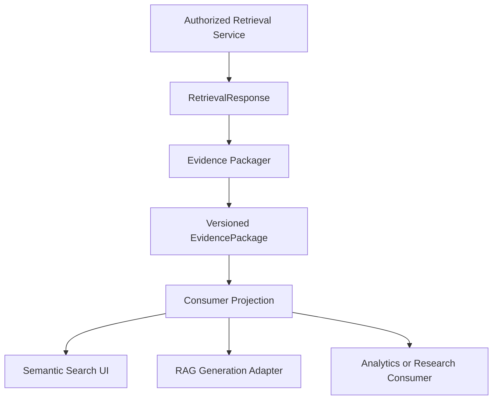
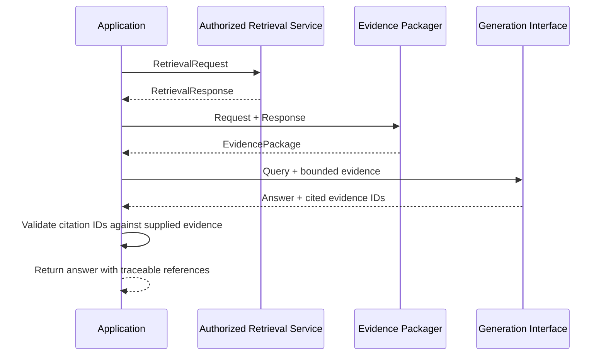
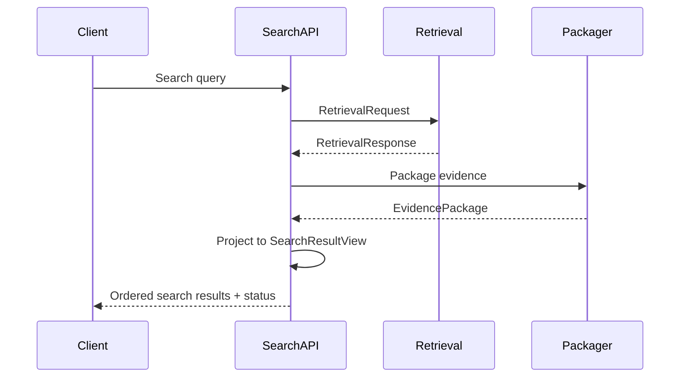

# RET-12.03 — Evidence Packaging and Downstream Integration

## 1. Purpose and Scope

A retrieval pipeline produces candidates. A downstream application needs more than a list of text fragments: it needs evidence that can be identified, traced to its source, interpreted in the correct order, and passed through a stable interface.

This file defines how the output of **RET-12.02 — Implementing the Retrieval Pipeline** becomes a consumer-independent evidence package and how that package is delivered to downstream applications.

The central principle is:

> Retrieval returns candidates. Evidence packaging turns those candidates into traceable, consumer-ready evidence. The downstream application decides what to do with that evidence.

Retrieval remains independent of RAG. The same retrieval capability can support a semantic search interface, document discovery API, analytics workflow, or a RAG application.

This file owns:

- The distinction between retrieved content and traceable evidence.
- Stable result identity and source provenance at the consumer boundary.
- A versioned evidence-package contract.
- Rank, score, metadata, source-reference, and evidence-boundary preservation.
- Handling multiple chunks from the same document.
- Safe projections for different downstream consumers.
- A bounded RAG generation interface.
- At least one non-RAG integration.
- Validation and tests for evidence packaging and consumer contracts.

It does not reimplement retrieval orchestration, candidate fusion, ranking algorithms, authorization systems, prompt engineering, or generation evaluation.

### 1.1 Prerequisites and ownership boundaries

This file assumes the reader understands the contracts and implementation established in RET-12.01 and RET-12.02.

| Existing location | Primary ownership | How this file uses it |
| ----------------- | ----------------- | --------------------- |
| RET-02 | Corpus lifecycle and trusted document metadata | Source-of-record attributes used to resolve provenance |
| RET-03 | Chunking and document structure | Meaning and boundaries of retrieved chunks |
| RET-08 | Candidate generation and combination | Consumes the combined candidate set; does not redefine fusion |
| RET-09 | Ranking and reranking | Preserves the resulting order; does not teach ranking |
| RET-10 | Retrieval evaluation | Supplies evaluation methodology for later end-to-end validation |
| RET-11 | Retrieval diagnostics | Supplies diagnostic methods when packaging defects are investigated |
| RET-12.01 | Architecture and acceptance criteria | Establishes consumer-independent system boundaries |
| RET-12.02 | Retrieval request, response, candidate, and pipeline contracts | Supplies the retrieval response packaged here |

The RET-12.02 `Candidate` contract identifies an evidence unit using `(document_id, chunk_id)`. It carries `source_id`, retrieved `text`, `metadata`, and `source_observations`. The `RetrievalResponse` carries request identity, execution status, results, successful and failed sources, constraint outcomes, and warnings.

This file builds on those contracts. It must not silently invent a final ranking score, replace candidate identity, or treat provider-specific metadata as trusted provenance.

### 1.2 What this file does not attempt

This file does not teach:

- How lexical or dense retrieval works internally.
- How candidates are fused, deduplicated, ranked, or reranked.
- The complete RET-12.02 retrieval pipeline implementation.
- A general-purpose authorization framework.
- LLM architecture, prompt engineering, or agent orchestration.
- Full RAG application architecture.
- Generation-quality evaluation methodology.

The examples use Python 3.10+ and provider-neutral interfaces, consistent with RET-12.02.

---

## 2. From Retrieved Content to Traceable Evidence

A text fragment is not automatically usable evidence.

Consider a retrieval response containing:

```text
"Access tokens expire after 30 minutes."
```

The text alone does not tell a consumer:

- Which document contained it.
- Which chunk was retrieved.
- Which source system owns the document.
- Whether it came from the latest document version.
- Where the passage appears in the source.
- Which retrieval source returned it.
- Where it appeared in the final result order.
- Whether the response is complete or partial.

An evidence item preserves the text together with enough identity, provenance, and retrieval context to support downstream use.

### 2.1 Evidence is not the same as a citation

These terms are related but not interchangeable.

| Concept | Meaning |
| ------- | ------- |
| Retrieved content | The text or payload returned by retrieval |
| Evidence item | Retrieved content plus stable identity, provenance, and relevant retrieval context |
| Source reference | A resolvable pointer to the original source or a location within it |
| Citation | A consumer-facing reference that identifies the evidence supporting a statement |
| Attribution | The relationship between a downstream output and one or more supplied evidence items |

A citation is useful only if it resolves to the intended source and evidence boundary. A filename alone may be insufficient when documents have versions or contain many chunks.

Likewise, attaching a source URL does not prove that the retrieved passage supports a generated statement. Evidence packaging provides traceability; semantic support verification is a separate responsibility.

### 2.2 Preserve the evidence unit

The retrieval pipeline's identity pair remains authoritative:

```text
(document_id, chunk_id)
```

Do not replace it with a display title, URL, array position, or generated summary.

A document can produce multiple chunks. Each chunk is a distinct evidence unit even when several chunks share one `document_id`.

Keep the following distinctions:

- `document_id`: stable identity of the source document in the corpus.
- `chunk_id`: stable identity of the chunk within that document.
- `source_id`: identity of the source system or collection.
- `result_position`: position in this response after ranking.
- `request_id`: identity of the retrieval request.
- `source_observations`: retrieval-source contributions recorded by RET-12.02.

`result_position` is response-specific and must never be used as durable evidence identity.

### 2.3 Preserve order without inventing scores

The final result order is meaningful. A consumer should receive results in the order produced by the retrieval pipeline.

However, the RET-12.02 candidate contract records source-level observations, not necessarily one universal final ranking score. Different retrievers may use scores with different scales and meanings.

Therefore:

- Preserve the final ordinal position.
- Preserve each source observation and its original score.
- Preserve the retriever name and source rank.
- Do not average incomparable source scores.
- Do not label a ranking score as a probability unless the producing component explicitly defines and calibrates it as one.
- Do not fabricate a final score when the ranker only returns an ordering.

A rank position means "this result appeared here in this response." It does not mean "this result has this probability of being relevant."

---

## 3. Evidence Package Contract

The evidence contract is the boundary between retrieval and downstream applications.

It should be stable enough that a consumer does not need to understand the internal retrieval provider, vector database, lexical engine, fusion strategy, or ranker.

### 3.1 Contract design principles

A useful evidence contract follows these principles:

1. **Stable identity:** document and chunk identity survive every downstream transformation.
2. **Traceable provenance:** source references are resolved from trusted corpus metadata, not guessed from provider response fields.
3. **Explicit ordering:** result position is represented directly.
4. **Score honesty:** scores retain their origin and meaning.
5. **Metadata minimization:** only consumer-relevant, approved metadata is exposed.
6. **Clear completeness:** empty, successful, and partial retrieval outcomes remain distinguishable.
7. **Consumer independence:** the common evidence model does not contain RAG prompt fields or UI-specific presentation rules.
8. **Versionability:** the schema has an explicit version and a defined compatibility policy.
9. **Safe serialization:** only intended fields cross the application boundary.
10. **No implied authorization:** packaging does not replace authentication or authorization.

### 3.2 Required, optional, and consumer-specific fields

| Field | Classification | Reason |
| ----- | -------------- | ------ |
| `request_id` | Required | Correlates the package with its retrieval request |
| `schema_version` | Required | Allows consumers to interpret the contract |
| `status` | Required | Distinguishes complete, empty, and partial outcomes |
| `document_id` | Required | Stable source-document identity |
| `chunk_id` | Required | Stable evidence-unit identity |
| `source_id` | Required | Identifies the source system or collection |
| `text` | Required for text retrieval | Content delivered to the consumer |
| `result_position` | Required | Preserves the final retrieval order |
| `source_observations` | Required, possibly empty | Retains source-level retrieval evidence without inventing a combined score |
| `provenance` | Required object; members may be optional | Describes the trusted source reference and location |
| `metadata` | Optional allowlisted fields | Supplies context needed by a specific consumer |
| `warnings` | Optional | Reports non-fatal conditions without exposing sensitive internals |
| `failed_sources` | Required collection, possibly empty | Makes partial source execution visible |
| `constraint_outcomes` | Required collection, possibly empty | Preserves the enforcement outcomes reported by RET-12.02 |

A field is not required merely because it is useful in one application. For example, a search interface may need a display title and URL, while a downstream analytics consumer may need a classification field. Keep those projections outside the shared retrieval contract unless multiple consumers genuinely require them.

### 3.3 Provenance must come from a source of record

The retrieval candidate carries metadata, but metadata should not automatically be trusted as a source reference.

A provider may return fields that are:

- Renamed.
- Stale.
- Incomplete.
- Provider-generated.
- Inconsistent with the corpus record.

The integration layer should resolve provenance using trusted corpus metadata or a controlled source catalog. RET-12.02 already establishes that candidate metadata must be traceable to trusted corpus or index preparation records. This file relies on that invariant; it does not recreate the corpus lifecycle.

A provenance resolver should answer questions such as:

- What source system owns this document?
- Which canonical source reference identifies it?
- Which source version was indexed?
- What page, section, or offset identifies the evidence location?
- Is the source reference safe to expose to this consumer?

If a trusted reference cannot be resolved, do not invent one. Return the evidence with an explicit unavailable provenance field only if the consumer contract allows that condition; otherwise reject the package as incomplete.

---

## 4. A Provider-Neutral Evidence Model

The following model is a downstream contract. It is deliberately separate from the RET-12.02 `Candidate` and `RetrievalResponse` types.

The model preserves source observations exactly as received. It does not introduce a combined relevance score.

### 4.1 Data structures

```python
from dataclasses import dataclass
from typing import Literal, TypeAlias

JSONScalar: TypeAlias = str | int | float | bool | None
JSONValue: TypeAlias = JSONScalar | list["JSONValue"] | dict[str, "JSONValue"]

@dataclass(frozen=True)
class EvidenceProvenance:
    source_reference: str | None
    source_title: str | None
    source_version: str | None
    locator: str | None
    content_hash: str | None
    start_offset: int | None
    end_offset: int | None

@dataclass(frozen=True)
class EvidenceSourceObservation:
    retriever_name: str
    source_rank: int
    score: float | None

@dataclass(frozen=True)
class EvidenceSourceFailure:
    retriever_name: str
    error_type: str
    message: str

@dataclass(frozen=True)
class EvidenceConstraintOutcome:
    retriever_name: str
    field: str
    requirement: Literal["mandatory", "optional"]
    status: Literal["applied", "unsupported", "failed"]
    enforcement_point: str
    diagnostic: str | None

@dataclass(frozen=True)
class EvidenceItem:
    document_id: str
    chunk_id: str
    source_id: str
    text: str
    result_position: int
    source_observations: tuple["EvidenceSourceObservation", ...]
    provenance: EvidenceProvenance
    metadata: dict[str, JSONValue]

@dataclass(frozen=True)
class EvidencePackage:
    schema_version: str
    request_id: str
    status: Literal["success", "empty", "partial"]
    items: tuple[EvidenceItem, ...]
    successful_sources: tuple[str, ...]
    failed_sources: tuple["EvidenceSourceFailure", ...]
    constraint_outcomes: tuple["EvidenceConstraintOutcome", ...]
    warnings: tuple[str, ...]
```

In a production codebase, the production implementation should reuse the canonical RET-12.02 contracts where the module boundary permits. This excerpt defines local typed DTOs to make the downstream evidence contract explicit without depending on a specific repository import path.

The evidence model is frozen at the dataclass level, but nested dictionaries remain mutable. A frozen dataclass does not make nested objects immutable. The packager must copy metadata, and consumers must treat evidence values as read-only. A system that requires stronger immutability can serialize to immutable representations or expose defensive copies at its API boundary.

The package always contains an `EvidenceProvenance` object. Individual provenance attributes may be `None` when the trusted source system cannot provide that attribute. The shared package therefore preserves the provenance shape without pretending that every source has every locator or version field.

A consumer that requires a resolvable source reference must enforce that requirement in its own projection or release policy. The shared package must not fabricate a reference to satisfy such a consumer.

### 4.2 Field semantics

- `result_position` is a one-based ordinal in the final retrieval response.
- `source_observations` preserves the original source-level rank and score information.
- `provenance.source_reference` is a canonical source pointer resolved by a trusted resolver.
- `locator` identifies a page, section, record, or other source location where available.
- `content_hash` is an optional integrity/version aid; it is not an authorization token.
- `start_offset` and `end_offset` are optional source-relative boundaries. Their unit must be defined by the source integration, such as UTF-8 byte offsets or Unicode code-point offsets. Never mix units.
- `metadata` contains only approved fields needed by downstream consumers.

Do not assume every source can provide page numbers, offsets, version identifiers, or stable URLs. Missing provenance must be represented honestly.

### 4.3 Result identity and request identity

The durable identity of an evidence item is still `(document_id, chunk_id)`.

A consumer may need a request-scoped result identifier for logging or output attribution. If one is added, define it as a separate field and document that it changes between requests. Do not confuse it with durable evidence identity.

For cross-request caching, a consumer should key on stable document/chunk identity plus any relevant source version or content hash. A chunk identifier that is reused after content changes is not sufficient for content-sensitive cache invalidation.

---

## 5. Packaging Retrieval Responses

The packager translates a validated RET-12.02 response into the evidence contract.

It should not perform retrieval, candidate fusion, ranking, or authorization. It validates the boundary conditions needed before evidence is handed to a consumer.

### 5.1 Packaging responsibilities

The packaging boundary should:

1. Confirm that the request and response identifiers match.
2. Preserve the retrieval status.
3. Preserve final result order.
4. Preserve candidate identity and text.
5. Resolve provenance from a trusted source of record.
6. Copy only allowlisted metadata.
7. Preserve source observations without score reinterpretation.
8. Preserve source failures and constraint outcomes.
9. Reject duplicate evidence identities in a supposedly normalized response.
10. Reject evidence that violates the package's required provenance policy.
11. Produce only values compatible with the versioned evidence contract.

### 5.2 Packaging implementation

```python
from copy import deepcopy
from dataclasses import dataclass
from typing import Protocol

class EvidencePackagingError(Exception):
    """Raised when a retrieval response cannot satisfy the evidence contract."""

EVIDENCE_SCHEMA_VERSION = "1.0"

class ProvenanceResolutionError(Exception):
    """Expected failure when trusted source provenance cannot be resolved."""

class ProvenanceResolver(Protocol):
    def resolve(self, candidate: Candidate) -> EvidenceProvenance:
        """Resolve source provenance from trusted corpus metadata."""

class EvidencePackager:
    def __init__(
        self,
        provenance_resolver: ProvenanceResolver,
        allowed_metadata_fields: frozenset[str],
    ) -> None:
        if not callable(getattr(provenance_resolver, "resolve", None)):
            raise ValueError("provenance_resolver must expose resolve()")

        if not isinstance(allowed_metadata_fields, frozenset):
            raise ValueError("allowed_metadata_fields must be a frozenset")

        if any(
            not isinstance(name, str) or not name
            for name in allowed_metadata_fields
        ):
            raise ValueError("metadata field names must be non-empty strings")

        self.provenance_resolver = provenance_resolver
        self.allowed_metadata_fields = allowed_metadata_fields

    def package(
        self,
        request: RetrievalRequest,
        response: RetrievalResponse,
    ) -> EvidencePackage:
        if request.request_id != response.request_id:
            raise EvidencePackagingError(
                "request and response identifiers do not match"
            )

        if response.status not in {"success", "empty", "partial"}:
            raise EvidencePackagingError("unsupported retrieval status")

        if response.status == "empty" and response.results:
            raise EvidencePackagingError(
                "empty response must not contain results"
            )

        if response.status == "success" and (
            not response.results or response.failed_sources
        ):
            raise EvidencePackagingError(
                "successful response must contain results and no failed sources"
            )

        if response.status == "empty" and response.failed_sources:
            raise EvidencePackagingError(
                "empty response must represent complete source execution"
            )

        if response.status == "partial" and (
            not response.failed_sources or not response.successful_sources
        ):
            raise EvidencePackagingError(
                "partial response must identify both failed and successful sources"
            )

        if len(set(response.successful_sources)) != len(
            response.successful_sources
        ):
            raise EvidencePackagingError(
                "successful source list contains duplicates"
            )

        self._verify_mandatory_outcomes(request, response)

        items: list[EvidenceItem] = []
        seen: set[tuple[str, str]] = set()

        for position, candidate in enumerate(response.results, start=1):
            identity = (candidate.document_id, candidate.chunk_id)

            if identity in seen:
                raise EvidencePackagingError(
                    "retrieval response contains duplicate evidence identity"
                )
            seen.add(identity)

            if not candidate.document_id or not candidate.chunk_id:
                raise EvidencePackagingError("candidate identity is incomplete")

            if not candidate.source_id or not candidate.text.strip():
                raise EvidencePackagingError(
                    "candidate source identity or text is incomplete"
                )

            try:
                provenance = self.provenance_resolver.resolve(candidate)
            except ProvenanceResolutionError:
                raise EvidencePackagingError(
                    "trusted source provenance could not be resolved"
                ) from None
            except Exception as exc:
                raise EvidencePackagingError(
                    "provenance resolver failed unexpectedly"
                ) from exc

            if not isinstance(provenance, EvidenceProvenance):
                raise EvidencePackagingError(
                    "provenance resolver returned an invalid contract"
                )

            selected_metadata = {
                key: deepcopy(value)
                for key, value in candidate.metadata.items()
                if key in self.allowed_metadata_fields
            }

            items.append(
                EvidenceItem(
                    document_id=candidate.document_id,
                    chunk_id=candidate.chunk_id,
                    source_id=candidate.source_id,
                    text=candidate.text,
                    result_position=position,
                    source_observations=tuple(
                        EvidenceSourceObservation(
                            retriever_name=observation.retriever_name,
                            source_rank=observation.source_rank,
                            score=observation.score,
                        )
                        for observation in candidate.source_observations
                    ),
                    provenance=provenance,
                    metadata=selected_metadata,
                )
            )

        return EvidencePackage(
            schema_version=EVIDENCE_SCHEMA_VERSION,
            request_id=response.request_id,
            status=response.status,
            items=tuple(items),
            successful_sources=tuple(response.successful_sources),
            failed_sources=tuple(
                EvidenceSourceFailure(
                    retriever_name=failure.retriever_name,
                    error_type=failure.error_type,
                    message=failure.message,
                )
                for failure in response.failed_sources
            ),
            constraint_outcomes=tuple(
                EvidenceConstraintOutcome(
                    retriever_name=outcome.retriever_name,
                    field=outcome.field,
                    requirement=outcome.requirement,
                    status=outcome.status,
                    enforcement_point=outcome.enforcement_point,
                    diagnostic=outcome.diagnostic,
                )
                for outcome in response.constraint_outcomes
            ),
            warnings=tuple(response.warnings),
        )

    @staticmethod
    def _verify_mandatory_outcomes(
        request: RetrievalRequest,
        response: RetrievalResponse,
    ) -> None:
        mandatory_fields = set(request.constraints.mandatory)

        for source_name in response.successful_sources:
            for field_name in mandatory_fields:
                matching = [
                    outcome
                    for outcome in response.constraint_outcomes
                    if outcome.retriever_name == source_name
                    and outcome.field == field_name
                    and outcome.requirement == "mandatory"
                ]

                if len(matching) != 1 or matching[0].status != "applied":
                    raise EvidencePackagingError(
                        "mandatory constraint outcome is missing or unconfirmed"
                    )
```

This code is an integration example and assumes the RET-12.02 types are imported. It intentionally fails closed when mandatory constraint outcomes are absent or ambiguous for a successful source.

The packaging check is a **downstream release-integrity gate**, not constraint enforcement. RET-12.02 owns constraint declaration, adapter capability validation, provider execution, and candidate-level enforcement semantics. RET-12.03 consumes the resulting `RetrievalResponse` and refuses to release evidence when the response does not contain the enforcement information required by the downstream contract.

This distinction prevents RET-12.03 from becoming a second implementation of retrieval constraint enforcement.

The check does not independently prove that a provider applied a filter correctly. RET-12.02 explains that adapter enforcement declarations are capability and execution attestations, not independent provider receipts. Real-provider contract tests and deployment verification remain necessary.

The example also assumes that the response has already passed RET-12.02 contract validation and the authorization wrapper where required. The packager adds downstream contract checks; it does not replace those controls.

### 5.3 Metadata allowlisting

Do not forward every candidate metadata field by default.

Metadata can contain:

- Internal identifiers.
- Tenant or access-control attributes.
- Personal or confidential information.
- Provider-specific fields.
- Fields that are irrelevant to the consumer.
- Values that are expensive or unsafe to serialize.

Use an explicit allowlist for each consumer boundary. The shared evidence package should expose only common fields. A consumer-specific projection can add a small, reviewed set of fields.

Avoid putting secrets, raw provider payloads, access tokens, internal index names, or unrestricted ACL metadata into evidence responses.

### 5.4 Serialization and API boundary

Serialization should be explicit. Do not rely on generic object serialization that may expose internal attributes as the model evolves.

The shared contract defines metadata as recursive JSON-compatible values. This is a type-level contract; runtime JSON compatibility is enforced at the serialization boundary. A transport serializer can therefore be small and deterministic:

```python
import json
from dataclasses import asdict

class EvidenceSerializationError(ValueError):
    """Raised when an evidence package cannot be serialized safely."""

def serialize_evidence_package(package: EvidencePackage) -> str:
    payload = asdict(package)

    try:
        return json.dumps(
            payload,
            ensure_ascii=False,
            separators=(",", ":"),
            allow_nan=False,
        )
    except (TypeError, ValueError) as exc:
        raise EvidenceSerializationError(
            "evidence package contains a non-JSON-compatible value"
        ) from exc
```

The serializer is intentionally limited to the approved DTO. It does not serialize arbitrary provider objects or negotiate schema compatibility. `allow_nan=False` prevents non-standard JSON numeric values from crossing the API boundary.

The transport layer should still apply the API's response-size limits and authentication/authorization policy. Serialization establishes shape and value compatibility; it does not establish access control.

The serializer shown here uses a stable representation policy: optional scalar fields are serialized as `null`, while empty tuple-based collections are serialized as empty JSON arrays (`[]`). Keep this policy consistent across API versions unless a deliberate contract change is introduced.

The transport layer should not serialize arbitrary Python objects from `metadata`. The packager copies only allowlisted fields, while the serializer is the final runtime JSON-compatibility boundary for the approved DTO. Metadata values are intended to satisfy the shared JSON-compatible metadata contract established in RET-12.02; the serializer is the runtime check that prevents incompatible values from crossing the API boundary.

---

## 6. Provenance, Source References, and Evidence Boundaries

Provenance is what allows a downstream consumer to move from a retrieved passage back to the source record.

### 6.1 Provenance attributes

Depending on the corpus and source system, useful attributes include:

| Attribute | Example | Notes |
| --------- | ------- | ----- |
| Source reference | Canonical HTTPS document URL or internal document key | Must be resolved from a trusted source catalog |
| Source title | `Employee Access Policy` | Display value; not a stable identifier |
| Source version | `v7` or source revision ID | Needed when content changes over time |
| Locator | `Section 4.2`, page 8, record key | Must use the source's actual locator semantics |
| Content hash | SHA-256 digest | Helps identify content version; does not prove authority |
| Start/end offsets | `1250`–`1680` | Must define byte versus character units |

A URL is not automatically safe to expose. A consumer may have access to the retrieval result but not to the source URL, or the URL may reveal internal infrastructure. Apply a source-reference policy at the application boundary.

### 6.2 Multiple and overlapping chunks from one document

Do not merge chunks simply because they share a document identifier.

Two chunks may legitimately overlap:

```text
chunk-10: characters 0–500
chunk-11: characters 400–900
```

RET-12.03 does **not** perform semantic overlap deduplication by default. The evidence package preserves the retrieval response's evidence identity and ordering. This keeps packaging from silently changing retrieval semantics.

A consumer-specific projection may collapse overlapping display excerpts when that improves presentation, but it must retain a complete mapping from the display excerpt back to every contributing `(document_id, chunk_id)` and its provenance. The projection must not create a synthetic evidence identity and then discard the original identities.

Therefore:

- Exact duplicate `(document_id, chunk_id)` identities are a packaging error.
- Distinct chunks with overlapping text are valid unless the retrieval contract has already declared them duplicates.
- Overlap reduction for display belongs to the consumer projection.
- Any merged display excerpt must retain all contributing evidence references.

Two chunks may:

- Represent separate sections.
- Contain different evidence.
- Have different source offsets.
- Be independently ranked.
- Be needed to preserve an answer's traceability.

A consumer may choose to group results visually by document, but the underlying evidence items should retain their individual chunk identities and result positions.

If overlapping chunks are presented together, the consumer may create a display-only excerpt. Preserve references to every contributing chunk. Do not silently replace multiple evidence identities with one synthetic chunk identity.

### 6.3 Evidence integrity and freshness

The source version and optional content hash help detect stale references.

A downstream system should define what happens when:

- The source document has been deleted.
- The source version has changed.
- The URL now points to different content.
- The indexed chunk no longer matches the current source.
- A source locator cannot be resolved.

Possible policies include displaying the indexed snapshot with its version, marking the reference stale, or requiring re-indexing before use. The correct policy depends on the application and its freshness requirements.

Do not claim that a content hash proves the document is authoritative or that it was authorized for a particular user. It establishes a content identity check, not trust or access rights.

---

## 7. Partial, Empty, and Invalid Evidence

Downstream consumers must interpret retrieval status deliberately.

RET-12.02 defines:

- `success`: all selected sources completed successfully and at least one result was returned.
- `empty`: all selected sources completed successfully, but no result was returned.
- `partial`: at least one selected source failed while at least one other source completed successfully.

A partial response can contain results or can be empty.

### 7.1 Consumer policy

| Retrieval outcome | Typical consumer behavior |
| ----------------- | -------------------------- |
| `success` with results | Continue with the evidence package |
| `empty` | Return a clear no-results state; do not invent evidence |
| `partial` with results | Continue only if the consumer's completeness policy permits partial coverage |
| `partial` without results | Report incomplete retrieval; do not mislabel it as a complete no-results outcome |
| Invalid response or packaging failure | Reject the package and surface a controlled application error |

The correct policy is workload-dependent. A document discovery UI may display partial results with a warning. A compliance decision workflow may require all configured sources to succeed and should reject partial coverage.

### 7.2 Never silently downgrade failure

Do not convert:

- A provider failure into an empty successful response.
- A mandatory constraint failure into an ordinary warning.
- Missing provenance into a fabricated URL.
- A malformed candidate into a displayable result.
- A partial response into a complete response.

A consumer should inspect `status`, `failed_sources`, and `constraint_outcomes`, not merely whether `items` is non-empty.

### 7.3 Authorization remains upstream and continuous

Evidence packaging is not an authorization boundary.

The application must call the authorized retrieval service described in RET-12.02 for permission-sensitive retrieval. It must not accept arbitrary candidate lists supplied by an untrusted caller.

Authorization may also need to be checked again when a user opens a source reference, because permissions can change between retrieval and source access. A previously authorized evidence package is not a permanent access grant.

---

## 8. Consumer-Specific Projections

The shared evidence package is not necessarily the ideal presentation model for every application.

Use a projection layer to translate it into the smallest contract a consumer needs.



The projection layer may format titles, snippets, source links, or generation input. It must not change durable evidence identity, silently reorder results, or discard provenance needed for traceability.

### 8.1 Search result projection

A search interface may need a smaller view:

```python
from dataclasses import dataclass

@dataclass(frozen=True)
class SearchResultView:
    document_id: str
    chunk_id: str
    title: str
    snippet: str
    source_reference: str | None
    position: int

def to_search_view(item: EvidenceItem) -> SearchResultView:
    title = item.provenance.source_title or item.document_id

    return SearchResultView(
        document_id=item.document_id,
        chunk_id=item.chunk_id,
        title=title,
        snippet=item.text,
        source_reference=item.provenance.source_reference,
        position=item.result_position,
    )
```

The search application owns display formatting, pagination, highlighting, and UI-specific behavior. The retrieval core does not need to know how a search card is rendered.

The projection preserves document and chunk identity so that a click, feedback event, or later audit can be tied to the original evidence item.

---

## 9. Bounded RAG Integration

RAG is one downstream consumer of the evidence package.

The integration boundary should pass retrieved evidence to a generation component without coupling the retrieval pipeline to a particular LLM provider, prompt format, or orchestration framework.

### 9.1 Integration flow



The application is responsible for deciding whether the response status is acceptable before invoking generation.

The generation component receives a bounded set of evidence items. It should not receive internal provider objects, raw adapter diagnostics, or unrelated candidate metadata.

### 9.2 Generation interface

```python
from dataclasses import dataclass
from typing import Protocol

@dataclass(frozen=True)
class GenerationEvidence:
    evidence_id: str
    document_id: str
    chunk_id: str
    text: str
    source_reference: str | None

@dataclass(frozen=True)
class GenerationRequest:
    query: str
    evidence: tuple[GenerationEvidence, ...]

@dataclass(frozen=True)
class GenerationResult:
    answer: str
    cited_evidence_ids: tuple[str, ...]

class GenerationClient(Protocol):
    def generate(self, request: GenerationRequest) -> GenerationResult:
        """Generate an answer using only the supplied evidence context."""
```

The `evidence_id` in this bounded interface is a request-scoped identifier assigned by the application when constructing the generation request. It maps back to the stable `(document_id, chunk_id)` pair in the evidence package. It is not a replacement for that durable identity.

### 9.3 Build and validate the generation request

```python
def build_generation_request(
    query: str,
    package: EvidencePackage,
) -> tuple[GenerationRequest, dict[str, EvidenceItem]]:
    if package.status == "empty":
        raise ValueError("cannot generate from an empty evidence package")

    if package.status == "partial":
        raise ValueError(
            "this consumer requires complete retrieval coverage"
        )

    evidence_items: list[GenerationEvidence] = []
    evidence_lookup: dict[str, EvidenceItem] = {}

    for index, item in enumerate(package.items, start=1):
        evidence_id = f"{package.request_id}:e{index}"

        evidence_items.append(
            GenerationEvidence(
                evidence_id=evidence_id,
                document_id=item.document_id,
                chunk_id=item.chunk_id,
                text=item.text,
                source_reference=item.provenance.source_reference,
            )
        )
        evidence_lookup[evidence_id] = item

    return (
        GenerationRequest(
            query=query,
            evidence=tuple(evidence_items),
        ),
        evidence_lookup,
    )

def validate_generation_result(
    result: GenerationResult,
    evidence_lookup: dict[str, EvidenceItem],
) -> None:
    if not result.answer.strip():
        raise ValueError("generation result contains an empty answer")

    unknown_ids = set(result.cited_evidence_ids) - set(evidence_lookup)
    if unknown_ids:
        raise ValueError("generation result cited evidence not supplied")
```

This validation proves only that returned citation identifiers belong to the evidence supplied to the generation component. It does not prove that the cited passages semantically support the answer.

The application must render citations using the trusted `EvidenceItem` associated with each identifier. It must not accept a model-generated URL or source title as authoritative.

### 9.4 Evidence is untrusted input

Retrieved text is data, not executable instruction.

A retrieved document may contain malicious, irrelevant, or instruction-like content. The generation boundary should preserve the distinction between the user's task and retrieved evidence. Do not execute commands, invoke tools, or change application policy merely because retrieved text asks for it.

This is a trust-boundary requirement, not a prompt-engineering lesson. Detailed prompt construction and injection mitigation belong to the relevant LLM and security curriculum modules.

### 9.5 Bounded integration responsibilities

The RAG consumer owns:

- Deciding whether partial retrieval is acceptable.
- Selecting the evidence subset within its context budget.
- Constructing the generation request.
- Handling generation errors and timeouts.
- Validating returned evidence identifiers.
- Rendering citations from trusted evidence metadata.
- Separately evaluating answer quality.

The retrieval service owns retrieval behavior. The packager owns the evidence contract. The generation client owns generation execution. Keeping these responsibilities separate makes failures easier to isolate.

---

## 10. Non-RAG Integration: Semantic Search API

A semantic search API demonstrates that retrieval can serve an application without generating an answer.

The application accepts a user query, calls the same retrieval service, packages the response, and returns a search-oriented projection.

### 10.1 Request and response flow



The API layer owns HTTP validation, authentication, pagination policy, and response serialization. It does not own lexical or dense retrieval internals.

### 10.2 Consumer service example

```python
from dataclasses import dataclass
from typing import Literal, Protocol

@dataclass(frozen=True)
class SearchResponse:
    request_id: str
    status: Literal["success", "empty", "partial"]
    results: tuple[SearchResultView, ...]
    warnings: tuple[str, ...]

class RetrievalService(Protocol):
    def retrieve(
        self,
        request: RetrievalRequest,
    ) -> RetrievalResponse:
        """Execute the authorized retrieval contract."""

class SemanticSearchService:
    def __init__(
        self,
        retrieval_service: RetrievalService,
        packager: EvidencePackager,
    ) -> None:
        self.retrieval_service = retrieval_service
        self.packager = packager

    def search(self, request: RetrievalRequest) -> SearchResponse:
        retrieval_response = self.retrieval_service.retrieve(request)

        package = self.packager.package(
            request=request,
            response=retrieval_response,
        )

        views = tuple(
            to_search_view(item)
            for item in package.items
        )

        return SearchResponse(
            request_id=package.request_id,
            status=package.status,
            results=views,
            warnings=package.warnings,
        )
```

In a permission-sensitive deployment, `retrieval_service` must be the authorized retrieval service boundary, not an unwrapped pipeline instance. The example uses the local `RetrievalService` protocol to make the consumer dependency explicit. A production application should import and reuse the canonical RET-12.02 service protocol where the repository module boundary permits.

The semantic search consumer does not need a generation model. It uses the same evidence contract and a different projection.

### 10.3 Why this is a meaningful non-RAG example

This integration demonstrates consumer independence:

- The retrieval pipeline is unchanged.
- The evidence package is unchanged.
- Only the consumer projection differs.
- The search API owns display and transport concerns.
- No LLM or generation component is required.

A second consumer should not require a second copy of the retrieval implementation.

---

## 11. Contract Versioning and Compatibility

Once more than one application consumes an evidence package, its schema becomes an integration contract.

### 11.1 Versioning policy

Use an explicit schema version, such as `1.0`.

A practical compatibility policy is:

| Change | Compatibility expectation |
| ------ | -------------------------- |
| Add an optional field | Usually backward-compatible if consumers ignore unknown fields |
| Add a new status value | Potentially breaking; consumers may use exhaustive status handling |
| Rename or remove a field | Breaking |
| Change field meaning | Breaking even if the type is unchanged |
| Change identifier semantics | Breaking |
| Change score interpretation | Breaking |
| Change offset unit | Breaking |
| Make an optional field mandatory | Potentially breaking |

Do not assume that adding a field is always safe. Strict consumers may reject unknown fields. Document whether consumers must ignore unknown optional fields or reject unknown schema versions. The serializer does not perform schema compatibility negotiation; it serializes the already-versioned `EvidencePackage`. Compatibility validation belongs at the contract boundary of the producer or consumer.

### 11.2 Contract evolution

For a breaking change:

1. Define the new contract version.
2. Document the semantic change.
3. Update the packager and schema validation.
4. Update consumer projections.
5. Run contract tests against every known consumer.
6. Migrate consumers deliberately.
7. Retire the old version only after its consumers have moved.

Avoid creating a generic transformation framework before there is a real compatibility requirement. A small explicit versioned DTO is usually easier to reason about.

---

## 12. Failure Handling Across the Packaging Boundary

A useful integration reports failures at the boundary where they occur.

| Failure | Responsible boundary | Expected handling |
| ------- | -------------------- | ----------------- |
| Provider timeout | Retrieval adapter/orchestrator | RET-12.02 source failure semantics |
| Invalid candidate contract | Retrieval validation | Reject as a contract failure |
| Mandatory constraint not confirmed | Retrieval constraint boundary | Do not release unverified evidence |
| Missing trusted source record | Provenance resolver | Reject or mark unavailable according to explicit policy |
| Duplicate `(document_id, chunk_id)` | Packaging validation | Reject inconsistent response |
| Disallowed metadata field | Consumer projection | Omit it from the consumer payload |
| Unsupported package schema | Consumer contract boundary | Reject with a controlled compatibility error |
| Generation timeout | Generation client | Return a downstream generation failure |
| Unknown citation identifier | Generation output validation | Reject invalid attribution |
| Source link no longer accessible | Source access boundary | Reauthorize and report unavailable/stale source |

Do not collapse these into a generic "RAG failed" or "search failed" error. The distinction is needed for correct retries, user messaging, and later diagnosis.

Use RET-11 when a retrieval-stage failure requires root-cause analysis. Use RET-10 when retrieval or downstream quality needs formal measurement. RET-12.04 owns the integrated evaluation and failure-isolation review.

---

## 13. Testing Evidence Packaging and Consumers

Tests must prove that the evidence contract preserves identity, provenance, order, and status. A test that only checks whether a package object was created is insufficient.

### 13.1 Unit tests for evidence packaging

The following examples assume the RET-12.02 contracts and the evidence classes from this file are available in the test module.

```python
from dataclasses import dataclass

import pytest

@dataclass(frozen=True)
class FakeProvenanceResolver:
    def resolve(self, candidate: Candidate) -> EvidenceProvenance:
        return EvidenceProvenance(
            source_reference=f"https://docs.example.test/{candidate.document_id}",
            source_title="Example policy",
            source_version="v3",
            locator=f"chunk:{candidate.chunk_id}",
            content_hash=None,
            start_offset=None,
            end_offset=None,
        )

def make_candidate(
    document_id: str = "doc-1",
    chunk_id: str = "chunk-1",
) -> Candidate:
    return Candidate(
        document_id=document_id,
        chunk_id=chunk_id,
        source_id="knowledge-base",
        text="Access tokens expire after 30 minutes.",
        metadata={
            "department": "engineering",
            "internal_acl": ["group-a"],
        },
        source_observations=(),
    )

def make_request() -> RetrievalRequest:
    return RetrievalRequest(
        query="token expiry",
        constraints=ConstraintSet(),
        config=RetrievalConfig(
            enabled_sources=("lexical",),
        ),
        request_id="req-123",
    )

def make_response(
    results: tuple[Candidate, ...],
    status: str = "success",
) -> RetrievalResponse:
    return RetrievalResponse(
        request_id="req-123",
        status=status,
        results=results,
        successful_sources=("lexical",),
        failed_sources=(),
        constraint_outcomes=(),
        warnings=(),
    )

def make_packager() -> EvidencePackager:
    return EvidencePackager(
        provenance_resolver=FakeProvenanceResolver(),
        allowed_metadata_fields=frozenset({"department"}),
    )

def test_packager_preserves_identity_order_and_provenance():
    first = make_candidate("doc-1", "chunk-1")
    second = make_candidate("doc-1", "chunk-2")

    package = make_packager().package(
        make_request(),
        make_response((first, second)),
    )

    assert package.items[0].document_id == "doc-1"
    assert package.items[0].chunk_id == "chunk-1"
    assert package.items[0].result_position == 1
    assert package.items[1].chunk_id == "chunk-2"
    assert package.items[1].result_position == 2
    assert package.items[0].provenance.source_version == "v3"

def test_packager_does_not_expose_non_allowlisted_metadata():
    package = make_packager().package(
        make_request(),
        make_response((make_candidate(),)),
    )

    assert package.items[0].metadata == {
        "department": "engineering"
    }
    assert "internal_acl" not in package.items[0].metadata

def test_packager_rejects_missing_provenance():
    class MissingProvenanceResolver:
        def resolve(self, candidate: Candidate) -> EvidenceProvenance:
            raise ProvenanceResolutionError("source record not found")

    packager = EvidencePackager(
        provenance_resolver=MissingProvenanceResolver(),
        allowed_metadata_fields=frozenset({"department"}),
    )

    with pytest.raises(EvidencePackagingError):
        packager.package(
            make_request(),
            make_response((make_candidate(),)),
        )

def test_packager_rejects_malformed_provenance():
    class MalformedResolver:
        def resolve(self, candidate: Candidate) -> EvidenceProvenance:
            return "not-provenance"

    packager = EvidencePackager(
        provenance_resolver=MalformedResolver(),
        allowed_metadata_fields=frozenset({"department"}),
    )

    with pytest.raises(EvidencePackagingError):
        packager.package(
            make_request(),
            make_response((make_candidate(),)),
        )

def test_packager_wraps_unexpected_provenance_failure():
    class BrokenResolver:
        def resolve(self, candidate: Candidate) -> EvidenceProvenance:
            raise RuntimeError("source catalog unavailable")

    packager = EvidencePackager(
        provenance_resolver=BrokenResolver(),
        allowed_metadata_fields=frozenset({"department"}),
    )

    with pytest.raises(EvidencePackagingError, match="unexpectedly"):
        packager.package(
            make_request(),
            make_response((make_candidate(),)),
        )

def test_packager_rejects_request_response_mismatch():
    request = make_request()
    response = make_response((make_candidate(),))

    wrong_request = RetrievalRequest(
        query=request.query,
        constraints=request.constraints,
        config=request.config,
        request_id="different-request",
    )

    with pytest.raises(EvidencePackagingError):
        make_packager().package(wrong_request, response)

def test_packager_rejects_duplicate_evidence_identity():
    candidate = make_candidate()

    with pytest.raises(EvidencePackagingError):
        make_packager().package(
            make_request(),
            make_response((candidate, candidate)),
        )

def test_packager_rejects_empty_status_with_results():
    with pytest.raises(EvidencePackagingError):
        make_packager().package(
            make_request(),
            make_response((make_candidate(),), status="empty"),
        )

def test_packager_accepts_empty_response_without_results():
    package = make_packager().package(
        make_request(),
        make_response((), status="empty"),
    )

    assert package.status == "empty"
    assert package.items == ()

def test_packager_copies_allowlisted_metadata():
    candidate = make_candidate()
    package = make_packager().package(
        make_request(),
        make_response((candidate,)),
    )

    candidate.metadata["department"] = "changed-after-packaging"

    assert package.items[0].metadata["department"] == "engineering"
```

The tests use a fake provenance resolver. They prove packager behavior against the resolver contract, not the correctness of a live source catalog or source URL.

### 13.2 Tests for mandatory constraints and partial outcomes

When a request contains mandatory constraints, the packager must not release results from a successful source unless the response reports the required enforcement outcomes as applied.

The following focused tests exercise the packaging gate. They assume the RET-12.02 `ConstraintOutcome` type is imported.

```python
def make_mandatory_request() -> RetrievalRequest:
    return RetrievalRequest(
        query="token expiry",
        constraints=ConstraintSet(
            mandatory={"tenant_id": "tenant-a"}
        ),
        config=RetrievalConfig(enabled_sources=("lexical",)),
        request_id="req-123",
    )

def make_constraint_outcome(
    status: str,
) -> ConstraintOutcome:
    return ConstraintOutcome(
        retriever_name="lexical",
        field="tenant_id",
        requirement="mandatory",
        status=status,
        enforcement_point="provider",
        diagnostic=None,
    )

def test_packager_accepts_confirmed_mandatory_outcome():
    request = make_mandatory_request()
    response = RetrievalResponse(
        request_id="req-123",
        status="success",
        results=(make_candidate(),),
        successful_sources=("lexical",),
        failed_sources=(),
        constraint_outcomes=(make_constraint_outcome("applied"),),
        warnings=(),
    )

    package = make_packager().package(request, response)

    assert len(package.items) == 1

@pytest.mark.parametrize("status", ["unsupported", "failed"])
def test_packager_rejects_unconfirmed_mandatory_outcome(status):
    request = make_mandatory_request()
    response = RetrievalResponse(
        request_id="req-123",
        status="success",
        results=(make_candidate(),),
        successful_sources=("lexical",),
        failed_sources=(),
        constraint_outcomes=(make_constraint_outcome(status),),
        warnings=(),
    )

    with pytest.raises(EvidencePackagingError):
        make_packager().package(request, response)

def test_packager_rejects_missing_mandatory_outcome():
    request = make_mandatory_request()
    response = RetrievalResponse(
        request_id="req-123",
        status="success",
        results=(make_candidate(),),
        successful_sources=("lexical",),
        failed_sources=(),
        constraint_outcomes=(),
        warnings=(),
    )

    with pytest.raises(EvidencePackagingError):
        make_packager().package(request, response)

def test_packager_rejects_duplicate_mandatory_outcomes():
    request = make_mandatory_request()
    outcome = make_constraint_outcome("applied")
    response = RetrievalResponse(
        request_id="req-123",
        status="success",
        results=(make_candidate(),),
        successful_sources=("lexical",),
        failed_sources=(),
        constraint_outcomes=(outcome, outcome),
        warnings=(),
    )

    with pytest.raises(EvidencePackagingError):
        make_packager().package(request, response)

def test_packager_preserves_partial_response_without_results():
    request = make_request()
    response = RetrievalResponse(
        request_id="req-123",
        status="partial",
        results=(),
        successful_sources=("lexical",),
        failed_sources=(
            SourceFailure(
                retriever_name="dense",
                error_type="provider_execution_error",
                message="Provider execution failed",
            ),
        ),
        constraint_outcomes=(),
        warnings=("dense source failed",),
    )

    package = make_packager().package(request, response)

    assert package.status == "partial"
    assert package.items == ()
    assert len(package.failed_sources) == 1
```

These tests exercise the packaging gate. They do not replace RET-12.02's tests that validate provider enforcement declarations and candidate-level mandatory constraints.

### 13.3 Consumer contract tests

Test the consumer-facing projection separately from the retrieval implementation.

For a search projection, verify:

- Result order is preserved.
- Document and chunk identity remain available.
- Display title fallback is deterministic.
- A missing source reference remains missing rather than fabricated.
- Internal metadata is not exposed.
- `partial` remains `partial` in the API response.

For a RAG adapter, verify:

- Only selected evidence is sent.
- Each supplied evidence identifier maps to one package item.
- Returned citation identifiers are a subset of supplied identifiers.
- Unknown citation identifiers are rejected.
- Empty and disallowed partial packages are not sent to generation.
- Generation failure does not mutate the retrieval response.

### 13.4 What each test level establishes

| Test level | Establishes | Does not establish |
| ---------- | ----------- | ------------------- |
| Packager unit test | Field mapping, identity preservation, ordering, allowlisting | Live source correctness |
| Provenance resolver contract test | Resolver output follows the agreed contract | That the source is always reachable |
| Consumer contract test | Consumer receives the expected stable shape | Retrieval relevance |
| Integration test | Retrieval response can flow through packaging into a consumer | Production provider behavior unless real providers are used |
| Real-provider contract test | Actual provider metadata and source-reference behavior for tested cases | Universal correctness across all corpus states |
| End-to-end test | The selected application path works for the tested scenario | General quality or factual correctness |

Use the appropriate level of evidence for each claim. Fake-based integration tests must not be presented as proof of real-provider provenance behavior.

---

## 14. Practical Integration Lab

Build two consumers over the same retrieval capability:

1. A semantic search consumer that returns ordered result cards.
2. A bounded RAG consumer that sends a selected evidence set to a generation interface.

Do not duplicate the retrieval implementation.

### 14.1 Required artifacts

Produce:

- A versioned evidence-package schema.
- A provenance resolver backed by trusted corpus metadata.
- An evidence packager.
- A metadata allowlist for each consumer.
- A search result projection.
- A bounded generation request/response contract.
- Citation identifier validation.
- Unit tests for packaging.
- Consumer contract tests.
- At least one integration test for each consumer.
- A short record of unresolved provenance and source-freshness limitations.

### 14.2 Suggested implementation sequence

1. Inspect the RET-12.02 `RetrievalResponse` and `Candidate` contracts.
2. Define the evidence DTO without changing the retrieval contracts.
3. Identify the trusted source-of-record for provenance.
4. Implement and test the provenance resolver.
5. Implement the evidence packager and mandatory-outcome gate.
6. Add consumer-specific metadata allowlists.
7. Implement the semantic search projection.
8. Implement the bounded generation adapter.
9. Validate citation identifiers against supplied evidence.
10. Add integration tests and document limitations.

This sequence keeps the work focused on the integration boundary rather than reopening retrieval internals.

### 14.3 Acceptance checklist

- The evidence package has an explicit schema version.
- Request identity is preserved and checked.
- Document and chunk identity remain stable.
- Result ordering is preserved.
- Source observations retain their original meaning.
- No universal score or probability is invented.
- Provenance is resolved from a trusted source of record.
- Source version and locator are represented when available.
- Missing provenance is handled explicitly.
- Multiple chunks from one document remain individually traceable.
- Metadata is allowlisted for each consumer.
- Partial and empty retrieval outcomes remain distinguishable.
- Mandatory constraint outcomes are checked before packaging.
- Permission-sensitive retrieval uses the authorized service boundary.
- Search integration works without a generation model.
- RAG integration uses a bounded generation interface.
- Citation identifiers are checked against supplied evidence.
- Generation errors remain distinct from retrieval errors.
- Unit and consumer contract tests cover the evidence boundary.
- Fake-based evidence is distinguished from real-provider validation.

---

## 15. Engineering Trade-offs and Common Mistakes

### 15.1 Common mistakes

| Mistake | Why it is harmful | Better approach |
| ------- | ----------------- | --------------- |
| Using array position as evidence identity | Position changes when ranking or filtering changes | Preserve `(document_id, chunk_id)` |
| Using document title as identity | Titles can change or collide | Use stable corpus identifiers |
| Treating every score as a probability | Score scales and semantics differ | Preserve score origin and meaning |
| Averaging source scores without calibration | Produces a misleading combined value | Preserve source observations; use RET-08/09 ranking contracts |
| Forwarding all metadata | Leaks irrelevant or sensitive attributes | Use consumer-specific allowlists |
| Building citations from model-generated URLs | The model output is not a trusted source of record | Resolve citations from packaged evidence |
| Merging chunks without retaining references | Destroys evidence boundaries | Keep chunk identity and map display excerpts to all source chunks |
| Treating `partial` as `success` | Hides incomplete source coverage | Preserve status and let consumer policy decide |
| Assuming packaging proves authorization | Packaging is not an access-control decision | Use the authorized retrieval boundary |
| Assuming a valid citation ID proves factual support | Identifier membership is not semantic entailment | Evaluate support separately |
| Passing provider payloads to consumers | Couples applications to a specific retrieval backend | Expose the shared evidence contract |

### 15.2 Design choices

The simplest useful evidence contract is usually preferable to a large universal schema.

Add a field only when at least one consumer needs it and its semantics can be defined. If only one consumer needs a presentation attribute, keep it in that consumer's projection.

Likewise, do not force every application to consume every provenance field. A regulated workflow may require source version and precise locator. A basic search interface may need only a title and link. The shared package can preserve optional provenance while each consumer chooses its required completeness policy.

### 15.3 When to reject rather than degrade

Reject the package when identity is ambiguous, required provenance is missing under the consumer's policy, mandatory constraints are unconfirmed, or the schema is incompatible.

Degrade gracefully only when the contract explicitly allows it—for example, an optional display title can fall back to a stable document identifier. Never degrade a security or traceability invariant into a cosmetic warning.

---

## 16. Interview Preparation

### Q1. Why should evidence packaging be separate from retrieval orchestration?

**Answer:** Retrieval orchestration produces the normalized retrieval response. Evidence packaging creates the stable downstream contract with identity, provenance, ordering, and consumer-safe metadata. This prevents provider and application concerns from becoming coupled.

### Q2. Why should source scores be preserved instead of averaged?

**Answer:** Scores from different retrievers can have different scales and semantics. Averaging them without an explicit calibration contract produces an uninterpretable value. Preserve source observations and rely on the ranking contract for final order.

### Q3. Does a source URL prove that a generated answer is supported?

**Answer:** No. A URL is provenance, not semantic support. The consumer must preserve the retrieved passage and evidence identity, while support quality is evaluated separately.

### Q4. How should overlapping chunks be handled?

**Answer:** RET-12.03 preserves distinct retrieval identities by default. A consumer may merge overlapping display excerpts only if it retains a complete mapping to every contributing evidence item.

### Q5. How should partial retrieval be handled?

**Answer:** The consumer applies a workload-specific completeness policy. Search may display partial results with a warning; a compliance workflow may reject them. The underlying status remains `partial`.

### Q6. Does validating citation IDs prove grounding?

**Answer:** No. It proves only that the cited evidence was supplied to generation. It does not prove that the evidence semantically supports the generated claim.

### Q7. What proves the integration is correct?

**Answer:** Contract tests for identity, ordering, provenance, metadata allowlisting, status handling, and citation validation; integration tests for each consumer; and real-provider evidence for provider-specific provenance behavior. Test evidence must clearly distinguish fakes from live-provider validation.

---

## 17. Self-Assessment and Teaching Check

Use the scenarios below to verify that you can apply the evidence contract independently. Do not rely on memorizing the interview answers.

### Exercise 1 — Identity under reranking

A result appears at position 2 for one query and position 5 for another. Its document and chunk identifiers are unchanged.

**Question:** Which fields remain stable, and which field changes?

**Expected reasoning:** `(document_id, chunk_id)` remains the evidence identity. `result_position` changes because it describes ordering within one response. A request-scoped result identifier may also change.

### Exercise 2 — Conflicting source scores

A lexical source returns score `12.4`; a dense source returns score `0.81`. Both contributed to the same candidate.

**Question:** Should the packager average these values?

**Expected reasoning:** No. Preserve each `SourceObservation` with its retriever identity, source rank, and original score. The packager must not invent a cross-source score or reinterpret the values as probabilities.

### Exercise 3 — Missing provenance

A candidate has valid text and stable identifiers, but the trusted source catalog cannot resolve its source reference. The consumer requires a resolvable source reference.

**Question:** Should the packager fabricate a URL from `document_id`?

**Expected reasoning:** No. Reject the package or evidence item according to the explicit consumer contract. The source reference must come from a trusted resolver.

### Exercise 4 — Multiple chunks from one source

Three retrieved chunks share the same `document_id` but have different `chunk_id` values and source offsets.

**Question:** Can the application group them into one search card?

**Expected reasoning:** Yes, as a presentation decision, but it must preserve all contributing chunk identities and locators. It must not replace them with a synthetic identity that cannot be traced back to the original evidence.

### Exercise 5 — Partial retrieval in two applications

A search interface receives a partial response with useful results. A compliance workflow receives the same response.

**Question:** Must both consumers behave identically?

**Expected reasoning:** No. The search interface may display partial results with a warning. The compliance workflow may reject the response because complete source coverage is required. The retrieval status remains partial in both cases.

### Exercise 6 — Citation validation

A generation component returns a citation ID that was not included in its request.

**Question:** What should the application do?

**Expected reasoning:** Reject the invalid attribution. Resolve citation references only through the evidence lookup created from the package. Do not trust a model-generated URL or title.

### Exercise 7 — Authorization changes

A user was allowed to retrieve a document, but their access is revoked before they click the source reference.

**Question:** Is the old evidence package sufficient authorization to open the source?

**Expected reasoning:** No. The source-access boundary must reauthorize the current request. Evidence packaging preserves traceability but does not grant permanent access.

### Teaching check

Explain, without reading this file:

1. Why retrieved text alone is not a complete evidence contract.
2. Why document and chunk identity must survive downstream transformations.
3. How provenance differs from citation and authorization.
4. Why ranking position and retrieval score have different meanings.
5. How one evidence package can support both RAG and non-RAG consumers.
6. How you would prove that a consumer did not silently lose provenance or misrepresent partial retrieval.

A complete explanation should connect the retrieval response contract, trusted provenance source, evidence packager, consumer projection, and downstream validation.

---

## 18. Completion Criteria

RET-12.03 is complete when you can:

- Explain the difference between retrieved content and traceable evidence.
- Define a versioned, consumer-independent evidence contract.
- Preserve stable document and chunk identifiers.
- Preserve source observations without inventing a combined score.
- Resolve provenance from trusted corpus or source-catalog records.
- Represent source references, versions, and evidence locators honestly.
- Handle multiple chunks from one document without losing identity.
- Apply metadata allowlists at consumer boundaries.
- Preserve success, empty, and partial retrieval status.
- Verify required constraint outcomes before packaging.
- Keep packaging separate from retrieval orchestration and authorization.
- Integrate a non-RAG consumer using the shared evidence contract.
- Integrate a bounded RAG generation interface.
- Validate generation citation identifiers against supplied evidence.
- Distinguish citation membership from semantic support.
- Test packaging, provenance, and consumer contracts.
- Explain the limitations of fake-based versus real-provider validation.
- Defend the evidence contract's design and compatibility decisions.

**Completion standard:** You should be able to take a normalized retrieval response, turn it into traceable evidence, and deliver it to different downstream consumers without coupling the retrieval core to their application-specific behavior.

The next file, **RET-12.04 — End-to-End Evaluation and Design Review**, owns integrated acceptance validation, retrieval-versus-downstream failure isolation, and the final engineering design review.
