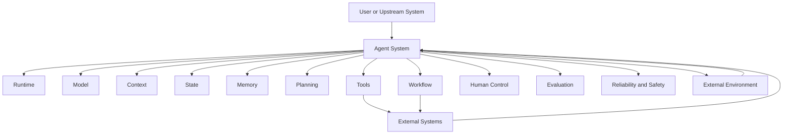
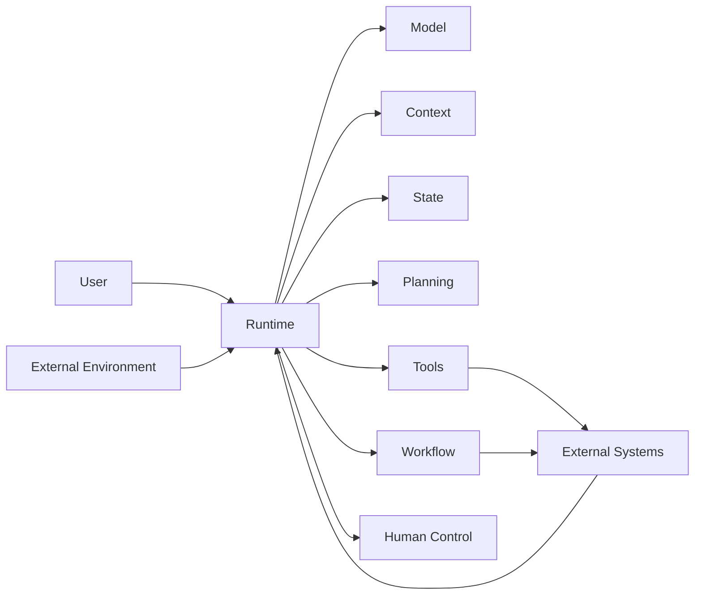

# AGT-01.03 — Agent Architecture and System Composition

## 1. Learning Objectives

By the end of this chapter, you should be able to:

- Explain the major responsibilities that can exist inside an agent system.
- Distinguish the **agent system boundary** from the external environment and external systems.
- Explain the relationship between:
  - user or upstream system,
  - agent system,
  - runtime,
  - model,
  - context,
  - state,
  - memory,
  - planning,
  - tools,
  - workflows,
  - human control,
  - evaluation,
  - reliability and safety.
- Understand why an LLM is only one component of an agent system.
- Explain the responsibility boundary between model capability and surrounding system behavior.
- Distinguish:
  - runtime from planning,
  - context from state and memory,
  - tools from external systems,
  - capability from authorization.
- Understand how these responsibilities can be composed without assuming that every implementation uses the same architecture.
- Identify which later AGT chapters provide detailed engineering treatment for each responsibility.

---

## 2. Prerequisites

You should already understand:

- What an agent is.
- The concept of an agent boundary.
- Goal-directed behavior.
- Agent/environment interaction.
- The difference between:
  - an LLM application,
  - a RAG application,
  - a workflow,
  - an agentic system.

Recommended prerequisites:

- [AGT-01.01 — Agent Definition and System Boundaries](./01-Agent-Definition-and-System-Boundaries.md)
- [AGT-01.02 — Agent vs LLM Applications, Workflows, and RAG Systems](./02-Agent-vs-LLM-Applications-Workflows-and-RAG-Systems.md)

---

## 3. Estimated Reading Time

**25–30 minutes**

---

## 4. Before We Start

The previous chapters answered two foundational questions:

1. **What is an agent?**
2. **How is an agentic system different from an ordinary LLM application, RAG application, or workflow?**

This chapter answers the next question:

> **What is an agent system composed of?**

An agent system should not be imagined as a single model sitting inside an application.

A production agent system can combine multiple responsibilities.

For example:

```text
User / Upstream System
          |
          v
+----------------------------------+
|          Agent System            |
|                                  |
|  Runtime                         |
|  Model                           |
|  Context                         |
|  State                           |
|  Memory                          |
|  Planning                        |
|  Tools                           |
|  Workflows                       |
|  Human Control                   |
|  Evaluation                      |
|  Reliability / Safety            |
+----------------+-----------------+
                 |
                 v
       External Environment
       / External Systems
```

This is a **conceptual architecture**, not a requirement that every system contain these as separate modules or services.

Some systems may combine several responsibilities.

Others may omit responsibilities they do not need.

The important goal is to understand the **responsibilities and their boundaries**, not memorize a fixed implementation.

---

# 5. Why This Exists

A simple LLM application can often be represented as:

```text
Input
  ↓
Model
  ↓
Output
```

That mental model becomes insufficient when a system must:

- pursue a goal across multiple steps,
- interact with external systems,
- maintain execution state,
- use external capabilities,
- adapt to observations,
- involve humans,
- coordinate deterministic and adaptive execution,
- operate under reliability and safety constraints.

The architecture therefore becomes a composition of responsibilities.

Instead of asking only:

> “Which model are we using?”

an engineer must ask:

> **“What responsibilities does this system need to perform?”**

This distinction matters because a capable model does not automatically create a well-designed agent system.

The model may provide reasoning, interpretation, generation, or recommendations.

The surrounding architecture determines how those capabilities participate in controlled system behavior.

---

# 6. Mental Model

A useful high-level mental model is:

```text
                    User / Upstream System
                              |
                              v
                    +-------------------+
                    |   Agent System    |
                    |                   |
                    |  Runtime          |
                    |  Model            |
                    |  Context          |
                    |  State            |
                    |  Memory           |
                    |  Planning         |
                    |  Tools            |
                    |  Workflows        |
                    |  Human Control    |
                    |  Evaluation       |
                    |  Reliability      |
                    |  Safety           |
                    +---------+---------+
                              |
                              v
                    External Environment
                    / External Systems
```

The central idea is:

> **The agent system is the broader architectural boundary around the responsibilities required to produce agentic behavior.**

The model is inside that boundary.

It is not the entire boundary.

---

## 6.1 Conceptual Component Map



The diagram represents **architectural responsibilities**, not literal implementation dependencies.

It does not imply that:

- every component is an independent service,
- every component exists in every system,
- every request passes through every component,
- the components execute in this exact order,
- the model directly controls every component.

Those are implementation decisions.

---

# 7. Core Concepts

## 7.1 Agent System

An **agent system** is the broader system that combines the capabilities and execution responsibilities required to produce agentic behavior.

It can include responsibilities for:

- model interaction,
- execution coordination,
- context and state,
- memory,
- planning,
- external capabilities,
- workflow orchestration,
- human control,
- evaluation,
- reliability and safety.

The exact composition depends on the problem.

For example, a small internal assistant might need:

```text
Model
Runtime
Context
One read-only capability
```

A more complex enterprise system might additionally require:

```text
State
Planning
Tools
Workflow
Human Control
Evaluation
Reliability / Safety
```

The architecture should therefore be driven by requirements rather than by a fixed component checklist.

---

# 8. User or Upstream System

An agent system normally receives work from something outside its boundary.

That may be:

- a human user,
- another application,
- an API,
- a scheduled process,
- an enterprise workflow,
- another agent system.

The upstream caller may provide:

- a request,
- a goal,
- constraints,
- identity,
- context,
- authorization information,
- an expected outcome.

For example:

```text
Customer Support Application
            |
            v
"Resolve this customer's billing issue."
            |
            v
       Agent System
```

The upstream system does not necessarily determine how the agent system achieves the goal.

That execution responsibility belongs to the agent system.

---

# 9. The Agent System Boundary

The boundary defines which responsibilities belong to the agent system and which remain external.

For example:

```text
+---------------------------------------------------+
|                 Agent System                      |
|                                                   |
|  Decision-making                                  |
|  Runtime                                          |
|  Context / State                                  |
|  Planning                                         |
|  Capability use                                   |
|  Workflow coordination                            |
|  Human control mechanisms                         |
|                                                   |
+----------------------+----------------------------+
                       |
                       v
              External Systems
```

The boundary matters because production engineering requires clear ownership.

Suppose an agent system uses a payment API.

The agent system may be responsible for:

- determining that a payment operation is needed,
- selecting an available capability,
- preparing a request,
- incorporating the result into its execution.

The payment platform remains responsible for its own:

- transaction processing,
- records,
- business rules,
- operational controls,
- service behavior.

The agent system does not become the payment platform simply because it can interact with it.

---

# 10. Runtime

The **runtime** is the architectural responsibility that coordinates execution.

At a high level:

> **Runtime answers: “What happens next during execution?”**

For example:

```text
Agent System
      |
      v
   Runtime
      |
      +---- coordinates model interaction
      +---- coordinates available capabilities
      +---- tracks execution progress
      +---- continues or terminates execution
```

The important AGT-01 distinction is:

```text
Runtime = execution coordination
```

rather than:

```text
Runtime = the model
```

Detailed runtime architecture, execution loops, continuation, cancellation, and execution budgets belong to **AGT-02**.

---

# 11. Model

The **model** provides capabilities such as:

- language understanding,
- generation,
- reasoning,
- classification,
- interpretation,
- structured output,
- recommendations.

The model can contribute to determining what should happen.

However, it does not automatically own the entire agent system.

A simplified relationship is:

```text
Agent System
      |
      +---- Model
      |
      +---- Runtime
      |
      +---- Context / State
      |
      +---- Capabilities
      |
      +---- Other Responsibilities
```

For example:

```text
Model:
"Send a refund request."

Agent System:
Determines how that recommendation participates
in execution, whether the capability is available,
whether required authority exists, and what happens next.
```

Therefore:

> **Model capability and system responsibility are not the same thing.**

An LLM can generate a proposed action without being the component that actually executes that action.

---

# 12. Context

**Context** is the information made available for a particular decision or execution step.

It may include:

- user input,
- relevant conversation information,
- task information,
- current observations,
- instructions,
- retrieved information,
- selected state,
- other information needed for the current decision.

A simplified model is:

```text
Available Information
        ↓
      Context
        ↓
Decision / Model Interaction
```

Context is therefore about **what information is currently available for the decision**.

A system may possess information elsewhere that is not included in the current context.

Detailed context assembly, selection, prioritization, lifecycle, and budget management belong to **AGT-04**.

---

# 13. State

**State** represents information about the current or accumulated condition of an execution or system.

Examples may include:

- current task status,
- completed actions,
- pending actions,
- execution identifiers,
- current workflow position,
- intermediate results.

A simplified model is:

```text
Execution
   |
   +-- Current State
   |
   +-- Previous State
   |
   +-- Current Context
```

State answers questions such as:

> “Where are we?”

or:

> “What has happened so far?”

State is not automatically memory.

A temporary execution state may exist only for the duration of a task.

Detailed state and execution-context engineering belong to **AGT-04**.

---

# 14. Memory

**Memory** concerns information that can persist beyond the immediate decision context and potentially be recalled later.

Examples include:

- user preferences,
- previous interactions,
- persistent facts,
- retained task information.

A useful distinction is:

```text
State
"What is the current condition of this execution?"

Context
"What information is available for this decision?"

Memory
"What information may be retained for future use?"
```

These concepts interact, but they are not interchangeable.

For example:

```text
Memory
   ↓
Selected information
   ↓
Context
   ↓
Current decision
```

Detailed memory retention, recall, lifecycle, correctness, and contamination engineering belong to **AGT-04**.

---

# 15. State ≠ Context ≠ Memory

This distinction is foundational.

| Concept | Core Question |
|---|---|
| State | What is the current condition or progress of the execution/system? |
| Context | What information is available for the current decision? |
| Memory | What information is retained for possible future use? |

Consider a customer-support agent:

```text
State:
Refund request is awaiting approval.

Context:
Customer's current issue + refund policy + recent conversation.

Memory:
Customer previously preferred email communication.
```

The same information can sometimes participate in more than one mechanism depending on the architecture.

The purpose of this distinction is therefore conceptual, not to impose a rigid classification on every data structure.

---

# 16. Planning

**Planning** concerns determining an intended sequence or structure of actions for achieving a goal.

At a high level:

```text
Goal
  ↓
Planning
  ↓
Intended Action Sequence
  ↓
Execution
```

For example:

```text
Goal:
Resolve a customer billing problem.

Possible plan:
1. Inspect account.
2. Check invoice.
3. Determine discrepancy.
4. Prepare correction.
5. Request approval if required.
6. Apply correction.
```

The important architectural distinction is:

```text
Planning:
"What sequence or structure of actions should achieve the goal?"

Runtime:
"What happens next during execution?"
```

Planning may be absent, implicit, or explicitly represented depending on the system.

Detailed planning, plan construction, replanning, verification, and plan-quality engineering belong to **AGT-05**.

---

# 17. Tools

A **tool** is an interface through which an agent system can access an external capability.

Examples include:

- querying a database,
- calling an API,
- searching a system,
- creating a ticket,
- sending a message,
- performing a calculation,
- interacting with an enterprise service.

Conceptually:

```text
Agent System
      |
      v
    Tool
      |
      v
External Capability
```

A tool is therefore an **agent-facing capability interface**, not necessarily the external system itself.

For example:

```text
Agent System
      ↓
Payment Tool
      ↓
Payment Service
```

AGT-01 establishes this architectural relationship.

Detailed tool contracts, schemas, selection, routing, invocation, execution, side effects, idempotency, and failure handling belong to **AGT-03**.

---

# 18. Capability ≠ Authorization

The existence of a tool does not automatically mean the agent system is authorized to use it.

For example:

```text
Capability:
"Delete customer account"

Authorization:
"Is this operation permitted for this agent,
this user, this account, and this situation?"
```

These are different questions.

A capability describes what can technically be performed.

Authorization determines whether that capability may be used under the applicable conditions.

Therefore:

```text
Capability
    ≠
Authorization
```

This distinction becomes increasingly important as agents interact with high-impact enterprise systems.

AGT-01 establishes the vocabulary; detailed enterprise authorization and security architecture belong to later domains.

---

# 19. Workflows

A **workflow** represents explicitly designed orchestration logic that coordinates multiple steps or activities.

For example:

```text
Validate Request
      ↓
Retrieve Customer
      ↓
Check Eligibility
      ↓
Request Approval
      ↓
Complete Operation
```

A workflow can be:

- sequential,
- conditional,
- iterative,
- parallel,
- event-driven.

A workflow can also contain agentic behavior:

```text
Validate Request
      ↓
Agent performs investigation
      ↓
Request Approval
      ↓
Complete Operation
```

Conversely, an agent system can use workflow mechanisms for deterministic parts of execution.

Therefore:

> **Workflow and agent are not mutually exclusive architectural categories.**

Detailed workflow patterns, state transitions, checkpoints, durable execution, and long-running execution belong to **AGT-06**.

---

# 20. Human Control

Some agent systems require humans to participate in execution.

At the architectural level, human control represents a boundary where a human may:

- provide information,
- review a proposed outcome,
- approve or reject an action,
- intervene in execution,
- take over a task.

Conceptually:

```text
Agent System
      |
      +---- Human Control
                 |
                 v
          Human Decision
```

The important point is that human control is an architectural responsibility, not merely a user-interface feature.

The exact mechanisms for authority, approval, intervention, and escalation belong to **AGT-07**.

---

# 21. Evaluation

**Evaluation** represents the responsibility for determining whether agent-system behavior meets the intended requirements.

At a high level, evaluation may consider:

- task outcomes,
- behavior,
- decision quality,
- execution results,
- regressions over time.

Conceptually:

```text
Agent System
      ↓
Behavior
      ↓
Evaluation
      ↓
Evidence about System Quality
```

Evaluation should therefore be considered part of the broader engineering lifecycle rather than something added only after the system is built.

Detailed behavioral evaluation, evaluation sets, metrics, graders, calibration, validity, disagreement, and regression engineering belong to **AGT-10**.

---

# 22. Reliability and Safety

Agent systems can produce behavior with real consequences.

Therefore, reliability and safety are architectural concerns.

At a high level, the system may need to account for:

- incorrect model outputs,
- invalid actions,
- external-system failures,
- unsafe continuation,
- excessive autonomy,
- untrusted information,
- containment and termination requirements.

The architectural principle is:

```text
Capability
    +
Decision
    +
Execution
    ↓
Potential Consequence
    ↓
Reliability / Safety Requirements
```

AGT-01 only establishes that these concerns surround agent execution.

Detailed failure taxonomies, recovery, containment, execution safety, prompt-injection consequences, memory poisoning, approval bypass, and termination safety belong to **AGT-11**.

---

# 23. External Environment

The **environment** is what exists outside the agent system and can provide observations or be affected by the agent system's actions.

For software agents, the environment may include:

- users,
- business processes,
- applications,
- databases,
- APIs,
- external events,
- other services.

The environment is not necessarily a physical world.

For a software agent:

```text
Environment
=
the external world of users, systems, data,
events, and processes with which the agent interacts.
```

Conceptually:

```text
Agent System
      |
      | Action
      v
Environment
      |
      | Observation
      v
Agent System
```

This extends the agent/environment relationship established in AGT-01.01.

---

# 24. External Systems

External systems are specific systems outside the agent boundary that provide data, services, or capabilities.

Examples include:

```text
CRM
Database
Payment Service
Email Service
Ticketing System
ERP
Calendar
Search Service
```

The agent system may interact with them through tools or other interfaces.

For example:

```text
Agent System
      ↓
CRM Tool
      ↓
CRM System
```

The CRM remains independently responsible for its own data and operations.

This distinction helps engineers reason about:

- ownership,
- failure boundaries,
- authority,
- data correctness,
- availability,
- side effects.

Detailed capability and tool engineering belongs to **AGT-03**.

---

# 25. Component Relationships

The components above should not be interpreted as a fixed linear pipeline.

A simplified system might look like:

```text
User
  ↓
Runtime
  ↓
Model
  ↓
Tool
  ↓
External System
```

But a real architecture may involve several responsibilities interacting:



The diagram is intentionally conceptual.

For example:

- the runtime may coordinate model interaction,
- context may provide information for the model,
- state may represent execution condition,
- planning may influence intended actions,
- tools may expose external capabilities,
- workflows may coordinate deterministic execution,
- human control may interrupt or authorize execution,
- external systems may return results that affect subsequent execution.

The exact implementation depends on the system.

---

# 26. Responsibility Boundaries

The most useful way to understand the architecture is by asking what each responsibility owns.

| Component | Primary Responsibility |
|---|---|
| Model | Interpretation, reasoning, generation, classification, or recommendation |
| Runtime | Execution coordination |
| Context | Information available for a current decision |
| State | Current or accumulated execution condition |
| Memory | Information retained for possible future use |
| Planning | Intended sequence or structure of actions |
| Tools | Interfaces to external capabilities |
| Workflow | Explicitly designed orchestration |
| Human Control | Human intervention or authority |
| Evaluation | Assessment of system behavior |
| Reliability / Safety | Controls around problematic behavior |
| External Environment | External world affected by or providing observations to the system |
| External Systems | Independent services, data, or capabilities |

These responsibilities do not have to map one-to-one to code modules, services, or infrastructure components.

A single implementation unit may own several responsibilities.

The important architectural question is:

> **Are the responsibilities clear, even if their implementation is combined?**

---

## 27. Architecture as a Composition Problem

Agent architecture should start with the problem, not the framework.

A useful design progression is:

```text
Problem
  ↓
Required Behavior
  ↓
Required Responsibilities
  ↓
Architecture
  ↓
Technology
```

For example, consider:

> “Automatically investigate failed payments and resolve simple cases, but require human approval for refunds above a threshold.”

The required responsibilities may include:

```text
Model
Runtime
State
Tools
Workflow
Human Control
Reliability / Safety
```

Another requirement may need only:

```text
Model
Runtime
Context
One read-only capability
```

Therefore:

> **Agent architecture should be problem-driven, not component-driven.**

---

# 28. Production Perspective

In production, component boundaries matter because failures often occur between responsibilities.

Consider:

```text
Model
  ↓
Tool
  ↓
External System
```

Several different failure sources are possible:

```text
Model
  └── incorrect recommendation

Tool
  └── incorrect request or capability handling

External System
  └── rejection, failure, timeout, or unexpected result
```

The agent system must therefore account for more than model quality.

The broader engineering question is:

> **How does the architecture turn model capabilities into controlled and reliable system behavior?**

This is why a production agent cannot be reduced to:

```text
Prompt + LLM
```

---

# 29. Architecture Should Reflect Risk

Not every agent system needs the same architectural complexity.

A low-risk informational assistant might look like:

```text
User
  ↓
Agent System
  ├── Runtime
  ├── Model
  └── Read-only Capability
          ↓
      Information
```

A higher-impact financial system may require additional controls:

```text
User
  ↓
Agent System
  ├── Runtime
  ├── Model
  ├── State
  ├── Tools
  ├── Workflow
  ├── Human Control
  └── Reliability / Safety
          ↓
    Financial Systems
```

The difference is not simply that one system is “more advanced.”

The difference is that the consequences of incorrect behavior require different architectural controls.

This leads to an important principle:

> **Architecture should reflect the capabilities, consequences, constraints, and risks of the problem.**

---

# 30. Explicit Components vs Combined Responsibilities

Conceptual responsibilities do not automatically require separate services.

### Explicit separation

```text
Runtime
State Manager
Planning Component
Tool Layer
```

Potential advantages:

- clearer ownership,
- independent testing,
- easier evolution.

Potential costs:

- more interfaces,
- more coordination,
- more operational complexity.

### Combined implementation

```text
Agent Application
  ├── Runtime logic
  ├── State handling
  └── Capability integration
```

Potential advantages:

- simpler implementation,
- fewer boundaries,
- lower initial complexity.

Potential costs:

- tighter coupling,
- harder responsibility isolation,
- potentially more difficult evolution.

The correct choice depends on:

- system complexity,
- expected change,
- reliability requirements,
- team ownership,
- operational constraints.

The conceptual architecture therefore describes **responsibilities**, not mandatory deployment topology.

---

# 31. More Components Do Not Automatically Mean Better Architecture

A system with:

```text
12 microservices
3 models
2 planning layers
4 memory systems
```

is not automatically more mature than:

```text
1 well-designed service
1 model
2 carefully designed capabilities
```

More components can introduce:

- more interfaces,
- more latency,
- more failure boundaries,
- more operational work,
- more coordination complexity.

Architectural quality comes from appropriate responsibility boundaries.

It does not come from component count.

---

# 32. Autonomy Is an Engineering Decision

An agent system with more autonomy can perform more actions, but it can also create greater consequences when something goes wrong.

Therefore:

> **The goal is not maximum autonomy. The goal is sufficient autonomy for the problem, within appropriate boundaries.**

AGT-01 establishes this principle.

Detailed bounded-autonomy and execution-control engineering belongs to **AGT-02**.

---

## 33. Architecture Selection Questions

Before selecting an architecture, ask:

### About the goal

- What outcome is the system trying to achieve?
- Is the goal well-defined?
- Can the task be solved deterministically?

### About decision-making

- Does the system need to select actions dynamically?
- Can explicit orchestration solve the problem?
- What information is required for each decision?

### About execution

- Does the system need multiple execution steps?
- Does execution need state?
- Can execution be interrupted or resumed?

### About capabilities

- What external capabilities are required?
- Are they read-only or side-effecting?
- What authority is required?

### About control

- Does a human need to approve certain actions?
- What should happen when the system is uncertain?
- What should cause execution to stop?

### About reliability

- What happens when the model is wrong?
- What happens when an external system fails?
- What happens when the system receives unexpected information?

These questions help determine architecture before technology selection.

---

## 34. Mapping AGT-01 to Later Engineering Chapters

AGT-01 establishes the vocabulary and architectural map.

The later chapters provide detailed engineering treatment.

| Responsibility / Concern | Detailed Owner |
|---|---|
| Runtime and execution | [AGT-02](../AGT-02-Agent-Runtime-Loops-and-Bounded-Autonomy/Readme.md) |
| Tools and capabilities | [AGT-03](../AGT-03-Tools-and-Action-Execution/Readme.md) |
| State, context, and memory | [AGT-04](../AGT-04-State-Context-and-Memory/Readme.md) |
| Planning and replanning | [AGT-05](../AGT-05-Planning-and-Adaptive-Execution/Readme.md) |
| Workflow execution | [AGT-06](../AGT-06-Workflow-Orchestration-and-Durable-Execution/Readme.md) |
| Human control and intervention | [AGT-07](../AGT-07-Human-Control-and-Approval/Readme.md) |
| Interoperability and protocols | [AGT-08](../AGT-08-Agent-Interfaces-and-Protocols/Readme.md) |
| Multi-agent systems | [AGT-09](../AGT-09-Multi-Agent-Systems/Readme.md) |
| Agent evaluation | [AGT-10](../AGT-10-Agent-Evaluation-and-Behavioral-Testing/Readme.md) |
| Agent reliability and safety | [AGT-11](../AGT-11-Agent-Reliability-and-Safety/Readme.md) |
| End-to-end architecture and design review | [AGT-12](../AGT-12-Agent-Architecture-and-Design-Review/Readme.md) |

This gives AGT-01 a clear role:

> **AGT-01 provides the architectural map; later chapters provide the engineering depth.**

---

## 35. Common Architectural Mistakes

## Mistake 1: Treating the LLM as the Agent System

Incorrect:

```text
LLM = Agent System
```

Better:

```text
Model
  +
Execution
  +
Context / State
  +
Capabilities
  +
Controls
  =
Agent System
```

Not every system requires every responsibility, but the model alone does not define the complete architecture.

---

## Mistake 2: Treating Every Stored Value as Memory

A database record, temporary execution state, current context, and persistent memory are not automatically the same thing.

Ask:

> **Why does this information exist, how long does it need to exist, and how will it be used?**

---

## Mistake 3: Treating Context and State as Synonyms

Context asks:

> “What information is available for this decision?”

State asks:

> “What is the current condition or progress of the execution/system?”

They can overlap, but they serve different responsibilities.

---

## Mistake 4: Treating Tools as External Systems

A tool is generally an interface to a capability.

The external system behind that capability has its own ownership and behavior.

```text
Tool ≠ External System
```

---

## Mistake 5: Assuming Every Agent System Needs Planning

Planning is an architectural capability, not a mandatory component.

A simple agent system may make decisions without an explicitly represented planning component.

More complex tasks may benefit from planning.

---

## Mistake 6: Assuming Every Agent System Needs a Workflow

A workflow is also not mandatory.

An agent system can operate without traditional workflow orchestration.

A workflow can also contain agentic behavior.

The architecture should follow the problem.

---

## Mistake 7: Assuming Conceptual Components Must Be Separate Services

A conceptual architecture may show:

```text
Runtime
Model
State
Memory
Planning
Tools
```

A real implementation may combine several responsibilities in one application.

Conceptual separation does not require physical separation.

---

## Mistake 8: Confusing Capability With Authority

Having access to a capability does not automatically authorize its use.

```text
Capability ≠ Authorization
```

This becomes critical when agent systems interact with high-impact enterprise systems.

---

## Mistake 9: Designing From the Framework Outward

Starting with:

> “We are using an agent framework, so we need agents, tools, memory, planning, and multi-agent architecture.”

is backwards.

Start with:

```text
Problem
  ↓
Required Behavior
  ↓
Required Responsibilities
  ↓
Architecture
  ↓
Technology
```

---

# 36. Interview Questions with Expected Answers

## 1. Why is an LLM not necessarily a complete agent system?

**Expected answer:**

An LLM provides capabilities such as generation and reasoning, but an agent system also needs surrounding responsibilities for execution, information handling, capabilities, environmental interaction, and potentially state, planning, human control, reliability, and safety.

---

## 2. What is the difference between context, state, and memory?

**Expected answer:**

Context is information available for a current decision. State represents the current or accumulated condition of an execution or system. Memory represents information retained for possible future recall. They can interact but are not synonymous.

---

## 3. What is the difference between runtime and planning?

**Expected answer:**

Planning concerns an intended sequence or structure of actions for achieving a goal. Runtime coordinates what actually happens during execution.

---

## 4. Why should tools and external systems be treated as different architectural concepts?

**Expected answer:**

A tool is an interface to a capability from the agent system's perspective, while the external system owns the underlying service, data, or operation. Separating them clarifies responsibility and failure boundaries.

---

## 5. Does an agent system need every component shown in the architecture diagram?

**Expected answer:**

No. The diagram represents conceptual responsibilities. A real system may omit, combine, or implement responsibilities differently depending on its requirements.

---

## 6. Why should conceptual components not automatically become separate microservices?

**Expected answer:**

Conceptual separation identifies responsibility boundaries, not deployment boundaries. Making every responsibility a separate service can introduce unnecessary complexity, latency, operational overhead, and coordination cost.

---

## 7. Can a workflow and an agent system exist in the same architecture?

**Expected answer:**

Yes. A workflow can contain agentic behavior, and an agent system can use workflows for deterministic parts of execution.

---

## 8. Does having a planning component make a system an agent?

**Expected answer:**

No. Planning is one architectural capability. Agentic behavior depends on the broader responsibility for goal-directed decision and action within an environment.

---

## 9. Does having memory make a system an agent?

**Expected answer:**

No. Memory can exist in ordinary applications and workflows as well. Memory supports retention and recall; it does not by itself define agentic behavior.

---

## 10. Why is capability different from authorization?

**Expected answer:**

Capability describes what an interface can technically perform. Authorization determines whether that operation is permitted under the applicable conditions.

---

## 11. Why is the agent system boundary important?

**Expected answer:**

It clarifies which responsibilities belong to the agent system and which belong to external systems or the environment. This helps define ownership, failure boundaries, and control responsibilities.

---

## 12. Why should architecture be problem-driven rather than framework-driven?

**Expected answer:**

Frameworks provide implementation mechanisms, but they do not determine which responsibilities the business problem actually requires. Starting from requirements helps avoid unnecessary components and inappropriate complexity.

---

## 13. What happens if an agent system can access a powerful external capability but lacks appropriate authorization?

**Expected answer:**

The capability may technically exist, but the agent system should not automatically use it. Capability and authorization are separate concerns, and production systems must enforce the required authority boundaries.

---

## 14. Why can a small agent system be better than a highly decomposed architecture?

**Expected answer:**

If the problem is simple, additional components may create unnecessary interfaces, latency, operational complexity, and failure modes. Architecture should match required complexity rather than maximize component count.

---

## 15. How would you explain the relationship between the model and the agent system to a junior engineer?

**Expected answer:**

The model provides capabilities such as reasoning and generation. The agent system surrounds those capabilities with execution, information handling, capabilities, controls, and external interaction that turn model outputs into system behavior.

---

## 37. Quick Revision

Remember these distinctions:

```text
Agent System
    =
Broader architecture producing agentic behavior

Model
    =
Reasoning / generation / interpretation capability

Runtime
    =
Execution coordination

Context
    =
Information available for a current decision

State
    =
Current or accumulated execution condition

Memory
    =
Information retained for possible future use

Planning
    =
Intended sequence or structure of actions

Tool
    =
Interface to an external capability

Workflow
    =
Explicitly designed orchestration

Human Control
    =
Human intervention or authority

Evaluation
    =
Assessment of system behavior

Reliability / Safety
    =
Controls around problematic behavior

External System
    =
Independent system providing data, services, or capabilities
```

The most important relationships are:

```text
Context ≠ State ≠ Memory

Runtime ≠ Planning

Tool ≠ External System

Capability ≠ Authorization

Model ≠ Agent System

Workflow ≠ Agent

Workflow + Agent
Agent + Workflow
Agent + RAG
```

These responsibilities can coexist without requiring every system to implement them as separate components.

---

# 38. Key Takeaways

1. An agent system is a **composition of responsibilities**, not simply an LLM.
2. The model is one component inside the broader agent architecture.
3. Runtime coordinates execution; planning concerns an intended course of action.
4. Context, state, and memory are related but distinct concepts.
5. Tools expose capabilities; external systems provide the underlying services or resources.
6. Capability does not automatically imply authorization.
7. Workflows and agentic behavior can coexist in the same architecture.
8. Human control, evaluation, reliability, and safety are system-level concerns.
9. Conceptual components do not have to become separate services.
10. Good architecture starts from **required behavior and responsibility boundaries**, not framework selection.
11. More components do not automatically produce a better architecture.
12. More autonomy does not automatically produce a better system.
13. Architecture should reflect the problem, capabilities, consequences, constraints, and risks.

---

## 39. Further Reading

- [AGT-01 README — Agent Systems Foundations](./README.md)
- [AGT-01.01 — Agent Definition and System Boundaries](./01-Agent-Definition-and-System-Boundaries.md)
- [AGT-01.02 — Agent vs LLM Applications, Workflows, and RAG Systems](./02-Agent-vs-LLM-Applications-Workflows-and-RAG-Systems.md)
- [AGT-02 — Agent Runtime and Execution](../AGT-02-Agent-Runtime-Loops-and-Bounded-Autonomy/Readme.md)
- [AGT-03 — Tool and Capability Engineering](../AGT-03-Tools-and-Action-Execution/Readme.md)
- [AGT-04 — State, Context, and Memory Engineering](../AGT-04-State-Context-and-Memory/Readme.md)
- [AGT-05 — Planning and Replanning](../AGT-05-Planning-and-Adaptive-Execution/Readme.md)
- [AGT-06 — Workflow and Long-Running Execution](../AGT-06-Workflow-Orchestration-and-Durable-Execution/Readme.md)
- [AGT-07 — Human Control and Intervention](../AGT-07-Human-Control-and-Approval/Readme.md)
- [AGT-08 — Agent Interoperability](../AGT-08-Agent-Interfaces-and-Protocols/Readme.md)
- [AGT-09 — Multi-Agent Systems](../AGT-09-Multi-Agent-Systems/Readme.md)
- [AGT-10 — Agent Evaluation](../AGT-10-Agent-Evaluation-and-Behavioral-Testing/Readme.md)
- [AGT-11 — Agent Reliability and Safety](../AGT-11-Agent-Reliability-and-Safety/Readme.md)
- [AGT-12 — Agent Architecture and Design Review](../AGT-12-Agent-Architecture-and-Design-Review/Readme.md)

**AGT-01.03 establishes the architectural map of an agent system.**

The key mental model is:

> **An agent is not simply a model. An agent system is a composition of decision-making, execution, information, capabilities, control, and environmental interaction.**

The next chapters will take these responsibilities one at a time and develop the detailed engineering knowledge required to build production-grade agent systems.
