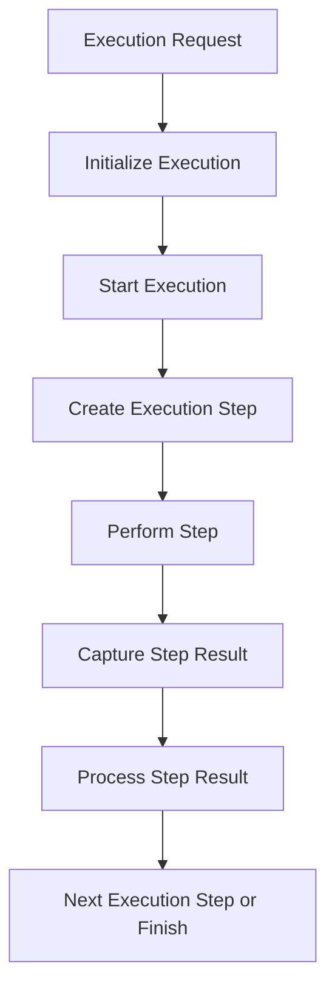

# Agent Runtime Harness and Execution Loop

## Learning Objectives

After completing this chapter, you should be able to:

- Explain what an agent runtime is.
- Explain why an LLM call alone does not constitute an agent runtime.
- Describe the responsibilities of a runtime harness.
- Explain what an execution step represents.
- Describe the structure of an agent execution loop.
- Identify the major boundaries around runtime execution.
- Explain how a runtime repeatedly executes work without assuming that every iteration is planning.
- Distinguish runtime execution from tool engineering, planning, state and memory engineering, and durable workflow orchestration.
- Identify the minimum execution visibility required to understand runtime behavior.
- Reason about runtime responsibilities when designing an agent system.

---

## Prerequisites

Before reading this chapter, you should understand the foundational concepts from:

- AGT-01-Agent-Systems-Foundations
  - Agent definition
  - Agent versus LLM
  - Agent versus workflow
  - Agent versus RAG
  - Foundational agent architecture
  - System boundaries

You should also be comfortable with the idea that an agent system may perform work over multiple execution steps rather than producing its result from a single model invocation.

---

## Estimated Reading Time

Approximately **15–20 minutes** for a focused first reading.

Additional time may be required for tracing the execution examples and answering the engineering questions.

---

## Before We Start

Consider a simple request:

> “Research three cloud providers, compare their object-storage services, and recommend one.”

An LLM can generate text about the providers.

But a production agent system may need to:

1. interpret the current task;
2. establish the current execution step;
3. perform work;
4. receive a result;
5. make that result available to the next execution step;
6. determine whether execution should proceed;
7. execute another step;
8. eventually produce a result or finish execution.

That repeated execution requires machinery around the model.

The model can contribute reasoning or decisions.

It does not, by itself, provide the complete runtime that manages execution over time.

This chapter focuses on that runtime machinery.

---

## Why This Exists

## The Problem

A single LLM invocation is conceptually simple:

```text
Input
  ↓
LLM
  ↓
Output
```

This can be sufficient for many applications.

An agent runtime introduces a different execution problem:

```text
Input
  ↓
Runtime
  ↓
Execution Step
  ↓
Step Result
  ↓
Next Execution Step
  ↓
Step Result
  ↓
...
```

The system therefore needs a mechanism that can coordinate repeated execution.

Without such a mechanism, there is no reliable place to define questions such as:

- What constitutes one execution step?
- What happens after a step completes?
- What information is available for the next step?
- When does another step begin?
- What runtime rules apply to the execution?
- How is execution observed?
- How does the runtime represent an active execution versus a completed one?

These are runtime concerns.

---

# Mental Model

A useful mental model is:

> **The agent runtime is the machinery that turns an agent's capability into an ongoing execution process.**

Think of the runtime as an **execution coordinator**.

The model may contribute reasoning or a decision.

The runtime provides the surrounding structure that:

- starts execution;
- establishes execution steps;
- coordinates execution work;
- receives step results;
- makes relevant results available to subsequent execution;
- controls progression through the execution lifecycle;
- exposes execution behavior.

A simplified model is:

```text
                 ┌───────────────────────┐
                 │     Agent Runtime     │
                 │                       │
Input ──────────►│  Start Execution      │
                 │        │              │
                 │        ▼              │
                 │  Create Step         │
                 │        │              │
                 │        ▼              │
                 │  Perform Work         │
                 │        │              │
                 │        ▼              │
                 │  Capture Step Result  │
                 │        │              │
                 │        ▼              │
                 │  Progress Execution   │
                 │        │              │
                 │        ▼              │
                 │  Next Step / Finish   │
                 └───────────────────────┘
```

The important idea is not the exact implementation.

The important idea is that **execution is managed as a process**.

---

# What Is an Agent Runtime?

An **agent runtime** is the execution machinery responsible for running an agent over one or more execution steps.

Depending on the system architecture, a runtime may be implemented as:

- a process inside an application;
- a service;
- an execution loop;
- a task runner;
- a stateful execution component;
- an orchestration layer;
- or a combination of these.

There is no single universal runtime implementation.

What makes something a runtime is the responsibility it performs, not the framework or programming language used to implement it.

At a minimum, the runtime needs to provide a mechanism for:

```text
Start
  ↓
Establish an execution step
  ↓
Perform the step
  ↓
Capture the step result
  ↓
Progress to another step or finish
```

The exact internal architecture can vary.

---

# Runtime Harness

## What Is a Runtime Harness?

The **runtime harness** is the surrounding execution structure that manages the agent's execution.

It provides the environment in which the agent performs work.

A conceptual harness may contain:

```text
Runtime Harness
│
├── Execution lifecycle
├── Current execution information
├── Step coordination
├── Execution boundary
├── Result handling
├── Progression control
└── Execution visibility
```

The harness does not need to contain all agent capabilities itself.

For example:

- tools may be implemented elsewhere;
- planning may be a separate responsibility;
- memory may be a separate subsystem;
- workflow durability may be handled by another orchestration layer.

The harness coordinates execution without necessarily owning every subsystem involved in that execution.

---

# Why an LLM Call Is Not a Runtime

Consider:

```python
response = llm.generate(prompt)
```

This is an LLM invocation.

It may be an important component of an agent system, but it does not by itself define an agent runtime.

A runtime must answer additional questions.

For example:

```text
Who starts execution?
Who establishes an execution step?
Who receives the model output?
Who coordinates the resulting work?
Who makes the result available to subsequent execution?
Who determines whether execution progresses?
Who records what happened?
Who finishes the execution?
```

A model invocation answers primarily:

> “Given this input, what output should the model produce?”

A runtime answers a broader engineering question:

> “How should this execution proceed over time?”

That distinction is foundational.

---

# Runtime Responsibilities

The exact responsibilities vary by architecture, but a runtime commonly provides several categories of responsibility.

## 1. Execution Lifecycle

The runtime establishes the lifecycle of an execution.

Conceptually:

```text
Execution Created
      ↓
Execution Started
      ↓
Execution Step
      ↓
Step Completed
      ↓
Next Execution Step
      ↓
...
      ↓
Execution Finished
```

The lifecycle may contain additional states in a real system.

The important point is that execution is treated as something with a lifecycle rather than as an isolated function call.

---

## 2. Step Coordination

The runtime coordinates individual execution steps.

A step represents a bounded unit of runtime progress.

For example:

```text
Step 1
  ↓
Step 2
  ↓
Step 3
  ↓
Step 4
```

A step should not be confused with:

- a complete user request;
- a complete plan;
- a single LLM token;
- a tool implementation;
- or necessarily one model call.

The exact size and internal composition of a step depend on the runtime architecture.

---

## 3. Execution Boundary

The runtime establishes where an execution step begins and ends.

A conceptual boundary might look like:

```text
┌────────────── Execution Step ──────────────┐
│                                            │
│  Establish current step                   │
│            ↓                               │
│  Perform execution work                   │
│            ↓                               │
│  Capture step result                       │
│                                            │
└────────────────────────────────────────────┘
```

The boundary provides the runtime with a point at which it can process what happened before progressing to subsequent execution.

The detailed **Decision → Action → Observation → Continuation** cycle inside execution is covered in the next chapter.

---

## 4. Execution Progression

After a step completes, the runtime needs to progress execution.

Conceptually:

```text
Step Completed
      ↓
Process Step Result
      ↓
 ┌────┴────┐
 │         │
Next      Finish
Step
```

The exact rules governing whether execution continues or terminates depend on the runtime design and its execution policies.

AGT-02 File 03 covers termination policies and bounded autonomy in detail.

This chapter establishes the runtime's responsibility for **progressing execution through successive steps**.

---

## 5. Execution Visibility

A runtime should make enough information available to understand what happened during execution.

Useful execution visibility may include:

- execution identifier;
- current step;
- step sequence;
- start and end times;
- execution status;
- relevant execution event;
- result status;
- termination reason;
- relevant errors;
- resource or budget information where applicable.

The exact telemetry design belongs to the broader observability architecture of the system.

AGT-02 focuses on the runtime information required to understand execution behavior.

---

# Execution Lifecycle

A simplified runtime lifecycle can be represented as:



This diagram intentionally simplifies the runtime.

It does not attempt to define:

- how a model plans;
- how tools are implemented;
- how memory is stored;
- how durable workflows operate;
- or how recovery and safety strategies are selected.

Those responsibilities belong to other parts of the agent architecture.

---

# What Is an Execution Step?

An **execution step** is a bounded unit of work within an agent execution.

A useful conceptual definition is:

> An execution step begins when the runtime establishes the work to be performed and ends when the runtime has a result that can be processed before subsequent execution.

The exact contents depend on the architecture.

For example, one runtime might represent a step as:

```text
Establish Step
     ↓
Perform Work
     ↓
Capture Result
```

Another architecture may divide these operations into smaller runtime events.

Therefore:

> **An execution step is a runtime abstraction, not a universal implementation boundary.**

This distinction matters when comparing agent systems.

Two systems may both describe their work in terms of “steps” while defining those steps differently.

---

# The Execution Loop

## Basic Model

An execution loop repeatedly processes execution steps.

A simplified conceptual model is:

```text
while execution_progresses:

    establish current step

    perform execution work

    capture step result

    process the result

    begin another step or finish
```

A more explicit conceptual model is:

```text
Start Execution
      ↓
Create Step
      ↓
Perform Work
      ↓
Capture Step Result
      ↓
Process Result
      ↓
 ┌────┴────┐
 │         │
Next      Finish
Step
```

This is the basic runtime pattern that later chapters refine.

---

# Execution Loop Does Not Mean Planning Loop

A common mistake is to equate:

```text
loop = planning
```

That is incorrect.

A runtime loop describes **repeated execution**.

Planning describes **determining or revising how a goal should be achieved**.

For example:

```text
Runtime:

Step 1
  ↓
Execute
  ↓
Step 2
  ↓
Execute
  ↓
Step 3
```

This does not necessarily mean that a new plan was generated at every step.

A runtime can repeatedly execute steps according to an existing strategy.

Likewise, a planning system may produce a plan that is subsequently executed by a runtime.

The two responsibilities can interact without being identical.

AGT-05 owns planning and adaptive execution.

AGT-02 owns runtime execution.

---

# Runtime and the Agent

A useful architectural distinction is:

```text
┌──────────────────────────────┐
│         Agent System         │
│                              │
│  ┌────────────────────────┐  │
│  │     Agent Capability   │  │
│  │                        │  │
│  │  Model / reasoning     │  │
│  │  Goal-oriented logic   │  │
│  └────────────┬───────────┘  │
│               │              │
│               ▼              │
│  ┌────────────────────────┐  │
│  │     Runtime Harness    │  │
│  │                        │  │
│  │  Lifecycle             │  │
│  │  Steps                 │  │
│  │  Execution             │  │
│  │  Progression           │  │
│  │  Runtime controls      │  │
│  └────────────────────────┘  │
└──────────────────────────────┘
```

The agent provides capabilities used during execution.

The runtime provides the machinery for executing those capabilities over time.

This separation is conceptual.

A particular implementation may combine these responsibilities in the same service or class.

---

# Runtime and the Application

The runtime is also not necessarily the entire application.

A broader system may look like:

```text
Application
     │
     ▼
Agent Runtime
     │
     ▼
Agent Execution
```

The application may provide:

- APIs;
- authentication;
- request handling;
- persistence;
- user interfaces;
- business logic;
- external integrations.

The runtime is the execution component responsible for running the agent.

A production architecture may combine these components in one service or separate them across multiple components.

The important distinction is responsibility, not deployment topology.

---

# Runtime Boundaries

A production runtime needs clear boundaries around what it controls.

Consider:

```text
                   Agent Runtime
                        │
        ┌───────────────┼────────────────┐
        │               │                │
        ▼               ▼                ▼
     Model          Execution          Results
                        Work
        │               │                │
        └───────────────┼────────────────┘
                        │
                        ▼
                 Next Step / Finish
```

The runtime coordinates these interactions.

However, coordination does not mean ownership of every subsystem.

For example:

| Concern | Primary Ownership |
|---|---|
| Runtime execution | AGT-02 |
| Tool definitions and invocation mechanics | AGT-03 |
| State, context, and memory | AGT-04 |
| Planning and replanning | AGT-05 |
| Durable workflow execution | AGT-06 |
| Human approval | AGT-07 |
| Protocols and interoperability | AGT-08 |
| Multi-agent coordination | AGT-09 |
| Evaluation | AGT-10 |
| Reliability and safety strategy | AGT-11 |
| Architecture synthesis | AGT-12 |

AGT-02 coordinates runtime execution across these boundaries where necessary without taking ownership of their internal engineering.

---

# Runtime State at a Conceptual Level

The runtime needs some representation of the current execution condition.

At a conceptual level, this may include information such as:

```text
Execution
├── identifier
├── status
├── current step
├── relevant execution result
└── runtime metadata
```

The exact representation depends on the architecture.

This does **not** mean that runtime state is equivalent to memory.

The distinction is important:

> **Runtime state describes the current execution condition.**

> **Context describes information assembled for a particular execution step.**

> **Memory describes information intentionally retained for future use.**

Detailed engineering of these concepts belongs to AGT-04.

---

# Conceptual Runtime Interface

A runtime can be reasoned about through a small conceptual interface.

For example:

```text
start(execution_input)
    ↓
create_step()
    ↓
execute_step()
    ↓
record_result()
    ↓
progress_execution()
    ↓
next_step() / finish()
```

This is not a required API design.

It is a mental model for identifying runtime responsibilities.

A concrete implementation may use:

- classes;
- functions;
- services;
- queues;
- events;
- callbacks;
- asynchronous tasks;
- state machines;
- or other mechanisms.

The abstraction remains useful even when the implementation changes.

---

# Framework-Independent Runtime Example

The following pseudocode illustrates the core runtime idea:

```python
def run_agent(runtime_input):
    execution = runtime.start(runtime_input)

    while runtime.has_next_step(execution):
        step = runtime.create_step(execution)

        result = runtime.execute_step(step)

        runtime.record_result(execution, result)

    return runtime.finish(execution)
```

This is **illustrative pseudocode**, not a recommended production implementation.

The important concepts are:

```text
start
  ↓
create step
  ↓
execute
  ↓
record result
  ↓
progress or finish
```

The details of decision selection, action execution, observation interpretation, termination policies, retries, persistence, and recovery depend on the architecture and are covered elsewhere in the curriculum.

---

# A Simple Example: Research Agent

Suppose an agent receives:

> “Compare three cloud providers for object storage.”

A simplified runtime may execute:

```text
Execution Start
      ↓
Step 1
Perform current work
      ↓
Step Result
      ↓
Step 2
Perform current work
      ↓
Step Result
      ↓
Step 3
Perform current work
      ↓
Step Result
      ↓
Step 4
Produce final result
      ↓
Execution Finish
```

The runtime is responsible for managing the progression through these execution steps.

It does not necessarily own:

- how the model reasons;
- how research tools are implemented;
- how information is stored;
- how planning is generated;
- or how the final result is evaluated.

Those are separate responsibilities.

The internal Decision → Action → Observation mechanics of each step are covered in the next chapter.

---

# Runtime Observability

A runtime that cannot expose what happened becomes difficult to debug.

At minimum, engineers should be able to answer questions such as:

```text
Which execution was running?
Which step was active?
What happened during that step?
Did the step complete?
What result was produced?
What execution progression followed?
Why did the execution finish?
```

A conceptual execution trace might look like:

```text
Execution: exec-123

Step 1
  started: 10:00:01
  completed: 10:00:03
  status: completed

Step 2
  started: 10:00:03
  completed: 10:00:07
  status: completed

Step 3
  started: 10:00:07
  status: active
```

The exact telemetry implementation is architecture-dependent.

The engineering principle is:

> **Runtime behavior should be observable enough to reconstruct how execution progressed.**

This becomes especially important when diagnosing:

- unexpected repeated execution;
- no-progress behavior;
- slow steps;
- partial execution;
- unexpected termination;
- resource consumption;
- unexpected execution progression.

Detailed reliability and recovery strategies belong to AGT-11.

---

# Production Perspective

A production runtime is more than:

```python
while True:
    ...
```

The runtime must establish explicit execution boundaries and make execution behavior understandable.

## Execution Lifecycle

The system should distinguish meaningful execution states rather than treating all activity as an undifferentiated loop.

## Step Boundaries

The runtime should have a clear definition of what constitutes an execution step.

## Execution Visibility

Engineers need enough information to understand what happened during execution.

## Runtime Controls

The runtime needs explicit mechanisms for controlling execution.

The detailed termination policies, execution limits, and bounded-autonomy mechanisms are covered in File 03.

## Failure Visibility

A failed execution should not become indistinguishable from a successful execution.

## Partial Execution

The runtime may need to represent that some work occurred before execution finished.

## External Dependencies

Execution may depend on model calls, tools, services, networks, databases, or other components.

The runtime therefore needs clear boundaries around their participation in an execution step.

Detailed dependency failure and recovery strategy are outside this chapter.

## Deterministic Runtime Rules

Where appropriate, runtime-level controls should be explicit rather than relying entirely on model behavior.

These concerns define the runtime engineering problem without attempting to define the complete reliability, recovery, or deployment architecture of the system.

---

# Engineering Decisions and Trade-offs

Runtime architecture involves trade-offs.

## 1. Simple Loop vs Explicit State Machine

A simple loop can be easy to understand:

```text
while execution_progresses:
    execute_step()
```

An explicit state machine can make lifecycle transitions more visible:

```text
Created
  ↓
Running
  ↓
Waiting
  ↓
Running
  ↓
Completed
```

The right choice depends on system complexity.

A simple runtime may not need a formal state machine.

A complex runtime may benefit from explicit lifecycle states.

---

## 2. Synchronous vs Asynchronous Execution

A synchronous runtime can be straightforward:

```text
start
 ↓
execute
 ↓
wait
 ↓
progress
```

An asynchronous runtime can allow other work to proceed while waiting for external operations.

The trade-off is increased complexity around:

- concurrency;
- cancellation;
- state management;
- ordering;
- failures;
- observability.

The runtime model should match the execution characteristics of the system.

---

## 3. Centralized vs Distributed Runtime Coordination

A centralized runtime can keep execution logic in one place.

A distributed design may separate responsibilities across services or workers.

Distributed execution can improve scalability or isolation but introduces additional concerns such as:

- communication failures;
- state synchronization;
- duplicate execution;
- ordering;
- coordination;
- observability.

The runtime abstraction remains the same even when implementation becomes distributed.

---

## 4. Implicit vs Explicit Execution Boundaries

An implicit boundary may be convenient but harder to reason about.

An explicit boundary makes it clearer:

```text
Step Start
    ↓
Work
    ↓
Step Result
```

Explicit boundaries generally make execution easier to observe and reason about.

The appropriate level of explicitness depends on the architecture.

---

# Common Mistakes and Misconceptions

## Mistake 1: “An LLM call is an agent runtime.”

An LLM invocation provides model inference.

A runtime manages execution around that inference.

They are related but not equivalent.

---

## Mistake 2: “The execution loop is the planning system.”

A loop describes repeated execution.

Planning determines or changes how a goal should be pursued.

A runtime can execute a plan without generating that plan itself.

---

## Mistake 3: “Every loop iteration is a new plan.”

A runtime may repeatedly execute steps using an existing strategy.

A new plan may or may not be generated.

Planning is a separate responsibility.

---

## Mistake 4: “The runtime owns every part of the agent.”

The runtime coordinates execution.

It does not automatically own:

- tools;
- memory;
- planning;
- workflow durability;
- evaluation;
- safety strategy;
- architecture.

Ownership depends on the system design.

---

## Mistake 5: “An execution step is always one LLM call.”

A step is a runtime abstraction.

Depending on the architecture, one step may involve multiple operations.

---

## Mistake 6: “Runtime state is the same as memory.”

Runtime state describes the current execution condition.

Memory is information intentionally retained for future use.

They should not be treated as interchangeable concepts.

---

## Mistake 7: “If the loop works, observability can be added later.”

Without execution visibility, diagnosing runtime behavior becomes difficult.

A production runtime should expose enough information to understand meaningful execution progression.

---

## Mistake 8: “A runtime is just an infinite loop with an LLM inside it.”

A production runtime requires explicit lifecycle, execution boundaries, progression behavior, visibility, and runtime controls.

The loop is only one part of the runtime design.

---

## Interview Questions

## Foundational

### 1. What is an agent runtime?

**Expected answer:**

An agent runtime is the execution machinery that runs an agent over one or more execution steps. It manages the execution lifecycle, coordinates steps, handles results, controls execution progression, and provides runtime-level boundaries and visibility. The exact implementation varies by architecture.

---

### 2. Why is an LLM call not sufficient to define an agent runtime?

**Expected answer:**

An LLM call primarily performs model inference: given some input, it produces an output. An agent runtime manages execution over time, including step coordination, result handling, progression, lifecycle, runtime controls, and execution visibility. Therefore, model inference can be a component of a runtime without being the runtime itself.

---

## Runtime Reasoning

### 3. What is an execution step?

**Expected answer:**

An execution step is a bounded unit of runtime progress. It begins when the runtime establishes the work to be performed and ends when the runtime has a result that can be processed before subsequent execution. Its exact contents depend on the architecture, so it should not automatically be equated with one LLM call or one tool invocation.

---

### 4. Why does a runtime need an execution loop?

**Expected answer:**

An agent may need multiple execution steps to complete a task. The execution loop provides the mechanism for repeatedly processing those steps, capturing results, and progressing execution. Without such a mechanism, execution would generally stop after the initial operation.

---

### 5. Why should runtime execution be separated conceptually from planning?

**Expected answer:**

Runtime execution answers how the system progresses through execution steps. Planning answers how the system should pursue the goal and whether the approach should change. A runtime can execute a plan without owning its generation, and a planning component can produce or revise a plan that the runtime subsequently executes.

---

## Scenario Questions

### 6. An agent completes one action and immediately performs another. Does that automatically mean it replanned?

**Expected answer:**

No. The runtime may simply progress to another execution step according to the current strategy. Replanning requires a planning responsibility that generates or changes the approach. Repeated runtime execution alone is not evidence of replanning.

---

### 7. An agent executes five steps. Does that mean the agent made five decisions?

**Expected answer:**

Not necessarily. The relationship between runtime steps and model decisions depends on the architecture. A step may contain multiple operations, and a decision may influence more than one runtime operation. The runtime step is an execution abstraction, not a universal model-call boundary.

---

## Debugging

### 8. An agent appears to execute the same operation repeatedly. What runtime information would you inspect first to reconstruct what happened?

**Expected answer:**

I would inspect the execution trace or equivalent runtime visibility: execution identifier, step sequence, relevant execution events, action or result status, timestamps, and progression information. The immediate goal is to reconstruct what the runtime actually did before deciding which component caused the behavior.

---

### 9. An agent produces a correct result, but engineers cannot determine how it reached that result. What runtime problem exists?

**Expected answer:**

The system has insufficient execution visibility. Even if the final output is correct, lack of step-level information makes debugging, auditing, performance analysis, and failure investigation difficult. The runtime should expose enough information to reconstruct meaningful execution progression without necessarily exposing every internal implementation detail.

---

## Engineering Judgment

### 10. When would you choose a simple execution loop instead of a formal state machine?

**Expected answer:**

A simple loop may be appropriate when the execution lifecycle is straightforward, the number of meaningful states is small, and explicit transition modeling would add unnecessary complexity. A state machine becomes more attractive when execution has many distinct states, transitions, waiting conditions, cancellation paths, or lifecycle rules that need to be explicit and observable.

---

### 11. What is the risk of putting too much responsibility into the runtime?

**Expected answer:**

The runtime can become a monolithic component that owns execution, planning, tools, memory, recovery, safety, and workflow concerns simultaneously. This makes the system harder to reason about, test, evolve, and maintain. Clear responsibility boundaries allow the runtime to coordinate these concerns without becoming the implementation owner of all of them.

---

### 12. What would you consider the minimum information needed to understand an execution loop during debugging?

**Expected answer:**

At minimum, I would want an execution identifier, step sequence, execution status, step start and completion information, relevant execution events or result status, progression information, and execution completion information. The exact telemetry depends on the system, but the key requirement is being able to reconstruct meaningful execution progression.

---

## Quick Revision

## Core Mental Model

```text
Input
  ↓
Runtime Starts Execution
  ↓
Create Execution Step
  ↓
Perform Step
  ↓
Capture Step Result
  ↓
Process Result
  ↓
┌───────────────────┐
│ Progress Execution│
└─────────┬─────────┘
          │
          ▼
   Next Step / Finish
```

## Remember

- An **LLM** performs model inference.
- An **agent runtime** manages execution over time.
- An **execution step** is a runtime unit of progress.
- An **execution loop** coordinates repeated steps.
- Runtime execution is **not the same as planning**.
- The runtime coordinates other agent components without automatically owning their internal engineering.
- Runtime state is **not the same as memory**.
- Execution visibility is essential for understanding runtime behavior.
- Runtime boundaries should be explicit enough to make execution understandable and controllable.
- File 02 explains the internal Decision → Action → Observation → Continuation cycle.
- File 03 explains termination policies and bounded autonomy.

---

# Key Takeaways

1. An agent runtime is the machinery that executes an agent over time.
2. An LLM invocation is only one component that may participate in that execution.
3. The runtime establishes execution lifecycle and step boundaries.
4. An execution loop allows multiple steps to occur as part of one execution.
5. Runtime progression is distinct from planning and replanning.
6. Execution steps are runtime abstractions and should not automatically be equated with LLM calls or tool calls.
7. The runtime coordinates other agent components without necessarily owning their internal engineering.
8. Runtime visibility should make meaningful execution progression observable.
9. Production runtimes require more than a simple loop; they need explicit lifecycle and execution boundaries.
10. The next chapter examines the internal Decision → Action → Observation → Continuation cycle in greater depth.

---

## Further Reading

For the next stage of AGT-02, continue with:

- [02-Agent-Decision-Action-Observation-and-Continuation.md](02-Agent-Decision-Action-Observation-and-Continuation.md)
- [03-Termination-Policies-and-Bounded-Autonomy.md](03-Termination-Policies-and-Bounded-Autonomy.md)

For foundational agent concepts, see:

- [AGT-01-Agent-Systems-Foundations](../AGT-01-Agent-Systems-Foundations/README.md)

For related ownership areas, continue to the relevant AGT chapters:

- AGT-03 — Tools & Action Execution
- AGT-04 — State, Context & Memory
- AGT-05 — Planning & Adaptive Execution
- AGT-06 — Workflow Orchestration & Durable Execution
- AGT-07 — Human Control & Approval
- AGT-08 — Agent Interfaces & Protocols
- AGT-09 — Multi-Agent Systems
- AGT-10 — Agent Evaluation & Behavioral Testing
- AGT-11 — Agent Reliability & Safety
- AGT-12 — Agent Architecture & Design Review
