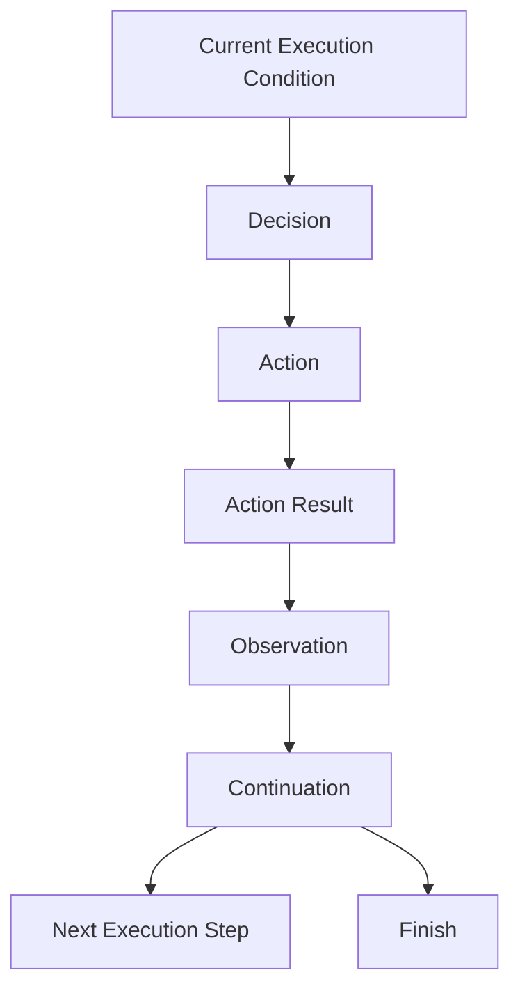

# Agent Decision, Action, Observation, and Continuation

## Learning Objectives

After completing this chapter, you should be able to:

- Explain what happens inside one agent execution cycle.
- Describe the relationship between decision, action, observation, and continuation.
- Explain why an action is a runtime execution boundary rather than simply a model output.
- Explain how an action result becomes an observation available to subsequent execution.
- Distinguish observation from the final answer.
- Explain how the runtime transitions from one execution step to the next.
- Identify the difference between execution progression and planning.
- Explain how changing observations can influence subsequent execution.
- Recognize repeated actions, no-progress behavior, and changing execution conditions at a conceptual level.
- Explain why continuation must be explicit rather than assuming that every completed action automatically produces another action.
- Distinguish runtime execution responsibilities from tool mechanics, state and memory management, planning, recovery, and termination policy.

---

## Prerequisites

Before reading this chapter, you should understand:

- Agent systems and their basic architecture from AGT-01.
- The purpose of an agent runtime from AGT-02 Lesson 01.
- Runtime harnesses and execution steps.
- The distinction between runtime execution and planning.
- The idea that one agent execution may contain multiple execution steps.

Recommended prerequisite:

- [01-Agent-Runtime-Harness-and-Execution-Loop.md](01-Agent-Runtime-Harness-and-Execution-Loop.md)

---

## Estimated Reading Time

Approximately **20–25 minutes** for a focused first reading.

Additional time may be required for tracing the execution examples and answering the engineering questions.

---

## Before We Start

Consider an agent that receives:

> “Find the current weather in Bengaluru and tell me whether I should carry an umbrella.”

The agent cannot complete the task simply by producing an initial model response if the required information is not already available.

A simplified execution may look like:

```text
Understand current task
        ↓
Decide what to do
        ↓
Perform an action
        ↓
Receive result
        ↓
Make relevant result available as an observation
        ↓
Determine the next execution transition
        ↓
Perform another action or finish
```

The important question for this chapter is:

> **What actually happens inside one execution cycle?**

Lesson 01 established that the runtime repeatedly executes steps.

This chapter now opens one of those steps and examines its internal progression.

---

# Why This Exists

A runtime loop by itself is too abstract to explain agent behavior.

Consider:

```text
Step 1
  ↓
Step 2
  ↓
Step 3
```

This tells us that execution progressed.

It does not tell us what caused the progression.

Inside an agent execution, the runtime commonly coordinates a sequence such as:

```text
Decision
   ↓
Action
   ↓
Observation
   ↓
Continuation
   ↓
Next Step
```

This cycle provides a useful mental model for understanding how an agent interacts with its execution environment and then uses the resulting information to determine what happens next.

The exact implementation varies by architecture.

The important engineering idea is:

> **An agent execution step is not merely “call the model and get an answer.” It is a runtime-managed cycle in which an execution-relevant decision leads to an action, the action produces a result, that result becomes relevant execution information, and the runtime transitions toward the next execution step or finish.**

---

# Mental Model

A useful mental model is:

```text
┌───────────────────────────────────────────┐
│              Execution Step               │
│                                           │
│   Decision                                │
│      │                                    │
│      ▼                                    │
│   Action                                  │
│      │                                    │
│      ▼                                    │
│   Observation                             │
│      │                                    │
│      ▼                                    │
│   Continuation                            │
│      │                                    │
└──────┼────────────────────────────────────┘
       │
       ▼
Next Execution Step
```

This does **not** mean every implementation has four literal objects called:

- `Decision`
- `Action`
- `Observation`
- `Continuation`

They are conceptual responsibilities.

A concrete runtime may represent them through:

- function calls;
- structured messages;
- state transitions;
- events;
- objects;
- service calls;
- or other mechanisms.

The conceptual model remains useful because it gives engineers a common vocabulary for reasoning about execution.

---

# The Core Cycle

The cycle can be summarized as:

```text
Decision
   ↓
Action
   ↓
Observation
   ↓
Continuation
```

Each stage answers a different question.

| Stage | Core Question |
|---|---|
| Decision | What should happen now? |
| Action | What execution operation should be performed? |
| Observation | What happened as a result? |
| Continuation | What execution transition follows? |

These stages should not be collapsed into one concept.

---

# 1. Decision

## What Is a Decision?

A **decision** is an execution-relevant determination of what should happen next.

For example:

```text
Current situation:
Need current weather information.

Decision:
Retrieve current weather information.
```

The decision may be produced or influenced by:

- a model;
- deterministic application logic;
- a policy;
- a planning component;
- or a combination of these.

AGT-02 does not prescribe one decision-generation mechanism.

The runtime's responsibility is to execute within the system architecture that provides the decision.

The important distinction is:

```text
Decision
→ execution-relevant choice

Runtime
→ executes that choice and manages the resulting execution transition
```

The runtime does not necessarily generate the intelligence behind every decision.

---

## Decision Is Not the Same as Planning

This distinction is important.

A decision answers:

> **What should happen now?**

Planning answers a broader question:

> **How should the goal be achieved, and should the approach change?**

For example:

```text
Goal:
Compare three cloud providers.

Plan:
1. Gather storage pricing.
2. Gather durability information.
3. Compare the results.
4. Produce recommendation.

Current decision:
Retrieve pricing for provider A.
```

The current decision can be an execution step within a larger plan.

Likewise, a system may make a local execution decision without maintaining an explicit multi-step plan.

Therefore:

```text
Decision ≠ Planning
```

The runtime cycle uses decisions without making AGT-02 responsible for teaching planning.

Detailed planning, decomposition, replanning, and adaptive strategy belong to AGT-05.

---

# 2. Action

## What Is an Action?

An **action** is the execution operation selected for the current step.

Examples include:

```text
Retrieve information
Submit a request
Read data
Transform data
Call an external capability
Generate a response
```

The exact action types depend on the agent system.

An action may be implemented through:

- a tool;
- an application function;
- an external service;
- a model operation;
- or another execution mechanism.

AGT-02 treats the action as the **runtime-level operation being executed**.

Detailed tool definitions, interfaces, schemas, discovery, invocation mechanics, and tool-specific result handling belong to AGT-03.

---

## Decision vs Action

These concepts are related but not identical.

Consider:

```text
Decision:
Retrieve weather information.

Action:
Execute the weather retrieval operation.
```

The decision describes what should happen.

The action is the operation that is actually performed.

This distinction becomes useful when debugging.

Suppose the agent repeatedly retrieves the same information.

An engineer should be able to ask:

```text
Was the same decision made repeatedly?

Was the same action executed repeatedly?

Did the action actually execute?

Did the action produce a different result?

Did the runtime make the result available as an observation?

Did execution progress afterward?
```

Without separating these concepts, runtime behavior becomes difficult to reconstruct.

---

# The Action Boundary

The action boundary is the point at which the runtime moves from deciding what should happen to actually performing the selected operation.

Conceptually:

```text
Before Action
─────────────
Decision exists

        ↓

Action Boundary

        ↓

After Action
────────────
Execution result exists
```

The runtime may perform additional work around this boundary, such as:

- validating the execution request;
- recording execution metadata;
- invoking the required component;
- receiving the result;
- recording the outcome.

The detailed engineering of tools and their invocation mechanics belongs to AGT-03.

Here, the important concept is the runtime transition:

> **A decision becomes an action that produces an execution result.**

---

# 3. Observation

## What Is an Observation?

An **observation** is information made available to the agent execution after an action has been performed.

For example:

```text
Action:
Retrieve weather information.

Observation:
Temperature: 24°C
Condition: Rain
Probability: 80%
```

The observation represents information available after the action.

It can include:

- successful results;
- error information;
- returned data;
- status information;
- changed conditions;
- external responses;
- or other execution-relevant information.

The exact observation structure depends on the architecture.

---

# Action Result vs Observation

These terms are closely related but can be distinguished conceptually.

An **action result** is the direct outcome produced by an executed action.

An **observation** is the information made available to the agent execution from that outcome.

For example:

```text
Action
   ↓
External system returns:
{
    "temperature": 24,
    "condition": "rain"
}
   ↓
Runtime processes result
   ↓
Observation available to execution:
"Current weather is rainy at 24°C."
```

A system may represent these as the same object.

It may also transform, normalize, validate, or enrich the raw result before making it available.

Therefore, the important distinction is functional rather than necessarily structural:

> **The action produces a result; the runtime makes relevant information from that result available as an observation for subsequent execution.**

---

# Observation Is Not the Final Answer

A common misconception is:

```text
Observation = Final Answer
```

That is incorrect.

An observation can be an intermediate piece of information.

For example:

```text
Observation:
Rain probability is 80%.

Next decision:
Recommend carrying an umbrella.

Final answer:
“Yes, carry an umbrella because the probability of rain is high.”
```

The observation supports subsequent execution.

It does not necessarily terminate the execution.

---

# 4. Continuation

## What Is Continuation?

**Continuation** is the runtime-level execution transition that follows an observation.

At a high level:

```text
Observation
     ↓
Continuation
     ↓
Next Step / Finish
```

Continuation answers:

> **What execution transition follows this result?**

The runtime owns this **execution transition**, but it does not necessarily own all of the intelligence that determines its content.

The information used to determine the transition may come from:

- model reasoning;
- planning;
- deterministic runtime logic;
- application logic;
- policy;
- or a combination of these,

depending on the architecture.

Therefore:

```text
Continuation
→ runtime-level execution transition

Decision logic
→ may be model-driven, planning-driven, policy-driven,
  deterministic, or hybrid
```

This distinction prevents continuation from being mistaken for a separate planning or reasoning subsystem.

---

# Why Continuation Matters

Without a continuation boundary, the execution model becomes ambiguous.

Suppose:

```text
Decision
   ↓
Action
   ↓
Observation
```

What happens now?

Several execution transitions may be possible:

```text
Observation
    ├──→ Next Execution Step
    └──→ Finish
```

Other runtime conditions may also affect the transition.

The exact termination conditions and policies are covered in Lesson 03.

The important point for this chapter is that the observation creates a point at which execution must transition somewhere.

---

# The Complete Execution Cycle

We can now combine the four concepts:



This diagram represents the conceptual cycle.

It does not imply that every architecture implements these as separate runtime objects.

The runtime may combine several stages internally.

---

# A Concrete Example

Consider a customer-support agent handling:

> “Where is my order?”

The execution may look like:

```text
Current situation:
Customer asks for order status.

        ↓

Decision:
Retrieve order information.

        ↓

Action:
Query the order system.

        ↓

Observation:
Order #4812 is out for delivery.

        ↓

Continuation:
Provide the current order status.

        ↓

Next execution step:
Generate response.

        ↓

Finish
```

Notice what happened.

The runtime did not simply:

```text
LLM → answer
```

Instead, execution progressed through an interaction with an external system.

The specific mechanics of the order-system interface belong to the relevant application or tool subsystem.

AGT-02 focuses on the execution cycle around that operation.

---

# Another Example: Research Agent

Suppose the user asks:

> “Compare two cloud providers based on current object-storage pricing.”

A simplified execution might look like:

```text
Step 1

Decision:
Retrieve provider A pricing.

Action:
Perform retrieval.

Observation:
Provider A pricing information.

Continuation:
Proceed with provider B retrieval.

Step 2

Decision:
Retrieve provider B pricing.

Action:
Perform retrieval.

Observation:
Provider B pricing information.

Continuation:
Compare collected information.

Step 3

Decision:
Compare the available information.

Action:
Perform comparison.

Observation:
Comparison result.

Continuation:
Generate final response.

Step 4

Decision:
Provide recommendation.

Action:
Generate response.

Observation:
Response generated.

Continuation:
Finish.
```

This example demonstrates an important point:

> **The runtime cycle can occur repeatedly within one overall execution.**

The execution step changes, but the conceptual cycle remains recognizable.

---

# Changing Observations

An agent interacts with an environment whose results may change.

For example:

```text
Step 1
Action → Check inventory
Observation → Item unavailable

Step 2
Action → Check alternative inventory
Observation → Item available

Step 3
Action → Retrieve alternative details
Observation → Details returned
```

The observation at one step can change what happens in the next step.

This is one reason agent execution can differ from a completely predetermined sequence of function calls.

The runtime must support progression based on information produced during execution.

---

# Execution Is Not Always Identical

Agent execution may vary because decisions and external observations can differ.

For example:

```text
Same Input
    ↓
Different decision
    ↓
Different action
    ↓
Different observation
```

or:

```text
Same Input
    ↓
Same action
    ↓
Different external result
    ↓
Different observation
```

Therefore, engineers should not assume that identical inputs always produce identical execution traces unless the architecture explicitly provides such guarantees.

This is particularly important when debugging agent systems.

The practical lesson is:

> **Reason from the actual execution trace rather than assuming that the same input must produce the same step sequence.**

---

# Runtime Progression

The runtime can be viewed as moving through execution conditions:

```text
Current Execution Condition
          ↓
       Decision
          ↓
        Action
          ↓
     Observation
          ↓
     Continuation
          ↓
Next Execution Condition
```

Conceptually:

```text
Execution Condition₀
  ↓
Action₁
  ↓
Observation₁
  ↓
Execution Condition₁
  ↓
Action₂
  ↓
Observation₂
  ↓
Execution Condition₂
```

Here, **execution condition** means the runtime-relevant condition from which the next execution step proceeds.

This should not be confused with application state, context, or memory.

Detailed state, context, memory, context assembly, and retention are owned by AGT-04.

---

# Progress and No Progress

A useful runtime concept is **progress**.

Progress means that execution has meaningfully advanced.

For example:

```text
Step 1
Retrieve customer record
Observation:
Customer found

Step 2
Retrieve order
Observation:
Order found

Step 3
Generate response
Observation:
Response generated
```

Execution is progressing.

Now consider:

```text
Step 1
Retrieve customer record
Observation:
Customer found

Step 2
Retrieve customer record
Observation:
Customer found

Step 3
Retrieve customer record
Observation:
Customer found
```

The runtime may be observing repeated behavior without meaningful advancement.

This does not automatically prove that the system is broken.

Repeated actions can be legitimate in some workflows.

The important engineering question is:

> **Is execution producing meaningful new information or progress toward the intended outcome?**

Detailed no-progress detection and termination policies belong to Lesson 03.

---

# Repeated Actions

Repeated actions deserve careful interpretation.

Consider:

```text
Action A
   ↓
Observation A
   ↓
Action A
   ↓
Observation A
```

There are multiple possibilities.

### Case 1: Legitimate repetition

A system may intentionally poll for changing status.

```text
Check status
   ↓
Not ready
   ↓
Check status
   ↓
Ready
```

### Case 2: Changing observations

The same action may produce different information.

```text
Check inventory
   ↓
Unavailable

Check inventory
   ↓
Available
```

The repeated action is not necessarily a problem.

### Case 3: No meaningful progress

```text
Check status
   ↓
Pending

Check status
   ↓
Pending

Check status
   ↓
Pending
```

This may indicate that execution is not progressing.

The runtime should make such behavior observable.

The specific policy for responding to repeated or non-progressing execution belongs to Lesson 03.

---

# Continuation vs Termination

Continuation and termination are related but should not be treated as identical concepts.

Continuation asks:

> **What execution transition follows the current result?**

Termination asks:

> **Under what runtime policy should execution stop?**

At a conceptual level:

```text
Observation
      ↓
Execution Transition
      │
      ├──────────────→ Next Step
      │
      └──────────────→ Finish
```

Lesson 02 focuses on the transition.

Lesson 03 focuses on the policies governing why and under what conditions execution stops.

This distinction prevents the two chapters from duplicating each other.

---

# Normal Progression vs Runtime Interruption

Execution can normally progress:

```text
Step
 ↓
Observation
 ↓
Next Step
```

But execution may also be interrupted by an external runtime condition.

For example:

```text
Step
 ↓
External cancellation
 ↓
Execution interrupted
```

or:

```text
Step
 ↓
Runtime boundary reached
 ↓
Execution stopped
```

This chapter only establishes that such runtime transitions can occur.

Detailed cancellation, timeout, budget exhaustion, and termination policies belong to Lesson 03.

---

# Decision, Action, Observation, Continuation in Different Systems

The conceptual cycle can appear in many types of agents.

## Research Agent

```text
Decision:
Retrieve source

Action:
Perform retrieval

Observation:
Retrieved content

Continuation:
Analyze or retrieve more
```

## Customer Support Agent

```text
Decision:
Retrieve customer record

Action:
Query system

Observation:
Customer data

Continuation:
Retrieve order or respond
```

## Coding Agent

```text
Decision:
Inspect repository file

Action:
Read file

Observation:
Code content

Continuation:
Analyze or modify code
```

## Data Analysis Agent

```text
Decision:
Inspect dataset schema

Action:
Load schema

Observation:
Columns and types

Continuation:
Choose next analysis operation
```

The domain changes.

The runtime pattern remains recognizable.

---

# Decision and Observation Form a Feedback Relationship

One of the most important mental models is:

```text
Decision
   ↓
Action
   ↓
Observation
   ↓
New Information
   ↓
Next Decision
```

This creates a feedback relationship.

The next decision may depend on what happened during the previous action.

This is why agent execution cannot always be represented as a completely predetermined sequence.

A fixed workflow may look like:

```text
A → B → C → D
```

An agent execution may instead behave like:

```text
A
 ↓
Observation
 ↓
Choose B or C
 ↓
Observation
 ↓
Choose D or E
```

The runtime supports this progression.

Planning may influence the choices.

The runtime itself provides the execution structure.

---

# Runtime Cycle vs Fixed Workflow

A fixed workflow can often be represented as:

```text
Step A
  ↓
Step B
  ↓
Step C
  ↓
Step D
```

An agent runtime may support execution where the next step depends on observations:

```text
Step A
   ↓
Observation
   ↓
 ┌─┴─┐
 ▼   ▼
 B   C
 │   │
 └─┬─┘
   ▼
Next Step
```

This does not mean every agent runtime must be dynamic.

It means the runtime model can support execution whose next step depends on information produced during execution.

---

# Runtime Mechanics and Planning Mechanics

The distinction can be expressed precisely:

```text
Planning:
"What is the right approach for achieving the goal?"

Runtime:
"How do we execute the current step and transition to the next execution condition?"
```

They can interact:

```text
Planning
    ↓
Current Strategy
    ↓
Runtime
    ↓
Decision
    ↓
Action
    ↓
Observation
    ↓
Runtime Progression
    ↓
Planning may be consulted again
```

The last transition is architecture-dependent.

A runtime does not automatically imply continuous replanning.

That distinction is important when designing agent systems.

---

# Framework-Independent Pseudocode

The following pseudocode illustrates the conceptual cycle:

```python
def execute_step(execution):
    decision = decide_next_action(execution)

    action_result = execute_action(decision)

    observation = process_action_result(action_result)

    continuation = determine_next_execution(execution, observation)

    return continuation
```

This is **illustrative pseudocode**.

It is not a production implementation and does not prescribe a specific framework.

The important sequence is:

```text
Decision
   ↓
Action
   ↓
Observation
   ↓
Continuation
```

A more complete conceptual runtime might look like:

```python
while runtime_has_execution_step(execution):
    continuation = execute_step(execution)

    if continuation.next_step:
        execution = continuation.next_step
    else:
        break
```

Again, this intentionally omits detailed termination policy mechanics.

Those are covered in Lesson 03.

---

# Runtime-Level Result Handling

The runtime may need to process an action result before allowing execution to progress.

For example:

```text
Action Result
     ↓
Validate / Normalize
     ↓
Observation
     ↓
Continuation
```

This distinction matters because external results are not always immediately usable.

A result might be:

- malformed;
- incomplete;
- unsuccessful;
- delayed;
- unexpected;
- or otherwise unsuitable for direct continuation.

The exact handling depends on the architecture.

The important runtime concept is:

> **The runtime establishes a boundary between an action producing a result and that result becoming execution-relevant information.**

Detailed recovery and fallback strategy belong to AGT-11.

---

# What Happens When the Action Fails?

Suppose:

```text
Decision:
Retrieve customer order.

Action:
Query order service.

Result:
Service unavailable.
```

The runtime now has an execution outcome representing failure.

At the AGT-02 level, the important concern is that this outcome becomes visible as part of the execution cycle:

```text
Action
   ↓
Failure Result
   ↓
Runtime exposes execution outcome
   ↓
Execution transitions according to the system design
```

The broader response to that failure is outside this chapter.

AGT-02 explains how runtime execution encounters and exposes execution outcomes.

AGT-11 owns broader recovery, fallback, compensation, containment, and safety strategy.

---

# Execution Trace Example

A useful runtime trace might look like:

```text
Execution: exec-204

Step 1
  Decision:
    Retrieve customer record

  Action:
    Customer lookup

  Observation:
    Customer found

  Continuation:
    Retrieve order

Step 2
  Decision:
    Retrieve order

  Action:
    Order lookup

  Observation:
    Order is out for delivery

  Continuation:
    Generate response

Step 3
  Decision:
    Generate customer response

  Action:
    Response generation

  Observation:
    Response produced

  Continuation:
    Finish
```

This trace gives engineers a much clearer picture than:

```text
Execution completed successfully.
```

The final status tells us what happened at the end.

The trace helps explain how execution reached that point.

---

# Production Perspective

In production systems, the Decision → Action → Observation → Continuation cycle becomes important for debugging and operational reasoning.

## Execution Traceability

Engineers should be able to correlate meaningful events across a single execution.

For example:

```text
Execution ID
   ↓
Step ID
   ↓
Decision
   ↓
Action
   ↓
Result / Observation
   ↓
Continuation
```

The exact telemetry format depends on the architecture.

The runtime should expose enough execution information to reconstruct meaningful progression.

---

## Action Boundaries

The runtime should make the transition into and out of an action understandable.

This helps distinguish:

```text
Decision problem
```

from:

```text
Action execution problem
```

from:

```text
Observation processing problem
```

from:

```text
Continuation problem
```

This separation is valuable during debugging.

---

## Changing External Conditions

Actions may interact with systems whose results change over time.

Therefore:

```text
Same Action
   ↓
Different Observation
```

is entirely possible.

Production runtime reasoning must account for this.

---

## Repeated Execution

Repeated actions should be observable.

The runtime should allow engineers to answer:

```text
Did the same action execute repeatedly?

Did its observations change?

Did the execution condition change?

Did the runtime make meaningful progress?
```

The detailed policy for responding to problematic repetition belongs to Lesson 03.

---

## Partial Execution

An execution may complete some steps before encountering an execution problem.

For example:

```text
Step 1 → completed
Step 2 → completed
Step 3 → failed
```

The runtime should preserve enough execution information to understand this progression.

---

# Engineering Decisions and Trade-offs

## 1. Raw Action Result vs Normalized Observation

A runtime may expose the raw result directly:

```text
Action
  ↓
Raw Result
  ↓
Observation
```

Or it may normalize the result:

```text
Action
  ↓
Raw Result
  ↓
Validation / Normalization
  ↓
Observation
```

Normalization can make downstream execution more consistent.

However, it may also introduce processing complexity and potentially hide useful raw information.

The appropriate choice depends on the architecture.

---

## 2. Explicit vs Implicit Continuation

An explicit continuation model might represent:

```text
continue(next_step)
finish()
```

An implicit model may allow the runtime to infer progression from returned execution information.

Explicit continuation can make execution behavior easier to inspect and reason about.

Implicit continuation can reduce implementation ceremony.

The correct choice depends on system complexity and control requirements.

---

## 3. Raw vs Structured Execution Events

A runtime could emit broad events:

```text
step_completed
```

or more structured events:

```text
decision_created
action_started
action_completed
observation_created
continuation_selected
```

More detailed events improve reconstruction and debugging but increase telemetry volume and implementation complexity.

The level of detail should reflect operational requirements.

---

## 4. Flexible vs Explicit Step Boundaries

A highly flexible step model may allow different operations to occur within one step.

A more explicit step model can make execution easier to reason about.

The trade-off is between:

```text
flexibility
```

and:

```text
observability + control
```

There is no universal boundary that fits every agent architecture.

---

# Common Mistakes and Misconceptions

## Mistake 1: “The decision is the action.”

A decision determines what should happen.

An action is the operation that is actually executed.

They may be represented together in some implementations, but they are conceptually distinct.

---

## Mistake 2: “The observation is just the final answer.”

An observation is information produced or exposed during execution.

It may be intermediate information that influences the next step.

---

## Mistake 3: “Every observation should immediately produce another action.”

Not necessarily.

An observation may lead to:

```text
Next Step
```

or:

```text
Finish
```

or another runtime transition.

---

## Mistake 4: “Every repeated action is a bug.”

Repeated actions can be legitimate.

Examples include:

- polling;
- status checks;
- iterative processing.

The important question is whether execution is making meaningful progress.

---

## Mistake 5: “Same action means same result.”

External conditions can change.

Therefore:

```text
Same Action
   ↓
Different Observation
```

is entirely possible.

---

## Mistake 6: “Continuation means replanning.”

Continuation describes runtime progression.

Planning determines or revises strategy.

The two can interact but are not equivalent.

---

## Mistake 7: “If an action fails, the runtime must retry.”

Action failure is an execution outcome.

Retrying is a recovery decision.

The runtime should make the failure visible and provide the execution boundary through which the system can transition, while broader recovery strategy belongs to AGT-11.

---

## Mistake 8: “Observation and runtime execution condition are the same thing.”

An observation is information produced from an action.

A runtime execution condition represents the execution context from which subsequent progression occurs.

They may both influence the next execution step, but they are not conceptually identical.

---

## Mistake 9: “The runtime itself decides what the agent should do.”

The runtime coordinates execution.

The decision may be produced by a model, planning component, deterministic logic, policy, or another component.

The runtime should not be assumed to own the intelligence responsible for every decision.

---

# Interview Questions

## Foundational

### 1. Explain the Decision → Action → Observation → Continuation cycle.

**Expected answer:**

A decision identifies what should happen next. The runtime executes the corresponding action. The action produces a result that becomes an observation available to subsequent execution. The runtime then processes that execution outcome and transitions to the next execution step or finishes. These are conceptual responsibilities and may not be separate objects in an implementation.

---

### 2. Why is an action different from a decision?

**Expected answer:**

A decision represents what should happen, while an action represents the operation actually performed. Keeping them conceptually separate helps engineers distinguish decision-making problems from execution problems.

---

### 3. Why is an observation important?

**Expected answer:**

An observation provides information about what happened after an action. It can influence subsequent execution and therefore creates the feedback needed for an agent to operate in an environment where conditions may change.

---

## Runtime Reasoning

### 4. Why does the observation occur after the action?

**Expected answer:**

The action changes or queries the execution environment. The observation represents the resulting information available after that operation. This creates the basic feedback relationship:

```text
Decision → Action → Observation → Next Execution
```

---

### 5. Can an agent make a new decision without making a new plan?

**Expected answer:**

Yes. A local execution decision can determine the next action without generating or revising a complete multi-step plan. Planning is a broader responsibility concerned with how the goal should be achieved.

---

### 6. Why should continuation be treated as a separate runtime concept?

**Expected answer:**

Because completing an action does not automatically determine what happens next. The runtime needs a transition point where the resulting observation is processed and execution either progresses to another step or finishes. The information driving that transition may come from model reasoning, planning, deterministic logic, policy, or a combination.

---

## Debugging

### 7. An action succeeds, but the next execution step receives no useful information. Where would you investigate?

**Expected answer:**

I would inspect the boundary between the action result and the observation available to subsequent execution. The problem may involve result handling, validation, normalization, observation construction, or execution-condition transition rather than the action itself.

---

### 8. The same action executes three times, but each execution returns a different result. Is this necessarily a runtime bug?

**Expected answer:**

No. The external environment may have changed between executions. Repeated actions are not inherently incorrect. I would inspect the observations and execution progression before deciding whether the behavior is problematic.

---

### 9. An agent repeatedly receives the same observation after performing the same action. What would you inspect?

**Expected answer:**

I would reconstruct the execution trace and inspect whether the action is expected to be repeated, whether the observation is genuinely unchanged, whether the execution condition is progressing, and whether meaningful progress is occurring. The specific policy for stopping no-progress behavior belongs to AGT-02 Lesson 03.

---

## Engineering Judgment

### 10. Would you always expose raw action results directly as observations?

**Expected answer:**

Not necessarily. A runtime may normalize or validate results before exposing them as observations. Direct exposure is simpler, while normalization can provide a more consistent interface. The trade-off depends on system requirements and whether preserving raw results is important for debugging or downstream processing.

---

### 11. What is the difference between “the action failed” and “the agent should retry”?

**Expected answer:**

Action failure is an execution outcome. Retrying is a recovery decision. The runtime should make the failure visible and provide the execution boundary through which the system can transition, while the broader recovery strategy belongs to reliability and safety engineering.

---

### 12. An engineer says, “The runtime loop is enough; we don't need Decision, Action, Observation, or Continuation as separate concepts.” How would you respond?

**Expected answer:**

The runtime loop describes repeated execution at a high level, but the four concepts provide useful boundaries for reasoning about what happens within each step. They help distinguish decision-making, action execution, result interpretation, and execution progression. They do not have to be separate classes or services, but the conceptual separation is valuable for architecture and debugging.

---

# Quick Revision

## The Core Cycle

```text
Decision
   ↓
Action
   ↓
Observation
   ↓
Continuation
   ↓
Next Execution Step
```

## Core Questions

```text
Decision
→ What should happen now?

Action
→ What operation is performed?

Observation
→ What happened as a result?

Continuation
→ What execution transition follows?
```

---

## Important Distinctions

### Decision vs Planning

```text
Decision
→ What should happen now?

Planning
→ How should the goal be achieved?
```

### Action Result vs Observation

```text
Action
→ produces result

Runtime
→ makes relevant information available as observation
```

### Observation vs Final Answer

```text
Observation
→ intermediate execution information

Final Answer
→ output produced when the task is complete
```

### Continuation vs Termination

```text
Continuation
→ runtime-level execution transition

Termination
→ policy governing when execution stops
```

### Runtime vs Recovery

```text
Runtime
→ executes and exposes outcomes

Recovery
→ determines how failures should be handled
```

### Action vs Tool

```text
Action
→ runtime-level operation being executed

Tool
→ one possible mechanism for implementing that operation
```

---

# Key Takeaways

1. An agent execution step can be understood through four conceptual responsibilities: **Decision → Action → Observation → Continuation**.
2. A decision identifies an execution-relevant choice about what should happen now.
3. An action is the operation performed for the current step.
4. An action produces a result that becomes relevant execution information through an observation.
5. An observation is not necessarily the final answer.
6. Continuation is the **runtime-level execution transition** from the current result toward another step or finish.
7. The information driving continuation may come from model reasoning, planning, deterministic logic, policy, or a combination, depending on the architecture.
8. Runtime execution is not the same as planning.
9. An action may be implemented through a tool, application function, external service, model operation, or another mechanism.
10. Repeated actions are not automatically failures; their observations and execution progress must be examined.
11. The same action can produce different observations because external conditions can change.
12. Runtime visibility should make the cycle reconstructable during debugging.
13. Runtime exposes execution outcomes; broader recovery strategy belongs to AGT-11.
14. Detailed termination policies and bounded autonomy belong to the next chapter.

---

## Further Reading

Continue with:

- [03-Termination-Policies-and-Bounded-Autonomy.md](03-Termination-Policies-and-Bounded-Autonomy.md)

For the runtime foundation, see:

- [01-Agent-Runtime-Harness-and-Execution-Loop.md](01-Agent-Runtime-Harness-and-Execution-Loop.md)

For foundational agent concepts, see:

- [AGT-01-Agent-Systems-Foundations](../AGT-01-Agent-Systems-Foundations/README.md)

Related ownership areas:

- AGT-03 — Tools & Action Execution
- AGT-04 — State, Context & Memory
- AGT-05 — Planning & Adaptive Execution
- AGT-06 — Workflow Orchestration & Durable Execution
- AGT-07 — Human Control & Approval
- AGT-11 — Agent Reliability & Safety

The key boundary to retain before moving forward is:

```text
AGT-02 Lesson 01
Runtime Harness
→ How is execution structured?

AGT-02 Lesson 02
Decision → Action → Observation → Continuation
→ What happens inside a step?

AGT-02 Lesson 03
Termination + Bounded Autonomy
→ When and why does execution stop?
```
