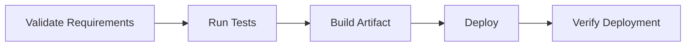

# AGT-05.03 — Verification, Critique, and Plan Quality

## Learning Objectives

By the end of this chapter, you should be able to:

- explain why an agent should verify a plan before relying on it
- distinguish plan verification from plan execution
- distinguish verification from broader plan critique and quality assessment
- check whether a plan is feasible
- validate dependencies and prerequisites
- identify missing or incorrect assumptions
- check whether a plan covers the required goal and subgoals
- detect inconsistent or conflicting plan steps
- verify constraint satisfaction
- critique a plan systematically rather than accepting it at face value
- compare alternative plans using multiple engineering criteria
- identify unnecessary steps and unnecessary complexity
- recognize over-planning and under-planning
- reason about plan robustness and recoverability
- distinguish plan verification from broader agent evaluation
- reason about plan quality as a multidimensional engineering property
- verify plans before execution, during execution, and after revision

---

## Prerequisites

Before reading this chapter, you should understand:

- what an agent is and how it differs from a simple LLM application
- the basic agent runtime loop
- task decomposition and planning
- dependencies, constraints, and sequencing
- plan execution
- local adaptation and replanning
- plan invalidation and changed assumptions

Recommended reading order:

1. [AGT-05.01 — Task Decomposition and Agent Planning](./01-Task-Decomposition-and-Agent-Planning.md)
2. [AGT-05.02 — Plan Execution, Replanning, and Adaptation](./02-Plan-Execution-Replanning-and-Adaptation.md)
3. **AGT-05.03 — Verification, Critique, and Plan Quality**

---

## Estimated Reading Time

**35–45 minutes**

---

## Before We Start

Imagine an agent receives this goal:

> Prepare and release a new version of a production application.

The agent generates:

```text
1. Update application code
2. Run tests
3. Build release artifact
4. Deploy artifact
5. Verify deployment
```

At first glance, this looks reasonable.

But suppose the production environment requires:

- security validation before deployment
- an approved release artifact
- database migration compatibility
- a rollback plan

The generated plan does not include all of these.

The problem is not that the plan is syntactically wrong.

The problem is that the plan is **not sufficiently valid for the real goal**.

This leads to an important engineering principle:

> A plan should not be trusted merely because it looks plausible.

An agent needs mechanisms for examining a plan before and during execution.

That is the purpose of **verification and critique**.

---

# Why This Exists

Planning answers:

> **What strategy should achieve the goal?**

But planning itself can produce weak strategies.

An agent can generate a plan that is:

- incomplete
- infeasible
- internally inconsistent
- based on false assumptions
- missing dependencies
- incompatible with constraints
- unnecessarily complex
- inefficient
- fragile
- poorly aligned with the actual goal

Without verification, the system may discover these problems only after execution has already begun.

That can make failures more expensive.

Consider:

```text
Goal
 ↓
Generate Plan
 ↓
Execute
 ↓
Discover Missing Dependency
 ↓
Abort / Rework
```

A stronger system tries to detect important problems earlier:

```text
Goal
 ↓
Generate Plan
 ↓
Verify / Critique
 ↓
Correct Plan
 ↓
Execute
```

Verification and critique therefore provide a **quality gate around planning**.

They do not guarantee that execution will succeed.

Instead, they increase confidence that the plan is reasonable under the information and constraints currently available.

---

# Mental Model

A useful mental model is:

> **Planning creates a candidate strategy. Verification checks whether that strategy satisfies known conditions. Critique challenges whether the strategy is a good engineering choice.**

This distinction is important.

Think of planning as making a route.

### Verification asks:

- Did we choose the correct destination?
- Is the road actually available?
- Are required roads or bridges missing?
- Are there restrictions?
- Does the route contain impossible turns?

### Critique asks:

- Is there a simpler route?
- Is this route unnecessarily expensive?
- Is it unnecessarily fragile?
- Is there a safer or more practical alternative?

The two activities overlap, but they answer different questions.

---

## Plan Assessment Model

A useful conceptual hierarchy is:

```text
Candidate Plan
      │
      ▼
Plan Assessment
      │
      ├───────────────┐
      ▼               ▼
Verification       Critique
      │               │
      │               ├── Efficiency
      │               ├── Simplicity
      │               ├── Robustness
      │               ├── Alternatives
      │               └── Unnecessary Complexity
      │
      ├── Goal Requirements
      ├── Dependencies
      ├── Prerequisites
      ├── Assumptions
      ├── Constraints
      ├── Completeness
      ├── Consistency
      └── Feasibility
              │
              └───────────────┐
                              ▼
                    Plan Decision
                    ├── Accept
                    ├── Revise
                    └── Reject
```

This distinction will be used throughout the chapter.

---

## Planning Lifecycle

AGT-05 can be viewed as a lifecycle:

```text
Goal
  ↓
Understand Task
  ↓
Decompose
  ↓
Identify Constraints & Dependencies
  ↓
Construct Plan
  ↓
Verify / Critique
  ↓
Execute
  ↓
Observe Results
  ↓
Is Plan Still Valid?
  ├── Yes → Continue
  │
  └── No
        ↓
     Adapt / Replan
        ↓
     Verify / Critique Revised Plan
        ↓
     Continue
```

Notice that verification and critique can appear more than once.

They may happen:

- before execution
- after a plan changes
- during execution
- after important observations
- before committing to a consequential step

Verification is therefore not necessarily a one-time operation.

---

# Core Concepts

## 1. What Is Plan Verification?

Plan verification is the process of checking whether a proposed plan satisfies known requirements, assumptions, dependencies, constraints, prerequisites, and feasibility conditions.

A simplified formulation is:

```text
Plan Verification
=
Does this plan satisfy the conditions required for execution?
```

For example:

```text
Goal:
Generate and publish a financial report.

Plan:
1. Retrieve financial data
2. Analyze data
3. Generate report
4. Publish report
```

Verification may ask:

```text
Is the required data available?
Is the data source accessible?
Are the required analysis inputs available?
Does publishing require a prerequisite or approval?
Are the report requirements covered?
```

The plan may need modification before execution.

---

## 2. Verification Is Not Proof of Execution Success

A verified plan can still fail during execution.

This distinction is fundamental.

### Plan feasibility

Plan feasibility asks:

> **Can the required actions reasonably be performed under the assumed conditions?**

### Execution success

Execution success asks:

> **Did those actions actually succeed in the real environment?**

Suppose:

```text
Plan:
Retrieve data
→ Analyze data
→ Generate report
```

Verification confirms:

- the data source exists
- the dependency is available
- the steps are logically ordered
- the required output is covered

The plan is therefore **feasible under current assumptions**.

But execution may still fail because:

- the data source becomes unavailable
- credentials expire
- the data format changes
- an external service times out

Therefore:

> **Plan verification increases confidence in a strategy; it does not guarantee execution success.**

This distinction prevents an important engineering mistake: treating verification as prediction.

---

## 3. Feasibility Checking

A plan is feasible when its required actions can reasonably be performed under the known conditions.

Consider:

```text
Goal:
Generate a report from customer transaction data.

Plan:
1. Retrieve transaction data
2. Analyze data
3. Generate report
```

If the agent has access to the required data source, the plan may be feasible.

Now consider:

```text
Plan:
1. Retrieve transaction data from unavailable system X
2. Analyze data
3. Generate report
```

The plan is not currently executable.

The problem is not simply that step 1 might fail.

The plan contains an invalid dependency.

### Feasibility Questions

A verifier can ask:

- Are the required capabilities available?
- Are required inputs available?
- Are prerequisites satisfied?
- Are required actions possible?
- Are required permissions available?
- Are dependencies reachable?
- Does the sequence make operational sense?
- Are known constraints preventing execution?

Feasibility is therefore broader than asking:

> "Does this plan look reasonable?"

It asks:

> **"Can this plan actually be carried out under the known conditions?"**

---

## 4. Dependency Validation

Many plans fail because their dependencies are wrong.

Suppose:

```text
A → B → C
```

where:

- B requires A
- C requires B

The ordering is valid.

Now suppose the plan is:

```text
B → A → C
```

If B depends on A, the plan contains an invalid ordering.

Dependency verification checks relationships such as:

```text
Does B actually require A?
Is A completed before B?
Does C require B?
Are any dependencies missing?
Are there circular dependencies?
```

A dependency graph can make ordering constraints explicit:



---

## 5. Prerequisite Checking

A dependency describes a relationship between tasks.

A prerequisite is a condition that must already be true before an action can proceed.

For example:

```text
Action:
Deploy application

Prerequisites:
- release artifact exists
- deployment environment is available
- required configuration exists
- required approval is present
```

A plan may contain the deployment step but omit one of these prerequisites.

Verification should identify that gap.

This is especially important because plans can appear complete while still lacking critical conditions.

---

## 6. Assumption Checking

Plans are often built on assumptions.

For example:

```text
Assumption:
The external API supports bulk updates.
```

The plan may contain:

```text
1. Fetch records
2. Perform bulk update
3. Verify results
```

But if the API does not support bulk updates, the plan is invalid.

The verifier should therefore identify:

```text
Plan assumption:
API supports bulk updates.

Required evidence:
API capability exists.

Current status:
Unknown.
```

This creates a useful distinction:

```text
Known fact
    ↓
Supported assumption
    ↓
Unverified assumption
    ↓
Contradicted assumption
```

The risk increases as the plan depends more heavily on assumptions that have not been checked.

---

## 7. Completeness Checking

A plan can be logically valid but incomplete.

Suppose the goal is:

> Release a production application safely.

Plan:

```text
1. Build application
2. Deploy application
```

The plan may be executable.

But it may not cover:

- testing
- compatibility checks
- deployment verification
- rollback preparation

Therefore:

> **Feasibility and completeness are different properties.**

A plan can be:

```text
Feasible + Incomplete
```

or:

```text
Complete + Infeasible
```

A strong plan should satisfy both where applicable.

### Completeness Questions

Ask:

- Does every required subgoal have coverage?
- Are important prerequisites represented?
- Are validation steps included?
- Are required outputs produced?
- Are important dependencies accounted for?
- Are critical constraints addressed?

Completeness does not mean adding every conceivable step.

It means covering what is actually necessary for the goal.

---

## 8. Goal Alignment

A plan can contain many correct actions and still fail to serve the actual goal.

Suppose the goal is:

> Produce a concise executive report.

The plan spends significant effort on:

```text
1. Collect all available historical data
2. Analyze every possible metric
3. Generate multiple statistical models
4. Produce a 100-page technical report
```

These steps may be valid individually.

But the strategy is poorly aligned with the goal.

Verification should therefore ask:

> **Does this plan actually serve the stated objective?**

Goal alignment prevents an agent from confusing:

```text
Doing more work
```

with:

```text
Achieving the goal better
```

---

## 9. Constraint Satisfaction

Plans must respect constraints.

Constraints can include:

- time
- budget
- available tools
- available data
- permissions
- required ordering
- output format
- security restrictions
- resource limits
- business rules

For example:

```text
Goal:
Prepare report.

Constraint:
Must complete within 10 minutes.

Plan:
1. Retrieve 50 million records
2. Run expensive analysis
3. Generate report
```

The plan may technically be possible but violate the time constraint.

A verifier should therefore ask:

> **Does the plan satisfy known constraints?**

Constraint satisfaction is part of plan validity.

---

## 10. Consistency Checking

A plan should not contradict itself.

Consider:

```text
1. Delete temporary files.
2. Use the temporary files for analysis.
3. Publish the analysis.
```

The sequence contains a contradiction.

Another example:

```text
1. Use source A as the authoritative data source.
2. Replace source A with source B as the authoritative source.
3. Continue using source A without revalidation.
```

The plan has conflicting assumptions.

Consistency checking looks for such contradictions.

---

## 11. Critique: Challenging Plan Quality

Verification checks whether known requirements and conditions are satisfied.

Critique asks a broader question:

> **What is weak, questionable, inefficient, fragile, or unnecessarily complicated about this plan?**

A critique may identify:

- unnecessary steps
- weak assumptions
- fragile dependencies
- excessive complexity
- redundant work
- poor sequencing
- missing fallback strategies
- excessive planning depth
- insufficient validation
- poor alignment with constraints

The purpose is not to reject every imperfect plan.

The purpose is to improve the plan when improvement has meaningful value.

---

## 12. Verification vs Critique

The distinction can be summarized as follows:

| Verification | Critique |
|---|---|
| Checks known requirements | Challenges strategy quality |
| Checks whether conditions are satisfied | Looks for weaknesses and opportunities |
| Checks dependencies | Questions whether the dependency structure is appropriate |
| Checks constraints | Questions whether the plan handles them effectively |
| Checks completeness | Questions whether the plan contains unnecessary complexity |
| Checks feasibility | Questions whether a better feasible alternative exists |
| Often produces findings such as pass/fail/warning | Often produces recommendations and trade-offs |

Example:

```text
Plan:
Retrieve data → Analyze → Report
```

Verification:

> Is the data source available?

Critique:

> Is retrieving the entire dataset necessary, or could a filtered subset satisfy the goal?

Verification establishes basic validity.

Critique improves engineering quality.

---

## 13. Alternative Plans

A strong planning system should sometimes consider alternatives.

Suppose the goal is:

> Obtain a reliable dataset.

Possible plans:

### Plan A

```text
Primary API → Validate → Process
```

### Plan B

```text
Database → Validate → Process
```

### Plan C

```text
Primary API
    ↓
If unavailable
    ↓
Approved fallback source
    ↓
Validate
    ↓
Process
```

The question is not:

> "Which plan has the fewest steps?"

Instead:

> **"Which plan best balances the requirements and constraints?"**

Alternative analysis becomes useful when multiple strategies are viable.

---

## 14. Plan Quality Is Multidimensional

There is rarely a single metric that defines a good plan.

Useful dimensions include:

| Dimension | Question |
|---|---|
| Goal alignment | Does the plan serve the actual goal? |
| Completeness | Does it cover required work? |
| Correctness | Are its assumptions and relationships valid? |
| Feasibility | Can it actually be executed? |
| Consistency | Do its steps and assumptions agree? |
| Constraint satisfaction | Does it respect known constraints? |
| Dependency correctness | Are dependencies valid and ordered correctly? |
| Efficiency | Does it avoid unnecessary cost? |
| Robustness | Can it tolerate reasonable variation? |
| Adaptability | Can it be revised when conditions change? |
| Simplicity | Is it understandable and manageable? |
| Recoverability | Can progress be preserved after failure? |

This leads to an important principle:

> **The best plan is not necessarily the shortest plan.**

A slightly longer plan may be better if it:

- validates critical assumptions
- handles important failure paths
- preserves recoverability
- satisfies constraints
- reduces execution risk

---

# Internal Working

## 15. A Conceptual Plan Assessment Pipeline

A planning system can conceptually assess a plan using two related activities:

```text
Candidate Plan
      ↓
┌───────────────────────┐
│ Verification          │
│                       │
│ Goal requirements     │
│ Dependencies          │
│ Prerequisites         │
│ Assumptions           │
│ Constraints           │
│ Completeness          │
│ Consistency           │
│ Feasibility           │
└───────────┬───────────┘
            │
            ▼
┌───────────────────────┐
│ Critique              │
│                       │
│ Efficiency            │
│ Simplicity            │
│ Robustness            │
│ Alternatives          │
│ Unnecessary complexity│
│ Trade-offs            │
└───────────┬───────────┘
            │
            ▼
      Plan Decision
      ├── Accept
      ├── Revise
      └── Reject
```

This does not require a particular framework.

It is an engineering pattern.

Different systems may implement these checks differently.

Some may use:

- deterministic rules
- schemas
- dependency graphs
- domain validators
- policy checks
- model-assisted critique
- human review for selected cases

The conceptual responsibility remains the same:

> **Challenge the plan before trusting it.**

---

## 16. Verification Before Execution

Before execution, the system should ask whether the plan is sufficiently valid.

For example:

```text
Goal:
Publish a product release.

Plan:
1. Run tests
2. Build artifact
3. Deploy
4. Verify deployment
```

Verification may discover:

```text
Missing:
Security validation
```

The plan can then become:

```text
1. Run tests
2. Security validation
3. Build artifact
4. Deploy
5. Verify deployment
```

This is a useful correction because the missing requirement is identified before execution.

However, verification depth should be proportional to risk.

A trivial task may require very little verification.

A high-impact operation may justify much stronger checks.

---

## 17. Verification During Execution

A plan that was valid before execution may become invalid later.

For example:

```text
Initial assumption:
API supports operation X.

Plan:
1. Call API
2. Process result
3. Generate output
```

During execution:

```text
Observation:
API does not support operation X.
```

The original plan must now be reconsidered.

This connects Lesson 03 directly with AGT-05.02:

```text
Plan
 ↓
Verify
 ↓
Execute
 ↓
Observe
 ↓
Verify Current Validity
 ↓
Continue / Adapt / Replan
```

The detailed mechanics of adaptation and replanning belong to AGT-05.02.

This file focuses on the **verification judgment** that determines whether the strategy remains acceptable.

---

## 18. Verification After Replanning

Replanning creates a new plan.

That new plan should not automatically be trusted simply because it replaced the old one.

For example:

```text
Original plan
     ↓
Invalidated
     ↓
Replan
     ↓
New plan
     ↓
Verify / Critique when warranted
     ↓
Execute
```

This prevents a common failure pattern:

```text
Plan failed
 ↓
Generate another plan
 ↓
Immediately execute
 ↓
Second plan contains same structural problem
```

The verification depth should match the significance of the revision.

A small local correction may require only a targeted check.

A fundamentally different strategy may require a broader assessment.

---

## 19. Plan Quality as a Decision

Plan quality is not binary.

A plan may be:

```text
Poor
  ↓
Acceptable
  ↓
Good
  ↓
Robust
```

The required quality threshold depends on the task.

For a simple internal operation:

```text
Light verification may be sufficient.
```

For a consequential production operation:

```text
Stronger verification may be justified.
```

Therefore:

> **Verification effort should be proportional to task complexity, uncertainty, and the consequences of failure.**

This is an engineering heuristic, not an exact formula.

---

## 20. Over-Planning

More planning does not automatically produce better plans.

Consider:

```text
Goal:
Send a status message.

Over-planned approach:

1. Analyze recipient preferences
2. Build communication strategy
3. Generate multiple message plans
4. Compare plans
5. Simulate responses
6. Re-evaluate wording
7. Select final plan
8. Send message
```

This may be technically sophisticated but operationally unreasonable.

The planning overhead exceeds the task complexity.

Over-planning can create:

- unnecessary latency
- unnecessary computation
- excessive complexity
- more opportunities for planning errors
- reduced system responsiveness

A good system should know when a lightweight plan is sufficient.

---

## 21. Under-Planning

The opposite problem is under-planning.

Example:

```text
Goal:
Deploy a production application.

Plan:
1. Deploy application.
```

This is simple.

It is also inadequate.

Important dependencies and verification steps may be missing.

Under-planning can cause:

- forgotten prerequisites
- poor sequencing
- avoidable failures
- incomplete outcomes
- difficult recovery

The engineering objective is therefore not:

> Maximum planning.

It is:

> **Sufficient planning for the task and its risk.**

---

## 22. Robustness

A robust plan remains useful when reasonable variations occur.

Consider:

```text
Plan:
Retrieve data from source A.
```

A fragile plan assumes:

```text
Source A will always be available.
```

A more robust plan may define:

```text
Source A
   ↓
Validate availability
   ↓
If unavailable
   ↓
Approved fallback
```

Robustness does not mean planning for every imaginable failure.

That would create excessive complexity.

Instead, robustness means accounting for **meaningful and foreseeable uncertainty**.

---

## 23. Efficiency

Efficiency asks whether the plan achieves the goal without unnecessary cost.

Costs may include:

- time
- computation
- tool calls
- external API usage
- human effort
- financial cost
- operational complexity

Consider:

```text
Plan A:
Retrieve 10 million records → analyze all → generate result

Plan B:
Retrieve required subset → validate → analyze → generate result
```

If both satisfy the goal, Plan B may be preferable.

However, efficiency must be balanced against robustness and correctness.

An aggressively optimized plan may remove useful validation.

Therefore:

> **Efficiency is one dimension of plan quality, not the only dimension.**

---

## 24. Simplicity

A simpler plan is often easier to:

- understand
- execute
- debug
- verify
- maintain
- adapt

But simplicity should not become oversimplification.

Compare:

```text
Plan A:
1. Retrieve data
2. Analyze
3. Report
```

with:

```text
Plan B:
1. Retrieve approved data
2. Validate data
3. Analyze required metrics
4. Validate results
5. Generate report
6. Verify output
```

Plan B is longer.

But if the task requires data and output validation, Plan B may be better.

The goal is:

> **Minimum necessary complexity, not minimum possible steps.**

---

## 25. Recoverability

A plan should sometimes make recovery easier.

Consider:

```text
1. Transform source data
2. Delete source data
3. Generate final result
```

If the transformation is wrong, recovery may be difficult.

A more recoverable approach may be:

```text
1. Validate source data
2. Transform data
3. Validate transformed data
4. Preserve source
5. Generate final result
```

Recoverability is especially important when the plan involves irreversible or costly actions.

Detailed safety and execution controls belong to AGT-11 and AGT-03 where applicable.

Here, the planning question is:

> **Does the strategy preserve useful options if something goes wrong?**

---

# Example or Practical Implementation

## Example 1 — Simple Release Decomposition

Suppose the goal is:

> Prepare a project release.

A reasonable decomposition is:

```text
Goal:
Prepare project release

1. Validate requirements
2. Run tests
3. Build release artifact
4. Deploy
5. Verify deployment
```

Dependency structure:


Verification questions:

```text
Are requirements available?
Are tests defined?
Can the artifact be built?
Is the deployment environment available?
Is deployment verification possible?
```

Now suppose deployment requires an additional security check.

The original plan is incomplete.

A revised plan becomes:

```text
1. Validate requirements
2. Run tests
3. Security validation
4. Build release artifact
5. Deploy
6. Verify deployment
```

The important lesson is:

> Verification can improve a plan before execution begins.

---

## Example 2 — Replanning Because a Data Source Is Unavailable

Initial plan:

```text
Retrieve data
    ↓
Analyze
    ↓
Generate report
```

Observation:

```text
Required data source is unavailable.
```

Possible response:

```text
Check approved fallback source
        ↓
Retrieve fallback data
        ↓
Validate data
        ↓
Continue analysis
```

The verification question is:

> Does the original plan remain feasible?

Answer:

```text
No.
```

The adaptation/replanning decision belongs to AGT-05.02.

The verification responsibility here is to establish that the original dependency is no longer valid.

---

## Example 3 — Unsupported API Operation

Original assumption:

```text
API supports operation X.
```

Plan:

```text
1. Retrieve records
2. Call operation X
3. Process result
```

During execution:

```text
Observation:
API does not support operation X.
```

The plan is invalidated.

A revised strategy might be:

```text
1. Retrieve records
2. Use supported operation Y
3. Transform the result
4. Process result
```

Before executing the revised plan, verify:

```text
Does operation Y actually exist?
Does it provide the required information?
Can its output be transformed appropriately?
Does the revised sequence satisfy the original goal?
```

This illustrates the relationship between:

```text
Replanning
    ↓
Verification
    ↓
Execution
```

---

## Example 4 — Unnecessary Replanning

Suppose a plan is:

```text
1. Retrieve data
2. Analyze data
3. Generate report
4. Publish report
```

During execution, the retrieval operation takes slightly longer than expected.

Observation:

```text
Retrieval completed successfully.
```

Nothing important about the strategy changed.

Therefore:

```text
No plan invalidation
        ↓
No replanning required
        ↓
Continue
```

A system that regenerates the entire plan every time an action takes slightly longer is creating unnecessary planning overhead.

The important question is not whether a deviation occurred.

It is whether the deviation **changes the validity or usefulness of the strategy**.

---

## Example 5 — Critiquing Three Plans

Goal:

> Prepare and publish a reliable business report.

Consider three plans.

### Plan A — Overcomplicated

```text
1. Retrieve every available dataset
2. Analyze every historical period
3. Generate multiple models
4. Compare all models
5. Generate several report drafts
6. Run extensive secondary analysis
7. Select report
8. Publish
```

Problems:

- excessive scope
- unnecessary work
- high planning and execution cost
- poor alignment with the actual requirement

### Plan B — Incomplete

```text
1. Retrieve data
2. Generate report
3. Publish
```

Problems:

- no data validation
- no analysis validation
- no output verification
- important dependencies may be missing

### Plan C — Balanced

```text
1. Retrieve required data
2. Validate data
3. Analyze required metrics
4. Validate results
5. Generate report
6. Verify report
7. Publish
```

Plan C is slightly longer than Plan B.

But it is more complete and more robust without the unnecessary complexity of Plan A.

Therefore:

> **Plan C is likely the better engineering choice.**

The lesson is not that seven steps are always better than three.

The lesson is that plan quality must be evaluated against the actual goal and constraints.

---

## Example 6 — Verification Matrix

A simple verification matrix can make plan review explicit.

| Check | Question | Result |
|---|---|---|
| Goal alignment | Does the plan serve the actual goal? | Pass |
| Dependencies | Are required dependencies present? | Pass |
| Assumptions | Are critical assumptions validated? | Warning |
| Constraints | Are constraints satisfied? | Pass |
| Completeness | Are required subgoals covered? | Fail |
| Feasibility | Can the actions be performed? | Pass |
| Consistency | Do steps contradict each other? | Pass |

Critique can then be performed separately:

| Critique Area | Question | Finding |
|---|---|---|
| Efficiency | Is unnecessary work present? | Warning |
| Simplicity | Is the plan more complex than necessary? | Warning |
| Robustness | Can meaningful deviations be handled? | Warning |
| Alternatives | Is there a clearly better strategy? | Review |

This separation keeps verification findings distinct from quality-improvement judgments.

---

# Engineering Decisions and Trade-offs

## Fixed Plan vs Adaptive Plan

| Fixed Plan | Adaptive Plan |
|---|---|
| More predictable | More flexible |
| Lower planning overhead | Higher planning overhead |
| Easier to reason about | More complex |
| Works well in stable environments | Useful under uncertainty |

Use a fixed strategy when:

- the environment is stable
- requirements are predictable
- execution paths are well known

Use adaptive planning when:

- important information may change
- external conditions are uncertain
- actions may become unavailable
- the cost of plan failure is significant

---

## Detailed Plan vs Lightweight Plan

A detailed plan can improve:

- predictability
- dependency visibility
- verification
- coordination

But it can increase:

- planning latency
- planning cost
- complexity
- brittleness

A lightweight plan may be better for simple tasks.

The right level of detail depends on:

```text
Task complexity
+
Uncertainty
+
Risk
+
Cost of failure
```

---

## Frequent Verification vs Minimal Verification

Frequent verification can detect problems earlier.

But excessive verification creates overhead.

For example:

```text
Simple task:
Verify once before execution.
```

versus:

```text
High-impact task:
Verify before execution
→ verify critical transition
→ verify result
```

The correct strategy depends on consequences and uncertainty.

---

## Short Plan vs Robust Plan

A short plan may be easier to execute.

A robust plan may contain additional validation and fallback logic.

The shortest plan is not necessarily the best.

A better objective is:

> **Choose the simplest plan that satisfies the required quality, constraints, and risk tolerance.**

---

## Local Improvement vs Full Plan Revision

Sometimes critique reveals one weak step.

For example:

```text
Step 3 is unnecessary.
```

There may be no reason to rebuild the entire plan.

Other times, a fundamental assumption is invalid.

For example:

```text
Required capability does not exist.
```

The plan may need substantial revision.

This distinction connects plan verification with AGT-05.02's adaptation hierarchy.

---

# Production Perspective

In production systems, plan verification is not free.

It consumes:

- compute
- model calls
- latency
- engineering complexity
- operational resources

Therefore, verification itself must be engineered.

## 1. Verification Cost

A system should not perform expensive critique for every trivial task.

For example:

```text
Low-risk task
    ↓
Light verification
```

while:

```text
High-impact task
    ↓
Stronger verification
```

The verification strategy should match the task.

---

## 2. Planning Latency

If every plan requires several expensive verification passes, the system may become slow.

This creates a trade-off:

```text
More verification
      ↓
Higher confidence
      ↓
Higher cost / latency
```

versus:

```text
Less verification
      ↓
Lower overhead
      ↓
Higher chance of undetected planning problems
```

Production systems need an appropriate balance.

---

## 3. Plan Stability

If verification causes the system to rewrite plans too frequently, execution can become unstable.

For example:

```text
Plan A
 ↓
Critique
 ↓
Plan B
 ↓
Critique
 ↓
Plan C
 ↓
Critique
 ↓
Plan D
```

The system may spend more time planning than executing.

A production system therefore needs bounded planning behavior.

---

## 4. Stale Assumptions

Verification is based on available information.

If that information becomes stale, a previously verified plan may no longer be valid.

Therefore:

```text
Verified at T1
      ↓
Environment changes
      ↓
Validity may change
```

Verification should be understood as **conditional on current knowledge and assumptions**.

---

## 5. Partial Completion

A plan may be partially completed before a problem is discovered.

Verification after a deviation should therefore consider:

```text
What remains valid?
What became invalid?
What can be reused?
What must change?
```

This connects directly to AGT-05.02's principle:

> **Preserve validated progress, not merely historical completion.**

---

## 6. Plan Persistence

In longer-running systems, plans may need to persist beyond a single reasoning step.

Persistence can support:

- inspection
- recovery
- continuation
- comparison between original and revised plans
- observability

However, persistence does not automatically make a plan correct.

A stored plan can still become stale.

---

## 7. Observability of Planning Decisions

Production systems benefit from being able to answer:

```text
Why was this plan chosen?
What assumptions did it depend on?
What was verified?
What failed verification?
Why was the plan revised?
Why was execution allowed to continue?
```

This does not require exposing internal model reasoning.

Instead, systems can record structured decision metadata such as:

```text
plan_version
plan_status
verification_status
failed_checks
changed_assumptions
revision_reason
```

The goal is operational visibility into planning behavior.

---

## 8. Deterministic vs Reasoning-Based Verification

Some checks are well suited to deterministic logic.

Examples:

```text
Required field exists
Dependency exists
Constraint value is within range
Required step is present
```

Other judgments may require more flexible reasoning.

Examples:

```text
Is this decomposition unnecessarily complex?
Does this alternative strategy better serve the goal?
Is this assumption sufficiently supported?
```

Production systems may combine deterministic validation with reasoning-based critique.

The important principle is:

> **Use deterministic checks where the requirement is deterministic; use broader reasoning where judgment is actually required.**

---

# Common Mistakes and Misconceptions

## 1. "Verification means the plan is guaranteed to work."

False.

Verification checks validity against known information and requirements.

Execution can still fail because the environment changes.

---

## 2. "A plan that looks reasonable does not need verification."

False.

Plausibility is not the same as feasibility or completeness.

---

## 3. "More verification is always better."

False.

Verification has cost.

Excessive verification can increase latency and complexity without meaningful benefit.

---

## 4. "The shortest plan is the best plan."

False.

A slightly longer plan may be more complete, robust, and recoverable.

---

## 5. "Completeness means adding every possible step."

False.

Completeness means covering what is required for the goal.

Adding unnecessary work creates over-planning.

---

## 6. "If one step is wrong, restart the entire plan."

Usually false.

A plan should be revised proportionally to the problem.

Some problems require local correction.

Others invalidate the overall strategy.

---

## 7. "Verification and evaluation are the same thing."

False.

Verification asks whether a specific plan or decision satisfies known conditions.

Evaluation is broader and belongs to AGT-10.

---

## 8. "Every unexpected observation requires plan revision."

False.

Some deviations are harmless.

The important question is:

> **Does the deviation affect the validity of the strategy?**

---

## 9. "A sophisticated plan is better than a simple plan."

False.

Complexity is useful only when it contributes meaningful value.

---

## 10. "Planning requires a specific framework."

False.

Planning is an engineering capability.

Frameworks can implement it, but the underlying concepts exist independently of frameworks.

---

## 11. "Planning requires a large language model."

False.

Planning can be implemented using:

- deterministic algorithms
- search
- optimization
- rules
- state machines
- symbolic methods
- human-defined strategies
- model-assisted reasoning

LLMs are one possible mechanism for generating or revising plans.

They are not the definition of planning.

---

## 12. "Planning necessarily means multi-agent systems."

False.

A single agent can plan.

Multi-agent planning introduces additional coordination problems but is not required for planning itself.

---

## Interview Questions with Expected Answers

## Foundational

### 1. What is plan verification?

**Expected answer:**

Plan verification is the process of checking whether a proposed plan satisfies known goals, dependencies, assumptions, constraints, prerequisites, and feasibility conditions before relying on it.

---

### 2. Why is plan verification necessary?

**Expected answer:**

Because a generated plan can be plausible but incomplete, infeasible, inconsistent, or based on invalid assumptions. Verification helps detect important problems before or during execution.

---

### 3. What is plan quality?

**Expected answer:**

Plan quality is the overall suitability of a plan for achieving its goal under relevant constraints. It includes properties such as alignment, completeness, feasibility, correctness, efficiency, robustness, simplicity, and recoverability.

---

## Conceptual

### 4. What is the difference between feasibility and completeness?

**Expected answer:**

Feasibility asks whether the plan can actually be executed under known conditions. Completeness asks whether the plan covers the required work for achieving the goal. A plan can be feasible but incomplete.

---

### 5. What is the difference between verification and critique?

**Expected answer:**

Verification checks whether known requirements and conditions are satisfied. Critique examines the plan more broadly for weaknesses, unnecessary complexity, inefficiency, fragility, or better alternatives.

---

### 6. What is the difference between plan feasibility and execution success?

**Expected answer:**

Plan feasibility asks whether the required actions can reasonably be performed under the assumed conditions. Execution success asks whether those actions actually succeed in the real environment. A feasible plan can still fail because the environment changes or an action encounters an unexpected runtime failure.

---

### 7. Why is the shortest plan not always the best plan?

**Expected answer:**

Because a shorter plan may omit required validation, dependencies, recovery paths, or important constraints. A slightly longer plan can be more reliable or robust.

---

### 8. What does goal alignment mean?

**Expected answer:**

Goal alignment means that the plan's actions actually contribute to the intended objective rather than merely performing technically valid but unnecessary work.

---

## Scenario-Based

### 9. An agent generates a plan using an API that does not support a required operation. What should happen?

**Expected answer:**

The plan's assumption should be recognized as invalid. The agent should identify the affected dependency, determine whether a local adaptation is possible, and otherwise replan using a supported capability. The revised plan should be verified before execution when the revision is consequential.

---

### 10. A plan contains one unnecessary step, but all other steps are valid. Must the entire plan be regenerated?

**Expected answer:**

No. If the unnecessary step can be removed without affecting dependencies or the overall strategy, local improvement is sufficient.

---

### 11. A plan is valid before execution but the environment changes halfway through. What should the agent do?

**Expected answer:**

Reassess the plan against the new conditions. If the change does not affect the strategy, continue. If it causes a local issue, adapt locally. If it invalidates the strategy, replan and verify the revised strategy as appropriate.

---

## Debugging

### 12. An agent generates plans that look complete but consistently fail during execution. What would you investigate?

**Expected answer:**

Investigate hidden assumptions, missing prerequisites, incorrect dependencies, unrealistic feasibility assumptions, unavailable capabilities, constraint violations, and insufficient verification. Also compare plan assumptions with actual execution conditions.

---

### 13. An agent spends more time verifying plans than executing them. What could be wrong?

**Expected answer:**

Verification may be too expensive or too frequent for the task. The system may lack risk-based verification, may repeat redundant checks, or may be over-planning low-risk tasks.

---

### 14. An agent repeatedly produces increasingly complex plans during critique. What could be wrong?

**Expected answer:**

The critique process may optimize for completeness without considering simplicity and cost. The system may need explicit complexity controls and multidimensional plan-quality criteria.

---

## Architecture

### 15. Where should plan verification sit relative to the runtime loop?

**Expected answer:**

Verification should interact with planning before execution and at important points during execution. It should not replace the runtime loop. AGT-02 owns runtime transitions; AGT-05 determines whether the strategy remains valid.

---

### 16. How should planning interact with state and context?

**Expected answer:**

Planning uses relevant state and context as inputs for understanding the current situation, constraints, progress, and assumptions. AGT-04 owns the state, context, and memory mechanisms themselves.

---

### 17. Should every agent have a separate planning subsystem?

**Expected answer:**

No. The amount and structure of planning should match the task. Some tasks need only a lightweight strategy, while complex or uncertain tasks may justify explicit planning and verification.

---

## Engineering Judgment

### 18. When is verification worth its cost?

**Expected answer:**

Verification is especially valuable when plan failure is costly, uncertainty is meaningful, dependencies are complex, or the task has significant constraints. For simple low-risk tasks, lightweight verification may be sufficient.

---

### 19. How would you balance plan stability against adaptability?

**Expected answer:**

Avoid unnecessary replanning while allowing meaningful changes when assumptions or constraints invalidate the strategy. Stable plans reduce overhead; adaptive plans handle uncertainty. The system should use bounded adaptation based on the impact of changes.

---

### 20. How would you choose between two feasible plans?

**Expected answer:**

Compare them across relevant dimensions such as goal alignment, completeness, correctness, cost, efficiency, robustness, simplicity, recoverability, and constraint satisfaction rather than choosing solely by step count.

---

### 21. What is the most important question when deciding whether a plan needs revision?

**Expected answer:**

Whether the current plan remains a valid and useful strategy for achieving the goal under the current information and constraints.

---

## Quick Revision

## Plan Assessment

```text
Candidate Plan
      ↓
Verification
      ↓
Critique
      ↓
Accept / Revise / Reject
```

---

## Verification

Verification asks:

```text
Does the plan satisfy the known conditions required for execution?
```

Check:

```text
Goal
Dependencies
Prerequisites
Assumptions
Constraints
Completeness
Consistency
Feasibility
```

---

## Critique

Critique asks:

```text
Is this a good engineering strategy, or can it be improved?
```

Consider:

```text
Efficiency
Simplicity
Robustness
Alternatives
Unnecessary Complexity
Trade-offs
```

---

## Plan Quality

Plan quality is multidimensional:

```text
Alignment
Completeness
Correctness
Feasibility
Consistency
Constraint Satisfaction
Efficiency
Robustness
Adaptability
Simplicity
Recoverability
```

---

## Feasibility vs Execution Success

```text
Feasibility
    ↓
Can the plan be carried out under the assumed conditions?

Execution Success
    ↓
Did the actions actually succeed in the real environment?
```

A feasible plan can still fail during execution.

---

## Verification vs Evaluation

```text
Verification
    ↓
Is this specific plan sufficiently valid?

Evaluation
    ↓
How well does the agent perform across defined tests or evaluation sets?
```

AGT-05 owns the first.

AGT-10 owns the second.

---

## Verification Lifecycle

```text
Construct Plan
      ↓
Verify
      ↓
Critique
      ↓
Accept / Revise
      ↓
Execute
      ↓
Observe
      ↓
Reassess Validity
      ↓
Continue / Adapt / Replan
      ↓
Verify / Critique Revised Plan when warranted
```

---

## Core Principle

> **Do not ask only whether a plan looks plausible. Ask whether it is aligned, complete, feasible, consistent, constraint-aware, and appropriate for the task.**

---

# Key Takeaways

1. A plan is a candidate strategy, not a guarantee of success.
2. Verification checks whether the plan is sufficiently valid under known conditions.
3. Feasibility and completeness are different properties.
4. Plan feasibility is different from execution success.
5. Dependencies and prerequisites must be validated.
6. Important assumptions should be identified and checked.
7. A plan must remain aligned with the actual goal.
8. Constraints are part of plan validity.
9. Critique challenges weaknesses beyond basic validity checks.
10. Alternative plans should be compared using multiple quality dimensions.
11. The shortest plan is not necessarily the best plan.
12. Over-planning wastes resources; under-planning creates avoidable failures.
13. Robustness means handling meaningful uncertainty without planning for everything.
14. Verification may happen before execution and again when conditions change.
15. A revised plan should be verified and critiqued at a level appropriate to the significance of the revision.
16. Verification is not the same as broader agent evaluation.
17. Verification effort should be proportional to task complexity, uncertainty, and consequences.
18. Good planning balances simplicity, efficiency, robustness, and recoverability.
19. Verification should improve decision quality without becoming an uncontrolled source of latency and complexity.
20. AGT-05 determines whether a strategy is sufficiently valid; AGT-02 manages runtime transitions; AGT-10 owns broader evaluation methodology.
21. The goal is not to create the most sophisticated plan. The goal is to create a plan that is **good enough, valid enough, and robust enough for the task at hand**.

---

## Further Reading

For the surrounding concepts in this repository:

- [AGT-05.01 — Task Decomposition and Agent Planning](./01-Task-Decomposition-and-Agent-Planning.md)
- [AGT-05.02 — Plan Execution, Replanning, and Adaptation](./02-Plan-Execution-Replanning-and-Adaptation.md)

Related ownership areas:

- **AGT-02** — Agent Runtime, Loops, and Bounded Autonomy
- **AGT-03** — Tool Definitions, Selection, Execution, and Invocation Boundaries
- **AGT-04** — State, Context, and Memory
- **AGT-06** — Workflow Orchestration and Durable Execution
- **AGT-07** — Human-in-the-Loop and Approval
- **AGT-10** — Agent Evaluation Methodology
- **AGT-11** — Agent Reliability and Safety

The important boundary to remember is:

```text
AGT-02
"What happens next?"

        ↓

AGT-05
"Is this still the right strategy?"

        ↓

AGT-10
"How do we systematically measure agent behavior?"
```

AGT-05 sits between planning and execution as the engineering discipline that helps an agent construct, inspect, adapt, and maintain a useful strategy for achieving its goal.
