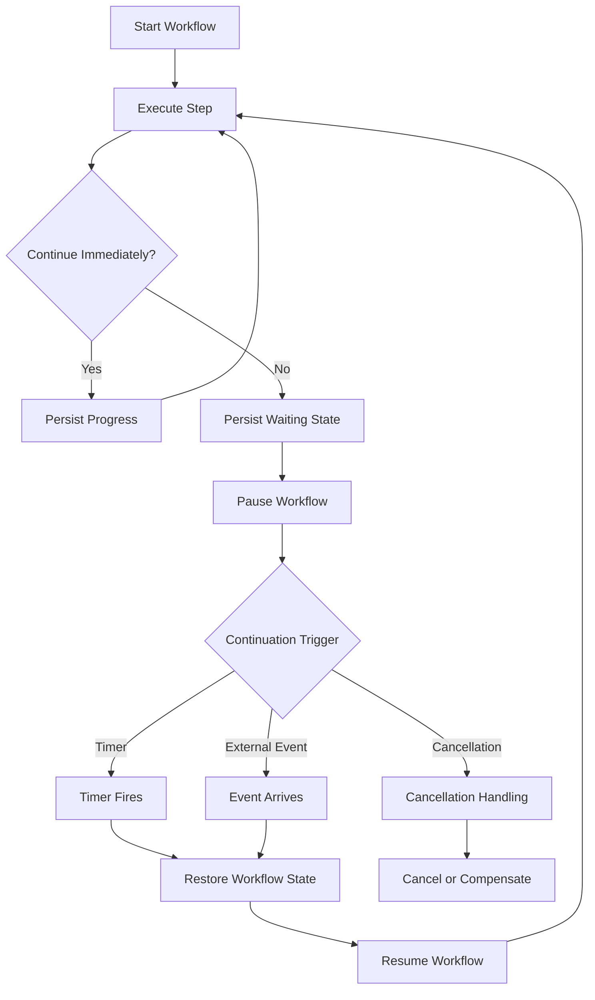

# AGT-06.03 — Async, Long-Running Execution, Continuity and Compensation

## Learning Objectives

By the end of this chapter, you should be able to:

- Explain why some workflows cannot remain continuously active in a single process.
- Distinguish synchronous execution from asynchronous workflow execution.
- Explain what makes a workflow long-running.
- Understand how timers, external events, and waiting periods affect workflow continuity.
- Explain how a workflow can pause and later resume.
- Understand execution continuity across worker restarts and long waiting periods.
- Reason about workflow identity across asynchronous continuation.
- Explain deadlines, timeouts, and cancellation at the workflow level.
- Distinguish cancellation from rollback.
- Explain partial completion in multi-step workflows.
- Understand why distributed workflows may require compensation rather than rollback.
- Distinguish compensation from retry.
- Explain the basic idea of saga-like compensation without turning it into a distributed-transactions implementation chapter.
- Design workflows that remain logically alive while no process is actively executing them.
- Reason about compensation workflows after partial completion.
- Evaluate trade-offs between synchronous and asynchronous continuation.
- Identify common mistakes in long-running workflow design.

---

## Prerequisites

Before reading this chapter, you should understand:

- Workflow steps
- Sequential workflows
- Branching
- Loops
- Parallel execution
- Fan-out and fan-in
- Synchronization
- Workflow state
- State transitions
- Checkpoints
- Durable execution
- Recovery and resumption
- Replay and idempotency

Recommended prerequisites:

- [AGT-06.01 — Workflow Patterns, Branches, Loops and Parallelism](./01-Workflow-Patterns-Branches-Loops-and-Parallelism.md)
- [AGT-06.02 — State Transitions, Checkpoints and Durable Execution](./02-State-Transitions-Checkpoints-and-Durable-Execution.md)

Related concepts:

- AGT-02 — Agent Runtime, Harness and Execution
- AGT-03 — Tool Definitions, Contracts and Execution
- AGT-04 — Agent State, Context and Memory
- AGT-05 — Planning, Decomposition and Adaptation
- AGT-07 — Human-in-the-Loop and Intervention
- AGT-11 — Reliability and Safety

This chapter remains framework-independent.

---

## Estimated Reading Time

**40–50 minutes**

---

## Before We Start

Consider this workflow:

```text
Start
  │
  ▼
Submit Application
  │
  ▼
Wait for External Decision
  │
  ▼
Receive Decision
  │
  ▼
Validate Decision
  │
  ▼
Complete
```

The problem is the waiting step.

The external decision might arrive:

- in a few seconds
- after several minutes
- several hours later
- the next day
- several days later

Should the application server keep a process running the entire time?

Usually, that would be a poor design.

A process may:

- restart
- be replaced
- lose its worker
- scale down
- encounter infrastructure failure
- consume unnecessary resources while waiting

The workflow therefore needs another model.

Instead of:

```text
Start
  │
  ▼
Execute
  │
  ▼
Wait inside process
  │
  ▼
Continue
```

we want:

```text
Start
  │
  ▼
Execute
  │
  ▼
Persist Workflow State
  │
  ▼
Pause
  │
  │
  │   No process needs to remain active
  │
  ▼
External Event
  │
  ▼
Restore Workflow State
  │
  ▼
Resume
  │
  ▼
Complete
```

This leads to the central question of this chapter:

> **How does a workflow remain logically alive when execution cannot remain continuously active?**

---

# Why This Exists

A simple workflow often looks like:

```text
Request
   │
   ▼
Execute
   │
   ▼
Return Response
```

This works well when execution completes quickly.

But many real workflows contain waiting periods.

Examples include:

- waiting for an external service
- waiting for a payment confirmation
- waiting for an asynchronous job
- waiting for a scheduled time
- waiting for a human decision
- waiting for a document
- waiting for a webhook
- waiting for another workflow
- waiting for an external business process

A workflow may therefore have this shape:

```text
Execute
   │
   ▼
Wait
   │
   ▼
Continue
   │
   ▼
Wait
   │
   ▼
Continue
   │
   ▼
Complete
```

The workflow's **logical lifetime** can be much longer than the lifetime of any individual process executing it.

This distinction is fundamental.

```text
Workflow Lifetime
──────────────────────────────────────────────►

Worker 1
██████

Worker 2
       █████

Worker 3
             ███████
```

The workflow remains the same logical execution even though different workers may execute different portions of it.

That is the foundation of long-running workflow continuity.

---

# Mental Model

A useful mental model is:

> **A long-running workflow can be understood as a durable state machine whose execution may become inactive without becoming finished.**

The phrase “state machine” here is a conceptual model. A concrete implementation may use different internal representations.

Consider:

```text
                ┌───────────────────┐
                │      Running      │
                └─────────┬─────────┘
                          │
                          ▼
                ┌───────────────────┐
                │ Waiting for Event │
                └─────────┬─────────┘
                          │
                     Event Arrives
                          │
                          ▼
                ┌───────────────────┐
                │     Resuming      │
                └─────────┬─────────┘
                          │
                          ▼
                ┌───────────────────┐
                │      Running      │
                └───────────────────┘
```

The important distinction is:

```text
Waiting
   ≠
Completed
```

A workflow can be inactive from an execution perspective while still being alive from a business-process perspective.

For example:

```text
Application Submitted
       │
       ▼
Waiting for Decision
       │
       │  18 hours
       │
       ▼
Decision Received
       │
       ▼
Continue
```

The workflow did not need to occupy a worker for those 18 hours.

It needed to preserve enough durable information to know:

- which workflow was waiting
- what it was waiting for
- what state existed before waiting
- what event could resume it
- what should happen after resumption

---

# Core Concepts

## 1. Synchronous Execution

In synchronous execution, the caller typically waits while the operation runs.

```text
Request
   │
   ▼
Execute
   │
   ▼
Response
```

For example:

```text
Client
  │
  ▼
API Request
  │
  ▼
Validate Input
  │
  ▼
Calculate Result
  │
  ▼
Return Response
```

This is appropriate when execution is short enough and the caller needs the result immediately.

---

# 2. Asynchronous Workflow Execution

In asynchronous workflow execution, the initial request starts the workflow but does not require the caller or worker to remain active until completion.

```text
Request
   │
   ▼
Start Workflow
   │
   ▼
Return Workflow ID
   │
   ▼
Workflow Continues Independently
```

Later:

```text
External Event
      │
      ▼
Workflow Resumes
      │
      ▼
Complete
```

A useful conceptual model is:

```text
Request
   │
   ▼
Start Workflow
   │
   ├──────────────► Return
   │
   ▼
Persist State
   │
   ▼
Continue Independently
```

The caller and workflow execution lifecycle are therefore decoupled.

---

# 3. Synchronous vs Asynchronous

| Synchronous | Asynchronous |
|---|---|
| Caller waits for execution | Caller may receive acknowledgement immediately |
| Usually short-lived | Can support long-running work |
| Process may remain active | Execution can pause |
| Simpler lifecycle | More lifecycle complexity |
| Immediate response | Result may arrive later |

Neither model is universally better.

The correct choice depends on:

- execution duration
- user experience
- resource requirements
- external dependencies
- failure characteristics
- business workflow requirements

---

## 4. What Makes a Workflow Long-Running?

A workflow is long-running when its logical execution may span a significant period during which continuous process execution is undesirable or impractical.

The exact duration is not universal.

A workflow may be considered long-running if it lasts:

- minutes
- hours
- days
- weeks
- longer

The important property is not simply elapsed time.

It is that:

> **The workflow's logical lifetime extends beyond a convenient continuous execution window.**

For example:

```text
Start
  │
  ▼
Submit Request
  │
  ▼
Wait 2 Days
  │
  ▼
Receive Response
  │
  ▼
Continue
```

Holding a process open for two days would usually be unnecessary.

---

# 5. Waiting Is a Workflow State

Waiting should be represented explicitly.

For example:

```text
RUNNING
   │
   ▼
WAITING_FOR_PAYMENT
   │
   ▼
PAYMENT_RECEIVED
   │
   ▼
VALIDATING_PAYMENT
```

The workflow is not simply “doing nothing.”

It is in a meaningful business execution state.

The state may need to identify:

```text
Workflow ID
Waiting reason
Expected event
Correlation information
Deadline
Required state
Next transition
```

This allows the workflow to resume correctly.

---

# 6. Pause vs Termination

A paused workflow is not necessarily terminated.

Compare:

```text
Paused
  │
  ▼
Waiting for Event
  │
  ▼
Resume
```

with:

```text
Terminated
  │
  ▼
No Further Execution
```

This distinction matters operationally.

A workflow can be:

- running
- waiting
- paused
- cancelled
- failed
- completed
- compensated

The exact state model depends on the system.

The important concept is that **waiting is a valid lifecycle state**.

---

# 7. Workflow Identity Across Continuation

A long-running workflow may be executed by multiple processes or workers.

For example:

```text
Workflow ID: WF-123

Day 1
Worker A
   │
   ▼
Pause

Day 2
Worker B
   │
   ▼
Resume

Day 3
Worker C
   │
   ▼
Complete
```

The workflow identity must remain stable even though the execution environment changes.

This identity allows the system to connect:

```text
Previous Execution
       │
       ▼
Persisted Workflow State
       │
       ▼
New Execution
```

Without stable identity, continuation becomes difficult.

---

# 8. External Events

A workflow may need to wait for an event outside its current execution.

Examples include:

```text
Payment Confirmation
Document Uploaded
Webhook Received
Approval Completed
Job Finished
Shipment Delivered
External API Result
```

Conceptually:

```text
Workflow
   │
   ▼
Wait for External Event
   │
   │
   │   External System
   │        │
   │        ▼
   │      Event
   │        │
   └────────┘
        │
        ▼
     Resume
```

The event should be associated with the correct workflow instance.

This usually requires some form of correlation information.

For example:

```text
Workflow ID = WF-123
Event ID = EVT-456
```

The exact event infrastructure is implementation-specific.

The workflow concept is:

> **An external event provides the trigger that moves a waiting workflow into its next execution state.**

---

# 9. Event-Driven Continuation

A workflow can remain dormant until an event arrives.

For example:

```text
Start
  │
  ▼
Submit Verification
  │
  ▼
WAITING_FOR_VERIFICATION
  │
  │
  │   Verification System
  │          │
  │          ▼
  │      Verification Event
  │
  ▼
Resume
  │
  ▼
Continue
```

Event-driven continuation can reduce unnecessary polling when the external system can reliably emit the required event.

Instead of repeatedly asking:

```text
Check?
Check?
Check?
Check?
Check?
```

the workflow can wait for:

```text
Event
```

However, event-driven continuation introduces its own concerns:

- event identity
- correlation
- duplicate events
- missing events
- delayed events
- invalid events
- ordering

These concerns should be handled according to the workflow's execution design.

---

# 10. Timers

Not every workflow waits for an external event.

Some wait until a specific time.

For example:

```text
Start
  │
  ▼
Create Reminder
  │
  ▼
Wait Until Tomorrow 09:00
  │
  ▼
Resume
  │
  ▼
Send Reminder
```

The workflow does not need to keep a process active overnight.

Instead, it preserves the required workflow state and establishes a future continuation point.

Timers are therefore another form of asynchronous continuation.

---

# 11. Deadlines

A deadline defines when a workflow or workflow activity is expected to complete or when a waiting period should end.

For example:

```text
Submitted
   │
   ▼
Wait for Response
   │
   ├── Response arrives
   │       │
   │       ▼
   │    Continue
   │
   └── Deadline reached
           │
           ▼
        Timeout Path
```

A deadline is different from simply waiting forever.

The workflow needs to define what happens if the expected event does not arrive within the required period.

Possible outcomes include:

- timeout
- escalation
- cancellation
- alternate processing
- compensation
- failure

The appropriate behavior is a workflow and reliability decision.

---

# 12. Timeout

A timeout is a condition in which an expected operation or event does not occur within its allowed time window.

For example:

```text
WAITING_FOR_PAYMENT
        │
        ├── Payment Received
        │        │
        │        ▼
        │     Continue
        │
        └── Timeout
                 │
                 ▼
             Timeout Path
```

Timeout does not automatically mean:

```text
Operation Failed
```

It means:

> **The expected condition was not observed within the defined time boundary.**

The external operation may still be executing.

This distinction matters when interacting with external systems.

---

# 13. Cancellation

Cancellation means requesting that a workflow stop further execution.

For example:

```text
Running
   │
   ▼
Cancellation Requested
   │
   ▼
Cancellation Handling
   │
   ▼
Cancelled
```

Cancellation is not necessarily instantaneous.

A workflow may contain:

- completed steps
- currently executing work
- pending work
- external operations

The system must therefore define how cancellation propagates.

For example:

```text
Workflow
   │
   ├── Step A ✓
   ├── Step B ✓
   ├── Step C → running
   └── Step D → pending
```

After cancellation:

```text
Step A ✓
Step B ✓
Step C → cancellation handling
Step D → not started
```

Completed work is not automatically undone.

---

# 14. Cancellation vs Rollback

This distinction is critical.

### Cancellation

Means:

> Stop further workflow execution.

### Rollback

Means:

> Restore transactional state to an earlier state.

These are not equivalent.

For example:

```text
Create Order
   │
   ▼
Charge Payment
   │
   ▼
Cancellation Requested
```

Cancellation may stop the workflow before shipment creation.

It does not automatically reverse the payment.

Rollback may be possible in a transactional system, but many external operations cannot simply be rolled back.

Therefore:

```text
Cancellation
      ≠
Rollback
```

---

# 15. Partial Completion

Long-running workflows often reach a state where some work has completed and some has not.

Consider:

```text
Reserve Inventory
       │
       ▼
Charge Payment
       │
       ▼
Create Shipment
```

Suppose:

```text
Reserve Inventory ✓
Charge Payment ✓
Create Shipment ✗
```

The workflow is partially complete.

A naive approach might attempt:

```text
Undo Everything
```

But external operations may not support transactional rollback.

For example:

- inventory reservation may have a release operation
- payment may have a refund operation
- shipment creation may simply have failed

This leads to compensation.

---

# 16. Compensation

Compensation is a new workflow action intended to offset the business effect of previously completed work.

Consider:

```text
Reserve Inventory
       │
       ▼
Charge Payment
       │
       ▼
Create Shipment
       X
```

Suppose shipment creation cannot continue.

A compensation workflow may be:

```text
Shipment Creation Failed
        │
        ▼
Compensation Workflow
        │
        ├── Release Inventory
        │
        └── Refund Payment
```

The important idea is:

> **Compensation does not rewind time. It performs new actions intended to offset previously completed effects.**

---

# 17. Compensation vs Rollback

These concepts should not be treated as synonyms.

### Rollback

```text
Transaction
   │
   ├── Operation A
   ├── Operation B
   └── Operation C
          │
          ▼
       Rollback
          │
          ▼
Earlier Transactional State
```

Rollback is usually associated with a transactional boundary that can restore previous state.

### Compensation

```text
Operation A
   │
   ▼
Operation B
   │
   ▼
Operation C
   X
   │
   ▼
Compensation
   ├── Offset A
   └── Offset B
```

Compensation is a new sequence of operations.

It may not perfectly restore the original state.

For example:

```text
Charge Payment
      │
      ▼
Refund Payment
```

A refund is not literally the same operation as reversing history.

There may be:

- processing fees
- timing differences
- partial refunds
- external state changes
- business rules

Therefore:

> **Compensation attempts to restore an acceptable business outcome, not necessarily the exact previous state.**

---

# 18. Compensation Is Not Automatically Required

Not every failure requires compensation.

Suppose:

```text
Validate Input
     │
     ▼
Calculate Score
     │
     ▼
Generate Report
```

If report generation fails, there may be nothing to compensate.

Compensation becomes relevant when previously completed actions created business effects that should be offset if the workflow cannot continue.

The decision about whether compensation is appropriate belongs to the broader reliability and safety design.

AGT-11 owns the decision-making around recovery, retry, fallback, compensation, degradation, containment, and termination.

AGT-06 owns how the selected compensation workflow is orchestrated and executed.

---

# 19. Compensation Workflow

A compensation workflow may itself be a workflow.

For example:

```text
Primary Workflow

Reserve Inventory
      │
      ▼
Charge Payment
      │
      ▼
Create Shipment
      X
```

Then:

```text
Compensation Workflow

Release Inventory
      │
      ▼
Refund Payment
      │
      ▼
Compensation Complete
```

This means compensation may require:

- its own state
- its own checkpoints
- its own failure handling
- its own execution history
- its own completion state

Compensation is therefore not merely:

```text
if failed:
    undo()
```

It can be a structured execution process.

---

# 20. Saga-Like Compensation

A saga-like model is useful for reasoning about distributed business workflows in which completed steps have corresponding compensating actions.

For example:

```text
A → B → C → D
```

may have conceptual compensating actions:

```text
A' ← B' ← C' ← D'
```

For example:

```text
Reserve Inventory
      │
      ▼
Charge Payment
      │
      ▼
Create Shipment
```

Possible compensations:

```text
Release Inventory
      │
      ▼
Refund Payment
```

The compensation order may depend on business semantics.

A simplified model is:

```text
Forward:
A → B → C

Compensation:
C' → B' → A'
```

But compensation is not universally a simple reverse-order operation.

The correct compensation sequence depends on:

- business dependencies
- external system behavior
- already completed effects
- acceptable final state

This chapter uses the saga-like idea conceptually. It does not define a specific saga framework or implementation.

---

# 21. Compensation Can Also Fail

A critical production insight is:

> **Compensation is itself execution.**

Therefore:

```text
Primary Workflow
      │
      ▼
Failure
      │
      ▼
Compensation
      │
      X
Compensation Failure
```

The system may now have:

```text
Partial Primary Completion
+
Partial Compensation
```

This is why compensation cannot be treated as a guaranteed undo mechanism.

The compensation workflow needs its own durable execution and state management.

---

# 22. Execution Continuity

Execution continuity means preserving the logical workflow across changes in the execution environment.

For example:

```text
Day 1
Worker A
   │
   ▼
Workflow State Persisted
   │
   ▼
Waiting

Day 2
Worker B
   │
   ▼
Restore State
   │
   ▼
Resume
```

The workflow identity and durable state connect these separate execution periods.

The worker is replaceable.

The workflow instance remains logically continuous.

---

# 23. Long-Running Workflow Lifecycle

A long-running workflow may follow a lifecycle such as:

```text
Start
  │
  ▼
Running
  │
  ▼
Waiting
  │
  ▼
Event Received
  │
  ▼
Running
  │
  ▼
Waiting
  │
  ▼
Resume
  │
  ▼
Complete
```

Or:

```text
Start
  │
  ▼
Running
  │
  ▼
Partial Completion
  │
  ▼
Failure
  │
  ▼
Compensation
  │
  ▼
Compensated
```

The workflow's lifecycle is therefore not necessarily a single uninterrupted execution.

---

# Internal Working

The exact implementation depends on the execution system, but the conceptual lifecycle can be modeled as follows.



The important lifecycle is:

```text
Execute
   ↓
Persist
   ↓
Pause
   ↓
Wait
   ↓
Trigger
   ↓
Restore
   ↓
Resume
```

---

## 1. Start the Workflow

A workflow receives a stable identity.

```text
Workflow ID = WF-123
State = Ready
```

The workflow begins execution.

---

## 2. Execute Work

The workflow performs one or more steps.

```text
Step A
   │
   ▼
Step B
```

After meaningful progress, workflow state is persisted according to the system's durability model.

---

## 3. Detect a Waiting Condition

Suppose the next step requires an external event.

```text
Step B
   │
   ▼
Waiting for Payment Confirmation
```

The workflow should transition into an explicit waiting state.

---

## 4. Persist Waiting State

The workflow persists enough information to continue later.

Conceptually:

```text
Workflow ID
Current State
Waiting Condition
Correlation Information
Deadline
Next Transition
Required Workflow Data
```

The active worker can now release execution resources.

---

## 5. Pause

The workflow becomes inactive.

```text
Workflow
   │
   ▼
WAITING
```

No continuously running process is required merely because the workflow still exists.

---

## 6. Continuation Trigger

The workflow may resume because of:

- timer
- external event
- scheduled condition
- asynchronous job completion
- another workflow event

For example:

```text
External System
      │
      ▼
Payment Confirmed
      │
      ▼
Event Delivered
      │
      ▼
Workflow WF-123
```

---

## 7. Restore State

A worker or execution environment loads the persisted workflow state.

```text
Workflow ID
     │
     ▼
Persisted State
     │
     ▼
Restore
```

The system reconstructs the workflow's required execution context.

This is workflow continuity, not necessarily reuse of the same process.

---

## 8. Validate the Trigger

The system should determine whether the received event or timer is valid for the workflow.

For example:

```text
Event
   │
   ▼
Correct Workflow?
   │
   ├── No → Ignore / Reject / Handle
   │
   └── Yes
          │
          ▼
       Continue
```

This is especially important when events may be duplicated or delayed.

---

## 9. Resume

The workflow transitions from waiting back into execution.

```text
WAITING
   │
   ▼
EVENT_RECEIVED
   │
   ▼
READY_TO_RESUME
   │
   ▼
RUNNING
```

The workflow can now continue from the appropriate state.

---

# Practical Example: External Verification

Consider an onboarding workflow:

```text
Start
  │
  ▼
Collect User Data
  │
  ▼
Submit Identity Verification
  │
  ▼
Wait for Verification
  │
  ▼
Verification Received
  │
  ▼
Validate Result
  │
  ▼
Complete
```

The verification service may take several hours.

A poor design would keep a process waiting:

```text
Worker
  │
  ├── submit verification
  │
  └── wait 4 hours
```

A durable asynchronous design is:

```text
Submit Verification
        │
        ▼
Persist Workflow State
        │
        ▼
WAITING_FOR_VERIFICATION
        │
        │
        │  Worker released
        │
        ▼
Verification Event
        │
        ▼
Restore Workflow
        │
        ▼
Validate Result
        │
        ▼
Complete
```

The workflow survives the waiting period without requiring continuous process execution.

---

# Practical Example: Timer-Based Continuation

Consider a reminder workflow:

```text
Create Reminder
      │
      ▼
Persist Workflow State
      │
      ▼
Wait Until 09:00 Tomorrow
      │
      ▼
Resume
      │
      ▼
Send Reminder
      │
      ▼
Complete
```

The workflow's logical state might be:

```text
Workflow ID = WF-500
State = WAITING
Resume At = Tomorrow 09:00
Next Step = Send Reminder
```

At the scheduled time:

```text
Timer
  │
  ▼
Workflow WF-500
  │
  ▼
Restore
  │
  ▼
Send Reminder
```

The process that originally created the reminder does not need to remain alive overnight.

---

# Practical Example: Partial Completion and Compensation

Consider:

```text
Reserve Inventory
       │
       ▼
Charge Payment
       │
       ▼
Create Shipment
```

Suppose:

```text
Reserve Inventory ✓
Charge Payment ✓
Create Shipment ✗
```

The business may no longer want the order to remain partially completed.

A compensation workflow could be:

```text
Shipment Failed
       │
       ▼
Start Compensation
       │
       ├── Release Inventory
       │
       ▼
     Refund
       │
       ▼
Compensation Complete
```

The final workflow state might be:

```text
Primary Workflow = Failed
Compensation = Completed
Business Outcome = Order Cancelled
```

Notice that the system did not literally restore the original state.

Instead, it performed new actions intended to produce an acceptable business outcome.

---

# Practical Example: Compensation Failure

Now suppose:

```text
Reserve Inventory ✓
Charge Payment ✓
Shipment ✗
       │
       ▼
Compensation
       │
       ├── Release Inventory ✓
       │
       └── Refund Payment ✗
```

The workflow is now in a more complex state:

```text
Primary Workflow = Failed
Inventory = Released
Payment = Not Refunded
Compensation = Partial
```

This state must itself be durable.

A compensation workflow may therefore require:

```text
Checkpoint
   │
   ▼
Resume Compensation
   │
   ▼
Retry / Alternative Action / Escalation
```

The specific recovery decision is outside the scope of AGT-06.

The orchestration mechanism remains within scope.

---

# Production Perspective

## 1. Do Not Keep Processes Alive Just to Wait

One of the most important production principles is:

> **A logical workflow should not require a continuously running process merely because it has not completed.**

Instead:

```text
Persist
   ↓
Pause
   ↓
Release Worker
   ↓
Resume Later
```

This can reduce unnecessary resource usage and improve resilience.

---

# 2. Workflow Identity Must Be Stable

Long-running execution requires a stable identity.

For example:

```text
Workflow ID = WF-123
```

The identity should allow the system to connect:

```text
Initial Execution
      ↓
Persisted State
      ↓
Waiting
      ↓
Event
      ↓
New Execution
```

Without this relationship, continuation becomes unreliable.

---

# 3. Waiting State Must Be Durable

A workflow that waits for hours cannot rely solely on process memory.

The system should persist enough information to reconstruct:

```text
Who am I?
What was I doing?
What am I waiting for?
What event should resume me?
What happens next?
```

This is a direct application of the durable execution concepts from AGT-06.02.

---

# 4. External Events May Be Duplicated

Suppose:

```text
Payment Confirmed
```

is delivered twice.

```text
Event 1 → Workflow
Event 2 → Workflow
```

The workflow should not blindly assume that every event represents a new business transition.

Event handling may therefore need:

- event identifiers
- correlation identifiers
- duplicate detection
- state validation

The exact mechanism depends on the event architecture.

---

# 5. Events May Arrive Late

Suppose the workflow expects:

```text
Payment Confirmation
```

but the workflow has already moved to another state.

A late event may arrive afterward.

The system should define what happens.

For example:

```text
Expected:
WAITING_FOR_PAYMENT

Actual:
PAYMENT_ALREADY_TIMED_OUT

Late Event:
PAYMENT_CONFIRMED
```

The event cannot automatically be treated as valid simply because it is related to the workflow.

The current workflow state matters.

---

# 6. Timeouts Are Not Proof of Failure

Suppose a payment confirmation does not arrive within ten minutes.

The workflow may transition:

```text
WAITING
   │
   ▼
TIMEOUT
```

But the external payment system may still be processing.

Therefore:

```text
Timeout
   ≠
External Operation Failed
```

This distinction is important when designing recovery and reconciliation behavior.

---

# 7. Cancellation Must Be Designed Explicitly

Cancellation can occur while:

```text
Waiting
Running
Partially Complete
Executing External Operation
```

Each situation may require different behavior.

For example:

```text
Waiting
   │
   ▼
Cancellation Requested
   │
   ▼
Cancel Waiting State
   │
   ▼
Cancelled
```

But:

```text
External Operation In Progress
   │
   ▼
Cancellation Requested
```

may require additional handling because the external operation may not support cancellation.

---

# 8. Compensation Is Business-Semantic

Compensation is not simply a technical inverse.

For example:

```text
Charge Payment
```

might be compensated with:

```text
Refund Payment
```

But the refund may:

- take time
- incur fees
- be partial
- fail
- require manual intervention
- produce a different final state

Therefore, compensation must be designed around business semantics.

---

# 9. Compensation Can Increase Workflow Complexity

A workflow that originally looks like:

```text
A → B → C
```

may become:

```text
A → B → C
       │
       X
       │
       ▼
     B'
       │
       ▼
     A'
```

The number of possible states increases.

This means compensation should not be added casually.

The business need must justify the complexity.

---

# 10. Long-Running Workflows Need Operational Visibility

A workflow that runs for days cannot be debugged like a simple request.

Operators may need to know:

```text
Workflow ID
Current State
Started At
Last Activity
Waiting Since
Expected Event
Deadline
Last Checkpoint
Execution History
Compensation State
```

This allows operators to understand:

```text
Is it running?
Is it waiting?
Is it stuck?
Did an event arrive?
Did it time out?
Was compensation started?
```

Operational observability is therefore important for long-running workflows.

AGT-10 owns evaluation methodology and metrics; AGT-06 focuses here on execution visibility and workflow history needed to operate and recover workflows.

---

# Engineering Decisions and Trade-offs

## 1. Synchronous vs Asynchronous

| Synchronous | Asynchronous |
|---|---|
| Simpler lifecycle | More complex lifecycle |
| Immediate result | Result may arrive later |
| Good for short work | Good for long-running work |
| Process may remain active | Worker can be released |
| Easier request-response model | Requires durable continuation |

Use asynchronous execution when the workflow's logical lifetime should not be tied to one active request or process.

---

## 2. Polling vs Event-Driven Continuation

### Polling

```text
Check
  ↓
Wait
  ↓
Check
  ↓
Wait
  ↓
Check
```

Advantages:

- simple in some environments
- useful when no event mechanism exists

Costs:

- repeated requests
- unnecessary load
- timing delays
- more coordination logic

### Event-driven

```text
Wait
  ↓
Event
  ↓
Resume
```

Advantages:

- less unnecessary work
- prompt continuation
- natural fit for asynchronous systems

Costs:

- event delivery complexity
- correlation
- duplicate handling
- ordering
- missing or delayed events

Neither approach is universally superior.

---

## 3. Immediate vs Deferred Continuation

### Immediate continuation

```text
Step A
  ↓
Step B
```

Useful when:

- next step is ready
- no external wait exists
- execution is short

### Deferred continuation

```text
Step A
  ↓
Wait
  ↓
External Event
  ↓
Step B
```

Useful when:

- external dependency exists
- timer is required
- workflow must remain active logically but not physically

The choice should reflect the workflow's actual dependency structure.

---

# 4. Retry vs Compensation

Retry and compensation solve different problems.

### Retry

Attempts an operation again.

```text
Operation
   X
   │
   ▼
Retry
   │
   ▼
Operation Again
```

### Compensation

Offsets the business effect of completed work.

```text
Completed Operation
       │
       ▼
Compensating Operation
```

For example:

```text
Payment Failed Before Completion
        → possible retry

Payment Succeeded
Shipment Failed
        → possible compensation
```

The correct reliability strategy depends on the failure and business semantics.

AGT-11 owns the broader decision about whether retry, compensation, fallback, degradation, or termination is appropriate.

AGT-06 owns the execution structure once that strategy has been selected.

---

# 5. Cancellation vs Compensation

Cancellation and compensation solve different problems.

Cancellation determines whether future workflow execution should stop.

Compensation determines whether already completed business effects need to be offset.

One may trigger the other, but neither automatically implies the other.

For example:

```text
Workflow
   │
   ├── A ✓
   ├── B ✓
   └── C pending
```

Cancellation might result in:

```text
A ✓
B ✓
C cancelled
```

If A and B created business effects that should be offset, compensation may additionally be required:

```text
Cancellation
     │
     ▼
Compensation
     │
     ├── Compensate B
     └── Compensate A
```

The decision to compensate belongs to the broader reliability and business recovery design.

---

# 6. Long-Running vs Short-Lived Workflow

Long-running workflows justify more execution infrastructure when:

- execution spans significant waiting periods
- external dependencies are involved
- process restarts are expected
- recovery is important
- workflow state must persist across execution windows

For a simple short-lived operation:

```text
Validate → Calculate → Return
```

durable long-running orchestration may add unnecessary complexity.

---

# 7. Compensation vs No Compensation

Compensation can improve business correctness when partial completion creates unwanted effects.

But compensation adds:

- additional workflow states
- more code
- more failure modes
- more operational complexity
- additional external operations

Therefore:

> **Compensation should be introduced when the business consequence of partial completion justifies the additional orchestration complexity.**

---

## Common Mistakes and Misconceptions

## 1. “Async means run it in the background.”

Not necessarily.

Asynchronous workflow execution is more than moving work to another thread or process.

A robust asynchronous workflow may require:

```text
Durable State
+
Stable Workflow Identity
+
Continuation Trigger
+
Resume Logic
```

---

## 2. “Waiting means the workflow is finished.”

No.

A workflow can be:

```text
WAITING
```

without being:

```text
COMPLETED
```

---

## 3. “Keep the process alive until the workflow finishes.”

This is usually inappropriate for long waits.

A durable workflow can persist its state, release the worker, and resume later.

---

## 4. “Timeout means the external operation failed.”

No.

Timeout means the expected condition was not observed within the defined time boundary.

The external operation may still be running.

---

## 5. “Cancellation automatically reverses completed work.”

No.

Cancellation stops further workflow execution according to the workflow's cancellation semantics.

It does not automatically undo completed external side effects.

---

## 6. “Compensation is rollback.”

No.

Rollback restores transactional state within a rollback-capable boundary.

Compensation performs new actions intended to offset previous business effects.

---

## 7. “Every failure needs compensation.”

No.

Compensation is relevant when completed effects need to be offset.

A failed read operation, for example, may require no compensation.

---

## 8. “Compensation always restores the original state.”

No.

Compensation attempts to produce an acceptable business outcome.

The resulting state may differ from the original state.

---

## 9. “Compensation cannot fail.”

It can.

```text
Primary Failure
      ↓
Compensation
      X
Compensation Failure
```

Compensation is itself a workflow and must be executed and tracked reliably.

---

## 10. “An external event always means the workflow should continue.”

No.

The event may be:

- duplicated
- delayed
- invalid
- unrelated
- stale

The workflow must validate the event against its current state and correlation information.

---

## 11. “Long-running means the worker runs for a long time.”

No.

The **workflow** may run for a long time logically while individual workers execute only short portions.

---

## 12. “Polling is always worse than events.”

No.

Polling may be appropriate when event delivery is unavailable or when its simplicity outweighs its cost.

The choice is architectural.

---

## 13. “A timer requires a process to stay alive.”

Not necessarily.

A durable workflow can persist the required continuation state and resume when the timer condition is reached.

---

## 14. “Cancellation and compensation are the same.”

No.

Cancellation controls future execution.

Compensation addresses previously completed effects.

They may occur together, but they solve different problems.

---

# Interview Questions with Expected Answers

## Foundational

### 1. What is asynchronous workflow execution?

**Expected answer:**

It is an execution model where the workflow can continue independently of the initial request and may pause, wait, and resume later without requiring the original process to remain active.

---

### 2. What makes a workflow long-running?

**Expected answer:**

Its logical execution spans a period where continuous process execution is impractical or undesirable, often because it must wait for external events, timers, or long-running business processes.

---

### 3. Why should a long-running workflow not keep a worker alive while waiting?

**Expected answer:**

It wastes resources and creates unnecessary dependence on one process. Durable state allows the worker to be released and another execution environment to resume the workflow later.

---

## Conceptual

### 4. What is the difference between waiting and completion?

**Expected answer:**

Waiting means the workflow is temporarily inactive while expecting a future continuation trigger. Completion means no further workflow execution is required.

---

### 5. What is the difference between cancellation and rollback?

**Expected answer:**

Cancellation stops future workflow execution. Rollback restores transactional state to an earlier state when the underlying transaction supports it. Cancellation does not automatically undo completed external effects.

---

### 6. What is the difference between cancellation and compensation?

**Expected answer:**

Cancellation controls whether future workflow execution should stop. Compensation performs new actions intended to offset business effects from work that has already completed. Cancellation may lead to compensation, but it does not automatically imply it.

---

### 7. What is compensation?

**Expected answer:**

Compensation is a new workflow action or sequence of actions intended to offset the business effects of previously completed operations when the primary workflow cannot continue.

---

### 8. Why is compensation not the same as rollback?

**Expected answer:**

Rollback restores previous transactional state. Compensation performs new actions and may only approximate the desired previous business outcome.

---

### 9. What is an external event in a workflow?

**Expected answer:**

It is an event originating outside the currently executing workflow that can trigger a transition from a waiting state to a resumable execution state.

---

## Scenario

### 10. A workflow waits six hours for an external payment confirmation. How would you design it?

**Expected answer:**

Persist the workflow state and waiting condition, release the worker, associate the expected payment event with the workflow identity, and resume the workflow when the event arrives.

---

### 11. A payment confirmation arrives twice. What should happen?

**Expected answer:**

The workflow should detect or safely handle duplicate events using event identity, correlation, current workflow state, or other duplicate-handling mechanisms so the business transition is not incorrectly applied twice.

---

### 12. A payment confirmation does not arrive before the deadline. Does that prove payment failed?

**Expected answer:**

No. It only means the expected confirmation was not observed within the defined time. The external payment operation may still be processing.

---

### 13. A workflow has reserved inventory and charged payment, but shipment creation fails. What could happen next?

**Expected answer:**

If the selected business recovery strategy requires compensation, the workflow could execute compensating actions such as releasing inventory and refunding payment.

---

## Debugging

### 14. A long-running workflow disappears after the worker restarts. What would you investigate?

**Expected answer:**

Check whether workflow state and waiting state were durably persisted, whether workflow identity was preserved, and whether the continuation mechanism can locate and restore the workflow.

---

### 15. A workflow resumes after an event but executes the wrong step. What would you investigate?

**Expected answer:**

Inspect persisted workflow state, state transitions, event correlation, event validation, and the continuation mapping between the waiting state and the next workflow step.

---

### 16. A compensation workflow repeatedly refunds the same payment. What would you investigate?

**Expected answer:**

Check whether compensation can be executed more than once, whether the refund operation is idempotent or deduplicated, whether compensation progress is durably persisted, and whether recovery can repeat completed compensation steps.

---

### 17. A workflow times out and then receives the expected external event. What should you investigate?

**Expected answer:**

Determine the workflow's current state, event timing, correlation, deadline semantics, and whether late events should be ignored, reconciled, or trigger another defined transition.

---

## Architecture

### 18. What information should be persisted before a workflow enters a long wait?

**Expected answer:**

At minimum, enough information to identify the workflow, represent its current state, describe the waiting condition, correlate the future trigger, preserve required workflow data, and determine what should happen after resumption.

---

### 19. How would you model a workflow waiting for an external event?

**Expected answer:**

Represent an explicit waiting state, persist the workflow identity and correlation information, establish the expected event or condition, and define the transition that occurs when the valid event arrives.

---

### 20. Why does compensation need durable execution?

**Expected answer:**

Because compensation can itself be interrupted, partially complete, or long-running. Its progress must be preserved so it can safely continue after failure.

---

## Engineering Judgment

### 21. When is asynchronous execution preferable to synchronous execution?

**Expected answer:**

When execution may be long-running, depends on external events, should not hold a request open, or can continue independently of the initiating request.

---

### 22. When is a long-running workflow unnecessary?

**Expected answer:**

When the operation is short-lived, has no meaningful waiting period, and can complete reliably within a normal request or execution window.

---

### 23. When should compensation be introduced?

**Expected answer:**

When partial completion can create business effects that need to be offset and the business value of correcting those effects justifies the additional workflow complexity.

---

### 24. Why might compensation be harder than the original workflow?

**Expected answer:**

Because compensation may involve different external operations, partial failure, timing differences, business rules, and its own recovery requirements.

---

### 25. What is the biggest architectural mistake in long-running workflow design?

**Expected answer:**

Treating the workflow as a continuously running process instead of a durable logical execution that can persist state, wait, and resume across different execution environments.

---

## Quick Revision

## Core Mental Model

```text
Workflow Lifetime
        │
        ├── Running
        │
        ├── Waiting
        │
        ├── Resuming
        │
        ├── Running
        │
        └── Completed
```

The workflow can remain logically alive even when no worker is actively executing it.

---

## Synchronous

```text
Request
   ↓
Execute
   ↓
Response
```

---

## Asynchronous

```text
Request
   ↓
Start Workflow
   ↓
Return
   ↓
Workflow Continues
```

---

## Long-Running

```text
Start
   ↓
Execute
   ↓
Persist
   ↓
Wait
   ↓
External Event / Timer
   ↓
Restore
   ↓
Resume
   ↓
Complete
```

---

## External Event

```text
Workflow
   ↓
WAITING
   ↓
External Event
   ↓
Validate Event
   ↓
Resume
```

---

## Timer

```text
Workflow
   ↓
Persist
   ↓
Wait Until Time
   ↓
Timer Fires
   ↓
Resume
```

---

## Cancellation

```text
Running
   ↓
Cancellation Requested
   ↓
Cancellation Handling
   ↓
Cancelled
```

Cancellation does not automatically undo completed effects.

---

## Compensation

```text
A
 ↓
B
 ↓
C
 X
 ↓
Compensation
 ├── Compensate B
 └── Compensate A
```

Compensation performs new actions to offset business effects.

---

## Rollback vs Compensation

```text
Rollback
    ↓
Restore Transactional State

Compensation
    ↓
Perform New Offsetting Actions
```

---

## Critical Distinctions

```text
Workflow Waiting
       ≠
Workflow Completed
```

```text
Cancellation
       ≠
Rollback
```

```text
Cancellation
       ≠
Compensation
```

```text
Compensation
       ≠
Rollback
```

Cancellation may lead to compensation when the selected business recovery strategy requires it, but neither concept automatically implies the other.

---

# Key Takeaways

1. Asynchronous execution decouples workflow lifetime from the initial request and active worker.
2. A long-running workflow can remain logically alive while no process is continuously executing it.
3. Waiting is a valid workflow state, not the same as completion.
4. Durable workflow state allows a workflow to pause and later resume.
5. Stable workflow identity is essential for continuity across workers and execution periods.
6. External events can trigger workflow continuation.
7. Timers can provide future continuation without keeping a worker alive.
8. Deadlines define when expected progress must occur.
9. A timeout means an expected condition was not observed within the allowed time; it does not necessarily prove the external operation failed.
10. Cancellation stops future workflow execution according to the workflow's cancellation semantics.
11. Cancellation does not automatically undo completed external effects.
12. Partial completion is normal in multi-step workflows interacting with external systems.
13. Rollback restores transactional state when the underlying transaction supports it.
14. Compensation performs new actions intended to offset previously completed business effects.
15. Compensation may not restore the exact original state.
16. Compensation is itself a workflow and can fail or become partially complete.
17. Saga-like workflows provide a useful conceptual model for forward execution plus compensating actions.
18. Compensation should be designed around business semantics rather than treated as a generic technical undo operation.
19. Long-running workflows require durable waiting state and reliable continuation mechanisms.
20. External events may be duplicated, delayed, stale, or invalid and must be correlated with workflow state.
21. A worker is an execution resource; the workflow is the durable logical process.
22. Asynchronous execution increases lifecycle complexity in exchange for scalability, resilience, and continuity.
23. Polling and event-driven continuation each have trade-offs.
24. Retry and compensation solve different problems.
25. Cancellation and compensation solve different problems: cancellation controls future execution, while compensation addresses already completed business effects.
26. AGT-11 owns the broader decision of whether recovery, retry, compensation, fallback, degradation, or termination is appropriate.
27. AGT-06 owns the orchestration and durable execution of the selected workflow path.
28. The central principle of long-running workflow design is:

> **Persist the workflow's logical state, release execution resources when waiting, and resume from a durable continuation point when the required trigger occurs.**

---

## Further Reading

Continue exploring the broader AGT domain through:

- [AGT-06.01 — Workflow Patterns, Branches, Loops and Parallelism](./01-Workflow-Patterns-Branches-Loops-and-Parallelism.md)
- [AGT-06.02 — State Transitions, Checkpoints and Durable Execution](./02-State-Transitions-Checkpoints-and-Durable-Execution.md)

Related AGT concepts:

- AGT-02 — Agent Runtime, Harness and Execution
- AGT-03 — Tool Definitions, Contracts and Execution
- AGT-04 — Agent State, Context and Memory
- AGT-05 — Planning, Decomposition and Adaptation
- AGT-07 — Human-in-the-Loop and Intervention
- AGT-11 — Reliability and Safety

The progression of AGT-06 is:

```text
AGT-06.01
Workflow Structure
       │
       ▼
AGT-06.02
State, Checkpoints and Durable Execution
       │
       ▼
AGT-06.03
Async, Long-Running Continuity and Compensation
```

The central progression is:

```text
How is execution structured?
          ↓
How does execution survive interruption?
          ↓
How does execution continue across long waits and partial completion?
```

---
