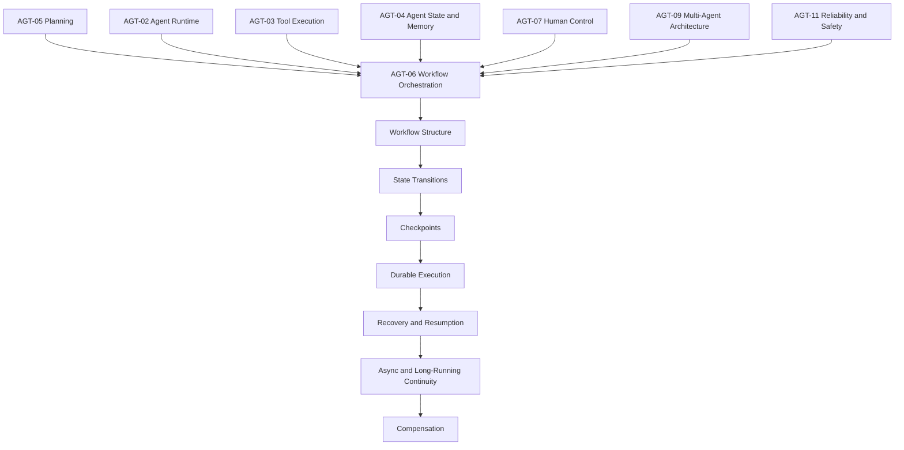

# AGT-06 — Workflow Orchestration & Durable Execution

## Chapter Purpose

AGT-06 explains how multi-step agent workflows are **structured, coordinated, persisted, resumed, and continued reliably** across branches, loops, parallel work, failures, delays, interruptions, and long-running execution.

The central question is:

> **How do we reliably orchestrate and continue this multi-step execution?**

AGT-06 focuses on the **workflow execution system around agent behavior**.

It does not focus on deciding what the agent should achieve or how the agent should construct the best plan.

---

## Learning Objectives

By the end of AGT-06, you should be able to:

- Explain workflow orchestration in an agent system.
- Distinguish workflow orchestration from agent planning and runtime execution.
- Model sequential, branching, looping, and parallel workflows.
- Reason about dependencies, synchronization, fan-out, and fan-in.
- Explain workflow state and state transitions.
- Explain checkpoints, persistence, and durable execution.
- Design basic checkpoint and recovery strategies.
- Reason about interruption, replay, recovery, and resumption.
- Explain why checkpointing does not guarantee exactly-once execution.
- Reason about duplicate side effects and idempotency at workflow boundaries.
- Design asynchronous and long-running workflow continuation.
- Explain pause/resume behavior around external events and waiting periods.
- Distinguish rollback from compensation.
- Reason about cancellation and partial completion.
- Explain compensation workflow orchestration.
- Evaluate trade-offs involving durability, recovery, parallelism, checkpoint frequency, and orchestration complexity.

---

## Scope

AGT-06 owns:

- Workflow structure
- Sequential execution
- Conditional branching
- Loops and iteration
- Parallel execution
- Fan-out and fan-in
- Synchronization
- Workflow dependencies
- Workflow composition
- Control flow
- Workflow state
- State transitions
- Execution history
- Checkpoints
- Persistence
- Durable execution
- Workflow recovery and resumption mechanics
- Replay
- Duplicate execution risks
- Workflow-boundary idempotency
- Asynchronous execution
- Long-running workflows
- Waiting and timers
- External-event continuation
- Pause and resume
- Cancellation
- Partial completion
- Compensation workflows
- Execution continuity

---

## Non-Goals

AGT-06 does not own the following areas:

| Area | Primary Owner | AGT-06 Boundary |
|---|---|---|
| Goal decomposition | AGT-05 | Execute an established plan; do not teach planning |
| Plan construction | AGT-05 | Do not re-teach plan generation |
| Plan verification and critique | AGT-05 | Do not teach plan-quality methodology |
| Replanning and adaptation | AGT-05 | Do not turn workflow recovery into planning methodology |
| Agent runtime loop | AGT-02 | Do not re-teach decision → action → observation → continuation |
| Tool contracts and schemas | AGT-03 | Workflow steps may contain tools, but tool design is out of scope |
| Tool selection and routing | AGT-03 | Do not re-teach capability selection |
| Tool side effects and invocation boundaries | AGT-03 | Discuss only what workflow recovery requires |
| Agent state and context | AGT-04 | Do not turn workflow state into an agent-state chapter |
| Agent memory | AGT-04 | Workflow state is not agent memory |
| Human approval and intervention | AGT-07 | Explain only workflow pause/resume mechanics |
| Protocols and interoperability | AGT-08 | External capabilities may be workflow steps, but protocol design is out of scope |
| Multi-agent architecture | AGT-09 | A workflow may contain multiple agents without becoming a multi-agent architecture chapter |
| Evaluation methodology | AGT-10 | Execution history may be discussed; evaluation methodology is out of scope |
| Reliability and safety strategy | AGT-11 | AGT-11 decides whether retry, recovery, compensation, degradation, or termination is appropriate |
| Cloud/platform infrastructure | PROD | Do not turn durable execution into an infrastructure tutorial |

---

## Chapter Structure

AGT-06 contains three lessons.

### 01 — Workflow Patterns, Branches, Loops and Parallelism

**Primary question:**

> How is a multi-step workflow structured?

This lesson establishes the fundamental structures used to represent workflow execution.

It covers:

- Workflow fundamentals
- Workflow steps
- Sequential execution
- Conditional branching
- Loops and iteration
- Parallel execution
- Fan-out and fan-in
- Synchronization
- Dependencies
- Workflow composition
- Control flow
- Deterministic and dynamic workflow structure
- Common workflow patterns
- Workflow design trade-offs

[Read AGT-06.01 — Workflow Patterns, Branches, Loops and Parallelism](./01-Workflow-Patterns-Branches-Loops-and-Parallelism.md)

---

### 02 — State Transitions, Checkpoints and Durable Execution

**Primary question:**

> How does a workflow survive interruption?

This lesson introduces the state and persistence mechanisms required to recover and continue workflow execution.

It covers:

- Workflow state
- State transitions
- Execution history
- Checkpoints
- Persistence
- Durable execution
- Interruption and crash recovery
- Resumption
- Replay
- Recovery points
- Duplicate execution risks
- Workflow-boundary idempotency
- Execution lineage
- Checkpoint design trade-offs

[Read AGT-06.02 — State Transitions, Checkpoints and Durable Execution](./02-State-Transitions-Checkpoints-and-Durable-Execution.md)

---

### 03 — Async, Long-Running Execution, Continuity and Compensation

**Primary question:**

> How does a workflow continue when execution cannot remain continuously active?

This lesson extends durable execution to workflows that wait for future events, remain active for long periods, or require compensation after partial completion.

It covers:

- Asynchronous workflows
- Long-running workflows
- Waiting periods
- Timers
- External events
- Pause and resume
- Execution continuity
- Workflow interruption
- External dependencies
- Deadlines
- Timeouts
- Cancellation
- Partial completion
- Compensation workflows
- Compensation vs rollback
- Distributed failure considerations
- Saga-like compensation concepts

[Read AGT-06.03 — Async, Long-Running Execution, Continuity and Compensation](./03-Async-Long-Running-Execution-Continuity-and-Compensation.md)

---

## Learning Progression

The chapter follows this progression:

```text
Workflow Structure
       ↓
Branches / Loops / Parallelism
       ↓
Dependencies / Synchronization
       ↓
Workflow State
       ↓
State Transitions
       ↓
Checkpoints
       ↓
Durable Execution
       ↓
Recovery / Replay / Resumption
       ↓
Async / Long-Running Continuity
       ↓
Cancellation / Partial Completion
       ↓
Compensation
```

The learning path therefore moves from:

**structure → state → durability → continuity**

Each file builds on the previous one.

---

## Prerequisites

Before starting AGT-06, you should be comfortable with:

- Basic software engineering and program control flow
- Sequential, conditional, and iterative execution
- Basic concurrency concepts
- Agent runtime behavior
- Agent state and context
- Tool execution
- Agent planning

Relevant prerequisite chapters:

- AGT-02 — Agent Runtime, Harness and Execution
- AGT-03 — Tool Definitions, Selection and Execution
- AGT-04 — Agent State, Context and Memory
- AGT-05 — Planning, Decomposition and Adaptation

No specific workflow framework is required.

---

## Critical Concept Boundaries

AGT-06 sits between planning and reliable workflow execution.

### AGT-05 → AGT-06

AGT-05 asks:

> **What is the right way to achieve the goal?**

AGT-06 asks:

> **How do we reliably orchestrate and continue that execution?**

AGT-06 therefore executes and persists workflow structure without becoming a planning chapter.

### AGT-02 → AGT-06

AGT-02 owns the agent runtime loop:

```text
Decision
   ↓
Action
   ↓
Observation
   ↓
Continuation / Termination
```

AGT-06 owns workflow-level orchestration across structured execution steps.

### AGT-03 → AGT-06

AGT-03 owns tool contracts, selection, routing, execution, side effects, and invocation boundaries.

AGT-06 may orchestrate steps that invoke tools but does not redefine tool behavior.

### AGT-04 → AGT-06

AGT-04 owns agent state, context, and memory.

AGT-06 owns workflow execution state, checkpoints, persistence, and workflow continuity.

> **Workflow state is not the same as agent memory.**

### AGT-07 → AGT-06

AGT-07 owns the decision and policy around human approval, intervention, and escalation.

AGT-06 may explain how a workflow technically pauses and resumes around such an event.

### AGT-11 → AGT-06

AGT-11 owns the reliability and safety decision about whether retry, recovery, compensation, degradation, containment, or termination is appropriate.

AGT-06 owns the **orchestration mechanics of the selected execution path**.

---

## Core Engineering Themes

The lessons develop a small set of connected engineering themes:

```text
Control Flow
     ↓
Workflow State
     ↓
Persistence
     ↓
Checkpointing
     ↓
Durable Execution
     ↓
Recovery and Resumption
     ↓
Long-Running Continuity
     ↓
Compensation
```

The chapter also examines the consequences of:

- replay
- duplicate execution
- side effects
- idempotency
- parallel execution
- synchronization
- cancellation
- partial completion

These themes are developed in the lessons rather than treated as independent topics.

---

## Production Perspective

AGT-06 introduces workflow-level production concerns including:

- Workflow persistence
- State serialization
- Checkpoint frequency
- Recovery behavior
- Replay behavior
- Idempotency
- Duplicate side effects
- Timeouts
- Cancellation
- Concurrency
- Synchronization
- Worker failures
- Execution ownership
- Long-running continuity
- Operational observability
- Compensation complexity
- Workflow versioning

Infrastructure and deployment implementation details belong to the production engineering domain rather than this chapter.

---

## Key Trade-offs

AGT-06 examines trade-offs such as:

| Decision | Primary Trade-off |
|---|---|
| Sequential vs parallel | Simplicity vs throughput |
| Frequent vs infrequent checkpoints | Recovery speed vs storage and overhead |
| Fine-grained vs coarse-grained steps | Recovery precision vs orchestration overhead |
| Retry vs compensation | Simplicity vs correctness for side effects |
| Stateful vs stateless execution | Continuity vs implementation simplicity |
| Immediate vs asynchronous continuation | Responsiveness vs lifecycle complexity |
| Full replay vs checkpoint resume | Simplicity vs recovery cost |

There is no universally optimal workflow design.

---

## Common Misconceptions Addressed

AGT-06 explicitly addresses misconceptions around:

- Workflow orchestration vs agent planning
- Workflow state vs agent memory
- Checkpointing vs exactly-once execution
- Durable execution vs idempotency
- Retry vs safe retry
- Rollback vs compensation
- Async execution vs simple background execution
- Parallelism vs guaranteed performance improvement
- Cancellation vs automatic rollback
- Recovery vs restarting from the beginning

Detailed explanations belong in the lessons.

---

## Framework Independence

AGT-06 teaches workflow orchestration principles independently of specific frameworks.

Frameworks such as:

- LangGraph
- Temporal
- Inngest
- AWS Step Functions
- Azure Durable Functions
- Google Cloud Workflows
- LangChain
- CrewAI
- AutoGen
- OpenAI Agents SDK

may be used later as implementation examples, but they are not the conceptual foundation of this chapter.

---

## Knowledge Graph



---

## Practical Outcome

After completing AGT-06, you should be able to:

- Model structured agent workflows.
- Explain how workflow state changes during execution.
- Design checkpoint and persistence strategies.
- Reason about interruption and safe continuation.
- Explain durable execution without assuming exactly-once guarantees.
- Identify replay and duplicate-side-effect risks.
- Reason about idempotency at workflow boundaries.
- Design asynchronous and long-running continuation.
- Distinguish rollback from compensation.
- Reason about cancellation and partial completion.
- Evaluate workflow orchestration trade-offs.
- Explain the boundaries between planning, runtime execution, tools, agent state, workflow state, human control, and reliability strategy.

---

## Recommended Reading Order

Read the files in this order:

1. [AGT-06.01 — Workflow Patterns, Branches, Loops and Parallelism](./01-Workflow-Patterns-Branches-Loops-and-Parallelism.md)
2. [AGT-06.02 — State Transitions, Checkpoints and Durable Execution](./02-State-Transitions-Checkpoints-and-Durable-Execution.md)
3. [AGT-06.03 — Async, Long-Running Execution, Continuity and Compensation](./03-Async-Long-Running-Execution-Continuity-and-Compensation.md)

Do not skip directly to durable execution before understanding the workflow structures introduced in AGT-06.01.

---

## Navigation

### Prerequisite Chapters

- AGT-02 — Agent Runtime, Harness and Execution
- AGT-03 — Tool Definitions, Selection and Execution
- AGT-04 — Agent State, Context and Memory
- AGT-05 — Planning, Decomposition and Adaptation

### Current Chapter

- AGT-06 — Workflow Orchestration & Durable Execution
  - [01 — Workflow Patterns, Branches, Loops and Parallelism](./01-Workflow-Patterns-Branches-Loops-and-Parallelism.md)
  - [02 — State Transitions, Checkpoints and Durable Execution](./02-State-Transitions-Checkpoints-and-Durable-Execution.md)
  - [03 — Async, Long-Running Execution, Continuity and Compensation](./03-Async-Long-Running-Execution-Continuity-and-Compensation.md)

### Related Chapters

- AGT-07 — Human-in-the-Loop and Intervention
- AGT-08 — Capability Interfaces and Interoperability
- AGT-09 — Multi-Agent Architecture
- AGT-10 — Agent Evaluation
- AGT-11 — Reliability and Safety

---

# End of Document
