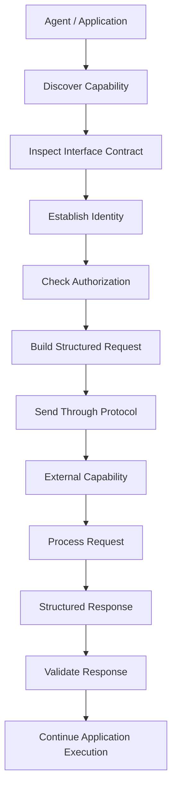

# Agent Capability Interfaces and Interoperability

## Learning Objectives

After completing this chapter, you should be able to:

- Explain why interoperability is an engineering problem rather than simply an API problem.
- Explain what a capability interface is and why an explicit interface boundary matters.
- Design a basic interface contract for an externally exposed capability.
- Distinguish interface semantics from implementation details.
- Explain capability discovery and its limitations.
- Understand structured requests, responses, and communication semantics.
- Identify capability boundaries and reason about what should cross them.
- Explain identity and authorization boundaries at an interoperability interface.
- Distinguish context exchange from internal agent state or memory.
- Explain protocol abstraction and how to select an appropriate communication mechanism.
- Reason about compatibility, versioning, schema evolution, and migration.
- Diagnose common interoperability failures.
- Translate an interface contract into a small framework-independent implementation boundary.
- Evaluate trade-offs between direct APIs, standardized protocols, static integration, and capability discovery.
- Explain how MCP and A2A fit into the broader interoperability problem without confusing protocol choice with system architecture.

---

## Prerequisites

Before studying this chapter, you should understand the basic concepts introduced in the earlier Agent Engineering chapters, particularly:

- what an agent system is
- agent and application boundaries
- tool usage and action execution
- execution context
- workflows and durable execution
- human intervention and approval boundaries

The chapter assumes that you already understand that an agent may need to interact with systems outside its own process.

You do **not** need prior knowledge of MCP or A2A.

---

## Estimated Reading Time

**Approximately 60–90 minutes**, excluding optional implementation exercises and further reading.

---

## Before We Start

Consider a simple agent application:

```text
User
  │
  ▼
Agent Application
  │
  ├── CRM
  ├── Payment Service
  ├── Calendar
  ├── Search Service
  └── Internal Business System
```

At first glance, this looks like a collection of API integrations.

But production systems quickly encounter harder questions:

- How does the agent know what capabilities are available?
- What exactly does a capability accept?
- What does it return?
- Which fields are required?
- What does an error mean?
- How does the caller know whether a capability changed?
- How is the caller authenticated?
- Is the caller authorized to perform the requested action?
- Can the capability be replaced without rewriting the caller?
- What happens if two systems understand the same field differently?
- What happens when one side upgrades its interface?
- Can another independently developed system use the capability?
- How do we distinguish a valid response from an unexpected or malformed response?

These are interoperability problems.

The important mental shift is:

> **Interoperability is not simply the ability to send a request. It is the ability of independently bounded systems to communicate and behave correctly across an agreed interface boundary.**

---

# Why This Exists

Modern AI systems rarely operate in isolation.

An agent may need to interact with:

- databases
- enterprise applications
- SaaS platforms
- internal services
- external APIs
- search systems
- business capabilities
- other agents

The implementation technologies may differ:

```text
Python
Java
Go
TypeScript
Rust
```

The systems may also be owned by different teams or organizations.

They may have different:

- deployment environments
- release cycles
- security policies
- data models
- operational responsibilities
- technology stacks

Yet they still need to communicate.

Without explicit interoperability boundaries, integrations tend to become tightly coupled.

```text
Caller
  │
  ├── knows implementation details
  ├── knows internal data structures
  ├── assumes undocumented behavior
  └── depends on deployment details
        │
        ▼
    Capability
```

This creates fragile integration.

A better design separates the caller from the implementation:

```text
Caller
  │
  │ agreed interface
  ▼
┌──────────────────────┐
│ Capability Interface │
├──────────────────────┤
│ Contract             │
│ Semantics            │
│ Identity             │
│ Authorization        │
└──────────────────────┘
  │
  ▼
Implementation
```

The caller depends on the **contract**, not on the internal implementation.

That separation is the foundation of interoperability.

---

# Mental Model

A useful model is:

```text
System A
   │
   ▼
┌──────────────────────────────────┐
│     Interoperability Boundary    │
├──────────────────────────────────┤
│ Interface                        │
│ Contract                         │
│ Communication Semantics          │
│ Identity / Authorization         │
│ Context Exchange                 │
│ Compatibility Rules              │
└──────────────────────────────────┘
   │
   ▼
System B
```

The boundary answers several different questions.

### Interface

> **What can the other system interact with?**

### Contract

> **What inputs, outputs, errors, and behavioral expectations apply?**

### Communication

> **How are messages exchanged?**

### Identity

> **Who is communicating?**

### Authorization

> **What is that caller allowed to do?**

### Context

> **What information must cross the boundary for the interaction to make sense?**

### Compatibility

> **Can the two sides continue communicating as they evolve?**

A protocol may standardize parts of this interaction, but a protocol does not automatically solve every problem above.

---

# Core Concepts

## 1. What Is Interoperability?

Interoperability is the ability of independently bounded systems to exchange information or invoke capabilities using sufficiently compatible interfaces and communication semantics.

The word **independently bounded** is important.

Two functions inside the same process do not necessarily present an interoperability problem.

Two independently developed services may.

For example:

```text
Agent Application
       │
       ▼
CRM Service
```

The CRM service may be:

- owned by another team
- deployed separately
- written in another language
- released independently
- governed by different access controls

The systems therefore need an explicit agreement about how they communicate.

### Interoperability is more than connectivity

A TCP connection can succeed while interoperability fails.

```text
Network connection
      ↓
Message delivered
      ↓
Schema accepted
      ↓
Semantic interpretation
      ↓
Correct behavior
```

A failure at any later stage can make the integration unusable.

For example:

```json
{
  "customer_id": "123"
}
```

may be syntactically valid but semantically wrong if the receiving system expects:

```json
{
  "account_id": "123"
}
```

Even worse, both sides might use `customer_id` but disagree about whether it means:

- internal database ID
- external CRM ID
- email address
- globally unique customer identifier

Therefore:

> **Interoperability requires compatible meaning, not merely compatible syntax.**

---

# 2. Capability Interfaces

A **capability** is something a system can provide to another system.

Examples:

- retrieve customer information
- create a support ticket
- check account status
- schedule an appointment
- search documents
- generate a report
- submit a payment request

An interface defines how another system can interact with that capability.

For example:

```text
Capability:
    Get Customer

Interface:
    get_customer(customer_id)

Input:
    customer_id

Output:
    customer information

Errors:
    customer not found
    unauthorized
    service unavailable
```

The implementation may internally involve:

```text
API
  ↓
Authentication
  ↓
Database
  ↓
Business Rules
  ↓
Response
```

But the caller does not need to know those internal details.

This is one of the most important interface design principles:

> **Expose the capability contract, not the implementation.**

---

# 3. Interface Contracts

An interface contract defines the expectations shared by the communicating systems.

A useful contract may describe:

```text
Identity
Input
Output
Errors
Behavior
Constraints
Version
Authorization requirements
```

For example:

```text
Capability: create_support_ticket

Input:
    customer_id: string
    title: string
    description: string
    priority: enum

Output:
    ticket_id: string
    status: enum

Possible errors:
    INVALID_INPUT
    UNAUTHORIZED
    FORBIDDEN
    CUSTOMER_NOT_FOUND
    SERVICE_UNAVAILABLE
```

The contract should answer:

> **What can I send?**

> **What can I expect back?**

> **What can go wrong?**

> **What behavior should I rely on?**

---

## Contract Layers

A useful way to reason about an interoperability contract is to separate its responsibilities.

```text
┌──────────────────────────────────────┐
│ Evolution / Compatibility Contract   │
├──────────────────────────────────────┤
│ Security Contract                    │
├──────────────────────────────────────┤
│ Behavioral Contract                  │
├──────────────────────────────────────┤
│ Semantic Contract                    │
├──────────────────────────────────────┤
│ Structural Contract                  │
└──────────────────────────────────────┘
```

### Structural contract

Defines the shape of exchanged information.

Examples:

```text
field names
field types
required fields
optional fields
allowed values
nested structures
```

### Semantic contract

Defines what the information means.

For example:

```text
customer_id
```

must have a shared meaning.

### Behavioral contract

Defines what the capability does and what behavior the caller can depend on.

For example:

```text
update_customer
```

may mean:

- modify only supplied fields
- replace the complete representation
- process asynchronously
- reject updates when a version conflicts

The contract must make the intended behavior clear.

### Security contract

Defines relevant expectations around:

- identity
- authentication
- authorization
- allowed operations
- trust boundaries

### Evolution and compatibility contract

Defines how the interface changes over time.

This may include:

- supported versions
- compatibility expectations
- deprecation
- migration
- schema evolution

This layered model prevents engineers from treating a JSON schema as the entire contract.

---

# 4. Interface Semantics

Interface semantics describe what the interface means and what behavior the caller can depend on.

Consider:

```text
update_customer(...)
```

What does `update` mean?

Possibilities include:

- replace the entire customer record
- modify only supplied fields
- merge fields
- update asynchronously
- enqueue an update
- update only if a version matches

These behaviors matter.

A good interface therefore documents not only:

```text
Input fields
Output fields
```

but also relevant behavioral semantics.

---

# 5. Request and Response Semantics

A basic interaction can be represented as:

```text
Caller
   │
   │ Request
   ▼
Capability
   │
   │ Response
   ▼
Caller
```

The request may contain:

```text
Operation
Parameters
Context
Correlation information
Identity information
```

The response may contain:

```text
Result
Status
Errors
Metadata
Continuation information
```

A conceptual example:

```json
{
  "operation": "get_customer",
  "parameters": {
    "customer_id": "C123"
  }
}
```

Response:

```json
{
  "status": "success",
  "result": {
    "customer_id": "C123",
    "name": "Example Customer"
  }
}
```

The exact message format depends on the interface or protocol.

The important engineering principle is that both sides must agree on:

- message structure
- message meaning
- expected behavior
- error semantics

---

# 6. Structured Inputs and Outputs

Structured communication reduces ambiguity.

Compare:

```text
"Please get customer C123"
```

with:

```json
{
  "operation": "get_customer",
  "customer_id": "C123"
}
```

The second representation is easier for software to validate and reason about.

Structured contracts allow systems to establish:

- required fields
- optional fields
- field types
- allowed values
- nested structures
- validation rules
- response structures

However, structured data does not automatically guarantee interoperability.

Two systems may both use JSON and still disagree about meaning.

```text
JSON
  ≠
Semantic interoperability
```

The serialization format is only one layer of the contract.

---

# 7. Capability Boundaries

A capability boundary defines what a system exposes to another system.

Suppose an internal CRM contains:

```text
Customer Database
├── customer records
├── billing records
├── employee notes
├── internal audit information
└── security metadata
```

The agent may only need:

```text
Customer Profile Capability
├── get customer
└── update contact information
```

The interface therefore becomes a boundary around the allowed capability.

```text
Internal System
┌──────────────────────────────┐
│ Customer DB                  │
│ Billing                      │
│ Internal Notes               │
│ Audit Data                   │
│                              │
│ ┌──────────────────────────┐ │
│ │ Exposed Capability       │ │
│ │ get_customer             │ │
│ │ update_contact            │ │
│ └──────────────────────────┘ │
└──────────────────────────────┘
               │
               ▼
          External Caller
```

This is important for both architecture and security.

A system should generally expose the **smallest useful capability surface** rather than exposing its entire internal model.

---

# 8. Capability Discovery

Static integration assumes the caller already knows what capability exists.

```text
Caller
  │
  └── "I know Capability X exists."
```

Capability discovery introduces another possibility:

```text
Caller
   │
   ▼
Discover Available Capabilities
   │
   ▼
Inspect Capability Metadata
   │
   ▼
Validate Capability Information
   │
   ▼
Select Capability
   │
   ▼
Invoke Capability
```

Discovery may provide information such as:

```text
Capability name
Description
Input schema
Output schema
Version
Availability
Authorization requirements
Supported operations
```

Discovery becomes useful when capabilities are:

- numerous
- independently deployed
- dynamically available
- provided by external systems
- expected to evolve

---

## Discovery Lifecycle

Discovery is not necessarily a one-time event.

A production interaction may conceptually follow:

```text
Advertise
   ↓
Discover
   ↓
Inspect
   ↓
Validate
   ↓
Select
   ↓
Invoke
   ↓
Refresh / Revalidate
```

The final step matters because discovery information can become stale.

For example:

```text
10:00
Capability advertises:
    create_ticket

10:30
Capability changes:
    create_ticket removed

11:00
Caller still uses cached metadata
```

The caller may therefore believe a capability exists when it no longer does.

Discovery systems need an appropriate strategy for:

- freshness
- caching
- invalidation
- capability changes
- version changes

The exact mechanism depends on the protocol and architecture.

---

## Discovery Does Not Mean Trust

A major misconception is:

> “If a capability was discovered, it must be safe or trustworthy.”

That is incorrect.

Discovery answers:

> **What capabilities are being advertised?**

It does not automatically answer:

> **Should I trust this capability?**

Trust requires separate considerations such as:

- identity
- authentication
- authorization
- provenance
- policy
- validation
- security controls

Therefore:

```text
Discovery
   ≠
Trust
```

---

# 9. Static Integration vs Dynamic Discovery

Both approaches have legitimate uses.

### Static integration

```text
Caller
   │
   └── Known Capability
```

Advantages:

- predictable
- easier to test
- easier to govern
- simpler dependency analysis

Disadvantages:

- less flexible
- changes may require coordinated integration work
- capability availability is known only through established configuration

### Dynamic discovery

```text
Caller
   │
   ▼
Capability Registry / Discovery
   │
   ▼
Available Capabilities
```

Advantages:

- more flexible
- supports changing capability environments
- can reduce hard-coded integration assumptions

Disadvantages:

- introduces discovery complexity
- introduces stale metadata risks
- increases trust and validation requirements
- makes dependency behavior less predictable

The right choice depends on the system.

---

# 10. Context Exchange

A capability or agent may require context to correctly process a request.

For example:

```text
Request
+
User identity
+
Tenant
+
Locale
+
Correlation ID
+
Task context
```

However, **context exchange** should not be confused with internal agent memory.

AGT-04 owns:

- agent state
- memory
- context lifecycle
- memory architecture

AGT-08 only needs to address:

> **What context must cross the interoperability boundary for the receiving system to interpret and process the interaction correctly?**

For example:

```text
Agent Internal State
        │
        │ selected context
        ▼
Interoperability Boundary
        │
        ▼
External System
```

Not every internal state value should cross the boundary.

A good design deliberately controls what context is exposed.

---

# 11. Identity

When systems communicate, the receiving system often needs to know:

> **Who is making this request?**

Identity may represent:

- an application
- an agent system
- a service
- a user
- a delegated principal

Identity becomes especially important when capabilities perform sensitive operations.

For example:

```text
Agent A
   │
   │ "Delete customer record"
   ▼
CRM
```

The CRM should not reason only about:

```text
"Is this request syntactically valid?"
```

It may also need to establish:

```text
Who is calling?
Under whose authority?
For which tenant?
Using which credentials?
```

Identity is therefore part of the interoperability boundary.

---

# 12. Authorization Boundaries

Authentication and authorization answer different questions.

### Authentication

> **Who are you?**

### Authorization

> **What are you allowed to do?**

A useful conceptual sequence is:

```text
Establish / Verify Identity
          │
          ▼
Identify Principal
          │
          ▼
Evaluate Authorization
          │
          ▼
Allow / Deny Requested Capability
```

This is a conceptual model, not a universal protocol-level sequence.

An interface may expose:

```text
get_customer
update_customer
delete_customer
```

but a caller may only be authorized for:

```text
get_customer
update_customer
```

The interface boundary therefore needs to preserve authorization semantics.

A protocol can standardize aspects of communication, but it does not eliminate the need for authorization.

---

# 13. Protocol Abstraction

An interface defines **what** interaction is available.

A protocol specifies agreed rules for **message exchange, interaction semantics, and participant behavior** at a communication boundary.

For example:

```text
Capability
    │
    ▼
Interface Contract
    │
    ▼
Protocol
    │
    ▼
Transport / Communication
```

Different protocols may carry similar conceptual operations.

For example, a capability could conceptually be exposed through:

```text
HTTP API
RPC
Message-based protocol
Protocol-specific interoperability mechanism
```

The important engineering question is not:

> “Which protocol is most popular?”

It is:

> **What communication mechanism provides the required interoperability with acceptable complexity, compatibility, security, and operational cost?**

---

# 14. Protocol Selection

Protocol selection should be driven by system requirements.

| Concern | Question |
|---|---|
| Participants | Who needs to communicate? |
| Capabilities | What is being exposed? |
| Contract | How structured is the interaction? |
| Discovery | Must capabilities be discovered dynamically? |
| Communication | Synchronous or asynchronous? |
| Compatibility | Are independent implementations expected? |
| Security | What identity and authorization boundaries exist? |
| Evolution | How will the interface change? |
| Ecosystem | Is interoperability with external implementations valuable? |
| Complexity | Does the protocol justify its operational cost? |

A standardized protocol is not automatically the correct choice.

---

## 15. Direct API vs Standardized Protocol

A direct API may be the better solution when:

- only two systems communicate
- ownership is shared
- the integration is stable
- requirements are simple
- no broader interoperability ecosystem is required

A standardized protocol becomes more attractive when:

- multiple independent implementations need to interoperate
- capability discovery matters
- a shared interaction model provides substantial value
- systems are independently developed
- ecosystem interoperability matters
- long-term compatibility is important

The decision should therefore be based on the problem, not the novelty of the protocol.

---

## 16. Synchronous vs Asynchronous Interaction

Not every interaction needs to return immediately.

### Synchronous

```text
Caller
  │
  │ Request
  ▼
Capability
  │
  │ Response
  ▼
Caller
```

Useful when:

- the operation is short
- the caller needs the result immediately
- execution duration is predictable

### Asynchronous

```text
Caller
  │
  │ Submit Task
  ▼
Capability
  │
  │ Accepted
  ▼
Caller

...later...

Capability
  │
  │ Result / Status
  ▼
Caller
```

Useful when:

- execution may be long-running
- immediate completion is not required
- the operation involves external processing
- the system needs durable task tracking

AGT-06 owns durable workflow execution and long-running execution mechanics. AGT-08 only needs to understand asynchronous communication as an interoperability pattern.

---

# 17. Compatibility

Compatibility asks:

> **Can two versions or implementations continue to interact correctly?**

Consider:

```text
Client v1
     │
     ▼
Service v2
```

They may both claim to support the same interface while still being incompatible.

Compatibility can involve:

- message structure
- field types
- required fields
- optional fields
- allowed values
- behavioral semantics
- error semantics
- protocol version
- capability availability

Therefore:

> **Compatibility is broader than matching version numbers.**

---

# 18. Backward and Forward Compatibility

### Backward compatibility

A newer implementation continues to support expectations of older clients.

```text
Old Client
     │
     ▼
New Service
```

### Forward compatibility

An older implementation can tolerate certain additions or changes introduced by a newer peer.

```text
New Client
     │
     ▼
Older Service
```

Forward compatibility is usually more constrained and depends heavily on the contract design.

For example, adding an optional response field may be harmless for a tolerant client.

Changing:

```json
"customer_id": "123"
```

into:

```json
"customer_id": 123
```

may break clients that depend on the original type.

---

# 19. Versioning

Versioning communicates that an interface has evolved.

But versioning alone does not guarantee compatibility.

For example:

```text
API v1
API v2
```

does not tell us whether:

```text
v2
```

is:

- backward compatible
- partially compatible
- incompatible
- semantically different

Good versioning should be accompanied by clear change-management rules.

---

# 20. Schema Evolution

Interfaces change.

A capability may evolve from:

```json
{
  "customer_id": "C123"
}
```

to:

```json
{
  "customer_id": "C123",
  "region": "IN"
}
```

If `region` is optional, older callers may continue to work.

But changing a required field can create incompatibility.

A useful evolution strategy distinguishes between:

```text
Safe-ish additive change
        ↓
Potentially breaking change
        ↓
Migration
        ↓
Deprecation
        ↓
Removal
```

The exact classification depends on the protocol and contract semantics.

The key principle is:

> **Interface evolution must be treated as a compatibility problem, not merely a code-change problem.**

---

# 21. Protocol Evolution

Protocol evolution may involve:

- versioning
- schema evolution
- capability changes
- backward compatibility
- forward compatibility where relevant
- deprecation
- migration
- negotiation where applicable
- coexistence of versions

A production system may temporarily need:

```text
Client v1 ──────► Service v1
Client v2 ──────► Service v2
Client v1 ──────► Service v2
```

The goal is controlled evolution rather than assuming every participant upgrades simultaneously.

---

# 22. Interoperability Failure Modes

Interoperability failures can occur at different layers.

```text
Discovery
   ↓
Identity
   ↓
Authorization
   ↓
Protocol
   ↓
Schema
   ↓
Semantics
   ↓
Availability
   ↓
Response Validation
```

Common failures include:

### Incompatible schemas

The sender and receiver disagree about message structure.

### Unsupported protocol version

One side requires capabilities that the other side does not support.

### Missing capabilities

A caller expects an operation that is not exposed.

### Discovery failure

The capability exists but cannot be discovered correctly.

### Authentication failure

The receiving system cannot establish the caller's identity.

### Authorization failure

The caller is authenticated but lacks permission.

### Malformed message

The message violates the expected contract.

### Invalid response

The receiver returns a response that does not satisfy the contract.

### Semantic mismatch

Both sides accept the message but interpret its meaning differently.

### Stale capability information

A caller relies on discovery information that is no longer accurate.

### Unavailable remote system

The capability exists but cannot currently be reached.

### Timeout

The operation does not complete within the expected time.

### Partial response

Only part of the expected interaction completes.

### Unexpected protocol behavior

The implementation behaves differently from the expected protocol semantics.

The important engineering skill is to identify **which boundary failed** rather than treating every failure as a generic API error.

---

# 23. Diagnosing an Interoperability Failure

A useful diagnostic sequence is:

```text
1. Can the participant be discovered?
              │
              ▼
2. Can identity be established?
              │
              ▼
3. Is the caller authorized?
              │
              ▼
4. Is the protocol/version supported?
              │
              ▼
5. Does the request satisfy the contract?
              │
              ▼
6. Does the receiver interpret the request correctly?
              │
              ▼
7. Is the capability available?
              │
              ▼
8. Is the response valid?
              │
              ▼
9. Does the caller interpret the response correctly?
```

This helps distinguish:

```text
Transport problem
Protocol problem
Contract problem
Semantic problem
Authorization problem
Availability problem
```

AGT-11 will later address broader reliability and recovery strategies. This chapter focuses on recognizing the interoperability boundary and diagnosing the class of failure.

---

# 24. Internal Working Model

A generalized capability interaction can be modeled as:



This is a conceptual model.

It does **not** imply that every protocol implements these steps in exactly this order or as separate messages.

The important idea is that successful interoperability involves more than request transmission.

---

# 25. Practical Implementation: Turning a Contract into an Interface Boundary

The concepts above become useful when they can be translated into an implementation boundary.

Consider this framework-independent capability contract:

```text
Capability:
    get_customer

Request:
    customer_id: string

Response:
    customer_id: string
    name: string
    status: string

Possible errors:
    INVALID_INPUT
    UNAUTHORIZED
    CUSTOMER_NOT_FOUND
    SERVICE_UNAVAILABLE
```

A simple implementation boundary can be modeled as:

```text
Incoming Request
       │
       ▼
Validate Structure
       │
       ▼
Establish / Verify Identity
       │
       ▼
Evaluate Authorization
       │
       ▼
Validate Capability Parameters
       │
       ▼
Invoke Internal Implementation
       │
       ▼
Map Internal Result
       │
       ▼
Validate External Response Contract
       │
       ▼
Return Structured Response
```

Notice what the boundary does **not** expose:

```text
Database tables
ORM models
Internal service topology
Private business objects
Internal exceptions
```

The interface converts internal implementation behavior into an externally supported contract.

---

## Framework-Independent Pseudocode

A conceptual implementation might look like:

```text
function handle_request(request, caller_identity):

    validate_request_structure(request)

    principal = establish_identity(caller_identity)

    authorize(
        principal,
        capability="get_customer"
    )

    validate_capability_parameters(
        customer_id=request.customer_id
    )

    internal_result = customer_service.get_customer(
        request.customer_id
    )

    response = map_to_contract(internal_result)

    validate_response_contract(response)

    return response
```

The important engineering separation is:

```text
External Contract
        │
        ▼
Interface Boundary
        │
        ▼
Internal Implementation
```

The internal implementation can change while preserving the external contract.

For example:

```text
Version 1
    PostgreSQL
       │
       ▼
    Customer Service
       │
       ▼
    Interface
```

Later:

```text
Version 2
    Distributed Customer Service
       │
       ├── Cache
       ├── Database
       └── Other Services
              │
              ▼
          Interface
```

If the externally supported contract remains compatible, the caller does not need to know about those internal changes.

---

## Contract Validation

A useful implementation principle is:

> **Validate at the boundary before allowing external data to enter internal execution paths.**

Conceptually:

```text
External Input
      │
      ▼
Structural Validation
      │
      ▼
Semantic / Business Validation
      │
      ▼
Authorization
      │
      ▼
Internal Processing
```

Likewise, responses should be validated before being trusted by the caller:

```text
Internal Result
      │
      ▼
Map to External Contract
      │
      ▼
Response Validation
      │
      ▼
External Caller
```

The exact validation mechanism depends on the implementation technology.

The durable engineering principle is the boundary itself.

---

# 26. Example: Agent Accessing a CRM Capability

Imagine an enterprise agent that needs customer information.

The internal system exposes:

```text
Capability:
    get_customer

Input:
    customer_id

Output:
    customer profile

Authorization:
    customer.read
```

The interaction can be modeled as:

```text
Agent
  │
  │ Discover / identify capability
  ▼
CRM Capability
  │
  │ Contract:
  │ get_customer(customer_id)
  ▼
Authorization Boundary
  │
  ▼
CRM Implementation
  │
  ▼
Customer Data
```

The agent does **not** need to know:

```text
PostgreSQL
Redis
ORM
internal microservices
database table names
```

Those are implementation details.

The agent needs to know:

```text
What capability exists?
What input does it accept?
What output does it return?
What errors can occur?
What authorization is required?
What version is supported?
```

That is the interface boundary.

### AGT-03 boundary

This example should not be interpreted as a replacement for the tool-execution concepts covered in AGT-03.

The distinction is:

```text
AGT-03
   │
   ├── tool contract
   ├── tool schema
   ├── tool selection
   ├── invocation
   ├── execution
   ├── side effects
   └── tool-specific failures

AGT-08
   │
   ├── interoperability boundary
   ├── cross-system interface contract
   ├── capability discovery
   ├── protocol interaction
   ├── identity / authorization boundary
   ├── compatibility
   └── interface evolution
```

AGT-08 may use a tool-like capability as an example, but its primary concern is **how independently bounded systems establish and maintain an interoperable boundary**.

---

# 27. Example: Contract Evolution

Suppose the original interface is:

```json
{
  "customer_id": "C123"
}
```

The service later wants to support region-aware queries.

A potentially compatible change is:

```json
{
  "customer_id": "C123",
  "region": "IN"
}
```

where `region` is optional.

The service can continue supporting:

```json
{
  "customer_id": "C123"
}
```

However, changing the contract to require:

```json
{
  "customer_id": "C123",
  "region": "IN"
}
```

may break existing callers.

This illustrates why:

> **Evolution strategy is part of interface design.**

---

# 28. Example: Semantic Incompatibility

Suppose both systems agree that:

```text
status = "active"
```

is valid.

But one system means:

> customer account can perform transactions

while the other means:

> customer record has not been deleted

The schemas match.

The values match.

The interaction still fails semantically.

This is why interoperable systems need agreement on **meaning**, not only structure.

---

# 29. Engineering Decisions and Trade-offs

## Direct API vs Standardized Protocol

### Direct API

Best when:

- integration scope is narrow
- participants are known
- ownership is coordinated
- requirements are stable

### Standardized protocol

More valuable when:

- multiple independent implementations are expected
- interoperability is a first-class requirement
- capability discovery matters
- ecosystem integration matters

The protocol introduces additional complexity, so the interoperability value must justify it.

---

## Static Integration vs Capability Discovery

### Static

```text
Known Capability
      ↓
Known Contract
      ↓
Invoke
```

Simpler and more predictable.

### Dynamic

```text
Discover
   ↓
Inspect
   ↓
Validate
   ↓
Select
   ↓
Invoke
```

More flexible but introduces:

- stale metadata
- trust decisions
- discovery failures
- additional runtime complexity

---

## Tight vs Flexible Contracts

Strict contracts improve:

- validation
- predictability
- tooling
- interoperability

But overly rigid contracts can make evolution difficult.

Flexible contracts can make evolution easier but may increase:

- ambiguity
- validation complexity
- semantic drift
- integration errors

The goal is not maximum strictness or maximum flexibility.

The goal is:

> **A contract that is explicit enough to support reliable interoperability while remaining evolvable.**

---

## Centralized vs Distributed Capability Exposure

A centralized capability registry can simplify discovery:

```text
              Registry
             /   |   \
            /    |    \
       Cap A   Cap B   Cap C
```

But it can introduce:

- central dependency
- ownership complexity
- stale metadata
- availability concerns

Distributed discovery may reduce central dependency but increase discovery complexity.

There is no universally correct architecture.

---

## Synchronous vs Asynchronous

Synchronous communication is simpler when:

- execution is short
- the caller needs an immediate result

Asynchronous interaction is useful when:

- execution is long
- completion is uncertain
- external processing is required

But asynchronous interaction introduces additional concerns such as:

- task identity
- status tracking
- correlation
- completion notification
- result retrieval

AGT-06 owns durable execution mechanics; AGT-08 only establishes the interoperability implications.

---

# 30. Security and Trust Boundaries

Interoperability expands the system boundary.

An external capability should not automatically be treated as trusted merely because it is reachable.

Important interface-level concerns include:

- identity
- authentication
- authorization
- least privilege
- capability exposure
- input validation
- response validation
- untrusted external systems
- malicious or malformed requests
- trust boundaries

A useful mental model is:

```text
Trusted Domain
      │
      ▼
┌─────────────────────┐
│ Interoperability    │
│ Boundary            │
├─────────────────────┤
│ Identity            │
│ Authentication      │
│ Authorization       │
│ Validation          │
└─────────────────────┘
      │
      ▼
External System
```

The protocol can define communication rules.

It does not automatically guarantee:

- safe behavior
- correct authorization
- trustworthy capabilities
- safe tool execution
- secure business logic

Those require additional controls.

### Scope boundary

AGT-08 covers protocol/interface-level security concerns.

It does **not** replace:

- AGT-11 agent safety
- ENT enterprise governance and compliance
- PROD infrastructure/runtime security

---

# 31. Common Mistakes and Misconceptions

## “If the schemas match, the systems are interoperable.”

Not necessarily.

Schemas provide structural compatibility. Semantic and behavioral compatibility may still fail.

---

## “A protocol solves interoperability completely.”

A protocol standardizes specified communication behavior.

It does not automatically solve:

- identity
- authorization
- trust
- semantic mismatch
- availability
- operational ownership
- business compatibility

---

## “Capability discovery means the capability is trustworthy.”

Discovery tells you what is advertised.

It does not establish trust or authorization.

---

## “Versioning means changing the version number.”

No.

Versioning is part of a broader evolution strategy involving compatibility, migration, deprecation, and supported behavior.

---

## “Every integration should use a standardized protocol.”

No.

A direct API may be simpler and better for a narrow, controlled integration.

Protocol adoption has a cost.

---

## “A2A means the system must be multi-agent.”

No.

A protocol can enable communication between independent agent systems.

Whether an application should be architected as a multi-agent system is a separate architectural decision owned by AGT-09.

---

## “MCP is fundamentally agent-to-agent.”

No.

In AGT-08, MCP is positioned primarily around **capability/tool interoperability** between an AI application or agent and externally exposed capabilities.

---

## “A protocol defines the architecture.”

No.

A protocol defines communication rules between participants.

Architecture determines:

- what components exist
- what responsibilities they have
- how they are organized
- how they interact as a system

Protocol choice is an architectural input, not the entire architecture.

---

## 32. MCP and A2A as Protocol Examples

This chapter establishes the durable interoperability concepts before introducing concrete protocols.

Two examples are especially relevant.

### MCP

MCP can be understood in AGT-08 as an interoperability mechanism for exposing and interacting with capabilities such as:

- tools
- resources
- prompts

Conceptually:

```text
AI Application / Agent
          │
          │ capability interaction
          ▼
External Capability
          │
          └── MCP
```

Detailed MCP architecture and protocol behavior belong to:

[`02-Model-Context-Protocol-MCP-and-Tool-Interoperability.md`](./02-Model-Context-Protocol-MCP-and-Tool-Interoperability.md)

### A2A

A2A addresses interoperability between independent agent systems.

Conceptually:

```text
Independent Agent A
          │
          │ agent-to-agent interaction
          ▼
Independent Agent B
          │
          └── A2A
```

Detailed A2A concepts belong to:

[`03-Agent-to-Agent-Interoperability-and-A2A.md`](./03-Agent-to-Agent-Interoperability-and-A2A.md)

The important distinction is:

```text
Interoperability
       │
       ├── Capability / Tool Interoperability
       │       └── MCP
       │
       └── Agent-to-Agent Interoperability
               └── A2A
```

This does **not** imply:

```text
MCP → A2A → Multi-Agent Architecture
```

Multi-agent architecture is addressed separately in AGT-09.

---

# 33. What Makes an Interface Truly Interoperable?

An interface is not truly interoperable merely because another system can send it a request.

A stronger definition considers multiple layers:

```text
Connectivity
     ↓
Protocol Compatibility
     ↓
Schema Compatibility
     ↓
Semantic Compatibility
     ↓
Behavioral Compatibility
     ↓
Security Compatibility
     ↓
Operational Compatibility
```

For example:

### Connectivity

Can the systems communicate?

### Protocol compatibility

Do they understand the communication mechanism?

### Schema compatibility

Do they understand the message structure?

### Semantic compatibility

Do they agree on what the data means?

### Behavioral compatibility

Do they agree on what operations actually do?

### Security compatibility

Can identity and authorization requirements be satisfied?

### Operational compatibility

Can the dependency be operated, monitored, evolved, and supported reliably?

This layered view is useful when evaluating real integrations.

---

# 34. Interface Review Checklist

Before exposing a capability to another system, review the boundary systematically.

### Capability

- What capability is being exposed?
- Why does the caller need it?
- What should remain internal?

### Contract

- Are inputs explicit?
- Are outputs explicit?
- Are errors defined?
- Are semantics documented?
- Are behavioral expectations clear?

### Discovery

- How does the caller learn the capability exists?
- How is capability metadata refreshed?
- What happens when metadata becomes stale?

### Identity and authorization

- How is the caller identified?
- What principal does the request represent?
- What operations are authorized?
- What tenant or security boundary applies?

### Context

- What context must cross the boundary?
- Is unnecessary internal state being exposed?

### Protocol

- Why is this communication mechanism appropriate?
- Does it provide enough interoperability value?
- Is its complexity justified?

### Compatibility

- What changes are backward compatible?
- Which changes are breaking?
- How are versions supported?

### Evolution

- How are changes announced?
- How are old versions deprecated?
- How are consumers migrated?

### Failure

- What happens when discovery fails?
- What happens when authorization fails?
- What happens when the remote capability is unavailable?
- How are malformed responses detected?

This checklist is a design aid, not a requirement that every interface implement identical mechanisms.

---

## 35. Production Perspective

In production, interoperability becomes a dependency-management problem as much as a communication problem.

A system may depend on capabilities owned by other teams or organizations.

Therefore engineers must consider:

### Ownership

Who owns the interface?

### Change management

Who decides when the contract changes?

### Compatibility

Which versions are supported?

### Availability

What happens when the remote capability is unavailable?

### Security

How are identity and authorization enforced?

### Observability

How can engineers understand failed interactions?

### Auditability

Can important requests and responses be traced appropriately?

### Dependency lifecycle

What happens when a capability is deprecated or replaced?

A useful enterprise interface record might therefore contain:

```text
Capability:
Owner:
Supported Versions:
Authentication:
Authorization:
Compatibility Policy:
Deprecation Policy:
Availability Expectations:
Observability:
Escalation / Support:
```

The exact fields depend on the organization.

The engineering principle is broader:

> **A production interface is a long-lived dependency boundary, not merely a request format.**

Infrastructure, deployment, runtime observability, and operational security remain primarily within PROD.

---

# 36. Interview Questions with Expected Answers

## 1. What is interoperability?

**Expected answer:**

Interoperability is the ability of independently bounded systems to communicate and behave correctly through compatible interfaces, contracts, and communication semantics. It requires more than network connectivity or matching schemas because the systems must also agree on meaning, behavior, identity, and relevant security boundaries.

---

## 2. What is a capability interface?

**Expected answer:**

A capability interface is a defined boundary through which another system can access a capability without depending on its internal implementation. It specifies how the capability can be invoked and what inputs, outputs, errors, and relevant behavioral expectations apply.

---

## 3. Why are interface contracts important?

**Expected answer:**

Contracts establish shared expectations between independently developed systems. They define structure and semantics for inputs, outputs, errors, and behavior, reducing ambiguity and allowing implementations to evolve independently.

---

## 4. What is capability discovery?

**Expected answer:**

Capability discovery is the process through which a caller learns what capabilities are available and how they can be used. It can reduce hard-coded integration assumptions, but discovered capabilities are not automatically trusted or authorized.

---

## 5. Why is schema compatibility not enough?

**Expected answer:**

Two systems can accept the same schema while interpreting the data or operation differently. Interoperability requires semantic and behavioral compatibility in addition to structural compatibility.

---

## 6. What is the difference between authentication and authorization?

**Expected answer:**

Authentication establishes or verifies the identity associated with a request. Authorization determines what that identified principal is permitted to do.

---

## 7. When would you prefer a direct API over a standardized protocol?

**Expected answer:**

A direct API is often preferable when the integration is narrow, participants are known, ownership is coordinated, and broader interoperability does not justify additional protocol complexity. A standardized protocol becomes more valuable when independent implementations, discovery, or ecosystem interoperability are important.

---

## 8. Does capability discovery imply trust?

**Expected answer:**

No. Discovery identifies advertised capabilities, but trust requires separate mechanisms such as identity, authentication, authorization, provenance, policy, and validation.

---

## 9. How would you handle protocol version incompatibility?

**Expected answer:**

First identify which versions each participant supports and whether a compatibility mode exists. Then consider negotiation, backward-compatible operation, version coexistence, migration, or a controlled upgrade. The exact strategy depends on the protocol and compatibility guarantees.

---

## 10. What is semantic incompatibility?

**Expected answer:**

Semantic incompatibility occurs when systems accept the same structure but assign different meanings to the data or operation. For example, both systems may accept `status="active"` but interpret the state differently.

---

## 11. Does using A2A imply a multi-agent architecture?

**Expected answer:**

No. A2A provides a mechanism for interoperability between independent agent systems. Whether a product or architecture should use multiple agents is a separate architectural decision.

---

## 12. How is MCP different from A2A at a conceptual level?

**Expected answer:**

MCP is positioned primarily around interoperability between an AI application or agent and externally exposed capabilities such as tools, resources, or prompts. A2A addresses interoperability between independent agent systems.

---

## 13. What happens if a discovered capability becomes unavailable?

**Expected answer:**

The caller should recognize the capability as an unavailable dependency rather than assuming discovery guarantees availability. The system needs appropriate handling for availability, timeouts, and stale capability information. Broader recovery strategy belongs to the reliability domain.

---

## 14. What makes an interface interoperable beyond matching schemas?

**Expected answer:**

It requires compatible semantics, behavior, identity and authorization expectations, protocol behavior, evolution rules, and operational assumptions. Matching schemas only establish part of the contract.

---

## 15. When should a team avoid introducing a protocol?

**Expected answer:**

When the interoperability value is low relative to the additional complexity. If two controlled systems have a simple, stable integration and do not need ecosystem interoperability or dynamic capability discovery, a direct API may be a better engineering choice.

---

## 16. Two systems support the same API version, but they interpret one field differently. What is wrong?

**Expected answer:**

This is a semantic compatibility failure. The structural contract may match while the semantic contract does not. The team should clarify and document the field's meaning, add contract or compatibility tests, and determine whether the mismatch requires migration or versioning.

---

## 17. Your organization has two internally controlled services and no external ecosystem requirement. Would you introduce a standardized interoperability protocol?

**Expected answer:**

Not automatically. First determine whether the protocol solves a real requirement such as independent implementations, dynamic discovery, or ecosystem interoperability. If a direct API provides the required behavior with lower complexity, it may be the better engineering choice.

---

## 18. A capability was discovered successfully yesterday, but today's invocation fails because the capability no longer exists. What does this tell you?

**Expected answer:**

Discovery information can become stale. The design needs an appropriate freshness, refresh, invalidation, or revalidation strategy. Discovery establishes knowledge about advertised capabilities at a point in time; it does not guarantee current availability.

---

## 37. Practical Design Exercise

Consider this scenario:

```text
Enterprise Agent
       │
       ▼
Customer Service Platform
```

The agent needs three capabilities:

```text
get_customer()
create_ticket()
update_customer()
```

Design the interoperability boundary.

Your design should identify:

1. The capability interface.
2. The structural, semantic, and behavioral contract.
3. Required context.
4. Identity requirements.
5. Authorization boundaries.
6. Discovery approach.
7. Synchronous vs asynchronous operations.
8. Versioning strategy.
9. Compatibility expectations.
10. At least five realistic failure modes.
11. Whether a direct API or standardized protocol is more appropriate.
12. What information should remain internal to the customer platform.
13. How stale capability information should be handled.
14. How you would validate requests and responses at the boundary.

The important part is not producing the most elaborate architecture.

The goal is to demonstrate that you can define a **clear boundary between the agent and the external capability** and reason about how that boundary behaves as systems evolve.

---

# 38. Quick Revision

### Interoperability

Independent systems communicating through compatible interfaces and semantics.

### Capability

Something a system can provide to another system.

### Interface

The defined boundary through which a capability can be accessed.

### Contract

The shared expectations for inputs, outputs, errors, semantics, behavior, security, and evolution.

### Structural contract

Defines the shape of exchanged information.

### Semantic contract

Defines what exchanged information means.

### Behavioral contract

Defines what the capability does and what behavior callers can rely on.

### Security contract

Defines relevant identity, authentication, authorization, and trust expectations.

### Discovery

Learning what capabilities are available and how they can be used.

### Structured communication

Using explicit machine-readable structures rather than relying on ambiguous free-form communication.

### Identity

Establishing who is communicating.

### Authorization

Determining what the identified caller is allowed to do.

### Context exchange

Passing the subset of context required across the system boundary.

### Compatibility

The ability of different versions or implementations to interact correctly.

### Versioning

A mechanism for communicating and managing interface evolution.

### Semantic compatibility

Agreement about what exchanged information and operations mean.

### Protocol

A defined set of communication rules between participants.

### Capability interoperability

Communication between an application/agent and an externally exposed capability.

### Agent-to-agent interoperability

Communication between independent agent systems.

---

## 39. Key Takeaways

1. **Interoperability is a systems-design problem.**
2. An interface should expose a capability without exposing unnecessary implementation details.
3. A contract is broader than a schema; it can include structural, semantic, behavioral, security, and evolution expectations.
4. Schema compatibility does not guarantee semantic compatibility.
5. Capability discovery improves flexibility but does not establish trust.
6. Discovery information can become stale and therefore requires an appropriate freshness strategy.
7. Identity and authorization are important parts of interoperability boundaries.
8. Context exchange should be deliberate; internal agent state should not automatically cross system boundaries.
9. Protocol choice should be driven by interoperability requirements and engineering trade-offs.
10. Direct APIs are often appropriate for simple, tightly controlled integrations.
11. Standardized protocols become more valuable when independent implementations and ecosystem interoperability matter.
12. Compatibility includes structure, semantics, behavior, and version evolution.
13. Versioning without an evolution strategy is insufficient.
14. Boundary validation protects internal implementations from malformed or incompatible external data.
15. Interoperability failures can occur at discovery, identity, authorization, protocol, schema, semantic, availability, and response-validation layers.
16. MCP belongs primarily to capability/tool interoperability.
17. A2A belongs to agent-to-agent interoperability.
18. Neither MCP nor A2A determines the overall system architecture.
19. Multi-agent architecture remains an AGT-09 concern.
20. A production interface should be treated as a long-lived dependency boundary.

---

## 40. Further Reading

For protocol-specific learning, continue with:

- [`02-Model-Context-Protocol-MCP-and-Tool-Interoperability.md`](./02-Model-Context-Protocol-MCP-and-Tool-Interoperability.md)
- [`03-Agent-to-Agent-Interoperability-and-A2A.md`](./03-Agent-to-Agent-Interoperability-and-A2A.md)

For adjacent engineering concepts, revisit:

- AGT-03 — Tools and Action Execution
- AGT-04 — Agent State, Context, and Memory
- AGT-06 — Workflow Orchestration and Durable Execution
- AGT-07 — Human Control and Approval
- AGT-09 — Multi-Agent Systems
- AGT-11 — Agent Reliability and Safety
- AGT-12 — Agent Architecture and Design Review

The purpose of these relationships is not to duplicate those chapters, but to preserve clear concept ownership.

---

## Final Mental Model

The entire chapter can be reduced to one engineering chain:

```text
Capability
     ↓
Interface
     ↓
Contract
     ├── Structural
     ├── Semantic
     ├── Behavioral
     ├── Security
     └── Evolution
     ↓
Discovery
     ↓
Identity / Authorization
     ↓
Context Exchange
     ↓
Structured Communication
     ↓
Protocol
     ↓
Compatibility & Evolution
     ↓
Boundary Validation
     ↓
Failure Diagnosis
     ↓
Reliable Interoperability
```

And the most important architectural distinction is:

```text
Agent / Application
        │
        │ capability interoperability
        ▼
External Capability
        │
        └── MCP
```

versus:

```text
Independent Agent
        │
        │ agent-to-agent interoperability
        ▼
Independent Agent
        │
        └── A2A
```

The protocol is only one part of the solution.

The deeper engineering problem is designing a boundary where **independently evolving systems can communicate with shared expectations about capability, contract, identity, authorization, semantics, compatibility, and evolution**.
