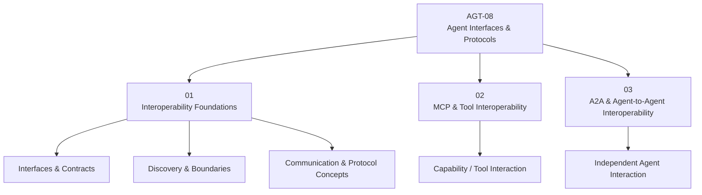

# AGT-08 — Agent Interfaces & Protocols

## Purpose

AGT-08 establishes the engineering foundations required for **interoperability between agent systems, applications, and externally exposed capabilities**.

The chapter introduces durable concepts such as interfaces, contracts, capability discovery, structured communication, identity, authorization boundaries, context exchange, compatibility, versioning, and protocol evolution. These foundations are then applied to two important interoperability patterns:

- **Capability / tool interoperability** through the Model Context Protocol (MCP)
- **Agent-to-agent interoperability** through A2A

The chapter is intentionally framework-independent and focuses on concepts that remain useful as protocols and implementation technologies evolve.

---

## Central Engineering Question

> **How can independent agent systems and external capabilities communicate through well-defined, interoperable interfaces?**

---

## Learning Outcomes

After completing AGT-08, you should be able to:

- Explain why interoperability requires explicit interfaces and contracts.
- Distinguish capabilities, interfaces, protocols, and architectures.
- Understand capability discovery and structured communication.
- Reason about request/response contracts, identity, authorization, and context exchange.
- Explain compatibility, versioning, protocol evolution, and common interoperability failures.
- Explain the role of MCP in capability and tool interoperability.
- Explain the role of A2A in agent-to-agent interoperability.
- Distinguish **agent/application ↔ capability** communication from **agent ↔ agent** communication.
- Evaluate when a protocol-based interface is appropriate and when a direct API or other integration approach may be simpler.
- Recognize interoperability concerns that become important in production systems.

---

## Chapter Structure

### 01 — Agent Capability Interfaces and Interoperability

**File:** [Agent Capability Interfaces and Interoperability](./01-Agent-Capability-Interfaces-and-Interoperability.md)

Establishes the durable foundations of interoperability:

- capability interfaces
- interface contracts
- capability discovery
- structured communication
- request/response semantics
- capability boundaries
- identity
- authorization boundaries
- context exchange
- protocol abstraction and selection
- compatibility
- versioning and evolution
- interoperability failure modes

This lesson provides the conceptual foundation for the protocol-specific files that follow.

---

### 02 — Model Context Protocol (MCP) and Tool Interoperability

**File:** [Model Context Protocol MCP and Tool Interoperability](./02-Model-Context-Protocol-MCP-and-Tool-Interoperability.md)

Applies the interoperability foundations to **MCP** and capability/tool exposure.

It covers the MCP interaction model, capability exposure and discovery, structured interaction, protocol boundaries, lifecycle considerations, compatibility, security-related protocol concerns, practical integration patterns, and production considerations.

MCP is treated as a mechanism for **capability/tool interoperability**, not as a definition of multi-agent architecture.

---

### 03 — Agent-to-Agent Interoperability and A2A

**File:** [Agent to Agent Interoperability and A2A](./03-Agent-to-Agent-Interoperability-and-A2A.md)

Applies the interoperability foundations to **agent-to-agent communication** and A2A.

It covers agent discovery, identity, structured communication, task-oriented interaction, request/message semantics, responses and status, context exchange, asynchronous interaction, protocol-level delegation, compatibility, trust boundaries, and common interoperability concerns.

A2A is treated as an **agent-to-agent interoperability mechanism** and does not, by itself, define a multi-agent architecture.

---

## Conceptual Progression

```text
AGT-08 — Agent Interfaces & Protocols
│
├── 01 — Interoperability Foundations
│   ├── Interfaces
│   ├── Contracts
│   ├── Capability Discovery
│   ├── Communication Semantics
│   ├── Boundaries
│   └── Protocol Concepts
│
├── 02 — MCP
│   └── Capability / Tool Interoperability
│
└── 03 — A2A
    └── Agent-to-Agent Interoperability
```

The progression is:

> **Understand interoperability → apply it to capabilities → apply it to independent agents**

---

## MCP and A2A Conceptual Boundary

The most important distinction in this chapter is the **type of participant communicating across the interface**.

```text
Agent / Application
        │
        │ capability / tool interaction
        ▼
External Capability
        │
        └── MCP
```

versus:

```text
Independent Agent System
        │
        │ agent-to-agent interaction
        ▼
Independent Agent System
        │
        └── A2A
```

Therefore:

- **MCP** belongs primarily to capability/tool interoperability.
- **A2A** belongs to agent-to-agent interoperability.
- Neither protocol automatically defines a multi-agent architecture.
- Multi-agent architecture and coordination are addressed separately in **AGT-09**.

The chapter should not be interpreted as:

```text
MCP → A2A → Multi-Agent
```

Instead:

```text
Interoperability Fundamentals
        │
        ├── Capability / Tool Interoperability
        │       └── MCP
        │
        └── Agent-to-Agent Interoperability
                └── A2A
```

---

## Key Concepts

The durable concepts developed throughout AGT-08 include:

- Interface contracts
- Capability boundaries
- Capability discovery
- Structured communication
- Request/response semantics
- Identity
- Authentication and authorization boundaries
- Context exchange
- Protocol selection
- Compatibility
- Versioning
- Protocol evolution
- Schema evolution
- Deprecation and migration
- Interoperability failure modes
- Capability exposure
- Protocol-driven communication
- Agent-to-capability interaction
- Agent-to-agent interaction

MCP and A2A are treated as current protocol examples through which these broader engineering concepts are applied.

---

## Prerequisites

AGT-08 assumes familiarity with the foundations established in earlier Agent Engineering chapters, particularly:

- **AGT-01** — Agent Foundations
- **AGT-02** — Agent Runtime and Execution
- **AGT-03** — Tools and Tool Use
- **AGT-04** — Agent State, Context, and Memory
- **AGT-05** — Agent Planning and Reasoning
- **AGT-06** — Agent Workflows and Durable Execution
- **AGT-07** — Human-in-the-Loop and Intervention

You should be comfortable with the idea of an agent system interacting with tools, services, APIs, and other system components before beginning AGT-08.

---

## Dependencies

AGT-08 builds primarily on the interface, execution, tool, state, workflow, and intervention concepts established in AGT-01 through AGT-07.

The chapter also establishes concepts that are reused later:

- **AGT-09** builds on interoperability when discussing multi-agent communication and coordination.
- **AGT-11** builds on interface and protocol boundaries when addressing reliability, safety, failure, and containment.
- **AGT-12** uses interoperability concepts when evaluating end-to-end architecture choices.
- **PROD** provides the infrastructure, deployment, observability, and operational foundations required to run these integrations in production.
- **ENT** addresses enterprise governance, organizational security, compliance, and enterprise access-control concerns.

AGT-08 does not replace those domains; it establishes the interoperability layer they may depend on.

---

## Relationship to Adjacent AGT Chapters

| Chapter | Primary Ownership | Relationship to AGT-08 |
|---|---|---|
| **AGT-03** | Tools and tool execution | Owns tool contracts, schemas, invocation, routing, execution, failures, and side effects. AGT-08 focuses on interoperable interfaces and protocols across system boundaries. |
| **AGT-04** | State, context, and memory | Owns agent state, context management, and memory. AGT-08 addresses context exchange across interoperability boundaries. |
| **AGT-06** | Workflows and durable execution | Owns workflow structure, checkpoints, durable execution, pause/resume, and long-running execution. AGT-08 does not redefine workflow execution. |
| **AGT-07** | Human intervention | Owns approval, escalation, intervention, and high-risk human control. AGT-08 only addresses the interface/protocol boundaries through which systems may communicate. |
| **AGT-09** | Multi-agent architecture | Owns multi-agent architecture, specialization, delegation, coordination, and multi-agent communication patterns. AGT-08 owns the interoperability mechanisms that can enable communication between independent agents. |
| **AGT-11** | Reliability and safety | Owns broader agent reliability, safety, containment, recovery, and unsafe behavior. AGT-08 covers protocol/interface-level failure and trust concerns. |
| **AGT-12** | Architecture selection | Owns end-to-end architecture decisions and trade-offs. AGT-08 supplies interoperability concepts used in those decisions. |

---

## Important Scope Boundaries

### AGT-08 vs AGT-03

AGT-03 answers:

> **How does an agent use a tool?**

AGT-08 answers:

> **How can capabilities and systems expose and consume capabilities through interoperable interfaces and protocols?**

Tool schemas and invocation mechanics remain primarily owned by AGT-03. AGT-08 focuses on the broader interoperability boundary.

### AGT-08 vs AGT-09

AGT-08 answers:

> **How can independent systems communicate through interoperable interfaces and protocols?**

AGT-09 answers:

> **When and how should a system be architected as multiple cooperating agents?**

A2A does not imply that a multi-agent architecture is appropriate.

### AGT-08 vs AGT-11

AGT-08 addresses protocol/interface-level concerns such as:

- identity
- authentication
- authorization boundaries
- capability exposure
- message validation
- compatibility
- protocol failures

AGT-11 owns broader agent safety, reliability, recovery, containment, and unsafe behavior.

### AGT-08 vs PROD / ENT

AGT-08 defines interoperability concerns at the interface and protocol layer.

**PROD** owns infrastructure, deployment, runtime operations, observability, and operational security.

**ENT** owns enterprise governance, compliance, organizational security, and enterprise access-control policy.

---

## Durable Concepts vs Protocol Examples

AGT-08 deliberately separates **durable engineering concepts** from **current protocol implementations**.

### Durable Concepts

These remain useful even when protocols or vendors change:

- interfaces
- contracts
- capability discovery
- structured communication
- identity
- authorization boundaries
- context exchange
- compatibility
- versioning
- evolution
- failure handling
- protocol selection

### Current Protocol Examples

The chapter applies those concepts to:

- MCP
- A2A

The goal is not to memorize protocol details. The goal is to understand the engineering principles that make interoperability reliable.

---

## Framework Independence

AGT-08 is intentionally independent of:

- LangChain
- LangGraph
- LlamaIndex
- AutoGen
- CrewAI
- OpenAI Agents SDK
- Google ADK
- specific cloud providers

Frameworks and SDKs may be used later as implementation examples, but they are not the conceptual foundation of this chapter.

---

## Protocol vs Architecture

A protocol and an architecture answer different questions.

**Architecture** describes the systems, components, responsibilities, and relationships that make up a solution.

**Protocol** defines how specified participants communicate across a defined boundary.

AGT-08 primarily addresses the **communication and interoperability layer**. Broader architecture selection belongs to the relevant architecture-focused chapters, particularly AGT-09 and AGT-12.

---

## Production Perspective

The concepts in AGT-08 become important in production when systems depend on capabilities or agents that are independently developed, deployed, versioned, or operated.

The lessons address concerns such as:

- compatibility
- capability discovery
- version evolution
- identity and authorization boundaries
- unavailable dependencies
- malformed or invalid messages
- timeouts and partial responses
- semantic mismatches
- trust boundaries
- dependency ownership
- operational visibility and auditability

Detailed implementation and failure analysis remain in the relevant lessons rather than being duplicated here.

---

## Suggested Learning Order

Follow the chapter in this order:

```text
01 — Interoperability Foundations
          │
          ▼
02 — MCP and Tool Interoperability
          │
          ▼
03 — Agent-to-Agent Interoperability and A2A
```

Do not skip Lesson 01.

The protocol-specific files assume that the underlying concepts of interfaces, contracts, discovery, boundaries, structured communication, compatibility, and protocol evolution are already understood.

---

## Estimated Effort

**Estimated reading effort:** Use the established curriculum estimation standard for this repository.

The actual time required will vary with prior familiarity and the depth of practical implementation performed alongside the reading.

---

## Chapter Completion Criteria

AGT-08 can be considered complete when you can:

- Explain interoperability without relying on a specific framework.
- Design a basic capability interface and identify its contract boundary.
- Explain how capability discovery works conceptually.
- Distinguish protocol concerns from architecture concerns.
- Explain the difference between MCP-style capability interoperability and A2A-style agent interoperability.
- Identify appropriate identity, authorization, compatibility, and versioning concerns at an interoperability boundary.
- Diagnose common interface and protocol incompatibility problems at a conceptual level.
- Explain why A2A does not automatically imply a multi-agent architecture.
- Identify when a protocol-based integration is justified versus when a simpler direct API may be preferable.

---

## Chapter Contents

Use this README as the chapter navigation point. Detailed concepts, examples, implementation guidance, production considerations, and interview material belong in the three lessons.

---

## Chapter Map



---

## Summary

AGT-08 establishes the interoperability layer for agent systems.

It progresses from:

> **interfaces and interoperability foundations**

to:

> **capability/tool interoperability through MCP**

and then to:

> **agent-to-agent interoperability through A2A**

The central engineering principle is that **interoperability is a system boundary problem, not merely a protocol implementation problem**.

The chapter therefore focuses on durable engineering concepts—contracts, discovery, communication semantics, identity, authorization boundaries, compatibility, versioning, evolution, and failure modes—while using MCP and A2A as concrete protocol examples.
