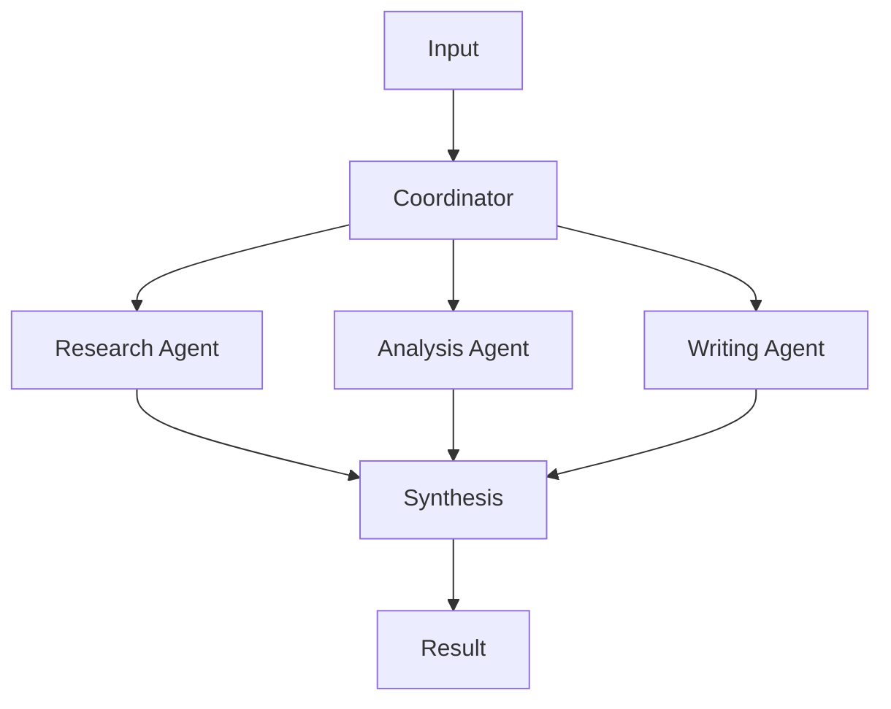
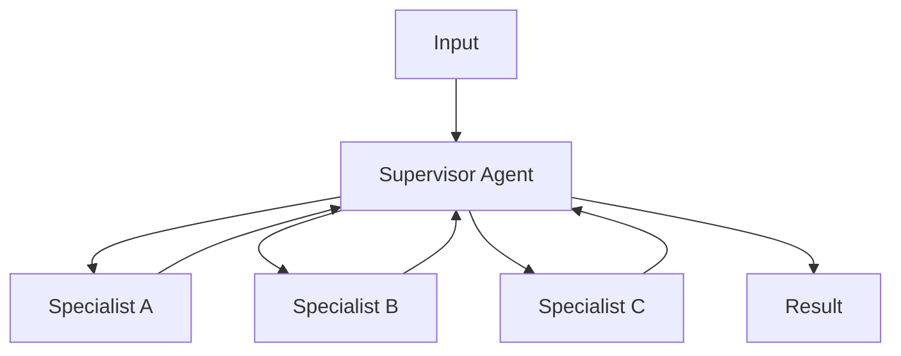
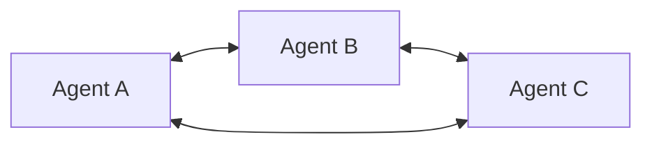
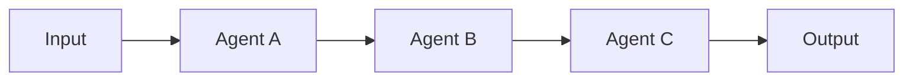
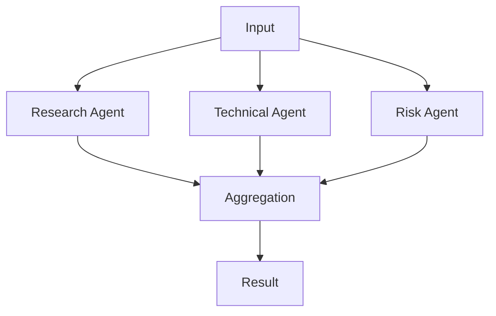
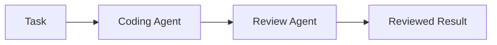
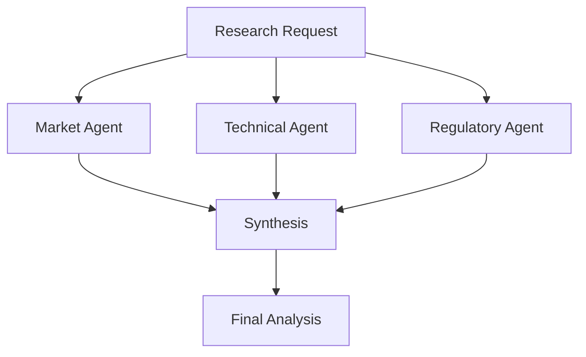
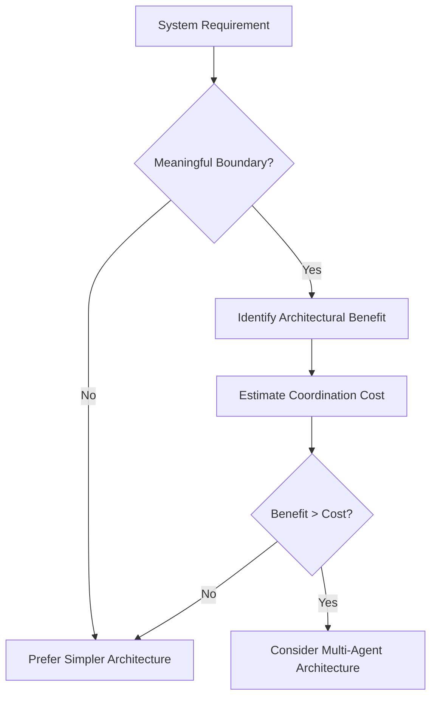

# 01 — Single-Agent vs Multi-Agent Architecture

## Learning Objectives

After completing this chapter, you should be able to:

- Explain the architectural difference between a single-agent and multi-agent system.
- Identify situations where multiple agents provide meaningful architectural value.
- Explain why specialization can justify separating responsibilities across agents.
- Define meaningful agent boundaries.
- Distinguish genuine specialization from artificial decomposition.
- Evaluate independence, isolation, ownership, and parallelism as reasons for multi-agent architecture.
- Recognize when a single agent is the better architectural choice.
- Compare the benefits and costs of centralized and distributed agent structures.
- Evaluate communication overhead, latency, cost, debugging difficulty, and coordination complexity.
- Recognize common multi-agent architectural anti-patterns.
- Use a practical decision framework before introducing additional agents.
- Explain why multi-agent architecture is an engineering choice rather than a maturity requirement.

---

## Prerequisites

Before studying this chapter, you should understand:

- What an agent is and how it differs from a conventional LLM application or workflow.
- Basic agent execution and autonomy concepts.
- The role of tools and external actions in agent systems.
- Basic task decomposition and workflow concepts.
- Basic agent state and context concepts.

Recommended preceding chapters:

- [AGT-01 — Agent Foundations](../AGT-01-Agent-Systems-Foundations/Readme.md)
- [AGT-02 — Agent Runtime and Execution](../AGT-02-Agent-Runtime-Loops-and-Bounded-Autonomy/Readme.md)
- [AGT-03 — Tools and Agent Actions](../AGT-03-Tools-and-Action-Execution/Readme.md)
- [AGT-04 — Agent State, Context and Memory](../AGT-04-State-Context-and-Memory/Readme.md)
- [AGT-05 — Task Decomposition and Planning](../AGT-05-Planning-and-Adaptive-Execution/Readme.md)
- [AGT-06 — Workflow Orchestration](../AGT-06-Workflow-Orchestration-and-Durable-Execution/Readme.md)

This chapter assumes those foundations and does not re-teach them in depth.

---

## Estimated Reading Time

**35–45 minutes**

The actual time depends on how deeply you work through the examples and architectural questions.

---

## Before We Start

A common progression in AI engineering looks like this:

```text
LLM
 ↓
LLM Application
 ↓
Tool-Using Agent
 ↓
More Agents
```

This can create a dangerous assumption:

> If one agent is useful, several agents must be better.

That assumption is wrong.

A system does not become more mature simply because it contains more agents.

A second agent creates another component with:

- its own responsibility,
- its own context,
- its own execution behavior,
- another communication boundary,
- another possible failure point,
- another dependency,
- another source of latency,
- another component engineers must understand and observe.

Therefore, the architectural question is not:

> **“How can we make this system multi-agent?”**

The better question is:

> **“What problem does another agent solve that the existing architecture cannot solve effectively?”**

That question is the foundation of this chapter.

---

# Why This Exists

A single agent can often perform several responsibilities.

For example, a research assistant could:

1. understand a research request,
2. search for information,
3. analyze the information,
4. write a summary,
5. review its own answer,
6. return the result.

Nothing about this task automatically requires multiple agents.

We could instead introduce:

```text
Research Agent
      ↓
Analysis Agent
      ↓
Writing Agent
      ↓
Review Agent
```

This looks sophisticated.

But sophistication is not the objective.

Now the system must also solve new problems:

- How does the research agent communicate with the analysis agent?
- What information is transferred?
- Who owns the intermediate result?
- What happens if analysis fails?
- How much context is passed between agents?
- How long does each handoff take?
- What happens if the writing agent disagrees with the analysis agent?
- How do engineers debug the complete execution?
- What happens if one agent becomes unavailable?

The architecture gained specialization, but it also gained coordination problems.

This leads to the central principle:

> **Adding more agents adds coordination problems.**

A multi-agent architecture is justified only when the value created by separating responsibilities is greater than the cost introduced by coordination.

---

# Mental Model

Think of agents as **independent engineering responsibilities**, not simply as multiple prompts.

Suppose a system contains one large agent:

```text
                    ┌───────────────────────┐
                    │     Single Agent      │
                    │                       │
Input ─────────────►│ Research              │
                    │ Analysis              │
                    │ Writing               │
                    │ Review                │
                    │ Decision Making       │
                    └───────────────────────┘
```

Now suppose these responsibilities have genuinely different requirements.

We could separate them:

```text
                       ┌───────────────┐
                       │  Coordinator  │
                       └───────┬───────┘
                               │
              ┌────────────────┼────────────────┐
              ▼                ▼                ▼
       ┌────────────┐   ┌────────────┐   ┌────────────┐
       │ Research   │   │ Analysis   │   │   Review   │
       │   Agent    │   │   Agent    │   │   Agent    │
       └────────────┘   └────────────┘   └────────────┘
```

The important question is not whether the second diagram looks cleaner.

The important question is:

> **Does each boundary represent a real engineering boundary?**

If yes, multi-agent architecture may be justified.

If not, the architecture may simply be distributing complexity across more components.

---

# Core Concepts

## 1. What Is a Single-Agent Architecture?

A single-agent architecture uses one agent as the primary autonomous decision-making component for the task.

A simplified model is:

```text
User
  │
  ▼
┌─────────────────────┐
│    Single Agent     │
│                     │
│ Reason              │
│ Decide              │
│ Use Tools           │
│ Maintain Context    │
│ Produce Result      │
└──────────┬──────────┘
           │
           ▼
        Result
```

The agent may still use many tools and services.

For example:

```text
                    ┌── Search API
                    │
                    ├── Database
                    │
Agent ──────────────┼── Calculator
                    │
                    ├── Internal API
                    │
                    └── External Service
```

This does **not** make the system multi-agent.

The number of tools is not the number of agents.

The architectural distinction is about the number of intentionally separated agent responsibilities or decision boundaries.

---

## 2. What Is a Multi-Agent Architecture?

A multi-agent architecture contains multiple agents whose responsibilities, capabilities, execution roles, or decision boundaries have been intentionally separated and who participate in achieving a shared or related objective.

For example:

```text
                 ┌─────────────────┐
                 │   Supervisor    │
                 └────────┬────────┘
                          │
            ┌─────────────┼─────────────┐
            ▼             ▼             ▼
      ┌──────────┐  ┌──────────┐  ┌──────────┐
      │Research  │  │ Analysis │  │  Review  │
      │  Agent   │  │  Agent   │  │  Agent   │
      └──────────┘  └──────────┘  └──────────┘
```

The agents may communicate through:

- direct calls,
- shared state,
- queues,
- APIs,
- workflow infrastructure,
- message-based communication,
- or protocol-based communication.

The communication mechanism is an implementation decision.

The architectural decision is:

> **Should these responsibilities belong to one agent or multiple agents?**

---

# 3. Why Introduce Multiple Agents?

There are several legitimate reasons to introduce multiple agents.

The most important are:

1. specialization,
2. responsibility separation,
3. independent ownership,
4. isolation,
5. independent execution,
6. meaningful parallelism,
7. organizational boundaries,
8. different operational or trust requirements.

These reasons should be evaluated individually.

---

## 3.1 Specialization

One agent may be responsible for a narrow domain where specialized behavior is useful.

For example:

```text
                Customer Support System
                         │
          ┌──────────────┼──────────────┐
          ▼              ▼              ▼
     Billing Agent   Technical Agent   Policy Agent
```

Each agent can have:

- different instructions,
- different tools,
- different knowledge sources,
- different output requirements,
- different validation rules,
- different operational constraints.

The architectural value comes from meaningful specialization.

### Good specialization

```text
Billing Agent
→ billing records
→ invoice operations
→ payment-related policies

Technical Agent
→ troubleshooting
→ diagnostics
→ technical documentation
```

These responsibilities are materially different.

### Artificial specialization

```text
Agent A
→ read customer name

Agent B
→ read customer email

Agent C
→ read customer phone number
```

This creates multiple components without creating meaningful architectural value.

The system has become more complicated without becoming better designed.

---

## 3.2 Separation of Responsibilities

Multiple agents may be justified when responsibilities have different boundaries.

Consider a coding system:

```text
Coding Agent
        │
        ├── writes implementation
        │
        └── performs review
```

A separate review agent may be useful if review has genuinely different:

- objectives,
- context,
- evaluation criteria,
- authority,
- or execution requirements.

The architecture becomes:

```text
        ┌──────────────┐
        │ Coding Agent │
        └──────┬───────┘
               │
               ▼
        ┌──────────────┐
        │ Review Agent │
        └──────────────┘
```

The key question is:

> Does the separation create a meaningful boundary, or are we simply moving two prompts into two processes?

---

## 3.3 Independent Ownership

A responsibility may belong to a different engineering or organizational owner.

For example:

```text
                 Product System
                      │
       ┌──────────────┼──────────────┐
       ▼              ▼              ▼
  Recommendation   Compliance    Customer
     Agent            Agent        Support
```

If these capabilities evolve independently and have different:

- owners,
- release cycles,
- operational responsibilities,
- reliability requirements,

separate agents may provide useful architectural boundaries.

However, organizational separation alone is **not** sufficient justification for a separate agent.

It is useful to distinguish several kinds of independence:

```text
Organizational Independence
          ≠
Runtime Independence
          ≠
Deployment Independence
          ≠
Failure Independence
```

Two teams may own different components while those components still depend heavily on one another at runtime.

The engineering question remains:

> **Does the ownership boundary produce useful runtime, capability, trust, deployment, or operational independence?**

If two teams are separate but their responsibilities are tightly coupled and require constant coordination, creating separate agents may simply move organizational complexity into the runtime architecture.

---

## 3.4 Isolation

Separate agents can provide isolation between responsibilities.

For example:

```text
┌───────────────────────┐
│ Customer-Facing Agent │
└───────────┬───────────┘
            │
            ▼
┌───────────────────────┐
│ Sensitive Operation   │
│       Agent           │
└───────────────────────┘
```

The second agent may operate under different:

- permissions,
- data access,
- execution constraints,
- trust assumptions,
- operational controls.

This can create a meaningful boundary.

But:

> **Logical separation does not automatically create actual isolation.**

Two agents are meaningfully isolated only when the architecture enforces a useful boundary around things such as:

- permissions,
- data,
- resources,
- failure behavior,
- or operational ownership.

Creating separate agents without enforcing such a boundary simply adds components.

---

## 3.5 Independent Execution

Sometimes two responsibilities need to execute independently.

For example:

```text
                    Input
                      │
          ┌───────────┴───────────┐
          ▼                       ▼
   Research Agent          Risk Agent
          │                       │
          └───────────┬───────────┘
                      ▼
                 Aggregation
```

The two agents can work independently because their responsibilities do not require continuous interaction.

This may make parallel execution valuable.

The key is that the work must actually be independent.

If Agent B cannot proceed until Agent A produces a result, then the supposed parallelism may not provide much benefit.

---

## 3.6 Meaningful Parallelism

Multi-agent architecture can be useful when several independent tasks can be performed concurrently.

For example:

```text
                    Research Request
                           │
             ┌─────────────┼─────────────┐
             ▼             ▼             ▼
        Market Agent   Technical Agent  Legal Agent
             │             │             │
             └─────────────┼─────────────┘
                           ▼
                       Synthesis
```

Parallelism can reduce elapsed time when:

- tasks are genuinely independent,
- resources are available,
- coordination overhead is controlled,
- the final aggregation step is manageable.

But parallelism is not free.

If five agents each take 5 seconds and the system spends another 10 seconds coordinating and aggregating them, the architecture may not provide the expected latency benefit.

---

# 4. Agent Responsibility Boundaries

A good agent boundary should answer:

> **What responsibility does this agent own that another component does not?**

A useful responsibility boundary usually has some combination of:

- distinct purpose,
- distinct capability,
- distinct knowledge requirement,
- distinct operational constraints,
- distinct ownership,
- distinct trust boundary,
- independent execution,
- meaningful lifecycle.

Consider:

```text
                 ┌──────────────────┐
                 │  Research Agent  │
                 │                  │
                 │ Research only    │
                 └──────────────────┘
```

A clear boundary exists if the agent's responsibility can be described independently.

Compare that with:

```text
Agent A
→ prepare sentence 1

Agent B
→ prepare sentence 2

Agent C
→ prepare sentence 3
```

There is no meaningful architectural responsibility boundary.

The decomposition is artificial.

---

# 5. Context Boundaries

Different responsibilities may require substantially different context.

Suppose one system must process:

- customer information,
- internal financial information,
- technical diagnostics,
- compliance policy.

Putting everything into one agent context can increase:

- context size,
- irrelevant information,
- instruction complexity,
- accidental information exposure,
- reasoning complexity.

A separated design might look like:

```text
                 Customer Request
                       │
              ┌────────┼────────┐
              ▼        ▼        ▼
           Support   Billing  Compliance
             Agent     Agent     Agent
```

Each agent can operate on the context relevant to its responsibility.

However, context separation is not automatically a reason for multiple agents.

The same objective may sometimes be achieved more simply through:

- scoped context,
- retrieval,
- tool permissions,
- structured workflow steps,
- or other architectural boundaries.

The question is always comparative:

> **Is an additional agent the simplest effective solution?**

---

# 6. When a Single Agent Is Sufficient

A single agent is often preferable when:

- the task has one coherent objective,
- responsibilities are tightly coupled,
- the same context is needed throughout,
- dependencies are frequent,
- specialization is weak,
- communication would dominate execution,
- coordination adds little value,
- the system is small enough to manage directly,
- one agent can reliably satisfy the requirements.

For example:

```text
User
  │
  ▼
┌──────────────────────┐
│      Agent           │
│                      │
│ Understand           │
│ Search               │
│ Analyze              │
│ Respond              │
└──────────────────────┘
```

If this architecture works reliably, introducing:

```text
Agent A
   ↓
Agent B
   ↓
Agent C
   ↓
Agent D
```

just because the system is “more agentic” is poor engineering.

---

# 7. A Practical Decision Framework

Before introducing another agent, ask the following questions.

## Question 1 — Is there a meaningful specialization boundary?

If not, keep the responsibility together unless another strong reason exists.

---

## Question 2 — Does the responsibility need independent execution?

If yes, separation may be useful.

If no, a simpler architecture may be sufficient.

---

## Question 3 — Does the responsibility have different operational or trust requirements?

Different requirements can justify isolation.

Examples:

- different permissions,
- different data access,
- different reliability requirements,
- different deployment ownership.

---

## Question 4 — Does the responsibility evolve independently?

If two responsibilities have different:

- owners,
- release cycles,
- change patterns,
- operational requirements,

separation may provide long-term architectural value.

But independent ownership should be accompanied by meaningful technical or operational independence. Team boundaries alone do not automatically require separate agents.

---

## Question 5 — Is meaningful parallelism possible?

If independent work can happen concurrently, multiple agents may reduce elapsed execution time.

But measure the actual benefit.

---

## Question 6 — What coordination cost is introduced?

Consider:

```text
Communication
+ Context Transfer
+ Synchronization
+ State Management
+ Failure Handling
+ Debugging
+ Observability
+ Operational Ownership
```

If this cost is larger than the architectural benefit, do not split the system.

---

## Question 7 — Could a simpler architecture solve the same problem?

Compare multi-agent architecture with alternatives such as:

- one agent with better tools,
- one agent with better context management,
- a deterministic workflow,
- a conventional service,
- a specialized API,
- a retrieval system,
- a simpler orchestration pattern.

Multi-agent architecture should win because it is the better solution, not because it is the newest one.

---

# 8. A Multi-Agent Decision Matrix

A useful first-pass decision matrix is:

| Requirement | Single Agent | Multiple Agents |
|---|---|---|
| One coherent responsibility | Usually preferable | Often unnecessary |
| Strong specialization | Possible | Often useful |
| Independent execution | Limited | Useful |
| Strong isolation requirement | Possible but harder | Often useful |
| Meaningful parallelism | Limited | Potentially useful |
| Shared context throughout | Often simpler | Can become expensive |
| Frequent dependencies | Often simpler | Coordination becomes costly |
| Independent ownership | Less separation | Potentially useful |
| Different trust boundaries | May be difficult | Potentially useful |
| High coordination overhead | Better fit | Poor fit |
| Simple task | Usually preferable | Usually unnecessary |
| Distinct operational constraints | Possible | Potentially useful |

This is not a mathematical decision rule.

It is a reasoning aid.

---

## 9. Architectural Patterns

Once the decision to use multiple agents is justified, the next question is how to organize them.

This chapter introduces the major patterns at an architectural level.

Detailed delegation and coordination behavior belongs to [02-Delegation-Supervision-and-Agent-Coordination.md](./02-Delegation-Supervision-and-Agent-Coordination.md).

---

## 9.1 Specialist Agents

Each agent owns a specialized responsibility.



### Strengths

- clear responsibility boundaries
- specialization
- easier ownership
- potential parallelism
- capability isolation

### Risks

- coordination overhead
- duplicated context
- conflicting outputs
- increased observability requirements
- more failure points

---

## 9.2 Hierarchical Architecture

A supervisor coordinates subordinate agents.



### Strengths

- clear authority
- centralized decision point
- easier global visibility
- useful when responsibilities require supervision

### Risks

- supervisor bottleneck
- supervisor failure
- excessive centralization
- increased dependency on the supervisor

The supervisor should have a meaningful responsibility.

If every decision must pass through one component, that component can become the architecture's bottleneck.

---

## 9.3 Peer-to-Peer Architecture

Agents coordinate directly with one another.



### Strengths

- less dependence on a central coordinator
- potentially greater autonomy
- distributed responsibility

### Risks

- harder coordination
- more communication paths
- conflict resolution complexity
- harder observability
- more difficult termination behavior

Peer-to-peer architecture should not be selected simply because centralized coordination feels undesirable.

The resulting communication structure must still be manageable.

---

## 9.4 Pipeline Architecture

Responsibilities are arranged sequentially.



For example:

```text
Research
   ↓
Analysis
   ↓
Draft
   ↓
Review
```

### Strengths

- clear sequence
- understandable responsibility boundaries
- predictable data flow

### Risks

- latency accumulation
- downstream dependency
- failure propagation
- limited parallelism
- bottlenecks

A pipeline can be useful when each stage materially transforms the result.

It is less useful when agents merely pass the same information through multiple steps.

---

## 9.5 Parallel Specialist Architecture

Several agents work independently before results are combined.



### Strengths

- parallel execution
- specialization
- independent analysis
- potentially lower elapsed latency

### Risks

- aggregation complexity
- conflicting outputs
- resource consumption
- inconsistent assumptions
- increased communication and observability requirements

Parallelism is valuable only when the work is actually independent enough to benefit from it.

---

# 10. Centralized vs Decentralized Architecture

A major architectural decision is where coordination authority lives.

## Centralized Coordination

A central component coordinates the other agents.

```text
                Coordinator
              /      |      \
             /       |       \
            ▼        ▼        ▼
        Agent A   Agent B   Agent C
```

### Benefits

- simpler global coordination
- centralized visibility
- clear decision authority
- easier responsibility tracking

### Costs

- coordinator bottleneck
- coordinator failure
- centralized dependency
- potential scaling limitations

Centralization is not inherently bad.

For many systems, explicit coordination authority makes the architecture easier to reason about.

---

## Decentralized Coordination

Agents coordinate without one central authority.

```text
Agent A ↔ Agent B
   ↕         ↕
Agent C ↔ Agent D
```

### Benefits

- less central dependency
- potentially greater autonomy
- distributed responsibility

### Costs

- harder coordination
- conflict resolution
- state consistency challenges
- more communication paths
- harder observability
- more complicated termination

There is no universal winner.

The correct choice depends on the system's requirements.

---

# 11. Coordination Cost

A useful engineering mental model is:

```text
Agent Count
     +
Communication Paths
     +
Shared State
     +
Dependencies
     +
Failure Modes
     +
Coordination Logic
     =
System Complexity
```

This is **not a formal mathematical complexity equation**.

It is a reasoning model.

As more agents and relationships are introduced, engineers generally have more system behavior to understand.

For example:

```text
2 agents
A ↔ B
```

is relatively simple.

Now consider:

```text
5 agents

A ↔ B
A ↔ C
A ↔ D
B ↔ C
B ↔ E
C ↔ D
D ↔ E
```

The number of possible interactions grows.

The problem is not merely the number of agents.

It is the number and nature of **relationships between them**.

---

# 12. Communication Overhead

When one agent performs work internally, information may remain within the same execution context.

When responsibility moves between agents, the receiving agent must obtain the information it needs through some defined mechanism.

Conceptually:

```text
Single Agent

Reason
  ↓
Decide
  ↓
Act
  ↓
Continue
```

versus:

```text
Agent A
  ↓
Context Transfer
  ↓
Agent B
  ↓
Context Transfer
  ↓
Agent C
```

The transfer may happen through:

- an explicit message,
- an API call,
- shared state,
- an orchestration context,
- or another defined interface.

Every boundary can introduce:

- serialization,
- transfer time,
- context reconstruction,
- information loss,
- duplicated information,
- inconsistent assumptions,
- additional observability requirements.

This does not mean communication is always bad.

The communication cost is justified when the boundary provides enough architectural value.

---

# 13. Latency and Cost

Suppose a single agent performs a task in:

```text
10 seconds
```

A multi-agent design might divide the work:

```text
Agent A → 3 seconds
Agent B → 3 seconds
Agent C → 3 seconds
Coordination → 2 seconds
Aggregation → 2 seconds
```

If the agents execute sequentially:

```text
3 + 3 + 3 + 2 + 2 = 13 seconds
```

The multi-agent design may actually be slower.

If A, B, and C can execute in parallel:

```text
max(3, 3, 3) + 2 + 2 = 7 seconds
```

The architecture may now provide a latency benefit.

But parallel execution can increase:

- compute consumption,
- model calls,
- infrastructure cost,
- aggregation complexity,
- failure surface.

Therefore:

> **Parallelism must be measured, not assumed.**

---

# 14. Reliability Trade-offs

Adding agents and coordination boundaries generally introduces additional components and interactions that must be considered in the system's failure model.

Consider:

```text
Agent A → Agent B → Agent C
```

In a strictly dependent execution path, the overall result may depend on each required agent and interaction succeeding.

However, production architectures can deliberately support:

- partial results,
- degraded operation,
- retries,
- fallback paths,
- optional agents,
- alternate execution paths.

Therefore, the relevant question is not simply whether more agents create more possible failures.

The better question is:

> **Does the architecture improve the overall reliability behavior of the system?**

For example:

```text
Research Agent ✕
       │
       ▼
System continues with
cached or degraded result
```

If separation allows the system to contain failure and continue safely, the additional boundary may provide real reliability value.

---

# 15. Debugging and Observability

A single-agent system can already be difficult to debug.

A multi-agent system adds distributed behavior.

For example:

```text
Request
  ↓
Agent A
  ↓
Agent B
  ↓
Agent C
  ↓
Agent D
```

If the final answer is wrong, engineers may need to determine:

- which agent made the wrong decision,
- which input it received,
- whether the previous agent produced incorrect information,
- whether context was lost,
- whether a message was delayed,
- whether a handoff changed the meaning,
- whether the wrong specialist was selected.

A production system therefore needs visibility into:

```text
Request
  ↓
Agent
  ↓
Delegation
  ↓
Agent
  ↓
Result
  ↓
Integration
  ↓
Final Outcome
```

Useful operational information includes:

- agent identity,
- responsibility owner,
- delegation chain,
- message flow,
- coordination state,
- timing,
- failures,
- timeouts,
- handoffs,
- decision ownership.

Detailed observability implementation belongs elsewhere in the broader production curriculum. Here, the important architectural lesson is:

> **Distributed responsibility creates distributed debugging.**

---

# 16. Maintainability

Multiple agents can improve maintainability when responsibilities are genuinely independent.

For example:

```text
Research Agent
```

can evolve independently from:

```text
Compliance Agent
```

if their responsibilities are truly separate.

But artificial decomposition has the opposite effect.

```text
Agent A
   ↓
Agent B
   ↓
Agent C
```

If every small change requires understanding all three agents, the architecture has created coupling rather than independence.

A good boundary should reduce cognitive and operational coupling.

---

# 17. Production Perspective

In production, the decision becomes more demanding.

A prototype may tolerate:

- additional latency,
- manual debugging,
- repeated context transfer,
- duplicated model calls.

A production system may not.

For a production multi-agent design, evaluate:

### Latency

How many agent boundaries exist?

How much time does communication add?

Can independent work execute concurrently?

### Cost

How many model calls are added?

Are agents using larger contexts?

Does parallelism increase resource consumption?

### Reliability

Does the additional decomposition improve isolation?

Or does it simply create more failure points?

### Maintainability

Can engineers understand each agent's responsibility?

Can components evolve independently?

### Observability

Can the system answer:

> Which agent made this decision?

> Why did this agent receive this task?

> Where did the execution fail?

### Ownership

Who owns each agent?

Who is responsible when the system fails across multiple agent boundaries?

### Version compatibility

If agents evolve independently, can one agent safely consume another agent's outputs?

### Capacity

Can all agents scale appropriately?

Does one component become a bottleneck?

### Blast radius

If one agent fails, how much of the system is affected?

These questions help determine whether the architecture is production-worthy.

---

## Engineering Decisions and Trade-offs

## Single Agent vs Multiple Agents

The core comparison is:

| Factor | Single Agent | Multiple Agents |
|---|---|---|
| Simplicity | Usually higher | Usually lower |
| Specialization | Limited by one responsibility boundary | Stronger |
| Context sharing | Simple | Requires transfer or shared state |
| Communication | Internal | Additional boundaries |
| Latency | Often lower | Can increase or decrease |
| Cost | Often lower | Often higher |
| Parallelism | Limited | Potentially higher |
| Isolation | Limited | Potentially stronger |
| Debugging | More centralized | More distributed |
| Failure surface | Smaller | Larger |
| Independent ownership | Limited | Stronger |
| Coordination | Minimal | Required |
| Maintainability | Simple when responsibility is coherent | Better when boundaries are genuine |
 
The table does not imply that one architecture always wins.

The correct choice depends on the task.

---

## A Practical Architectural Test

Before adding an agent, complete this statement:

> **“We need another agent because…”**

A strong answer might be:

> “The compliance responsibility has different permissions, policies, ownership, and release requirements from the customer-support responsibility.”

A weak answer might be:

> “Because multi-agent systems are more advanced.”

Another weak answer:

> “Because the framework supports multiple agents.”

The architecture should be justified by the system's requirements, not by the capabilities of the framework.

---

## Common Multi-Agent Anti-Patterns

## 1. Agent Explosion

Creating many agents without meaningful responsibility boundaries.

```text
Agent A
Agent B
Agent C
Agent D
Agent E
Agent F
Agent G
```

The number of agents grows, but architectural value does not.

### Why it fails

- more coordination,
- more latency,
- more cost,
- more debugging,
- more failure points.

### Better approach

Start with the simplest architecture that satisfies the requirements.

Split only where the boundary creates meaningful value.

---

## 2. Artificial Specialization

Creating agents for responsibilities that are not meaningfully different.

```text
Agent A → Extract name
Agent B → Extract email
Agent C → Extract phone
```

The system gains components but not useful specialization.

### Better approach

Group responsibilities according to meaningful domain or operational boundaries.

---

## 3. Coordinator Bottleneck

One coordinator controls every decision.

```text
               Coordinator
             /      |      \
            A       B       C
             \      |      /
               Coordinator
```

If all decisions require the coordinator, it may become:

- a latency bottleneck,
- a scaling bottleneck,
- a single point of failure,
- an ownership bottleneck.

### Better approach

Use centralized coordination when it provides valuable authority and visibility, but avoid unnecessary centralization.

---

## 4. Circular Delegation

Agents repeatedly send responsibility around the system.

```text
A → B → C → A
```

The system may appear active while accomplishing nothing.

### Better approach

Define responsibility ownership clearly and establish boundaries that prevent circular responsibility transfer.

---

## 5. Excessive Handoffs

A task passes through many agents without meaningful transformation.

```text
A
 ↓
B
 ↓
C
 ↓
D
 ↓
E
```

If each agent mostly forwards the same information, the architecture has created communication overhead without meaningful specialization.

### Better approach

Ask what architectural value each boundary provides.

---

## 6. Shared-State Chaos

Many agents modify shared state without clear ownership.

```text
Agent A ─┐
Agent B ─┼──► Shared State
Agent C ─┘
```

Potential consequences include:

- conflicting updates,
- unclear ownership,
- stale assumptions,
- difficult debugging.

Shared state is sometimes useful, but ownership must be explicit.

Detailed shared-state behavior is covered in Lesson 03.

---

## 7. Unbounded Agent Spawning

Allowing an agent to create additional agents without meaningful limits.

Conceptually:

```text
Agent A
  ↓
A1 + A2 + A3
       ↓
   More Agents
       ↓
   More Agents
```

This can create unpredictable:

- cost,
- resource usage,
- coordination complexity,
- operational behavior.

Agent creation should have explicit architectural constraints.

---

## 8. Consensus Everywhere

Using consensus whenever agents disagree.

Consensus can be useful in some architectures, but it is not universally required.

For a deterministic decision, a clear authority may be simpler:

```text
Agent A
Agent B
Agent C
   ↓
Deterministic Authority
```

Instead of:

```text
A ↔ B ↔ C
 ↖──────↙
Consensus
```

Consensus can introduce additional:

- latency,
- communication,
- complexity,
- failure modes.

Use it when the problem genuinely benefits from collective agreement.

---

## 9. Hidden Coupling

Agents appear independent but rely heavily on one another's assumptions.

For example:

```text
Agent A
  ↓
assumes format X

Agent B
  ↓
expects format Y
```

The agents may technically be separate but architecturally coupled.

### Better approach

Define clear responsibility and interface boundaries.

Detailed interface and interoperability mechanisms belong to AGT-08.

---

## 10. Protocol-Driven Architecture

A team discovers an interoperability protocol and then decides to create multiple agents because the protocol exists.

This reverses the architectural decision.

Incorrect reasoning:

```text
A2A exists
   ↓
We should build multiple agents
```

Better reasoning:

```text
System Requirement
       ↓
Need for Multiple Agents?
       ↓
Responsibility Boundaries
       ↓
Coordination Design
       ↓
Choose Communication Mechanism
       ↓
Possibly A2A
```

The architecture should drive the protocol choice, not the reverse.

---

# Common Mistakes and Misconceptions

## Misconception 1 — More Agents Mean Better Reasoning

Not necessarily.

Multiple agents can provide independent specialization or perspectives, but they also introduce coordination and communication costs.

The quality of the architecture depends on whether those costs are justified.

---

## Misconception 2 — Multi-Agent Is the Natural Next Step After Single-Agent

No.

A system can remain single-agent indefinitely if one agent is the right architectural fit.

Architecture should evolve because requirements change, not because a technology progression says it should.

---

## Misconception 3 — Every Specialist Requires a Separate Agent

No.

A specialization can sometimes be implemented through:

- tools,
- retrieval,
- structured workflows,
- scoped context,
- conventional services,
- deterministic logic.

A separate agent should be introduced only when the agent boundary provides meaningful value.

---

## Misconception 4 — Multiple Agents Automatically Provide Parallelism

No.

Agents can still execute sequentially.

Parallelism requires independent work and an architecture that actually allows concurrent execution.

---

## Misconception 5 — A2A Is Required for Multi-Agent Systems

No.

A2A is one interoperability mechanism.

Multi-agent systems can use direct calls, APIs, queues, shared state, workflow infrastructure, or other communication mechanisms.

Protocol details belong to AGT-08.

---

## Misconception 6 — A Workflow Is the Same as a Multi-Agent System

No.

A workflow coordinates execution steps.

A multi-agent architecture coordinates agents with distinct responsibilities.

A system can contain both.

For example:

```text
Workflow
   ↓
Agent A
   ↓
Agent B
   ↓
Workflow
```

The concepts overlap, but they are not interchangeable.

---

## Misconception 7 — Centralized Coordination Is Always Bad

No.

Centralized coordination can provide:

- clear authority,
- simpler global reasoning,
- easier visibility,
- explicit responsibility.

Its disadvantages must be evaluated against its benefits.

---

## Misconception 8 — Decentralized Coordination Is Always More Scalable

No.

Removing a central coordinator can reduce one dependency, but it may introduce:

- more communication paths,
- harder conflict resolution,
- state consistency problems,
- harder observability,
- more complex termination behavior.

---

# Practical Examples

## Example 1 — Research and Writing

### Requirement

A system must research a topic and produce a report.

### Option A — Single Agent

```text
                Single Agent
                    │
        ┌───────────┼───────────┐
        ▼           ▼           ▼
     Search      Analyze       Write
```

This may be completely sufficient.

### Option B — Multiple Agents

```text
                 Coordinator
                  /       \
                 ▼         ▼
          Research Agent   Writing Agent
                 │         ▲
                 └─────────┘
```

This may be justified if research and writing have genuinely different:

- responsibilities,
- context,
- evaluation criteria,
- ownership,
- execution requirements.

### Architectural lesson

Do not create a separate writing agent simply because “writing” is a different verb.

Create one when the boundary provides meaningful value.

---

## Example 2 — Coding and Review

A coding agent generates an implementation.

A separate review agent evaluates the implementation against independent criteria.



This can be useful when review is intentionally separated from generation.

The important architectural question is:

> Does independent review provide enough value to justify the additional model call, latency, and coordination?

---

## Example 3 — Parallel Research

A user asks for analysis across three independent domains.



This architecture may be useful because the three research tasks can execute independently.

The value comes from **meaningful parallelism and specialization**.

---

## Example 4 — Customer Support

Suppose an enterprise support system handles:

- billing questions,
- technical issues,
- account access,
- policy questions.

Specialist agents may be justified if each responsibility has different:

- tools,
- data access,
- policies,
- ownership,
- operational constraints.

```text
                 Support Entry
                       │
             ┌─────────┼─────────┐
             ▼         ▼         ▼
          Billing   Technical   Account
           Agent      Agent      Agent
```

The architecture should still define how responsibility is selected and transferred.

Those coordination details are covered in Lesson 02.

---

# Internal Working: From One Responsibility to Multiple Agents

A useful way to reason about decomposition is to start with one responsibility and identify where genuine boundaries appear.

Suppose the initial system is:

```text
                Single Agent
                     │
       ┌─────────────┼─────────────┐
       ▼             ▼             ▼
   Research       Analysis       Review
```

Now ask:

### Step 1 — Are these responsibilities genuinely different?

If no:

```text
Keep one agent.
```

If yes:

```text
Continue analysis.
```

### Step 2 — Do they require different capabilities?

For example:

```text
Research → external information retrieval
Review   → evaluation against defined criteria
```

If yes, separation becomes more plausible.

### Step 3 — Can they operate independently?

If yes, parallelism may be useful.

If no, sequential coordination may dominate.

### Step 4 — Are their contexts significantly different?

If yes, context separation may provide value.

### Step 5 — Do they have different ownership or operational requirements?

If yes, independent components may be useful.

### Step 6 — What is the cost of separating them?

Estimate:

```text
Additional Agents
+ Communication
+ Context Transfer
+ Coordination
+ Failure Handling
+ Observability
+ Operational Cost
```

### Step 7 — Compare benefit with cost

Only then should the architecture be split.

---

# Engineering Decision Example

Consider a report-generation system.

## Design A — Single Agent

```text
User
 ↓
Agent
 ├── Research
 ├── Analyze
 ├── Draft
 └── Review
 ↓
Report
```

### Advantages

- simple
- low communication overhead
- shared context
- easier debugging
- fewer failure boundaries

### Disadvantages

- less responsibility isolation
- potentially larger context
- less independent execution
- less explicit specialization

---

## Design B — Multi-Agent

```text
                  Supervisor
                 /    |     \
                ▼     ▼      ▼
           Research  Analysis  Review
             Agent    Agent    Agent
                \       |      /
                 \      |     /
                  ▼     ▼    ▼
                    Report
```

### Advantages

- specialization
- clearer responsibility boundaries
- potential parallelism
- independent evolution
- possible isolation

### Disadvantages

- communication
- coordination
- additional model calls
- more latency
- higher cost
- distributed debugging
- failure propagation
- more complex state

### Engineering decision

The answer depends on requirements.

If the report is simple and the same context is needed throughout, Design A may be better.

If research, analysis, and review have genuinely different requirements and can operate independently, Design B may provide enough value to justify its complexity.

---

# A More Useful Mental Model: Architectural Value vs Coordination Cost

Think of the decision as:



The exact threshold is system-specific.

There is no universal number of agents that makes an architecture “good.”

---

# Security and Trust Boundaries

Multi-agent architecture can also introduce new trust boundaries.

For example:

```text
Customer Agent
      │
      ▼
Privileged Agent
```

If the privileged agent has access to sensitive operations, the boundary must be intentional.

Relevant considerations include:

- authorization,
- least privilege,
- capability isolation,
- sensitive data exposure,
- untrusted outputs,
- compromised participants,
- shared-state access.

These concerns matter when they influence the architecture.

However:

- AGT-08 owns protocol-level interoperability concerns.
- AGT-11 owns broader agent safety and excessive agency.
- Enterprise governance and compliance belong to the appropriate enterprise domain.
- Infrastructure and runtime security belong to production engineering.

AGT-09 should not duplicate those chapters.

---

# Common Architectural Questions

## “Should every domain have its own agent?”

No.

Create separate agents only when the domain boundary provides meaningful architectural value.

---

## “Should we always have a supervisor agent?”

No.

A supervisor can be useful when centralized coordination and authority are valuable.

It can also become a bottleneck.

---

## “Should independent tasks always use separate agents?”

No.

Independent tasks may be handled through a workflow, service, function, or other mechanism.

The question is whether agent autonomy and specialization provide additional value.

---

## “If agents use different prompts, are they different agents?”

Not necessarily.

Different prompts alone do not establish a meaningful architectural boundary.

The responsibility, execution, ownership, capability, and operational boundary matter more than prompt text.

---

## “Can a single agent act like multiple specialists?”

Yes.

A single agent can use:

- different tools,
- different context,
- different instructions,
- structured workflows,
- specialized retrieval,

without becoming a multi-agent system.

This is why the architectural boundary should be based on system responsibilities rather than labels.

---

## Interview Questions with Expected Answers

## Foundational

### 1. What is a multi-agent system?

**Expected answer:**

A multi-agent system contains multiple agents whose responsibilities, capabilities, execution roles, or decision boundaries have been intentionally separated and who participate in achieving a shared or related objective. The important architectural property is meaningful separation, not simply the number of model calls.

---

### 2. When is a multi-agent architecture justified?

**Expected answer:**

When multiple agents provide meaningful architectural value through specialization, independent execution, isolation, organizational ownership, distinct capabilities, parallelism, or different operational constraints, and that value justifies the additional communication and coordination complexity.

---

### 3. Why is multi-agent not automatically better?

**Expected answer:**

Because every additional agent introduces coordination, communication, latency, cost, failure boundaries, state-management requirements, and debugging complexity. If the additional agent does not provide enough architectural value, the system becomes unnecessarily complex.

---

### 4. What is the biggest mistake when designing a multi-agent system?

**Expected answer:**

Starting with the assumption that the system should be multi-agent instead of first determining whether multiple agents solve a real architectural problem.

---

## Architecture

### 5. How would you decide whether to split one agent into multiple agents?

**Expected answer:**

Identify whether there are meaningful responsibility boundaries, specialization requirements, independent execution, isolation, different operational constraints, or independent ownership. Then compare the benefit of separation with communication, coordination, latency, cost, reliability, and debugging overhead.

---

### 6. What makes a good agent responsibility boundary?

**Expected answer:**

A good boundary represents a distinct responsibility with meaningful differences in capability, context, ownership, execution, trust, or operational requirements. It should reduce coupling rather than simply distribute the same work across multiple components.

---

### 7. When would a single agent be preferable?

**Expected answer:**

When the task has one coherent objective, responsibilities are tightly coupled, shared context is important, dependencies are frequent, specialization is weak, and coordination would add more complexity than value.

---

### 8. Does different prompting automatically justify separate agents?

**Expected answer:**

No. Different prompts alone do not establish a meaningful architectural boundary. The separation should be justified by responsibility, capability, execution, ownership, isolation, or another real system requirement.

---

## Specialization

### 9. What is the benefit of specialization?

**Expected answer:**

Specialization can provide focused responsibilities, different tools or knowledge, clearer ownership, isolation, and potentially independent execution. However, specialization is useful only when the responsibilities are genuinely distinct.

---

### 10. Give an example of artificial specialization.

**Expected answer:**

Creating separate agents where one extracts a customer's name, another extracts the email, and another extracts the phone number, even though the work is naturally one coherent extraction responsibility. The boundaries add complexity without meaningful architectural value.

---

## Trade-offs

### 11. What are the main costs of multi-agent architecture?

**Expected answer:**

Communication overhead, context transfer, latency, additional model calls, cost, coordination complexity, state-management complexity, failure propagation, observability requirements, and distributed debugging.

---

### 12. Why might adding another specialist agent make the system worse?

**Expected answer:**

The new agent may add another model call, communication boundary, failure point, synchronization dependency, and operational burden without providing enough specialization or independent execution to compensate for those costs.

---

### 13. Is decentralized coordination always better than centralized coordination?

**Expected answer:**

No. Centralized coordination can provide simpler global visibility and clear authority. Decentralized coordination reduces central dependency but can increase communication, conflict-resolution, state-consistency, observability, and termination complexity.

---

## Production Judgment

### 14. When is a workflow preferable to multi-agent architecture?

**Expected answer:**

When the task consists primarily of deterministic or predefined execution steps and does not require multiple autonomous or semi-autonomous responsibilities. A workflow can often provide simpler orchestration without introducing unnecessary agent coordination.

---

### 15. When is A2A unnecessary even though multiple agents exist?

**Expected answer:**

When the agents can communicate effectively through simpler mechanisms such as direct calls, internal APIs, shared process state, queues, or other internal interfaces. A2A is an interoperability mechanism, not a prerequisite for multi-agent architecture.

---

### 16. What signals indicate that a multi-agent architecture is over-engineered?

**Expected answer:**

Artificial specialization, excessive handoffs, repeated context transfer, high coordination overhead, circular dependencies, frequent synchronization, difficult debugging, high latency or cost, and little measurable benefit compared with a simpler design.

---

## Scenario-Based Questions

### 17. You have one agent that can research, analyze, and write reports. Your team proposes three agents because “specialization is better.” What do you do?

**Expected answer:**

Ask what architectural problem each additional agent solves. Evaluate whether research, analysis, and writing have meaningful differences in capabilities, context, ownership, execution, isolation, or operational requirements. If not, keep the single-agent design.

---

### 18. Three research tasks can execute independently and take five seconds each. A single agent takes fifteen seconds sequentially. Would multiple agents automatically be better?

**Expected answer:**

Not automatically. Parallel agents could reduce elapsed latency to approximately five seconds plus coordination and aggregation overhead, but they also increase model calls, cost, resource use, and failure surface. The actual benefit must be measured.

---

### 19. Your multi-agent architecture has a supervisor that makes every decision. Latency is increasing as the system grows. What architectural concern should you investigate?

**Expected answer:**

The supervisor may have become a coordination bottleneck. Investigate whether all decisions genuinely require centralized authority and whether some responsibilities can be coordinated more independently without creating excessive complexity.

---

### 20. Your system has five agents, but every task passes through all five agents. What might this indicate?

**Expected answer:**

The architecture may have excessive handoffs or artificial specialization. The team should examine whether each boundary performs meaningful transformation or provides a real responsibility boundary.

---

## Quick Revision

## The Core Question

> **Why do we need more than one agent?**

Not:

> “How can we add more agents?”

---

## Legitimate Reasons for Multiple Agents

```text
Specialization
      +
Responsibility Separation
      +
Independent Execution
      +
Isolation
      +
Independent Ownership
      +
Meaningful Parallelism
      +
Different Operational Constraints
```

---

## Reasons Not to Split

```text
Artificial Specialization
        +
Frequent Dependencies
        +
High Communication Cost
        +
Repeated Context Transfer
        +
Harder Debugging
        +
No Measurable Benefit
```

---

## Architectural Mental Model

```text
Architectural Benefit
        │
        │ must justify
        ▼
Coordination Cost
```

---

## Main Patterns

```text
Specialist
    │
Hierarchical
    │
Peer-to-Peer
    │
Pipeline
    │
Parallel Specialists
```

No pattern is universally superior.

---

## Main Anti-Patterns

```text
Agent Explosion
Artificial Specialization
Coordinator Bottleneck
Circular Delegation
Excessive Handoffs
Shared-State Chaos
Unbounded Spawning
Consensus Everywhere
Hidden Coupling
Protocol-Driven Architecture
```

---

# Key Takeaways

1. **Multi-agent architecture is an engineering choice, not a maturity requirement.**
2. A single agent may be the best architecture even for complex applications.
3. Multiple agents should be introduced only when they provide meaningful architectural value.
4. Specialization is useful only when responsibilities are genuinely distinct.
5. Good agent boundaries reduce coupling; artificial boundaries increase it.
6. Independent execution and meaningful parallelism can justify agent separation.
7. Isolation, ownership, and different operational requirements can also justify separation.
8. Additional agents introduce communication, coordination, latency, cost, and failure complexity.
9. Centralized coordination provides authority and visibility but can create bottlenecks.
10. Decentralized coordination reduces central dependency but increases coordination complexity.
11. Multi-agent architecture should be compared against simpler alternatives such as a single agent, workflow, service, or deterministic component.
12. A2A is an interoperability mechanism, not a requirement for multi-agent architecture.
13. A workflow and a multi-agent system can coexist, but they solve different architectural problems.
14. Agent count alone is not a measure of architectural quality.
15. The strongest design is the simplest architecture that reliably satisfies the system requirements.

> **Do not introduce multiple agents because the architecture looks sophisticated. Introduce them only when separation, specialization, independence, isolation, parallelism, or another measurable architectural benefit justifies the additional complexity.**

---

## Further Reading

### Next in AGT-09

- [02 — Delegation, Supervision and Agent Coordination](./02-Delegation-Supervision-and-Agent-Coordination.md)

This chapter will build on the architectural decision made here and explain how multiple agents transfer responsibility, supervise work, and coordinate their activities.

- [03 — Multi-Agent State, Communication, Failure and Termination](./03-Multi-Agent-State-Communication-Failure-and-Termination.md)

This chapter will then examine how state, communication failures, partial failures, conflicting outputs, and termination affect multi-agent systems.

### Related Chapters

- [AGT-04 — Agent State, Context and Memory](../AGT-04-State-Context-and-Memory/Readme.md)
- [AGT-06 — Workflow Orchestration](../AGT-06-Workflow-Orchestration-and-Durable-Execution/Readme.md)
- [AGT-08 — Agent Interfaces and Protocols](../AGT-08-Agent-Interfaces-and-Protocols/Readme.md)
- [AGT-11 — Agent Safety and Failure Handling](../AGT-11-Agent-Reliability-and-Safety/Readme.md)
- [AGT-12 — Architecture and System Design](../AGT-12-Agent-Architecture-and-Design-Review/Readme.md)
