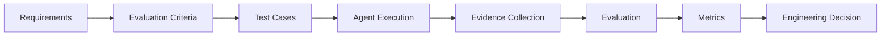
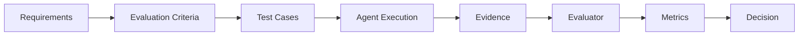
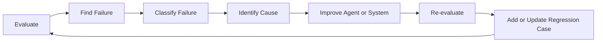
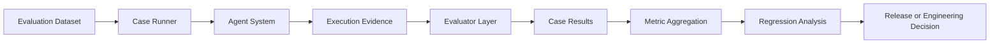
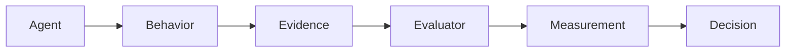
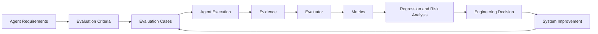

# AGT-10 — Agent Evaluation Sets, Metrics, and Regression Testing

## Learning Objectives

By the end of this chapter, you should be able to:

- Explain why reliable agent evaluation requires more than individual test cases.
- Design evaluation datasets that represent real agent tasks, failure modes, edge cases, and risk levels.
- Distinguish evaluation datasets, golden datasets, and regression test sets.
- Design evaluation cases with explicit expected behavior and acceptance criteria.
- Select metrics that measure properties relevant to actual system requirements.
- Explain why aggregate metrics can hide important failures.
- Evaluate agents using outcome-based, reference-based, rubric-based, human, and model-based evaluation.
- Design and calibrate LLM-based evaluators.
- Analyze evaluator disagreement, bias, false positives, false negatives, and drift.
- Recognize contamination, leakage, benchmark gaming, and evaluation overfitting.
- Build regression evaluation processes that detect behavioral degradation across system changes.
- Design release gates and thresholds based on engineering and risk requirements.
- Version evaluation datasets, rubrics, evaluators, models, metrics, thresholds, and environments.
- Explain why observability and evaluation serve different purposes.
- Build an evaluation-driven improvement loop from failures to durable regression tests.
- Reason about evaluation quality as a first-class engineering problem.

---

## Prerequisites

Before studying this chapter, you should understand the concepts covered in:

- [01-Agent-Task-Success-and-Behavioral-Evaluation.md](./01-Agent-Task-Success-and-Behavioral-Evaluation.md)
- [02-Trajectory-Tool-Planning-and-State-Evaluation.md](./02-Trajectory-Tool-Planning-and-State-Evaluation.md)

You should already understand:

- task success and behavioral correctness
- outcome-based versus behavior-based evaluation
- evaluation criteria and acceptance conditions
- agent trajectories
- tool-use evaluation
- planning evaluation
- state and context evaluation
- evidence collected during execution
- evaluator design fundamentals

This chapter does **not** re-teach trajectory, tool, planning, or state evaluation in depth. Those concepts belong primarily to Lesson 02.

The focus here is different:

> **How do we turn individual evaluations into a trustworthy evaluation system that can measure change, detect regressions, and support engineering decisions over time?**

---

## Estimated Reading Time

**60–80 minutes**, depending on how deeply you study the examples and engineering trade-offs.

---

## Before We Start

A single successful test does not establish that an agent is reliable.

Suppose an agent successfully completes one customer-support task.

That tells us something about that particular execution.

It does not tell us:

- whether the agent succeeds across different task types
- whether it fails on edge cases
- whether it behaves correctly under tool failures
- whether it violates constraints on rare cases
- whether a new model version introduced regressions
- whether our evaluator itself is reliable
- whether our test set represents real usage
- whether a high score hides critical failures

Therefore, agent evaluation must eventually become an **evaluation system**, not merely a collection of prompts.

A useful mental model is:



The important insight is that every stage can introduce error.

A poor requirement produces a poor criterion.

A poor criterion produces a poor test.

A poor test set produces misleading metrics.

A weak evaluator produces misleading measurements.

A misleading measurement produces a bad engineering decision.

Therefore:

> **Agent quality asks whether the agent behaves well. Evaluation quality asks whether the measurement can be trusted.**

---

# 1. From Individual Evaluation to Evaluation Systems

Individual evaluation asks:

> Did this agent execution behave correctly?

An evaluation system asks:

> Can we reliably determine whether this agent version behaves acceptably across the situations that matter?

That difference is fundamental.

A single evaluation case has limited scope.

An evaluation system introduces:

- evaluation datasets
- test-case definitions
- expected outcomes
- evaluation criteria
- evaluators
- metrics
- aggregation
- segmentation
- baselines
- regression comparisons
- thresholds
- release gates
- versioning
- calibration
- maintenance

The system therefore becomes an engineering asset in its own right.

---

## 1.1 The Evaluation Measurement Pipeline

A practical evaluation system can be represented as:



Each stage answers a different question:

| Stage | Question |
|---|---|
| Requirements | What does good behavior mean? |
| Criteria | What properties should be measured? |
| Test Cases | Which situations will we test? |
| Execution | What did the agent actually do? |
| Evidence | What evidence do we have? |
| Evaluator | How should the evidence be judged? |
| Metrics | How should results be summarized? |
| Decision | What engineering action should follow? |

This separation prevents a common mistake:

> Treating the final score as if it appeared directly from the agent.

The score is the result of a measurement pipeline.

---

# 2. What Is an Evaluation Dataset?

An **evaluation dataset** is a structured collection of cases used to measure agent behavior against defined expectations.

A case may contain:

- input
- task description
- context
- available tools
- environmental conditions
- expected outcome
- constraints
- evaluation criteria
- reference answer where applicable
- expected behavioral properties
- risk classification
- metadata
- known failure categories

A conceptual case might look like:

```text
{
    task: "Update a customer's shipping address",

    input:
        customer request + customer context,

    available_tools:
        lookup_customer,
        update_address,

    constraints:
        identity verification required,

    expected_outcome:
        address updated only after verification,

    evaluation_criteria:
        task_success,
        constraint_adherence,
        tool_use_correctness,

    risk_level:
        high
}
```

The exact representation may vary.

The important part is that the case defines **what is being evaluated and why**.

---

# 3. Why Dataset Design Matters

An evaluation dataset is not merely a collection of examples.

It represents a model of the problem space.

If the dataset is poorly designed, the resulting score can be highly misleading.

For example:

```text
Evaluation Set A

900 easy tasks
80 medium tasks
20 difficult tasks
0 failure scenarios
0 edge cases
0 high-risk cases
```

An agent could achieve a very high score while still performing poorly on important situations.

Therefore:

> **Evaluation-set quality is part of evaluation quality.**

A useful dataset should reflect the engineering decisions the evaluation is intended to support.

---

# 4. Evaluation Case Design

A strong evaluation case should answer:

1. What task is being tested?
2. What conditions apply?
3. What behavior is acceptable?
4. What behavior is unacceptable?
5. What evidence will be evaluated?
6. What constitutes success?
7. What constitutes partial success?
8. What failure category applies?
9. How important is the failure?
10. Is this case intended for development, regression, release, production analysis, or another purpose?

The evaluation case should make the evaluation objective explicit enough that different evaluators can apply it consistently.

---

## 5. Types of Evaluation Cases

A useful evaluation dataset can contain several categories.

## 5.1 Representative Cases

These approximate normal real-world usage.

They answer:

> Does the agent work on the tasks users actually perform?

---

## 5.2 Boundary Cases

These operate near important constraints.

Examples:

- minimum or maximum values
- ambiguous instructions
- missing required fields
- unusual but valid inputs

---

## 5.3 Edge Cases

These are uncommon but valid situations.

They are important because systems often fail outside the common path.

---

## 5.4 Failure Cases

These intentionally exercise known or suspected failure modes.

Examples:

- tool failure
- malformed tool response
- missing context
- stale state
- conflicting information
- incomplete user request

---

## 5.5 Adversarial Cases

These attempt to expose weaknesses in the agent or evaluator.

Examples include:

- conflicting instructions
- misleading context
- unusual tool outputs
- unexpected task combinations

The objective is not merely to make the agent fail.

The objective is to discover whether the system behaves incorrectly under conditions that matter.

---

## 5.6 High-Risk Cases

These represent actions or situations where failure has disproportionate consequences.

Examples:

- financial actions
- irreversible operations
- sensitive data handling
- external communication
- approval-bound actions

High-risk cases may require deeper behavioral evaluation and stronger release criteria.

---

## 5.7 Regression Cases

These preserve previously discovered failures or important historical behavior.

They help answer:

> Did a later change reintroduce a problem that we had already fixed?

---

## 5.8 Synthetic and Human-Authored Cases

Synthetic cases can increase coverage efficiently.

Human-authored cases can capture realistic ambiguity, unusual phrasing, domain nuance, and important failure patterns.

Neither is automatically superior.

The correct choice depends on the evaluation objective.

---

## 6. Coverage Dimensions

Coverage should be considered across multiple dimensions.

Possible dimensions include:

- task type
- difficulty
- user intent
- ambiguity
- tool combinations
- state conditions
- failure conditions
- context conditions
- memory conditions
- risk level
- workflow complexity
- expected output type
- agent configuration
- model version
- external dependency conditions

Coverage is not simply:

> Number of test cases.

It is:

> **How well does the evaluation set represent the situations and properties that matter?**

---

## 7. Distribution Matters

Suppose an evaluation dataset contains:

```text
95% easy tasks
5% difficult tasks
```

A 90% overall success rate may sound impressive.

But suppose the agent succeeds on:

```text
98% easy tasks
20% difficult tasks
```

The aggregate number hides an important weakness.

Therefore, evaluation results should often be segmented by:

- task category
- difficulty
- risk
- tool
- failure type
- user type
- agent version
- scenario
- environment

The correct distribution depends on the real decision being made.

There is no universal ideal distribution.

---

# 8. Golden Evaluation Datasets

A **golden evaluation dataset** is a curated, relatively stable collection of trusted evaluation cases used for repeatable comparison.

Golden datasets can provide:

- stable baselines
- repeatable regression checks
- known historical failures
- release comparison
- long-term tracking
- consistent evaluation conditions

However, golden does not mean permanent.

A golden dataset can become stale.

Real systems evolve.

User behavior evolves.

Tools evolve.

Requirements evolve.

Therefore:

> **A golden dataset should be stable enough for comparison but maintained enough to remain relevant.**

---

## 9. Dataset Evolution

Evaluation datasets should evolve when:

- new failure modes are discovered
- requirements change
- new tools are introduced
- new workflows are added
- production behavior reveals missing cases
- old cases become irrelevant
- evaluation gaming is detected
- task distributions change

Dataset changes should be documented.

Otherwise, a score change may be impossible to interpret.

For example:

```text
Version 1:
1000 cases

Version 2:
1200 cases
+200 high-risk cases
```

If success rate changes from 94% to 90%, the change may not represent an agent regression.

The evaluation population changed.

Therefore, dataset versioning is essential.

---

# 10. Evaluation Splits

In agent evaluation, an **evaluation split** is a purposeful partition of evaluation cases used for different engineering decisions.

It does **not necessarily correspond to the train/validation/test structure used in model training**.

Possible evaluation partitions include:

| Evaluation partition | Purpose |
|---|---|
| Development set | Rapid iteration and debugging |
| Tuning set | Compare changes during development |
| Release set | Pre-release acceptance |
| Regression set | Detect known behavioral degradation |
| Protected/hidden set | Reduce benchmark overfitting |
| Production sample | Evaluate real-world behavior |
| Incident set | Preserve newly discovered failures |

These sets may overlap in carefully controlled systems, but their purposes should remain explicit.

A developer should not repeatedly optimize against a protected regression set until its cases become memorized targets.

---

## 11. Reference Answers

Some evaluation cases have well-defined expected answers.

A reference can provide:

- expected final result
- required facts
- required fields
- acceptable values
- forbidden values
- expected tool outcomes
- acceptable behavioral conditions

However, not every task has one canonical answer.

For example, a research task may have several valid responses.

Therefore:

> **A reference answer is useful when correctness can reasonably be represented by a reference. It should not be forced onto tasks where multiple valid outcomes exist.**

---

## 12. Metrics Are Measurement Tools, Not Truth

A metric is not the property itself.

It is a measurement of some property.

For example:

```text
Task success rate
```

attempts to measure successful task completion.

But the metric may fail to capture:

- unsafe behavior
- unnecessary actions
- excessive cost
- poor user experience
- policy violations
- inefficient tool usage

Therefore:

> **A metric is useful only when it measures a property relevant to actual requirements.**

This principle should govern metric selection.

---

# 13. Task Success Rate

Task success rate can be represented conceptually as:

```text
successful cases
----------------
evaluated cases
```

For binary evaluation:

```text
success = 1
failure = 0
```

This is useful for clear task outcomes.

However, it may hide important differences.

Consider:

```text
Agent A: 95% task success
Agent B: 93% task success
```

That does not automatically mean Agent A is better.

Agent A might have:

- more critical failures
- more unsafe actions
- higher cost
- more unnecessary tool calls

Metrics must therefore be interpreted in context.

---

# 14. Pass Rate and Error Rate

A pass rate measures the proportion of cases meeting the defined acceptance condition.

An error rate measures the proportion failing that condition.

These are useful for:

- release comparisons
- regression detection
- category comparisons
- trend analysis

But the meaning depends entirely on the evaluation criteria.

A weak criterion produces a weak pass rate.

---

## 15. Graded Metrics

Not all outcomes are binary.

A graded evaluator might assign:

```text
0 = unacceptable
1 = poor
2 = partially acceptable
3 = good
4 = excellent
```

Graded evaluation can capture partial success.

However, it introduces additional evaluator complexity.

Different evaluators may interpret the difference between:

```text
2 and 3
```

inconsistently.

Therefore, grading requires clear rubrics and calibration.

---

# 16. Distribution-Aware Metrics

Instead of reporting only:

```text
overall_success = 93%
```

report results by relevant segments.

For example:

```text
Overall:       93%
Easy tasks:    98%
Medium tasks:  91%
Hard tasks:    72%
High-risk:     81%
```

This makes hidden weaknesses visible.

Segmentation should be driven by meaningful engineering dimensions rather than creating arbitrary categories merely to produce favorable numbers.

---

# 17. Severity-Aware Evaluation

Not all failures have equal importance.

For example:

```text
Minor formatting error
```

is not equivalent to:

```text
Unauthorized financial action
```

A severity-aware evaluation can classify failures such as:

- informational
- minor
- moderate
- major
- critical

The classification should come from actual system requirements and risk analysis.

A high overall success rate should not compensate for unacceptable critical failures.

---

# 18. Cost and Latency Metrics

Agent quality is not always independent of operational efficiency.

Useful measurements can include:

- latency
- token consumption
- tool-call count
- external API cost
- compute cost
- unnecessary actions
- retries
- execution duration

These metrics should be interpreted together with task quality.

Optimizing latency by terminating before completing the task is not an improvement.

Optimizing cost by skipping required verification is not an improvement.

Therefore:

> **Efficiency metrics must be evaluated alongside correctness and behavioral requirements.**

---

## 19. Metric Aggregation

Metrics can be aggregated at different levels.

For example:

```text
Case
  ↓
Task category
  ↓
Risk category
  ↓
Agent version
  ↓
Overall result
```

Aggregation is useful for summarization.

But every aggregation loses information.

Therefore, important engineering decisions should preserve access to:

- raw case results
- failure categories
- segment-level metrics
- severity
- evaluator disagreement

The aggregate number should be a summary, not the entire evidence base.

---

# 20. Why One Aggregate Metric Can Be Dangerous

Suppose:

```text
Overall success = 96%
```

That number could conceal:

```text
Normal tasks       = 99%
High-risk tasks    = 98%
Tool failures      = 94%
Memory tasks       = 91%
Critical cases     = 70%
```

The system may look excellent overall while being unacceptable in one important category.

Therefore:

> **No single aggregate metric should automatically determine agent quality.**

The correct metric set depends on the requirements.

---

# 21. Evaluation Uncertainty

Evaluation results are not always exact representations of true system quality.

Uncertainty can arise from:

- small datasets
- noisy tasks
- evaluator disagreement
- stochastic agent behavior
- stochastic evaluator behavior
- changing external information
- incomplete evidence
- changing environments

Suppose:

```text
Observed success rate = 92%
```

That number should not automatically be interpreted as:

```text
True agent quality = exactly 92%
```

An engineer should consider:

- dataset size
- variability
- evaluator agreement
- confidence intervals where appropriate
- repeated evaluations
- segmentation
- critical failures
- uncertainty in the evaluation process

When uncertainty is high, stronger conclusions may require additional evidence.

---

# 22. Evaluator Design

An evaluator converts evidence into an assessment.

Possible evaluator types include:

- rule-based evaluator
- reference-based evaluator
- human evaluator
- model-based evaluator
- hybrid evaluator

The evaluator should be selected according to:

- task characteristics
- required precision
- cost
- scalability
- risk
- availability of references
- complexity of the behavior being measured

The evaluator is itself part of the evaluation system.

Therefore:

> **The evaluator must also be evaluated.**

---

## 23. Rule-Based Evaluation

Rule-based evaluation uses explicit deterministic conditions.

Examples:

```text
required_field_present == true
```

```text
tool_call_count <= 3
```

```text
approval_required == true
```

Rules work particularly well when the expected property is explicit.

Advantages:

- deterministic
- transparent
- fast
- inexpensive
- reproducible

Limitations:

- difficult to apply to nuanced language quality
- can become brittle
- may not capture semantic equivalence

---

# 24. Reference-Based Evaluation

Reference-based evaluation compares agent behavior or output against a known reference.

This can work well when:

- expected results are well defined
- correctness can be represented explicitly
- exact or structured outputs are required

But reference-based evaluation becomes harder when:

- multiple answers are valid
- wording can vary
- reasoning paths can differ
- the reference itself may become outdated

The evaluator should therefore compare **properties of correctness**, not blindly require textual similarity.

---

## 25. Human Evaluation

Humans can evaluate complex qualities such as:

- relevance
- usefulness
- nuanced correctness
- domain appropriateness
- quality of interaction

Advantages:

- nuanced judgment
- domain expertise
- ability to interpret ambiguity
- ability to detect unexpected problems

Limitations:

- expensive
- slower
- variable
- difficult to scale
- subject to evaluator bias

Human evaluation therefore remains valuable but should be designed carefully.

---

## 26. LLM-as-a-Judge

An LLM-as-a-judge system uses a model to evaluate another agent's behavior or output against defined criteria.

A judge may evaluate:

- correctness
- relevance
- completeness
- instruction adherence
- quality
- tool-use behavior
- trajectory properties

The judge may receive:

```text
Task
Agent output
Relevant evidence
Evaluation rubric
Optional reference
```

and produce structured evaluation results.

For example:

```text
{
    "correct": true,
    "constraint_adherence": false,
    "score": 3,
    "reason": "Required verification was skipped."
}
```

A model-based judge can scale evaluation substantially.

But:

> **An LLM judge is an evaluator, not ground truth.**

Its reliability must be measured.

---

# 27. LLM-Judge Failure Modes

Model-based evaluators can exhibit:

- bias toward fluent answers
- preference for stylistic similarity
- inconsistent scoring
- sensitivity to prompt wording
- reference anchoring
- overconfidence
- false positives
- false negatives
- difficulty detecting subtle failures
- difficulty evaluating domain-specific correctness
- evaluator drift after model changes

A judge can therefore produce a convincing but incorrect evaluation.

This creates a dangerous failure mode:

```text
Agent is wrong
      ↓
Judge incorrectly approves
      ↓
Metric increases
      ↓
Engineering team gains false confidence
```

---

# 28. Structured Rubrics for Model-Based Judges

A strong rubric should define:

- evaluation dimensions
- acceptable behavior
- unacceptable behavior
- scoring criteria
- evidence requirements
- critical failure conditions

For example:

```text
Dimension: Constraint adherence

4 = All constraints satisfied
3 = Minor non-critical deviation
2 = Multiple deviations
1 = Major violation
0 = Critical violation
```

The rubric should reduce ambiguity.

A good rubric also asks the evaluator to ground judgments in available evidence rather than rewarding style.

---

# 29. Reference-Based, Rubric-Based, and Pairwise Judging

Different judging approaches answer different questions.

### Reference-based

> How closely does the behavior satisfy a known expected result?

### Rubric-based

> How well does the behavior satisfy explicitly defined criteria?

### Pairwise

> Which of two candidate behaviors is better according to the defined criteria?

Pairwise comparison can be useful when absolute scoring is difficult.

However, pairwise comparison still depends on:

- rubric quality
- judge consistency
- task selection
- comparison framing
- evaluator bias

No judging method automatically eliminates evaluation error.

---

## 30. Reference-Based vs Reference-Free Evaluation

Reference availability is an important engineering decision.

| Approach | Strength | Limitation |
|---|---|---|
| Reference-based | Strong when expected behavior is well-defined | Hard when many valid answers exist |
| Reference-free | Flexible for open-ended tasks | More evaluator subjectivity |
| Hybrid | Can combine explicit correctness with qualitative criteria | More complex |

Reference-free does not mean “without criteria.”

It still requires a meaningful rubric or evaluation standard.

---

## 31. Evaluator Calibration

Calibration checks whether evaluators interpret evaluation criteria consistently.

A calibration process can include:

1. Select known examples.
2. Obtain trusted human judgments where appropriate.
3. Apply the evaluator.
4. Compare evaluator judgments with expected judgments.
5. Analyze disagreements.
6. Refine the rubric.
7. Re-test.
8. Repeat until reliability is acceptable for the intended use.

Calibration does not make an evaluator perfect.

It makes its behavior better understood and potentially more reliable.

---

## 32. Human-Judge Agreement

If a model-based judge is being used, compare it against human evaluation where appropriate.

Important questions include:

- Does the judge agree with domain experts?
- Where does it disagree?
- Does disagreement concentrate in certain task types?
- Does it over-reward fluent outputs?
- Does it miss specific failure modes?
- Does it behave differently across task categories?

Agreement should not be interpreted as proof of truth.

Humans can also disagree or make mistakes.

The purpose is to understand evaluator reliability.

---

## 33. Inter-Rater Agreement

When multiple human evaluators judge the same cases, disagreement should be measured and analyzed.

High disagreement can indicate:

- ambiguous criteria
- weak rubric
- unclear task definition
- evaluator training gaps
- inherently subjective evaluation

The correct response is not always to force agreement.

Sometimes the disagreement reveals that the property itself is poorly defined.

---

## 34. Disagreement Analysis

Disagreement is evidence.

Consider:

```text
Human A: Pass
Human B: Fail
Judge Model: Pass
```

This should trigger investigation.

Questions include:

- Was the rubric ambiguous?
- Was evidence incomplete?
- Did evaluators interpret requirements differently?
- Was the task inherently subjective?
- Did the judge miss a failure?
- Was the human judgment incorrect?

Disagreement analysis can reveal weaknesses in the evaluation system itself.

---

# 35. Evaluator Bias

Evaluators may systematically favor:

- fluent language
- longer answers
- certain writing styles
- expected phrasing
- familiar tool sequences
- particular solution patterns

A valid agent behavior should not automatically be penalized merely because it differs from the evaluator's preferred form.

Therefore:

> **Evaluation criteria should measure required properties rather than superficial similarity.**

---

## 36. Evaluator Drift

An evaluator can change behavior over time.

Possible causes include:

- judge model updates
- prompt changes
- rubric changes
- reference changes
- evaluator configuration changes
- environment changes

Suppose:

```text
Agent version unchanged
Judge version changed
Score: 91% → 96%
```

The improvement may come entirely from the evaluator.

Therefore, evaluator versions must be tracked.

---

# 37. Evaluation Contamination

Evaluation contamination occurs when evaluation cases or their answers become exposed to the system being evaluated in ways that invalidate the measurement.

Examples include:

- benchmark data entering training
- test cases becoming optimization targets
- known evaluation prompts being explicitly tuned against
- evaluator exposure influencing outputs

Contamination can create artificially high confidence.

---

## 38. Evaluation Leakage

Leakage occurs when information that should remain independent of the evaluation becomes available to the agent or evaluator in a way that improperly improves the measured result.

Examples:

- reference answers accidentally included in agent context
- hidden test information exposed through tooling
- evaluator prompts leaking expected labels
- test metadata revealing the intended answer

Leakage can invalidate an otherwise well-designed test.

---

## 39. Benchmark Gaming

Benchmark gaming occurs when a system optimizes for the measurement rather than the real objective.

For example:

```text
Metric:
Answer must contain specific phrases.

Agent:
Learns to include those phrases.

Result:
Benchmark score increases.

Real-world quality:
Unchanged.
```

This is a form of Goodhart-like failure:

> When a measurement becomes a target, optimizing the measurement can make it less useful as a proxy for the underlying objective.

---

# 40. Mitigating Benchmark Gaming

Possible strategies include:

- multiple evaluation dimensions
- behavior and outcome evaluation
- representative cases
- edge cases
- hidden or protected cases where appropriate
- human review
- changing evaluation cases
- production sampling
- incident-driven tests
- evaluator diversity

Hidden tests alone do not solve benchmark gaming.

The fundamental solution is to ensure that the evaluation system continues to measure the real objective.

---

## 41. Evaluation Drift

Evaluation itself can drift even when the evaluator does not.

Sources include:

- changing user behavior
- changing task distribution
- changing tools
- changing business requirements
- changing external information
- changing reference answers
- changing environments

Therefore, an evaluation score should always be interpreted relative to:

```text
Dataset version
Evaluator version
Agent version
Evaluation configuration
Environment
```

---

# 42. Reproducibility

A useful evaluation should record enough information to reproduce or interpret the result.

Relevant artifacts may include:

- agent/model version
- model configuration
- prompts
- evaluator version
- evaluator prompt
- dataset version
- rubric version
- reference version
- randomness configuration
- tool availability
- external dependencies
- environment
- time-dependent information

Agent evaluation does not need to be perfectly deterministic in every system.

The goal is instead to make variability observable, explainable, and appropriately controlled.

---

## 43. Regression Testing

Regression testing asks:

> Did a change cause previously acceptable behavior to become unacceptable?

Changes may include:

- model updates
- prompt changes
- tool changes
- orchestration changes
- state-management changes
- memory changes
- policy changes
- configuration changes
- infrastructure changes

A regression is not limited to final-answer correctness.

It can include:

- new tool errors
- increased unnecessary actions
- constraint violations
- degraded termination behavior
- state inconsistency
- increased latency
- increased cost
- degraded performance on specific task categories

---

## 44. Regression Test Sets

A regression set should contain cases that are valuable for detecting degradation.

It may include:

- previously failed cases
- high-value business cases
- critical-risk cases
- representative cases
- important edge cases
- known integration cases
- historically unstable cases

The regression set should be curated.

Adding every historical test forever can create an enormous and noisy suite.

The goal is useful coverage, not maximum case count.

---

## 45. Regression Is Not Just Re-running Old Prompts

A meaningful regression process compares:

```text
Agent Version A
        ↓
Evaluation
        ↓
Baseline
        ↓
Agent Version B
        ↓
Evaluation
        ↓
Comparison
```

The comparison should examine:

- overall changes
- category-level changes
- new failures
- recovered failures
- critical failures
- evaluator disagreement
- cost
- latency
- behavioral changes

A simple score comparison may not be enough.

---

# 46. Regression Tolerance

Not every numerical difference represents a meaningful regression.

Suppose:

```text
Version A = 92.1%
Version B = 91.9%
```

The difference may be insignificant.

But:

```text
Version A = 92%
Version B = 84%
```

may require investigation.

Tolerance should therefore account for:

- dataset size
- expected variance
- metric uncertainty
- task importance
- severity
- business requirements

Critical failures may require zero tolerance even when the aggregate metric remains stable.

---

# 47. Release Gates

A release gate defines conditions that must be satisfied before a system change is accepted.

Examples:

```text
Overall success >= required threshold
AND
Critical failure count = 0
AND
High-risk success >= required threshold
AND
No unacceptable regression in key categories
```

Release gates should come from:

- business requirements
- technical requirements
- risk analysis
- operational constraints

There is no universal threshold such as:

> "90% is always good."

---

# 48. Threshold Management

Thresholds should be treated as engineering policy.

A threshold should document:

- metric
- threshold value
- scope
- rationale
- severity
- owner
- effective version
- review conditions

Thresholds may differ by category.

For example:

```text
General task success >= 90%

High-risk task success >= 98%

Critical violations = 0
```

These values are examples only.

Real thresholds must come from actual requirements.

---

# 49. Regression Analysis

When a regression is detected, do not immediately conclude:

> The model became worse.

Investigate:

1. Which cases failed?
2. Which categories changed?
3. Which behaviors changed?
4. Which evaluator identified the change?
5. Did the evaluator change?
6. Did the dataset change?
7. Did the environment change?
8. Did a tool change?
9. Did external data change?
10. Is the regression reproducible?

A regression result is evidence requiring analysis, not automatically a root cause.

---

## 50. Evaluation Versioning

Evaluation artifacts should be versioned independently where appropriate.

This can include:

- evaluation dataset
- regression dataset
- golden dataset
- rubrics
- evaluator prompts
- judge models
- reference answers
- metric definitions
- thresholds
- release gates
- test environment

For example:

```text
Agent:       v4.2
Eval Set:    v3.1
Rubric:      v2.0
Judge:       v5
Thresholds:  v1.4
```

Without this information, historical scores become difficult to interpret.

---

# 51. Production Evaluation

Evaluation does not stop after deployment.

Production evaluation can include:

- sampled production traces
- periodic evaluation
- shadow evaluation
- release evaluation
- regression suites
- incident-driven test creation
- evaluator monitoring
- evaluation-drift analysis

Production evaluation should respect:

- privacy
- security
- data-access controls
- retention requirements
- appropriate sampling

The purpose is to discover whether behavior remains acceptable under real-world conditions.

---

## 52. Observability Is Not Evaluation

Observability asks:

> What happened?

Evaluation asks:

> How well did the system behave relative to defined expectations?

For example:

```text
Observability:
Agent called payment_tool three times.

Evaluation:
The agent should have called payment_tool once after verification.
```

Observability provides evidence.

Evaluation interprets that evidence against requirements.

Therefore:

> **Observability can support evaluation, but observability is not evaluation.**

PROD owns operational observability and runtime infrastructure. AGT-10 owns systematic behavioral evaluation and measurement.

---

# 53. Incident-Driven Evaluation

Production incidents should often become evaluation cases.

For example:

```text
Production incident
       ↓
Failure analysis
       ↓
Failure classification
       ↓
Reproduction case
       ↓
Evaluation case
       ↓
Regression test
```

This prevents the same failure from silently returning later.

A mature evaluation system therefore grows from real failures.

---

# 54. Evaluation-Driven Improvement Loop

A practical improvement loop is:



The loop turns evaluation into an engineering feedback mechanism.

The goal is not merely to increase a score.

The goal is to systematically reduce meaningful failures.

---

# 55. Common Evaluation-System Failure Modes

## 55.1 Wrong Evaluation Target

The metric measures something convenient rather than something important.

---

## 55.2 Unrepresentative Dataset

The dataset does not resemble meaningful real-world usage.

---

## 55.3 Single-Metric Blindness

One score hides important failure categories.

---

## 55.4 Weak Rubric

Different evaluators interpret success differently.

---

## 55.5 Uncalibrated Judge

A model-based evaluator is trusted without validating its behavior.

---

## 55.6 Evaluator Drift

The evaluator changes while the agent remains constant.

---

## 55.7 Human Inconsistency

Different evaluators produce substantially different judgments.

---

## 55.8 Data Leakage

Information improperly reaches the agent or evaluator.

---

## 55.9 Benchmark Overfitting

The agent becomes optimized for known evaluation cases.

---

## 55.10 False Confidence

A high score is treated as proof of reliability without examining evaluation quality.

---

## 55.11 Evaluation Configuration Drift

Dataset, rubric, evaluator, threshold, or environment changes without proper versioning.

---

## 55.12 Observability-Evaluation Confusion

Telemetry is mistaken for a judgment of behavioral quality.

---

## 56. Engineering Decisions and Trade-offs

There is no universally best evaluation strategy.

## Human vs Automated

| Human | Automated |
|---|---|
| Nuanced | Scalable |
| Domain-aware | Fast |
| Expensive | Repeatable |
| Slower | Can evaluate large volumes |
| Can be inconsistent | Can have systematic bias |

A hybrid strategy is often useful.

---

## Outcome vs Trajectory

| Outcome evaluation | Trajectory evaluation |
|---|---|
| Simpler | More detailed |
| Lower cost | Higher cost |
| Good for clear results | Good for behavioral correctness |
| Can hide bad execution | Can expose behavioral failures |

Risk and requirements should determine evaluation depth.

---

## Fixed vs Evolving Evaluation Sets

| Fixed | Evolving |
|---|---|
| Strong comparability | Better real-world relevance |
| Stable baseline | Captures new failures |
| Can become stale | Harder historical comparison |

Mature systems generally need both stability and controlled evolution.

---

## Reference-Based vs Reference-Free

| Reference-based | Reference-free |
|---|---|
| Strong for explicit correctness | Flexible for open-ended tasks |
| Easier to automate in structured tasks | More evaluator subjectivity |
| Requires good references | Requires strong rubrics |
| Can struggle with multiple valid answers | Can struggle with evaluator reliability |

---

## Rule-Based vs Model-Based

| Rule-based | Model-based |
|---|---|
| Transparent | Flexible |
| Deterministic | Handles nuanced language |
| Limited semantic flexibility | Can be biased |
| Easy to audit | Requires calibration |

---

## Single Judge vs Multiple Judges

Multiple evaluators may provide more evidence about disagreement and reliability.

But they also increase:

- cost
- complexity
- coordination requirements

Multiple judges are not automatically better.

The decision should depend on risk and evaluator uncertainty.

---

## 57. Practical Evaluation Architecture

A framework-independent evaluation architecture can be represented as:



The architecture can support:

- development evaluation
- pre-release evaluation
- regression testing
- production sampling
- incident-driven evaluation

The important design principle is separation of concerns.

The agent should not define its own evaluation criteria.

The evaluator should not silently redefine requirements.

The metric layer should not hide critical failures.

The release decision should be traceable to evidence.

---

# 58. Evaluation Quality as a First-Class System

The evaluation system itself should be evaluated.

A useful mental model is:



Now ask:

- Is the evidence sufficient?
- Is the evaluator reliable?
- Is the rubric valid?
- Is the dataset representative?
- Are the metrics meaningful?
- Are thresholds justified?
- Is the evaluation reproducible?
- Is disagreement understood?
- Is the dataset contaminated?
- Can the benchmark be gamed?

This leads to an important principle:

> **Evaluation quality must be treated as an engineering property of the evaluation system itself.**

---

# 59. Evaluation Configuration as a Versioned Artifact

A mature evaluation system should be able to answer:

> What exactly produced this evaluation result?

A useful evaluation record may therefore identify:

```text
Agent version
Model version
Prompt version
Dataset version
Rubric version
Evaluator version
Evaluator prompt version
Metric version
Threshold version
Environment version
Tool configuration
External dependency state
Execution timestamp
```

This makes historical comparisons interpretable.

For example:

```text
Evaluation Result

Agent:        agent-v4.2
Dataset:      eval-v3.1
Rubric:       rubric-v2.0
Judge:        judge-v5
Metrics:      metrics-v1.3
Thresholds:   release-v1.4
Environment:  prod-like-2026-11
```

Without this context, a numerical score can become an orphaned number.

---

# 60. A Practical Regression Decision Example

Suppose a new agent version produces:

```text
Overall success:
94% → 95%

High-risk success:
98% → 97%

Critical failures:
0 → 1

Latency:
3.2s → 2.7s
```

A simplistic evaluation might say:

> The new version improved from 94% to 95%.

A production engineer should ask more questions.

The overall score improved.

Latency improved.

But:

- high-risk performance decreased
- a critical failure appeared

Therefore, the release decision should depend on the defined risk policy.

If critical failures are blocking conditions, the release should fail despite the higher aggregate score.

This demonstrates why:

> **Metrics inform decisions; requirements and risk determine decisions.**

---

# 61. Production Evaluation Checklist

Before trusting an evaluation system, ask:

### Dataset

- Does the dataset represent meaningful real-world tasks?
- Are important edge cases included?
- Are failure cases included?
- Are high-risk cases represented?
- Is the distribution understood?
- Is the dataset versioned?
- Is the dataset maintained?

### Evaluator

- Is the evaluator appropriate?
- Is the rubric clear?
- Has the evaluator been calibrated?
- Is human agreement understood where relevant?
- Are false positives and false negatives understood?
- Is evaluator drift monitored?
- Is evaluator versioning implemented?

### Metrics

- Do metrics measure important requirements?
- Are results segmented?
- Are critical failures visible?
- Is aggregation hiding important behavior?
- Is uncertainty understood?

### Regression

- Is there a stable regression set?
- Are new failures added?
- Are old cases maintained?
- Are thresholds documented?
- Are release gates explicit?
- Are changes compared against a known baseline?

### Reproducibility

- Is the agent version recorded?
- Is the dataset version recorded?
- Is the evaluator version recorded?
- Is the rubric version recorded?
- Is the environment recorded?
- Are relevant external dependencies known?

### Production

- Is production behavior sampled appropriately?
- Are incidents converted into evaluation cases?
- Is evaluation drift monitored?
- Is observability kept distinct from evaluation?

---

## Interview Questions

## 1. Why is a large evaluation dataset not necessarily a good evaluation dataset?

**Expected answer:**  
Because dataset quality depends on relevance, representativeness, coverage, failure cases, edge cases, risk distribution, and usefulness for the engineering decision. More cases do not automatically mean better measurement.

---

## 2. What is the difference between an evaluation dataset and a regression dataset?

**Expected answer:**  
An evaluation dataset is the broader collection used to measure agent behavior. A regression dataset is a curated set maintained specifically to detect degradation across system changes. They may overlap but have different primary purposes.

---

## 3. Why can one aggregate metric be dangerous?

**Expected answer:**  
Because it can hide poor performance in important segments such as high-risk tasks, difficult tasks, specific tools, or critical failure categories.

---

## 4. What is an LLM-as-a-judge system?

**Expected answer:**  
A model-based evaluator that assesses agent behavior or output against defined criteria, optionally using references or structured rubrics.

---

## 5. Why should an LLM judge not be treated as ground truth?

**Expected answer:**  
Because the judge can exhibit bias, inconsistency, false positives, false negatives, reference anchoring, evaluator drift, and domain-specific weaknesses.

---

## 6. What is evaluator calibration?

**Expected answer:**  
The process of comparing evaluator judgments against trusted examples or human judgments, analyzing disagreement, refining criteria, and checking reliability.

---

## 7. What is benchmark gaming?

**Expected answer:**  
Optimizing system behavior for the evaluation metric rather than the real underlying objective.

---

## 8. How can benchmark gaming be reduced?

**Expected answer:**  
Use representative cases, multiple dimensions, behavior plus outcome evaluation, protected cases where appropriate, human review, production evidence, and continuously updated failure cases.

---

## 9. What is evaluation drift?

**Expected answer:**  
A change in the evaluation process or evaluation population that changes the meaning or behavior of measured results over time.

---

## 10. What information should be versioned for reproducible evaluation?

**Expected answer:**  
At minimum, agent/model version, dataset, evaluator, rubric, metrics, thresholds, relevant configuration, environment, and important external dependencies.

---

## 11. Why is observability not the same as evaluation?

**Expected answer:**  
Observability records what happened. Evaluation determines how well the behavior met defined expectations.

---

## 12. Why might a regression be detected even when task success remains unchanged?

**Expected answer:**  
Because other behavioral properties may have degraded, such as unnecessary tool calls, constraint violations, cost, latency, state consistency, termination behavior, or high-risk performance.

---

## 13. What is the difference between reference-based and reference-free evaluation?

**Expected answer:**  
Reference-based evaluation compares behavior against known expected results. Reference-free evaluation judges against criteria without requiring one canonical answer. Reference-free does not mean criteria-free.

---

## 14. Why are false positives and false negatives important in evaluation?

**Expected answer:**  
A false positive incorrectly approves bad behavior and can create unsafe confidence. A false negative incorrectly rejects acceptable behavior and can cause unnecessary remediation. The relative importance depends on system risk.

---

## 15. What should happen after discovering a production failure?

**Expected answer:**  
The failure should be analyzed, classified, reproduced where possible, converted into an evaluation case, added to the appropriate regression set, and used to improve the system.

---

## Quick Revision

Remember these principles:

1. Evaluation is a measurement system, not a single score.
2. Agent quality and evaluation quality are different problems.
3. Dataset quality determines the usefulness of measured results.
4. More evaluation cases do not automatically mean better evaluation.
5. Coverage must reflect meaningful task and risk dimensions.
6. Golden datasets provide stable comparison but can become stale.
7. Regression sets are curated for detecting degradation.
8. Evaluation splits serve different engineering purposes.
9. A reference answer is useful only when a reference meaningfully represents correctness.
10. Metrics are measurement tools, not truth.
11. Aggregate metrics can hide critical failures.
12. Segment metrics by dimensions that matter.
13. Severity matters.
14. Cost and latency should be considered alongside quality.
15. Evaluation uncertainty should influence engineering conclusions.
16. Evaluators must themselves be evaluated.
17. LLM judges are not objective ground truth.
18. Rubrics require calibration.
19. Human disagreement can reveal weak evaluation criteria.
20. Evaluator drift can change scores without agent improvement.
21. Contamination and leakage can invalidate evaluation.
22. Benchmark gaming can make scores misleading.
23. Regression testing detects degradation across system changes.
24. Thresholds should come from requirements and risk.
25. Release gates should expose critical failures.
26. Evaluation artifacts must be versioned.
27. Observability provides evidence; evaluation interprets it.
28. Production incidents should become durable evaluation cases.

---

## Key Takeaways

The most important lesson of this chapter is not how to calculate a pass rate.

It is how to determine whether a measurement deserves to influence an engineering decision.

A trustworthy evaluation system requires:

```text
Meaningful Requirements
        ↓
Useful Evaluation Criteria
        ↓
Representative Evaluation Cases
        ↓
Sufficient Evidence
        ↓
Reliable Evaluators
        ↓
Meaningful Metrics
        ↓
Risk-Aware Interpretation
        ↓
Regression Analysis
        ↓
Engineering Decision
```

A high score is useful only when:

- the property being measured matters
- the evaluation set represents the real problem
- the evaluator measures reliably
- the evidence is sufficient
- the metric does not hide critical failures
- the evaluation configuration is understood
- the result supports the decision being made

The mature engineering question is therefore not:

> **"What score did the agent get?"**

It is:

> **"What exactly did we measure, how trustworthy was that measurement, what evidence supports it, and what engineering decision should follow?"**

That is the foundation of trustworthy agent evaluation.

---

# Further Reading and Related Chapters

## Within AGT-10

- [01-Agent-Task-Success-and-Behavioral-Evaluation.md](./01-Agent-Task-Success-and-Behavioral-Evaluation.md)
- [02-Trajectory-Tool-Planning-and-State-Evaluation.md](./02-Trajectory-Tool-Planning-and-State-Evaluation.md)

## Related Agent Engineering Chapters

- [AGT-02 — Agent Runtime and Control Loop](../AGT-02-Agent-Runtime-Loops-and-Bounded-Autonomy/Readme.md)
- [AGT-03 — Tools, Actions, and Tool Execution](../AGT-03-Tools-and-Action-Execution/Readme.md)
- [AGT-04 — Agent State, Context, and Memory](../AGT-04-State-Context-and-Memory/Readme.md)
- [AGT-05 — Verification, Critique, and Self-Correction](../AGT-05-Planning-and-Adaptive-Execution/Readme.md)
- [AGT-06 — Agent Workflow Orchestration](../AGT-06-Workflow-Orchestration-and-Durable-Execution/Readme.md)
- [AGT-07 — Human-in-the-Loop and Intervention](../AGT-07-Human-Control-and-Approval/Readme.md)
- [AGT-08 — Agent Interoperability](../AGT-08-Agent-Interfaces-and-Protocols/Readme.md)
- [AGT-09 — Multi-Agent Systems](../AGT-09-Multi-Agent-Systems/Readme.md)
- [AGT-11 — Agent Failure Modes, Recovery, and Safety](../AGT-11-Agent-Reliability-and-Safety/Readme.md)
- [AGT-12 — Agent System Architecture and Design](../AGT-12-Agent-Architecture-and-Design-Review/Readme.md)

---

## Final Mental Model

Keep this model in mind when designing any agent evaluation system:



The loop is continuous.

A production-quality agent is not proven once.

It is repeatedly evaluated against meaningful expectations, with evidence strong enough to support engineering decisions.

> **Evaluation is trustworthy only when the thing being measured matters, the cases represent the real problem, the evaluator measures reliably, and the resulting evidence is strong enough to justify the decision.**
