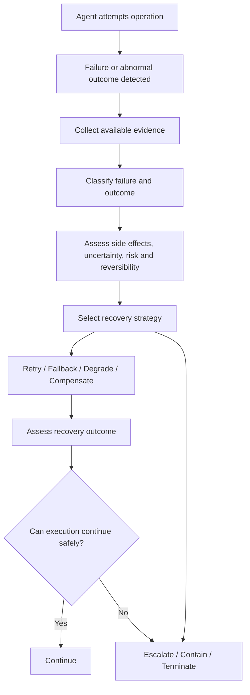
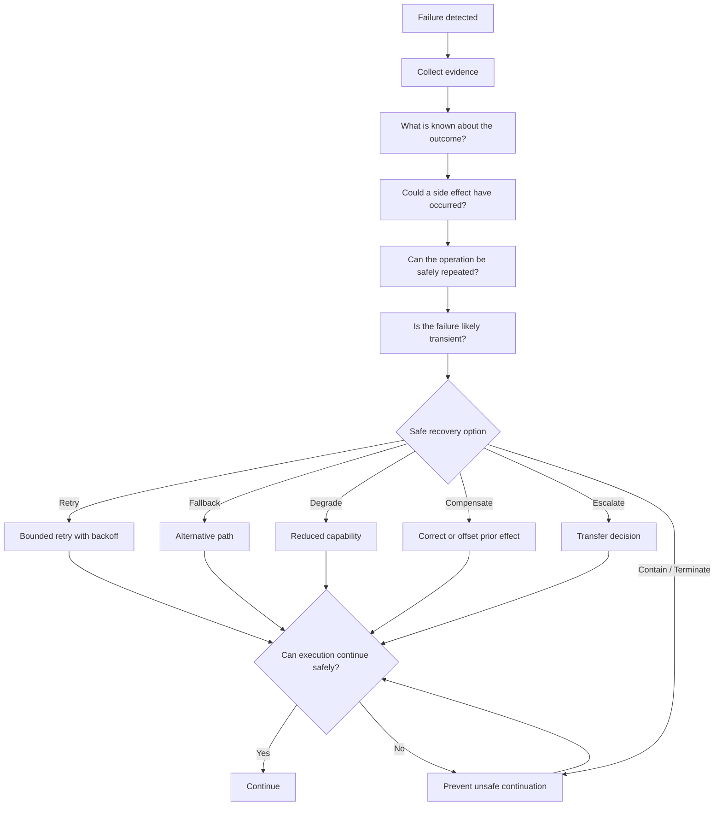

# Agent Failure Modes and Recovery Strategies

## Learning Objectives

After completing this chapter, you should be able to:

- Explain why agent failure is a systems problem rather than only a model-quality problem.
- Classify common agent failure modes.
- Distinguish transient, persistent, deterministic, and nondeterministic failures.
- Identify failures originating from models, tools, planning, state, context, and external dependencies.
- Recognize partial failures, cascading failures, malformed outputs, invalid actions, timeouts, resource exhaustion, stuck execution, and repeated failure loops.
- Distinguish failure detection, evidence collection, classification, and recovery decision-making.
- Distinguish retry, backoff, fallback, degradation, compensation, recovery, containment, escalation, and termination.
- Select recovery strategies based on failure type, side effects, reversibility, uncertainty, risk, dependency state, and available alternatives.
- Design bounded retry and recovery limits.
- Reason about failure budgets and termination conditions.
- Handle uncertain outcomes and potentially duplicated side effects safely.
- Design recovery behavior for partial and cascading failures.
- Explain why recovery is not equivalent to retry.
- Instrument recovery behavior so engineers can understand what happened and why a recovery decision was made.

---

## Prerequisites

You should understand the basic concepts covered by:

- **AGT-02 — Agent Execution and Control**
- **AGT-03 — Tool Use and Tool Execution**
- **AGT-04 — Agent State, Context and Memory**
- **AGT-05 — Agent Planning and Reasoning**
- **AGT-06 — Agent Workflows and Durable Execution**
- **AGT-07 — Human Intervention and Approval**
- **AGT-09 — Multi-Agent Systems**
- **AGT-10 — Agent Evaluation**

This chapter does not re-teach those mechanisms.

Instead, it focuses on the failure and recovery perspective:

> **What happens when agent behavior or one of its dependencies does not behave as expected, and what should the system do next?**

---

## Estimated Reading Time

**60–75 minutes**

This estimate covers the teaching content and examples. Exercises, implementation work, and revision are additional.

---

## Before We Start

An agent is not reliable simply because its model usually produces correct responses.

Production agents interact with:

- models,
- tools,
- APIs,
- databases,
- external services,
- state,
- context,
- workflows,
- users,
- and other agents.

Every additional dependency creates another place where execution can fail.

The engineering question is therefore not:

> **“How do we prevent every failure?”**

That is unrealistic.

The more useful question is:

> **“When failure occurs, how do we detect it, understand it, and choose a response that keeps the system within acceptable behavior?”**

Sometimes the correct response is to retry.

Sometimes it is to use an alternative path.

Sometimes the system should degrade.

Sometimes it should compensate for an effect that may already have occurred.

Sometimes it should escalate.

And sometimes the safest recovery is to stop.

This chapter is about making those decisions deliberately rather than allowing the agent to improvise its own recovery behavior.

---

## Why This Exists

Traditional software often has relatively explicit failure boundaries.

A function receives input, performs a defined operation, and returns a result or error.

Agents introduce additional uncertainty because behavior can depend on:

- model outputs,
- dynamically selected tools,
- changing context,
- intermediate state,
- external information,
- generated plans,
- previous failures,
- and continuation decisions.

As a result, the same apparent task can fail in different ways.

For example, an agent attempting to retrieve customer information might encounter:

1. A temporary API timeout.
2. An invalid API response.
3. An expired authentication token.
4. A malformed model-generated request.
5. A missing database record.
6. Corrupted intermediate state.
7. A service outage.
8. A repeated tool failure.
9. An incorrect result that appears successful.
10. An uncertain outcome where the operation may have succeeded but the response was lost.

These failures cannot all be handled with the same mechanism.

A retry may be appropriate for a temporary read timeout.

The same retry may be dangerous for a payment operation whose outcome is unknown.

Therefore:

> **Recovery is a decision problem, not a retry mechanism.**

---

## Mental Model

A useful recovery mental model is:



The important idea is that **failure detection comes before recovery selection**.

But detection alone is not enough.

A production recovery path should distinguish:

```text
Detection
    ↓
Evidence Collection
    ↓
Classification
    ↓
Recovery Decision
    ↓
Recovery Execution
    ↓
Recovery Outcome
```

The system should not immediately jump from:

> failure → retry

Instead:

> failure → understand → decide → recover.

---

# Core Concepts

## 1. Agent Failure Is a Systems Problem

An agent failure does not necessarily originate in the model.

A useful classification is:

```text
Agent Failure
├── Model Failure
├── Tool Failure
├── Planning Failure
├── State Failure
├── Context Failure
├── External Dependency Failure
├── Execution Failure
└── Integration / Interaction Failure
```

A production system should therefore avoid treating every failure as:

> “The LLM gave a bad answer.”

The model may be perfectly capable while the surrounding system fails.

For example:

```text
Model generates valid tool call
        ↓
Tool service unavailable
        ↓
Agent operation fails
```

The model did not necessarily fail.

The system failed to complete the intended operation.

---

## 2. Failure Categories

### 2.1 Transient Failures

A transient failure is expected to potentially succeed if the operation is attempted again later.

Examples:

- temporary network interruption,
- temporary service overload,
- short-lived dependency outage,
- rate limiting,
- connection reset,
- transient timeout.

Conceptually:

```text
Attempt
  ↓
Temporary Failure
  ↓
Wait / Backoff
  ↓
Retry
  ↓
Success
```

Retry is often reasonable here, but only after confirming that repeating the operation is safe.

A transient failure is therefore **evidence about the failure condition**, not automatic authorization to retry.

---

### 2.2 Persistent Failures

A persistent failure is unlikely to disappear merely because the same operation is repeated.

Examples:

- invalid credentials,
- malformed request,
- unsupported operation,
- missing required resource,
- invalid schema,
- permanent authorization failure.

Blind retries create noise without improving the outcome.

```text
Invalid Request
      ↓
Retry Same Request
      ↓
Invalid Request
      ↓
Retry Again
      ↓
Same Failure
```

This is not meaningful recovery.

It is repeated execution of a known-invalid operation.

---

### 2.3 Deterministic Failures

A deterministic failure occurs predictably for the same conditions.

Example:

```text
Input violates schema
       ↓
Validation fails
       ↓
Same input
       ↓
Validation fails again
```

Retrying without changing the relevant conditions is unlikely to help.

The recovery should instead address the cause, change the execution path, or terminate if no safe alternative exists.

---

### 2.4 Nondeterministic Failures

A nondeterministic failure may occur inconsistently under similar conditions.

Examples include:

- intermittent service failures,
- race conditions,
- unstable dependencies,
- intermittent network problems,
- occasional model-output failures.

These failures require careful diagnosis because repeated execution may sometimes succeed.

However:

> **Nondeterministic does not automatically mean retryable.**

A nondeterministic failure involving an irreversible side effect can still require reconciliation, containment, escalation, or termination.

---

# 3. Failure Sources

## 3.1 Model Failures

Model-related failures include:

- malformed structured output,
- invalid tool arguments,
- unsupported reasoning assumptions,
- incorrect interpretation of task requirements,
- hallucinated information,
- inappropriate action proposals,
- failure to follow required output constraints.

The important engineering distinction is:

> **A model-generated result is an input to system control logic, not an automatic source of truth.**

A model can propose an action that the system must reject or correct.

---

## 3.2 Tool Failures

Tools can fail because of:

- timeout,
- unavailable service,
- authentication failure,
- validation failure,
- malformed request,
- unexpected response,
- rate limiting,
- partial execution,
- duplicate invocation,
- or unknown execution status.

A tool failure is particularly important when the tool has side effects.

For example:

```text
Agent
  ↓
Payment Tool
  ↓
Request Submitted
  ↓
Response Lost
  ↓
Agent sees "timeout"
```

The timeout does **not** prove that the payment failed.

The system now has an uncertainty problem.

Blindly retrying could create a duplicate payment.

---

## 3.3 Planning Failures

Planning failures occur when the agent's intended sequence of actions is unsuitable.

Examples:

- selecting an unavailable capability,
- incorrect task decomposition,
- impossible dependency ordering,
- planning an action that conflicts with current state,
- failing to account for a known constraint,
- repeatedly selecting a known-failing path.

The recovery may require:

- replanning,
- an alternative execution path,
- degradation,
- escalation,
- or termination.

The correct response depends on the failure and its consequences.

This chapter does not re-teach planning mechanics; it focuses on the **failure consequences and recovery decision**.

---

## 3.4 State Failures

State-related failures can occur when:

- expected state is missing,
- state is stale,
- state is inconsistent,
- state does not reflect an earlier side effect,
- a state transition fails,
- persisted information is corrupted,
- or execution continues using an invalid assumption.

AGT-04 owns state architecture and lifecycle.

AGT-11 is concerned with the **recovery consequences** of state problems.

For example:

```text
Expected State:
Payment = Pending

External System:
Payment = Completed

Agent State:
Payment = Pending

       ↓

Agent considers payment again
       ↓
Possible duplicate side effect
```

The recovery question is not:

> “How does agent state work?”

It is:

> **“Can execution safely continue when the system's knowledge of the external world is uncertain?”**

That distinction keeps the discussion within AGT-11.

---

## 3.5 Context Failures

Context can become problematic when:

- required information is missing,
- stale information is used,
- contradictory information exists,
- relevant information is unavailable,
- the agent acts on an outdated assumption,
- or an earlier result is incorrectly treated as current.

The recovery strategy may involve:

- refreshing information,
- revalidating assumptions,
- obtaining authoritative state,
- restarting a bounded portion of execution,
- or terminating if reliable recovery is impossible.

The focus here is the **recovery consequence of bad context**, not context architecture itself.

---

## 3.6 External Dependency Failures

External dependencies include:

- APIs,
- databases,
- identity systems,
- payment services,
- search systems,
- third-party services,
- network services,
- and other agents.

Dependency failures may be:

- transient,
- persistent,
- partial,
- cascading,
- or uncertain.

The recovery strategy must account for the dependency's actual state rather than assuming that an error response means the operation had no effect.

---

# 4. Partial Failures

A partial failure occurs when some part of a larger operation succeeds while another part fails.

Example:

```text
Task
├── Create Customer      ✓
├── Create Subscription  ✓
├── Send Welcome Email   ✗
└── Update CRM           ✗
```

The system cannot safely treat this as:

> “The entire task failed.”

Some effects already occurred.

The recovery problem becomes:

- What has definitely happened?
- What may have happened?
- What has not happened?
- Which operations can safely be repeated?
- Which operations require compensation?
- Can the task continue?
- Should execution stop?

Partial failure is one reason recovery must be side-effect-aware.

---

# 5. Cascading Failures

A cascading failure occurs when one failure causes additional failures.

Example:

```text
External API slows down
        ↓
Tool calls begin timing out
        ↓
Agent retries aggressively
        ↓
Request volume increases
        ↓
Dependency becomes more overloaded
        ↓
More requests fail
        ↓
Agent retries again
```

The recovery mechanism has now become part of the failure.

This is why:

> **A recovery strategy must not amplify the failure it is attempting to resolve.**

Bounded retries, backoff, fallback, degradation, and termination conditions exist partly to prevent this behavior.

---

# 6. Malformed Outputs and Invalid Actions

An agent may produce output that is syntactically valid but operationally invalid.

For example:

```text
Expected:
{
  "customer_id": "123",
  "amount": 500
}

Generated:
{
  "customer": "123",
  "amount": "five hundred"
}
```

Possible responses include:

1. Validate and reject.
2. Request regeneration.
3. Use a constrained output path.
4. Fall back to another mechanism.
5. Escalate.
6. Terminate if safe recovery is unavailable.

The important principle is:

> **Validation should happen before an invalid model output becomes an invalid external action.**

The mechanics of action validation belong to the relevant execution and safety chapters; here the focus is what the failure means for recovery.

---

# 7. Timeouts

A timeout means:

> The expected response was not received within the allowed period.

It does **not necessarily mean the operation failed**.

Consider:

```text
Agent
  ↓
POST /payment
  ↓
Server processes request
  ↓
Payment completed
  ↓
Response lost
  ↓
Client timeout
```

The client sees:

```text
TIMEOUT
```

But the external system may contain:

```text
PAYMENT = COMPLETED
```

Therefore:

> **Timeout is often an uncertainty signal, not proof of failure.**

Recovery may require checking authoritative status before retrying.

---

# 8. Resource Exhaustion

Agents can consume excessive:

- tokens,
- model calls,
- tool calls,
- execution time,
- memory,
- API quota,
- compute,
- or external-service capacity.

Resource exhaustion may result from:

- runaway loops,
- repeated retries,
- excessive planning,
- tool failure loops,
- unnecessary delegation,
- or poorly bounded workflows.

A recovery strategy should include explicit limits.

Examples:

```text
Maximum retries
Maximum execution time
Maximum tool calls
Maximum model calls
Maximum delegation depth
Maximum recovery attempts
```

These limits are not merely performance controls.

They can also be reliability and safety boundaries because they prevent recovery behavior from continuing indefinitely.

---

# 9. Stuck Execution and Repeated Failure Loops

An agent can become stuck when it repeatedly performs actions without meaningful progress.

Example:

```text
Tool fails
   ↓
Agent retries
   ↓
Tool fails
   ↓
Agent retries
   ↓
Tool fails
   ↓
Agent retries
   ↓
...
```

A more subtle loop can occur when the tool succeeds but the agent does not change its state or strategy:

```text
Action
  ↓
Observation
  ↓
Same decision
  ↓
Same action
  ↓
Same observation
  ↓
Same decision
```

Production systems should detect repeated failure and lack of progress.

Useful signals include:

- repeated identical actions,
- repeated identical errors,
- increasing retry count,
- no meaningful state progress,
- repeated tool calls,
- repeated plans,
- exceeded time budget,
- exceeded recovery budget.

---

# 10. Failure Detection, Evidence, and Classification

Recovery begins with detecting that something is wrong, but detection alone does not explain the failure.

A useful distinction is:

```text
Detection
    ↓
Evidence Collection
    ↓
Classification
    ↓
Recovery Decision
```

### Detection

Detection answers:

> **“Did the expected behavior fail or become abnormal?”**

Examples:

- exception,
- error response,
- timeout,
- validation failure,
- rejected action,
- unexpected result,
- no progress.

### Evidence Collection

Evidence collection asks:

> **“What do we know about what happened?”**

Examples:

- error code,
- dependency response,
- execution history,
- known side effects,
- authoritative status,
- previous attempt results,
- current recovery budget.

### Classification

Classification asks:

> **“What kind of failure or abnormal outcome is this?”**

Examples:

- transient,
- persistent,
- deterministic,
- nondeterministic,
- partial,
- cascading,
- uncertain outcome,
- repeated failure,
- resource exhaustion.

Classification should not pretend to have certainty that the available evidence does not support.

---

# 11. Recovery Strategy Selection

Recovery should be selected only after understanding the failure and its consequences.

A useful decision sequence is:



The order is intentionally different from a simplistic:

```text
Transient → Retry
```

A transient failure can still involve an unsafe or uncertain side effect.

The key questions are:

1. What failed?
2. What evidence do we have?
3. What outcome is known or unknown?
4. Could a side effect have occurred?
5. Is repeating the operation safe?
6. Is the failure likely transient?
7. Are alternatives available?
8. Can the operation be compensated?
9. Can execution continue safely?
10. Has the recovery budget or termination boundary been reached?

---

# 12. Recovery Strategy Comparison

| Strategy | Purpose | Best Fit | Main Risk |
|---|---|---|---|
| Retry | Repeat an operation | Transient failure + safely repeatable operation | Duplicate effects, repeated failure |
| Backoff | Delay subsequent attempts | Temporary dependency pressure or transient failure | Added latency |
| Fallback | Use an alternative path | Primary dependency/path unavailable | Lower capability or different behavior |
| Degradation | Continue with reduced capability | Full behavior unavailable but reduced behavior remains acceptable | Lower quality or incomplete task |
| Compensation | Correct or offset an effect that may already have occurred | Partial completion or side-effected workflow | Compensation may itself fail or create effects |
| Escalation | Transfer the decision | High uncertainty, high risk, or insufficient authority | Human/system dependency |
| Containment | Limit consequences | Continued execution could worsen the situation | Reduced availability |
| Termination | Stop execution | Unsafe or unrecoverable condition | Task incompletion |

These strategies are not mutually exclusive.

For example:

```text
Timeout
  ↓
Status verification
  ↓
Unknown outcome remains
  ↓
Contain
  ↓
Escalate
```

Or:

```text
Transient read failure
  ↓
Backoff
  ↓
Bounded retry
  ↓
Fallback
  ↓
Degraded result
```

---

# 13. Retry

Retry means attempting the same operation again.

Retry is appropriate when:

- the failure is likely transient,
- repeating the operation is safe,
- side effects are controlled,
- the dependency may recover,
- and the retry remains within defined limits.

Example:

```text
GET customer profile
      ↓
Temporary timeout
      ↓
Backoff
      ↓
Retry
      ↓
Success
```

Retry is not inherently safe.

The key question is:

> **What happens if the operation actually succeeded but the response was lost?**

---

# 14. Backoff

Backoff introduces a delay between attempts.

Instead of:

```text
Retry
Retry
Retry
Retry
```

the system may use:

```text
Attempt 1
   ↓
wait
   ↓
Attempt 2
   ↓
wait longer
   ↓
Attempt 3
```

Backoff can reduce:

- dependency overload,
- request bursts,
- retry storms,
- unnecessary pressure on failing services.

A common engineering pattern is exponential backoff with jitter.

The exact algorithm depends on system requirements, but the underlying principle is:

> **Do not let recovery behavior amplify transient failure.**

---

# 15. Bounded Retry

Retries must have explicit limits.

Possible limits include:

- maximum attempt count,
- maximum retry duration,
- maximum total execution time,
- maximum retry cost,
- maximum side-effect exposure.

Example:

```text
Retry Budget = 3 attempts

Attempt 1 → Failure
Attempt 2 → Failure
Attempt 3 → Failure
                 ↓
          Retry exhausted
                 ↓
       Fallback / Escalate /
       Degrade / Terminate
```

More retries do not necessarily mean more reliability.

Unlimited retries can create:

- runaway execution,
- resource exhaustion,
- duplicated side effects,
- increased latency,
- dependency overload,
- and failure loops.

---

# 16. Fallback

Fallback means switching to an alternative path when the preferred path fails.

Example:

```text
Primary Search Service
        ↓
      Failure
        ↓
Secondary Search Service
        ↓
     Continue
```

Fallback is useful when:

- an alternative capability exists,
- the alternative is sufficiently trustworthy,
- the alternative satisfies the required task quality,
- and switching does not introduce unacceptable risk.

Fallback is not synonymous with recovery.

It is **one possible recovery strategy**.

---

# 17. Degradation

Degradation means continuing with reduced functionality or quality rather than fully completing the original behavior.

Example:

```text
Personalized Recommendation Service
          ↓
        Failure
          ↓
Generic Recommendation
          ↓
Continue with reduced capability
```

Degradation may be preferable when:

- full functionality is unavailable,
- partial functionality remains useful,
- safety remains acceptable,
- and the reduced behavior is clearly bounded.

A degraded result should not silently be presented as equivalent to a fully successful result.

---

# 18. Compensation

Compensation addresses the effects of an operation that may already have occurred.

Consider:

```text
Create Order       ✓
Charge Customer    ✓
Send Notification ✗
```

The correct response may involve compensating for the incomplete workflow rather than repeating everything.

Compensation is particularly important when operations cannot be atomically rolled back.

---

# 19. Compensation Is Not Rollback

Rollback attempts to restore a previous system state.

Compensation performs another action intended to offset or correct an earlier effect.

For example:

```text
Charge Customer
      ↓
Refund Customer
```

A refund is a compensating action.

It is not necessarily a database-style rollback of the original transaction.

This distinction matters because compensation can itself:

- fail,
- create another side effect,
- require authorization,
- take time,
- or produce a different final state.

Therefore:

> **Never assume that every side effect is reversible simply because a compensating operation exists.**

---

# 20. Recovery

Recovery is the broader process of restoring safe, useful behavior after failure.

Recovery may involve:

```text
Retry
Fallback
Degradation
Replanning
Compensation
State Reconciliation
Escalation
Containment
Termination
```

Therefore:

> **Retry is a recovery mechanism. Recovery is not a synonym for retry.**

A good recovery decision considers the entire system condition rather than the failed operation in isolation.

---

# 21. Recovery vs Safety Enforcement

A useful boundary for this chapter is:

```text
Failure Recovery
        vs
Safety Enforcement
```

Lesson 01 primarily asks:

> **“What should the system do when something fails or produces an abnormal outcome?”**

Lesson 02 primarily asks:

> **“How does the system constrain execution and state so unsafe behavior cannot continue?”**

Therefore, Lesson 01 focuses on selecting among:

```text
Retry
Fallback
Degrade
Compensate
Escalate
Contain
Terminate
```

while Lesson 02 goes deeper into mechanisms such as:

```text
Safety Invariants
Preconditions
Postconditions
State Validation
Execution Boundaries
Circuit Breakers
Kill Switches
Safe Failure States
Fail-Safe / Fail-Open Behavior
```

The two chapters are connected, but they have different ownership.

---

# 22. Containment and Termination

Containment and termination become important when continued execution is no longer justified.

### Containment

Containment limits the consequences of a failure or abnormal behavior.

Examples:

- disable a failing capability,
- stop further mutations,
- restrict subsequent actions,
- isolate a failed execution path,
- prevent additional retries,
- preserve the current state for investigation.

### Termination

Termination stops execution when safe continuation is no longer justified.

Examples include:

- recovery attempts are exhausted,
- the system cannot establish sufficiently trustworthy state,
- the failure is persistent,
- no safe fallback exists,
- risk exceeds acceptable limits,
- or continued execution could amplify harm.

This lesson covers the **recovery decision**:

> **When should the system recover, contain, escalate, or terminate?**

The detailed mechanics for enforcing those boundaries belong to **AGT-11 Lesson 02 — Execution and State Safety**.

---

## 23. Recovery Under Uncertainty

One of the hardest recovery conditions is:

```text
Outcome Unknown
```

Example:

```text
Agent
  ↓
Payment Request
  ↓
Network Timeout
  ↓
Unknown:
Did payment happen?
```

There are three important possibilities:

```text
Payment definitely failed
Payment definitely succeeded
Payment outcome unknown
```

The third state must be represented explicitly.

A system that converts:

> unknown → failed

and blindly retries may create duplicates.

A system that converts:

> unknown → succeeded

may incorrectly continue without verification.

Therefore:

> **Uncertainty is itself a recovery state that requires explicit handling.**

Possible responses include:

- query authoritative status,
- reconcile state,
- use a safe idempotency mechanism,
- switch to a non-mutating path,
- escalate,
- contain,
- or terminate.

---

# 24. Side Effects and Recovery

Recovery strategy becomes more difficult when operations have side effects.

Consider two operations:

### Read

```text
GET /profile
```

Retrying may be relatively low risk.

### Mutation

```text
POST /payment
```

Retrying may create a duplicate side effect.

Therefore:

> **Retryability depends not only on failure type, but also on operation semantics and side effects.**

The system should distinguish:

```text
Did the operation fail?
```

from:

```text
Did the operation execute but fail to report its result?
```

That difference is critical in production.

---

# 25. Idempotency and Recovery

An operation is idempotent when repeating the same logical operation does not produce an additional unintended effect.

For example:

```text
Set user status = ACTIVE
```

may be safely repeatable.

By contrast:

```text
Charge customer $500
```

may create a new effect every time it is executed.

Recovery logic should therefore ask:

> **Can this operation safely be repeated?**

If the answer is unknown, the system should not assume that retry is safe.

Possible responses include:

- query authoritative status,
- reconcile state,
- use an idempotency mechanism where supported,
- switch to a safe recovery path,
- escalate,
- or terminate.

The purpose here is recovery decision-making. Detailed tool invocation and execution semantics remain owned by **AGT-03**.

---

# 26. Failure Classification to Recovery Mapping

The following is a reasoning aid rather than a rigid algorithm:

| Failure / Condition | Typical Recovery Direction |
|---|---|
| Transient + safely repeatable | Backoff + bounded retry |
| Persistent + known cause | Correct condition, fallback, or terminate |
| Deterministic invalid request | Correct/reject rather than blind retry |
| Nondeterministic + low-risk repeatable | Bounded retry with backoff |
| Unknown outcome + possible side effect | Reconcile/verify before retry |
| Partial completion | Determine completed effects, then continue/recover selectively |
| Repeated failure | Exhaust recovery budget → fallback/degrade/escalate/terminate |
| Dependency unavailable | Fallback, degrade, wait within budget, or terminate |
| No safe continuation | Contain / escalate / terminate |
| Recovery itself causing amplification | Stop recovery path and contain |

The word **typical** is important.

The table does not establish universal policy. Actual recovery depends on operation semantics, risk, available alternatives, and system requirements.

---

## 27. Failure Budgets and Recovery Limits

Recovery consumes resources.

Examples:

- model calls,
- tool calls,
- latency,
- tokens,
- compute,
- API quota,
- human attention,
- money,
- external-service capacity.

A recovery budget defines how much recovery effort is acceptable.

Example:

```text
Task Budget
├── 30 seconds total execution
├── 5 tool attempts
├── 3 retries per dependency
└── 1 escalation
```

The exact limits depend on system requirements.

The engineering principle is:

> **Recovery must itself be bounded.**

A system that can recover indefinitely is not necessarily reliable.

It may simply be incapable of stopping.

---

# 28. Escalation

Escalation transfers the decision to another control layer when the agent cannot safely resolve the situation.

Escalation may involve:

- a human,
- a supervising agent,
- a higher-authority workflow,
- a recovery service,
- or an operational process.

Escalation is appropriate when:

- uncertainty is high,
- consequences are significant,
- recovery requires authority the agent does not possess,
- no safe automated path exists,
- or recovery limits have been reached.

Escalation should not simply mean:

> “Ask someone whenever anything fails.”

That creates unnecessary human dependency.

The decision should be risk-based.

---

## 29. Recovery Observability

Recovery behavior should be observable independently from ordinary task execution.

Useful signals include:

- failure type,
- failure source,
- failed operation,
- evidence used for classification,
- retry count,
- retry reason,
- backoff duration,
- fallback selected,
- degradation mode,
- compensation attempted,
- compensation outcome,
- recovery decision,
- recovery budget consumed,
- escalation reason,
- containment reason,
- termination reason,
- final recovery outcome.

For example:

```text
Task ID: 8472
Operation: Payment Status Check
Failure: Timeout
Outcome: Unknown
Retry Attempt: 2/3
Recovery Decision: Status Reconciliation
Result: Payment Confirmed
Final State: Continue
```

This is more useful than simply recording:

```text
Error: timeout
```

Observability should explain:

> **What happened, what was known, which recovery decision was selected, and what happened afterward.**

Observability does not itself make the system safe or reliable.

It provides evidence needed to operate, debug, and improve recovery behavior.

---

# Production Perspective

Production recovery systems should be designed around explicit failure policies rather than ad hoc agent behavior.

A production-oriented recovery layer should establish:

- failure detection,
- evidence collection,
- failure classification,
- retry policies,
- backoff policies,
- retry limits,
- recovery budgets,
- fallback paths,
- degradation behavior,
- compensation strategies,
- escalation paths,
- containment conditions,
- termination conditions,
- and recovery observability.

The agent should not be allowed to decide:

> “I failed, so I will keep trying until it works.”

Instead, the surrounding system should define:

> **Which recovery actions are available, under what conditions, and for how long?**

This preserves agent flexibility while keeping recovery bounded.

---

## Engineering Decisions and Trade-offs

## Retry vs. Latency

More retries can increase success probability for transient failures.

But they also increase:

- latency,
- resource consumption,
- dependency load,
- and potentially side-effect exposure.

---

## Retry vs. Duplicate Side Effects

Retrying a read may be relatively safe.

Retrying an uncertain mutation may be dangerous.

The recovery decision should therefore account for operation semantics and outcome uncertainty.

---

## Availability vs. Safety

Fallback and degradation can improve availability.

But an alternative path may have:

- lower accuracy,
- weaker guarantees,
- different side effects,
- or different risk.

Continuing is not automatically better than stopping.

---

## Recovery vs. Termination

Recovery attempts can preserve task completion.

But excessive recovery can:

- prolong failure,
- amplify side effects,
- consume resources,
- or create unsafe loops.

Termination can be the safer outcome when recovery confidence is low.

---

## Automation vs. Escalation

Automated recovery improves speed and reduces human workload.

Human escalation can provide judgment when:

- risk is high,
- uncertainty is significant,
- or the system lacks sufficient authority.

The correct boundary depends on the operation and risk.

---

## Fallback vs. Quality

Fallback can preserve availability.

But a fallback may produce lower-quality results.

The system should distinguish:

```text
Primary Success
```

from:

```text
Degraded Success
```

so downstream consumers understand what actually happened.

---

## Recovery vs. Complexity

Adding recovery paths increases system complexity.

Each additional recovery mechanism creates additional states to test:

```text
Normal
Retrying
Backoff
Fallback
Degraded
Compensating
Escalated
Contained
Terminated
```

Recovery therefore needs its own testing and observability.

---

# Common Mistakes and Misconceptions

## “Retry always improves reliability.”

Incorrect.

Retry can improve reliability for transient, safely repeatable failures.

It can worsen reliability or safety when the operation is persistent, non-idempotent, expensive, or already succeeded.

---

## “More retries mean a more reliable agent.”

Incorrect.

Unlimited retries can create:

- runaway execution,
- dependency overload,
- duplicate effects,
- resource exhaustion,
- and failure loops.

Retries must be bounded.

---

## “A fallback is the same as recovery.”

Incorrect.

Fallback is one recovery strategy.

Recovery is the broader process of restoring acceptable behavior.

---

## “A timeout means the operation failed.”

Not necessarily.

The operation may have succeeded while the response was lost.

Timeout can represent **unknown outcome**.

---

## “If the tool returned an error, nothing happened.”

Not necessarily.

An operation may have been partially completed before the error was returned.

Recovery must consider uncertain side effects.

---

## “Compensation is the same as rollback.”

Incorrect.

Rollback attempts to restore an earlier state.

Compensation performs another operation intended to offset or correct an earlier effect.

---

## “A valid response means recovery succeeded.”

Not necessarily.

The response may be syntactically valid while the resulting state remains incorrect or the original task remains incomplete.

---

## “Observability is the same as reliability.”

Incorrect.

Observability helps engineers understand behavior.

It does not itself prevent failures or recover from them.

---

## “Termination means the system failed.”

Incorrect.

When continued execution is unsafe or recovery is exhausted, termination may be the correct engineering outcome.

---

## “The agent should decide how many times to retry.”

Not necessarily.

Recovery limits should be system-defined and risk-aware.

The model should not be the sole authority for its own recovery boundaries.

---

## Practical Example: Payment Timeout

Consider:

> An agent calls a payment API. The request times out, but the agent cannot determine whether the payment was completed.

### Poor recovery

```text
Timeout
  ↓
Retry
  ↓
Timeout
  ↓
Retry
  ↓
Duplicate Payment
```

### Better reasoning

```text
Timeout
   ↓
Outcome Unknown
   ↓
Could a side effect have occurred?
   ↓
Yes
   ↓
Can authoritative payment status be queried?
   ↓
Yes
   ↓
Query authoritative status
   ↓
Confirmed
   ↓
Continue
```

If authoritative status cannot be established:

```text
Unknown Outcome
      ↓
High-impact Side Effect
      ↓
Do Not Blindly Retry
      ↓
Contain / Escalate
```

The important lesson is not:

> “Never retry payments.”

The lesson is:

> **Recovery strategy must account for side effects and uncertainty.**

---

# Practical Example: Repeated Tool Failure

Suppose an agent repeatedly calls a search service:

```text
Search
  ↓
Timeout
  ↓
Retry
  ↓
Timeout
  ↓
Retry
  ↓
Timeout
  ↓
Retry
```

A production system should eventually reach a recovery boundary:

```text
Retry Budget Exhausted
        ↓
Alternative Search Available?
      ┌─┴─┐
    Yes   No
     ↓     ↓
 Fallback  Can task
           continue safely?
             ┌─┴─┐
           Yes   No
            ↓     ↓
         Degrade  Escalate /
                  Terminate
```

The system should not continue indefinitely simply because the agent still wants to complete the task.

---

# Practical Example: Partial Workflow Failure

Suppose:

```text
Create Account       ✓
Create Subscription  ✓
Send Email           ✗
Update CRM            ✗
```

The recovery system should first establish:

- what definitely succeeded,
- what definitely failed,
- what is uncertain,
- what can be safely retried,
- what can be compensated,
- and whether the remaining workflow can continue safely.

It should not restart the entire workflow automatically.

That could duplicate the successful operations.

---

# Engineering Pattern: Recovery Controller

A framework-independent recovery controller can be conceptualized as:

```python
def recover(operation, failure, context):
    evidence = collect_evidence(
        operation=operation,
        failure=failure,
        context=context,
    )

    classification = classify_failure(
        failure=failure,
        evidence=evidence,
    )

    decision = select_recovery_strategy(
        operation=operation,
        classification=classification,
        evidence=evidence,
        context=context,
    )

    return execute_bounded_recovery(decision)
```

The important design point is not the specific code.

It is the separation between:

```text
Failure Detection
        ↓
Evidence Collection
        ↓
Failure Classification
        ↓
Recovery Decision
        ↓
Bounded Recovery Execution
        ↓
Recovery Outcome
```

The recovery decision should consider:

- side effects,
- uncertainty,
- reversibility,
- risk,
- available alternatives,
- recovery budget,
- and termination conditions.

The model may contribute information or propose a recovery path, but system-defined constraints should govern what recovery actions are actually permitted.

---

# Recovery Decision Checklist

Before allowing recovery, ask:

### Failure

- What exactly failed?
- Where did it fail?
- Is the failure transient, persistent, deterministic, or nondeterministic?

### Evidence

- What do we actually know?
- What remains uncertain?
- Is there authoritative information available?

### Side Effects

- Could the operation have changed external state?
- Could it have partially completed?
- Could repeating it create a duplicate effect?

### Recovery Options

- Is retry appropriate?
- Is backoff required?
- Is fallback available?
- Can the system degrade safely?
- Is compensation possible?
- Is escalation required?

### Boundaries

- Has the retry budget been exhausted?
- Has the execution budget been exhausted?
- Is continued execution still safe?
- Is containment required?
- Is termination required?

This checklist should become part of engineering reasoning when designing recovery behavior.

---

## Interview Questions with Expected Answers

## Foundational

### 1. What is an agent failure mode?

**Expected answer:**

A failure mode is a way in which an agent or one of its dependencies can fail to produce the intended behavior. Examples include model failures, tool failures, planning failures, state failures, context failures, dependency failures, malformed outputs, timeouts, and repeated failure loops.

---

### 2. What is agent reliability?

**Expected answer:**

Agent reliability is the ability of an agent system to continue producing acceptable behavior despite expected failures and uncertainty, using appropriate detection, recovery, degradation, containment, escalation, and termination mechanisms.

---

### 3. What is recovery?

**Expected answer:**

Recovery is the broader process of responding to failure and restoring acceptable behavior. It may involve retry, backoff, fallback, degradation, compensation, replanning, escalation, containment, or termination.

---

### 4. What is containment?

**Expected answer:**

Containment limits the consequences of failure or abnormal behavior so that the problem does not propagate or become worse. It may restrict further actions, isolate execution, stop retries, or prevent additional side effects.

---

## Conceptual

### 5. Why is retry not equivalent to recovery?

**Expected answer:**

Retry is only one recovery mechanism. Some failures are persistent, some operations are unsafe to repeat, and some failures have uncertain outcomes. Recovery requires selecting an appropriate response based on failure type, side effects, reversibility, uncertainty, risk, and available alternatives.

---

### 6. Why can retry make a system less reliable?

**Expected answer:**

Retries can amplify dependency failures, create retry storms, increase latency, consume resources, and duplicate side effects. Unbounded retries can also create runaway execution and prevent the system from reaching a safe termination state.

---

### 7. What is the difference between fallback and compensation?

**Expected answer:**

Fallback uses an alternative path when the preferred operation fails. Compensation addresses the effects of an operation that may already have occurred. Compensation is therefore particularly important for partial workflows and non-atomic side effects.

---

### 8. Why is a timeout not necessarily proof of failure?

**Expected answer:**

Because the external operation may have completed while the response was lost or delayed. The system may know only that it did not receive a response within the expected period. The actual outcome may be unknown.

---

## Scenario-Based

### 9. A payment API times out. Should the agent immediately retry?

**Expected answer:**

Not necessarily. The engineer should determine whether the payment may have succeeded, whether the operation is safely repeatable, whether authoritative transaction status can be queried, and what duplicate-payment risk exists. If the outcome is unknown, blind retry may be unsafe.

---

### 10. A search API fails three times. What should happen next?

**Expected answer:**

The system should apply its defined retry budget. If the budget is exhausted, it should consider a safe fallback, degradation, escalation, containment, or termination depending on task requirements and risk. It should not retry indefinitely.

---

### 11. A workflow creates an account and subscription successfully but fails while sending an email. Should the entire workflow restart?

**Expected answer:**

No. The system should identify which operations already succeeded and retry only operations that are safe to repeat. Restarting the whole workflow could duplicate account or subscription creation. The remaining operation may be retried, compensated, degraded, or escalated depending on its semantics.

---

## Debugging

### 12. An agent repeatedly retries a failed tool call until the execution budget is exhausted. What is wrong?

**Expected answer:**

The recovery design is missing or misconfiguring controls such as failure classification, bounded retries, backoff, recovery budgets, termination conditions, fallback handling, or escalation. The agent is effectively treating retry as the entire recovery strategy.

---

### 13. An agent reports “payment failed” after a timeout and retries the payment. What should you investigate?

**Expected answer:**

Investigate whether the timeout represents an unknown outcome, whether the payment request may have reached the provider, whether the provider exposes authoritative status, whether safe repeatability is established, whether duplicate execution is possible, and whether the agent is incorrectly treating timeout as definitive failure.

---

## Architecture

### 14. What should a production recovery layer provide?

**Expected answer:**

It should provide failure detection and classification, evidence collection, retry and backoff policies, bounded recovery, fallback and degradation paths, compensation mechanisms where applicable, escalation, containment, termination conditions, recovery budgets, and observability of recovery decisions and outcomes.

---

### 15. Why should recovery limits be system-defined rather than left entirely to the model?

**Expected answer:**

The model is not an appropriate sole authority for resource, safety, or recovery boundaries. System-defined limits provide deterministic constraints on retries, execution time, tool calls, side effects, and termination behavior even when model behavior is incorrect or unexpected.

---

## Engineering Judgment

### 16. When is termination the correct recovery outcome?

**Expected answer:**

When recovery attempts are exhausted, safe continuation cannot be justified, no safe fallback exists, risk exceeds acceptable limits, the failure is persistent, or continued execution could amplify harm. Termination can therefore be the correct recovery outcome.

---

### 17. Is fallback always better than termination?

**Expected answer:**

No. A fallback may have lower quality, different side effects, or unacceptable risk. If the fallback cannot satisfy the required safety or correctness conditions, termination may be preferable.

---

### 18. How should recovery strategy change when an operation is irreversible?

**Expected answer:**

The system should become more conservative. Retry and automatic recovery should account for the possibility that the operation already occurred. Stronger verification, reconciliation, authorization, escalation, containment, or termination may be appropriate depending on the risk.

---

## Quick Revision

Remember these principles:

### Failure

```text
Failure ≠ Model Failure Only
```

Agents can fail through models, tools, planning, state, context, dependencies, and execution.

### Detection

```text
Detection ≠ Diagnosis
```

Detecting abnormal behavior is only the beginning. Recovery decisions require evidence and classification.

### Recovery

```text
Recovery ≠ Retry
```

Recovery includes multiple possible responses.

### Retry

```text
Retry = Conditional + Bounded
```

Retry only when repeating the operation is justified.

### Uncertainty

```text
Timeout ≠ Guaranteed Failure
```

An operation may have succeeded even when the response was lost.

### Side Effects

```text
Unknown Outcome + Possible Side Effect
        ↓
Do Not Blindly Retry
```

### Recovery Selection

```text
Failure Type
+ Evidence
+ Side Effects
+ Reversibility
+ Uncertainty
+ Risk
+ Alternatives
+ Recovery Budget
        ↓
Recovery Decision
```

### Safety Boundary

```text
Lesson 01
"What should we do when failure occurs?"

Lesson 02
"How do we constrain execution and state so unsafe behavior cannot continue?"
```

### Termination

```text
Unsafe Continuation
        ↓
Contain / Escalate / Terminate
```

---

# Key Takeaways

1. Agent failure is a systems problem, not merely a model problem.
2. Failure detection should be followed by evidence collection and classification.
3. Transient failures may be retryable; persistent failures usually require another response.
4. Nondeterministic failures are not automatically safe to retry.
5. Timeouts can represent unknown outcomes rather than definite failures.
6. Partial failures require understanding which effects already occurred.
7. Cascading failures can be amplified by poorly designed recovery.
8. Retry is only one recovery strategy.
9. Backoff and bounded retry prevent recovery from becoming a new failure source.
10. Fallback provides an alternative path; degradation continues with reduced capability.
11. Compensation addresses effects that may already have occurred.
12. Compensation is not the same as rollback.
13. Recovery decisions must account for side effects and reversibility.
14. Recovery must be bounded by explicit limits and budgets.
15. Escalation is appropriate when automated recovery cannot safely resolve uncertainty or risk.
16. Containment limits consequences when continuation is unsafe.
17. Termination can be the correct recovery outcome.
18. Recovery observability should explain both what failed and why a particular recovery path was selected.
19. Lesson 01 decides the appropriate recovery response; Lesson 02 owns the detailed execution/state safety mechanisms that enforce safety boundaries.
20. The goal of recovery is not to keep the agent running indefinitely.
21. The goal is to restore acceptable behavior **only when safe continuation is justified**.

---

## Further Reading

For related concepts within this curriculum, continue with:

- **AGT-02 — Agent Execution and Control**  
  For execution loops, continuation, termination, and bounded execution mechanics.

- **AGT-03 — Tool Use and Tool Execution**  
  For tool contracts, invocation, execution semantics, and side effects.

- **AGT-04 — Agent State, Context and Memory**  
  For state, context, and memory architecture.

- **AGT-05 — Agent Planning and Reasoning**  
  For planning, decomposition, replanning, and verification.

- **AGT-06 — Agent Workflows and Durable Execution**  
  For workflow mechanics, checkpoints, durable execution, and compensation mechanisms.

- **AGT-07 — Human Intervention and Approval**  
  For intervention, approval, and escalation architecture.

- **AGT-10 — Agent Evaluation**  
  For systematic evaluation of agent behavior and recovery-related controls.

- **AGT-11 Lesson 02 — Execution and State Safety**  
  For safety invariants, unsafe execution and state, containment, and termination controls.

- **AGT-11 Lesson 03 — Agent Safety, Excessive Agency and Tool Boundaries**  
  For excessive agency, capability and authority boundaries, tool trust, and unsafe agent actions.

---

> **Production agents will fail. Reliable engineering does not assume failure can be eliminated; it ensures that failures are detected, recovery is bounded and risk-aware, side effects are understood, and execution continues only when continuation remains justified.**
