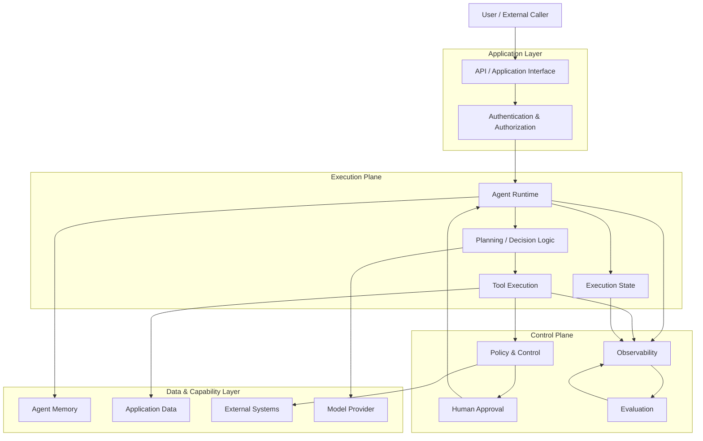
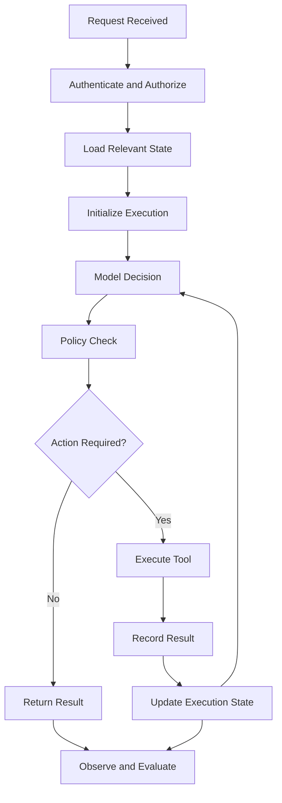
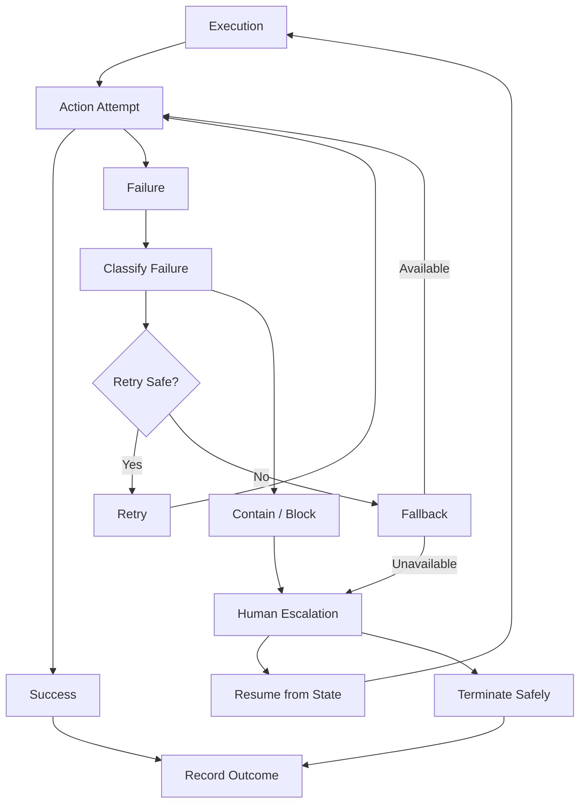
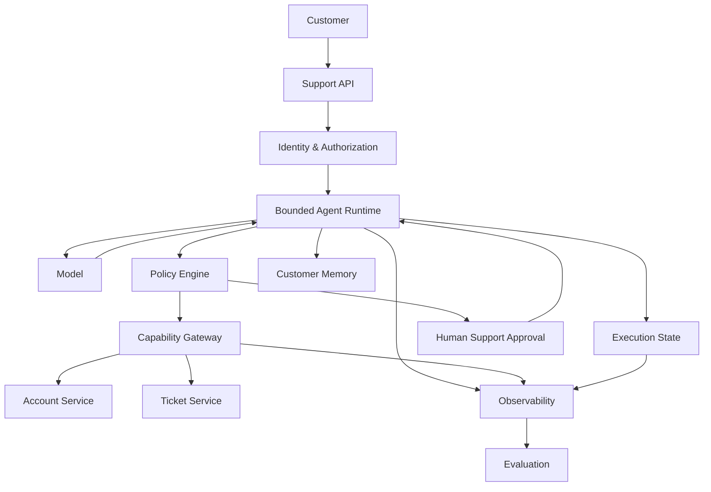

# End-to-End Agent System Design

## Purpose

Selecting an agent architecture is only the first architectural decision.

A production system still needs to compose the selected architecture into a coherent system with clearly defined components, interfaces, state ownership, execution boundaries, safety controls, human control points, evaluation mechanisms, observability, and operational responsibilities.

This chapter teaches how to turn an architectural choice into an **end-to-end agent system design**.

The focus is not on implementing individual agent capabilities. Those capabilities are covered in earlier Agent Engineering chapters. The focus here is **architectural composition**: how capabilities, controls, state, execution, and infrastructure are assembled into a system that can be implemented, evaluated, operated, and evolved.

The central question is:

> **How do we compose an agent architecture into a complete system whose components, interfaces, state, execution, safety, human control, evaluation, and operational behavior work together coherently?**

---

## 1. From Architecture Selection to System Design

File 01 answered:

> **Which architecture should we choose, and why?**

This file answers:

> **How should the selected architecture be composed into a complete system?**

The distinction is important.

Architecture selection determines the structural approach.

System design determines how that approach operates as a system.

For example, selecting a bounded single-agent architecture does not yet define:

- where requests enter the system,
- where authorization occurs,
- where the agent runtime executes,
- how tools are exposed,
- where application state is stored,
- where execution state is persisted,
- where human approval occurs,
- how failures are handled,
- how evaluation evidence is captured,
- or how the system is operated in production.

A useful progression is:

```text
Problem
   ↓
Requirements
   ↓
Architecture Selection
   ↓
Component Responsibilities
   ↓
Interfaces and Boundaries
   ↓
Execution and Control
   ↓
State and Data Ownership
   ↓
Failure and Recovery Paths
   ↓
Safety and Human Control
   ↓
Evaluation and Observability
   ↓
Production and Evolution
```

This is a design sequence, not a rigid one-way lifecycle. Later analysis can force earlier architectural decisions to change.

---

## 2. System Design as Composition

An agent system is rarely a single component.

Even a relatively simple agent may depend on:

- an application interface,
- an agent runtime,
- a model,
- tools,
- application data,
- execution state,
- memory,
- authorization,
- human approval,
- evaluation infrastructure,
- observability,
- and external services.

The architectural challenge is therefore not merely identifying components.

It is deciding:

1. What responsibility belongs to each component?
2. Which component owns each important piece of state?
3. Which interfaces connect the components?
4. Which components may make decisions?
5. Which components may execute actions?
6. Where are control boundaries enforced?
7. What happens when a dependency fails?
8. How can the system be evaluated and operated?
9. How can the architecture evolve without uncontrolled coupling?

A strong architecture makes these answers explicit.

A weak architecture leaves them implicit inside prompts, framework behavior, shared state, or application code.

---

## 3. End-to-End Architecture View

A useful high-level model separates the system into logical responsibility layers.



These are **logical responsibility boundaries, not mandatory deployment boundaries**.

A small system may implement several responsibilities within one process or service.

A larger system may distribute them across multiple services.

The architectural question is:

> **Which boundaries are necessary for the system's requirements, risk profile, and operational needs?**

Not:

> **How many services should we create?**

---

## 4. Component Responsibilities, Interfaces, and Authority Boundaries

Every significant component should have an explicit responsibility and a clear authority boundary.

| Component | Primary responsibility | Authority boundary |
|---|---|---|
| Application API | Request handling and product interaction | Does not own agent reasoning |
| Identity and authorization | Establish caller identity and permissions | Authorizes access and actions |
| Agent runtime | Execute agent behavior and lifecycle | Does not independently grant permissions |
| Model provider | Model inference | Does not own application state or authorization |
| Capability/tool layer | Expose controlled actions | Executes only permitted capabilities |
| Policy layer | Enforce policy and control constraints | Governs whether proposed actions may proceed |
| State store | Persist owned application/execution state | Does not become implicit shared state |
| Memory subsystem | Store information intentionally retained for agent behavior | Does not become business-state authority |
| Approval system | Provide human decisions at defined control points | Does not replace authorization |
| Evaluation system | Assess system behavior | Does not silently alter production execution |
| Observability system | Capture execution evidence | Does not become business-state authority |

These boundaries should be reflected in interfaces.

A useful capability boundary is:

```text
Agent Runtime
      │
      │ ActionRequest
      ▼
Capability Interface
      │
      ├── validate input
      ├── validate authorization
      ├── enforce policy
      ├── execute action
      └── return structured result
```

The agent should not need to know implementation details of the underlying external service.

Likewise, the external service should not need to understand how the agent arrived at its decision.

This creates a useful separation:

```text
Decision
   ↓
Capability Interface
   ↓
Controlled Execution
   ↓
External System
```

The interface becomes an architectural boundary between reasoning and action.

---

## 5. Execution Plane and Control Plane

A particularly useful architectural distinction is between the **execution plane** and the **control plane**.

### 5.1 Execution Plane

The execution plane performs the work required to complete the request.

Typical responsibilities include:

- agent runtime,
- model invocation,
- planning or decision execution,
- tool invocation,
- state transitions,
- workflow execution,
- result generation.

The execution plane answers:

> **What is the system doing right now?**

### 5.2 Control Plane

The control plane governs how execution is allowed to occur.

Typical responsibilities include:

- authorization,
- policy enforcement,
- approval,
- execution limits,
- safety controls,
- evaluation gates,
- operational controls,
- configuration,
- governance.

The control plane answers:

> **Under what conditions is execution allowed, and how is it controlled?**

### 5.3 Why the Separation Matters

Without clear control boundaries, agent execution can become responsible for deciding its own permissions.

Weak:

```text
Agent
  ↓
"I think this action is safe."
  ↓
Execute external action
```

Stronger:

```text
Agent proposes action
        ↓
Policy / authorization boundary
        ↓
Approval if required
        ↓
Controlled execution
        ↓
Evidence recorded
```

The model may participate in deciding **what should be done**.

It should not automatically determine **what it is authorized to do**.

---

## 6. State and Data Ownership

State ownership is one of the most important architectural decisions in an agent system.

A common failure mode is treating all persisted information as "agent memory."

A production architecture should distinguish at least four categories.

| State type | Purpose | Typical owner |
|---|---|---|
| Application state | Business/product data | Application/data layer |
| Execution state | Current workflow or agent execution | Runtime/orchestration layer |
| Agent memory | Information intentionally retained for future agent behavior | Memory subsystem |
| Telemetry | Logs, traces, metrics, and execution evidence | Observability system |

These categories may use the same physical database in a small system.

That does not mean they have the same ownership semantics.

### 6.1 Application State

Application state represents business truth.

Examples include:

- customer account status,
- order status,
- subscription state,
- profile information,
- transaction records.

The agent may read or request changes to application state.

The agent should not silently become the authoritative owner of business state merely because it can access it.

### 6.2 Execution State

Execution state represents the information required to continue or recover an active execution.

Examples include:

- current task,
- execution status,
- pending action,
- retry count,
- checkpoint,
- workflow branch,
- approval status.

This state belongs to the execution architecture.

### 6.3 Agent Memory

Agent memory contains information intentionally retained to influence future behavior.

Examples might include:

- stable user preferences,
- explicitly retained context,
- long-term interaction information.

Memory should have explicit ownership and lifecycle rules.

The architecture should answer:

- who may write it,
- who may read it,
- when it expires,
- how it is corrected,
- how stale information is handled,
- whether it is authoritative.

These are architectural questions even when detailed memory mechanisms are covered elsewhere.

### 6.4 Telemetry

Telemetry records evidence about system behavior.

Examples include:

- execution traces,
- latency,
- tool calls,
- errors,
- state transitions,
- model usage,
- cost measurements.

Telemetry should not become an accidental source of business truth.

### 6.5 State Ownership Rule

A useful design rule is:

> **Every important piece of persistent information should have an explicit owner, lifecycle, and authority model.**

If two components believe they own the same state, the architecture is likely to develop synchronization and correctness problems.

---

## 7. Data Flow and Authority

Data flow should distinguish between **information access** and **authority to change state**.

For example:

```text
Agent
  │
  ├── read customer profile
  │
  ├── propose account change
  │
  ▼
Authorization / Policy
  │
  ▼
Approved Capability
  │
  ▼
Application Service
  │
  ▼
Business State
```

The agent may have access to information without owning the authority to modify it.

This distinction is critical in enterprise systems.

---

## 8. Interoperability Boundaries

Agent systems may interact with external capabilities, services, agents, or protocol-defined interfaces.

At architecture level, the important question is not which interoperability technology is selected.

The question is:

> **Where is the contract between independent capabilities defined, and who owns that contract?**

Relevant boundaries may include:

- agent-to-tool interfaces,
- service-to-service APIs,
- capability protocols,
- agent-to-agent communication,
- external platform integrations.

A useful abstraction is:

```text
Agent / Runtime
       ↓
Interoperability Contract
       ↓
External Capability / Agent / Service
```

The contract should make important assumptions explicit, including:

- capability exposed,
- input and output expectations,
- authorization requirements,
- failure behavior,
- ownership,
- compatibility expectations.

AGT-08 covers the detailed interoperability concepts and protocols. AGT-12 focuses on where those boundaries belong in the overall architecture.

---

## 9. Normal Execution Path

Every end-to-end design should describe the normal execution path.

A generic bounded agent flow might be:



The important architectural property is not the exact sequence.

It is that the system has explicit boundaries for:

- authorization,
- execution,
- policy,
- action,
- state,
- termination,
- and evidence.

---

## 10. Failure Paths Are Part of the Architecture

An architecture is incomplete if it only describes the happy path.

Agent systems interact with probabilistic models, external tools, distributed infrastructure, mutable state, and potentially unreliable dependencies.

Failure behavior therefore needs to be designed rather than improvised.

A complete design should consider:

- model failure,
- tool failure,
- timeout,
- malformed response,
- invalid action,
- authorization failure,
- policy rejection,
- approval rejection,
- approval timeout,
- state persistence failure,
- duplicate execution,
- partial completion,
- dependency outage,
- unsafe behavior,
- execution limit reached,
- unrecoverable state,
- termination.

A useful mental model is:

```text
Normal Path
     │
     ├── Failure
     │     ├── Retry
     │     ├── Fallback
     │     ├── Compensation
     │     └── Escalation
     │
     ├── Timeout
     │     ├── Resume
     │     └── Terminate
     │
     ├── Unsafe Action
     │     ├── Block
     │     ├── Escalate
     │     └── Contain
     │
     └── Partial Completion
           ├── Record completed work
           ├── Determine remaining work
           └── Resume or terminate
```

The correct response depends on the action and its consequences.

There is no universal retry or recovery strategy.

---

## 11. Failure-Path Architecture

A failure-aware architecture can be represented as:



This is conceptual.

The implementation depends on the system's failure model, action semantics, and business consequences.

---

## 12. Retry and Partial Completion

### 12.1 Retry Is an Architectural Decision

Retry should not be treated as a generic reliability feature.

Before retrying, the architecture should establish:

- whether the operation is idempotent,
- whether the failure is transient,
- whether retry could duplicate side effects,
- whether the action is still authorized,
- whether underlying state has changed,
- how many retries are allowed,
- what happens after retry exhaustion.

For example:

```text
Read operation
    → retry may be relatively safe

Create payment
    → retry requires stronger idempotency guarantees

Send external message
    → retry may duplicate communication

Delete production resource
    → automatic retry may be inappropriate
```

The architecture should encode these distinctions.

### 12.2 Partial Completion

Agent executions may complete some actions and fail later.

For example:

```text
1. Create support ticket       ✓
2. Update customer record     ✓
3. Send notification           ✗
```

The system must not assume that the entire operation either happened or did not happen.

The architecture should determine:

- which actions completed,
- which actions failed,
- which actions can safely be retried,
- which actions require compensation,
- whether human intervention is required,
- how execution state records the partial outcome.

This is particularly important for long-running and multi-step systems.

---

## 13. Human Control as an Architectural Boundary

Human-in-the-loop is not simply a UI feature.

It is an architectural control point.

The system should decide **where human control belongs** based on risk and reversibility.

Examples:

```text
Low-risk information retrieval
    → no approval

Low-risk reversible action
    → optional review

High-risk reversible action
    → explicit approval

High-risk irreversible action
    → mandatory approval or stronger control
```

The exact approval mechanics belong to AGT-07.

AGT-12 focuses on **where human control is placed within the overall architecture and how it interacts with execution**.

### 13.1 Designing an Approval Boundary

An approval boundary should make the following explicit:

1. What action requires approval?
2. Who is authorized to approve it?
3. What information does the reviewer receive?
4. What happens if the reviewer rejects it?
5. What happens if the approval expires?
6. What happens if the underlying state changes before approval?
7. Can execution resume safely?
8. Is the action reversible?

A conceptual flow is:

```text
Agent proposes action
        ↓
Action validation
        ↓
Risk / policy assessment
        ↓
Approval required?
      /   \
    No     Yes
    │       │
 Execute   Human Review
            │
        ┌───┴───┐
      Approve  Reject
        │        │
     Execute   Terminate / Revise
```

Approval should occur before the consequential action when prevention is required.

### 13.2 State Changes During Approval

Long approval delays introduce another architectural problem.

During the approval period:

- account state may change,
- permissions may change,
- the requested action may become invalid,
- the underlying resource may disappear,
- the risk classification may change.

Therefore:

> **Approval should authorize a well-defined action against appropriately validated state, not merely authorize an old textual intention.**

The architecture may need to revalidate:

```text
Original Proposal
      ↓
Human Approval
      ↓
State Revalidation
      ↓
Authorization Revalidation
      ↓
Action Execution
```

---

## 14. Safety as Architecture

Safety should not be added as a final component around an otherwise unconstrained agent.

Safety controls need to be placed at the relevant architectural boundaries.

Important boundaries may include:

- input boundaries,
- identity boundaries,
- tool boundaries,
- data-access boundaries,
- action boundaries,
- approval boundaries,
- execution boundaries,
- termination boundaries.

A useful principle is:

> **Do not rely on the agent to enforce controls that the architecture can enforce independently.**

For example:

```text
Weak:

User → Agent → Tool → External System

Stronger:

User
 ↓
Authorization
 ↓
Agent
 ↓
Policy / Capability Boundary
 ↓
Tool
 ↓
External System
```

The model remains part of the decision process, but critical controls do not depend exclusively on model behavior.

### 14.1 Untrusted Input

Agent systems frequently process information that should not automatically be treated as instructions.

Examples include:

- user-provided content,
- retrieved documents,
- emails,
- web pages,
- tool results,
- external API responses,
- files.

The architecture should distinguish:

```text
Instruction / Control Data
        ≠
Untrusted Content
        ≠
Business Data
        ≠
Tool Output
```

The architectural responsibility is to ensure that untrusted information does not silently bypass higher-level control boundaries.

### 14.2 Capability and Containment Boundaries

A useful architecture treats tools and external capabilities as bounded interfaces:

```text
Agent
  ↓
Declared Capability
  ↓
Validation
  ↓
Authorization
  ↓
Controlled Execution
```

The system should also have a defined answer to:

> **What stops execution when behavior becomes unsafe, invalid, excessive, or no longer useful?**

Possible controls include:

- execution time limits,
- step limits,
- budget limits,
- tool invocation limits,
- policy rejection,
- circuit breakers,
- cancellation,
- human escalation,
- state-based termination.

Termination is an architectural safety boundary.

---

## 15. Evaluation as Architecture

Evaluation should be integrated into the system rather than treated as a separate activity performed only after deployment.

AGT-10 defines the detailed evaluation concepts and methodology.

AGT-12 determines how evaluation fits into the architecture.

The architecture should answer:

- What behavior is being evaluated?
- Where is execution evidence captured?
- What traces are available?
- What data is required for evaluation?
- How are failures connected to evaluations?
- How do evaluation results reach engineering teams?
- Which evaluations become regression tests?
- Which evaluation results affect release decisions?

A useful flow is:

```text
Production / Test Execution
        ↓
Execution Evidence
        ↓
Trace / Evaluation Data
        ↓
Evaluation
        ↓
Failure / Quality Signal
        ↓
Engineering Feedback
        ↓
Change
        ↓
Regression Evaluation
        ↓
Release Decision
```

This creates a feedback loop between system behavior and system evolution.

### 15.1 Evaluation Evidence

Depending on the system, evaluation may require access to:

- inputs,
- outputs,
- tool calls,
- tool results,
- execution steps,
- state transitions,
- latency,
- errors,
- human decisions,
- policy decisions,
- final outcomes.

The architecture should capture sufficient evidence while respecting:

- privacy requirements,
- data retention policies,
- access controls,
- security requirements,
- cost constraints.

The objective is not to capture everything indiscriminately.

It is to capture the evidence required to understand and evaluate system behavior.

---

## 16. Observability as an Architectural Capability

Observability should be designed into the system.

A production agent system may need visibility into:

```text
Request
  ↓
Execution
  ↓
Model Calls
  ↓
Decision / Plan
  ↓
Tool Invocations
  ↓
State Transitions
  ↓
External Effects
  ↓
Final Outcome
```

Useful evidence can include:

- logs,
- metrics,
- traces,
- execution history,
- tool invocation records,
- state transitions,
- model latency,
- token usage,
- cost,
- errors,
- retries,
- approval events.

The goal is to make important execution behavior explainable to operators and engineers.

This chapter does not define an observability implementation tutorial.

It defines observability as an architectural requirement.

### 16.1 Observability and State Are Different

Telemetry should describe what happened.

State should represent what the system owns or believes.

For example:

```text
Execution State
    status = "awaiting_approval"

Telemetry
    event = "approval_requested"
    timestamp = ...
    execution_id = ...
```

The telemetry event provides evidence.

The execution state determines how execution continues.

Confusing these roles can create difficult recovery and debugging problems.

---

## 17. Production Architecture Considerations

Production architecture should account for system-level constraints without turning this chapter into a detailed operations tutorial.

### Reliability

Consider:

- dependency failures,
- availability requirements,
- recovery behavior,
- execution durability,
- failure containment.

### Latency

Consider:

- sequential model calls,
- tool latency,
- external dependencies,
- human approval delays,
- synchronous versus asynchronous execution.

### Cost

Consider:

- model usage,
- repeated model calls,
- tool execution,
- storage,
- telemetry,
- infrastructure,
- human operational cost.

### Scalability

Consider:

- request concurrency,
- execution concurrency,
- state throughput,
- model rate limits,
- external service limits,
- human approval capacity,
- telemetry volume.

### Security

Consider:

- identity,
- authorization,
- credential isolation,
- sensitive-data access,
- capability permissions,
- auditability.

### Dependency Management

Consider:

- availability,
- latency,
- rate limits,
- versioning,
- authentication,
- fallback behavior,
- ownership.

These dimensions interact.

For example:

- more model calls may improve quality but increase latency and cost;
- more agents may improve specialization but increase coordination failures;
- more state may improve continuity but increase consistency and privacy risks;
- more safety gates may reduce risk but increase latency and operational complexity.

The objective is therefore not to optimize one dimension independently.

It is to choose a system composition that satisfies the relevant requirements and risk boundaries.

---

## 18. Long-Running and Human-Paused Execution

Some agent tasks may continue for minutes, hours, or days.

Examples include:

- research workflows,
- document processing,
- approval-driven business processes,
- long-running investigations,
- asynchronous integrations.

A long-running architecture should consider:

- durable execution state,
- checkpointing,
- resumption,
- timeouts,
- external callbacks,
- approval waits,
- retries,
- duplicate execution,
- cancellation,
- version compatibility.

The key principle is:

> **Long-running execution must not depend on keeping one process or one in-memory agent session alive indefinitely.**

A human approval may therefore produce a flow such as:

```text
Execution
   ↓
Approval Required
   ↓
Persist Execution State
   ↓
Pause
   ↓
Human Decision
   ↓
Revalidate State
   ↓
Resume Execution
```

This is fundamentally different from:

```text
Keep process alive
   ↓
Wait indefinitely
   ↓
Continue
```

The latter creates unnecessary operational coupling.

---

## 19. Architecture Evolution and Compatibility

Agent systems evolve quickly.

Models change.

Tools change.

Business requirements change.

Policies change.

Evaluation criteria change.

Architecture should therefore make important change boundaries explicit.

Examples:

```text
Model Provider
      │
      │ Stable interface
      ▼
Agent Runtime
```

```text
Tool Implementation
      │
      │ Stable capability contract
      ▼
Agent
```

```text
Evaluation Method
      │
      │ Stable evidence interface
      ▼
Execution System
```

The goal is not to eliminate change.

The goal is to prevent every change from propagating through the entire system.

### 19.1 Versioning and Compatibility

An evolving agent architecture may require versioning for:

- tool contracts,
- APIs,
- state schemas,
- prompts,
- model configurations,
- execution definitions,
- evaluation datasets,
- policies.

State is particularly important.

If an execution started under architecture version `v1` and resumes under `v2`, the system must know whether persisted state remains compatible.

This creates an architectural question:

> **Can an in-flight execution safely survive a deployment or configuration change?**

If not, the system needs an explicit migration, draining, or termination strategy.

---

## 20. End-to-End Design Example: Enterprise Customer Support

Consider a support system that can:

- answer questions,
- retrieve account information,
- update selected account fields,
- create support tickets,
- escalate complex cases.

The architecture might be:



The architecture separates:

- application entry,
- authorization,
- agent execution,
- model reasoning,
- policy,
- capabilities,
- application services,
- execution state,
- memory,
- human control,
- observability,
- evaluation.

The model does not directly own account or ticket data.

The agent does not directly bypass authorization.

High-risk actions can be routed through approval.

Execution evidence can be evaluated later.

The important design question is not whether every box must become a separate service.

It is whether each responsibility and authority boundary is explicit.

---

## 21. End-to-End Design Example: Research Assistant

Consider a research assistant that:

- accepts a research question,
- searches approved sources,
- retrieves information,
- synthesizes findings,
- cites evidence,
- produces a report.

A bounded agent or hybrid workflow may be sufficient.

The end-to-end composition might be:

```text
Research Request
       ↓
Request Validation
       ↓
Research Workflow
       ↓
Search / Retrieval
       ↓
Evidence Collection
       ↓
Agent Synthesis
       ↓
Citation Validation
       ↓
Output Evaluation
       ↓
Report
```

The architecture demonstrates that not every step needs to be agentic.

Deterministic workflow steps can safely handle retrieval, validation, formatting, and persistence when those requirements do not require autonomous decision-making.

The architectural lesson is:

> **The end-to-end design should reflect the problem's requirements, not the perceived sophistication of the product.**

---

## 22. Architectural Invariants

An architectural invariant is a property that should remain true regardless of implementation technology or framework choice.

Important agent-system invariants include:

### Authorization is not model reasoning

The model may propose an action.

Authorization determines whether the action is permitted.

### Business state has an authoritative owner

Agent memory or execution state must not silently become the source of truth for business data.

### Consequential actions cross explicit capability boundaries

The agent should not gain arbitrary system access merely because a capability exists somewhere in the infrastructure.

### Failure recovery preserves action semantics

A recovery strategy must not turn a transient failure into duplicate or unauthorized side effects.

### Human approval does not bypass authorization

Approval is a control point, not a replacement for identity or authorization.

### Execution can terminate safely

The architecture must have bounded and controllable termination behavior.

### Important behavior is observable

The system must capture enough evidence to understand and evaluate important execution behavior.

### Evaluation has access to sufficient evidence

An evaluation system cannot reliably assess behavior that the architecture does not record.

### Untrusted information cannot silently become privileged control input

Retrieved or externally supplied content must not automatically gain the authority of system instructions or policy.

### Logical boundaries do not require unnecessary physical boundaries

Responsibility separation should not automatically produce unnecessary services or infrastructure.

These invariants provide a useful test:

> **If replacing a framework, model provider, or deployment topology would violate one of these properties, the architecture contains an important hidden dependency.**

---

## 23. End-to-End Design Method

A practical design process is:

```text
1. Confirm Requirements
          ↓
2. Confirm Selected Architecture
          ↓
3. Identify Responsibilities
          ↓
4. Define Components and Boundaries
          ↓
5. Define Interfaces
          ↓
6. Define Execution Flow
          ↓
7. Define State Ownership
          ↓
8. Define Failure Paths
          ↓
9. Place Human Control
          ↓
10. Place Safety Boundaries
          ↓
11. Integrate Evaluation
          ↓
12. Design Observability
          ↓
13. Review Production Constraints
          ↓
14. Validate Architecture
          ↓
15. Record Important Decisions
```

This sequence is a practical starting point, not a one-way lifecycle.

Architecture design is iterative.

For example:

```text
Initial Design
      ↓
Failure Analysis
      ↓
Safety Analysis
      ↓
Operational Analysis
      ↓
Architecture Review
      ↓
Refinement
      ↺
```

A failure analysis may reveal a missing state boundary.

A safety analysis may require a stronger tool boundary.

A latency analysis may require asynchronous execution.

A human approval requirement may require durable execution state.

An evaluation requirement may require additional execution evidence.

Therefore:

> **A complete architecture emerges through repeated constraint, failure, safety, and operational analysis—not from drawing the first architecture diagram.**

---

## 24. Architecture Checklist

Before implementation, verify:

### Requirements

- [ ] Functional requirements are explicit.
- [ ] Important non-functional requirements are explicit.
- [ ] Hard constraints are identified.
- [ ] Risk-sensitive requirements are identified.

### Architecture

- [ ] The selected architecture is justified.
- [ ] The system is no more complex than necessary.
- [ ] Major responsibilities are explicit.
- [ ] Important alternatives and rejected options are documented where appropriate.

### Boundaries and Interfaces

- [ ] Component responsibilities are explicit.
- [ ] Authority boundaries are explicit.
- [ ] Capability interfaces are defined.
- [ ] Interoperability contracts are identified where relevant.
- [ ] Failure behavior is defined at important boundaries.
- [ ] Hidden coupling is minimized.

### Execution

- [ ] Normal execution is understood.
- [ ] Continuation conditions are explicit.
- [ ] Termination conditions are explicit.
- [ ] Long-running execution is handled appropriately.

### State

- [ ] Application state has an owner.
- [ ] Execution state has an owner.
- [ ] Agent memory has an owner.
- [ ] Telemetry has an owner.
- [ ] State authority is unambiguous.

### Failure

- [ ] Model failures are considered.
- [ ] Tool failures are considered.
- [ ] Timeouts are considered.
- [ ] Retry safety is considered.
- [ ] Partial completion is handled.
- [ ] Recovery and termination are defined.

### Human Control

- [ ] Approval boundaries are explicit.
- [ ] Reviewer context is sufficient.
- [ ] Rejection behavior is defined.
- [ ] Approval timeout behavior is defined.
- [ ] State is revalidated before consequential execution where necessary.

### Safety

- [ ] Authorization boundaries are explicit.
- [ ] Tool capabilities are constrained.
- [ ] Untrusted input is handled as untrusted.
- [ ] High-risk actions have appropriate controls.
- [ ] Containment and termination mechanisms exist.

### Evaluation

- [ ] Required execution evidence is captured.
- [ ] Evaluation data can be produced.
- [ ] Important behaviors can be evaluated.
- [ ] Evaluation results can feed engineering changes.
- [ ] Regression testing is connected to system evolution.

### Operations

- [ ] Observability is sufficient.
- [ ] Scaling bottlenecks are identified.
- [ ] Latency drivers are understood.
- [ ] Cost drivers are understood.
- [ ] Dependency failures are considered.
- [ ] Operational ownership is clear.

### Evolution

- [ ] Important interfaces are stable or versioned.
- [ ] State compatibility is considered.
- [ ] In-flight executions can be handled across changes.
- [ ] Architecture can evolve without uncontrolled coupling.

---

## 25. Connection to File 03

File 02 establishes the complete architecture.

The next question is whether that architecture is actually defensible.

File 03 therefore focuses on:

> **How do we review and validate an agent architecture before implementation or production?**

The relationship is:

```text
File 01
Architecture Selection
        │
        │ Which architecture?
        ▼
File 02
End-to-End System Design
        │
        │ How is it composed?
        ▼
File 03
Architecture Review and Validation
        │
        │ Is the design defensible?
        ▼
Implementation / Production
```

File 03 should challenge the assumptions, boundaries, risks, evidence, and operational fitness of the design produced here.

---

## 26. Scope Boundaries

This file intentionally does not provide detailed instruction on:

- agent foundations,
- runtime loop mechanics,
- tool implementation,
- state and memory mechanisms,
- planning algorithms,
- workflow orchestration mechanics,
- human-in-the-loop implementation,
- interoperability protocols,
- multi-agent coordination,
- evaluation methodology,
- safety and reliability techniques.

Those responsibilities belong to earlier Agent Engineering chapters.

AGT-12 uses those concepts as architectural building blocks.

The focus here is **composition and system-level reasoning**.

---

## 27. Key Principles

1. **Architecture selection and system design are different activities.**
2. **Components should have explicit responsibilities and authority boundaries.**
3. **Interfaces should make important boundaries visible.**
4. **Execution and control should be reasoned about separately.**
5. **State ownership must be explicit.**
6. **Application state, execution state, memory, and telemetry are not interchangeable.**
7. **Failure paths are part of the architecture.**
8. **Retry behavior depends on action semantics and side effects.**
9. **Partial completion must be represented explicitly.**
10. **Human control is an architectural boundary, not merely a UI feature.**
11. **Safety controls should be enforced at meaningful system boundaries.**
12. **The model should not be the sole authority for permissions or safety.**
13. **Evaluation requires architectural access to execution evidence.**
14. **Observability must be designed into the system.**
15. **Logical separation does not require unnecessary physical distribution.**
16. **Production architecture must account for latency, cost, reliability, security, and operations.**
17. **Stable interfaces enable independent evolution.**
18. **Architectural invariants should remain true across implementation changes.**
19. **Architecture design is iterative and should be refined through failure, safety, and operational analysis.**
20. **Architecture quality is demonstrated through reasoning and evidence, not diagram complexity.**

---

## 28. Summary

An end-to-end agent system is more than an agent runtime connected to a model and a collection of tools.

A production-oriented architecture must compose:

```text
Requirements
     ↓
Architecture
     ↓
Responsibilities
     ↓
Interfaces and Authority
     ↓
Execution
     ↓
State
     ↓
Safety
     ↓
Human Control
     ↓
Failure Handling
     ↓
Evaluation
     ↓
Observability
     ↓
Operations
     ↓
Evolution
```

The central engineering responsibility is to make these relationships explicit.

A strong system design answers:

- What does each component own?
- How do components interact?
- Where does execution occur?
- Where is control enforced?
- Who owns each state?
- What happens when something fails?
- Where can a human intervene?
- Where are safety boundaries enforced?
- What evidence is available for evaluation?
- How is the system observed?
- How does it scale?
- How does it evolve?

The objective is not to produce the most elaborate architecture.

It is to produce an architecture in which **responsibilities, authority boundaries, failure behavior, control mechanisms, and operational concerns are explicit enough to implement, evaluate, operate, and evolve safely**.
