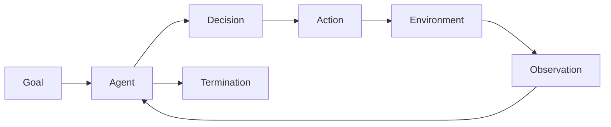
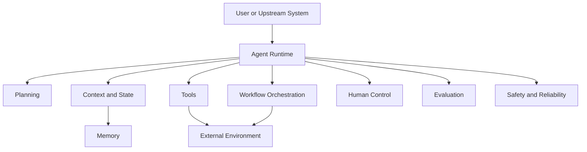
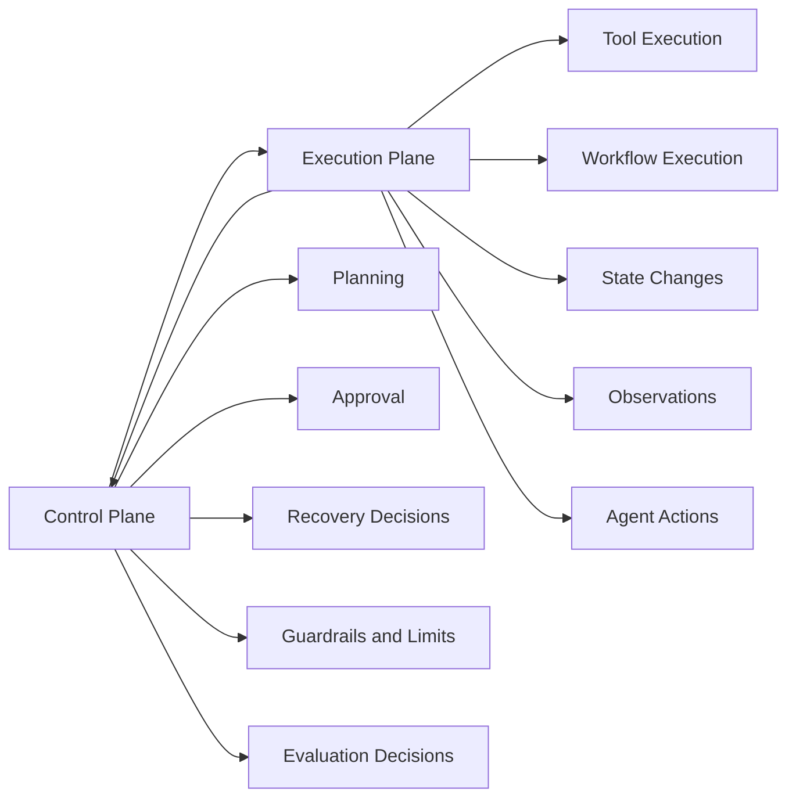
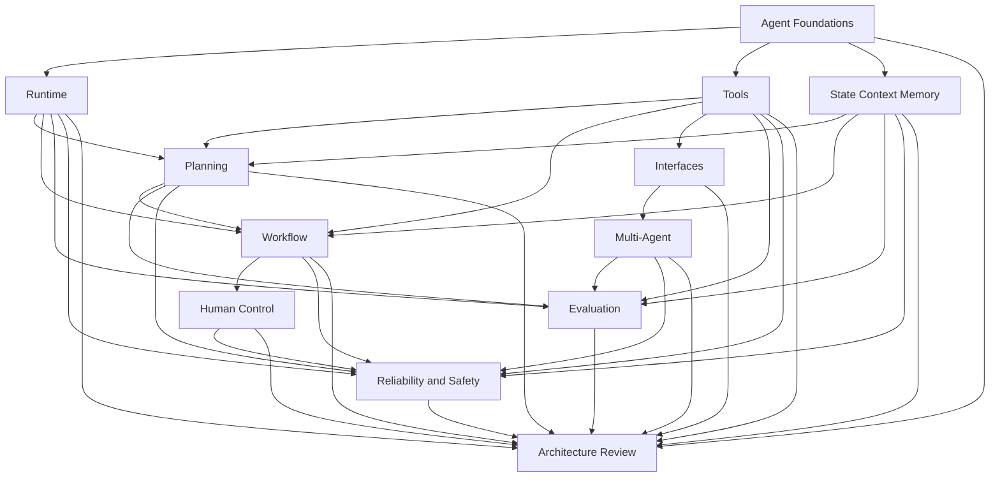

# AGT — Agent Engineering

## Domain Overview

Agent Engineering (AGT) develops the engineering foundations required to **design, implement, evaluate, control, and review agentic AI systems**.

The domain focuses on systems in which an AI model can:

- interpret a goal,
- reason about the next step,
- select or invoke tools,
- observe results,
- maintain execution state,
- plan and re-plan,
- interact with humans,
- coordinate with other agents,
- recover from failures,
- and operate within explicit control and safety boundaries.

AGT treats an agent as an engineered system rather than simply an LLM with tools.

The central engineering question is:

> **How do we build an agent that can reliably pursue a goal while remaining observable, controllable, evaluable, recoverable, and safe?**

---

## Why Agent Engineering Exists

A conventional LLM application generally follows a bounded interaction pattern:

```text
Input → Model → Output
```

A retrieval-augmented application may extend this:

```text
Input → Retrieval → Model → Output
```

An agentic system introduces dynamic execution:

```text
Goal
  ↓
Decision
  ↓
Action
  ↓
Observation
  ↓
Decision
  ↓
Action
  ↓
...
  ↓
Termination
```

The system may therefore need to answer questions such as:

- What should happen next?
- Which tool should be used?
- Should the current plan continue?
- Has the objective been achieved?
- Should the system re-plan?
- Should execution stop?
- Does a human need to approve an action?
- What state must survive between steps?
- What context should be assembled for the current step?
- What information should be retained as memory?
- What happens if a tool fails?
- What happens if execution is interrupted?
- How should the system recover?
- How can the behavior be evaluated systematically?
- How can the evaluation itself be trusted?

These are engineering problems.

AGT provides the conceptual and architectural foundation for solving them.

---

# Domain Scope

AGT covers:

1. Agent definitions and system boundaries
2. Agent runtime and execution loops
3. Tool contracts and tool execution
4. Agent state, context, and memory
5. Planning and adaptive execution
6. Workflow orchestration and durable execution
7. Human control and approval
8. Agent interfaces and interoperability
9. Multi-agent architectures
10. Agent evaluation and behavioral testing
11. Agent reliability and safety
12. Agent architecture and design review

The domain progresses from individual execution mechanics toward complete agent-system architecture.

---

## Domain Non-Goals

AGT does not attempt to own every concept that appears in an agentic system.

The following remain primarily owned by other domains:

| Area | Primary Domain |
|---|---|
| General software engineering | ENG |
| AI/ML foundations | AIF |
| Model behavior and model-facing prompting | LLM |
| Retrieval systems | RET |
| Deployment and infrastructure | PROD |
| Enterprise security, authorization, governance, and compliance | ENT |

AGT integrates with these domains rather than replacing them.

For example:

- AGT may decide that an agent needs retrieval.
- RET owns how retrieval itself is engineered.
- AGT may invoke an external API.
- ENT owns enterprise authorization and governance.
- AGT may execute a service.
- PROD owns deployment and infrastructure.
- AGT may construct execution context for a model step.
- LLM owns model behavior and model-facing prompting concerns.

---

## Agent–Environment Mental Model

An agent exists inside an environment and continuously interacts with that environment.



The environment may contain:

- APIs
- databases
- applications
- files
- external services
- users
- other agents
- retrieval systems
- enterprise systems

The agent therefore operates as an execution system between a goal and an environment.

---

# Agent System Composition

An agent is not one component.

A production agent system may contain:



AGT-01 establishes the identity and responsibility of these major components.

Detailed implementation mechanics belong to their respective chapters.

---

# Core AGT Mental Models

Several mental models are used throughout the domain.

## 1. Agent as a Controlled Execution Loop

The agent repeatedly performs:

```text
Decision
→ Action
→ Observation
→ Decision
```

until a termination condition is satisfied.

AGT-02 owns this runtime execution model.

---

## 2. Agent as a Goal-Directed Planner

Some tasks require the agent to construct and execute a plan:

```text
Goal
 ↓
Decomposition
 ↓
Plan
 ↓
Execution
 ↓
Verification
 ↓
Adaptation
```

AGT-05 owns planning and adaptive execution.

---

## 3. Agent as a Stateful System

Agent execution may span multiple steps.

The system therefore needs to distinguish:

- current execution state,
- execution context,
- memory,
- durable workflow state,
- and externally persisted information.

AGT-04 owns agent state, context, and memory.

AGT-06 additionally owns durable workflow state, checkpoints, and workflow state-transition semantics.

---

## 4. Agent as an Orchestrated Workflow

Some agent systems require:

- branching,
- looping,
- parallel execution,
- checkpoints,
- retries,
- asynchronous execution,
- long-running workflows,
- and compensation.

AGT-06 owns workflow orchestration and durable execution semantics.

---

## 5. Agent as a Controlled Authority

An agent may be capable of performing actions, but capability does not automatically imply authority.

Human approval and intervention may therefore be required for sensitive operations.

AGT-07 owns human control and approval.

Enterprise authorization and security remain owned by ENT.

---

# Context, State, and Memory

These concepts must not be treated as interchangeable.

> **State ≠ Context ≠ Memory**

## Context

Context is the information assembled and made available to the agent for a particular reasoning or execution step.

Examples include:

- current task information,
- retrieved information,
- tool results,
- prior execution outputs,
- instructions,
- relevant state,
- selected memory.

AGT-04 owns the **agent execution-context management problem**, including how context is assembled, selected, prioritized, maintained, and changed across an agent execution lifecycle.

LLM owns model-facing behavior and prompting mechanics.

RET owns retrieval and retrieval-system behavior.

---

## State

State represents the current condition of an execution, session, or workflow.

Examples include:

- current step,
- execution status,
- pending actions,
- workflow position,
- accumulated results,
- checkpoints,
- execution metadata.

AGT-04 owns agent execution state and its lifecycle.

AGT-06 additionally owns durable workflow state, checkpoints, and state-transition semantics required for durable workflow execution.

---

## Memory

Memory represents information intentionally retained beyond the immediate execution context for future use.

Examples include:

- user preferences,
- historical interactions,
- learned facts,
- persistent agent information.

AGT-04 owns:

- memory architecture,
- memory retention,
- memory recall,
- memory updates,
- staleness handling,
- conflict handling,
- memory correctness.

---

## Context Engineering Boundary

AGT-04 owns the engineering of **agent execution context, state, and memory across their respective lifecycles**.

The context-engineering responsibility includes:

- context assembly,
- context selection,
- context prioritization,
- context lifecycle,
- context growth,
- context budgets,
- compaction and truncation,
- freshness,
- stale context handling,
- conflicting context,
- context contamination,
- interaction between context and execution state,
- interaction between context and memory.

The central problem is:

> **What information should be available to the agent for this execution step, in what form, with what priority, for how long, and under what lifecycle rules?**

This is an **agent execution-context management problem**.

It does not transfer ownership of retrieval systems from RET.

RET owns:

- retrieval architecture,
- indexing,
- retrieval,
- relevance,
- ranking,
- retrieval freshness,
- retrieval conflict handling,
- retrieval diagnostics,
- retrieval evaluation,
- retrieval-system behavior.

AGT may consume retrieval results and decide how they participate in agent execution context.

RET remains responsible for the retrieval system that produced those results.

LLM owns:

- model-facing prompting,
- model behavior,
- instruction hierarchy,
- model-specific generation behavior,
- model-specific context behavior.

AGT should therefore not become a second LLM prompting chapter or a second RET retrieval chapter.

---

## Runtime vs Planning

Runtime and planning are related but distinct.

## Runtime

Runtime answers:

> **What should the agent do now?**

AGT-02 owns:

- execution loops,
- decision/action/observation cycles,
- continuation,
- termination,
- cancellation,
- execution budgets,
- bounded autonomy.

## Planning

Planning answers:

> **What sequence of actions should achieve the goal?**

AGT-05 owns:

- decomposition,
- plan construction,
- plan execution,
- replanning,
- adaptation,
- verification,
- critique,
- plan quality.

A planner can operate inside an agent runtime.

The runtime does not therefore become the planner.

The distinction is:

```text
Runtime
"What happens next?"
        ↓
Execution step
        ↓
Observation
        ↓
Continuation or termination
```

versus:

```text
Planning
"What sequence of actions should achieve the goal?"
        ↓
Plan
        ↓
Execution
        ↓
Verification
        ↓
Replanning or completion
```

---

# Tool Execution

Tools provide the agent with capabilities beyond model generation.

AGT-03 owns:

- tool contracts,
- schemas,
- tool selection,
- routing,
- invocation,
- execution,
- side effects,
- idempotency,
- invocation boundaries,
- tool failures.

The conceptual flow is:

```text
Agent Decision
      ↓
Tool Selection
      ↓
Tool Contract
      ↓
Invocation
      ↓
Execution
      ↓
Observation
      ↓
Agent Runtime
```

Enterprise authorization remains outside AGT-03 and is owned by ENT.

Tool capability therefore does not automatically imply permission to perform the corresponding enterprise action.

---

# Human Control

Autonomous capability should not be confused with unrestricted authority.

AGT-07 owns:

- human-delegated decision authority,
- human approval policies,
- intervention,
- escalation,
- override,
- high-risk action approval.

A production system may therefore use:

```text
Agent proposes action
        ↓
Risk evaluation
        ↓
Human approval required?
     ↙          ↘
   Yes           No
    ↓             ↓
Human approval   Execute
    ↓
Execute
```

Human control is a system-design mechanism rather than merely a user-interface feature.

AGT-07 owns the agent-level human-control mechanism.

ENT remains responsible for enterprise authorization, identity, governance, and compliance requirements surrounding the action.

---

# Interoperability

Modern agent systems may interact with external capabilities and independent agents.

AGT-08 covers:

- capability interfaces,
- interoperability,
- MCP,
- tool interoperability,
- agent-to-agent interoperability,
- A2A.

The durable concepts are more important than any single protocol:

- capability discovery,
- interface contracts,
- structured communication,
- capability boundaries,
- interoperability,
- identity boundaries,
- authorization boundaries,
- context exchange,
- protocol selection,
- protocol versioning,
- protocol evolution.

Protocols are taught as current implementations of these broader interoperability requirements.

---

## MCP

MCP primarily addresses interaction between an AI application or agent and external capabilities such as tools, resources, and prompts.

Conceptually:

```text
Agent / Application
        ↓
       MCP
        ↓
External Capability
```

MCP is therefore not fundamentally an agent-to-agent protocol.

AGT-08 owns the interoperability concepts and MCP as a concrete protocol example.

---

## A2A

A2A addresses interoperability and communication between independent agent systems.

```text
Agent A
   ↓
  A2A
   ↓
Agent B
```

A2A does not imply that a system must use multiple agents.

A system may use A2A to communicate with another independently operated agent system without adopting a multi-agent architecture internally.

AGT-08 owns the interoperability boundary.

AGT-09 owns the architectural question of whether and how multiple agents are used.

---

# Single-Agent and Multi-Agent Systems

Not every problem requires multiple agents.

A useful engineering principle is:

> **Use the least-autonomous architecture that adequately solves the problem.**

This means a system should not introduce:

- additional agents,
- additional planning,
- additional orchestration,
- or additional autonomy

unless the problem requires them.

AGT-09 owns multi-agent architecture.

The progression is not a maturity ladder:

```text
Simple deterministic workflow
        ↓
LLM application
        ↓
Single agent
        ↓
Multi-agent system
```

These are architectural choices with different capabilities, costs, failure modes, and control requirements.

Increasing autonomy and coordination should therefore be justified by engineering requirements rather than novelty.

---

# Multi-Agent Coordination

Multi-agent systems introduce additional concerns:

- delegation,
- supervision,
- communication,
- coordination,
- shared or distributed state,
- coordination failures,
- conflict resolution,
- termination,
- failure propagation,
- communication cost.

AGT-09 owns these multi-agent architectural concerns.

Generic reliability and recovery strategy remain cross-cutting concerns owned by AGT-11.

---

## Evaluation

Agents require behavioral evaluation because correct final output alone may not adequately represent system quality.

AGT-10 owns systematic evaluation of:

- task success,
- behavioral outcomes,
- trajectories,
- tool usage,
- planning,
- state behavior,
- evaluation-set construction,
- metrics,
- regression testing.

Evaluation applies to capabilities introduced earlier in the domain.

AGT-10 is positioned later primarily for **pedagogical consolidation**, not because earlier AGT capabilities are unevaluable.

For example:

- AGT-02 runtime behavior can be evaluated.
- AGT-03 tool behavior can be evaluated.
- AGT-04 memory behavior can be evaluated.
- AGT-05 planning behavior can be evaluated.
- AGT-09 multi-agent coordination can be evaluated.

AGT-10 provides the systematic evaluation framework for these behaviors.

---

## Agent Quality vs Evaluation Quality

Agent evaluation has two distinct engineering questions.

## Agent Quality

Agent quality asks whether the agent itself behaves well.

This includes questions such as:

- Did the agent achieve the task?
- Did it follow constraints?
- Did it choose appropriate tools?
- Did it produce valid actions?
- Did it plan effectively?
- Did it recover appropriately?
- Did it terminate correctly?
- Did it remain within safety boundaries?

## Evaluation Quality

Evaluation quality asks whether the process used to measure agent behavior can be trusted.

This includes:

- evaluator reliability,
- evaluation validity,
- rubric validity,
- grader consistency,
- judge calibration,
- evaluator disagreement,
- evaluator bias,
- evaluator drift,
- false positives,
- false negatives,
- contamination,
- leakage.

The key distinction is:

> **Agent quality asks whether the agent behaves well; evaluation quality asks whether the measurement of that behavior can be trusted.**

A strong agent evaluation system therefore requires both:

```text
Agent Behavior
      ↓
Evaluation Method
      ↓
Measurement
      ↓
Trustworthiness of Measurement
```

AGT-10 owns the engineering of this evaluation process.

---

# Verification vs Evaluation

Verification and evaluation are related but are not identical.

> **Verification controls execution; evaluation measures behavior.**

Verification may occur during execution to determine whether a step or result satisfies a required condition.

Evaluation examines system behavior across defined evaluation cases and determines how well the agent performs according to specified criteria.

For example:

```text
Agent executes action
        ↓
Verification
"Is this action/result acceptable?"
        ↓
Continue / Correct / Stop
```

versus:

```text
Evaluation Set
        ↓
Run Agent
        ↓
Collect Behavior
        ↓
Score / Judge
        ↓
Analyze Results
        ↓
Regression Decision
```

AGT-05 owns execution-time verification and critique.

AGT-10 owns systematic behavioral evaluation and evaluation validity.

---

# Reliability and Safety

Agent systems can fail in ways that differ from conventional deterministic software.

Examples include:

- incorrect tool selection,
- repeated actions,
- invalid plans,
- runaway execution,
- stale memory,
- incorrect state transitions,
- unsafe tool invocation,
- untrusted tool outputs,
- unsafe continuation,
- coordination failures,
- incomplete termination,
- unexpected side effects,
- prompt-injection consequences at the agent-action level,
- memory poisoning,
- approval bypass,
- excessive agency.

AGT-11 owns:

- failure taxonomy,
- failure classification,
- recovery strategies,
- execution safety,
- state safety,
- agent-level action safety,
- excessive agency,
- tool safety,
- reliability boundaries,
- containment,
- termination.

AGT-11 is cross-cutting.

It does not imply that reliability or safety only becomes relevant after evaluation or multi-agent systems.

Reliability and safety considerations apply throughout AGT.

---

## Agent-Specific Safety Boundary

AGT-11 focuses specifically on safety problems created by agentic execution and autonomy.

These include:

- excessive agency,
- unsafe tool use,
- untrusted tool outputs,
- prompt-injection consequences at the agent-action level,
- memory poisoning,
- unsafe continuation,
- approval bypass,
- unsafe state transitions,
- uncontrolled side effects,
- containment,
- termination.

The distinction is important.

AGT-11 asks:

> **How can agent behavior become unsafe, and how should the agent system prevent, contain, recover from, or terminate that behavior?**

ENT owns enterprise-level concerns such as:

- identity,
- authentication,
- authorization,
- governance,
- compliance,
- enterprise security policy.

PROD owns infrastructure and runtime security concerns surrounding:

- deployment,
- infrastructure,
- service isolation,
- platform security,
- production operations.

AGT-11 therefore does not replace ENT or PROD security responsibilities.

---

## Recovery and Compensation

Recovery is not equivalent to simply retrying an action.

A production agent may require:

- retry,
- fallback,
- rollback,
- compensation,
- degradation,
- escalation,
- containment,
- termination,
- human intervention.

The ownership boundary is:

```text
Failure
   ↓
AGT-11: Recovery Strategy Decision
   ↓
Retry / Fallback / Compensation / Escalation / Containment / Termination
   ↓
Selected Recovery or Compensation
   ↓
AGT-06: Workflow Execution
```

AGT-11 owns the **strategy decision**:

- why recovery is required,
- whether recovery is appropriate,
- whether the failure is retryable,
- whether fallback is appropriate,
- whether compensation is required,
- whether escalation is required,
- whether execution must be contained,
- whether execution must terminate.

AGT-06 owns the **workflow execution semantics** for the selected recovery or compensation path within durable workflows.

AGT-07 owns human escalation and intervention when human participation is required.

Therefore:

> **AGT-11 decides what recovery strategy is appropriate; AGT-06 executes the selected recovery or compensation workflow.**

---

# Control Plane and Execution Plane

A useful cross-cutting mental model is the separation between control decisions and execution.



The **Control Plane** determines and constrains what should happen.

It may include:

- limits,
- approvals,
- policies,
- evaluation decisions,
- guardrails,
- recovery decisions,
- termination decisions.

The **Execution Plane** performs the required work.

It may include:

- model decisions,
- tool calls,
- state changes,
- planning execution,
- workflow execution,
- actions,
- observations.

This is a cross-cutting mental model spanning multiple AGT chapters rather than a separate architectural chapter.

---

# Curriculum Structure

AGT Phase 1 contains:

- **12 chapters**
- **35 lessons**
- **12 chapter READMEs**
- **1 domain README**
- **48 Markdown artifacts in total**

The curriculum progresses from foundational agent concepts toward end-to-end architecture and design review.

AGT-07 contains 2 lessons.

All other chapters contain 3 lessons.

---

## Chapter Navigation

## AGT-01-Agent-Systems-Foundations

Focus:

- agent definition,
- system boundaries,
- agent vs LLM application,
- architecture composition.

Files:

1. `01-Agent-Definition-and-System-Boundaries.md`
2. `02-Agent-vs-LLM-Applications-Workflows-and-RAG-Systems.md`
3. `03-Agent-Architecture-and-System-Composition.md`

**Previous:** None  
**Next:** AGT-02 — Agent Runtime, Loops & Bounded Autonomy

---

## AGT-02 — Agent Runtime, Loops & Bounded Autonomy

Focus:

- runtime harness,
- execution loops,
- decision/action/observation,
- continuation,
- termination,
- bounded autonomy.

Files:

1. `01-Agent-Runtime-Harness-and-Execution-Loop.md`
2. `02-Agent-Decision-Action-Observation-and-Continuation.md`
3. `03-Termination-Policies-and-Bounded-Autonomy.md`

**Previous:** AGT-01-Agent-Systems-Foundations  
**Next:** AGT-03 — Tools & Action Execution

---

## AGT-03 — Tools & Action Execution

Focus:

- tool contracts,
- schemas,
- selection,
- routing,
- execution,
- failures,
- side effects,
- idempotency,
- invocation boundaries.

Files:

1. `01-Tool-Contracts-Schemas-and-Structured-Calls.md`
2. `02-Tool-Selection-Routing-and-Execution.md`
3. `03-Tool-Failures-Side-Effects-Idempotency-and-Invocation-Boundaries.md`

**Previous:** AGT-02 — Agent Runtime, Loops & Bounded Autonomy  
**Next:** AGT-04 — State, Context & Memory

---

## AGT-04 — State, Context & Memory

Focus:

- agent state,
- execution context,
- memory,
- lifecycle,
- context assembly,
- context prioritization,
- context budgets,
- context growth,
- compaction and truncation,
- freshness,
- conflicts,
- contamination,
- recall,
- updates,
- staleness,
- correctness.

Files:

1. `01-Agent-State-Context-and-Lifecycle.md`
2. `02-Agent-Memory-Types-and-Memory-Architecture.md`
3. `03-Memory-Recall-Update-Staleness-and-Correctness.md`

**Previous:** AGT-03 — Tools & Action Execution  
**Next:** AGT-05 — Planning & Adaptive Execution

---

## AGT-05 — Planning & Adaptive Execution

Focus:

- decomposition,
- planning,
- plan execution,
- replanning,
- adaptation,
- verification,
- critique,
- plan quality.

Files:

1. `01-Task-Decomposition-and-Agent-Planning.md`
2. `02-Plan-Execution-Replanning-and-Adaptation.md`
3. `03-Verification-Critique-and-Plan-Quality.md`

**Previous:** AGT-04 — State, Context & Memory  
**Next:** AGT-06 — Workflow Orchestration & Durable Execution

---

## AGT-06 — Workflow Orchestration & Durable Execution

Focus:

- workflow patterns,
- branches,
- loops,
- parallelism,
- state transitions,
- checkpoints,
- durable execution,
- asynchronous execution,
- long-running continuity,
- compensation.

Files:

1. `01-Workflow-Patterns-Branches-Loops-and-Parallelism.md`
2. `02-State-Transitions-Checkpoints-and-Durable-Execution.md`
3. `03-Async-Long-Running-Execution-Continuity-and-Compensation.md`

**Previous:** AGT-05 — Planning & Adaptive Execution  
**Next:** AGT-07 — Human Control & Approval

---

## AGT-07 — Human Control & Approval

Focus:

- human-in-the-loop,
- intervention,
- human-delegated decision authority,
- approval policies,
- escalation,
- high-risk actions.

Files:

1. `01-Human-in-the-Loop-and-Intervention-Patterns.md`
2. `02-Approval-Boundaries-Escalation-and-High-Risk-Actions.md`

**Previous:** AGT-06 — Workflow Orchestration & Durable Execution  
**Next:** AGT-08 — Agent Interfaces & Protocols

---

## AGT-08 — Agent Interfaces & Protocols

Focus:

- capability interfaces,
- interoperability,
- MCP,
- tool interoperability,
- A2A,
- agent-to-agent interoperability,
- protocol selection and evolution.

Files:

1. `01-Agent-Capability-Interfaces-and-Interoperability.md`
2. `02-Model-Context-Protocol-MCP-and-Tool-Interoperability.md`
3. `03-Agent-to-Agent-Interoperability-and-A2A.md`

**Previous:** AGT-07 — Human Control & Approval  
**Next:** AGT-09 — Multi-Agent Systems

---

## AGT-09 — Multi-Agent Systems

Focus:

- single-agent vs multi-agent architecture,
- delegation,
- supervision,
- coordination,
- communication,
- state,
- coordination failure,
- conflict resolution,
- communication cost,
- termination.

Files:

1. `01-Single-Agent-vs-Multi-Agent-Architecture.md`
2. `02-Delegation-Supervision-and-Agent-Coordination.md`
3. `03-Multi-Agent-State-Communication-Failure-and-Termination.md`

**Previous:** AGT-08 — Agent Interfaces & Protocols  
**Next:** AGT-10 — Agent Evaluation & Behavioral Testing

---

## AGT-10 — Agent Evaluation & Behavioral Testing

Focus:

- task success,
- behavioral evaluation,
- trajectories,
- tool usage,
- planning,
- state,
- evaluation sets,
- metrics,
- evaluator reliability,
- evaluation validity,
- rubric validity,
- grader consistency,
- judge calibration,
- evaluator disagreement,
- evaluator bias,
- evaluator drift,
- false positives and false negatives,
- contamination,
- leakage,
- regression testing.

Files:

1. `01-Agent-Task-Success-and-Behavioral-Evaluation.md`
2. `02-Trajectory-Tool-Planning-and-State-Evaluation.md`
3. `03-Agent-Evaluation-Sets-Metrics-and-Regression-Testing.md`

**Previous:** AGT-09 — Multi-Agent Systems  
**Next:** AGT-11 — Agent Reliability & Safety

> AGT-10 is positioned later for pedagogical consolidation. Evaluation concepts apply to earlier AGT capabilities as they are introduced.

---

## AGT-11 — Agent Reliability & Safety

Focus:

- failure modes,
- failure classification,
- recovery strategies,
- execution safety,
- state safety,
- excessive agency,
- unsafe tool use,
- untrusted tool outputs,
- prompt-injection consequences,
- memory poisoning,
- unsafe continuation,
- approval bypass,
- containment,
- termination,
- tool boundaries.

Files:

1. `01-Agent-Failure-Modes-and-Recovery-Strategies.md`
2. `02-Execution-and-State-Safety.md`
3. `03-Agent-Safety-Excessive-Agency-and-Tool-Boundaries.md`

**Previous:** AGT-10 — Agent Evaluation & Behavioral Testing  
**Next:** AGT-12 — Agent Architecture & Design Review

> AGT-11 is cross-cutting and applies to the agent capabilities introduced throughout AGT.

---

## AGT-12 — Agent Architecture & Design Review

Focus:

- architecture selection,
- trade-offs,
- end-to-end design,
- architecture validation,
- design review.

Files:

1. `01-Agent-Architecture-Selection-and-Trade-offs.md`
2. `02-End-to-End-Agent-System-Design.md`
3. `03-Agent-Design-Review-and-Architecture-Validation.md`

**Previous:** AGT-11 — Agent Reliability & Safety  
**Next:** None

AGT-12 integrates previously established concepts.

It does not re-teach their detailed mechanics.

---

## Recommended Learning Progression

The recommended progression is:

```text
AGT-01
  ↓
AGT-02
  ↓
AGT-03
  ↓
AGT-04
  ↓
AGT-05
  ↓
AGT-06
  ↓
AGT-07
  ↓
AGT-08
  ↓
AGT-09
  ↓
AGT-10
  ↓
AGT-11
  ↓
AGT-12
```

This ordering is primarily pedagogical.

It should not be interpreted as a strict conceptual dependency graph.

---

# Conceptual Dependency Model

The actual conceptual relationships are more interconnected.

For example:



This model intentionally avoids treating:

```text
AGT-09 → AGT-10 → AGT-11 → AGT-12
```

as a strict conceptual dependency chain.

AGT-10 and AGT-11 apply to capabilities introduced earlier.

AGT-12 integrates the complete set of previously established capabilities.

---

# Engineering Artifact Progression

The curriculum should progressively produce engineering artifacts.

| Stage | Representative Artifact |
|---|---|
| Foundations | Agent boundary definition |
| Runtime | Execution-loop design |
| Tools | Tool contract and invocation design |
| State | State/context/memory model |
| Planning | Planning and replanning design |
| Workflow | Durable workflow design |
| Human Control | Approval boundary design |
| Interfaces | Capability interoperability design |
| Multi-Agent | Multi-agent architecture |
| Evaluation | Behavioral evaluation and evaluation-validity plan |
| Reliability | Failure, recovery, and safety strategy |
| Architecture | End-to-end agent architecture |

The artifacts should become increasingly integrated.

---

## Concept Ownership

Each major concept has one primary owner.

| Concept | Primary Owner |
|---|---|
| Agent definition | AGT-01 |
| Agent architecture composition | AGT-01 |
| Runtime execution loop | AGT-02 |
| Termination and bounded autonomy | AGT-02 |
| Tool contracts | AGT-03 |
| Tool selection and execution | AGT-03 |
| Tool side effects and idempotency | AGT-03 |
| Agent state | AGT-04 |
| Agent execution context | AGT-04 |
| Context assembly and prioritization | AGT-04 |
| Context lifecycle and budgets | AGT-04 |
| Agent memory | AGT-04 |
| Planning | AGT-05 |
| Replanning | AGT-05 |
| Verification and critique | AGT-05 |
| Workflow orchestration | AGT-06 |
| Durable execution | AGT-06 |
| Compensation execution semantics | AGT-06 |
| Human approval | AGT-07 |
| Human intervention | AGT-07 |
| Capability interoperability | AGT-08 |
| MCP | AGT-08 |
| A2A | AGT-08 |
| Multi-agent architecture | AGT-09 |
| Delegation and supervision | AGT-09 |
| Agent evaluation | AGT-10 |
| Evaluation validity | AGT-10 |
| Evaluator reliability | AGT-10 |
| Rubric validity | AGT-10 |
| Grader consistency and calibration | AGT-10 |
| Behavioral regression testing | AGT-10 |
| Failure taxonomy | AGT-11 |
| Recovery strategy | AGT-11 |
| Execution/state safety | AGT-11 |
| Excessive agency | AGT-11 |
| Tool and action safety | AGT-11 |
| Containment and termination safety | AGT-11 |
| Architecture selection | AGT-12 |
| End-to-end agent design | AGT-12 |
| Architecture validation | AGT-12 |

Later chapters may integrate earlier concepts but should not re-teach their detailed mechanics.

---

## Cross-Domain Ownership Boundaries

## AGT ↔ LLM

AGT owns:

- agent execution,
- planning,
- tools,
- state,
- memory,
- workflows,
- autonomy,
- agent execution-context management.

LLM owns:

- model behavior,
- prompting,
- instruction handling,
- model-facing context behavior,
- model-specific generation behavior.

AGT may assemble context for an execution step.

LLM owns how the model interprets and responds to that model-facing context.

---

## AGT ↔ RET

AGT owns:

- how retrieval is incorporated into agent execution,
- how retrieved information becomes execution context,
- context lifecycle,
- context prioritization,
- memory/context interaction.

RET owns:

- retrieval architecture,
- indexing,
- retrieval,
- relevance,
- ranking,
- retrieval freshness,
- retrieval evaluation,
- retrieval diagnostics.

AGT should not re-teach retrieval internals.

---

## AGT ↔ PROD

AGT owns:

- agent execution semantics,
- runtime behavior,
- workflows,
- state,
- recovery logic,
- agent-level control behavior.

PROD owns:

- deployment,
- infrastructure,
- scaling,
- service operations,
- production observability infrastructure,
- infrastructure/runtime security.

AGT should not become a deployment or infrastructure curriculum.

---

## AGT ↔ ENT

AGT owns:

- agent-level control,
- human approval,
- execution boundaries,
- tool invocation boundaries,
- agent-specific safety mechanisms,
- agent containment and termination.

ENT owns:

- enterprise identity,
- authentication,
- authorization,
- governance,
- compliance,
- enterprise security policy.

Agent capability does not imply enterprise authorization.

---

## Reliability, Safety, and Control Boundaries

These concerns span multiple chapters.

### Runtime Control

AGT-02:

- execution budgets,
- termination,
- cancellation,
- bounded autonomy.

### Tool Safety

AGT-03:

- invocation boundaries,
- side effects,
- idempotency,
- tool failure behavior.

### Human Control

AGT-07:

- approval,
- escalation,
- intervention,
- human authority.

### Evaluation Quality

AGT-10:

- evaluation validity,
- evaluator reliability,
- rubric validity,
- grader consistency,
- judge calibration,
- disagreement,
- bias,
- drift,
- false positives,
- false negatives,
- contamination,
- leakage.

### Agent Reliability and Safety

AGT-11:

- failure classification,
- recovery strategy,
- execution/state safety,
- excessive agency,
- unsafe tool use,
- untrusted tool outputs,
- memory poisoning,
- unsafe continuation,
- approval bypass,
- containment,
- termination.

### Enterprise Governance

ENT:

- authorization,
- security,
- compliance,
- governance.

These boundaries prevent concepts from being duplicated across chapters.

---

## How to Use This Domain

Each chapter should be studied in the context of the larger agent system.

For every concept, ask:

1. What problem does this solve?
2. Why is it required?
3. What existed before it?
4. What limitation does it address?
5. How does it work internally?
6. What assumptions does it make?
7. What can go wrong?
8. What happens at scale?
9. What are the alternatives?
10. What are the trade-offs?
11. How is it implemented in production?
12. How should it be evaluated?
13. How does it interact with other AGT components?
14. Which domain owns the adjacent concern?

The objective is not framework memorization.

The objective is engineering judgment.

---

## Documentation Map

```text
docs/
└── 05-AGT/
    ├── README.md
    ├── AGT-01/
    │   ├── README.md
    │   ├── 01-Agent-Definition-and-System-Boundaries.md
    │   ├── 02-Agent-vs-LLM-Applications-Workflows-and-RAG-Systems.md
    │   └── 03-Agent-Architecture-and-System-Composition.md
    │
    ├── AGT-02/
    │   ├── README.md
    │   ├── 01-Agent-Runtime-Harness-and-Execution-Loop.md
    │   ├── 02-Agent-Decision-Action-Observation-and-Continuation.md
    │   └── 03-Termination-Policies-and-Bounded-Autonomy.md
    │
    ├── AGT-03/
    │   ├── README.md
    │   ├── 01-Tool-Contracts-Schemas-and-Structured-Calls.md
    │   ├── 02-Tool-Selection-Routing-and-Execution.md
    │   └── 03-Tool-Failures-Side-Effects-Idempotency-and-Invocation-Boundaries.md
    │
    ├── AGT-04/
    │   ├── README.md
    │   ├── 01-Agent-State-Context-and-Lifecycle.md
    │   ├── 02-Agent-Memory-Types-and-Memory-Architecture.md
    │   └── 03-Memory-Recall-Update-Staleness-and-Correctness.md
    │
    ├── AGT-05/
    │   ├── README.md
    │   ├── 01-Task-Decomposition-and-Agent-Planning.md
    │   ├── 02-Plan-Execution-Replanning-and-Adaptation.md
    │   └── 03-Verification-Critique-and-Plan-Quality.md
    │
    ├── AGT-06/
    │   ├── README.md
    │   ├── 01-Workflow-Patterns-Branches-Loops-and-Parallelism.md
    │   ├── 02-State-Transitions-Checkpoints-and-Durable-Execution.md
    │   └── 03-Async-Long-Running-Execution-Continuity-and-Compensation.md
    │
    ├── AGT-07/
    │   ├── README.md
    │   ├── 01-Human-in-the-Loop-and-Intervention-Patterns.md
    │   └── 02-Approval-Boundaries-Escalation-and-High-Risk-Actions.md
    │
    ├── AGT-08/
    │   ├── README.md
    │   ├── 01-Agent-Capability-Interfaces-and-Interoperability.md
    │   ├── 02-Model-Context-Protocol-MCP-and-Tool-Interoperability.md
    │   └── 03-Agent-to-Agent-Interoperability-and-A2A.md
    │
    ├── AGT-09/
    │   ├── README.md
    │   ├── 01-Single-Agent-vs-Multi-Agent-Architecture.md
    │   ├── 02-Delegation-Supervision-and-Agent-Coordination.md
    │   └── 03-Multi-Agent-State-Communication-Failure-and-Termination.md
    │
    ├── AGT-10/
    │   ├── README.md
    │   ├── 01-Agent-Task-Success-and-Behavioral-Evaluation.md
    │   ├── 02-Trajectory-Tool-Planning-and-State-Evaluation.md
    │   └── 03-Agent-Evaluation-Sets-Metrics-and-Regression-Testing.md
    │
    ├── AGT-11/
    │   ├── README.md
    │   ├── 01-Agent-Failure-Modes-and-Recovery-Strategies.md
    │   ├── 02-Execution-and-State-Safety.md
    │   └── 03-Agent-Safety-Excessive-Agency-and-Tool-Boundaries.md
    │
    └── AGT-12/
        ├── README.md
        ├── 01-Agent-Architecture-Selection-and-Trade-offs.md
        ├── 02-End-to-End-Agent-System-Design.md
        └── 03-Agent-Design-Review-and-Architecture-Validation.md
```

---

# Completion Criteria

AGT Phase 1 is complete when an engineer can:

- define an agent and its system boundary,
- distinguish agents from ordinary LLM applications and RAG workflows,
- design an agent runtime,
- implement bounded execution loops,
- define robust tool contracts,
- safely execute tools,
- model agent state and execution context,
- distinguish state, context, and memory,
- design memory,
- construct and execute plans,
- re-plan when conditions change,
- orchestrate durable workflows,
- design human approval boundaries,
- reason about MCP and A2A,
- determine when multi-agent architecture is justified,
- evaluate agent behavior systematically,
- assess whether the evaluation itself is reliable and valid,
- diagnose agent failures,
- design recovery and safety mechanisms,
- contain and terminate unsafe execution,
- review an end-to-end agent architecture,
- and explain the trade-offs behind architectural decisions.

Completion is demonstrated through engineering artifacts and reasoning, not memorization.

---

## Final Mental Model

The complete AGT mental model can be summarized as:

```text
Goal
 ↓
Agent Boundary
 ↓
Runtime
 ↓
Decision
 ↓
Planning
 ↓
Context / State / Memory
 ↓
Tool / Workflow / Agent Action
 ↓
Observation
 ↓
Verification
 ↓
Adaptation
 ↓
Termination
```

Around this execution loop sit:

```text
Human Control
Evaluation
Reliability
Safety
Interoperability
Enterprise Governance
Production Infrastructure
```

The engineering objective is not maximum autonomy.

It is:

> **Use the least-autonomous architecture that reliably achieves the required goal while remaining observable, controllable, evaluable, recoverable, and safe.**
