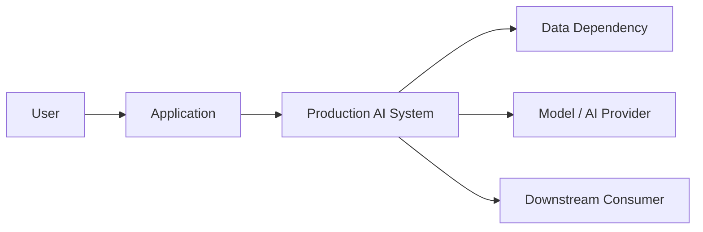
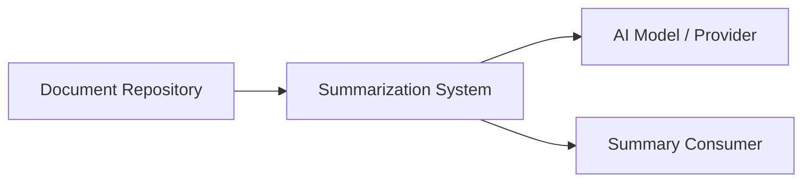
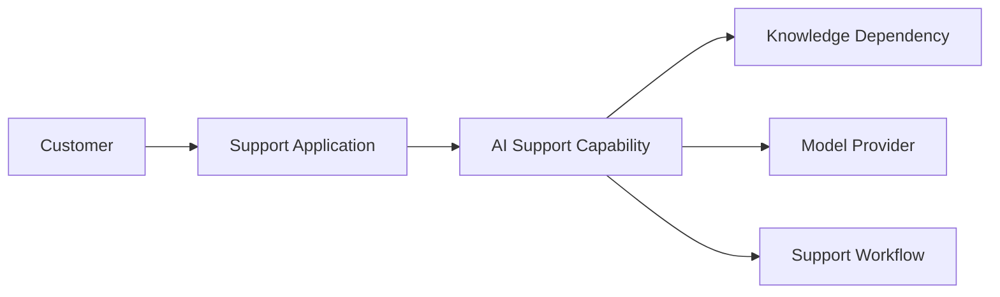

# Production AI Problem and Production Boundaries

## 1. Learning Objectives

By the end of this chapter, you should be able to:

- distinguish an AI capability from a production AI system,
- explain why a working model is not automatically a production-ready system,
- identify functional and operational production requirements,
- identify users, consumers, stakeholders, and their expectations,
- define what a production system is responsible for,
- establish a meaningful system boundary,
- distinguish system boundaries from ownership boundaries,
- identify upstream and downstream responsibilities,
- identify and classify external dependencies,
- recognize production constraints,
- identify responsibilities that prototypes often hide,
- reason about where responsibility should begin and end,
- explain how production requirements influence system boundaries,
- evaluate boundary decisions using engineering trade-offs.

The goal is not to memorize a production checklist.

The goal is to learn how to turn an AI capability into a clearly defined **production problem**.

---

## 2. Prerequisites

You should be comfortable with:

- basic software systems and applications,
- APIs and service-to-service communication,
- basic databases and external services,
- the idea of a software component having a responsibility,
- basic engineering concepts such as requirements, dependencies, and constraints.

Detailed knowledge of containers, Kubernetes, model serving, observability, CI/CD, cloud infrastructure, or SRE is **not required** for this chapter.

Those topics are covered elsewhere in the production engineering curriculum.

---

## 3. Estimated Reading Time

**45–60 minutes**

The exact time depends on how deeply you work through the examples and reasoning exercises.

---

## 4. Before We Start

Consider this statement:

> “We have an AI model that works.”

Technically, that may be completely true.

But it tells us very little about whether the capability is ready to become part of a production system.

We still need to know:

- Who uses it?
- What problem does it solve?
- What inputs does it accept?
- What outputs does it provide?
- Who depends on those outputs?
- What behavior is expected?
- What happens when the model or a dependency is unavailable?
- Which system is responsible for validation?
- Which team owns the capability?
- What data does it depend on?
- What constraints must it operate within?
- What responsibilities belong to the surrounding application?
- What responsibilities belong to external systems?

This leads to the central idea of this chapter:

```text
AI Capability
     ↓
Production Requirements
     ↓
Responsibilities
     ↓
Dependencies
     ↓
System Boundary
     ↓
Production AI System
```

Productionization is therefore not simply the act of deploying an AI model.

It is the process of turning an AI capability into a system with **defined responsibilities, requirements, dependencies, constraints, and expectations**.

---

# 5. Why This Exists

An AI prototype often focuses on one question:

> **Does the AI capability work?**

A production system must answer a much broader question:

> **Can this capability operate as part of a real system under defined requirements and constraints?**

That difference changes the engineering problem.

A prototype may contain:

```text
Input
  ↓
Prompt / Model
  ↓
Output
```

A production system may need to account for:

```text
Users
   ↓
Application
   ↓
Input Validation
   ↓
AI Capability
   ↓
Supporting Data / Services
   ↓
Result Handling
   ↓
Downstream Consumers
```

The model may still be the core AI capability.

But the production problem is larger than the model.

This is why production AI engineering begins with **problem framing and boundaries**, not with infrastructure selection.

---

# 6. Mental Model

A useful mental model is:

```text
                PRODUCTION AI SYSTEM

        ┌─────────────────────────────────┐
        │          System Boundary        │
        │                                 │
Users → │  Application / AI Capability    │ → Consumers
        │          │                      │
        │          ├── Data Dependencies  │
        │          ├── External Services  │
        │          └── Supporting Logic   │
        │                                 │
        └─────────────────────────────────┘
                    │
                    ↓
             External Systems
```

The important question is not:

> “Where is the model?”

The important question is:

> **“What does this system promise to do, and what must it control or depend on to fulfill that promise?”**

That question naturally leads to requirements and boundaries.

---

# 7. AI Capability vs Production AI System

## 7.1 What Is an AI Capability?

An AI capability is a technical capability that performs some AI-related function.

Examples:

- classify a document,
- summarize text,
- generate an answer,
- extract entities,
- rank candidates,
- recommend an item,
- generate an embedding,
- detect an image feature.

For example:

```text
Document
    ↓
Summarization Model
    ↓
Summary
```

The model may perform its task correctly.

That establishes that the **capability works**.

It does not establish that the surrounding system is production-ready.

---

## 7.2 What Is a Production AI System?

A production AI system is a system that provides an AI-enabled capability to real consumers under defined requirements, responsibilities, dependencies, and constraints.

The exact architecture varies by workload.

But the system normally has to answer questions such as:

- Who can use it?
- What does it accept?
- What does it guarantee?
- What does it depend on?
- What does it own?
- What does it not own?
- Who owns failures at different boundaries?
- What operational expectations apply?
- What constraints apply to the system?

A useful distinction is:

```text
AI Capability
    ↓
Can the AI function produce a useful result?

Production AI System
    ↓
Can the overall system provide that capability
under defined real-world requirements?
```

The second question is the production engineering problem.

---

# 8. From Prototype to Production Problem

A prototype often optimizes for learning speed.

For example:

```python
result = model.generate(prompt)
print(result)
```

This may be perfectly reasonable during experimentation.

But production introduces additional questions.

### Input

- Who provides the input?
- Is the input valid?
- What input sizes are acceptable?
- What happens with malformed input?

### Processing

- Which component invokes the AI capability?
- What data does it require?
- Which external services does it depend on?

### Output

- Who consumes the output?
- What format is expected?
- What happens if the output is incomplete or unusable?

### Responsibility

- Who owns the AI capability?
- Who owns the surrounding application?
- Who owns the data?
- Who owns external dependencies?

### Constraints

- What performance is expected?
- What resource constraints exist?
- What cost constraints exist?
- What availability expectations exist?

The prototype may have hidden these questions.

Production cannot.

---

# 9. Production Requirements

Production engineering starts with requirements.

Without clear requirements, architecture decisions become guesses.

A requirement should describe **what the system must provide or how it must behave under defined conditions**.

For example:

> “The system should be fast.”

is incomplete.

A stronger requirement asks:

```text
Who experiences the behavior?
        ↓
Under what workload?
        ↓
What behavior is expected?
        ↓
Under what constraints?
```

The purpose is not to introduce detailed SLO or benchmarking methodology here.

The purpose is to establish that production requirements must be sufficiently clear to influence engineering decisions.

---

## 9.1 Functional Requirements

Functional requirements describe **what the system must do**.

Examples:

- summarize uploaded documents,
- classify incoming requests,
- answer questions using approved knowledge,
- generate recommendations,
- extract structured information.

For example:

> “The system shall generate a summary from an uploaded document.”

This describes system behavior.

---

## 9.2 Operational Requirements

Operational requirements describe **how the system must behave or operate in its real environment**.

Examples may include:

- response-time expectations,
- availability expectations,
- capacity expectations,
- cost constraints,
- resource constraints,
- recoverability expectations,
- supportability expectations.

These are examples, not a universal checklist.

Different systems will have different operational requirements.

For example, an internal batch document processor may have very different operational requirements from an interactive customer-support assistant.

---

## 9.3 Requirements Must Be Contextual

Consider two systems:

### System A — Interactive Assistant

```text
User
  ↓
Question
  ↓
AI System
  ↓
Answer
```

The user may care strongly about responsiveness.

### System B — Overnight Document Processing

```text
Documents
    ↓
Batch Processing
    ↓
Results
```

The system may prioritize predictable completion and resource usage over immediate response.

The AI capability may be similar.

The production requirements are different.

Therefore:

> **Architecture should follow requirements, not the other way around.**

---

# 10. Users, Consumers, and Stakeholders

A production system may have several different parties interacting with or depending on it.

These roles should not automatically be treated as identical.

## 10.1 Users

A user directly interacts with the system.

Examples:

- customer,
- analyst,
- employee,
- administrator.

---

## 10.2 Consumers

A consumer uses the system's output.

The consumer may be another software system rather than a human.

For example:

```text
AI Classification Service
        ↓
Order Processing System
```

The order processing system is a consumer of the classification result.

---

## 10.3 Stakeholders

A stakeholder has an interest in the system's behavior or outcome.

Examples:

- product owner,
- engineering team,
- compliance team,
- business owner,
- operations team.

A stakeholder may never directly call the AI system.

---

## 10.4 Why the Distinction Matters

Different parties may have different expectations.

For example:

```text
Customer
    ↓
Wants useful and timely answer

Application
    ↓
Needs predictable response format

Business
    ↓
Needs useful business outcome

Engineering
    ↓
Needs manageable system responsibility
```

A production boundary should therefore be defined around **system responsibility**, not merely around the person who happens to use the model.

---

# 11. Production Expectations

Production expectations describe what stakeholders reasonably expect from the system once it becomes part of a real workflow.

These may include:

- predictable behavior,
- acceptable performance,
- appropriate availability,
- controlled costs,
- understandable ownership,
- defined failure expectations,
- controlled dependencies,
- maintainable operation,
- clear interfaces.

The exact expectations depend on the workload.

There is no universal definition of “production-ready” independent of context.

A system can be production-ready for one workload and inappropriate for another.

---

## 12. System Responsibility

A production system boundary should answer:

> **What is this system responsible for delivering?**

Consider an AI document summarization system.

It might be responsible for:

```text
Receive document
      ↓
Validate request
      ↓
Process document
      ↓
Generate summary
      ↓
Return summary
```

But it may not own:

- the user's identity system,
- the source document repository,
- the downstream document-management application,
- the external model provider,
- the business workflow consuming the summary.

The system therefore has responsibilities **inside** the boundary and dependencies **outside** it.

---

# 13. System Boundaries

A system boundary defines what belongs to the system being designed and what remains outside it.

A useful question is:

> **Where does our responsibility begin and end?**

For example:



The diagram does not imply that every AI system must have these exact components.

It illustrates the reasoning problem.

We need to determine:

- what the system controls,
- what it depends on,
- what it provides,
- what other systems provide,
- what other systems consume.

---

## 13.1 Boundary Is Not the Same as Deployment

A system boundary is a **responsibility boundary**.

A deployment boundary is a **runtime or infrastructure boundary**.

They may overlap, but they do not have to.

For example, two logically separate responsibilities may temporarily run in the same process.

Conversely, one logical system may depend on several separately deployed services.

Therefore:

```text
System Boundary
≠
Deployment Boundary
```

This distinction becomes important when architecture is designed later.

---

## 13.2 Boundary Is Not the Same as Team Ownership

Similarly:

```text
System Boundary
≠
Organizational Boundary
```

A system may contain responsibilities owned by one team while depending on another team for an external capability.

For example:

```text
Team A
  ↓
AI Application
  ↓
Team B
  ↓
Identity Service
```

The identity service may be outside the AI application's system boundary even though both teams contribute to the overall product.

---

# 14. External Dependencies

A production AI system rarely operates in complete isolation.

It may depend on:

- databases,
- object storage,
- identity systems,
- external APIs,
- model providers,
- internal services,
- data providers,
- organizational services.

The important engineering question is not simply:

> “Does a dependency exist?”

It is:

> **“What does this dependency provide, who owns it, and what responsibility remains with our system?”**

---

## 14.1 Types of External Dependencies

External dependencies can be classified conceptually.

| Dependency type | Example | Primary concern |
|---|---|---|
| Data dependency | Customer database | Data availability and correctness |
| Service dependency | Identity service | Service contract and availability |
| Provider dependency | External AI API | Provider behavior and interface |
| Infrastructure dependency | Storage platform | Resource availability |
| Organizational dependency | Another team's service | Ownership and coordination |

These categories can overlap.

The purpose is not to create a universal taxonomy.

The purpose is to make dependency responsibility explicit.

---

## 14.2 Dependency Boundary

Suppose an AI assistant uses an external model provider.

```text
Our System
    ↓
Model Provider
```

The provider may be responsible for operating the model service.

Our system may still be responsible for:

- deciding when to call it,
- providing appropriate input,
- handling the returned result,
- enforcing application-level requirements,
- handling provider failures according to our system's requirements.

Therefore:

> **Using an external service does not transfer all production responsibility to the provider.**

The dependency boundary must be explicit.

---

# 15. Upstream and Downstream Responsibilities

Production systems rarely exist alone.

They participate in a chain.

```text
Upstream System
       ↓
Production AI System
       ↓
Downstream System
```

Each system has its own responsibilities.

---

## 15.1 Upstream Responsibility

An upstream system provides something our system requires.

Examples:

- user identity,
- input data,
- uploaded documents,
- request metadata.

Our system should not automatically assume responsibility for everything the upstream system does.

Instead, the interface between them should make responsibilities clear.

---

## 15.2 Downstream Responsibility

A downstream system consumes something our system produces.

Examples:

```text
AI Classifier
      ↓
Order Processing System
```

The classifier is responsible for producing the classification according to its contract.

The order-processing system is responsible for what it does with that classification.

---

## 15.3 Responsibility at the Boundary

A useful model is:

```text
Upstream
   ↓
[Boundary]
   ↓
Our Responsibility
   ↓
[Boundary]
   ↓
Downstream
```

The purpose of the boundary is not to eliminate dependencies.

It is to make responsibility explicit.

---

# 16. Ownership Boundaries

Ownership answers a different question from system boundaries:

> **Who is accountable for a responsibility?**

Consider:

```text
System Boundary
       ↓
What does the system provide?

Ownership Boundary
       ↓
Who is accountable for providing it?
```

These boundaries can differ.

For example:

```text
Product
├── AI Application       → Team A
├── Identity Service     → Team B
└── Data Platform        → Team C
```

Team A may own the AI application while depending on Team B and Team C.

This creates an important engineering requirement:

> **A dependency should have an identifiable owner, even when it is outside your system boundary.**

Without ownership clarity, failures can become organizational ambiguity rather than purely technical problems.

---

# 17. Production Constraints

Production architecture exists under constraints.

Common categories include:

- performance,
- availability,
- cost,
- security,
- data,
- resource,
- organizational,
- regulatory,
- operational,
- dependency constraints.

PROD-01 does not deeply teach how to optimize these constraints.

Instead, the important lesson is:

> **Constraints influence architecture.**

For example:

```text
Large AI workload
      ↓
High compute requirement
      ↓
Resource constraint
      ↓
Architecture must account for resource usage
```

The exact scaling and optimization techniques belong to later production chapters.

---

## 17.1 Technical Constraints

Examples:

- available compute,
- memory limits,
- accelerator availability,
- model size,
- dependency interfaces.

---

## 17.2 Business Constraints

Examples:

- budget,
- required user experience,
- business deadlines,
- acceptable operational complexity.

---

## 17.3 Organizational Constraints

Examples:

- team ownership,
- existing platform capabilities,
- operational expertise,
- approved technology boundaries.

A technically elegant architecture may still be a poor production choice if it conflicts with these constraints.

---

# 18. Hidden Production Responsibilities

One of the most common differences between a prototype and a production system is that prototypes hide responsibility.

Consider:

```python
response = model.generate(prompt)
```

This single operation hides many questions.

```text
Who created the prompt?
        ↓
Who validates the input?
        ↓
Who provides required context?
        ↓
Who invokes the model?
        ↓
Who owns the model dependency?
        ↓
Who validates the result?
        ↓
Who stores or forwards the result?
        ↓
Who handles failure?
```

The code may remain simple.

The production responsibility does not.

This is why production engineering cannot be reduced to deployment.

---

# 19. A Production Problem-Framing Method

A practical way to frame a production AI problem is:

```text
1. Capability
       ↓
2. Users / Consumers
       ↓
3. Requirements
       ↓
4. Responsibilities
       ↓
5. Dependencies
       ↓
6. Constraints
       ↓
7. System Boundary
       ↓
8. Ownership
       ↓
9. Architectural Implications
```

Let's make each step explicit.

### Step 1 — Identify the capability

What does the AI component actually do?

### Step 2 — Identify users and consumers

Who uses the capability or its output?

### Step 3 — Identify requirements

What must the system do, and how must it behave?

### Step 4 — Identify responsibilities

What must this system own to satisfy those requirements?

### Step 5 — Identify dependencies

What does the system require from outside?

### Step 6 — Identify constraints

What limits the possible solutions?

### Step 7 — Draw the system boundary

What is inside the system and what remains outside?

### Step 8 — Identify ownership

Who is accountable for each major responsibility and dependency?

### Step 9 — Consider architectural implications

Only now should architecture decisions begin.

This ordering is important.

If architecture is chosen before requirements and responsibilities are understood, engineers can end up designing around assumptions rather than actual production needs.

---

# 20. Worked Example — Enterprise Document Summarization

Suppose an organization wants:

> “An AI system that summarizes uploaded enterprise documents.”

At first glance:

```text
Document
   ↓
LLM
   ↓
Summary
```

looks sufficient.

It is not yet a production problem definition.

---

## 20.1 Capability

The AI capability is:

> Generate a summary from an enterprise document.

---

## 20.2 Users and Consumers

Possible users:

- employees,
- analysts,
- support personnel.

Possible consumers:

- document management workflow,
- search interface,
- downstream reporting system.

---

## 20.3 Requirements

Functional:

- accept supported documents,
- generate summaries,
- return results in an expected format.

Operational:

- acceptable response behavior,
- appropriate availability,
- controlled resource usage,
- acceptable cost.

The exact values depend on the business requirements.

---

## 20.4 Dependencies

Possible dependencies:

```text
Document System
       ↓
AI Summarization System
       ↓
Model Provider
       ↓
Result Consumer
```

Each dependency needs a clear responsibility and owner.

---

## 20.5 Boundary

A possible boundary is:



The summarization system may own:

- request handling,
- document preparation,
- AI invocation,
- result handling.

It may not own:

- the document repository,
- the external model provider,
- the downstream business workflow.

The exact boundary depends on the actual product requirements.

---

# 21. Another Example — Customer Support AI

Consider a customer-support assistant.

A prototype might be:

```text
Question
   ↓
LLM
   ↓
Answer
```

A production problem might look more like:



Now the engineering questions become visible:

- Who authenticates the user?
- Who provides conversation context?
- Who owns the knowledge source?
- Who owns the model dependency?
- What does the AI system guarantee?
- Who consumes the generated answer?
- What happens when a dependency is unavailable?
- Which responsibilities belong to the support application?
- Which responsibilities belong to the AI capability?

The model is still important.

But it is only one part of the production problem.

---

# 22. Engineering Decisions and Trade-offs

Boundary decisions involve trade-offs.

There is no universally correct boundary.

For example:

```text
Smaller Boundary
    ↓
More isolated responsibility
    ↓
Potentially clearer ownership
    ↓
But potentially more interfaces and dependencies
```

Whereas:

```text
Larger Boundary
    ↓
Fewer external interfaces
    ↓
Potentially simpler coordination
    ↓
But potentially broader responsibility
```

The decision should be driven by requirements and constraints.

---

## 22.1 Boundary Decision Questions

Before creating or changing a boundary, ask:

| Question | Engineering purpose |
|---|---|
| What responsibility is being separated? | Clarify the reason for the boundary |
| Who owns that responsibility? | Establish accountability |
| Who depends on it? | Understand coupling |
| Does it have distinct requirements? | Identify meaningful separation |
| Does it have different workload behavior? | Identify architectural differences |
| Does separation simplify the system? | Evaluate benefit |
| Does separation add coordination overhead? | Evaluate cost |
| Does the boundary create unnecessary dependency? | Identify coupling risk |

This is intentionally a **boundary reasoning framework**, not a service-decomposition tutorial.

Detailed component and service architecture belongs in the next file.

---

# 23. Production Reasoning Chain

The central engineering reasoning pattern for this chapter is:

```text
Requirement
     ↓
Responsibility
     ↓
Constraint
     ↓
Boundary
     ↓
Dependency
     ↓
Ownership
     ↓
Architectural Consequence
     ↓
Trade-off
```

For example:

```text
Users need interactive answers
        ↓
System must provide timely responses
        ↓
Performance becomes a requirement
        ↓
The system boundary must include the
responsibilities necessary to provide that behavior
        ↓
External dependencies become important
        ↓
Ownership must be explicit
        ↓
Architecture must account for those dependencies
        ↓
Additional control may increase complexity
```

The exact architecture is not determined by the AI model alone.

It emerges from the combination of:

```text
Workload
+
Requirements
+
Responsibilities
+
Dependencies
+
Constraints
```

---

# 24. What This Chapter Does Not Solve

This chapter establishes the production problem and boundary.

It does **not** deeply teach:

- application packaging,
- containers,
- runtime engineering,
- model serving,
- inference serving mechanisms,
- concurrency mechanisms,
- batching,
- streaming,
- CI/CD,
- deployment strategies,
- observability implementation,
- SLI/SLO engineering,
- retries,
- backpressure,
- graceful degradation,
- autoscaling,
- capacity engineering,
- inference optimization,
- security engineering,
- incident response,
- production evaluation,
- drift management.

Those concepts have dedicated ownership elsewhere in the PROD curriculum.

The distinction is important:

```text
File 01
Why does this production responsibility exist?
Where should the responsibility boundary be?

        ↓

File 02
How should those responsibilities be represented
in system architecture and component/service boundaries?
```

File 01 therefore establishes the **problem and boundary model**.

File 02 will build the **architecture model**.

---

# 25. Common Mistakes and Misconceptions

## Mistake 1 — “If the model works, the system is production-ready.”

A working model demonstrates capability.

It does not establish production requirements, ownership, dependencies, constraints, or operational expectations.

---

## Mistake 2 — “Production means deployment.”

Deployment is only one part of production engineering.

Production also requires understanding the system's responsibilities, requirements, dependencies, constraints, and operational expectations.

---

## Mistake 3 — “The AI model is the entire system.”

The model is usually a component of the production system.

The surrounding application, data, dependencies, interfaces, and consumers also matter.

---

## Mistake 4 — “Every responsibility should become a separate service.”

Separation has costs.

More boundaries can introduce:

- more interfaces,
- more coordination,
- more dependencies,
- more operational responsibility.

A boundary should exist because it provides engineering value.

---

## Mistake 5 — “Team ownership and system boundaries are the same.”

They are different concepts.

A system can depend on another team's service while remaining responsible for how that dependency affects its own behavior.

---

## Mistake 6 — “External AI providers remove our responsibility.”

They may operate the external capability.

They do not automatically own the responsibilities of the consuming application.

---

## Mistake 7 — “Operational requirements can be added later.”

Architecture decisions often depend on operational requirements.

If those requirements are discovered too late, earlier architectural decisions may need to change.

---

## Mistake 8 — “More components mean better architecture.”

More components create more boundaries.

More boundaries can create both benefits and costs.

Architecture quality depends on whether the boundaries solve meaningful problems.

---

## Mistake 9 — “Every AI system should have the same production architecture.”

Different workloads have different:

- requirements,
- dependencies,
- constraints,
- ownership models,
- performance expectations,
- operational needs.

There is no universal production AI architecture.

---

## 26. Interview Questions with Expected Answers

## 1. Why is a working AI model not automatically a production-ready system?

**Expected answer:**

Because a model demonstrates a capability, while production requires defined requirements, users, responsibilities, dependencies, constraints, ownership, and operational expectations.

---

## 2. What is the difference between an AI capability and a production AI system?

**Expected answer:**

An AI capability performs an AI function. A production AI system integrates that capability into a system that serves real consumers under defined requirements and constraints.

---

## 3. What is a system boundary?

**Expected answer:**

A system boundary defines what the system is responsible for providing and controlling versus what remains external.

---

## 4. Is a system boundary the same as a deployment boundary?

**Expected answer:**

No. A system boundary represents responsibility, while a deployment boundary represents how software is physically or logically deployed. They may overlap but do not have to.

---

## 5. Is a system boundary the same as a team ownership boundary?

**Expected answer:**

No. Organizational ownership and system responsibility are related but distinct. A system can depend on capabilities owned by other teams.

---

## 6. How would you distinguish a functional requirement from an operational requirement?

**Expected answer:**

A functional requirement describes what the system must do. An operational requirement describes how the system must behave or operate under real-world conditions.

---

## 7. Why should production requirements be defined before architecture?

**Expected answer:**

Because requirements and constraints influence responsibilities, boundaries, dependencies, and architectural choices. Designing first can result in architecture based on assumptions rather than actual needs.

---

## 8. Why are external dependencies important when defining a system boundary?

**Expected answer:**

Because dependencies provide capabilities the system requires but does not fully control. Their ownership, interface, availability, and failure implications affect the system's responsibilities.

---

## 9. When should a responsibility receive its own architectural boundary?

**Expected answer:**

When separating it provides meaningful engineering value, such as clearer ownership, distinct requirements, reduced coupling, or independent responsibility. Separation should also be weighed against additional interfaces and operational complexity.

---

## 10. An external model provider fails. Is the AI application automatically no longer responsible?

**Expected answer:**

No. The provider owns the external service, but the consuming application remains responsible for how that dependency affects its own system behavior.

---

## 11. What is the difference between upstream and downstream responsibility?

**Expected answer:**

An upstream system provides something our system needs. A downstream system consumes something our system produces. Each system remains responsible for its own defined responsibilities across those boundaries.

---

## 12. A team says, “We will define operational requirements after the architecture is complete.” What is wrong with that approach?

**Expected answer:**

Operational requirements can influence architecture. Delaying them may cause architectural decisions to be based on incomplete assumptions and require costly changes later.

---

## 13. A team proposes splitting every AI component into separate services. What would you ask first?

**Expected answer:**

I would ask what responsibility each boundary solves, who owns it, what requirements differ, who depends on it, and whether the benefits justify the additional interfaces, coordination, and operational complexity.

---

## 27. Quick Revision

Remember these distinctions:

### AI capability

```text
What can the AI component do?
```

### Production AI system

```text
What must the overall system provide?
```

### Functional requirement

```text
What must the system do?
```

### Operational requirement

```text
How must the system behave or operate?
```

### System boundary

```text
What is this system responsible for?
```

### Ownership boundary

```text
Who is accountable for that responsibility?
```

### External dependency

```text
What does our system require from outside?
```

### Upstream responsibility

```text
What does another system provide to us?
```

### Downstream responsibility

```text
What does another system consume from us?
```

### Production constraint

```text
What limits the possible engineering solutions?
```

---

# 28. Key Takeaways

1. **A working AI model is not automatically a production system.**

2. **Productionization begins with problem framing, not infrastructure selection.**

3. **Production requirements define what the system must provide and how it must behave in its real environment.**

4. **Functional and operational requirements are different but both influence architecture.**

5. **A system boundary defines responsibility, not merely deployment.**

6. **A system boundary is not automatically the same as a team ownership boundary.**

7. **External dependencies should have explicit responsibilities and identifiable ownership.**

8. **Upstream and downstream systems remain responsible for their own defined roles.**

9. **Production constraints influence architecture and trade-offs.**

10. **Prototypes often hide responsibilities that production systems must make explicit.**

11. **A boundary should exist because it provides engineering value, not because more components appear more sophisticated.**

12. **The correct production architecture depends on workload, requirements, responsibilities, dependencies, and constraints.**

13. **File 01 establishes why and where production responsibilities exist. File 02 will address how those responsibilities are represented in system architecture and service boundaries.**

---

## 29. Next Chapter

Continue with:

[02 — Production AI System Architecture and Service Boundaries](./02-Production-AI-System-Architecture-and-Service-Boundaries.md)

The next chapter moves from:

```text
What is the production problem?
        ↓
What is the system responsible for?
        ↓
Where should boundaries exist?
```

to:

```text
How should those responsibilities
be represented in system architecture?
```

The goal is to preserve the distinction between **problem framing** and **architecture design** while connecting the two.
