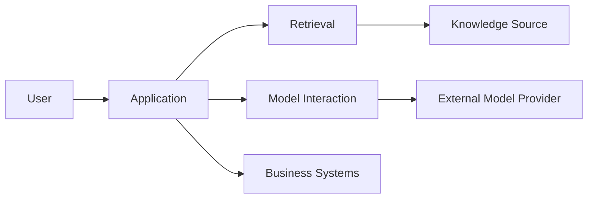
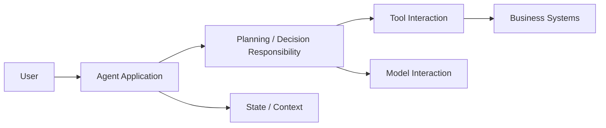
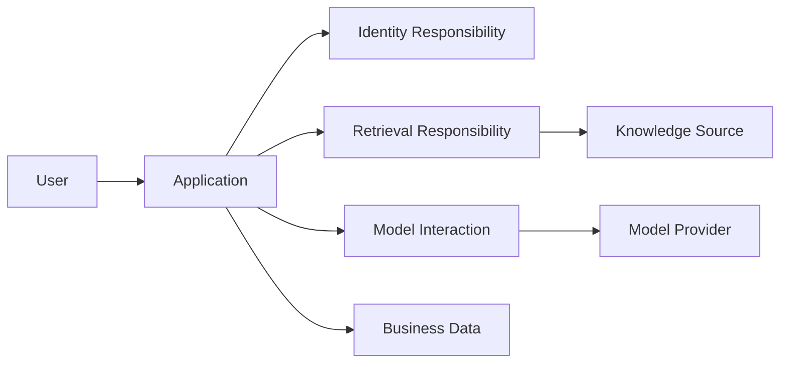
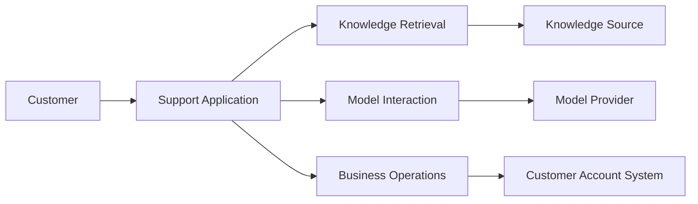

# Production AI System Architecture and Service Boundaries

## 1. Learning Objectives

By the end of this chapter, you should be able to:

- Explain why a production AI system needs explicit architectural boundaries.
- Decompose a production AI system into meaningful components based on responsibility.
- Distinguish a component boundary from a deployment boundary.
- Define clear responsibilities for system components.
- Identify appropriate service boundaries without assuming that every component must become a separate service.
- Understand interfaces as contracts between responsibilities.
- Explain why interface ownership matters when multiple components depend on a contract.
- Reason about synchronous and asynchronous responsibility boundaries at a conceptual level.
- Distinguish internal components from external dependencies.
- Separate control responsibility from data responsibility without assuming they must always be different components.
- Analyze ownership, coupling, and cohesion when defining boundaries.
- Identify when a boundary simplifies a system and when it introduces unnecessary complexity.
- Evaluate architecture choices using production requirements and constraints.
- Explain how AI-specific components fit into larger production systems.
- Review an architecture for unclear responsibilities, excessive coupling, or unnecessary decomposition.

---

## 2. Prerequisites

Before reading this chapter, you should understand:

- The difference between an AI capability and a production AI system.
- Production requirements and expectations.
- System boundaries and ownership boundaries.
- External dependencies.
- Upstream and downstream responsibilities.
- Production constraints.
- The production problem-framing method introduced in:

[`01-Production-AI-Problem-and-Production-Boundaries.md`](./01-Production-AI-Problem-and-Production-Boundaries.md)

You do not need to know a specific cloud platform, container platform, model-serving framework, or orchestration system.

---

## 3. Estimated Reading Time

**35–45 minutes**

---

## 4. Before We Start

A common way to begin designing an AI system is to ask:

> “Which framework should we use?”

That is usually too early.

Another common question is:

> “Should this be a microservice?”

That is also too early.

Architecture starts with a different question:

> **What responsibilities exist in this system, and where should the boundaries between those responsibilities be?**

Consider a customer-support AI system.

At first glance, it may look simple:

```text
User
  ↓
AI Model
  ↓
Answer
```

But a production system may actually involve:

```text
User
  ↓
Application
  ↓
Request Handling
  ↓
Conversation Context
  ↓
Knowledge Retrieval
  ↓
Model Interaction
  ↓
Response Processing
  ↓
Application Response
```

There may also be external systems:

```text
                ┌── Identity System
                │
User → Application
                │
                ├── Knowledge Store
                │
                ├── Model Provider
                │
                └── Business Data
```

The important engineering problem is not simply identifying these boxes.

It is deciding:

- What responsibility belongs in each box?
- Which responsibilities should remain together?
- Which responsibilities should be separated?
- What information crosses each boundary?
- Who owns each responsibility?
- Who owns the interface between responsibilities?
- What dependencies are created?
- What complexity does the boundary introduce?

That is the focus of this chapter.

---

# 5. Why This Exists

A production AI system is rarely one algorithm.

It is a set of responsibilities that cooperate to provide a useful capability.

If those responsibilities are left implicit, several problems appear.

For example:

```text
AI Application
    ├── authentication
    ├── business rules
    ├── retrieval
    ├── prompt construction
    ├── model invocation
    ├── response processing
    ├── persistence
    └── external integrations
```

Everything may initially live in one codebase.

That is not automatically wrong.

But if nobody can clearly answer:

> “Who is responsible for what?”

the architecture becomes difficult to reason about.

A production architecture should make important responsibilities visible.

The goal is **not maximum decomposition**.

The goal is:

> **Create boundaries where they improve responsibility, changeability, ownership, or architectural reasoning without introducing unnecessary coordination complexity.**

This distinction is fundamental.

---

# 6. Mental Model

A useful mental model is:

```text
                    Production AI System
                           │
                           ▼
                    System Responsibilities
                           │
             ┌─────────────┼─────────────┐
             ▼             ▼             ▼
       Responsibility A  Responsibility B  Responsibility C
             │             │             │
             └───────┬─────┴─────┬───────┘
                     ▼           ▼
                  Interfaces / Contracts
                     │
                     ▼
                 Dependencies
```

Architecture is therefore not primarily about drawing boxes.

It is about deciding:

```text
Responsibility
      ↓
Boundary
      ↓
Interface
      ↓
Dependency
      ↓
Ownership
      ↓
Trade-off
```

A good architecture makes these relationships understandable.

---

# 7. From Responsibilities to Architecture

## 7.1 Responsibility Comes First

Suppose an AI application needs to answer questions using company documents.

Possible responsibilities include:

1. Accept the user's request.
2. Identify the user.
3. Retrieve relevant information.
4. Construct model input.
5. Invoke the model.
6. Interpret the model response.
7. Apply application-level rules.
8. Return the response.
9. Persist conversation information.

These responsibilities do not automatically imply nine services.

They simply tell us what the system needs to accomplish.

Architecture begins by identifying meaningful responsibility boundaries.

---

## 7.2 Component vs Service

The terms **component** and **service** are often used interchangeably, but they should not automatically mean the same thing.

A **component** is a logical unit of responsibility.

A **service** is a separately accessible unit that exposes a contract to other parts of the system.

For example:

```text
AI Application
│
├── Request Handling Component
├── Retrieval Component
├── Model Interaction Component
└── Response Processing Component
```

These could initially exist within one application.

They could later become:

```text
Application Service
       │
       ├── Retrieval Service
       └── Model Gateway Service
```

The important point is:

> **A logical responsibility can exist without requiring a separate deployable service.**

This prevents a common architectural mistake:

> “Every box in the architecture diagram must be a microservice.”

It does not.

---

# 8. Responsibility Boundaries

A boundary should separate responsibilities that have a meaningful reason to be separated.

Consider:

```text
Request Handling
       │
       ▼
Retrieval
```

The boundary may make sense because retrieval has:

- different data dependencies,
- different logic,
- different ownership,
- potentially different change patterns,
- potentially different workload behavior.

Now consider:

```text
Prompt Formatting
       │
       ▼
Prompt String Validation
```

Separating these into independent services may provide little value.

The distinction is therefore not:

> “Are these two things technically different?”

Almost everything is technically different.

The better question is:

> **Does separating them create enough engineering value to justify the additional boundary?**

---

# 9. Architecture Boundaries

A useful architecture boundary identifies:

- a responsibility,
- an owner,
- an interface,
- dependencies,
- and a reason for separation.

Conceptually:

```text
┌──────────────────────────┐
│ Component A              │
│                          │
│ Responsibility           │
└────────────┬─────────────┘
             │
             │ Interface
             │
┌────────────▼─────────────┐
│ Component B              │
│                          │
│ Responsibility           │
└──────────────────────────┘
```

The interface is important because the two components should not need to know every internal implementation detail of each other.

This creates a useful principle:

> **A boundary should hide internal implementation while exposing the information necessary to fulfill the responsibility.**

---

# 10. Interfaces as Contracts

An interface defines how one responsibility interacts with another.

For example:

```text
Application
    │
    │ retrieve(query, filters)
    ▼
Retrieval Component
    │
    │ results
    ▼
Application
```

The application should not need to know:

- which retrieval algorithm is used,
- how indexing works,
- which storage technology is used,
- how candidate ranking is implemented.

It needs to know what the retrieval responsibility provides.

A conceptual contract might be:

```text
Input:
    query
    filters

Output:
    ranked relevant results
```

The exact implementation can change without necessarily changing the consuming component.

---

# 11. Interface Ownership

An interface is not only a technical shape.

It is also a responsibility.

Consider:

```text
Component A
     │
     │ Contract
     ▼
Component B
```

Several questions should have clear answers:

- Who defines the contract?
- Who is accountable for keeping the contract meaningful?
- Who can change it?
- Who depends on it?
- What responsibilities belong to the provider?
- What assumptions belong to the consumer?

This does not mean the provider can change the interface without considering consumers.

A useful mental model is:

```text
Responsibility
      ↓
Interface
      ↓
Interface Owner
      ↓
Consumers
```

Interface ownership becomes especially important when multiple components depend on the same capability.

For example:

```text
Application A ──┐
Application B ──┼──► Shared Capability
Application C ──┘
```

The shared capability may have one technical owner, but several consumers.

The architectural concern is therefore not merely:

> “Who owns the service?”

It is also:

> **Who is accountable for the contract that other components depend on?**

Detailed API versioning, contract testing, and interface compatibility mechanisms are outside the scope of this chapter.

---

# 12. What Makes a Good Boundary?

A useful boundary usually has several characteristics.

## 12.1 Clear Responsibility

The component should have a meaningful purpose.

Weak:

```text
Utility Service
```

Strong:

```text
Document Retrieval
```

The second description communicates responsibility.

---

## 12.2 Controlled Dependencies

A component should not depend unnecessarily on many unrelated components.

Consider:

```text
A → B → C → D → E → F
```

A change in `F` may affect several upstream responsibilities.

Excessive dependency chains make systems harder to reason about.

---

## 12.3 Cohesive Responsibility

Related behavior should generally remain together.

For example:

```text
Retrieval
├── query preparation
├── retrieval execution
└── result preparation
```

may have stronger cohesion than:

```text
Retrieval Query Formatter
Retrieval Executor
Retrieval Result Formatter
```

where every small operation has become a separate component.

---

## 12.4 Limited Coupling

A component should not need detailed knowledge of another component's internal behavior.

Compare:

```text
Application
    │
    │ "retrieve documents"
    ▼
Retrieval
```

with:

```text
Application
    │
    ├── knows index structure
    ├── knows embedding implementation
    ├── knows storage schema
    ├── knows ranking algorithm
    └── knows retrieval internals
```

The second architecture creates stronger coupling.

---

# 13. Coupling and Cohesion

Two concepts are especially useful when evaluating boundaries.

## Coupling

**Coupling** describes how strongly components depend on each other.

High coupling:

```text
Component A
   │
   ├──────────────┐
   ▼              ▼
Component B    Component C
   │              │
   └──────┬───────┘
          ▼
     Shared Internals
```

Changes in one area can propagate into others.

Lower coupling:

```text
Component A
     │
     │ Contract
     ▼
Component B
```

The interaction is constrained by an interface.

---

## Cohesion

**Cohesion** describes how closely related the responsibilities inside a component are.

High cohesion:

```text
Retrieval Component
├── retrieval query handling
├── retrieval execution
└── retrieval result preparation
```

Low cohesion:

```text
General AI Service
├── authentication
├── retrieval
├── billing
├── model invocation
├── analytics
└── business operations
```

In AI systems, this distinction becomes especially useful.

For example:

```text
High cohesion

Retrieval Component
├── retrieval-specific input handling
├── retrieval execution
└── retrieval result preparation
```

is generally easier to reason about than:

```text
Low cohesion

AI Service
├── retrieval
├── billing
├── identity
├── notification
└── business operations
```

A useful architectural goal is:

> **High cohesion within boundaries and manageable coupling across boundaries.**

This does not mean coupling must always be minimized at all costs.

Some dependencies are necessary.

The goal is to make them intentional.

---

# 14. Boundary-Driven Architecture

Instead of beginning with technologies, begin with responsibilities.

A useful process is:

```text
Identify responsibilities
        ↓
Group related responsibilities
        ↓
Identify meaningful boundaries
        ↓
Define interfaces
        ↓
Identify dependencies
        ↓
Assign ownership
        ↓
Evaluate coupling and cohesion
        ↓
Evaluate trade-offs
```

This process prevents technology from dictating architecture prematurely.

---

# 15. Internal Components and External Components

A production AI system usually interacts with both internal and external components.

Consider:

```text
                    AI Application
                          │
          ┌───────────────┼───────────────┐
          ▼               ▼               ▼
    Internal          Internal         External
    Retrieval         Policy           Model
    Component         Component        Provider
```

The distinction matters because responsibility differs.

For an internal component, the organization may control:

- implementation,
- interface,
- deployment,
- change process,
- ownership.

For an external dependency, the organization may not control:

- implementation,
- availability,
- internal architecture,
- release schedule,
- underlying infrastructure.

The system therefore needs a clear boundary around the dependency.

---

# 16. AI-Specific Components in Larger Systems

An AI component rarely exists alone.

For example, consider an enterprise document assistant.

A conceptual architecture might be:



This diagram does not prescribe a specific technology.

It shows responsibilities and dependencies.

The application coordinates the user-facing workflow.

The retrieval responsibility obtains relevant information.

The model interaction responsibility communicates with the model capability.

Business systems provide domain information or actions.

The external model provider supplies a model capability.

The important architectural question is:

> **Which responsibility belongs where, and what information crosses each boundary?**

---

# 17. Control Responsibility vs Data Responsibility

A useful distinction in AI architecture is between **control responsibility** and **data responsibility**.

## Control Responsibility

Control responsibility concerns decisions such as:

- what operation should happen,
- which component should be invoked,
- what sequence should be followed,
- which policy should be applied.

## Data Responsibility

Data responsibility concerns:

- storing information,
- retrieving information,
- transforming information,
- providing information to another component.

Consider:

```text
Application
    │
    │ controls workflow
    ▼
Retrieval Component
    │
    │ retrieves data
    ▼
Knowledge Store
```

The application may own workflow control.

The retrieval component may own retrieval behavior.

The knowledge store may own persistence of the underlying data.

These responsibilities should not automatically be collapsed into one component.

At the same time, control and data responsibility are **analytical distinctions**, not mandatory decomposition rules. A single component may legitimately participate in both.

The architectural question is:

> **Are the responsibilities sufficiently related that keeping them together improves the system, or is there a meaningful reason to separate them?**

---

# 18. Synchronous and Asynchronous Responsibility Boundaries

A system can communicate between responsibilities in different conceptual ways.

## Synchronous Interaction

One component requests something and waits for a response.

```text
A ───── request ─────► B
A ◄──── response ───── B
```

This is useful when the result is immediately required for continuing the operation.

For example:

```text
Application
     │
     │ retrieve context
     ▼
Retrieval
     │
     │ results
     ▼
Application
```

---

## Asynchronous Interaction

A component initiates work without requiring the result immediately.

```text
A ───── message ─────► B
A                     │
continues             │
                      ▼
                   processing
```

This can be useful when work can occur independently of the current interaction.

For example:

```text
Application
     │
     │ submit processing request
     ▼
Processing Component
     │
     │ later produces result
     ▼
Persistent Result
```

At this level, the important architectural question is:

> **Does the consuming responsibility require the result immediately, or can the responsibility continue independently?**

The detailed engineering of queues, retries, delivery guarantees, backpressure, and recovery belongs to later production reliability topics.

---

# 19. Service Boundaries

A logical component becomes a stronger candidate for a separate service when separation provides meaningful engineering value.

Possible reasons include:

- independent ownership,
- independent lifecycle,
- distinct workload behavior,
- distinct dependencies,
- reusable capability,
- different requirements,
- isolation of change,
- organizational boundaries.

But these benefits come with costs.

A service boundary introduces:

- network interaction,
- interface contracts,
- deployment coordination,
- version compatibility,
- additional distributed dependencies,
- additional operational responsibility.

Therefore:

> **A service boundary is an architectural decision, not a default implementation pattern.**

---

## 20. When Not to Create a Service

Suppose an application contains:

```text
Prompt Construction
Response Formatting
Model Invocation
```

A team might propose:

```text
Prompt Service
Formatting Service
Model Service
```

That may be unnecessary.

If these responsibilities:

- change together,
- have the same owner,
- have similar workload behavior,
- have little independent reuse,
- have no meaningful isolation requirement,

then separating them may increase complexity without sufficient benefit.

A simpler architecture may be:

```text
AI Application
├── Prompt Construction
├── Model Interaction
└── Response Processing
```

The responsibilities remain explicit without becoming distributed services.

This is an important production principle:

> **Logical separation does not require physical separation.**

---

# 21. Architecture Trade-offs

Every boundary creates both benefits and costs.

Consider:

```text
Fewer Components
       │
       ├── simpler coordination
       ├── fewer interfaces
       └── easier local reasoning

More Components
       │
       ├── clearer responsibility isolation
       ├── independent change
       └── potentially independent ownership
```

But:

```text
More Components
       ↓
More Interfaces
       ↓
More Dependencies
       ↓
More Coordination
       ↓
More Architectural Complexity
```

Therefore, architecture should not optimize for the number of components.

It should optimize for the system's actual requirements and constraints.

---

# 22. Centralized vs Distributed Responsibility

A responsibility can sometimes be centralized.

For example:

```text
Applications
      │
      ▼
Central AI Gateway
      │
      ▼
Model Providers
```

Or distributed:

```text
Application A ──► Model Provider A

Application B ──► Model Provider B
```

Centralization can provide:

- consistent policies,
- shared behavior,
- common interfaces,
- centralized control.

But it can also create:

- a shared dependency,
- coordination requirements,
- coupling between consumers,
- concentration of responsibility.

Distribution can provide:

- local autonomy,
- independent change,
- fewer shared dependencies.

But it may produce:

- duplicated logic,
- inconsistent behavior,
- more components to manage.

There is no universal winner.

The correct choice depends on requirements, ownership, reuse, and architectural consequences.

---

# 23. Shared vs Isolated Components

Another architectural decision is whether a capability should be shared.

For example:

```text
                ┌── Application A
Shared Retrieval
                ├── Application B
                └── Application C
```

Sharing may reduce duplication.

But the shared component becomes a dependency for multiple consumers.

Alternatively:

```text
Application A → Retrieval A

Application B → Retrieval B

Application C → Retrieval C
```

Isolation may provide greater autonomy but can increase duplication and maintenance.

The question is therefore not:

> “Should we always share?”

or:

> “Should we always isolate?”

Instead:

> **What benefit does sharing provide, and what coupling does it create?**

---

# 24. Architecture for AI Workflows

AI workflows often contain responsibilities that are different from conventional application logic.

Consider a retrieval-augmented generation workflow:


The architecture should make responsibility clear.

For example:

**Application**

Owns user-facing workflow and application behavior.

**Query Processing**

Transforms the request into a form appropriate for retrieval.

**Retrieval**

Finds relevant information.

**Context**

Represents information selected for model use.

**Model Interaction**

Handles interaction with the model capability.

**Response Processing**

Applies application-level response handling before returning the result.

This does not mean every box must become a separate service.

The diagram represents logical responsibilities.

---

# 25. Agentic Systems as Larger Production Systems

Agentic AI introduces additional responsibilities, but the same architectural reasoning applies.

A conceptual system might look like:



The important architectural questions are:

- Who owns the planning responsibility?
- Who controls tool interaction?
- Who owns state?
- Who owns business operations?
- Which systems are external?
- What information crosses the boundaries?
- Which responsibilities should remain inside the application?

This chapter does not teach agent execution, state safety, tool governance, or multi-agent coordination.

Those are covered by the Agent Engineering domain.

The architectural principle needed here is simply:

> **An AI agent is a capability inside a larger system, not automatically the architecture itself.**

---

# 26. Ownership and Architecture

Technical architecture and organizational ownership influence each other, but they are not identical.

Consider:

```text
                    Enterprise AI System
                           │
              ┌────────────┼────────────┐
              ▼            ▼            ▼
          AI Team      Data Team     Business Team
              │            │            │
              ▼            ▼            ▼
          AI Logic     Data Source   Business API
```

A boundary may exist because different teams own different responsibilities.

But organizational structure should not be the only reason to create technical boundaries.

If every team boundary automatically becomes a service boundary, the architecture can become overly distributed.

A better approach is:

```text
Business Responsibility
        +
Technical Responsibility
        +
Ownership Reality
        ↓
Boundary Decision
```

All three should be considered.

---

# 27. Boundary Quality Test

A proposed boundary can be evaluated with a compact set of questions.

| Question | What it reveals |
|---|---|
| What responsibility does this boundary isolate? | Responsibility clarity |
| Why does it need separation? | Architectural justification |
| Who owns it? | Accountability |
| Who consumes it? | Dependency scope |
| What crosses the boundary? | Interface design |
| Who owns the interface contract? | Contract accountability |
| How often does it change? | Change coupling |
| Does it have distinct workload behavior? | Workload separation |
| Does it have distinct requirements? | Requirement separation |
| What new dependency does the boundary create? | Coupling cost |
| What architectural consequence follows from the dependency? | Dependency reasoning |
| Could the same benefit be achieved without a separate service? | Simplicity check |

This is not a mandatory checklist for every design.

It is a reasoning tool.

---

## 28. Worked Example — Enterprise Document Assistant

Suppose an enterprise wants an AI assistant that answers questions about internal documents.

The initial prototype looks like:

```text
Question
   ↓
Prompt
   ↓
LLM
   ↓
Answer
```

The production architecture may require:



Now analyze the responsibilities.

### Application

Responsible for:

- user interaction,
- request workflow,
- application-level decisions.

### Identity

Responsible for:

- establishing user identity or authorization context.

The detailed security architecture is outside this chapter.

### Retrieval

Responsible for:

- finding relevant document information.

### Knowledge Source

Provides the underlying information.

It may be owned by another system or team.

### Model Interaction

Responsible for:

- communicating with the model capability.

### Model Provider

An external dependency providing model capability.

The application remains responsible for how it uses that capability.

---

## 28.1 Should Retrieval Be a Separate Service?

Not necessarily.

Suppose:

- only one application uses retrieval,
- the retrieval logic changes frequently with the application,
- the same team owns both,
- the workload is similar,
- there is no meaningful isolation requirement.

Then:

```text
Single Application
├── Application Workflow
└── Retrieval Component
```

may be appropriate.

If several applications need the same retrieval capability:

```text
Application A ──┐
Application B ──┼──► Retrieval Service
Application C ──┘
```

a shared service may become more attractive.

But now the retrieval service becomes a shared dependency.

That trade-off must be evaluated.

---

# 29. Worked Example — Customer Support AI

Consider a customer-support assistant that can answer questions and perform account actions.

A conceptual architecture might be:



Now consider responsibility.

The model should not automatically own:

```text
Account balance
Refund authorization
Customer identity
Order cancellation
```

Those responsibilities belong to business systems or application-controlled workflows.

The model may help determine what action is appropriate, but the system boundary should preserve responsibility for the actual business operation.

This leads to an important principle:

> **AI reasoning does not automatically imply AI ownership of the underlying business responsibility.**

---

# 30. Dependency Awareness at Architecture Boundaries

Architecture should make important dependency relationships visible.

Suppose:

```text
Application
    ↓
Model Provider
```

The model provider is an external dependency.

Or:

```text
Application
    ↓
Retrieval
    ↓
Knowledge Store
```

The application has a dependency relationship that passes through retrieval.

The architectural questions are:

- What does the dependency provide?
- Who owns the dependency?
- What information crosses the boundary?
- Which responsibilities remain with the consuming system?
- What architectural consequence follows if the dependency changes or becomes unavailable?

These questions establish dependency awareness without designing the failure-handling mechanisms themselves.

Detailed retry, timeout, fallback, graceful degradation, failure isolation, and recovery strategies belong to later reliability engineering topics.

---

# 31. Architecture Review: Common Warning Signs

Several patterns should trigger deeper investigation.

## 31.1 Everything Is a Service

```text
Service A
Service B
Service C
Service D
Service E
Service F
Service G
```

If every responsibility is independently deployed, ask:

> What engineering benefit justifies each boundary?

---

## 31.2 One Giant Component

```text
AI Application
├── Authentication
├── Retrieval
├── Billing
├── Model Interaction
├── Analytics
├── Notifications
└── Business Operations
```

If unrelated responsibilities are tightly coupled, ask:

> Which responsibilities have independent reasons to change?

---

## 31.3 Shared Database as the Architecture

```text
Service A ─┐
Service B ─┼──► Shared Database
Service C ─┘
```

The components may appear separated while remaining tightly coupled through shared internal data structures.

The important question is:

> Are the boundaries actually independent, or is the shared data model creating hidden coupling?

---

## 31.4 Undefined Ownership

```text
Component A
     ↓
Component B
     ↓
External System
```

Nobody can answer who is responsible for the behavior.

This is an architectural warning sign.

A production architecture should make ownership understandable even when the dependency is external.

---

# 32. Architecture Decisions and Trade-offs

A production architecture is a collection of decisions.

For each major boundary, reason through:

```text
Responsibility
      ↓
Reason for separation
      ↓
Ownership
      ↓
Interface
      ↓
Dependency
      ↓
Benefits
      ↓
Costs
      ↓
Architectural consequence
```

For example:

### Decision

Separate retrieval from the main application.

### Benefit

Retrieval can evolve independently and may be reusable.

### Cost

The application now depends on another boundary.

### Consequence

The system has additional coordination and dependency complexity.

This is architectural reasoning.

The objective is not to find a universally correct architecture.

The objective is to make a defensible decision.

---

# 33. Architecture Principles

The following principles are useful when designing production AI systems.

### 1. Start with responsibility, not technology.

Do not choose architecture because a particular framework makes a certain pattern easy.

### 2. Separate meaningful responsibilities.

Do not split components merely because they can be split.

### 3. Keep cohesive responsibilities together.

Avoid scattering closely related behavior across unnecessary boundaries.

### 4. Make dependencies explicit.

Hidden dependencies create architectural surprises.

### 5. Treat interfaces as contracts.

Consumers should depend on required behavior, not unnecessary implementation details.

### 6. Make interface ownership clear.

A contract shared by multiple consumers needs clear accountability.

### 7. Do not confuse logical and physical boundaries.

A component does not automatically require a separate deployment.

### 8. Do not confuse technical and organizational boundaries.

A team boundary does not automatically justify a service boundary.

### 9. Every boundary has a cost.

Interfaces, coordination, dependencies, and architectural complexity are real costs.

### 10. Prefer the simplest architecture that satisfies the requirements.

Complexity should have a reason.

### 11. Revisit boundaries as requirements change.

An architecture is not permanently correct.

---

## 34. What This Chapter Does Not Solve

This chapter establishes architectural reasoning but deliberately does not deeply teach:

- containerization,
- packaging,
- runtime environments,
- model serving infrastructure,
- inference servers,
- batching,
- streaming implementation,
- CI/CD,
- deployment strategies,
- observability implementation,
- SLI/SLO design,
- retries and backpressure,
- autoscaling,
- capacity planning,
- performance optimization,
- security architecture,
- incident response,
- production evaluation,
- AI lifecycle management.

Those concerns belong to later production engineering topics.

The important connection is:

```text
Architecture
    ↓
creates the structure
within which
    ↓
deployment, serving, reliability,
observability, scaling, security,
and lifecycle engineering operate.
```

This chapter therefore provides the architectural foundation without replacing those later topics.

---

# 35. Common Mistakes and Misconceptions

## Mistake 1 — Every Component Must Be a Microservice

False.

A component is a logical responsibility.

A service is a possible physical/runtime boundary.

---

## Mistake 2 — More Services Means Better Architecture

False.

More boundaries can increase coupling, coordination, and architectural complexity without providing sufficient benefit.

---

## Mistake 3 — Microservices Automatically Improve Scalability

Not necessarily.

Scalability depends on workload and architecture.

Simply splitting code into services does not solve every scaling problem.

---

## Mistake 4 — Team Boundaries Should Always Become Service Boundaries

False.

Organizational ownership matters, but technical boundaries should also be justified by system responsibilities and requirements.

---

## Mistake 5 — The Model Owns the AI System

False.

The model is one capability inside the broader production system.

---

## Mistake 6 — External Providers Remove Responsibility

False.

If an application depends on an external model provider, the application still owns the responsibility of integrating and using that dependency appropriately.

---

## Mistake 7 — Synchronous Communication Is Always Better

False.

The appropriate interaction style depends on whether the consuming responsibility requires an immediate result.

---

## Mistake 8 — Shared Components Are Always Better

False.

Sharing reduces duplication but creates shared dependency and coordination costs.

---

## Mistake 9 — Independent Components Should Never Share Data

Too simplistic.

Data sharing may be appropriate.

The engineering question is whether the shared data creates undesirable coupling or violates ownership responsibilities.

---

## Mistake 10 — Architecture Is Mainly About Technology Selection

False.

Technology implements architecture.

It does not replace architectural reasoning.

---

## 36. Interview Questions with Expected Answers

## Q1. What is the difference between a component and a service?

**Expected answer:**

A component is a logical unit of responsibility. A service is a separately accessible unit that exposes a contract. A component does not automatically need to become a separately deployed service.

---

## Q2. Why should architecture start with responsibilities rather than technologies?

**Expected answer:**

Responsibilities describe what the system must do. Technologies are implementation choices. Starting with technology can force the problem into a predetermined architecture rather than deriving the architecture from requirements and constraints.

---

## Q3. Why is “one component per service” a bad default?

**Expected answer:**

It can create unnecessary network calls, coordination complexity, deployment complexity, dependency chains, and failure paths without providing sufficient architectural benefit.

---

## Q4. What is coupling?

**Expected answer:**

Coupling describes how strongly one component depends on another. High coupling means changes or internal details in one component can have significant impact on another.

---

## Q5. What is cohesion?

**Expected answer:**

Cohesion describes how closely related the responsibilities within a component are. High cohesion means the component's responsibilities strongly belong together.

---

## Q6. How are coupling and cohesion related to service boundaries?

**Expected answer:**

Good boundaries generally aim to keep related responsibilities together while limiting unnecessary dependencies between components. The goal is not to eliminate all coupling but to make necessary coupling intentional and manageable.

---

## Q7. What is the difference between a logical component boundary and a deployment boundary?

**Expected answer:**

A logical boundary separates responsibilities. A deployment boundary determines where and how software runs. Multiple logical components can exist inside one deployment unit.

---

## Q8. When should a responsibility become a separate service?

**Expected answer:**

When separation provides meaningful value such as independent ownership, lifecycle, workload behavior, reuse, isolation, or distinct requirements, and that value justifies the additional coordination and dependency costs.

---

## Q9. Why can a shared service be useful?

**Expected answer:**

It can reduce duplicated implementation and provide a common capability or contract to multiple consumers.

---

## Q10. What is the main architectural cost of a shared service?

**Expected answer:**

Consumers become dependent on it. Changes or architectural consequences associated with the shared capability can affect multiple systems.

---

## Q11. Why is ownership important in architecture?

**Expected answer:**

Ownership establishes accountability for a responsibility, its interfaces, changes, and dependencies. A technically visible component with unclear ownership is difficult to evolve and reason about.

---

## Q12. Why does interface ownership matter?

**Expected answer:**

When multiple consumers depend on a contract, someone must be accountable for maintaining the contract's intended behavior. Otherwise, changes can affect consumers without clear responsibility.

---

## Q13. An external model provider is responsible for operating the model. Does your application stop being responsible for model-related behavior?

**Expected answer:**

No. The provider owns its service, but the application remains responsible for how it integrates the dependency, uses its capabilities, and incorporates its behavior into the application's overall responsibility.

---

## Q14. An architect proposes splitting every AI workflow step into a separate service. What would you ask?

**Expected answer:**

Ask what responsibility each boundary isolates, why separation is needed, who owns it, what independent requirements or workload justify it, what interface is required, and what coordination and dependency costs are introduced.

---

## Q15. Can a production AI system be a monolith?

**Expected answer:**

Yes. A monolithic deployment can still have clear internal component boundaries and responsibilities. Architecture quality is not determined solely by the number of deployable services.

---

## Q16. Why should architecture make dependencies explicit?

**Expected answer:**

Explicit dependencies make responsibility, coupling, ownership, and architectural consequences easier to reason about. Hidden dependencies create unexpected impact when components change.

---

## 37. Scenario-Based Architecture Exercise

Consider this proposed architecture:

```text
User
  ↓
AI Service
  ↓
Retrieval Service
  ↓
Embedding Service
  ↓
Model Service
  ↓
Response Service
```

The team claims:

> “This is a good architecture because every responsibility is independently scalable.”

Do not accept the statement immediately.

Analyze it.

Ask:

1. What responsibility does each service actually own?
2. Which boundaries provide real value?
3. Which boundaries may be artificial?
4. Who owns each service?
5. Who owns each interface contract?
6. Which interactions require immediate results?
7. What dependencies are created?
8. Which components have genuinely distinct requirements or workload behavior?
9. Could some responsibilities remain components inside one application?
10. What architectural complexity has been introduced?

The important engineering lesson is:

> **An architecture diagram should explain why the boundaries exist, not merely show that boundaries exist.**

---

# 38. Architecture Review Checklist

When reviewing a production AI architecture, ask:

### Responsibility

- Is every major responsibility clearly defined?
- Are unrelated responsibilities unnecessarily combined?
- Are responsibilities unnecessarily fragmented?

### Boundaries

- Why does each important boundary exist?
- Is the boundary logical, physical, organizational, or some combination?
- Is that distinction explicit?

### Interfaces

- What crosses each boundary?
- Is the contract clear?
- Who owns the contract?
- Does the consumer depend on unnecessary implementation details?

### Dependencies

- Which dependencies are internal?
- Which are external?
- Which are shared?
- What architectural consequences do those dependencies create?

### Ownership

- Who owns each responsibility?
- Who owns the interface?
- Who is accountable when behavior changes?

### Coupling and Cohesion

- Are components internally cohesive?
- Are dependencies intentionally limited?
- Is shared state creating hidden coupling?

### Trade-offs

- What complexity does each boundary introduce?
- What benefit justifies that complexity?
- Could a simpler architecture satisfy the same requirements?

### AI-Specific Concerns

- Where does model interaction occur?
- Where does retrieval occur?
- Where does business logic remain?
- Where are external AI dependencies represented?
- Is the AI capability clearly positioned within the larger system?

---

## 39. Quick Revision

Remember these relationships:

```text
Responsibility
     ↓
Component
     ↓
Boundary
     ↓
Interface
     ↓
Dependency
     ↓
Ownership
     ↓
Trade-off
```

### Component

A logical unit of responsibility.

### Service

A separately accessible unit with a contract.

### Boundary

A separation between responsibilities.

### Interface

The contract through which responsibilities interact.

### Interface Ownership

Accountability for maintaining the intended contract relied upon by consumers.

### Coupling

How strongly components depend on one another.

### Cohesion

How closely related responsibilities within a component are.

### Ownership

Who is accountable for a responsibility.

### Architecture

A set of structural decisions about responsibilities, boundaries, interactions, dependencies, and trade-offs.

---

# 40. Key Takeaways

1. **Production architecture starts with responsibilities, not technologies.**

2. **A component is not automatically a service.**

3. **Logical boundaries and deployment boundaries are different concepts.**

4. **A good boundary has a reason to exist.**

5. **Interfaces should expose required behavior rather than unnecessary implementation details.**

6. **Interface ownership matters when multiple components depend on a contract.**

7. **High cohesion and manageable coupling are useful architectural goals.**

8. **External dependencies must remain visible in the architecture.**

9. **Control and data responsibility are useful distinctions, not mandatory decomposition rules.**

10. **Organizational ownership influences architecture but does not automatically determine technical boundaries.**

11. **Synchronous and asynchronous interactions represent different responsibility relationships.**

12. **Every additional boundary introduces costs as well as benefits.**

13. **More services do not automatically mean better architecture.**

14. **AI capabilities such as retrieval and model interaction are responsibilities inside a larger production system.**

15. **Business responsibility should not automatically be transferred to an AI model or agent.**

16. **A defensible architecture explains why each important boundary exists.**

17. **The simplest architecture that satisfies the requirements is often a better starting point than maximum decomposition.**

---

## 41. Next Chapter

Continue to:

[`03-Production-Workload-Characteristics-and-Trade-offs.md`](./03-Production-Workload-Characteristics-and-Trade-offs.md)

The next chapter asks:

> **What characteristics of an AI workload influence architecture, and what trade-offs follow from them?**

It will connect workload behavior to architectural consequences without moving into detailed capacity planning or performance optimization.
