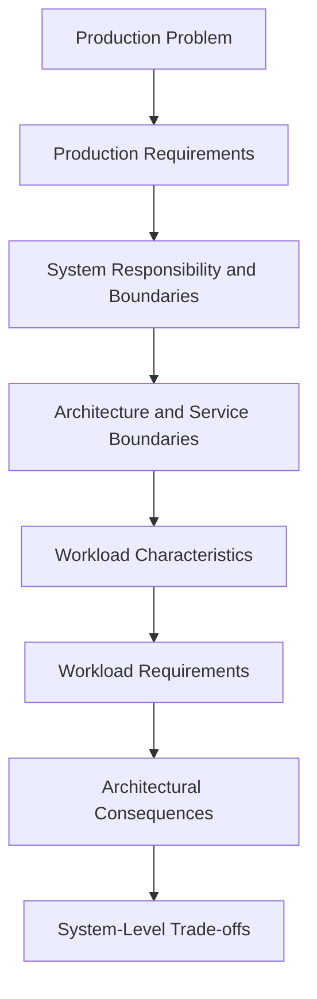

# PROD-01 — Production AI System Foundations

## Chapter Purpose

PROD-01 establishes the foundation for reasoning about **AI capabilities as production systems**.

The chapter answers the central engineering question:

> **What changes when an AI capability becomes a production system?**

A working AI capability or prototype is not automatically a production system. Production introduces real users, defined requirements, system boundaries, dependencies, workload behavior, ownership, operational constraints, and architectural trade-offs.

This chapter teaches how to frame those problems before moving into implementation and operational engineering.

---

## Scope

PROD-01 focuses on:

- Production AI problem framing
- Production requirements
- Users and system consumers
- Functional and operational requirements
- System responsibility and ownership
- Production boundaries
- Upstream and downstream responsibilities
- External dependencies
- System and service boundaries
- Component responsibilities
- Workload characteristics
- Workload requirements
- System-level constraints
- Architecture-level trade-offs

The chapter intentionally stays at the **system-foundation level**. Detailed implementation and operational concerns are handled by later PROD chapters.

---

## What PROD-01 Owns

| Area | Responsibility |
|---|---|
| Production problem framing | Understand what makes an AI capability a production engineering problem |
| Production requirements | Identify functional and operational requirements |
| System responsibility | Define what the AI system is responsible for |
| Production boundaries | Establish system, ownership, dependency, and responsibility boundaries |
| Architecture boundaries | Define component and service responsibilities |
| Workload characteristics | Understand workload behavior that influences system design |
| Workload requirements | Translate workload characteristics into engineering requirements |
| System constraints | Identify constraints that shape architectural choices |
| Architecture trade-offs | Evaluate competing architectural choices at the system level |

---

## What PROD-01 Does Not Own

The following areas are intentionally handled by later PROD chapters:

| Area | Primary Responsibility |
|---|---|
| Packaging, reproducibility, runtime contracts, and artifacts | PROD-02 |
| Model and inference serving | PROD-03 |
| Delivery and deployment engineering | PROD-04 |
| Observability and production telemetry | PROD-05 |
| Reliability engineering and failure handling | PROD-06 |
| Capacity planning and scaling | PROD-07 |
| Performance and resource optimization | PROD-08 |
| Production security | PROD-09 |
| Operations and incident response | PROD-10 |
| AI lifecycle and continuous production improvement | PROD-11 |
| Production readiness and architecture validation | PROD-12 |

These areas may be referenced when explaining why production boundaries or architecture decisions matter, but PROD-01 does not teach them in depth.

---

## Learning Outcomes

After completing PROD-01, you should be able to:

1. Explain why a working AI capability is not necessarily a production system.
2. Distinguish an AI capability from the larger system that delivers it.
3. Identify production users, consumers, requirements, and expectations.
4. Distinguish functional requirements from operational requirements.
5. Define system responsibility and production boundaries.
6. Identify upstream, downstream, internal, and external dependencies.
7. Reason about component and service boundaries.
8. Describe workload characteristics that influence architecture.
9. Translate workload characteristics into system requirements.
10. Identify system-level constraints.
11. Compare architecture choices using explicit trade-offs.
12. Explain the relationship between requirements, constraints, architecture choices, and operational consequences.

---

## Chapter Progression



The progression moves from **problem framing** toward **architecture reasoning**.

The learner first establishes what the production system must accomplish, then determines where responsibility lies, how the system should be structured, and how workload behavior influences architectural decisions.

---

## Teaching File Map

### 01 — Production AI Problem and Production Boundaries

**File:** [`01-Production-AI-Problem-and-Production-Boundaries.md`](./01-Production-AI-Problem-and-Production-Boundaries.md)

Focuses on:

- AI capability vs production system
- Production problem framing
- Users and consumers
- Functional requirements
- Operational requirements
- System responsibility
- Production boundaries
- External dependencies
- Upstream and downstream responsibilities
- Ownership boundaries
- Production constraints
- Responsibilities hidden by prototypes

**Core question:**

> What makes an AI capability a production problem, and where should the production boundary be drawn?

---

### 02 — Production AI System Architecture and Service Boundaries

**File:** [`02-Production-AI-System-Architecture-and-Service-Boundaries.md`](./02-Production-AI-System-Architecture-and-Service-Boundaries.md)

Focuses on:

- Production system architecture
- Component responsibilities
- Service boundaries
- Interfaces
- Dependencies
- Synchronous and asynchronous responsibility at a conceptual level
- Internal and external components
- Control and data responsibilities
- Ownership
- Coupling and cohesion
- Boundary-driven architecture
- Architecture trade-offs
- AI-specific components inside larger systems

**Core question:**

> How should a production AI system be decomposed into components or services with clear responsibilities and boundaries?

---

### 03 — Production Workload Characteristics and Trade-offs

**File:** [`03-Production-Workload-Characteristics-and-Trade-offs.md`](./03-Production-Workload-Characteristics-and-Trade-offs.md)

Focuses on:

- Request/response workloads
- Batch workloads
- Interactive workloads
- Asynchronous workloads
- Latency sensitivity
- Throughput
- Traffic variability
- Request and response size
- Compute intensity
- Accelerator dependence
- Stateful vs stateless behavior
- Dependency behavior
- Predictability and variability
- Cost sensitivity
- Availability expectations
- Data movement
- Resource contention

The core reasoning pattern is:

```text
Workload Characteristic
        ↓
Requirement
        ↓
Architectural Consequence
        ↓
Trade-off
```

**Core question:**

> Which workload characteristics influence architecture, and what trade-offs do they create?

---

## Dependencies

PROD-01 builds on engineering and AI foundations that allow the learner to reason about:

- Software systems
- APIs and interfaces
- Components and dependencies
- Basic system architecture
- AI model capabilities
- AI application workflows
- System requirements and constraints

Detailed production implementation topics are intentionally deferred to later PROD chapters.

---

## Cross-Chapter Relationships

PROD-01 provides the **system-level foundation** for the rest of the PROD domain.

```text
PROD-01
Production Problem
        ↓
Requirements
        ↓
Boundaries
        ↓
Architecture
        ↓
Workload Characteristics
        ↓
Trade-offs
        ↓
Later Production Engineering
```

The later PROD chapters build on these foundations:

- **PROD-02** extends system reasoning into packaging and runtime consistency.
- **PROD-03** extends workload and architecture reasoning into serving and inference execution.
- **PROD-04** extends system responsibility into delivery and deployment.
- **PROD-05** extends production requirements into observability and telemetry.
- **PROD-06** extends system boundaries into reliability and failure handling.
- **PROD-07** extends workload characteristics into capacity and scaling decisions.
- **PROD-08** extends workload requirements into performance and resource optimization.
- **PROD-09** extends system and ownership boundaries into production security.
- **PROD-10** extends system responsibility into operational response and recovery.
- **PROD-11** extends production systems into AI lifecycle and continuous improvement.
- **PROD-12** validates the resulting production architecture and operational design.

These relationships describe **dependency and concept flow**, not additional teaching responsibilities for PROD-01.

---

## Concept Ownership

PROD-01 is the primary teaching location for:

- Production AI problem framing
- Production requirements
- Production boundaries
- System responsibility
- Component and service boundaries
- Workload characteristics
- Workload requirements
- System-level constraints
- Architecture-level trade-offs

Later chapters may reference these concepts, but should not re-teach them in depth.

Likewise, PROD-01 should not absorb the detailed implementation concerns owned by later PROD chapters.

---

## Recommended Learning Order

Complete the chapter in this order:

```text
01 — Production AI Problem and Production Boundaries
                    ↓
02 — Production AI System Architecture and Service Boundaries
                    ↓
03 — Production Workload Characteristics and Trade-offs
```

The order is intentional:

1. Define the production problem.
2. Establish responsibility and boundaries.
3. Decompose the system.
4. Understand workload behavior.
5. Evaluate architectural consequences and trade-offs.

---

## Chapter Completion Criteria

Consider PROD-01 complete when you can independently:

- Explain why a prototype that works may still be unsuitable for production.
- Define the production boundary of an AI system.
- Identify what belongs inside and outside the system.
- Identify important external dependencies and ownership boundaries.
- Define responsibilities for major system components.
- Explain why service boundaries exist.
- Describe how workload characteristics influence architecture.
- Translate workload characteristics into requirements.
- Identify important system-level constraints.
- Compare architectural options using explicit trade-offs.
- Explain why adding more components does not automatically produce a better architecture.
- Explain why production engineering is broader than simply deploying a model.

---

## Navigation

### Teaching Files

1. [Production AI Problem and Production Boundaries](./01-Production-AI-Problem-and-Production-Boundaries.md)
2. [Production AI System Architecture and Service Boundaries](./02-Production-AI-System-Architecture-and-Service-Boundaries.md)
3. [Production Workload Characteristics and Trade-offs](./03-Production-Workload-Characteristics-and-Trade-offs.md)

### Chapter Relationship

PROD-01 establishes the production-system reasoning foundation used by the remaining PROD chapters.

The detailed implementation and operational concerns introduced later should be understood as extensions of the requirements, boundaries, workload characteristics, and architectural decisions established here.
