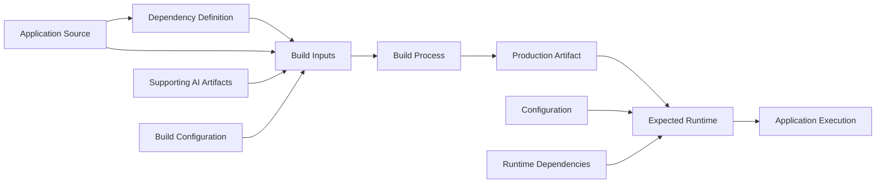

# AI Application Packaging and Reproducibility

## Learning Objectives

By the end of this chapter, you should be able to:

- Explain what it means to package an AI application for production.
- Identify the boundary between application source code, dependencies, configuration, and runtime assumptions.
- Explain why reproducibility is a production engineering requirement.
- Distinguish direct and transitive dependencies and explain why dependency drift matters.
- Explain build reproducibility, runtime reproducibility, and behavioral reproducibility.
- Identify AI-specific factors that make reproducibility more difficult.
- Explain why model artifacts and supporting AI assets must be treated as explicit production inputs.
- Identify the difference between a reproducible build and deterministic model behavior.
- Explain the relationship between packaging, runtime assumptions, artifact identity, and traceability.
- Recognize common packaging and reproducibility failure modes.
- Evaluate basic packaging trade-offs without assuming that one packaging strategy fits every AI system.

---

## Prerequisites

You should already understand:

- Basic software application structure.
- Source code and application dependencies.
- Basic versioning concepts.
- The distinction between development and production environments.
- Basic understanding of AI/ML applications and model artifacts.

You do not need prior knowledge of containers or deployment systems.

---

## Estimated Reading Time

**35–45 minutes**

---

## Before We Start

An AI application may work correctly on a developer's machine and still fail when moved to another environment.

The application may depend on:

- a particular Python version,
- specific library versions,
- operating-system packages,
- a particular model version,
- tokenizer files,
- environment variables,
- configuration values,
- filesystem behavior,
- accelerator capabilities,
- external services,
- or assumptions that were never explicitly documented.

This creates a basic production engineering problem:

> **How do we turn an AI application into a reproducible production artifact that can run consistently across environments?**

The answer begins with packaging.

Packaging is not simply creating a ZIP file, building a container image, or copying source code to a server.

It is the process of defining **what constitutes the application, what it depends on, what inputs it requires, and what must remain consistent for it to execute correctly.**

---

## Why This Exists

In development, engineers often control the environment around an application.

For example:

```text
Developer Machine
├── Python 3.x
├── Installed Libraries
├── Environment Variables
├── Local Model Files
├── OS Libraries
├── Application Code
└── Developer Assumptions
```

The application may work because all of these pieces happen to align.

Production is different.

The application may run on:

- another machine,
- another operating system,
- another runtime version,
- another dependency set,
- another accelerator,
- another filesystem,
- or another configuration.

If the required inputs are not known and controlled, the application becomes difficult to reproduce.

This is the origin of the familiar engineering problem:

> **“It works on my machine.”**

The real problem is not that the developer's machine is special.

The problem is that the application depends on environmental state that has not been made explicit.

Production packaging attempts to reduce this hidden state.

---

# Mental Model

A useful starting model is:

```text
Development Environment
        ↓
Application + Dependencies + Configuration
        ↓
Reproducible Production Artifact
        ↓
Defined Runtime Expectations
        ↓
Consistent Execution
```

The important idea is that the production artifact should not depend on undocumented assumptions.

A more complete reproducibility model is:

```text
Reproducibility
=
Known Inputs
+
Known Dependencies
+
Known Build Process
+
Known Configuration
+
Known Runtime
+
Identifiable Artifact
```

This does **not** mean that every execution must produce byte-for-byte identical results.

AI systems introduce additional sources of variation.

The engineering goal is to make the important inputs and assumptions explicit enough that differences can be understood, controlled, and reproduced where required.

---

# Core Concepts

## 1. What Is Application Packaging?

Application packaging means defining and assembling the components required for an application to be built and executed.

For a conventional application, this might include:

```text
Application
├── Source Code
├── Runtime
├── Dependencies
├── Configuration
└── Supporting Files
```

An AI application can contain additional components:

```text
AI Application
├── Application Code
├── Runtime
├── Software Dependencies
├── Model Artifact
├── Tokenizer
├── Prompt / Configuration Assets
├── Pre-processing Logic
├── Post-processing Logic
└── Environment Configuration
```

Not every AI system packages all of these components together.

Some components may remain external.

For example:

```text
Application Artifact
        │
        ├── Application Code
        ├── Runtime Dependencies
        └── Configuration Contract
                 │
                 └── External Model Service
```

Another application may package the model locally:

```text
Application Artifact
        │
        ├── Application Code
        ├── Runtime Dependencies
        └── Model Artifact
```

Therefore, packaging is fundamentally about defining **boundaries and relationships**, not simply collecting files.

---

## 2. Source Code Is Not the Whole Application

A common mistake is to assume:

> “If the source code is available, the application is reproducible.”

It is not.

Consider:

```text
app.py
requirements.txt
```

These files may still be insufficient.

The application may depend on:

```text
Python Version
Library Versions
OS Libraries
Model Files
Configuration
External Services
Runtime Capabilities
```

Therefore:

```text
Source Code
≠
Complete Application Definition
```

A production-oriented package should make important external dependencies explicit.

---

# 3. Defining the Application Boundary

Before packaging an AI application, determine what belongs to the application boundary.

For example:

```text
+---------------------------------------+
|        AI Application Boundary        |
|                                       |
|  Application Code                     |
|  Business Logic                       |
|  Model Integration                    |
|  Pre/Post Processing                  |
|  Runtime Dependencies                 |
|                                       |
+---------------------------------------+
       │          │           │
       │          │           │
       ↓          ↓           ↓
    Model      Database    External API
   Artifact
```

The boundary depends on the architecture.

A locally hosted model may be part of the application's deployable artifact.

A model accessed through an external service may not be.

Similarly, a vector index may be:

- bundled with an application in a small controlled system,
- stored separately,
- generated as part of another process,
- or maintained as an external service.

There is no universal packaging boundary.

The engineering requirement is to make the boundary explicit.

---

# 4. Dependencies

An application depends on more than the libraries explicitly imported by its source code.

Consider:

```text
Application
    │
    ├── FastAPI
    │      │
    │      └── Starlette
    │
    ├── ML Library
    │      │
    │      └── Numerical Library
    │
    └── Database Driver
```

The application has direct dependencies and transitive dependencies.

### Direct Dependency

A dependency explicitly required by the application.

Example:

```text
Application
    ↓
FastAPI
```

### Transitive Dependency

A dependency required by another dependency.

Example:

```text
Application
    ↓
FastAPI
    ↓
Starlette
```

The application may not directly import Starlette, but its behavior can still depend on it.

This is why dependency management is a reproducibility concern.

---

# 5. Dependency Versions and Drift

Suppose an application was developed with:

```text
Library A = 1.4
Library B = 2.1
Library C = 5.0
```

Later, the environment contains:

```text
Library A = 1.8
Library B = 2.4
Library C = 5.3
```

The application may:

- continue working,
- behave differently,
- fail during startup,
- fail only for certain requests,
- produce different model behavior,
- or expose compatibility problems.

This is dependency drift.

The important production principle is:

> **The application should not rely on accidental dependency versions.**

Dependency versions should be intentionally managed and reproducible.

Lock files or equivalent dependency-resolution mechanisms can help record resolved dependency sets where the chosen ecosystem supports them.

The specific package manager is an implementation choice.

The engineering principle is broader:

```text
Known Dependency Set
        ↓
Repeatable Environment
        ↓
More Predictable Execution
```

---

# 6. Reproducible Environments

A reproducible runtime environment is one whose relevant dependencies, runtime characteristics, and required inputs can be recreated or controlled from known definitions.

For an AI application, those inputs may include:

```text
Runtime Version
Dependency Versions
System Dependencies
Model Version
Model Configuration
Application Configuration
Build Inputs
```

The goal is not necessarily to reproduce every byte of the operating system.

The goal is to identify and control the environmental factors that materially affect application execution.

---

# 7. Build Inputs and Outputs

A production artifact is produced through a build process.

Conceptually:

```text
Source
   +
Dependencies
   +
Build Configuration
   +
Supporting Artifacts
   ↓
Build Process
   ↓
Production Artifact
```

The build process itself is an input to reproducibility.

If two engineers use the same source but different dependency resolution, build configuration, or build tooling, they may produce different artifacts.

Therefore, reproducibility requires more than storing source code.

It requires understanding:

```text
What went into the build?
        ↓
How was it built?
        ↓
What artifact came out?
```

This becomes particularly important when an AI application includes model files or other large supporting assets.

A production artifact is a **versioned and identifiable output of the build process that contains or references the components required for the intended application runtime.**

The exact mechanism used to identify the artifact depends on the artifact system.

---

# 8. Three Types of Reproducibility

Reproducibility is not one single property.

Three useful categories are:

## 8.1 Build Reproducibility

Can the same defined inputs and build process produce an equivalent artifact?

```text
Same Inputs
     +
Same Build Process
     ↓
Equivalent Artifact
```

---

## 8.2 Runtime Reproducibility

Can the artifact execute under the expected runtime conditions without depending on undocumented environmental differences?

For example:

```text
Artifact
   +
Expected Runtime
   +
Expected Dependencies
   +
Expected Configuration
   ↓
Expected Execution
```

Runtime reproducibility does not guarantee that every execution will produce identical output.

---

## 8.3 Behavioral Reproducibility

Can the system produce sufficiently consistent behavior for the intended application?

This is more complicated for AI systems.

Outputs can vary because of:

- model sampling,
- randomness,
- model implementation,
- hardware differences,
- numerical behavior,
- external model updates,
- changing external data,
- or other system inputs.

Therefore:

> **A reproducible package does not automatically produce deterministic AI behavior.**

This distinction is critical.

---

# 9. AI-Specific Packaging Complexity

AI applications often have additional artifacts and compatibility relationships.

Examples include:

- model weights,
- tokenizers,
- embedding models,
- prompt assets,
- model configuration,
- preprocessing assets,
- postprocessing logic,
- vector indexes,
- evaluation datasets,
- inference libraries,
- accelerator-specific runtimes.

These components may have compatibility relationships.

For example:

```text
Application
    │
    ├── Model
    │     ├── Model Configuration
    │     └── Tokenizer
    │
    └── Inference Runtime
           └── Required Libraries
```

These components do not necessarily have to be packaged together.

The engineering question is:

> **Which components must be versioned and associated together for the intended application runtime, and which can remain external?**

Changing one component may affect another.

For example:

```text
Model Version
      ↓
Tokenizer Compatibility
      ↓
Inference Library Compatibility
      ↓
Runtime Compatibility
```

This is why AI packaging cannot be treated as simply packaging application source code.

---

# 10. Model Artifact Compatibility

Consider an application that expects a particular model.

The model may have associated assumptions about:

- model format,
- tokenizer,
- preprocessing,
- inference library,
- runtime version,
- hardware capabilities.

Therefore, the application should identify which model artifact it expects.

For example:

```text
Application Version
        │
        └── Expected Model
                │
                ├── Model Version
                ├── Model Format
                └── Required Runtime Compatibility
```

The exact implementation depends on the model ecosystem.

The important principle is:

> **The relationship between application and model must be explicit enough to reproduce the intended runtime.**

---

# 11. Configuration as a Reproducibility Input

Configuration can influence application behavior just as much as source code.

Examples include:

```text
MODEL_ID
MODEL_VERSION
DATABASE_ENDPOINT
REQUEST_TIMEOUT
FEATURE_FLAG
EMBEDDING_DIMENSION
MAX_INPUT_LENGTH
```

Consider:

```text
Application Code
      +
Configuration A
      ↓
Behavior A
```

versus:

```text
Application Code
      +
Configuration B
      ↓
Behavior B
```

The source code has not changed.

The application behavior has.

Therefore:

> **Configuration is part of the application's effective runtime input.**

For reproducibility, important configuration assumptions should be known and controlled rather than hidden inside developer environments.

Configuration injection, validation, and runtime contracts are covered in the next chapter. Detailed environment-specific configuration, artifact metadata, and provenance are covered in the following chapter.

---

# 12. Runtime Assumptions

Every application has assumptions about the environment in which it executes.

Examples:

```text
Python Version
Library Versions
Filesystem Availability
Network Connectivity
External Service Availability
Required Environment Variables
CPU / Memory Requirements
Accelerator Availability
Startup Requirements
```

Some assumptions are obvious.

Others are hidden.

For example:

```python
model = load_model("/models/model.bin")
```

This code assumes:

- `/models/model.bin` exists,
- the process can read it,
- the model format is supported,
- required libraries are installed,
- the runtime can execute the model.

These assumptions form part of the application's runtime expectations.

A production package should make important assumptions discoverable.

The detailed definition of runtime contracts belongs to the next chapter.

---

# Internal Working

A simplified packaging flow looks like this:



The important relationship is:

```text
Source
+
Dependencies
+
Supporting Artifacts
+
Build Inputs
+
Configuration
        ↓
Production Artifact
        ↓
Expected Runtime
        ↓
Execution
```

A packaging strategy is useful when these relationships are explicit enough to reproduce the intended application environment.

---

# Practical Examples

## Example 1: FastAPI AI Service

Consider a FastAPI application that calls an embedding model.

A simplified structure might be:

```text
AI Service
├── Application Code
├── FastAPI Runtime
├── Python Dependencies
├── Embedding Model
├── Model Configuration
└── Environment Configuration
```

A weak packaging approach might be:

```text
Copy Source Code
        ↓
Install Latest Dependencies
        ↓
Run Application
```

This creates uncertainty.

A stronger approach is:

```text
Defined Source
      +
Defined Dependency Set
      +
Defined Model Artifact
      +
Known Configuration
      ↓
Build
      ↓
Identifiable Application Artifact
```

The exact packaging technology is not the main issue.

The important issue is that the inputs are known.

---

## Example 2: Local Model Inference

Suppose an application runs a local model.

The application depends on:

```text
Application
    ↓
Inference Library
    ↓
Model Format
    ↓
Model Artifact
```

The model also requires a compatible runtime.

A change to the inference library could therefore affect whether the model loads or behaves as expected.

The production engineering question becomes:

> Which versions and artifacts are part of the supported combination?

This relationship should be captured rather than left to environmental assumptions.

---

## Example 3: “Works on My Machine”

Suppose a developer says:

> “The application works locally.”

A useful engineering response is:

```text
Which runtime version?
Which dependency versions?
Which model version?
Which configuration?
Which system libraries?
Which hardware assumptions?
Which external services?
Which build process?
```

The goal is not to blame the developer.

The goal is to convert implicit assumptions into explicit inputs.

That is the foundation of reproducibility.

---

# Containers: A Packaging Mechanism

Containers are one way to package an application's filesystem, runtime components, and dependencies into a defined artifact.

Conceptually:

```text
Container Image
├── Application
├── Runtime
├── Dependencies
└── Supporting Files
```

The resulting image can provide a more consistent starting point across environments.

However:

> **Containerization does not automatically guarantee reproducibility.**

A container can still contain:

- unpinned dependencies,
- mutable external inputs,
- ambiguous model versions,
- environment-specific assumptions,
- non-reproducible build steps,
- or configuration that changes execution.

Therefore:

```text
Containerization
        ≠
Automatic Reproducibility
```

Containers are a packaging mechanism.

They are not a substitute for dependency management, explicit configuration, controlled build inputs, or artifact identification.

The detailed container model, image-versus-container distinction, runtime environment, configuration contracts, and immutable artifact thinking are covered in the next chapter.

---

# Production Perspective

In production, packaging becomes an engineering control rather than a convenience.

A production artifact should be sufficiently defined that engineers can answer:

```text
What is this application?
What source produced it?
Which dependencies does it use?
Which model does it expect?
Which supporting artifacts does it require?
Which configuration assumptions exist?
Which runtime conditions are required?
```

This improves:

- reproducibility,
- debugging,
- rollback analysis,
- incident investigation,
- environment consistency,
- operational traceability,
- and auditability where required.

Packaging does not solve every production problem.

It establishes a reliable foundation for later concerns such as deployment, scaling, serving, monitoring, and security.

---

# Artifact Identity

A production artifact should be identifiable.

Consider two artifacts:

```text
ai-service
ai-service
```

The names alone do not tell us whether they are the same artifact.

A stronger identity may include information such as:

```text
Application
Version
Build Identifier
Model Version
Dependency Set
```

The exact identity mechanism depends on the artifact system.

The important principle is:

> **Engineers should be able to distinguish one production artifact from another.**

This chapter introduces that requirement because reproducibility depends on knowing what was actually produced.

Detailed artifact metadata, lineage, and provenance are covered in the next chapter.

---

# Provenance and Traceability

Reproducibility also requires understanding where an artifact came from.

At a high level:

```text
Source
   ↓
Build
   ↓
Artifact
   ↓
Runtime
```

Useful questions include:

- Which source version produced this artifact?
- Which dependency set was used?
- Which model artifact was associated with it?
- Which build process produced it?
- Which configuration assumptions were expected?

This is provenance.

The purpose here is to establish the need for traceability.

Detailed artifact metadata, build-to-artifact relationships, lineage, and provenance records are covered in the next chapter.

---

# Engineering Decisions and Trade-offs

Packaging decisions involve trade-offs.

## 1. Bundle More vs Externalize More

Bundling more components can improve consistency.

But it can also produce larger and more tightly coupled artifacts.

Externalizing components can provide more flexibility.

But it introduces runtime dependencies.

---

## 2. Pinned Dependencies vs Update Flexibility

Pinned dependencies improve reproducibility.

But they can make dependency updates slower.

Less restrictive dependency management may make updates easier.

But it increases the risk of environmental drift.

---

## 3. Larger vs Smaller Artifacts

A larger artifact may contain more required dependencies and supporting assets.

A smaller artifact may reduce transfer and storage costs.

However, external dependencies then become more important.

The correct choice depends on the application and its operational requirements.

---

## 4. Immutable vs Runtime Modification

An artifact that is modified after creation becomes harder to identify and reproduce.

An immutable artifact provides a clearer relationship between:

```text
Build
  ↓
Artifact
  ↓
Execution
```

Runtime modification may provide flexibility, but it increases uncertainty.

The detailed immutable-artifact model is covered in the next chapter.

---

## 5. Reproducibility vs Rapid Updates

Highly controlled environments improve reproducibility.

But excessive rigidity can slow experimentation and updates.

Production engineering therefore requires a balance:

```text
Control
   ↕
Change Velocity
```

The objective is not maximum rigidity.

The objective is sufficient control over the inputs that materially affect production behavior.

---

# Common Mistakes and Misconceptions

## Mistake 1: “Source Code Is Enough”

Source code alone does not define the complete runtime.

Dependencies, models, configuration, and runtime assumptions may also matter.

---

## Mistake 2: “A Requirements File Guarantees Reproducibility”

A dependency file is useful, but it may not capture every relevant system dependency, build input, model artifact, or runtime assumption.

---

## Mistake 3: “Containers Automatically Make Applications Reproducible”

Containers improve packaging consistency but do not automatically control every input that affects reproducibility.

---

## Mistake 4: “Reproducible Means Deterministic”

An application can be reproducibly packaged while an AI model still produces variable outputs.

Packaging reproducibility and behavioral determinism are different properties.

---

## Mistake 5: “The Model Is Just Another File”

AI models may have compatibility relationships with tokenizers, inference libraries, runtime versions, hardware, and application logic.

They should be treated as explicit production artifacts or dependencies.

---

## Mistake 6: “Configuration Does Not Affect Reproducibility”

Configuration can materially change application behavior.

Important configuration assumptions must therefore be identified.

---

## Mistake 7: “Artifact Name Is Artifact Identity”

A human-readable name is not necessarily sufficient to uniquely identify a production artifact.

Artifacts should have an appropriate identity mechanism.

---

## Interview Questions

## 1. What does reproducible packaging mean?

**Expected answer:**

Reproducible packaging means defining the application's important inputs, dependencies, build process, configuration, runtime expectations, and resulting artifact clearly enough that the intended production environment can be recreated consistently.

---

## 2. Why is “works on my machine” a production problem?

**Expected answer:**

Because the application may depend on undocumented environmental state. Another environment may have different dependency versions, runtime versions, configuration, system libraries, models, or hardware capabilities.

---

## 3. What is the difference between build and runtime reproducibility?

**Expected answer:**

Build reproducibility concerns whether equivalent defined inputs and build processes produce an equivalent artifact. Runtime reproducibility concerns whether that artifact can execute consistently under its expected runtime conditions.

---

## 4. Does reproducible packaging guarantee deterministic LLM output?

**Expected answer:**

No. Packaging controls application and environment inputs, but AI output can still vary because of sampling, model behavior, external inputs, hardware differences, provider-side changes, or other sources of nondeterminism.

---

## 5. Why are transitive dependencies relevant?

**Expected answer:**

Because an application can depend indirectly on libraries that it does not explicitly import. Changes to those transitive dependencies can affect compatibility or behavior.

---

## 6. What additional challenges do AI applications have compared with conventional applications?

**Expected answer:**

AI applications may depend on model artifacts, tokenizers, inference runtimes, model configuration, accelerator compatibility, preprocessing and postprocessing assets, external model providers, and other AI-specific components.

---

## 7. Does packaging mean every component must be bundled together?

**Expected answer:**

No. Packaging defines the application's deployable boundary and its relationships with external dependencies. Some components may be bundled while others remain external.

---

## Quick Revision

### Application Packaging

```text
Application
+
Dependencies
+
Supporting Artifacts
+
Configuration
+
Runtime Assumptions
```

---

### Reproducibility

```text
Known Inputs
+
Known Dependencies
+
Known Build Process
+
Known Configuration
+
Known Runtime
+
Identifiable Artifact
```

---

### Three Reproducibility Dimensions

| Dimension | Main Question |
|---|---|
| Build | Can the artifact be recreated from known inputs and build process? |
| Runtime | Can the artifact execute under its expected conditions? |
| Behavioral | Can the system produce sufficiently consistent behavior? |

---

### AI Packaging

Important components may include:

- Model artifacts
- Tokenizers
- Inference libraries
- Prompt/configuration assets
- Pre/post-processing
- Vector indexes where applicable
- Accelerator/runtime dependencies
- External model provider configuration

---

### Important Distinction

```text
Containerization
        ≠
Automatic Reproducibility
```

And:

```text
Reproducible Packaging
        ≠
Deterministic AI Behavior
```

---

# Key Takeaways

1. Packaging defines what an AI application requires to execute.
2. Source code alone is rarely a complete production definition.
3. Dependencies must be intentionally managed to reduce environmental drift.
4. Reproducibility requires known inputs, dependencies, build process, configuration, runtime, and artifact identity.
5. Build, runtime, and behavioral reproducibility are different concerns.
6. AI applications introduce additional packaging complexity through models, tokenizers, inference runtimes, and supporting assets.
7. Model artifacts should have explicit compatibility relationships with the application and runtime.
8. Configuration is an important input to application behavior.
9. Containers are useful packaging mechanisms but do not automatically guarantee reproducibility.
10. Artifact identity and traceability are necessary foundations for production reproducibility.
11. Packaging decisions involve trade-offs between control, flexibility, coupling, size, and change velocity.
12. Packaging is the foundation for later production concerns; it is not itself a deployment, scaling, serving, CI/CD, or security solution.

---

## Further Reading

Continue with:

- [Containers, Configuration, and Runtime Contracts](./02-Containers-Configuration-and-Runtime-Contracts.md)
- [Production Artifacts, Dependencies, and Environment Configuration](./03-Production-Artifacts-Dependencies-and-Environment-Configuration.md)

For broader production-system context, see:

- [PROD-01 — Production AI Problem and Production Boundaries](../PROD-01-Production-AI-System-Foundations/Readme.md)
- [PROD-03 — AI Model Serving and Inference](../PROD-03-Production-Model-and-AI-Serving/Readme.md)
- [PROD-04 — AI CI/CD and Delivery](../PROD-04-Deployment-and-Release-Engineering/Readme.md)
- [PROD-09 — AI Supply Chain Security and Trust](../PROD-09-Production-AI-Security/Readme.md)

---

## Chapter Principle

> **A production AI application is reproducible only when the important inputs, dependencies, build process, configuration, runtime assumptions, and resulting artifact are sufficiently known and identifiable to recreate the intended execution environment.**
