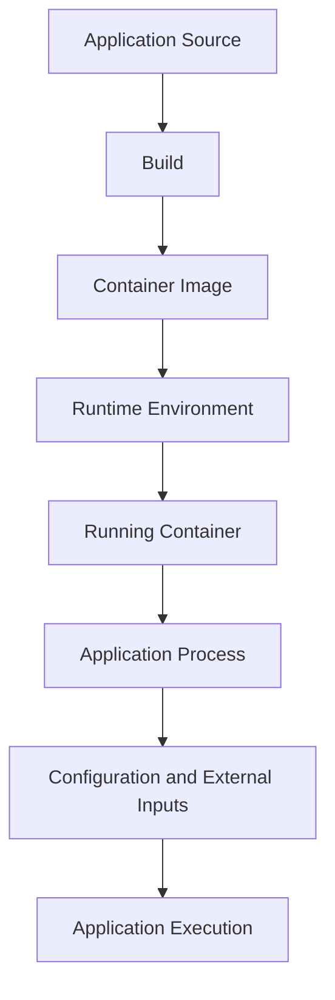

# Containers, Configuration, and Runtime Contracts

## Learning Objectives

After completing this chapter, you should be able to:

- Explain why a production AI application needs an explicit runtime environment.
- Explain what containers provide and what they do not provide.
- Distinguish a container image from a running container.
- Explain the relationship between an application artifact and its runtime environment.
- Distinguish code, configuration, secrets, artifacts, and environment-specific inputs.
- Explain how configuration can be supplied to an application without changing the packaged artifact.
- Define a configuration contract.
- Explain why configuration validation matters before application execution.
- Identify runtime assumptions that must be explicit for an AI application.
- Explain ports and application interfaces at a conceptual level.
- Explain startup behavior and why successful startup does not necessarily mean the application is ready.
- Distinguish health and readiness as conceptual runtime expectations.
- Define a runtime contract and explain why it is important in production.
- Identify required, optional, and conditional runtime assumptions.
- Evaluate common packaging and runtime trade-offs in AI systems.
- Recognize the limits of containerization and avoid treating containers as a complete production solution.

## Prerequisites

Before reading this chapter, you should understand:

- Basic application packaging and reproducibility.
- Direct and transitive dependencies.
- Build inputs and build outputs.
- Runtime environments.
- The distinction between build-time and runtime concerns.
- Why reproducibility matters for production AI systems.

These concepts are introduced in [01-AI-Application-Packaging-and-Reproducibility.md](./01-AI-Application-Packaging-and-Reproducibility.md).

---

## Estimated Reading Time

**40–50 minutes**

---

## Before We Start

The previous chapter established a basic problem:

> An AI application cannot be considered reproducible merely because its source code is available.

The application also depends on libraries, runtime versions, system capabilities, model artifacts, configuration, and other runtime assumptions.

This chapter moves one step further.

The question is:

> **How do we define a consistent runtime environment and make its assumptions explicit?**

A production artifact is useful only when a runtime environment can execute it according to known expectations.

This chapter therefore focuses on the boundary between:

```text
Production Artifact
        ↓
Runtime Environment
        ↓
Application Execution
```

Containers are one important mechanism for packaging and isolating runtime environments.

But containers are not the complete solution.

A container does not automatically make an application reproducible, correctly configured, secure, scalable, observable, or deployable.

The engineering goal is to make the runtime **explicit, controlled, and understandable**.

---

# Why This Exists

Consider an AI application that works correctly on a developer's machine.

The application depends on:

- a particular Python runtime,
- specific libraries,
- a particular model version,
- configuration values,
- environment variables,
- external services,
- filesystem behavior,
- network access,
- CPU or GPU capabilities.

The application is then packaged and executed elsewhere.

Problems can appear:

```text
Development Environment
        ↓
Application
        ↓
Different Runtime
        ↓
Different Configuration
        ↓
Different Dependencies
        ↓
Different Behavior
```

The problem is not necessarily the application code.

The problem may be that the **runtime assumptions were never made explicit**.

Production engineering therefore requires more than packaging the application.

It requires defining the environment in which the artifact is expected to execute.

---

# Mental Model

A useful mental model is:

```text
Application Artifact
        ↓
Runtime Environment
        ↓
Configuration
        ↓
External Dependencies
        ↓
Runtime Contract
        ↓
Application Execution
```

Each layer answers a different question.

| Layer | Question |
|---|---|
| Application artifact | What are we running? |
| Runtime environment | What environment runs it? |
| Configuration | What values control its behavior? |
| External dependencies | What does it depend on outside itself? |
| Runtime contract | What assumptions must hold for execution to work? |
| Execution | Does the application behave according to those expectations? |

The runtime contract connects these pieces.

It describes the assumptions under which the application is expected to operate correctly.

---

# Core Concepts

## 1. Runtime Environment

A runtime environment is the collection of conditions under which an application executes.

It can include:

- operating-system characteristics,
- runtime language version,
- application libraries,
- system libraries,
- environment variables,
- filesystem assumptions,
- network access,
- CPU capabilities,
- GPU or accelerator capabilities,
- external services,
- model artifacts,
- configuration values.

For example, an AI application might require:

```text
Python 3.x
        +
specific application dependencies
        +
specific model runtime
        +
model artifact
        +
required configuration
        +
network access to an external service
```

The exact requirements depend on the application.

### Runtime consistency

Runtime consistency means that the relevant execution assumptions are controlled sufficiently that the application can be expected to behave according to its defined runtime contract across intended environments.

This does not mean every machine becomes physically identical.

Instead, the relevant differences are reduced, controlled, or explicitly represented.

---

# 2. Containers as Isolation and Packaging

A container is a mechanism for packaging an application together with many of its required runtime components and executing it within an isolated process environment.

Conceptually:

```text
Container Image
┌─────────────────────────────┐
│ Application                 │
│ Application Dependencies    │
│ Runtime Components          │
│ Supporting Files            │
│ Configuration Defaults      │
└─────────────────────────────┘
              ↓
        Running Container
              ↓
       Application Process
```

Containers are useful because they allow an application and its runtime dependencies to be represented as a defined artifact.

This can reduce differences between environments.

However, containers do not create an entirely independent computer.

They rely on underlying operating-system and host mechanisms.

A container therefore provides a controlled execution boundary, not a completely separate physical or virtual machine.

---

## Why Containers Help

Without containerization, an application might depend heavily on the state of the host environment.

For example:

```text
Host Machine
├── Python version
├── Installed libraries
├── System libraries
├── Environment variables
├── OS configuration
└── Developer-specific changes
```

Another machine may have:

```text
Different Python version
Different libraries
Different system dependencies
Different configuration
```

A container allows more of the application's required environment to be represented explicitly.

The important idea is:

> **Move relevant runtime assumptions from implicit host state into an explicit artifact and runtime contract.**

---

# 3. Image vs Running Container

One of the most important distinctions is between a **container image** and a **running container**.

## Container Image

An image is a packaged artifact used as the basis for creating a container.

It can contain:

- application code,
- application dependencies,
- runtime components,
- supporting files,
- model files where intentionally bundled,
- filesystem contents required by the application.

The image represents a defined application environment.

## Running Container

A container is a running execution instance created from an image.

Conceptually:

```text
Image
  ↓
Create / Start
  ↓
Running Container
  ↓
Application Process
```

The image is the packaged artifact.

The container is the runtime instance.

This distinction becomes important when reasoning about:

- reproducibility,
- artifact identity,
- configuration,
- runtime state,
- lifecycle,
- debugging.

---

# 4. Immutable Artifact Mental Model

A useful production principle is:

> **Build the artifact once, then run that artifact without modifying its core contents at runtime.**

Conceptually:

```text
Source
  ↓
Build
  ↓
Artifact
  ↓
Run
  ↓
Configuration injected at runtime
```

The application artifact should not depend on someone manually changing files inside a running environment.

For example, consider two approaches.

### Approach A — Immutable

```text
Build artifact
      ↓
Run artifact
      ↓
Provide configuration
      ↓
Execute
```

### Approach B — Runtime modification

```text
Build artifact
      ↓
Run artifact
      ↓
Manually modify files
      ↓
Install packages
      ↓
Change application behavior
      ↓
Execute
```

The second approach makes reproducibility and troubleshooting much harder.

If the runtime environment can be modified arbitrarily, two instances based on the same original artifact may no longer actually be equivalent.

---

# 5. Configuration vs Code

Configuration represents values that influence application behavior without requiring the application logic itself to be changed.

Examples include:

- service endpoints,
- model identifiers,
- feature flags,
- timeout values,
- retry settings,
- logging configuration,
- resource-related settings,
- environment-specific behavior.

For example:

```text
CODE

Which model client should be used?
        ↓
CONFIGURATION

Which model identifier should this environment use?
```

The code defines behavior.

Configuration provides environment- or deployment-specific values used by that behavior.

This separation allows the same artifact to be used with different legitimate runtime configurations.

---

# 6. Configuration vs Secrets

Configuration and secrets are related but should not be treated as identical concepts.

For example:

```text
Configuration
├── MODEL_ID
├── REQUEST_TIMEOUT
├── FEATURE_FLAG
└── SERVICE_ENDPOINT

Secret
├── API_KEY
├── DATABASE_PASSWORD
└── ACCESS_TOKEN
```

A secret is sensitive information that requires additional protection.

The important point for this chapter is conceptual:

> **Configuration describes how the application should operate; secrets are sensitive values that must be protected while being supplied to the application.**

Detailed secret-management and security controls are outside the scope of this chapter and belong to the security-focused production material.

---

# 7. Environment Variables

Environment variables are one mechanism for supplying runtime configuration to an application.

For example:

```text
MODEL_ID=production-model
REQUEST_TIMEOUT=30
SERVICE_ENDPOINT=https://example.internal
```

The application reads these values at runtime.

Conceptually:

```text
Container Image
      +
Environment Configuration
      ↓
Running Application
```

This allows the same artifact to operate with different legitimate configurations.

However, environment variables are not automatically the correct mechanism for every configuration type.

Other mechanisms can include:

- configuration files,
- command-line parameters,
- runtime configuration systems,
- platform-provided configuration,
- external configuration services.

The engineering principle is more important than the specific mechanism:

> **Configuration should be explicit, controlled, and separable from the application artifact where appropriate.**

---

# 8. Configuration Contract

A configuration contract defines the configuration that an application expects.

For example:

```text
MODEL_ID
    required
    string

REQUEST_TIMEOUT
    optional
    integer
    default = 30

VECTOR_STORE_ENDPOINT
    conditional
    required when semantic search is enabled
```

The contract answers questions such as:

- Which values are required?
- Which values are optional?
- What types are expected?
- What values are valid?
- Are defaults available?
- When does a configuration value become required?
- What happens when configuration is missing or invalid?

This is especially important for AI applications because behavior can depend heavily on configuration.

For example:

```text
LLM_PROVIDER
LLM_MODEL_ID
EMBEDDING_MODEL_ID
TEMPERATURE
MAX_OUTPUT_TOKENS
RETRIEVAL_TOP_K
```

A configuration contract makes these expectations explicit instead of leaving them hidden inside application code.

---

# 9. Configuration Validation

Configuration should ideally be validated before the application begins handling production traffic.

For example:

```text
Application Startup
        ↓
Read Configuration
        ↓
Validate Configuration
        ↓
Valid?
   /         \
 Yes         No
  ↓           ↓
Start       Fail Clearly
```

Validation may check:

- required values exist,
- values have the correct type,
- values are within acceptable ranges,
- mutually dependent settings are consistent,
- required conditional settings are present.

For example:

```text
RETRIEVAL_ENABLED=true

Therefore:

VECTOR_STORE_ENDPOINT → required
EMBEDDING_MODEL_ID    → required
```

Without validation, the application may start successfully and fail later during an actual request.

Early validation makes configuration errors easier to detect and diagnose.

---

# 10. Runtime Assumptions

A runtime assumption is something the application expects to be true while executing.

Examples:

```text
Runtime Version
    ↓
Expected Dependencies
    ↓
Required Configuration
    ↓
Network Access
    ↓
Filesystem Availability
    ↓
External Services
    ↓
Resource Availability
```

Some assumptions are required for every execution.

Some are optional.

Some become required only under particular application modes.

This distinction is important.

## Required Assumptions

The application cannot operate correctly without them.

Example:

```text
MODEL_ID
```

If the application is designed to load a model identified by this value, it is required.

## Optional Assumptions

The application can operate without them.

Example:

```text
DEBUG_MODE
```

The application may have a safe default.

## Conditional Assumptions

The assumption becomes required only when a particular feature or execution path is enabled.

Example:

```text
RAG_ENABLED=true
        ↓
VECTOR_STORE_ENDPOINT required
```

This classification makes runtime contracts more precise.

---

# 11. Ports and Interfaces

An application often exposes a network interface through which other systems communicate.

For example:

```text
Client
  ↓
Network Interface
  ↓
AI Application
```

The interface may define:

- protocol,
- address,
- port,
- request format,
- response format,
- error behavior.

At this stage, the important concept is not how to configure a specific platform.

The important question is:

> **What interface does the application expect to expose at runtime?**

For example, an HTTP-based AI service may conceptually expose:

```text
POST /generate
POST /embed
GET  /health
```

The exact endpoints depend on the application.

Interface design and API architecture are broader topics and should not be confused with the runtime contract itself.

---

# 12. Startup Behavior

Startup behavior describes what happens when the application begins execution.

A startup sequence may conceptually look like:

```text
Process Starts
      ↓
Load Configuration
      ↓
Validate Configuration
      ↓
Initialize Dependencies
      ↓
Load Required Artifacts
      ↓
Initialize Application
      ↓
Ready to Accept Work
```

Different applications may perform these steps differently.

For example, an AI application might load a local model during startup.

Another application might initialize a client for an external model provider instead.

Another might lazily initialize components only when the first request arrives.

The important engineering question is:

> **What must be true before the application can safely perform its intended work?**

---

# 13. Health and Readiness Expectations

Health and readiness are useful conceptual categories for describing runtime state.

They are not universal protocol semantics.

Different platforms and applications may implement them differently.

### Health

A health signal generally answers:

> Is the application process or runtime functioning according to the expected health criteria?

### Readiness

A readiness signal generally answers:

> Is the application currently prepared to perform its intended work?

These are not necessarily the same.

For example:

```text
Process Started
      ↓
Configuration Loaded
      ↓
Model Loading
      ↓
Model Ready
      ↓
Application Ready
```

During model loading, the process may be running while the application is not yet ready to serve inference.

This distinction becomes particularly important for AI applications with expensive initialization.

---

# 14. Resource and Runtime Assumptions

AI applications can have significant resource requirements.

Examples include:

- CPU capacity,
- memory,
- GPU availability,
- accelerator compatibility,
- local storage,
- network bandwidth,
- model memory requirements.

For example:

```text
Model
  ↓
Memory Requirement
  ↓
Runtime Environment
  ↓
Available Resource
```

A model may be valid and correctly packaged but still fail to execute because the runtime environment cannot provide the required resources.

Resource requirements therefore form part of the runtime contract.

However, this chapter does not define scaling or capacity-management strategies.

Those concerns belong to the scaling and capacity material in **PROD-07**.

---

# 15. Runtime Contract

The central concept of this chapter is the **runtime contract**.

A runtime contract describes the assumptions and expectations required for an application artifact to execute correctly.

Conceptually:

```text
                    Runtime Contract
                           │
        ┌──────────────────┼──────────────────┐
        ↓                  ↓                  ↓
    Environment        Configuration       Interfaces
        │                  │                  │
        ↓                  ↓                  ↓
   Dependencies       Required Values     Input / Output
        │
        ↓
     Resources
        │
        ↓
   External Services
```

A runtime contract may describe:

- runtime version,
- dependency expectations,
- required configuration,
- optional configuration,
- conditional configuration,
- required environment variables,
- filesystem assumptions,
- network assumptions,
- external services,
- resource requirements,
- startup behavior,
- input/output interfaces,
- health expectations,
- readiness expectations.

The contract answers:

> **What must be true for this artifact to execute correctly?**

---

# Internal Working

## Image to Running Application

A simplified lifecycle is:



The important distinction is that the image and runtime configuration are separate concerns.

The image represents the packaged application environment.

The runtime provides:

- configuration,
- environment-specific values,
- external connectivity,
- resources,
- runtime capabilities.

---

## What the Image Represents

The image can contain components such as:

```text
Application Code
Application Dependencies
Runtime Components
Supporting Files
Optional Model Artifacts
```

What should be included depends on the application's packaging boundary.

For example, a small LLM gateway may package:

```text
Application
+
Client Libraries
+
Runtime
```

while referencing an external model provider.

A local inference service may instead package:

```text
Application
+
Inference Runtime
+
Model Artifact
```

The correct boundary depends on operational requirements and trade-offs.

---

# What a Container Does Not Automatically Solve

Containerization can reduce environmental differences, but it does not automatically solve:

- dependency compatibility,
- deterministic builds,
- configuration correctness,
- model compatibility,
- external service availability,
- resource availability,
- runtime behavior,
- application bugs,
- nondeterministic model behavior,
- observability,
- scaling,
- deployment strategy,
- security.

Therefore:

```text
Containerization
        ≠
Complete Production Readiness
```

A container is one part of a production engineering system.

---

# Runtime Configuration Injection

A common model is:

```text
Immutable Image
       +
Environment-Specific Configuration
       +
Runtime Resources
       +
External Services
       ↓
Running Application
```

The image remains unchanged.

The environment supplies the values and capabilities that legitimately vary.

For example:

```text
Same Image

Development
MODEL_ID=dev-model

Staging
MODEL_ID=staging-model

Production
MODEL_ID=production-model
```

The same artifact can therefore be used across environments while the runtime configuration changes.

Whether this is desirable depends on the application's compatibility requirements.

---

# Runtime Contract Failure

Suppose an application expects:

```text
MODEL_ID
VECTOR_STORE_ENDPOINT
API_KEY
GPU capability
```

The runtime provides:

```text
MODEL_ID
VECTOR_STORE_ENDPOINT
API_KEY
```

but does not provide the required GPU capability.

The application may fail during initialization or execution.

The problem is not necessarily the application artifact.

The problem may be:

```text
Artifact Requirements
        ↓
Runtime Contract
        ↓
Environment
        ↓
Missing Requirement
```

This is why runtime assumptions should be explicit.

---

# Practical Examples

## Example 1 — FastAPI AI Service

Consider a FastAPI application that exposes an inference endpoint.

Conceptually:

```text
Client
   ↓
HTTP Interface
   ↓
FastAPI Application
   ↓
Model Client
   ↓
External Model Provider
```

The application may require:

```text
MODEL_ID
PROVIDER_ENDPOINT
REQUEST_TIMEOUT
```

The production artifact contains:

```text
Application Code
FastAPI
Required Libraries
Runtime
```

The environment provides:

```text
MODEL_ID
PROVIDER_ENDPOINT
REQUEST_TIMEOUT
Credentials
Network Access
```

The model itself does not need to be bundled into the artifact if inference is provided by an external service.

This illustrates an important packaging decision:

> **Not every AI dependency must be physically packaged into the same artifact.**

The relationship between the application and the external model provider still needs to be explicit.

---

## Example 2 — Local Model Inference

Consider an application that runs a local embedding model.

The runtime may require:

```text
Application
+
Inference Library
+
Model Artifact
+
Compatible Runtime
+
Required Memory
```

The model might be packaged into the same artifact:

```text
Application Artifact
├── Application
├── Runtime
├── Dependencies
└── Model
```

Or the model may be managed separately:

```text
Application Artifact
        +
External Model Artifact
        ↓
Runtime
```

Neither approach is universally correct.

The decision depends on:

- artifact size,
- update frequency,
- model ownership,
- deployment workflow,
- compatibility,
- startup requirements,
- operational independence.

---

## Example 3 — LLM Application

Consider an LLM application that uses an external provider.

The artifact may contain:

```text
Application
+
LLM Client
+
Prompt Templates
+
Business Logic
```

Runtime configuration may define:

```text
PROVIDER
MODEL_ID
TEMPERATURE
MAX_OUTPUT_TOKENS
REQUEST_TIMEOUT
```

Secrets may provide:

```text
API_KEY
```

The runtime contract may therefore require:

```text
Required:
    MODEL_ID
    PROVIDER
    API_KEY

Optional:
    TEMPERATURE

Conditional:
    VECTOR_STORE_ENDPOINT
    when RAG is enabled
```

This example demonstrates why configuration requirements should be classified instead of treating every setting as equally mandatory.

---

# Production Perspective

## Runtime as an Explicit System Boundary

A production AI application should make its runtime assumptions understandable.

Instead of:

```text
"Install these packages and hope it works."
```

the engineering model becomes:

```text
Artifact
   ↓
Defined Runtime Requirements
   ↓
Defined Configuration
   ↓
Defined External Dependencies
   ↓
Expected Execution
```

This improves:

- troubleshooting,
- reproducibility,
- environment consistency,
- operational handoff,
- artifact traceability.

---

## Runtime Contract as an Interface

A runtime contract can be viewed as an interface between the artifact and its execution environment.

```text
Application Artifact
        │
        │ Runtime Contract
        │
        ↓
Execution Environment
```

The artifact declares what it expects.

The environment must provide those expectations.

This is similar to an API contract.

An API defines what a client can expect from a service.

A runtime contract defines what an application can expect from its execution environment.

---

# Packaging vs Runtime

Packaging and runtime are related but distinct.

### Packaging

Answers:

> What do we build?

```text
Application
+
Dependencies
+
Supporting Artifacts
        ↓
Production Artifact
```

### Runtime

Answers:

> What must exist for that artifact to execute?

```text
Artifact
+
Configuration
+
Resources
+
External Services
        ↓
Execution
```

Confusing these responsibilities causes production problems.

For example, an application may be perfectly packaged but fail because:

```text
Required Configuration → Missing
```

Or:

```text
Required Model → Incompatible
```

Or:

```text
Required Resource → Unavailable
```

---

# Containers Do Not Solve Everything

Containerization is valuable, but it should not be treated as a universal solution.

A container can help package:

```text
Application
Dependencies
Runtime Components
Supporting Files
```

But it does not automatically guarantee:

```text
Reproducible Build
Correct Configuration
Compatible Model
Available External Service
Sufficient Resources
Correct Application Behavior
```

Therefore:

> **Containerization is a mechanism for controlling part of the runtime environment, not a substitute for explicit production engineering.**

---

# Dependency and Runtime Drift

Even when applications are containerized, drift can occur through:

- changing base images,
- changing dependency versions,
- rebuilding with different inputs,
- changing external services,
- changing configuration,
- changing model artifacts,
- changing runtime capabilities.

For example:

```text
Image Build 1
    ↓
Dependency Version A

Image Build 2
    ↓
Dependency Version B
```

If the build process does not control dependency resolution, two artifacts that appear to represent the same application may behave differently.

This is why reproducibility begins during packaging and continues through runtime definition.

---

# Environment-Specific Behavior

Different environments often require different configuration.

For example:

```text
Development
    ↓
Local Services

Staging
    ↓
Test Services

Production
    ↓
Production Services
```

The application artifact may remain the same while the configuration changes.

However, environment-specific configuration should not silently change the application's fundamental runtime assumptions.

If production requires a completely different dependency or execution model, the artifact and runtime contract may need to reflect that difference explicitly.

---

# Runtime Compatibility for AI Systems

AI systems introduce additional compatibility dimensions.

For example:

```text
Application
    ↓
Inference Runtime
    ↓
Model
    ↓
Accelerator
```

Compatibility can involve:

- model format,
- inference runtime,
- library versions,
- CPU architecture,
- GPU capabilities,
- accelerator drivers,
- memory requirements,
- tokenizer/model compatibility.

A model artifact alone is therefore not necessarily sufficient.

The runtime must satisfy the assumptions associated with the model.

---

# Engineering Decisions and Trade-offs

## 1. Bundle vs Externalize

Should a model be bundled with the application?

### Bundle

```text
Application
+
Model
```

Advantages:

- stronger coupling between application and model,
- simpler artifact relationship,
- easier to identify the exact model associated with the artifact.

Disadvantages:

- larger artifacts,
- slower builds/transfers,
- model updates may require rebuilding the application artifact.

### Externalize

```text
Application
+
External Model
```

Advantages:

- independent model updates,
- smaller application artifacts,
- potentially cleaner separation of responsibilities.

Disadvantages:

- runtime dependency,
- compatibility management,
- more complex operational relationships.

There is no universal answer.

---

## 2. Pinned Dependencies vs Update Flexibility

Highly controlled dependency versions improve reproducibility.

However, strict version pinning can make updates slower.

```text
More Control
    ↕
Less Update Flexibility
```

The correct balance depends on the application's stability and change requirements.

---

## 3. Large vs Small Images

Including more components in an image can simplify runtime dependencies.

However, larger images may increase:

- build time,
- transfer time,
- storage requirements,
- startup overhead in some environments.

Smaller images can improve efficiency but may require more external runtime dependencies.

---

## 4. Immutable Artifacts vs Runtime Modification

Immutable artifacts improve consistency.

Runtime modification provides flexibility.

The trade-off is:

```text
Immutability
    ↓
Higher Reproducibility

Runtime Modification
    ↓
Higher Flexibility
    ↓
Higher Drift Risk
```

Production systems generally benefit from keeping the core artifact immutable.

---

## 5. Centralized vs Application-Local Configuration

Configuration can be managed through a centralized mechanism or remain close to the application.

Centralization can improve consistency across services.

Application-local configuration can simplify ownership and reasoning.

The right choice depends on:

- organizational structure,
- configuration complexity,
- operational requirements,
- number of services,
- change frequency.

The important principle is that configuration ownership and expectations should be clear.

---

## 6. Reproducibility vs Rapid Updates

Highly controlled environments can improve reproducibility.

Rapid dependency and model updates can improve iteration speed.

These goals can conflict.

A production engineering team therefore needs to decide:

```text
How much change can happen
without losing confidence in the artifact?
```

The answer should be explicit rather than accidental.

---

# Common Mistakes and Misconceptions

## Mistake 1 — “A container guarantees reproducibility.”

Incorrect.

Containers can control many runtime dependencies, but reproducibility also depends on:

- controlled build inputs,
- dependency resolution,
- configuration,
- artifacts,
- runtime compatibility,
- external dependencies.

---

## Mistake 2 — “The source code is the production artifact.”

Usually incorrect.

Source code is an input to the build process.

A production artifact is a defined output of that process.

```text
Source
  ↓
Build
  ↓
Production Artifact
```

---

## Mistake 3 — “Configuration should be hard-coded.”

Hard-coding environment-specific values reduces flexibility and can make the same artifact difficult to reuse.

Configuration should generally be represented separately when it is expected to vary by environment.

---

## Mistake 4 — “Secrets are just another configuration value.”

They may be supplied through configuration mechanisms, but secrets have different sensitivity and protection requirements.

Do not treat credentials as ordinary non-sensitive configuration.

---

## Mistake 5 — “Every model must be bundled into the application.”

Incorrect.

A model may be:

- bundled,
- separately packaged,
- referenced externally,
- provided by an external model service.

The engineering decision depends on the system boundary and operational requirements.

---

## Mistake 6 — “Pinning dependencies completely solves reproducibility.”

Incorrect.

Dependency versions are only one part of reproducibility.

Other factors include:

- build inputs,
- runtime,
- configuration,
- model artifacts,
- system dependencies,
- external services.

---

## Mistake 7 — “If the application starts, the runtime contract is satisfied.”

Incorrect.

An application can start while still being unable to perform its intended workload.

For example:

```text
Process Started
      ↓
Model Still Loading
      ↓
Application Not Ready
```

Startup and readiness are related but distinct concepts.

---

## Mistake 8 — “Packaging is deployment.”

Incorrect.

Packaging creates the artifact.

Deployment determines how and where that artifact is released and operated.

Deployment and release engineering belong to later production material, including **PROD-04**.

---

## Mistake 9 — “A container removes the need to understand the host.”

Incorrect.

Containers still depend on underlying host and runtime capabilities.

For AI workloads, this can be especially important for:

- CPU architecture,
- GPU availability,
- accelerator compatibility,
- system-level runtime behavior.

---

# Interview Questions with Expected Answers

## 1. What problem does containerization solve?

**Expected answer:**

Containerization helps package an application with many of its runtime dependencies and execute it within a controlled environment. It reduces environmental differences between execution contexts but does not guarantee complete reproducibility or production readiness.

---

## 2. What is the difference between a container image and a running container?

**Expected answer:**

An image is a packaged artifact used as the basis for execution. A container is a running instance created from that image.

---

## 3. Does a container guarantee reproducibility?

**Expected answer:**

No. It controls part of the runtime environment, but reproducibility also depends on controlled dependencies, build inputs, configuration, artifacts, runtime compatibility, and external dependencies.

---

## 4. Why separate configuration from application code?

**Expected answer:**

Because configuration often varies between environments while the application logic should remain unchanged. Separating them allows the same artifact to operate under different legitimate runtime configurations.

---

## 5. What is a configuration contract?

**Expected answer:**

A configuration contract defines the values an application expects, including required, optional, and conditional settings, their expected types or constraints, defaults where applicable, and dependencies between settings.

---

## 6. Why distinguish required, optional, and conditional runtime assumptions?

**Expected answer:**

Because not every application capability requires the same runtime inputs. Required assumptions are always needed, optional assumptions can be absent safely, and conditional assumptions become necessary only when a specific feature or execution path is enabled.

---

## 7. What is a runtime contract?

**Expected answer:**

A runtime contract describes the assumptions and expectations required for an application artifact to execute correctly, including runtime versions, dependencies, configuration, resources, interfaces, external services, and startup/readiness expectations.

---

## 8. Why is runtime validation important?

**Expected answer:**

It allows configuration and environment problems to be detected before the application handles production work. This reduces late failures and makes troubleshooting easier.

---

## 9. Why might an AI application need different runtime assumptions from a normal web application?

**Expected answer:**

AI applications may depend on model artifacts, inference runtimes, tokenizer compatibility, GPU or accelerator capabilities, model memory requirements, and model-specific configuration.

---

## 10. Why should an artifact generally be immutable?

**Expected answer:**

Immutability reduces runtime drift. If the artifact is modified after build, two instances originating from the same build may no longer be equivalent, making debugging and reproducibility harder.

---

## Quick Revision

### Runtime Environment

The conditions under which an application executes.

### Container

A mechanism for packaging and isolating an application runtime environment.

### Image

The packaged artifact used as the basis for creating a container.

### Container

The running execution instance created from an image.

### Configuration

Values that control application behavior without changing application logic.

### Configuration Contract

The explicit definition of configuration expectations.

### Runtime Assumption

A condition the application expects to be true during execution.

### Runtime Contract

The collection of runtime assumptions and execution expectations required for an application artifact to operate correctly.

### Health

A conceptual indication that the application or runtime satisfies defined health criteria.

### Readiness

A conceptual indication that the application is prepared to perform its intended work.

### Immutable Artifact

An artifact whose core contents are not modified during runtime.

---

## Key Takeaways

1. A production artifact is useful only when its runtime assumptions are understood.
2. Containers help package and isolate application runtime environments.
3. A container image is different from a running container.
4. Containers do not automatically guarantee reproducibility.
5. Configuration should generally be separated from application code when it varies by environment.
6. Secrets are a separate concern from ordinary configuration because they require additional protection.
7. Configuration contracts make runtime expectations explicit.
8. Runtime assumptions should be classified as required, optional, or conditional where appropriate.
9. Startup does not necessarily mean readiness.
10. Health and readiness are conceptual runtime categories whose exact implementation depends on the system.
11. AI applications introduce additional runtime compatibility requirements around models, inference runtimes, and accelerators.
12. Immutable artifact thinking reduces runtime drift.
13. Runtime contracts provide a clear interface between an application artifact and its execution environment.
14. Packaging and deployment are different engineering concerns.
15. Scaling and capacity management belong to **PROD-07**.
16. Deployment, release, and promotion belong to **PROD-04**.
17. Security controls for artifact trust and supply-chain protection belong to **PROD-09**.

---

## Further Reading

- [01-AI-Application-Packaging-and-Reproducibility.md](./01-AI-Application-Packaging-and-Reproducibility.md)
- [03-Production-Artifacts-Dependencies-and-Environment-Configuration.md](./03-Production-Artifacts-Dependencies-and-Environment-Configuration.md)
- [PROD-03 — Model Serving](../PROD-03-Model-Serving/README.md)
- [PROD-04 — CI/CD, Deployment, and Release Engineering](../PROD-04-CI-CD-Deployment-and-Release-Engineering/README.md)
- [PROD-07 — Scaling and Capacity](../PROD-07-Scaling-and-Capacity/README.md)
- [PROD-09 — AI Security and Supply-Chain Trust](../PROD-09-AI-Security-and-Supply-Chain-Trust/README.md)

---

## Chapter Principle

> **A production AI artifact is not defined only by what is packaged inside it. It is also defined by the runtime assumptions under which it is expected to execute.**

Containers help make those assumptions more controlled.

Configuration makes environment-specific values explicit.

Runtime contracts make expectations visible.

Together, these concepts turn an application from something that merely runs in one environment into an artifact with a defined and reproducible execution boundary.
