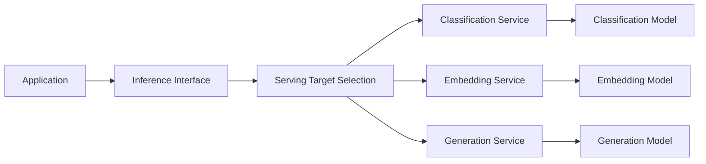

# Production Inference and Model Serving

## Learning Objectives

By the end of this chapter, you should be able to:

- Explain inference as a production workload rather than simply a model function call.
- Explain what model serving means and why a production model needs a serving layer.
- Distinguish an AI model from the system that serves that model.
- Identify the responsibilities of an inference service.
- Explain common serving interfaces and request/response inference.
- Trace the lifecycle of an inference request from client to response.
- Explain how inference execution occurs inside a serving runtime.
- Explain model loading, initialization, warm serving, and cold serving.
- Understand the role of a model process or serving runtime.
- Explain serving replicas at a conceptual level.
- Identify the dependencies involved in production inference.
- Compare embedded inference, dedicated model services, specialized serving services, and external model providers.
- Reason about serving architecture without assuming that one serving pattern is universally correct.
- Distinguish model serving from model routing.

---

## Prerequisites

Before studying this chapter, you should understand:

- Basic software application architecture.
- HTTP/API request and response concepts.
- Functions, processes, and services at a basic level.
- The difference between an application and a deployed runtime.
- Basic machine learning concepts such as model training, model artifacts, inference, and predictions.

For production application packaging and runtime concepts, see [PROD-02 — AI Application Packaging and Runtime](../PROD-02-AI-Application-Packaging-and-Runtime/README.md).

---

## Estimated Reading Time

**35–45 minutes**

---

## 1. Before We Start

A trained AI model is not automatically a production AI service.

A model can successfully generate a prediction inside a notebook and still be unsuitable for production traffic.

Consider a simple model call:

```python
result = model.predict(input_data)
```

This answers only one question:

> Can the model execute inference?

A production system has additional questions:

- How does a client send an inference request?
- Where does the model execute?
- How is the model loaded?
- Who validates the request?
- How is input transformed into the model's expected format?
- How is inference executed?
- How is the output transformed into a response?
- How is the model kept available after initialization?
- Should inference run inside the application or behind a dedicated service?
- Should the organization operate the model itself or use an external provider?

These are serving questions.

This chapter establishes the engineering foundation for answering them.

---

# 2. Why Production Inference Exists

## 2.1 A model is a computational capability

At its simplest, an AI model is a function:

```text
input → model → output
```

For example:

```text
image → classifier → class probabilities
```

or:

```text
prompt → language model → generated tokens
```

or:

```text
text → embedding model → vector
```

The model provides the computational capability.

Production applications need a system that makes this capability accessible and executable.

That creates another layer:

```text
Client
   ↓
Inference Service
   ↓
Model
   ↓
Prediction
   ↓
Response
```

The inference service provides the operational boundary around model execution.

---

## 2.2 Why a direct model call is not enough

A notebook can load a model directly:

```python
model = load_model()

prediction = model(input)
```

A production application usually needs more structure around this call.

Production inference needs boundaries around:

- input,
- execution,
- model state,
- output,
- process lifetime,
- model availability,
- service interaction,
- resource ownership.

The model therefore becomes one component inside a larger execution system.

---

# 3. Mental Model

The core mental model for this chapter is:

```text
Client
   │
   ▼
Serving Interface
   │
   ▼
Request Validation
   │
   ▼
Inference Execution
   │
   ▼
Model
   │
   ▼
Post-processing
   │
   ▼
Response
```

A useful way to think about serving is:

> **Model serving is the engineering discipline of making model inference available as a production-executable capability.**

The exact implementation can vary considerably.

---

## 3.1 Request lifecycle

A typical inference request can be represented as:


The important point is that model execution is embedded inside a request-processing lifecycle.

Each stage has a distinct responsibility even when several stages are implemented inside the same process.

---

# 4. What Is Production Inference?

## 4.1 Inference

Inference is the execution of a trained model against input to produce an output.

Examples include:

```text
Text → Classification
Image → Classification
Text → Embedding
Prompt → Generated Response
Audio → Transcription
Document → Extraction
```

Inference differs from training.

Training generally involves:

```text
Dataset
   ↓
Training
   ↓
Model Parameters
   ↓
Model Artifact
```

Inference involves:

```text
Request
   ↓
Loaded Model
   ↓
Execution
   ↓
Prediction / Generation
```

Production inference is inference executed as part of an operational application or service.

---

## 4.2 Inference is a workload

A useful production mindset is to treat inference as a workload rather than a function call.

For example, a text-generation request may involve:

```text
Receive request
      ↓
Validate input
      ↓
Prepare prompt
      ↓
Execute model
      ↓
Generate output
      ↓
Post-process output
      ↓
Return result
```

The execution characteristics can vary between requests.

One request may require little computation.

Another may require substantially more.

One model may load quickly.

Another may require significant initialization and memory.

One inference workload may fit naturally inside an application process.

Another may justify a dedicated serving system.

Therefore, serving architecture must reflect the workload.

---

# 5. What Is Model Serving?

## 5.1 Definition

**Model serving** is the mechanism through which a trained AI model is made available for inference requests in a runtime environment.

A serving system typically provides:

- a way to receive inference requests,
- input validation or preparation,
- model execution,
- output processing,
- model lifecycle management,
- a way to return inference results.

The serving system may be simple or highly specialized.

For example:

```text
Application
    │
    └── Model loaded in process
```

is a valid serving arrangement.

So is:

```text
Application
    │
    ▼
Model Service
    │
    ▼
Loaded Model
```

And so is:

```text
Application
    │
    ▼
External AI Provider
```

All three expose inference capability, but they have different ownership and operational characteristics.

---

## 5.2 Model versus model-serving system

This distinction is fundamental.

| Model | Model-serving system |
|---|---|
| Performs learned computation | Makes computation available to applications |
| Contains learned parameters/logic | Owns request execution around the model |
| Produces predictions/generations | Receives requests and returns results |
| Does not inherently define an API | Defines or participates in an inference interface |
| Does not inherently manage process lifetime | Manages serving runtime behavior |
| Is one computational component | Is an operational system around that component |

A model can exist without a production serving system.

The serving system exists to make that inference capability usable by consumers.

---

# 6. Serving Interfaces

A serving interface defines how consumers interact with inference capability.

The interface may be:

- an HTTP API,
- an internal service interface,
- an SDK,
- an RPC interface,
- a function boundary inside an application,
- an external provider API.

The interface answers questions such as:

- What input does the service accept?
- What output does it return?
- What parameters are supported?
- How are errors represented?
- Is the response complete or incremental?
- What model capability does the interface expose?

The exact protocol is less important than the architectural boundary.

---

## 6.1 Request/response inference

The simplest serving pattern is request/response inference.

```text
Client
   │
   │ Request
   ▼
Inference Service
   │
   │ Execute model
   ▼
Model
   │
   │ Result
   ▼
Inference Service
   │
   │ Response
   ▼
Client
```

The client sends an input and receives the inference result.

For example:

```json
{
  "text": "This product is excellent."
}
```

The service may return:

```json
{
  "label": "positive",
  "confidence": 0.97
}
```

The interface is simple, but the underlying execution may be complex.

---

# 7. Responsibilities of an Inference Service

A production inference service establishes a boundary around model execution.

Its responsibilities can include:

### 7.1 Request acceptance

The service accepts inference requests through its serving interface.

### 7.2 Request validation

The service checks whether the request is structurally and semantically suitable for inference.

For example:

```text
Required field present?
Expected data type?
Input within supported limits?
Required parameters available?
```

Validation should happen before expensive model execution where practical.

---

### 7.3 Input preparation

The incoming representation may not be directly suitable for the model.

The serving layer may need to perform transformations such as:

```text
API Input
   ↓
Parsing
   ↓
Normalization
   ↓
Tokenization / preprocessing
   ↓
Model-compatible representation
```

The exact preprocessing depends on the model and application.

---

### 7.4 Inference execution

The serving runtime invokes the model.

Conceptually:

```text
Prepared Input
      ↓
Model Runtime
      ↓
Model
      ↓
Output
```

This is the central computational responsibility of serving.

---

### 7.5 Post-processing

Model output may need transformation before being returned.

For example:

```text
Model output
     ↓
Decode
     ↓
Format
     ↓
Apply response schema
     ↓
API response
```

For classification:

```text
logits → probabilities → label
```

For generation:

```text
generated tokens → decoded text → response object
```

---

### 7.6 Model availability

The serving layer must make the model available to the runtime.

This includes concerns such as:

- loading the model,
- initializing required runtime state,
- keeping the model available while serving,
- managing model lifecycle at the serving level.

This does not mean that serving owns the complete deployment lifecycle.

Deployment and release engineering belong to PROD-04.

---

# 8. Inference Dependencies

Inference rarely depends on the model alone.

A serving runtime may depend on:

```text
Serving Interface
        │
        ├── Request validation
        ├── Preprocessing
        ├── Model runtime
        ├── Model artifact
        ├── Runtime libraries
        ├── Hardware / accelerator
        ├── Post-processing
        └── External inference dependencies
```

The exact dependency graph varies by workload.

For example, an embedding service may require:

```text
Request
   ↓
Text preprocessing
   ↓
Tokenizer
   ↓
Embedding model
   ↓
Vector output
```

A generative model may require:

```text
Request
   ↓
Prompt processing
   ↓
Tokenizer
   ↓
Generation runtime
   ↓
Model
   ↓
Token decoding
   ↓
Response
```

The serving architecture should make these execution dependencies explicit.

---

# 9. Model Loading

## 9.1 Why model loading matters

A model cannot normally execute inference until the serving runtime has access to its required model state.

Model loading may involve:

```text
Locate model artifact
       ↓
Read model data
       ↓
Initialize runtime
       ↓
Load model parameters
       ↓
Initialize required resources
       ↓
Model ready for inference
```

For small models, this may be relatively straightforward.

For large AI models, loading can involve significant memory and initialization requirements.

---

## 9.2 Model loading is different from inference

These are separate stages:

```text
Model Loading
      ↓
Model Ready
      ↓
Inference
      ↓
Response
```

Loading prepares the serving runtime.

Inference uses the loaded model to process requests.

Confusing these stages creates poor mental models around serving.

---

# 10. Cold and Warm Serving

## 10.1 Cold serving

A model is in a cold state when the serving runtime does not yet have the model ready for immediate inference.

A simplified lifecycle is:

```text
No model loaded
      ↓
Load model
      ↓
Initialize runtime
      ↓
Model ready
      ↓
Inference
```

The first inference request may therefore encounter additional initialization or loading work.

---

## 10.2 Warm serving

A warm serving runtime has the required model already initialized and ready for inference.

```text
Model already loaded
       ↓
Request
       ↓
Inference
       ↓
Response
```

Warm serving can avoid repeated model initialization.

However, keeping models warm also consumes resources.

This creates an engineering trade-off:

| Approach | Advantage | Cost |
|---|---|---|
| Cold / on-demand | Lower persistent resource usage | Initialization can add latency |
| Warm / resident | Faster readiness for inference | Resources remain allocated |

The correct choice depends on workload characteristics and system architecture.

---

# 11. Serving-Level Model Lifecycle

Model lifecycle at the serving layer is concerned with the state of the model inside the serving runtime.

A simplified lifecycle is:

```text
Unavailable
    ↓
Loading
    ↓
Initializing
    ↓
Ready
    ↓
Serving
    ↓
Unloading / Releasing
```

Different serving systems may implement these states differently.

The important distinction is:

> **Serving lifecycle describes how the runtime manages a model while it is being served.**

It is not the same as the broader deployment and release lifecycle.

For deployment and release concerns, see [PROD-04 — Deployment and Release Engineering](../PROD-04-Deployment-and-Release-Engineering/README.md).

---

# 12. Model Process and Serving Runtime

A serving runtime is the execution environment responsible for running inference.

Conceptually:

```text
Serving Process
│
├── Serving Interface
├── Request Handling
├── Model Runtime
├── Loaded Model
├── Preprocessing
└── Post-processing
```

The exact implementation varies.

The runtime could be:

- an application process containing the model,
- a dedicated model-serving process,
- a specialized inference runtime,
- an external provider's serving infrastructure.

The architectural principle remains:

> Requests need an execution boundary that can transform an incoming inference request into a model result.

---

# 13. Serving Replicas

A production serving system may have more than one serving instance.

Conceptually:

```text
                 ┌── Serving Instance A
Client → Service ─┼── Serving Instance B
                 └── Serving Instance C
```

Each instance may have its own serving runtime and model state.

This creates several architectural consequences:

- Model state may exist in multiple processes.
- Model loading may occur independently in each instance.
- Resource consumption increases as serving instances increase.
- Requests need to be directed to an available serving instance.

At this stage, replicas are a **serving architecture concept**, not a capacity-planning topic.

Detailed resource capacity, scaling decisions, and demand-driven replica planning belong to [PROD-07 — Scaling and Capacity Engineering](../PROD-07-Scaling-and-Capacity-Engineering/README.md).

---

# 14. Different Ways to Serve an AI Model

There is no universal serving architecture.

Several patterns are common.

---

## 14.1 Application-embedded inference

The application directly loads and executes the model.

```text
Client
   ↓
Application
   │
   └── Model
```

### Advantages

- Simple architecture.
- No additional network hop.
- Straightforward for small or tightly coupled models.
- Model execution can remain close to application logic.

### Trade-offs

- Application and model lifecycle become coupled.
- Resource requirements may be difficult to isolate.
- Large models can make application processes heavy.
- Multiple applications may duplicate model memory.

This can be appropriate when model inference is a small, tightly coupled part of the application.

---

## 14.2 Dedicated model service

The model runs behind a dedicated inference service.

```text
Client
   ↓
Application
   ↓
Model Service
   ↓
Model
```

The application does not directly own model execution.

### Advantages

- Model execution can be independently managed.
- Multiple applications can consume the same serving capability.
- Model-specific resources can be isolated.
- Model lifecycle can be separated from application lifecycle.

### Trade-offs

- Adds service boundaries.
- Introduces network communication.
- Creates another operational component.
- Requires clear ownership between application and model service.

---

## 14.3 Multiple specialized model services

Different models can be served by different services.

```text
                 ┌── Classification Service
                 │
Application ─────┼── Embedding Service
                 │
                 └── Generation Service
```

This can provide stronger isolation and model-specific ownership.

However, it also increases architectural complexity.

The organization must decide whether the benefits of isolation justify the additional services.

---

## 14.4 External AI provider

The application may consume inference from an external provider.

```text
Application
     ↓
External AI Provider
     ↓
Model
```

The application does not directly operate the model runtime.

### Advantages

- Reduced model-serving infrastructure ownership.
- Access to externally operated model capabilities.
- Potentially simpler integration for some workloads.

### Trade-offs

- External dependency.
- Provider-specific interfaces.
- Data and privacy considerations.
- Dependency on provider availability and service characteristics.
- Less direct control over serving infrastructure.

The architectural decision is therefore not simply:

> "Can we run the model ourselves?"

It is:

> "Which serving ownership model best fits the application's requirements?"

---

# 15. Serving Architecture Comparison

| Serving pattern | Model ownership | Isolation | Complexity | Typical reason to choose |
|---|---|---:|---:|---|
| Embedded inference | Application | Lower | Lower | Tight coupling and simpler workloads |
| Dedicated model service | Internal serving team/system | Higher | Medium | Shared or independently managed inference |
| Specialized model services | Service-specific | High | Higher | Different models need different serving characteristics |
| External provider | External provider | Provider-defined | Lower infrastructure ownership | Avoid operating model-serving infrastructure directly |

No pattern is inherently "production-grade" by itself.

Production readiness depends on how well the architecture satisfies the workload's requirements.

---

## 16. Request Lifecycle in Detail

Consider a text-generation request.

```text
Client
  │
  │ 1. Send prompt
  ▼
Serving Interface
  │
  │ 2. Parse request
  ▼
Request Validation
  │
  │ 3. Validate parameters
  ▼
Input Preparation
  │
  │ 4. Prepare model input
  ▼
Inference Execution
  │
  │ 5. Execute model
  ▼
Model
  │
  │ 6. Generate output
  ▼
Post-processing
  │
  │ 7. Decode / format
  ▼
Response
  │
  │ 8. Return result
  ▼
Client
```

Each stage has a different responsibility.

This separation is useful because production failures and behavior can originate in different stages.

For example:

- invalid request → interface/validation issue,
- preprocessing failure → input preparation issue,
- unavailable model → serving lifecycle issue,
- model execution failure → inference runtime issue,
- malformed output → post-processing issue.

The serving boundary makes these responsibilities easier to reason about.

---

# 17. Example: Text Generation Service

Suppose an application exposes a text-generation capability.

A simplified interface could look like:

```http
POST /generate
```

Request:

```json
{
  "prompt": "Explain retrieval augmented generation.",
  "max_tokens": 200
}
```

The serving system may internally perform:

```text
HTTP Request
     ↓
Parse JSON
     ↓
Validate prompt and parameters
     ↓
Prepare model input
     ↓
Execute generation
     ↓
Decode generated tokens
     ↓
Construct response
     ↓
Return response
```

Response:

```json
{
  "text": "Retrieval augmented generation combines..."
}
```

The important engineering observation is:

> The API request is not the model.

The API is the **serving interface**.

The model is the **inference capability**.

The runtime connects the two.

---

# 18. Example: Image Classification

Consider an image classification service.

```text
Image Request
     ↓
Serving Interface
     ↓
Validation
     ↓
Image Decode
     ↓
Preprocessing
     ↓
Model Inference
     ↓
Class Scores
     ↓
Post-processing
     ↓
Prediction Response
```

The model may return:

```json
{
  "class": "cat",
  "confidence": 0.94
}
```

The production system consists of more than the classifier.

The serving boundary manages the path from external request to model execution and back to the consumer.

---

# 19. AI-Specific Serving Characteristics

AI serving differs from many traditional application workloads.

Several characteristics influence serving architecture.

---

## 19.1 Large model memory requirements

Some models require substantial memory.

This affects:

- which runtime can host the model,
- how many models can coexist,
- how many serving instances can load the model,
- whether model sharing is practical.

The serving architecture therefore cannot treat model memory as an implementation detail.

---

## 19.2 Model loading time

Large models may take meaningful time to initialize.

This makes the distinction between:

```text
Model unavailable
```

and:

```text
Model loaded and ready
```

architecturally important.

---

## 19.3 Accelerator dependence

Some inference workloads benefit from specialized hardware or accelerators.

The serving runtime therefore may have dependencies on specific execution environments.

The important serving question is:

> What execution environment is required for this model to perform inference?

Detailed accelerator optimization is outside this chapter's scope and belongs to performance engineering.

---

## 19.4 Variable inference duration

Inference duration may vary between requests.

For example:

```text
Request A → short input → short execution
Request B → long input → longer execution
```

For generative workloads, output length can also vary.

This means an inference service may not behave like a workload where every request consumes approximately the same amount of processing time.

These characteristics become important when designing concurrency, queues, and batching in [02 — Concurrency, Queues, Batching, and Streaming](02-Concurrency-Queues-Batching-and-Streaming.md).

---

## 19.5 Variable generation size

Generative models may produce:

```text
10 tokens
100 tokens
1,000 tokens
```

depending on the request and generation behavior.

Therefore, one request does not necessarily represent a fixed amount of work.

This is an important production serving characteristic.

Detailed request scheduling and batching implications are covered in [02 — Concurrency, Queues, Batching, and Streaming](02-Concurrency-Queues-Batching-and-Streaming.md).

---

## 19.6 Multiple model versions

A serving environment may need to expose different model versions.

For example:

```text
Model v1
Model v2
```

The serving architecture must be able to represent the existence of multiple inference targets.

The decision about **which target should receive a request** is a routing concern and is covered in [03 — Model Routing and Serving Architecture](03-Model-Routing-and-Serving-Architecture.md).

---

# 20. Serving Versus Routing

Serving and routing are related but distinct.

### Serving asks:

> How do we execute this inference request?

```text
Request
   ↓
Serving Runtime
   ↓
Model
   ↓
Result
```

### Routing asks:

> Which serving target should execute this request?

```text
Request
   ↓
Router
   ↓
Selected Serving Target
```

Therefore:

```text
Routing
   ↓
Select serving target
   ↓
Serving
   ↓
Execute inference
```

Routing may consider factors such as model version, capability, or request type, but the detailed design of those decisions belongs to [03 — Model Routing and Serving Architecture](03-Model-Routing-and-Serving-Architecture.md).

The key boundary is:

> **Routing selects the target; serving executes inference on that target.**

---

# 21. Serving Versus Deployment and Packaging

Serving, packaging, and deployment interact, but they solve different problems.

### Packaging asks:

> What does the application/runtime need in order to execute reproducibly?

This includes dependencies, configuration, containers, runtime contracts, and artifact identity.

See [PROD-02 — AI Application Packaging and Runtime](../PROD-02-AI-Application-Packaging-and-Runtime/README.md).

### Deployment asks:

> How does the software reach and change the target environment?

This includes deployment workflows, release promotion, infrastructure provisioning, and progressive delivery.

See [PROD-04 — Deployment and Release Engineering](../PROD-04-Deployment-and-Release-Engineering/README.md).

### Serving asks:

> How is inference executed once the serving runtime is available?

This includes request handling, model availability, inference execution, and response generation.

Keeping these boundaries separate prevents the entire production AI system from being treated as one undifferentiated "AI service."

---

## 22. Production Architecture Example

Consider an application that provides:

- text classification,
- embeddings,
- text generation.

A possible architecture is:



The important lesson is not that this architecture is universally correct.

It demonstrates that an application can expose multiple inference capabilities through distinct serving targets.

Another system might embed classification directly into the application while using dedicated services for other models.

The architecture should follow the workload and ownership requirements.

---

# 23. Engineering Decisions and Trade-offs

Production serving is primarily an engineering decision problem.

There is rarely a single universally correct architecture.

---

## 23.1 Embedded versus dedicated serving

### Embedded inference

```text
Application → Model
```

Advantages:

- simple,
- low architectural overhead,
- direct execution.

Costs:

- tighter coupling,
- resource sharing,
- more difficult independent model lifecycle.

### Dedicated serving

```text
Application → Model Service → Model
```

Advantages:

- isolation,
- independent model management,
- potentially shared inference capability.

Costs:

- service complexity,
- network boundary,
- additional operational ownership.

The decision should follow system requirements rather than architectural fashion.

---

## 23.2 Shared versus isolated serving

Multiple models can share a serving environment.

```text
Serving Runtime
 ├── Model A
 ├── Model B
 └── Model C
```

Or models can be isolated:

```text
Runtime A → Model A
Runtime B → Model B
Runtime C → Model C
```

Sharing can improve resource efficiency.

Isolation can improve independence and reduce interference.

The trade-off is therefore:

```text
Resource efficiency
        ↕
Isolation and independence
```

---

## 23.3 Complete response versus incremental delivery

A serving interface can return the result only after inference completes:

```text
Request
   ↓
Inference
   ↓
Complete Response
```

For workloads that generate output incrementally, the interface may instead expose partial results:

```text
Request
   ↓
Inference
   ↓
Partial Output
   ↓
Partial Output
   ↓
Completion
```

The architectural difference is in **response delivery behavior**.

Incremental delivery can improve perceived responsiveness for long-running generation, but it does not inherently reduce the computation required to produce the result.

Detailed streaming mechanics and request-processing trade-offs belong to [02 — Concurrency, Queues, Batching, and Streaming](02-Concurrency-Queues-Batching-and-Streaming.md).

---

## 23.4 Local model versus external provider

Operating a model internally provides more control over serving infrastructure.

Using an external provider can reduce infrastructure ownership.

The trade-off can be expressed as:

```text
Internal control
      ↕
Operational simplicity
```

Additional considerations include:

- data handling,
- latency,
- provider dependency,
- model availability,
- cost,
- interface compatibility,
- operational ownership.

---

## 23.5 Single model versus multiple models

A single-model architecture is simpler:

```text
Application
    ↓
Model
```

A multi-model architecture can support different capabilities:

```text
Application
    ↓
Multiple Serving Targets
```

But multiple models increase the number of serving decisions and lifecycle states.

The architecture should therefore introduce multiple models when there is a meaningful requirement for them.

---

# 24. Production Perspective

A useful production review of an inference service should ask:

### Model

- What model is being served?
- What resources does it require?
- How is it loaded?
- How long does initialization take?

### Interface

- How does the client invoke inference?
- What input does it accept?
- What output does it return?
- Is the response complete or incremental?

### Execution

- Where does inference execute?
- What runtime owns the model?
- What preprocessing and post-processing occur?

### Lifecycle

- When is the model loaded?
- When is it ready?
- Can it be unloaded?
- Can multiple model versions coexist?

### Architecture

- Is inference embedded or dedicated?
- Is the serving runtime shared or isolated?
- Are there multiple serving targets?
- Is an external provider involved?

### Boundaries

- Which concerns belong to serving?
- Which belong to deployment?
- Which belong to reliability?
- Which belong to capacity?
- Which belong to performance optimization?

These questions help prevent architecture discussions from collapsing unrelated concerns into one large "AI service" concept.

---

## 25. What This Chapter Does Not Cover

This chapter intentionally stops at the serving boundary.

## Not packaging

Packaging, dependencies, containers, configuration, runtime contracts, and artifact identity belong to [PROD-02 — AI Application Packaging and Runtime](../PROD-02-AI-Application-Packaging-and-Runtime/README.md).

## Not deployment

Deployment workflows, release promotion, infrastructure provisioning, and progressive delivery belong to [PROD-04 — Deployment and Release Engineering](../PROD-04-Deployment-and-Release-Engineering/README.md).

## Not observability

Telemetry architecture and observability signal design belong to [PROD-05 — AI Observability and Telemetry](../PROD-05-AI-Observability-and-Telemetry/README.md).

## Not reliability engineering

Timeouts, retries, failure isolation, graceful degradation, fallback strategy, and dependency failure handling belong to [PROD-06 — Production AI Reliability](../PROD-06-Production-AI-Reliability/README.md).

## Not capacity engineering

Demand forecasting, resource capacity, autoscaling, burst capacity, GPU scaling, and load testing belong to [PROD-07 — Scaling and Capacity Engineering](../PROD-07-Scaling-and-Capacity-Engineering/README.md).

## Not deep performance optimization

Inference optimization, latency/throughput optimization, benchmarking, resource efficiency, and cost-performance optimization belong to [PROD-08 — AI Performance Optimization and Cost](../PROD-08-AI-Performance-Optimization-and-Cost/README.md).

## Not detailed routing

This chapter establishes only the distinction between serving and routing.

Detailed routing policies, serving-target selection, and serving topology belong to [03 — Model Routing and Serving Architecture](03-Model-Routing-and-Serving-Architecture.md).

## Not detailed concurrency, queues, batching, or streaming

These concepts are introduced only where necessary to establish the characteristics of an inference workload.

Detailed request concurrency, queue behavior, batching strategies, and streaming mechanics belong to [02 — Concurrency, Queues, Batching, and Streaming](02-Concurrency-Queues-Batching-and-Streaming.md).

---

## 26. Common Mistakes and Misconceptions

## 26.1 "The model is the serving system."

Incorrect.

A model provides inference capability.

A serving system provides the execution boundary through which applications consume that capability.

---

## 26.2 "If the model works in a notebook, it is production-ready."

Incorrect.

Notebook inference proves that the model can execute under that environment.

Production serving requires an operational interface and execution architecture around the model.

---

## 26.3 "Every model should have a dedicated service."

Incorrect.

Embedded inference can be appropriate for tightly coupled or simpler workloads.

Dedicated serving becomes valuable when isolation, reuse, independent lifecycle, or model-specific resource requirements justify the additional architecture.

---

## 26.4 "Every AI system needs a specialized inference server."

Incorrect.

A specialized serving runtime can be useful, but it is not automatically required.

The architecture should follow workload requirements.

---

## 26.5 "Streaming makes inference faster."

Incorrect.

Streaming changes **how results are delivered**.

It may improve perceived responsiveness without reducing the underlying computation required to produce the complete result.

---

## 26.6 "Scaling and serving are the same thing."

Incorrect.

Serving answers:

> How is inference executed?

Scaling answers:

> How much serving capacity is required as workload changes?

They are related but distinct engineering concerns.

---

## 26.7 "Serving is just an API endpoint."

Incomplete.

An API may be the external interface, but serving also includes:

- model availability,
- model loading,
- inference execution,
- preprocessing,
- post-processing,
- runtime ownership,
- serving lifecycle.

---

## 26.8 "The serving framework makes the system production-ready."

Incorrect.

A serving framework is only one component.

Production readiness depends on architecture, workload behavior, runtime boundaries, reliability, capacity, observability, deployment, security, and other system concerns.

---

## 26.9 "Latency and throughput are interchangeable."

Incorrect.

Latency measures how long an individual request takes.

Throughput measures how much work the system completes over time.

A system can improve throughput while increasing individual request waiting time.

Detailed performance trade-offs belong to PROD-08.

---

## 27. Interview Questions and Expected Answers

## Question 1: What is the difference between a model and a model-serving system?

**Expected answer:**

A model performs learned computation.

A serving system makes that computation available to production requests by providing an execution boundary around the model, including request handling, model availability, inference execution, and response processing.

---

## Question 2: Why isn't loading a model and calling `predict()` enough for production?

**Expected answer:**

Because production requires a way to accept requests, validate inputs, manage model availability, execute inference within a runtime, process outputs, and expose results to consumers. A direct model call demonstrates inference capability but not a complete serving architecture.

---

## Question 3: What happens during model loading?

**Expected answer:**

The serving runtime obtains the model artifact, initializes the required runtime state, loads model parameters into the required execution environment, and prepares the model for inference.

---

## Question 4: What is the difference between cold and warm serving?

**Expected answer:**

Cold serving means the model is not yet ready for immediate inference and may require loading or initialization.

Warm serving means the required model state is already initialized and ready for inference.

---

## Question 5: When would you choose embedded inference?

**Expected answer:**

When the model is tightly coupled to the application, resource requirements are manageable, and the benefits of a separate serving boundary do not justify the additional architectural complexity.

---

## Question 6: Why might a team choose a dedicated model service?

**Expected answer:**

To isolate model resources, independently manage the model lifecycle, allow multiple applications to consume the same inference capability, or support model-specific serving requirements.

---

## Question 7: Is a dedicated model service always better than embedded inference?

**Expected answer:**

No.

It introduces additional service and operational complexity. The architecture should be selected based on workload characteristics, resource requirements, isolation needs, reuse, lifecycle independence, and system constraints.

---

## Question 8: What is the difference between serving and routing?

**Expected answer:**

Serving executes inference for a selected target.

Routing decides which serving target should receive the request.

Conceptually:

```text
Request
   ↓
Routing
   ↓
Selected Serving Target
   ↓
Inference
```

---

## Question 9: Why can model loading affect production serving?

**Expected answer:**

Large or complex models may require significant initialization time and resources. This affects readiness, startup behavior, resource consumption, and potentially the latency experienced when a model is not already warm.

---

## Question 10: Does streaming reduce inference computation?

**Expected answer:**

Not necessarily.

Streaming changes result delivery by returning partial output incrementally. It can improve perceived responsiveness without reducing the total computation required.

---

## Question 11: Why might multiple models require separate serving boundaries?

**Expected answer:**

Different models may have different resource requirements, runtime dependencies, lifecycle requirements, workload characteristics, or isolation needs. Separate serving boundaries can provide stronger independence, but they also increase architectural complexity.

---

## Question 12: Architecture scenario

You have a large generation model used by three internal applications. Would you embed the model in each application or create a dedicated serving service?

**Expected answer:**

There is no universal answer.

A strong engineering response would first evaluate:

- model memory requirements,
- whether applications share the same model capability,
- model lifecycle independence,
- resource isolation,
- expected workload,
- interface requirements,
- operational ownership,
- network overhead,
- versioning needs.

A dedicated service may be attractive when the model is large and shared across applications because duplicating model state across application processes can be expensive. Embedded inference may still be reasonable when tight coupling, simplicity, or workload characteristics justify it.

The important point is to explain the decision using system constraints rather than choosing an architecture by default.

---

# 28. Quick Revision

Remember the core serving path:

```text
Client
   ↓
Serving Interface
   ↓
Request Validation
   ↓
Input Preparation
   ↓
Inference Execution
   ↓
Model
   ↓
Post-processing
   ↓
Response
```

### Core definitions

| Concept | Meaning |
|---|---|
| Inference | Executing a trained model against input |
| Model serving | Making model inference available through a production runtime |
| Serving interface | Boundary through which inference requests are submitted |
| Model loading | Preparing model state for inference |
| Warm serving | Model already initialized and ready |
| Cold serving | Model requires initialization/loading before inference |
| Serving runtime | Execution environment responsible for serving inference |
| Serving replica | An additional serving instance capable of handling inference |
| Embedded inference | Model executes inside the application |
| Dedicated serving | Model executes behind a separate serving boundary |
| External provider | Inference is operated by an external service |

### Key distinctions

```text
Model ≠ Serving System

Serving ≠ Deployment

Serving ≠ Packaging

Serving ≠ Routing

Serving ≠ Capacity Planning

Serving ≠ Performance Optimization
```

---

# 29. Key Takeaways

1. A trained model is an inference capability, not automatically a production service.
2. Model serving creates the execution boundary between applications and model inference.
3. A serving system usually handles request acceptance, validation, input preparation, inference execution, output processing, and model availability.
4. Model loading and inference execution are separate stages.
5. Warm and cold serving represent different model availability states.
6. Serving can be embedded in an application or implemented as a dedicated service.
7. External AI providers are another valid serving ownership model.
8. There is no universally correct serving architecture.
9. AI workloads introduce serving-specific characteristics such as large model memory requirements, model loading time, variable inference duration, variable generation size, and accelerator dependence.
10. Serving replicas are a serving architecture concept; detailed capacity and scaling decisions belong to PROD-07.
11. Routing decides **which serving target** handles a request; serving determines **how that target executes inference**.
12. Incremental response delivery changes how results reach the client; it does not automatically reduce model computation.
13. Production serving must be considered separately from packaging, deployment, reliability, capacity, observability, and performance optimization.

---

## 30. Further Reading

Continue with:

- [02 — Concurrency, Queues, Batching, and Streaming](02-Concurrency-Queues-Batching-and-Streaming.md)
- [03 — Model Routing and Serving Architecture](03-Model-Routing-and-Serving-Architecture.md)

Related production engineering domains:

- [PROD-02 — AI Application Packaging and Runtime](../PROD-02-AI-Application-Packaging-and-Runtime/README.md)
- [PROD-04 — Deployment and Release Engineering](../PROD-04-Deployment-and-Release-Engineering/README.md)
- [PROD-05 — AI Observability and Telemetry](../PROD-05-AI-Observability-and-Telemetry/README.md)
- [PROD-06 — Production AI Reliability](../PROD-06-Production-AI-Reliability/README.md)
- [PROD-07 — Scaling and Capacity Engineering](../PROD-07-Scaling-and-Capacity-Engineering/README.md)
- [PROD-08 — AI Performance Optimization and Cost](../PROD-08-AI-Performance-Optimization-and-Cost/README.md)

---

## End of Document
