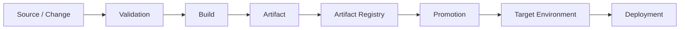
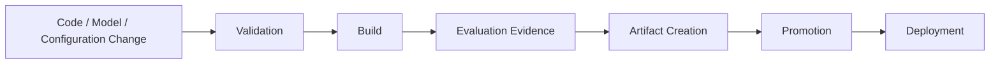
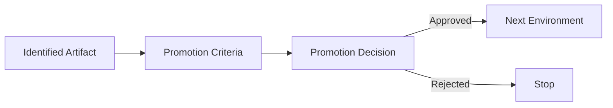
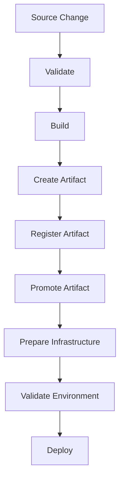

# AI CI/CD, Infrastructure Provisioning and Artifact Promotion

## Learning Objectives

By the end of this chapter, you should be able to:

- Explain the difference between Continuous Integration, Continuous Delivery, and Continuous Deployment.
- Explain why CI/CD is a control system for moving validated changes rather than simply an automation script.
- Identify the additional pipeline concerns introduced by AI systems.
- Distinguish source changes, validation, builds, artifacts, promotion, infrastructure provisioning, deployment, and release.
- Explain why artifact creation and artifact promotion are separate engineering problems.
- Explain why the same identified artifact should be promoted across environments whenever practical.
- Understand artifact identity, versioning, immutability, provenance, and promotion records.
- Explain the role of environment metadata in controlled artifact promotion.
- Explain why infrastructure should be treated as an engineering artifact rather than an undocumented manually configured environment.
- Explain Infrastructure as Code conceptually without depending on a specific tool or cloud provider.
- Understand infrastructure drift and why it matters to environment consistency.
- Explain how infrastructure provisioning and application artifact deployment interact.
- Identify deployment prerequisites that should be satisfied before an application or AI artifact is deployed.
- Design a conceptual CI/CD pipeline for an AI system.
- Separate build responsibilities from deployment responsibilities.
- Reason about the engineering trade-offs involved in automation, environment progression, artifact promotion, and infrastructure provisioning.

The central engineering question is:

> **How do production AI changes move from source and validated artifacts toward controlled deployment environments?**

---

## Prerequisites

Before studying this chapter, you should understand the following concepts at a high level:

- Software source code and version control
- Application builds
- Dependencies
- Runtime environments
- Containers and application packaging
- Configuration
- Basic testing concepts
- Production environments
- Basic deployment terminology

The concepts of packaging, reproducibility, runtime contracts, dependencies, and artifact identity are primarily established in [PROD-02 — AI Application Packaging and Runtime](../PROD-02-AI-Application-Packaging-and-Runtime/README.md).

This chapter uses those concepts as inputs rather than re-teaching them.

You should also understand that serving architecture is a separate concern. [PROD-03 — Production Model and AI Serving](../PROD-03-Production-Model-and-AI-Serving/README.md) owns the mechanisms used to serve models and AI workloads.

---

## Estimated Reading Time

**35–45 minutes**

---

## Before We Start

A common mental shortcut is:

```text
Developer writes code
        ↓
CI/CD runs
        ↓
Production
```

That model is too simplistic for production engineering.

A production AI change may involve:

- application code,
- model artifacts,
- prompt or configuration changes,
- dependency changes,
- inference runtime changes,
- infrastructure changes,
- evaluation evidence,
- compatibility constraints,
- environment-specific configuration,
- large artifacts,
- deployment prerequisites.

The system therefore needs to answer several different questions:

1. **Did the change pass validation?**
2. **What exactly was built?**
3. **What version or identity does the artifact have?**
4. **Where is the resulting artifact?**
5. **What is the artifact's provenance?**
6. **Has the artifact been approved for the next environment?**
7. **Is the target environment ready?**
8. **Is the required infrastructure available?**
9. **Can the artifact be deployed into that environment?**
10. **Can we prove what changed, what was promoted, and where it was deployed?**

These questions are related, but they are not the same engineering problem.

A useful starting point is:

```text
Source Change
      ↓
Validation
      ↓
Build
      ↓
Artifact
      ↓
Artifact Registry
      ↓
Promotion
      ↓
Environment
      ↓
Deployment
```

Infrastructure follows a related lifecycle:

```text
Infrastructure Definition
        ↓
Plan / Validate
        ↓
Provision / Change
        ↓
Environment
```

The purpose of CI/CD and deployment engineering is not simply to make these arrows automatic.

The purpose is to make the movement of change **controlled, repeatable, traceable, and safe**.

---

# Why This Exists

## The Problem Before CI/CD

Historically, software could be moved toward production through manual processes:

```text
Developer
   ↓
Manual Build
   ↓
Manual File Transfer
   ↓
Manual Server Configuration
   ↓
Manual Deployment
   ↓
Manual Verification
```

This can work at small scale.

But as systems grow, manual processes create problems:

- inconsistent environments,
- undocumented changes,
- accidental configuration differences,
- difficult reproduction,
- unclear artifact identity,
- human error,
- weak auditability,
- deployment inconsistency,
- difficult rollback,
- hidden dependencies.

The deeper problem is not that humans are involved.

The problem is that **the process itself is not sufficiently controlled and repeatable**.

---

## What CI/CD Attempts to Solve

CI/CD introduces a repeatable mechanism for moving changes through validation and delivery.

Conceptually:

```text
Change
  ↓
Automated Validation
  ↓
Build
  ↓
Artifact
  ↓
Controlled Promotion
  ↓
Deployment
```

This gives the organization a consistent path through which changes must travel.

CI/CD therefore should be understood as an **engineering control mechanism**, not merely as a collection of automation tools.

---

# Mental Model

## The Complete Change Movement Model

The most useful mental model for this chapter is:



Each stage answers a different question.

| Stage | Core Question |
|---|---|
| Source / Change | What changed? |
| Validation | Is the change acceptable enough to build? |
| Build | Can the change produce the intended artifact? |
| Artifact | What exactly was produced? |
| Registry | Where can the artifact be stored and retrieved? |
| Promotion | Is this identified artifact approved for the next environment? |
| Environment | Is the target environment ready? |
| Deployment | Can the artifact be introduced into the environment? |

This separation is fundamental.

A pipeline becomes difficult to reason about when these responsibilities are collapsed together.

---

# Core Concepts

## 1. Continuous Integration

Continuous Integration, or CI, is the practice of integrating changes frequently and validating them through an automated process.

The essential idea is:

```text
Change
  ↓
Integrate
  ↓
Validate
  ↓
Provide Fast Feedback
```

The exact validation steps vary by system, but may include:

- source checks,
- dependency validation,
- unit tests,
- integration tests,
- static analysis,
- build validation,
- compatibility checks,
- artifact generation,
- AI-specific validation inputs.

The purpose is not simply to produce a green pipeline.

The purpose is to detect unacceptable changes **before they move farther through the production lifecycle**.

---

## 2. Continuous Delivery

Continuous Delivery extends the pipeline beyond integration.

The system should maintain a state where validated changes can be delivered toward an environment in a controlled manner.

Conceptually:

```text
Change
  ↓
CI Validation
  ↓
Build
  ↓
Artifact
  ↓
Ready for Controlled Delivery
```

Continuous Delivery does not necessarily mean that every change automatically reaches production.

There may be:

- approval boundaries,
- environment gates,
- release decisions,
- change windows,
- business controls,
- quality requirements,
- deployment prerequisites.

The key property is **production readiness through a repeatable delivery path**.

---

## 3. Continuous Deployment

Continuous Deployment goes one step further.

A validated change may automatically proceed toward deployment without requiring a separate human approval at every stage.

Conceptually:

```text
Validated Change
      ↓
Automated Delivery
      ↓
Automated Deployment
```

This can increase deployment frequency and reduce manual intervention.

But automation does not remove the need for engineering controls.

A highly automated pipeline can still be unsafe if:

- validation is weak,
- environments differ,
- artifacts are mutable,
- release gates are poorly designed,
- rollback is unavailable,
- infrastructure changes are uncontrolled,
- AI quality is ignored.

Therefore:

> **Automation increases the speed of the process. It does not automatically increase the safety of the process.**

---

## CI vs Continuous Delivery vs Continuous Deployment

These concepts should remain distinct.

| Concept | Primary Focus |
|---|---|
| Continuous Integration | Integrate and validate changes |
| Continuous Delivery | Keep validated changes ready for controlled delivery |
| Continuous Deployment | Automatically deploy validated changes |

A simplified progression is:

```text
CI
↓
Validate Changes

Continuous Delivery
↓
Validate + Produce Deliverable + Keep Ready

Continuous Deployment
↓
Validate + Produce + Automatically Deploy
```

The organization should choose the level of automation appropriate to its risk, controls, and operating model.

---

# 4. AI-Specific CI/CD

Traditional application pipelines often focus heavily on source code and application dependencies.

AI systems can introduce additional change dimensions.

A production AI change may involve:

```text
Application Code
Model Artifact
Prompt / Configuration
Dependencies
Inference Runtime
Infrastructure
Evaluation Evidence
```

These may change independently or together.

For example:

```text
Prompt Change
     ↓
No Application Code Change
     ↓
Different AI Behavior
```

Or:

```text
Model Version Change
     ↓
Same Application Code
     ↓
Different Latency / Cost / Quality
```

Or:

```text
Inference Runtime Change
     ↓
Same Model
     ↓
Different Performance / Compatibility
```

Therefore, an AI CI/CD pipeline needs to recognize that **the production change is not always equivalent to the source-code diff**.

---

# 5. AI CI/CD Pipeline

A useful conceptual model is:



The exact order can vary depending on the system.

For example, evaluation may occur before artifact creation, after artifact creation, or at multiple points.

The important principle is:

> **AI-specific evidence can become an input to the deployment lifecycle without making deployment engineering responsible for defining the evaluation methodology.**

Production evaluation methodology belongs to PROD-11.

PROD-04 consumes relevant accepted evidence as a deployment or release input.

---

# 6. Build Validation

A build is more than compiling code.

At a conceptual level, build validation asks:

> **Can this change produce a valid artifact that satisfies the expected technical requirements?**

Depending on the system, validation may include:

### Source Validation

- syntax checks,
- formatting,
- static analysis,
- dependency checks.

### Software Tests

- unit tests,
- integration tests,
- component tests.

### Build Validation

- successful compilation or packaging,
- dependency resolution,
- artifact generation.

### Compatibility Validation

- runtime compatibility,
- interface compatibility,
- dependency compatibility,
- model/runtime compatibility.

### AI-Specific Inputs

- model artifact availability,
- expected model version,
- configuration consistency,
- accepted evaluation evidence.

These are conceptual categories rather than a fixed mandatory pipeline.

A production system should choose validation stages according to its actual failure modes.

---

## 7. Test Stages

Testing should not be treated as one giant “test” step.

A pipeline may contain progressively more expensive validation.

For example:

```text
Fast Checks
    ↓
Unit Tests
    ↓
Integration Tests
    ↓
Build Validation
    ↓
Compatibility Checks
    ↓
Broader Validation
```

The engineering principle is:

> **Fail as early and cheaply as practical without pretending that early validation proves production safety.**

A unit test can detect a logic error.

It cannot prove:

- production infrastructure is correctly configured,
- traffic routing is safe,
- model quality is acceptable,
- production capacity is sufficient,
- rollback will work.

This distinction becomes increasingly important as the pipeline moves toward production.

---

# 8. Artifact Generation

A build produces an artifact that can be moved toward deployment.

Depending on the AI system, the artifact may represent:

- an application package,
- a container image,
- a model artifact,
- a model-serving package,
- a configuration bundle,
- another deployable unit,
- a combination of these.

The important property is not the specific format.

The important property is that the artifact is **identifiable and deployable**.

Conceptually:

```text
Source + Dependencies + Build Process
                ↓
             Artifact
```

The artifact becomes the unit that moves through subsequent stages.

---

# 9. Artifact Identity and Versioning

Once an artifact exists, the system must be able to answer:

> **Exactly which artifact are we deploying?**

An artifact should therefore have a meaningful identity.

This may involve:

- version identifiers,
- immutable references,
- digests,
- build identifiers,
- source revision references,
- model version identifiers,
- metadata.

The specific mechanism is implementation-dependent.

The engineering requirement is not.

> **A production deployment should be traceable to a specific artifact identity.**

Versioning should also preserve a meaningful relationship between the change and the artifact produced from it.

A useful conceptual chain is:

```text
Source Version
      ↓
Build Identity
      ↓
Artifact Version / Digest
      ↓
Promotion Record
      ↓
Deployment Record
```

These identifiers do not have to use the same naming scheme.

The important property is that the relationships between them remain traceable.

This prevents ambiguity such as:

```text
"latest"
```

meaning different things at different times.

---

# 10. Artifact Registry

An artifact registry provides a controlled location from which artifacts can be stored and retrieved.

Conceptually:

```text
Build
  ↓
Artifact
  ↓
Artifact Registry
  ↓
Promotion
```

The registry separates artifact creation from artifact consumption.

This matters because a deployment environment should not need to recreate the artifact itself.

Instead:

```text
Build Once
   ↓
Store
   ↓
Promote
   ↓
Deploy
```

This improves consistency and traceability.

---

# Artifact Creation vs Artifact Promotion

These are different engineering operations.

### Artifact Creation

Produces the artifact.

```text
Source
  ↓
Build
  ↓
Artifact
```

### Artifact Promotion

Moves an identified artifact into the next controlled stage.

```text
Artifact
  ↓
Development
  ↓
Test
  ↓
Staging
  ↓
Production
```

Promotion does not necessarily mean rebuilding.

This distinction is one of the most important concepts in this chapter.

---

# 11. Artifact Promotion

Artifact promotion means the controlled movement of an identified artifact between environments.

A common conceptual progression is:

```text
Development
    ↓
Test
    ↓
Staging
    ↓
Production
```

The key principle is:

> **Promote the same identified artifact whenever practical rather than rebuilding different artifacts for each environment.**

Why?

Because rebuilding can introduce differences.

Consider:

```text
Source Revision X
      ↓
Build A
      ↓
Test
```

and later:

```text
Source Revision X
      ↓
Build B
      ↓
Production
```

Even if both builds originate from the same source revision, differences in:

- dependencies,
- build environment,
- external inputs,
- generated content,
- timestamps,
- tool versions,
- configuration

can potentially produce different outputs.

Therefore:

```text
Build Once
   ↓
Identify
   ↓
Promote
   ↓
Deploy
```

is generally easier to reason about than:

```text
Build
   ↓
Test

Rebuild
   ↓
Staging

Rebuild
   ↓
Production
```

This does not mean every system must literally build only once.

It means the organization should understand and control the identity relationship between what was validated and what was ultimately deployed.

---

# 12. Promotion Controls and Environment Metadata

Artifact promotion should carry enough context to explain **what moved, where it moved, and under what decision**.

A conceptual promotion record may contain:

```text
Artifact Identity
      +
Source Revision
      +
Environment
      +
Promotion Time
      +
Promotion Decision
      +
Relevant Gate / Approval
```

Environment metadata can identify the deployment context associated with the promotion, such as:

- environment name,
- environment version or definition reference,
- relevant infrastructure revision,
- deployment target,
- configuration reference,
- promotion timestamp.

The exact metadata depends on the organization and platform.

The engineering requirement is:

> **A promotion should be understandable after the fact without relying on human memory.**

Promotion may be subject to controls such as:

- validation completion,
- approval boundaries,
- environment readiness,
- compatibility checks,
- security checks,
- AI quality evidence,
- change authorization,
- deployment prerequisites.

Conceptually:



The promotion decision is therefore not simply:

> “The artifact exists.”

It is:

> “This identified artifact satisfies the conditions required to move into the next environment.”

---

# 13. Artifact Immutability

An immutable artifact is one whose identity points to a fixed content state.

This creates a valuable engineering property:

```text
Artifact ID
     ↓
Known Content
```

If the content behind the same identifier can silently change, then:

```text
Artifact ID
     ↓
Unknown Content
```

becomes possible.

That weakens:

- reproducibility,
- traceability,
- auditability,
- rollback confidence.

Therefore, immutability is useful because it makes artifact identity meaningful.

This chapter does not re-teach artifact provenance in depth; that responsibility belongs to PROD-02.

---

# 14. Artifact Provenance and Promotion Records

Artifact identity answers:

> **Which artifact is this?**

Provenance answers:

> **Where did this artifact come from and how was it produced?**

Promotion history answers:

> **Through which controlled environments and decisions did this artifact move?**

A deployment-oriented provenance chain can therefore be represented as:

```text
Source Revision
      +
Build Identity
      +
Artifact Identity
      +
Relevant Build Context
      +
Promotion History
      ↓
Artifact Provenance
```

A promotion record can then connect that artifact to its environment progression:

```text
Artifact
   ↓
Test
   ↓
Promotion Record
   ↓
Staging
   ↓
Promotion Record
   ↓
Production
```

The deployment concern is not to reproduce the complete provenance model owned by PROD-02.

The deployment concern is to preserve enough identity and provenance references to establish that the artifact being promoted is the artifact that was built and validated.

A production organization should therefore be able to answer:

- What artifact was promoted?
- Which source change produced it?
- Which build produced it?
- From which environment?
- To which environment?
- When?
- Under which promotion decision?
- What deployment consumed it?

Together, these records provide a traceable movement history.

---

# Environment Progression

## 15. Why Multiple Environments Exist

A single environment creates a difficult problem:

```text
Build
  ↓
Production
```

There is little controlled space between creation and production impact.

Multiple environments provide opportunities for validation and controlled progression.

For example:

```text
Development
     ↓
Test
     ↓
Staging
     ↓
Production
```

Each environment may serve a different purpose.

### Development

Optimized for active engineering and rapid iteration.

### Test

Used for broader automated validation.

### Staging

Provides a production-like environment for additional validation and deployment rehearsal.

### Production

Serves real users or workloads.

These names are conventional rather than universal.

An organization may use different environment models.

The important principle is:

> **Environment progression should create meaningful control points rather than simply create more copies of infrastructure.**

---

# 16. Environment Consistency

An environment should be sufficiently consistent with the assumptions made by the artifact.

Differences between environments can create failures such as:

```text
Works in Development
        ↓
Fails in Production
```

Potential causes include:

- different runtime versions,
- missing dependencies,
- different infrastructure capabilities,
- configuration differences,
- incompatible services,
- different network behavior,
- different resource availability.

Environment consistency therefore becomes a deployment engineering concern.

However, environment configuration and runtime contracts are primarily established by PROD-02.

PROD-04 is concerned with ensuring that the target environment is appropriately prepared and that deployment prerequisites are satisfied.

---

# Infrastructure Provisioning

## 17. Why Infrastructure Provisioning Belongs in the Deployment Lifecycle

An application cannot be deployed into an environment that does not provide the required infrastructure.

Consider:

```text
Application Artifact
       +
Required Infrastructure
       ↓
Deployable Environment
```

The infrastructure may include conceptual resources such as:

- compute,
- storage,
- networking,
- databases,
- queues,
- identity integrations,
- supporting services.

The exact infrastructure depends on the application.

The key engineering point is:

> **Deployment is not only about moving application artifacts. It may also require creating or changing the environment in which those artifacts operate.**

---

# 18. Infrastructure as Code

Infrastructure as Code, or IaC, means representing infrastructure configuration and desired state in machine-readable definitions that can be versioned and processed through controlled workflows.

Conceptually:

```text
Infrastructure Definition
          ↓
Version Control
          ↓
Validation / Plan
          ↓
Apply / Provision
          ↓
Environment
```

This creates a fundamentally different model from:

```text
Engineer
   ↓
Manually Configures Server
   ↓
Environment Exists
```

Manual configuration may be appropriate for experimentation.

It becomes problematic when production environments depend on undocumented human actions.

---

# 19. Infrastructure as an Engineering Artifact

Infrastructure definitions should be treated as engineering artifacts.

That means they can be:

- versioned,
- reviewed,
- tested or validated,
- changed through controlled workflows,
- associated with a change,
- reproduced,
- compared across revisions.

This does not mean infrastructure definitions are identical to application artifacts.

They have different lifecycles and characteristics.

But both should be treated as **controlled representations of production state**.

---

## 20. Declarative Infrastructure

A declarative infrastructure model describes the desired state rather than requiring every individual operational action to be manually specified.

Conceptually:

```text
Desired State
      ↓
Infrastructure System
      ↓
Current Environment
```

This creates an important separation:

```text
What should exist?
        ↓
Infrastructure Definition

How should the system reach it?
        ↓
Provisioning Mechanism
```

The exact implementation is tool-dependent and outside the scope of this chapter.

---

# 21. Planning Before Applying Infrastructure Changes

Infrastructure changes should not ideally jump directly from:

```text
Definition
    ↓
Production
```

A controlled workflow can instead be:

```text
Infrastructure Change
        ↓
Validate
        ↓
Plan / Review
        ↓
Approval / Gate
        ↓
Apply
        ↓
Environment
```

The planning stage provides an opportunity to understand the intended infrastructure change before it affects an environment.

This is especially important when changes may:

- replace resources,
- remove dependencies,
- change networking,
- affect availability,
- modify persistent infrastructure,
- introduce incompatibilities.

---

# 22. Infrastructure Drift

Infrastructure drift occurs when the actual environment diverges from the expected or declared infrastructure state.

Conceptually:

```text
Declared State
      ≠
Actual State
```

For example:

```text
Expected Environment
       ↓
Manual Change
       ↓
Actual Environment
       ↓
Drift
```

Drift creates a hidden problem.

The infrastructure definition may say one thing while production behaves according to another state.

This can cause:

- deployment surprises,
- inconsistent environments,
- difficult reproduction,
- unexpected provisioning changes,
- weakened confidence in automation.

Therefore:

> **An infrastructure definition is useful only when the organization also has a mechanism for keeping actual environments aligned with controlled definitions.**

---

# 23. Environment Reproducibility

A reproducible environment is one that can be created or reconstructed predictably from controlled definitions and inputs.

Conceptually:

```text
Versioned Infrastructure Definition
          +
Known Configuration
          +
Known Dependencies
          ↓
Predictable Environment
```

Reproducibility reduces dependence on undocumented historical actions.

Compare:

### Weak Model

```text
Production
=
Years of Manual Changes
```

with:

### Stronger Model

```text
Production
=
Controlled Definitions
+
Known Changes
+
Repeatable Provisioning
```

Reproducibility is particularly valuable when:

- environments must be recreated,
- infrastructure must be scaled,
- disaster recovery is required,
- teams need consistent staging environments,
- changes must be audited.

---

# 24. Infrastructure Dependencies

Infrastructure components often depend on one another.

For example:

```text
Network
   ↓
Compute
   ↓
Application Runtime
   ↓
Supporting Service
```

Or:

```text
Storage
   ↓
Application
```

Or:

```text
Database
   ↓
Application
```

A deployment pipeline therefore needs to understand prerequisites.

A technically valid application artifact cannot compensate for missing infrastructure.

---

# 25. Application Artifact vs Infrastructure Definition

These should remain distinct.

```text
Application / AI Artifact
          +
Infrastructure Definition
          +
Configuration
          ↓
Production Environment
```

The application artifact describes what application or AI workload should run.

The infrastructure definition describes the environment required to run it.

Configuration provides runtime values required by the system.

Collapsing these into one undifferentiated object makes change management harder.

---

# Deployment Prerequisites

## 26. What Must Be Ready Before Deployment?

Before deploying an artifact, the pipeline should conceptually verify that required conditions are satisfied.

Examples include:

### Artifact Readiness

- artifact exists,
- artifact identity is known,
- artifact can be retrieved,
- required version is available.

### Environment Readiness

- target environment exists,
- required infrastructure is available,
- required services are reachable,
- environment satisfies expected prerequisites.

### Compatibility

- runtime is compatible,
- dependencies are compatible,
- interfaces are compatible,
- required model/runtime relationships are valid.

### Configuration

- required configuration exists,
- expected configuration schema is compatible,
- required environment-specific values are available.

### Change Controls

- required approval exists,
- promotion criteria are satisfied,
- deployment permissions are available.

The exact checks depend on the system.

The principle is:

> **Do not discover deployment prerequisites by failing halfway through deployment if they can be validated beforehand.**

---

## Deployment Pipeline Responsibilities

## 27. What Should a Pipeline Actually Do?

A deployment pipeline should coordinate the movement of change.

Conceptually:



The pipeline may perform or invoke:

- validation,
- build operations,
- artifact registration,
- promotion,
- infrastructure planning,
- infrastructure provisioning,
- environment validation,
- deployment.

But each operation should retain a clear responsibility.

A pipeline should not become a giant opaque script where nobody can explain what each stage means.

---

# Separation of Build and Deployment

## 28. Why Build and Deployment Should Be Separate

Consider two responsibilities.

### Build

```text
Source
  ↓
Artifact
```

### Deployment

```text
Artifact
  ↓
Environment
```

The build answers:

> **What should we deploy?**

The deployment answers:

> **Where and how should we deploy it?**

Keeping these responsibilities separate provides several advantages:

- clearer artifact identity,
- easier promotion,
- better traceability,
- reduced rebuild risk,
- easier testing,
- clearer rollback,
- cleaner pipeline design.

---

# 29. The Anti-Pattern: Build Per Environment

A weak pipeline may do this:

```text
Source
   ↓
Build for Test
   ↓
Test

Source
   ↓
Build for Staging
   ↓
Staging

Source
   ↓
Build for Production
   ↓
Production
```

The problem is that the artifact being validated may not be identical to the artifact being deployed.

A stronger model is:

```text
Source
   ↓
Build
   ↓
Artifact A
   ↓
Test
   ↓
Promote Artifact A
   ↓
Staging
   ↓
Promote Artifact A
   ↓
Production
```

This creates a clearer relationship between validation and deployment.

---

# 30. Configuration and Environment-Specific Inputs

Environment-specific configuration may vary between environments.

For example:

```text
Application Artifact
        +
Development Configuration
        ↓
Development

Application Artifact
        +
Production Configuration
        ↓
Production
```

This is one reason artifact promotion and environment configuration must remain conceptually distinct.

The artifact can remain stable while the environment supplies appropriate configuration.

The exact runtime configuration mechanism belongs primarily to PROD-02.

PROD-04 needs to reason about how configuration participates in deployment and environment progression without re-teaching its implementation.

---

# Practical Example

## 31. Example: New AI Application Version

Suppose an engineering team changes an AI application.

The change includes:

- application code,
- a dependency update,
- a new model version,
- updated configuration.

The engineering process could look like this:

```text
Developer Change
      ↓
Source Control
      ↓
CI Validation
      ↓
Build
      ↓
Artifact Creation
      ↓
Artifact Identity
      ↓
Artifact Registry
      ↓
Test Environment
      ↓
Validation
      ↓
Promotion
      ↓
Staging
      ↓
Validation
      ↓
Production Deployment
```

The promotion record can preserve the relationship between the artifact and its environment progression:

```text
Artifact Identity
      +
Source Revision
      +
Build Identity
      +
Environment Metadata
      +
Promotion Decision
      ↓
Controlled Promotion History
```

The important point is that the model and application changes are treated as controlled production artifacts rather than simply being copied directly into production.

---

# 32. Example: Infrastructure Change

Suppose the application requires additional infrastructure.

The workflow may be:

```text
Infrastructure Definition Change
            ↓
Validation
            ↓
Plan / Review
            ↓
Controlled Apply
            ↓
Environment Updated
            ↓
Deployment Prerequisites Satisfied
```

The application artifact and infrastructure change may be coordinated:

```text
Infrastructure Change
        +
Application Artifact
        +
Configuration
        ↓
Target Environment
        ↓
Deployment
```

This is why deployment engineering cannot consider the application artifact in isolation.

---

# 33. Example: AI Model Artifact Promotion

Suppose a new model version is validated.

The progression might be:

```text
Model Version M42
       ↓
Validation
       ↓
Artifact M42
       ↓
Test
       ↓
Promotion
       ↓
Staging
       ↓
Promotion
       ↓
Production
```

The system should retain the identity of `M42` throughout the process.

The production system should not accidentally receive a different artifact merely because another build occurred during promotion.

The exact model evaluation methodology is outside this chapter and belongs to PROD-11.

The deployment concern is:

> **How do we ensure that the accepted model artifact is the one that actually moves through the deployment lifecycle?**

---

# Production Perspective

## 34. Production Deployment Is a Chain of Controlled Decisions

A mature production pipeline is not simply:

```text
Click Deploy
```

It is closer to:

```text
Change
  ↓
Validation
  ↓
Artifact Creation
  ↓
Artifact Identity
  ↓
Promotion Decision
  ↓
Environment Readiness
  ↓
Infrastructure Readiness
  ↓
Deployment
```

Each stage reduces a different category of uncertainty.

---

# 35. What Happens When Pipelines Are Poorly Designed?

A weak deployment process may exhibit:

### Unclear Artifact Identity

Nobody can confidently answer which artifact is running.

### Environment Drift

Staging and production behave differently for undocumented reasons.

### Rebuilding During Promotion

The production artifact differs from the artifact tested earlier.

### Manual Infrastructure Changes

Production contains changes that are not represented in controlled definitions.

### Hidden Prerequisites

Deployment fails because required infrastructure or configuration was not ready.

### Opaque Pipelines

The pipeline technically works but nobody understands its stages or failure modes.

These problems increase deployment risk even when the pipeline is highly automated.

---

## 36. CI/CD as a Control System

A useful engineering perspective is to think of CI/CD as a control system.

```text
Change
  ↓
Observe / Validate
  ↓
Decide
  ↓
Transform / Build
  ↓
Promote
  ↓
Deploy
  ↓
Validate Again
```

The pipeline continuously creates decision points.

This is more useful than thinking:

> “CI/CD is a script that deploys applications.”

A mature pipeline controls the **movement of change**.

---

# Engineering Decisions and Trade-offs

## 37. Automation vs Control

More automation can provide:

- faster delivery,
- lower manual effort,
- more consistency,
- higher deployment frequency.

But automation can also amplify mistakes.

If an unsafe change passes weak validation, automation can move it toward production very quickly.

Therefore:

> **Automate repeatable decisions, but make the decision criteria explicit.**

---

## 38. Build Once vs Rebuild

### Build Once and Promote

Advantages:

- stronger artifact identity,
- better traceability,
- reduced variation,
- easier reasoning about what was tested.

Trade-offs:

- environment-specific behavior must be handled separately,
- artifact design may require more discipline.

### Rebuild Per Environment

Potential advantages:

- environment-specific build behavior,
- flexibility in some workflows.

Risks:

- artifact divergence,
- weaker reproducibility,
- difficult comparison,
- harder auditability.

For production promotion, promoting the same identified artifact is generally the stronger default when practical.

---

## 39. Environment Parity vs Cost

Making every environment identical to production may improve confidence.

But it can be expensive.

A smaller organization may not be able to maintain a complete production-scale replica for every stage.

Therefore the goal is not:

> “Every environment must be identical.”

The goal is:

> **Differences between environments should be intentional, understood, and compatible with the assumptions being tested.**

---

## 40. Infrastructure as Code vs Manual Intervention

### Manual Configuration

Advantages:

- quick for experimentation,
- flexible for temporary work.

Risks:

- undocumented state,
- configuration drift,
- poor reproducibility,
- dependency on individuals.

### Controlled Infrastructure Definitions

Advantages:

- versioning,
- review,
- repeatability,
- traceability,
- easier reconstruction.

Trade-offs:

- initial setup effort,
- need for engineering discipline,
- additional workflow complexity.

For production infrastructure, controlled definitions provide stronger long-term engineering properties.

---

## 41. More Pipeline Gates vs Faster Delivery

Additional validation can reduce risk.

But every gate also adds:

- execution time,
- maintenance,
- operational complexity,
- possible false positives,
- potential friction.

Therefore:

> **More gates do not automatically mean more safety.**

A useful gate should detect a meaningful failure mode and produce a decision that justifies its cost.

This principle becomes central in File 03 when release gates are examined in detail.

---

## 42. Continuous Deployment vs Approval

Automatic deployment can increase speed.

Manual approval can provide additional organizational control.

Neither is universally correct.

The choice depends on factors such as:

- risk,
- change type,
- regulatory requirements,
- rollback capability,
- quality evidence,
- blast radius,
- organizational controls.

The important engineering question is:

> **What control is needed for this type of change, and why?**

---

## 43. AI Artifact Size vs Deployment Speed

AI systems may contain large artifacts.

For example:

```text
Traditional Application
        ↓
Small / Moderate Artifact

AI System
        ↓
Potentially Large Model Artifact
```

Large artifacts can affect:

- transfer time,
- storage,
- caching,
- startup time,
- deployment duration,
- rollback duration.

Therefore artifact promotion design must account for the physical characteristics of AI artifacts.

This does not turn PROD-04 into a model-serving chapter.

It simply recognizes that artifact movement itself can become a production engineering constraint.

---

# 44. Infrastructure Changes vs Application Changes

Not every deployment is an application-only change.

A release may involve:

```text
Application Change
+
Infrastructure Change
```

or:

```text
Model Change
+
Infrastructure Change
```

or:

```text
Configuration Change
+
Infrastructure Change
```

These combinations can increase risk because the system is changing along multiple dimensions simultaneously.

A mature deployment process should therefore preserve visibility into **what changed**, rather than treating every deployment as one undifferentiated operation.

---

# Common Mistakes and Misconceptions

## “CI/CD means automatically deploying everything to production.”

Incorrect.

CI/CD describes practices and automation for integrating, delivering, and potentially deploying changes.

Production deployment may still require:

- approvals,
- gates,
- environment progression,
- validation,
- controlled exposure.

---

## “If CI passes, the release is safe.”

Incorrect.

CI may establish that the change satisfies a defined set of validations.

It does not prove:

- production infrastructure is ready,
- deployment will succeed,
- production behavior is healthy,
- AI quality is acceptable,
- rollback will work.

---

## “Artifact creation and artifact promotion are the same thing.”

Incorrect.

Creation produces the artifact.

Promotion moves an identified artifact between controlled environments.

```text
Build
 ↓
Artifact
 ↓
Promotion
 ↓
Environment
```

---

## “We should rebuild the application for every environment.”

Not generally desirable when the goal is controlled promotion.

Rebuilding can create differences between the artifact tested in one environment and the artifact deployed in another.

The stronger default is:

> Build the artifact, identify it, then promote that artifact whenever practical.

---

## “The application artifact is the only thing that needs versioning.”

Incorrect.

Production state may depend on:

- application artifacts,
- model versions,
- configuration,
- infrastructure definitions,
- dependencies,
- environment definitions.

Not every item has the same versioning mechanism, but important production changes should remain identifiable and controlled.

---

## “Infrastructure can be configured manually without consequence.”

Incorrect for mature production systems.

Manual changes can create drift between:

```text
Declared State
```

and:

```text
Actual State
```

That weakens reproducibility and deployment confidence.

---

## “Infrastructure as Code means using one particular tool.”

Incorrect.

Infrastructure as Code is an engineering approach.

Specific tools are implementations of that approach.

PROD-04 remains tool- and vendor-neutral.

---

## “A successful build means deployment will succeed.”

Incorrect.

A build can succeed while:

- infrastructure is unavailable,
- configuration is incompatible,
- dependencies are missing,
- environment prerequisites are unsatisfied,
- deployment permissions are unavailable.

Build success is one condition, not the complete deployment decision.

---

## “AI CI/CD is just normal CI/CD with a model file added.”

Incomplete.

AI systems can introduce additional change dimensions:

- model behavior,
- model versions,
- prompts,
- embeddings,
- runtime compatibility,
- evaluation evidence,
- large artifacts,
- hardware requirements,
- latency and cost changes.

The underlying CI/CD principles remain applicable, but the pipeline must recognize these additional sources of change.

---

## “A promotion record only needs the artifact version.”

Incomplete.

An artifact version alone may not explain:

- which source revision produced it,
- which environment it came from,
- when it was promoted,
- what decision authorized the promotion,
- which environment definition was involved.

A useful promotion record preserves enough context to reconstruct the artifact's movement through the deployment lifecycle.

---

# Interview Questions with Expected Answers

## 1. What is the difference between Continuous Integration, Continuous Delivery, and Continuous Deployment?

**Expected answer:**

Continuous Integration focuses on frequently integrating changes and validating them automatically.

Continuous Delivery extends this by maintaining validated changes in a state where they can be delivered through a controlled process.

Continuous Deployment goes further by automatically deploying validated changes without requiring a manual approval at every deployment boundary.

The key distinction is the degree to which the validated change is automatically moved toward deployment.

---

## 2. Why should the same identified artifact be promoted rather than rebuilt for each environment?

**Expected answer:**

Rebuilding can produce a different artifact due to differences in dependencies, build tools, external inputs, generated content, or environment conditions.

Promoting the same identified artifact creates a stronger relationship between what was validated and what is ultimately deployed.

This improves traceability, reproducibility, and confidence in deployment identity.

---

## 3. What is the difference between artifact creation and artifact promotion?

**Expected answer:**

Artifact creation is the build process that produces a deployable artifact.

Artifact promotion is the controlled movement of that identified artifact between environments.

The artifact should generally be created first and then promoted rather than rebuilt unnecessarily at every environment boundary.

---

## 4. What is the difference between artifact identity and artifact provenance?

**Expected answer:**

Artifact identity answers which artifact is being referenced.

Provenance explains where that artifact came from and how it was produced, including relationships to source revisions, builds, and relevant production movement history.

Identity tells us **what** the artifact is; provenance gives us context about **where it came from**.

---

## 5. Why does infrastructure provisioning belong in the deployment lifecycle?

**Expected answer:**

An application or AI artifact depends on an environment in which it can operate.

If the required infrastructure does not exist or is incompatible, application deployment may fail or be unsafe.

Therefore deployment engineering must coordinate environment preparation and infrastructure provisioning with application artifact deployment.

---

## 6. What is Infrastructure as Code?

**Expected answer:**

Infrastructure as Code represents infrastructure configuration or desired state as controlled, machine-readable definitions that can be versioned, reviewed, validated, and applied through repeatable workflows.

Its purpose is to reduce dependence on undocumented manual configuration and improve consistency and reproducibility.

---

## 7. What is infrastructure drift?

**Expected answer:**

Infrastructure drift occurs when the actual environment diverges from the expected or declared infrastructure state.

For example, a manual production change may cause the actual environment to differ from the infrastructure definition.

Drift weakens reproducibility and can cause unexpected deployment behavior.

---

## 8. Why is build/deployment separation useful?

**Expected answer:**

The build determines what artifact should be deployed.

The deployment determines where and how that artifact is introduced into an environment.

Separating them allows the same identified artifact to be tested and promoted across environments, improving traceability and reducing rebuild-related variation.

---

## 9. What additional concerns can AI introduce into CI/CD?

**Expected answer:**

AI systems can involve model artifacts, model versions, prompts, configuration, inference runtimes, evaluation evidence, large artifacts, compatibility constraints, hardware requirements, and changes in latency, cost, or behavior.

Therefore the pipeline may need to account for more than source-code changes.

---

## 10. How would you design a deployment pipeline for a new AI model version?

**Expected answer:**

A strong answer should describe a flow such as:

```text
Model / Application Change
        ↓
Validation
        ↓
Build / Artifact Creation
        ↓
Artifact Identity
        ↓
Evaluation Evidence
        ↓
Artifact Registry
        ↓
Promotion
        ↓
Environment Readiness
        ↓
Deployment
        ↓
Deployment Validation
```

The candidate should also explain why the same identified artifact should be promoted rather than rebuilt unnecessarily and should distinguish evaluation methodology from deployment control.

---

## 11. What should a promotion record contain?

**Expected answer:**

At minimum, it should allow the organization to identify the artifact, source change, source and target environments, promotion time, and relevant promotion decision or gate.

Depending on the system, it may also reference the infrastructure definition, configuration, deployment target, or other environment metadata.

The goal is to make artifact movement reconstructable without relying on human memory.

---

# Quick Revision

## CI/CD

```text
CI
→ Integrate + Validate

Continuous Delivery
→ Keep Validated Changes Ready for Controlled Delivery

Continuous Deployment
→ Validate + Produce + Automatically Deploy
```

---

## Artifact Lifecycle

```text
Source
  ↓
Build
  ↓
Artifact
  ↓
Registry
  ↓
Promotion
  ↓
Environment
  ↓
Deployment
```

---

## Artifact Identity and Provenance

```text
Source Version
      +
Build Identity
      +
Artifact Identity
      +
Relevant Provenance
      ↓
Traceable Artifact
```

---

## Promotion Context

```text
Artifact Identity
      +
Source Revision
      +
Environment Metadata
      +
Promotion Decision
      +
Promotion Time
      ↓
Promotion Record
```

---

## Infrastructure Lifecycle

```text
Infrastructure Definition
        ↓
Validate / Plan
        ↓
Provision / Change
        ↓
Environment
```

---

## Core Distinctions

| Distinction | Meaning |
|---|---|
| Build vs Deployment | Produce artifact vs introduce artifact into environment |
| Creation vs Promotion | Produce artifact vs move identified artifact |
| Identity vs Provenance | Identify artifact vs explain where it came from |
| Promotion vs Deployment | Approve/move artifact toward next environment vs introduce it into target environment |
| Deployment vs Release | Put version into environment vs expose it to users/traffic |
| Application Artifact vs Infrastructure | Workload being deployed vs environment required to run it |
| CI Success vs Production Safety | Validation result vs complete production decision |
| Evaluation vs Release Engineering | Determine AI quality vs safely move an accepted change |

---

# Key Takeaways

1. **CI/CD is an engineering control system for moving changes, not merely an automation script.**
2. **Continuous Integration, Continuous Delivery, and Continuous Deployment represent different levels of integration and automation.**
3. **AI systems introduce additional change dimensions beyond application source code.**
4. **Build and deployment are separate engineering problems.**
5. **Artifact creation and artifact promotion are separate operations.**
6. **Promoting the same identified artifact is generally preferable to rebuilding independently for each environment.**
7. **Artifact identity tells us which artifact is being deployed.**
8. **Versioning provides controlled identifiers for changes and artifacts.**
9. **Provenance connects an artifact to its source, build context, and relevant production movement history.**
10. **Environment metadata makes promotion context explicit rather than dependent on human memory.**
11. **Promotion records provide a traceable history of artifact movement between environments.**
12. **Infrastructure is part of the deployment lifecycle because applications depend on their runtime environment.**
13. **Infrastructure as Code provides a controlled representation of infrastructure state.**
14. **Infrastructure drift creates divergence between expected and actual environments.**
15. **Environment reproducibility reduces dependence on undocumented manual changes.**
16. **Deployment prerequisites should be validated before deployment whenever practical.**
17. **Automation increases speed but does not automatically increase safety.**
18. **AI evaluation methodology belongs to PROD-11; PROD-04 consumes relevant accepted evidence as a deployment/release input.**
19. **A successful build or deployment does not automatically mean that a production release is safe.**
20. **A production deployment process should make the movement of change controlled, repeatable, identifiable, and explainable.**

The central mental model is:

```text
Source / Change
      ↓
Validation
      ↓
Build
      ↓
Artifact
      ↓
Artifact Identity + Provenance
      ↓
Artifact Registry
      ↓
Promotion + Environment Metadata
      ↓
Environment Preparation
      ↓
Deployment
```

The engineering objective is to make this movement **controlled, repeatable, traceable, and explainable**.

---

# Further Reading

For repository context, continue with:

- [PROD-02 — AI Application Packaging and Runtime](../PROD-02-AI-Application-Packaging-and-Runtime/README.md)
- [PROD-03 — Production Model and AI Serving](../PROD-03-Production-Model-and-AI-Serving/README.md)

For the next stage of PROD-04, continue with:

- [02 — Deployment Strategies and Progressive Delivery](./02-Deployment-Strategies-and-Progressive-Delivery.md)

The next file builds on the artifact and environment movement established here and asks a different question:

> **How can a production change be introduced gradually so that risk is controlled before full rollout?**
