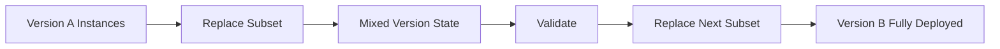
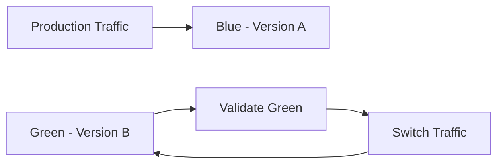
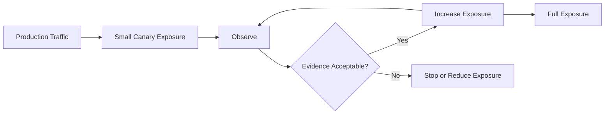
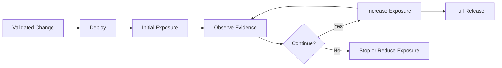

# Deployment Strategies and Progressive Delivery

## Learning Objectives

By the end of this chapter, you should be able to:

- Explain the difference between deployment and release.
- Explain why putting a new version into an environment does not necessarily mean that the version has been released to users.
- Understand deployment strategy as a mechanism for controlling how a production change is introduced.
- Explain rolling, blue-green, canary, traffic-shifting, and staged deployment strategies.
- Understand progressive delivery and why it reduces production blast radius.
- Explain the relationship between deployment scope, exposure, blast radius, and rollout risk.
- Understand how deployment strategies affect rollback readiness.
- Identify the infrastructure, traffic, state, and compatibility assumptions behind different deployment strategies.
- Explain why deployment strategy should be selected according to workload characteristics rather than popularity.
- Identify AI-specific considerations when deploying models, prompts, inference runtimes, and AI application changes.
- Understand how technical deployment evidence and AI quality evidence can participate in progressive release decisions.
- Reason about the trade-offs between rollout speed, infrastructure cost, operational complexity, traffic control, and recovery speed.
- Design a conceptual progressive delivery flow for a production AI system.

The central engineering question is:

> **How can a production change be introduced gradually so that risk is controlled before full rollout?**

---

## Prerequisites

Before studying this chapter, you should understand:

- Application artifacts and artifact identity
- CI/CD
- Artifact promotion
- Environment progression
- Infrastructure provisioning
- Deployment prerequisites
- Build/deployment separation

These concepts are established in [01 — AI CI/CD, Infrastructure Provisioning and Artifact Promotion](./01-AI-CI-CD-Infrastructure-Provisioning-and-Artifact-Promotion.md).

You should also understand that production serving architecture is a separate concern. [PROD-03 — Production Model and AI Serving](../PROD-03-Production-Model-and-AI-Serving/README.md) owns serving mechanisms, concurrency, queues, batching, streaming, routing, and serving architecture.

This chapter does not re-teach those mechanisms.

---

## Estimated Reading Time

**35–45 minutes**

---

## Before We Start

Consider this deployment:

```text
Version A
   ↓
Version B
   ↓
Production
```

At first glance, it appears simple.

But production engineering immediately raises additional questions:

- Does Version B receive 100% of traffic immediately?
- Can only a small percentage of users receive Version B?
- Can Version A and Version B operate simultaneously?
- Can traffic move between them?
- What happens if Version B is unhealthy?
- How quickly can exposure be reduced?
- Does the application require shared state?
- Can both versions safely read and write the same database?
- Does Version B require different infrastructure?
- Can the new AI model produce different outputs even when technical health appears normal?

These questions lead to an important distinction:

> **Deployment is about putting a new version into an environment. Release is about making that version available to users or production traffic.**

Those events may happen at the same time, but they do not have to.

---

# Why This Exists

A naive deployment process might look like:

```text
Build
  ↓
Deploy
  ↓
100% Production Traffic
```

This creates a large blast radius.

If the new version is defective, the entire production workload may be affected immediately.

A safer approach may be:

```text
Build
  ↓
Deploy
  ↓
Small Exposure
  ↓
Observe
  ↓
Increase Exposure
  ↓
Observe
  ↓
Full Release
```

The underlying idea is simple:

> **Do not expose the entire production workload to an uncertain change when the system can safely learn from a smaller exposure first.**

This is the foundation of progressive delivery.

---

# Mental Model

## Deployment vs Release

The distinction is fundamental.

### Deployment

Deployment means putting a version into a target environment.

```text
Artifact
   ↓
Production Environment
```

The new version now exists in production infrastructure.

### Release

Release means making that version available to users or production workload traffic.

```text
Production Environment
        ↓
Traffic / Users
        ↓
New Version
```

Therefore:

```text
Deployment ≠ Release
```

A system can deploy Version B without immediately sending all users to Version B.

For example:

```text
Version A → Serving Users
Version B → Deployed but Not Yet Fully Exposed
```

This separation creates opportunities for controlled rollout.

---

# From Environment Promotion to Production Exposure

File 01 established **artifact promotion** and **environment progression**.

Conceptually:

```text
Source Change
     ↓
Validation
     ↓
Build
     ↓
Artifact
     ↓
Promotion
     ↓
Test / Staging / Production Environment
```

File 02 begins where the artifact has reached its target deployment environment.

The next question is:

> **How should that deployed version become available to production traffic?**

Therefore:

```text
Environment Promotion
        ↓
Production Environment
        ↓
Deployment
        ↓
Controlled Exposure
        ↓
Release
```

These are different control points.

Promoting an artifact to production does not necessarily mean exposing it to 100% of production traffic.

For example:

```text
Artifact B
    ↓
Production Environment
    ↓
Version B Deployed
    ↓
0% Production Traffic
```

The artifact has reached production, but the release has not yet been fully exposed.

This distinction prevents artifact promotion and progressive release from being treated as the same operation.

---

# Deployment Strategy as Risk Control

A deployment strategy determines or influences how a new version is introduced.

Conceptually:

```text
New Version
    ↓
Exposure Decision
    ↓
Traffic / Users / Instances
    ↓
Validation
```

The strategy may determine or influence:

- how much infrastructure changes at once,
- how much traffic changes at once,
- how many users are exposed,
- how quickly exposure increases,
- how quickly exposure can be reduced,
- whether old and new versions coexist,
- how much additional infrastructure is required,
- how recovery or rollback can be performed.

Therefore:

> **A deployment strategy is fundamentally a mechanism for controlling change exposure and transition risk.**

---

# Core Concepts

## 1. Deployment

A deployment introduces a new version into an environment.

For example:

```text
Production
    ↓
Version A
```

becomes:

```text
Production
    ↓
Version A
Version B
```

or:

```text
Production
    ↓
Version B
```

depending on the strategy.

Deployment is therefore an infrastructure and application-state transition.

It does not automatically determine how users experience the change.

---

# 2. Release

A release controls whether and how the newly deployed version becomes available to production users or workload traffic.

For example:

```text
Version B deployed
       ↓
0% user traffic
```

may later become:

```text
Version B deployed
       ↓
10% user traffic
```

and eventually:

```text
Version B deployed
       ↓
100% user traffic
```

This distinction is especially useful for progressive delivery.

---

# 3. Blast Radius

Blast radius describes the scope of impact if a change behaves incorrectly.

A simple model is:

```text
Small Exposure
    ↓
Small Potential Impact

Large Exposure
    ↓
Large Potential Impact
```

For example:

```text
10% Traffic
```

generally creates a smaller potential user impact than:

```text
100% Traffic
```

assuming the traffic can actually be isolated and controlled.

Blast radius is not determined only by traffic percentage.

It can also depend on:

- affected services,
- affected users,
- data access,
- shared state,
- infrastructure changes,
- geographic scope,
- tenant scope,
- failure propagation.

Therefore a “10% rollout” is not automatically a low-risk deployment.

---

# 4. Rollout Scope

Rollout scope describes **what portion of the production system is being exposed to the change**.

It may be expressed through:

- traffic percentage,
- instances,
- users,
- tenants,
- regions,
- availability zones,
- request categories,
- other controlled segments.

For example:

```text
Phase 1 → 5% traffic
Phase 2 → 20% traffic
Phase 3 → 50% traffic
Phase 4 → 100% traffic
```

Or:

```text
Phase 1 → Internal users
Phase 2 → Small customer segment
Phase 3 → Broader customer segment
Phase 4 → All users
```

The exact segmentation mechanism depends on the system.

The engineering principle is:

> **Expose the smallest meaningful scope that provides useful evidence.**

---

# 5. Rollout Risk

Rollout risk depends on both the change and the exposure model.

A useful conceptual relationship is:

```text
Rollout Risk
≈
Change Uncertainty × Exposure
```

This is not a mathematical production formula.

It is an engineering intuition.

A highly uncertain change exposed to 100% of production traffic has a very different risk profile from the same change exposed to a small controlled segment.

Progressive delivery attempts to reduce the amount of production impact that can occur before evidence is collected.

---

# 6. Deployment Strategies

Several deployment strategies can be used to control how a new version enters production.

The major strategies covered in this chapter are:

- rolling deployment,
- blue-green deployment,
- canary deployment,
- traffic shifting,
- staged rollout.

These strategies are not mutually exclusive in all systems.

For example, a platform may combine:

```text
Rolling Deployment
+
Canary Exposure
+
Traffic Shifting
```

The correct choice depends on workload characteristics and available infrastructure.

---

# Rolling Deployment

## 7. Rolling Deployment

A rolling deployment replaces or updates production instances gradually rather than replacing everything simultaneously.

Conceptually:

```text
Before:

A A A A A
```

Then:

```text
Step 1:

B A A A A
```

Then:

```text
Step 2:

B B A A A
```

Then:

```text
Step 3:

B B B A A
```

Eventually:

```text
B B B B B
```

The key property is:

> **The new version replaces the old version incrementally.**

This can reduce the immediate infrastructure disruption associated with a full replacement.

---

# 8. Rolling Deployment Mental Model



During part of the rollout, both versions may coexist.

This creates an important requirement:

> **Old and new versions must be able to coexist safely during the transition.**

That can affect:

- APIs,
- database schemas,
- configuration,
- shared state,
- message formats,
- dependencies.

---

# 9. Rolling Deployment Trade-offs

### Advantages

- gradual infrastructure replacement,
- potentially lower infrastructure overhead than maintaining two complete environments,
- familiar operational model,
- reduced simultaneous change.

### Risks

- old and new versions coexist,
- rollback may require reversing a partially completed rollout,
- compatibility problems can appear during mixed-version operation,
- rollout duration may be longer,
- stateful workloads can be more difficult.

Rolling deployment is therefore not simply “safe by default.”

Its safety depends on the system's ability to tolerate transitional mixed-version states.

### Rollback Readiness

Before increasing rollout scope, the team should understand how the rollout can be reversed or exposure reduced.

For a rolling deployment, this may involve:

- stopping the rollout,
- preventing additional instances from being updated,
- reducing exposure to the new version where possible,
- replacing updated instances with the previous version,
- verifying that the previous version remains compatible with current state.

The exact rollback procedure belongs to File 03.

The deployment-strategy concern is:

> **A rolling strategy should be selected only when its transition and recovery behavior are understood.**

---

## Blue-Green Deployment

## 10. Blue-Green Deployment

Blue-green deployment maintains two environments or environment representations:

```text
Blue  → Current Version
Green → New Version
```

For example:

```text
Blue
Version A
   ↓
Production Traffic
```

while:

```text
Green
Version B
   ↓
Ready for Validation
```

Once the new environment is considered ready, traffic can be switched:

```text
Before:

Traffic → Blue

After:

Traffic → Green
```

The old environment can remain available for a period of time.

---

# 11. Blue-Green Mental Model



The central idea is:

> **Prepare the new environment separately, then switch traffic between environments.**

This can make the transition relatively clear.

---

# 12. Blue-Green Trade-offs

### Advantages

- clear separation between old and new versions,
- relatively simple traffic switch,
- potentially fast rollback by switching traffic back,
- reduced mixed-version operation.

### Risks

- may require significant additional infrastructure,
- state synchronization can be difficult,
- database compatibility remains important,
- running two environments can increase cost,
- switching traffic does not automatically guarantee application correctness.

### Rollback Readiness

Blue-green can provide a comparatively direct recovery path when:

- the previous environment remains available,
- traffic can be switched back,
- the previous version remains compatible with current state,
- external side effects do not prevent reversal.

Therefore the existence of a second environment does not automatically make rollback safe.

The team must still establish whether the previous version can safely become active again.

---

## Canary Deployment

## 13. Canary Deployment

A canary deployment introduces the new version to a small portion of production traffic or users first.

Conceptually:

```text
Version A → 95%
Version B → 5%
```

Then, if evidence is acceptable:

```text
Version A → 80%
Version B → 20%
```

Then:

```text
Version A → 50%
Version B → 50%
```

Eventually:

```text
Version B → 100%
```

The central idea is:

> **Use a small production exposure to gather evidence before increasing exposure.**

---

# 14. Canary Mental Model



Canary deployment therefore naturally supports progressive delivery.

---

# 15. What Makes a Canary Useful?

A canary is useful only if the selected exposure can provide meaningful evidence.

For example, if the canary receives:

```text
1 request
```

then the evidence may be insufficient.

If it receives:

```text
10% of meaningful production traffic
```

the organization may learn much more.

However, the correct percentage depends on:

- traffic volume,
- workload characteristics,
- risk,
- user distribution,
- geographic distribution,
- tenant distribution,
- AI behavior variability.

Therefore:

> **Canary size should be chosen for information value as well as risk containment.**

---

# 16. Canary Rollout and Recovery Readiness

A canary should not be treated as merely a traffic percentage.

Before increasing exposure, the team should understand:

- how canary exposure can be stopped,
- how traffic can be reduced or redirected,
- whether the previous version remains available,
- whether the previous version remains compatible with shared state,
- what happens to requests already in flight,
- whether the rollout can be resumed safely after intervention.

This creates an important principle:

> **Progressive exposure should be paired with a practical recovery path.**

The detailed definition of rollback, rollback triggers, and rollback limitations is covered in File 03.

---

## Traffic Shifting

## 17. Traffic Shifting

Traffic shifting changes which version receives requests.

Conceptually:

```text
Before:

100% → Version A
```

Then:

```text
90% → Version A
10% → Version B
```

Then:

```text
50% → Version A
50% → Version B
```

Finally:

```text
100% → Version B
```

Traffic shifting can therefore be used as a mechanism for progressive exposure.

It is a control mechanism rather than a complete deployment strategy by itself.

---

# 18. Traffic Shifting vs Deployment

This distinction is important.

Deployment determines whether a version exists in the environment.

Traffic shifting determines where requests go.

For example:

```text
Version B deployed
        ↓
0% Traffic
```

means:

```text
Deployment = Yes
Release Exposure = No
```

This is one of the clearest examples of why deployment and release should remain conceptually separate.

---

# 19. Traffic Shifting and Recovery Readiness

Traffic shifting can provide a useful recovery mechanism when the routing layer supports controlled reversal.

For example:

```text
Before:

Version A → 90%
Version B → 10%
```

If the new version becomes unsafe, exposure may be reduced:

```text
Version A → 100%
Version B → 0%
```

This is **reducing exposure**, not necessarily the same thing as rollback.

Rollback is the broader change-control operation of returning the production system or change to a previously acceptable state.

Therefore:

```text
Stop Rollout
→ Do not increase exposure.

Reduce Exposure
→ Decrease the new version's production exposure.

Rollback
→ Return the production change to a previous acceptable state.
```

The detailed rollback mechanics belong to File 03.

---

# Staged Rollout

## 20. Staged Rollout

A staged rollout introduces a change through predefined exposure stages.

For example:

```text
Stage 1 → 5%
Stage 2 → 20%
Stage 3 → 50%
Stage 4 → 100%
```

Each stage can have validation criteria.

Conceptually:

```text
Deploy
  ↓
Stage 1
  ↓
Validate
  ↓
Stage 2
  ↓
Validate
  ↓
Stage 3
  ↓
Validate
  ↓
Stage 4
```

Staged rollout is therefore a broader control pattern.

It does not require one particular underlying deployment mechanism.

---

# 21. Staged Rollout and Rollback Readiness

Each stage should have an understood response if evidence becomes unacceptable.

Conceptually:

```text
Stage N
   ↓
Validate
   ↓
Evidence Acceptable?
   ├── Yes → Next Stage
   └── No  → Stop / Reduce Exposure / Recover
```

The important design question is not only:

> “What is the next rollout stage?”

It is also:

> **“What can we safely do if this stage fails?”**

This is why rollout planning and recovery planning should be considered together.

File 03 will define the detailed release-gate and rollback mechanics.

---

# Progressive Delivery

## 22. What Is Progressive Delivery?

Progressive delivery is the practice of introducing changes gradually while using evidence to determine whether exposure should increase, stop, or decrease.

The core model is:



This is more than simply deploying slowly.

The key properties are:

1. controlled exposure,
2. evidence collection,
3. explicit decision points,
4. increasing exposure only when evidence supports it,
5. an understood response when evidence is unacceptable.

Therefore:

> **Progressive delivery is controlled change exposure combined with evidence-driven rollout decisions and a prepared recovery path.**

---

# 23. Progressive Delivery vs Slow Deployment

A slow deployment is not necessarily progressive delivery.

For example:

```text
Deploy one instance every 30 minutes
```

may simply be slow.

Progressive delivery is different:

```text
Small Exposure
      ↓
Evidence
      ↓
Decision
      ↓
Increase / Stop / Reduce
```

The distinction is **decision control**, not merely elapsed time.

---

# 24. Progressive Delivery Lifecycle

A generalized progressive delivery lifecycle is:

```text
Validated Change
    ↓
Deployment
    ↓
Initial Exposure
    ↓
Verification
    ↓
Increase Exposure
    ↓
Verification
    ↓
Increase Exposure
    ↓
Full Release
```

At each stage, the organization should know:

- what is being exposed,
- what evidence is expected,
- who or what makes the decision,
- how exposure can be stopped,
- how exposure can be reduced if necessary,
- what recovery path is available.

Detailed release gates and rollback mechanics are covered in File 03.

---

# Deployment Verification

## 25. What Should Be Verified?

Deployment verification asks:

> **Did the deployed system behave as expected at this rollout stage?**

Technical verification may include:

- deployment completion,
- instance readiness,
- endpoint availability,
- dependency connectivity,
- expected configuration,
- expected runtime behavior,
- latency,
- error behavior,
- capacity readiness.

AI systems may require additional signals such as:

- model response behavior,
- output validity,
- inference latency,
- token usage,
- cost behavior,
- model-specific quality signals.

The exact evaluation methodology is owned by PROD-11.

PROD-04 uses relevant accepted signals to support rollout decisions.

---

## 26. Deployment Evidence vs AI Quality Evidence

These should not be conflated.

### Deployment Evidence

Answers:

> **Is the deployment technically behaving as expected?**

Examples:

- service is available,
- instances are healthy,
- requests are completing,
- dependencies are reachable,
- latency is within expected bounds.

### AI Quality Evidence

Answers:

> **Is the AI system producing acceptable outcomes?**

Examples may involve:

- quality evaluation,
- regression signals,
- model behavior,
- output correctness.

The methodology and ownership for production evaluation belong to PROD-11.

The deployment lifecycle can consume that evidence when deciding whether to increase exposure.

Therefore:

```text
Deployment Evidence
        +
Accepted AI Quality Evidence
        ↓
Progressive Rollout Decision
```

---

# AI-Specific Deployment Considerations

## 27. Model Version Changes

A model change can alter system behavior even when application code is unchanged.

For example:

```text
Application Code = Same
Model Version = Changed
```

The production system may still experience changes in:

- output behavior,
- latency,
- resource consumption,
- cost,
- failure modes,
- quality.

Therefore model deployment should be treated as a meaningful production change.

---

# 28. Prompt Changes

Prompt changes can also alter application behavior.

For example:

```text
Application Code = Same
Model = Same
Prompt = Changed
```

The system may produce different outputs.

Therefore a prompt change can require controlled rollout even when the underlying model and application code remain unchanged.

---

# 29. Inference Runtime Changes

A runtime change may preserve the model artifact while changing how the model executes.

For example:

```text
Model = Same
Runtime = Changed
```

Potential effects include:

- latency,
- memory consumption,
- throughput,
- compatibility,
- hardware utilization,
- cost.

This is why deployment strategy should consider the complete production change rather than only the model identifier.

The serving mechanisms themselves remain the responsibility of PROD-03.

---

# 30. Large AI Artifacts

AI artifacts can be significantly larger than conventional application artifacts.

This can affect:

- deployment duration,
- transfer time,
- startup time,
- storage requirements,
- infrastructure preparation,
- rollback speed.

For example:

```text
Small Artifact
   ↓
Fast Transfer
   ↓
Fast Deployment

Large Model Artifact
   ↓
Longer Transfer
   ↓
Longer Deployment
```

Progressive deployment does not remove these physical constraints.

The deployment strategy must account for them.

---

# 31. Hardware Requirements

Some AI workloads depend strongly on infrastructure characteristics.

For example:

```text
Model Version
      ↓
Hardware Requirement
      ↓
Infrastructure Availability
      ↓
Deployment
```

A deployment may be technically correct but operationally impractical if the required resources are unavailable.

Therefore rollout planning should consider:

- compute requirements,
- memory requirements,
- accelerator requirements,
- startup time,
- resource availability.

The serving mechanisms themselves remain the responsibility of PROD-03.

---

# 32. AI-Specific Blast Radius

AI changes can have a broader behavioral blast radius than a simple software failure.

A conventional failure might look like:

```text
Request
  ↓
Error
```

An AI quality failure might look like:

```text
Request
  ↓
Successful Response
  ↓
Poor / Incorrect Output
```

The infrastructure may appear healthy while the system is still producing unacceptable results.

Therefore progressive delivery can be particularly valuable for AI systems.

It allows the organization to expose a new AI behavior to a limited scope before broadening exposure.

---

# 33. AI Rollout Example

Suppose Version B contains a new model.

A progressive rollout might look like:

```text
Version A → 100%
Version B → 0%
```

Then:

```text
Version A → 95%
Version B → 5%
```

Then:

```text
Version A → 80%
Version B → 20%
```

Then:

```text
Version A → 50%
Version B → 50%
```

Finally:

```text
Version A → 0%
Version B → 100%
```

At each stage, the organization can evaluate relevant technical and AI-quality evidence.

The decision model is:

```text
Exposure
   ↓
Evidence
   ↓
Decision
   ↓
More Exposure / Stop / Reduce
```

This is the core of progressive delivery.

---

# Deployment Strategy Selection

## 34. There Is No Universally Best Strategy

A common engineering mistake is to ask:

> “Which deployment strategy is best?”

The better question is:

> **Which strategy provides an acceptable risk profile for this workload under our infrastructure and operational constraints?**

Different strategies optimize different properties.

| Strategy | Primary Strength | Major Trade-off | Rollback / Recovery Consideration |
|---|---|---|---|
| Rolling | Incremental replacement | Mixed-version operation | May require reversing a partially completed rollout |
| Blue-Green | Clear environment separation | Higher infrastructure cost | Traffic may be switched back if the old environment remains viable |
| Canary | Small production exposure | Requires meaningful traffic/evidence | Exposure can be reduced if routing and previous version remain available |
| Traffic Shifting | Flexible exposure control | Requires traffic-control capability | Routing may provide a direct exposure-reduction mechanism |
| Staged Rollout | Explicit progressive control | Additional operational coordination | Each stage should have a defined stop/recovery response |

The rollback/recovery column is intentionally high-level.

Detailed rollback mechanics and limitations are covered in File 03.

The correct strategy depends on the system.

---

## 35. Factors Affecting Strategy Choice

Important factors include:

### Infrastructure Cost

Can the organization afford parallel environments?

### Traffic Control

Can production traffic be split safely?

### State Compatibility

Can old and new versions share state?

### Database Compatibility

Can both versions operate against the same schema?

### Rollback Readiness

Can the team reliably:

- stop further exposure,
- reduce exposure,
- redirect traffic,
- restore a previous version where appropriate,
- verify that the previous version remains compatible?

### Operational Complexity

Can the team reliably operate the strategy?

### Blast Radius

How much impact could a failed change produce?

### AI Characteristics

Does the change affect:

- model behavior,
- latency,
- cost,
- quality,
- hardware requirements?

### Evidence Availability

Can the organization obtain meaningful evidence at each rollout stage?

These factors should drive the decision.

---

## State and Compatibility Considerations

## 36. The Hidden Challenge: Shared State

Deployment strategies become more difficult when multiple versions share state.

For example:

```text
Version A
    ↓
Database
    ↑
Version B
```

Both versions may access the same database.

This creates compatibility requirements.

Suppose Version B expects:

```text
Field X
```

while Version A expects:

```text
Field Y
```

A transition may fail if both versions cannot safely operate against the same state.

Therefore:

> **A deployment strategy is constrained by the compatibility of the versions that coexist during the transition.**

---

# 37. Backward and Forward Compatibility

During progressive deployment, systems may temporarily contain:

```text
Old Version
+
New Version
```

Compatibility may therefore need to work in both directions.

For example:

```text
Old Application → Shared State
New Application → Shared State
```

The exact compatibility strategy depends on the architecture.

The important principle is:

> **If multiple versions coexist, shared interfaces and state must support the transition.**

This is one reason deployment strategy cannot be selected independently from system architecture.

---

# 38. Database and Schema Considerations

A deployment strategy can be affected by database changes.

For example:

```text
Application A
      ↓
Database Schema A
```

may transition toward:

```text
Application B
      ↓
Database Schema B
```

If Application A and Application B coexist during rollout, the database transition may need to support both versions temporarily.

Therefore:

```text
Deployment Strategy
        ↕
Application Compatibility
        ↕
State / Schema Compatibility
```

This chapter does not teach database migration methodology in depth.

The deployment concern is to recognize that state changes can constrain rollout and rollback options.

---

# Production Perspective

## 39. Progressive Delivery as Risk Containment

A useful production mental model is:

```text
Uncertain Change
      ↓
Small Exposure
      ↓
Evidence
      ↓
Controlled Decision
      ↓
Larger Exposure
```

This creates a feedback loop:

```text
Change
  ↓
Exposure
  ↓
Observation
  ↓
Decision
  ↓
Exposure Adjustment
```

The system is therefore not simply deploying.

It is **learning about the change while controlling its impact**.

---

# 40. Why Full Deployment Is Often the Wrong First Step

Consider two approaches.

### Approach A

```text
Version B
   ↓
100% Production
   ↓
Problem
```

Potential impact:

```text
Large
```

### Approach B

```text
Version B
   ↓
5%
   ↓
Validate
   ↓
20%
   ↓
Validate
   ↓
50%
   ↓
Validate
   ↓
100%
```

Potential impact before detection can be smaller, assuming the exposure controls and evidence are meaningful.

This does not eliminate risk.

It changes the **shape and containment of risk**.

---

# 41. Progressive Delivery Is Not a Substitute for Testing

A dangerous misconception is:

> “We can deploy directly to production because we have canary deployment.”

Incorrect.

Progressive delivery is an additional production control.

It does not replace:

- automated testing,
- compatibility validation,
- infrastructure validation,
- artifact validation,
- security controls,
- AI evaluation.

The stronger model is:

```text
Pre-Deployment Validation
        ↓
Deployment
        ↓
Progressive Production Exposure
        ↓
Production Evidence
```

Not:

```text
No Testing
   ↓
Canary
```

---

# 42. Progressive Delivery Is Not Automatically Safe

A rollout can still fail badly if:

- the canary is unrepresentative,
- the exposure is too large,
- evidence is weak,
- decision thresholds are unclear,
- traffic cannot actually be isolated,
- shared state is incompatible,
- recovery is difficult,
- the team cannot operate the mechanism reliably.

Therefore:

> **Progressive delivery reduces risk only when the exposure and decision mechanisms are meaningful and the recovery path is practical.**

---

## 43. Deployment Strategy and Operational Complexity

More sophisticated deployment strategies can provide stronger control.

But they also introduce more machinery.

For example:

```text
Simple Deployment
    ↓
Low Operational Complexity
```

versus:

```text
Progressive Delivery
    ↓
Traffic Control
    ↓
Multiple Versions
    ↓
Evidence Collection
    ↓
Automated Decisions
    ↓
Higher Operational Complexity
```

The organization should therefore avoid implementing advanced rollout mechanisms merely because they are fashionable.

The strategy must be supportable by the engineering team.

---

# Engineering Decisions and Trade-offs

## 44. Rolling vs Blue-Green

### Rolling

Advantages:

- incremental replacement,
- potentially lower infrastructure cost,
- natural fit for many stateless workloads.

Trade-offs:

- mixed-version state,
- potentially slower rollback,
- compatibility requirements.

Recovery consideration:

- the rollout may need to be stopped or reversed,
- updated instances may need to return to the previous version,
- the previous version must remain compatible with current state.

### Blue-Green

Advantages:

- strong environment separation,
- clear traffic switch,
- potentially fast rollback.

Trade-offs:

- additional infrastructure,
- state synchronization complexity,
- higher cost.

Recovery consideration:

- traffic can potentially be switched back to the previous environment,
- but only if the previous environment and current state remain compatible.

---

## 45. Canary vs Full Release

### Full Release

```text
Version B → 100%
```

Advantages:

- simple,
- fast,
- low operational overhead.

Risk:

- large blast radius.

### Canary

```text
Version B → Small Exposure
```

Advantages:

- limited initial blast radius,
- production evidence before full exposure.

Trade-offs:

- traffic management,
- additional operational complexity,
- need for meaningful evidence.

Recovery consideration:

- exposure should be reducible without requiring an unnecessarily large operational transition,
- the previous version or an alternative recovery path should remain available where required.

Canary is therefore useful when the value of early production evidence justifies the operational complexity.

---

# 46. Speed vs Risk

A faster rollout may reduce deployment duration.

But faster exposure can increase the amount of production impact before a problem is detected.

Conceptually:

```text
Faster Exposure
     ↓
Less Time to Validate
     ↓
Potentially Larger Impact
```

Progressive delivery intentionally trades some rollout speed for additional evidence and containment.

The correct balance depends on risk.

---

# 47. Infrastructure Cost vs Rollback Speed

Some strategies require additional infrastructure.

For example:

```text
Blue Environment
+
Green Environment
```

may cost more than a single environment.

But the additional environment may provide a faster transition path between versions.

Therefore:

> **Infrastructure cost can sometimes be exchanged for operational control and recovery speed.**

This is an engineering trade-off, not an absolute rule.

---

# 48. Simplicity vs Control

A simple deployment process may be easier to operate:

```text
Build
 ↓
Deploy
 ↓
Release
```

A more controlled process may look like:

```text
Build
 ↓
Deploy
 ↓
5%
 ↓
Validate
 ↓
20%
 ↓
Validate
 ↓
50%
 ↓
Validate
 ↓
100%
```

The second provides more control but requires:

- more automation,
- more evidence,
- more operational logic,
- more failure handling.

Therefore the organization should choose the minimum complexity that provides the required risk control.

---

# 49. Traffic Control vs Operational Capability

Traffic shifting can provide precise rollout control.

But it requires reliable mechanisms to:

- route traffic,
- measure exposure,
- change routing,
- verify routing,
- recover from routing mistakes.

If the organization cannot reliably operate these mechanisms, theoretical control may not translate into practical safety.

Therefore:

> **A deployment strategy should be evaluated based on operational capability, not only architectural possibility.**

---

## 50. AI Quality vs Technical Health

An AI deployment may show excellent technical health:

```text
Latency       → Good
Errors        → Low
CPU / GPU     → Normal
Availability  → Good
```

while AI quality has degraded:

```text
Output Quality → Poor
```

Conversely, a model may improve quality while introducing unacceptable latency or cost.

Therefore production AI rollout decisions may require multiple dimensions of evidence:

```text
Technical Health
      +
AI Quality
      +
Cost / Performance
      ↓
Rollout Decision
```

The evaluation methodology remains owned by PROD-11.

PROD-04 owns the deployment mechanism and the controlled exposure decision process.

---

# File 02 and File 03 Boundary

This chapter establishes **how a change is deployed and progressively exposed**.

File 02 owns:

- deployment strategies,
- rollout scope,
- traffic movement,
- exposure stages,
- blast-radius control,
- progressive delivery,
- deployment verification,
- strategy selection,
- rollout readiness and recovery considerations.

File 03 owns the deeper decision mechanics for:

- release gates,
- explicit continue/stop decisions,
- rollback definition and mechanics,
- rollback triggers,
- rollback limitations,
- irreversible changes,
- change-safety controls,
- release auditability.

The distinction is:

```text
File 02
How should we introduce and expose the change?

        ↓

File 03
How do we decide whether to continue, stop, or reverse it?
```

The chapters therefore complement each other without duplicating the same teaching responsibility.

---

# Common Mistakes and Misconceptions

## “Deployment and release are the same thing.”

Incorrect.

Deployment puts the version into an environment.

Release makes it available to users or production traffic.

A version can be deployed without being fully released.

---

## “Canary deployment means sending exactly 5% of traffic.”

Incorrect.

Five percent is only an example.

The appropriate canary size depends on:

- workload,
- traffic volume,
- risk,
- user distribution,
- evidence quality.

---

## “Rolling deployment means there is no downtime.”

Not necessarily.

A rolling deployment can reduce disruption, but availability depends on:

- capacity,
- readiness,
- dependencies,
- application behavior,
- infrastructure design.

---

## “Blue-green deployment eliminates rollback risk.”

Incorrect.

It can make traffic reversal simpler in some architectures, but rollback can still be constrained by:

- state changes,
- database changes,
- external side effects,
- incompatible versions.

---

## “Progressive delivery means deploying slowly.”

Incomplete.

Progressive delivery requires controlled exposure and evidence-driven decisions.

Simply taking longer to deploy is not progressive delivery.

---

## “Canary deployment replaces testing.”

Incorrect.

Canary deployment is a production risk-control mechanism.

It does not replace pre-production validation.

---

## “If the canary is healthy, the entire rollout is automatically safe.”

Incorrect.

The canary may be:

- unrepresentative,
- too small,
- exposed to different users,
- exposed to different traffic patterns.

Therefore canary evidence reduces uncertainty but does not eliminate it.

---

## “Traffic shifting is the same as deployment.”

Incorrect.

Traffic shifting controls request distribution.

Deployment controls whether the version exists in the environment.

---

## “Stopping a rollout is the same as rolling back.”

Incorrect.

Stopping a rollout means preventing additional exposure.

Reducing exposure means decreasing the new version's production exposure.

Rollback means returning the production change to a previous acceptable state.

These may occur together, but they are not identical operations.

---

## “AI deployments only need infrastructure health checks.”

Incorrect.

Technical health does not necessarily indicate AI quality.

A system can be technically healthy while producing poor outputs.

---

## “Blue-green always costs twice as much.”

Not necessarily.

Actual cost depends on:

- environment size,
- resource sharing,
- deployment duration,
- infrastructure architecture,
- how long both environments coexist.

The correct statement is that blue-green **can require additional infrastructure capacity**.

---

## “The most sophisticated deployment strategy is the safest.”

Incorrect.

A sophisticated strategy that the organization cannot reliably operate may be less safe than a simpler strategy with strong operational discipline.

---

## Interview Questions with Expected Answers

## 1. What is the difference between deployment and release?

**Expected answer:**

Deployment puts a version into an environment.

Release makes that version available to users or production traffic.

Separating the two allows an organization to deploy a version without immediately exposing the entire production workload to it.

---

## 2. What is progressive delivery?

**Expected answer:**

Progressive delivery is the controlled introduction of a change through increasing levels of exposure while using evidence to decide whether to continue, stop, or reduce exposure.

The core pattern is:

```text
Small Exposure
→ Observe
→ Decide
→ Increase Exposure
```

It should also have a practical recovery path if the evidence becomes unacceptable.

---

## 3. What is the main purpose of a canary deployment?

**Expected answer:**

A canary deployment exposes a new version to a small portion of production traffic or users first so the organization can gather production evidence while limiting the initial blast radius.

---

## 4. What is the difference between rolling and blue-green deployment?

**Expected answer:**

Rolling deployment gradually replaces instances of the old version with the new version.

Blue-green deployment maintains separate old and new environments and switches traffic between them.

Rolling deployments can require mixed-version compatibility, while blue-green deployments can require additional infrastructure.

---

## 5. Why might blue-green deployment make rollback easier?

**Expected answer:**

If the old environment remains available and state compatibility is maintained, traffic can potentially be switched back to the previous environment.

However, rollback is not guaranteed to be simple because database changes, state changes, and external side effects may constrain it.

---

## 6. Is progressive delivery the same as canary deployment?

**Expected answer:**

No.

Canary deployment is one mechanism for progressive delivery.

Progressive delivery is the broader practice of controlled exposure combined with evidence-driven rollout decisions.

Other mechanisms can include staged rollouts, traffic shifting, and other controlled exposure models.

---

## 7. Why is deployment strategy affected by database compatibility?

**Expected answer:**

During some deployment strategies, old and new versions coexist.

If both versions interact with the same database, the database state and schema must support the transition.

An incompatible schema change can therefore prevent safe coexistence or rollback.

---

## 8. What makes a canary meaningful?

**Expected answer:**

The canary must provide representative and useful production evidence while keeping the initial blast radius controlled.

A tiny or unrepresentative canary may not expose the failure modes that matter.

---

## 9. What AI-specific factors should influence deployment strategy?

**Expected answer:**

Factors may include:

- model behavior,
- model version,
- output quality,
- latency,
- cost,
- resource requirements,
- model artifact size,
- runtime compatibility,
- hardware requirements,
- prompt changes.

AI systems can appear technically healthy while quality has degraded, so rollout decisions may need both technical and AI-quality evidence.

---

## 10. Why isn't a healthy canary enough to guarantee a safe full rollout?

**Expected answer:**

The canary may not represent the broader production population.

The remaining traffic may have different:

- users,
- workloads,
- inputs,
- geographic distribution,
- tenants,
- traffic patterns.

Therefore canary evidence reduces uncertainty but does not eliminate it.

---

## 11. How would you choose between rolling, blue-green, and canary deployment?

**Expected answer:**

The decision should consider:

- blast radius,
- infrastructure cost,
- traffic-control capability,
- mixed-version compatibility,
- shared state,
- rollback readiness,
- operational complexity,
- workload characteristics,
- available production evidence.

There is no universally best strategy.

---

## 12. What is the difference between stopping a rollout, reducing exposure, and rolling back?

**Expected answer:**

Stopping a rollout means preventing further increase in exposure.

Reducing exposure means decreasing the amount of production traffic or users receiving the new version.

Rollback means returning the production change to a previous known acceptable state.

A rollout may stop or reduce exposure before a full rollback is necessary, depending on the situation.

---

## 13. Why should rollback readiness influence deployment strategy selection?

**Expected answer:**

A deployment strategy determines how versions coexist, how traffic moves, and what infrastructure remains available during transition.

Those properties affect how easily the system can stop, reduce exposure, or return to a previous state.

Therefore deployment strategy should be evaluated together with its practical recovery path rather than only its rollout mechanism.

---

# Quick Revision

## Deployment vs Release

```text
Deployment
→ Put Version B into the environment

Release
→ Make Version B available to production users/traffic
```

Therefore:

```text
Deployment ≠ Release
```

---

## Environment Promotion vs Progressive Exposure

```text
Artifact
   ↓
Environment Promotion
   ↓
Production Environment
   ↓
Deployment
   ↓
Controlled Exposure
   ↓
Release
```

Key distinction:

> **Promoting an artifact to production does not necessarily mean exposing it to 100% of production traffic.**

---

## Rolling Deployment

```text
A A A A A
↓
B A A A A
↓
B B A A A
↓
B B B A A
↓
B B B B B
```

Key property:

> Incremental replacement.

---

## Blue-Green

```text
Blue  → Version A
Green → Version B

Traffic → Blue

        ↓ Switch

Traffic → Green
```

Key property:

> Separate old and new environments with a traffic transition.

---

## Canary

```text
Version A → 95%
Version B → 5%

        ↓

Version A → 80%
Version B → 20%

        ↓

Version A → 50%
Version B → 50%

        ↓

Version B → 100%
```

Key property:

> Small production exposure before broader rollout.

---

## Progressive Delivery

```text
Validated Change
    ↓
Deployment
    ↓
Small Exposure
    ↓
Observe
    ↓
Decision
    ↓
Increase / Stop / Reduce
    ↓
Full Release
```

Key property:

> Controlled exposure + evidence-driven decisions + practical recovery path.

---

## Rollout Control Terminology

```text
Stop Rollout
→ Prevent further exposure increase.

Reduce Exposure
→ Decrease production exposure to the new version.

Rollback
→ Return the production change to a previous acceptable state.
```

These concepts are related but not interchangeable.

---

## Deployment Strategy Selection

| Question | Why It Matters |
|---|---|
| How much infrastructure can we afford? | Blue-green may require additional capacity |
| Can versions coexist? | Important for rolling deployments |
| Can traffic be controlled? | Important for canary/traffic shifting |
| Can state support transition? | Critical for mixed-version operation |
| Is rollback or recovery practical? | Influences strategy safety |
| How representative is the canary? | Determines evidence quality |
| How complex can operations be? | Determines practical safety |
| What AI evidence is available? | Important for AI rollout decisions |

---

# Key Takeaways

1. **Deployment and release are related but distinct concepts.**
2. **Deployment puts a version into an environment; release makes it available to users or production traffic.**
3. **Environment promotion and progressive exposure are different control points.**
4. **Deployment strategy controls how a production change is introduced and influences its blast radius.**
5. **Rolling deployments replace old instances incrementally.**
6. **Blue-green deployments maintain separate old and new environments and transition traffic between them.**
7. **Canary deployments expose a new version to a limited production population before broader rollout.**
8. **Traffic shifting controls which version receives production requests.**
9. **Staged rollout introduces changes through predefined exposure stages.**
10. **Progressive delivery combines controlled exposure with evidence-driven decisions.**
11. **Progressive delivery is not simply slow deployment.**
12. **Progressive delivery does not replace pre-production testing or validation.**
13. **A meaningful canary must provide useful evidence while controlling initial blast radius.**
14. **Deployment strategy is constrained by state, database, interface, and version compatibility.**
15. **Rollback readiness should influence deployment-strategy selection.**
16. **Stopping a rollout, reducing exposure, and rolling back are related but distinct operations.**
17. **AI deployments require consideration of model behavior, quality, latency, cost, artifact size, runtime, and hardware requirements.**
18. **Technical health and AI quality are different dimensions of rollout evidence.**
19. **There is no universally best deployment strategy.**
20. **A more sophisticated deployment strategy is not automatically safer if the organization cannot operate it reliably.**
21. **Progressive delivery reduces uncertainty and contains potential impact; it does not eliminate production risk.**
22. **The right deployment strategy is the one that provides sufficient risk control for the workload without introducing unjustified operational complexity.**

The central mental model is:

```text
Validated Change
      ↓
Environment / Deployment
      ↓
Controlled Exposure
      ↓
Production Evidence
      ↓
Rollout Decision
      ↓
Increase / Stop / Reduce
      ↓
Full Release
```

---

# Further Reading

Continue with:

- [01 — AI CI/CD, Infrastructure Provisioning and Artifact Promotion](./01-AI-CI-CD-Infrastructure-Provisioning-and-Artifact-Promotion.md)
- [03 — Release Gates, Rollback and Change Safety](./03-Release-Gates-Rollback-and-Change-Safety.md)

For broader production context:

- [PROD-03 — Production Model and AI Serving](../PROD-03-Production-Model-and-AI-Serving/README.md)
- [PROD-05 — AI Observability and Telemetry](../PROD-05-AI-Observability-and-Telemetry/README.md)
- [PROD-11 — AI Lifecycle Evaluation and Continuous Improvement](../PROD-11-AI-Lifecycle-Evaluation-and-Continuous-Improvement/README.md)

The next file addresses the decision point that follows progressive delivery:

> **How do we decide whether a production change should continue, stop, or be reversed?**
