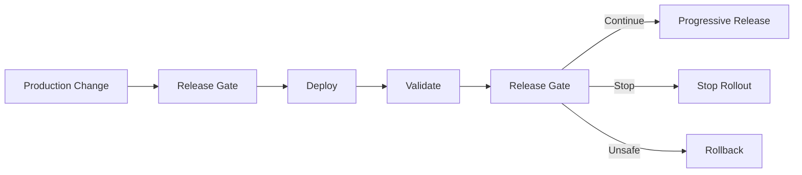
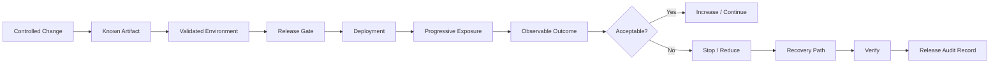

# Release Gates, Rollback and Change Safety

## Learning Objectives

By the end of this chapter, you should be able to:

- Explain why production deployment requires explicit release-control decisions.
- Distinguish deployment, release, validation, rollback, and recovery.
- Explain what a release gate is and why gates exist.
- Classify release gates into technical, operational, and AI-quality categories.
- Understand pre-deployment, deployment, and post-deployment gates.
- Explain how release gates interact with progressive delivery.
- Define rollback and identify appropriate rollback targets.
- Explain rollback triggers and rollback readiness.
- Understand why rollback is not always possible or safe.
- Identify changes that can make rollback difficult or irreversible.
- Explain the relationship between rollback, state compatibility, database/schema changes, external side effects, and model/data coupling.
- Understand rollback verification.
- Distinguish deployment rollback from runtime fallback.
- Explain release auditability and the information required to reconstruct a release decision.
- Distinguish release auditability from runtime observability.
- Explain change safety as a combination of controlled change, known artifacts, validated environments, release gates, progressive exposure, observable outcomes, and a recovery path.
- Reason about release decisions for application, model, prompt/configuration, runtime, infrastructure, and combined AI changes.
- Understand how release engineering consumes accepted AI-quality evidence without owning AI evaluation methodology.
- Design a conceptual release-control flow for a production AI system.

The central engineering question is:

> **How do we decide whether a production change should continue, stop, or be reversed?**

---

## Prerequisites

Before studying this chapter, you should understand:

- CI/CD
- Artifact promotion
- Environment progression
- Infrastructure provisioning
- Deployment
- Deployment strategies
- Progressive delivery
- Blast radius
- Rollout scope
- Deployment verification

These concepts are established in:

- [01 — AI CI/CD, Infrastructure Provisioning and Artifact Promotion](./01-AI-CI-CD-Infrastructure-Provisioning-and-Artifact-Promotion.md)
- [02 — Deployment Strategies and Progressive Delivery](./02-Deployment-Strategies-and-Progressive-Delivery.md)

You should also understand the distinction between deployment and release:

```text
Deployment
→ Put a version into an environment.

Release
→ Make that version available to intended production users or traffic.
```

This chapter builds on that distinction and adds the next control layer:

```text
Deploy
   ↓
Validate
   ↓
Decide
   ↓
Continue / Stop / Rollback
```

---

## Estimated Reading Time

**40–50 minutes**

---

# Before We Start

Consider a production change:

```text
Version A
    ↓
Version B
```

The deployment may succeed technically.

The service may start.

The infrastructure may be healthy.

The new artifact may be available.

But the engineering team still has to answer:

> **Should the release continue?**

This is the problem release gates and change-safety mechanisms address.

A useful mental model is:

```text
Change
  ↓
Gate
  ↓
Deploy
  ↓
Validate
  ↓
Healthy?
  ├── Yes → Continue
  └── No  → Stop / Rollback
```

The important idea is:

> **A successful deployment is evidence that the deployment operation completed. It is not automatically evidence that the production release should continue.**

---

# Why This Exists

A production deployment is a controlled state transition.

Without release controls, a pipeline can effectively behave like:

```text
Build
  ↓
Deploy
  ↓
100% Production
```

This assumes that everything is acceptable after deployment.

Production engineering cannot safely rely on that assumption.

A stronger model is:

```text
Validate
    ↓
Gate
    ↓
Deploy
    ↓
Verify
    ↓
Gate
    ↓
Continue / Stop / Rollback
```

This introduces explicit decision points.

The purpose is not to make deployment bureaucratic.

The purpose is to prevent an uncertain or unsafe change from automatically becoming a fully exposed production change.

---

# Mental Model

## Change → Gate → Deploy → Validate → Decision

A release-control lifecycle can be represented as:



This model should be understood as a control loop rather than a one-time sequence.

During progressive delivery:

```text
Deploy
   ↓
Expose
   ↓
Validate
   ↓
Decision
   ↓
Increase / Stop / Reduce
   ↓
Validate
   ↓
Decision
```

The release therefore remains under control throughout the transition.

---

# Deployment, Release, Validation and Rollback

These concepts are related but should remain distinct.

## Deployment

Putting or updating a version in an environment.

```text
Artifact
   ↓
Environment
```

---

## Release

Making the deployed version available to intended production users or traffic.

```text
Production Environment
        ↓
Production Traffic
        ↓
New Version
```

---

## Validation

Collecting evidence that the deployment or release is behaving acceptably.

```text
Deployment
   ↓
Evidence
   ↓
Assessment
```

---

## Rollback

Returning the production system to a previously known acceptable state after a change is determined to be unsafe or unsuccessful.

```text
Unsafe Change
     ↓
Rollback
     ↓
Previous Acceptable State
```

Therefore:

```text
Build
  ↓
Deploy
  ↓
Validate
  ↓
Release
  ↓
Observe
  ↓
Continue / Stop / Rollback
```

The exact sequence can vary by architecture.

The important point is that each operation has a different engineering responsibility.

---

# Release Gates

## What Is a Release Gate?

A release gate is a condition that must be satisfied before a production change is allowed to proceed to the next controlled stage.

Conceptually:

```text
Change
   ↓
Gate
   ↓
Allowed?
   ├── Yes → Continue
   └── No  → Stop / Investigate / Recover
```

A gate can be:

- automated,
- manually approved,
- evidence-based,
- policy-based,
- threshold-based,
- or a combination.

The engineering purpose is the same:

> **Prevent progression when required conditions have not been satisfied.**

---

# Why Release Gates Exist

Without gates:

```text
Change
   ↓
Deployment
   ↓
Full Exposure
```

With gates:

```text
Change
   ↓
Gate
   ↓
Deployment
   ↓
Gate
   ↓
Progressive Exposure
   ↓
Gate
   ↓
Full Release
```

Gates create explicit control points.

They can prevent:

- unvalidated artifacts from progressing,
- incompatible infrastructure changes from being applied,
- unhealthy deployments from receiving additional traffic,
- unacceptable AI changes from continuing rollout,
- unsafe production states from being treated as successful.

---

# Release Gate Lifecycle

Release gates can exist at different points in the lifecycle.

A useful conceptual model is:

```text
Pre-Deployment Gate
        ↓
Deployment
        ↓
Deployment Gate
        ↓
Initial Exposure
        ↓
Post-Deployment Gate
        ↓
Progressive Exposure
        ↓
Release Completion Gate
```

The exact number of gates depends on the system.

The principle is:

> **Place decision points where additional exposure or state change would increase production risk.**

---

# Pre-Deployment Gates

A pre-deployment gate asks:

> **Is this change ready to be deployed?**

Examples include:

- build success,
- required tests passing,
- artifact availability,
- artifact identity verification,
- compatibility validation,
- infrastructure validation,
- required environment readiness.

Conceptually:

```text
Validated Artifact
       ↓
Pre-Deployment Gate
       ↓
Deploy?
```

If the gate fails:

```text
No Deployment
```

This prevents a known-invalid change from entering the deployment process.

---

# Deployment Gates

A deployment gate asks:

> **Did the deployment itself complete in an acceptable state?**

Examples include:

- deployment completed,
- expected instances became ready,
- required dependencies are reachable,
- expected configuration is present,
- expected service behavior is available,
- infrastructure changes reached the intended state.

The important distinction is:

```text
Deployment Operation Successful
```

does not necessarily mean:

```text
Production Release Safe
```

A deployment can complete while the resulting system is still unsuitable for broader exposure.

---

# Post-Deployment Gates

A post-deployment gate asks:

> **Is the newly deployed version behaving acceptably under its current exposure?**

Evidence may include:

- service health,
- error behavior,
- latency,
- capacity behavior,
- rollout health,
- AI-quality evidence,
- cost/performance evidence.

For a progressive rollout:

```text
5% Exposure
    ↓
Post-Deployment Gate
    ↓
20% Exposure
    ↓
Post-Deployment Gate
    ↓
50% Exposure
    ↓
Post-Deployment Gate
    ↓
100% Exposure
```

Each gate limits uncontrolled progression.

---

# Release Gate Classes

Release gates can be grouped into three major classes.

```text
Technical Gates
Operational Gates
AI-Quality Gates
```

These categories are complementary.

---

# Technical Gates

Technical gates evaluate whether the technical change and its deployment prerequisites are acceptable.

Examples:

- build success,
- automated tests,
- artifact availability,
- compatibility,
- infrastructure validation,
- deployment completion,
- required configuration,
- runtime readiness.

A simplified model:

```text
Artifact
   ↓
Technical Validation
   ↓
Technical Gate
```

Technical gates answer questions such as:

> Is the artifact valid?

> Can the environment support it?

> Did the deployment produce the expected technical state?

---

# Operational Gates

Operational gates evaluate whether the production environment is ready to safely continue the rollout.

Examples:

- required environment readiness,
- rollout health,
- service health,
- capacity readiness,
- deployment stability,
- expected exposure behavior.

Conceptually:

```text
Production Environment
        ↓
Operational Evidence
        ↓
Operational Gate
```

These gates are not a replacement for observability architecture.

PROD-05 owns observability and telemetry.

PROD-04 uses available operational signals as inputs to release control where appropriate.

---

# AI-Quality Gates

AI-quality gates use evidence about AI behavior to determine whether a change should continue.

Examples include:

- evaluation thresholds,
- regression signals,
- model-quality evidence,
- accepted production quality signals.

Conceptually:

```text
AI Change
    ↓
AI Quality Evidence
    ↓
Release Decision
```

However, an important ownership boundary must remain explicit.

PROD-11 owns:

- production evaluation,
- regression,
- drift,
- quality signals,
- evaluation gates,
- continuous improvement,
- evaluation methodology.

PROD-04 owns:

- the deployment/release control mechanism,
- rollout progression,
- release gates as a deployment-control concern,
- rollback,
- change safety.

Therefore:

```text
PROD-11
Evaluation Methodology
        ↓
Quality Criteria / Evidence
        ↓
PROD-04
Release-Control Decision
        ↓
Production
```

The distinction is:

> **PROD-11 defines how AI quality is evaluated and what quality evidence means. PROD-04 uses accepted quality evidence as an input to determine whether a release may progress.**

PROD-04 does not redefine AI evaluation methodology.

---

# Combining Gate Types

A production AI release may require multiple forms of evidence.

For example:

```text
Technical Health
      +
Operational Readiness
      +
AI Quality Evidence
      ↓
Release Gate
      ↓
Continue / Stop / Rollback
```

This matters because an AI system can be technically healthy while producing poor outputs.

Likewise, an AI model may demonstrate good quality while creating unacceptable:

- latency,
- infrastructure load,
- cost,
- operational behavior.

Therefore:

> **A production release decision should use the evidence relevant to the risk of the change.**

---

# Release Gates and Progressive Delivery

Progressive delivery creates repeated decision points.

For example:

```text
Deploy
  ↓
5% Exposure
  ↓
Gate
  ↓
20% Exposure
  ↓
Gate
  ↓
50% Exposure
  ↓
Gate
  ↓
100% Exposure
```

The gate determines whether exposure can increase.

This creates a feedback loop:

```text
Exposure
   ↓
Evidence
   ↓
Gate
   ↓
Decision
   ↓
Exposure
```

This is why release gates and progressive delivery work together.

Progressive delivery controls **how much change is exposed**.

Release gates control **whether exposure should continue**.

---

# Stop, Reduce Exposure and Rollback

These actions should not be treated as synonyms.

## Stop Rollout

Stopping a rollout means:

> **Do not increase exposure further.**

For example:

```text
Current:
Version A → 80%
Version B → 20%

Stop
```

The system may remain at 80/20.

No additional rollout occurs.

---

## Reduce Exposure

Reducing exposure means:

> **Decrease the production exposure of the new version.**

For example:

```text
Before:
Version A → 80%
Version B → 20%

After:
Version A → 95%
Version B → 5%
```

This may reduce risk without requiring the entire change to be removed.

---

## Rollback

Rollback means:

> **Return the production system toward a previously known acceptable state after a change is determined to be unsafe or unsuccessful.**

This may involve:

- restoring an application artifact,
- restoring a model version,
- restoring configuration,
- redirecting traffic,
- reversing an infrastructure change where safely reversible.

Therefore:

```text
Stop
→ Prevent further progression.

Reduce Exposure
→ Decrease new-version exposure.

Rollback
→ Return the production change toward a previous acceptable state.
```

These actions may occur sequentially.

For example:

```text
Problem Detected
      ↓
Stop Rollout
      ↓
Reduce Exposure
      ↓
Rollback
      ↓
Verify
```

But not every situation requires all three.

---

# Rollback

## What Is Rollback?

Rollback is a change-control mechanism for returning production toward a previously known acceptable state after a change is determined to be unsafe or unsuccessful.

The key concept is:

```text
Current State
     ↓
Unsafe Change
     ↓
Rollback
     ↓
Previous Acceptable State
```

Rollback is therefore not simply:

> “Deploy the previous version.”

That may be one rollback mechanism, but it is not the definition.

---

# Rollback Targets

Depending on the architecture, rollback may target:

### Application Artifact

```text
Application v2
     ↓
Application v1
```

### Model Version

```text
Model v2
     ↓
Model v1
```

### Configuration

```text
Config B
     ↓
Config A
```

### Traffic Routing

```text
Traffic
   ↓
Version B
```

may become:

```text
Traffic
   ↓
Version A
```

### Infrastructure Change

An infrastructure change may be reversed where the change is safely reversible.

The important qualification is:

> **Not every infrastructure change can safely be reversed.**

---

# Rollback Triggers

A rollback may be considered when evidence indicates that the current production change is unsafe or unsuccessful.

Potential triggers include:

- severe technical degradation,
- unacceptable rollout health,
- critical compatibility problems,
- unacceptable AI-quality regression,
- unacceptable latency,
- unacceptable cost behavior,
- infrastructure instability,
- production impact beyond the acceptable boundary.

The exact thresholds depend on the system.

This chapter does not define universal numerical thresholds.

Instead:

> **Rollback triggers should be defined before or during release planning so that the team is not inventing recovery criteria after the failure occurs.**

---

## Rollback Readiness

Rollback readiness means understanding whether a change can actually be reversed safely if required.

Before increasing production exposure, the team should understand:

- what would be rolled back,
- how it would be rolled back,
- how quickly it can be done,
- whether rollback is automated or manual,
- whether the previous version remains available,
- whether current state remains compatible with the previous version,
- whether external side effects prevent reversal,
- how rollback success will be verified.

A useful model is:

```text
Change
   ↓
Rollback Target
   ↓
Rollback Mechanism
   ↓
Rollback Feasibility
   ↓
Rollback Verification
```

This is more useful than simply saying:

> “We have rollback.”

---

# Rollback Speed

Rollback speed matters because production exposure continues while recovery is being performed.

Conceptually:

```text
Failure Detection
      ↓
Rollback Initiation
      ↓
Rollback Completion
      ↓
Verification
```

The longer this takes, the longer the system may remain exposed to the unsafe change.

Therefore:

> **Rollback readiness includes not only whether rollback is possible, but how quickly the system can return to an acceptable state.**

However, faster rollback is not always better if the rollback itself creates additional risk.

The objective is **safe recovery**, not merely maximum speed.

---

# Rollback Automation

Rollback can be:

- manual,
- partially automated,
- automated.

Automation can reduce human execution time and reduce operator error.

But automation should not be treated as inherently safer.

An automated rollback can be dangerous if:

- its trigger is incorrect,
- the rollback target is invalid,
- state is incompatible,
- the rollback action creates secondary failures.

Therefore:

> **Automated rollback requires validated rollback logic and a known-safe rollback target.**

---

## Rollback Verification

Rollback is not complete simply because the previous artifact was deployed.

The system must verify that the resulting production state is acceptable.

Conceptually:

```text
Rollback
   ↓
Deployment / Routing Change
   ↓
Validation
   ↓
Healthy?
   ├── Yes → Recovery Confirmed
   └── No  → Further Recovery Required
```

Verification may include:

- service health,
- request behavior,
- expected configuration,
- traffic routing,
- capacity behavior,
- relevant AI-quality evidence.

The exact operational signals belong to the relevant observability and reliability systems.

PROD-04's responsibility is to ensure that rollback is treated as an incomplete action until the resulting state is validated.

---

# Why Rollback Is Not Always Possible

A common but dangerous assumption is:

> “Every production deployment can always be rolled back.”

That is false.

Some changes are partially or fully irreversible.

Rollback becomes difficult when the new state cannot safely coexist with the old state.

Examples include:

- database schema changes,
- irreversible data migrations,
- external side effects,
- state incompatibility,
- model/data coupling,
- configuration incompatibility.

---

## Database Schema Changes

Consider:

```text
Version A
   ↓
Schema A
```

A new version introduces:

```text
Version B
   ↓
Schema B
```

If the schema change is incompatible with Version A, simply deploying Version A again may not restore the previous safe state.

For example:

```text
Version B
   ↓
Database Schema B
   ↓
Rollback to Version A
   ↓
Version A cannot operate correctly with Schema B
```

This is why rollback planning must consider state compatibility.

This chapter does not teach database migration engineering in depth.

The important production principle is:

> **A rollback target is useful only if the target can safely operate against the state that exists at rollback time.**

---

# Irreversible Data Migrations

Some data changes cannot simply be undone.

For example:

```text
Original Data
     ↓
Transformation
     ↓
New Data
```

If information is permanently discarded or transformed in a non-reversible way, restoring the previous application version does not necessarily restore the previous data state.

Therefore:

```text
Application Rollback
≠
Data Rollback
```

These are different problems.

A deployment process must recognize when a change creates an irreversible state transition.

---

# External Side Effects

A production application may interact with external systems.

For example:

```text
Application
    ↓
External System
    ↓
Side Effect
```

If the new version triggers an external action, rolling the application back may not reverse that external action.

Examples could include:

- sending an external request,
- creating a record in another system,
- initiating a business transaction,
- triggering an external workflow.

Therefore:

> **Rollback of application code does not automatically undo external side effects.**

This is another reason why “deploy the old version” is an incomplete rollback model.

---

# State Incompatibility

Multiple versions may coexist during deployment or rollback.

For example:

```text
Version A
     ↕
Shared State
     ↕
Version B
```

If the versions interpret state differently, rollback can be unsafe.

This can involve:

- database state,
- caches,
- queues,
- persisted configuration,
- serialized objects,
- model-related state.

Therefore:

> **Rollback safety depends partly on whether the previous version remains compatible with the current state.**

---

# Model/Data Coupling

AI systems introduce another important possibility:

```text
Model
   ↕
Data / Representation
```

A new model may depend on:

- a changed representation,
- a changed preprocessing format,
- a changed embedding space,
- a changed feature interpretation,
- a changed data contract.

If the system changes both model and data assumptions, simply restoring the previous model may not be sufficient.

Conceptually:

```text
Model v2
   +
Data Representation v2
```

may not be safely replaced with:

```text
Model v1
   +
Data Representation v2
```

This is why AI rollback planning must consider model/data compatibility rather than only model version identifiers.

---

# Configuration Incompatibility

Configuration can also constrain rollback.

For example:

```text
Version A
   ↓
Config A
```

changes to:

```text
Version B
   ↓
Config B
```

If Version A cannot operate with Config B, then restoring only the application artifact may not restore the previous state.

Therefore rollback may need to consider:

```text
Application
+
Model
+
Configuration
+
Infrastructure
+
State
```

rather than one isolated artifact.

---

# Deployment Rollback vs Runtime Fallback

This distinction is critical.

## Deployment Rollback

A deployment rollback is a **change-control mechanism**.

It asks:

> How do we return the production deployment toward a previous acceptable state?

Examples:

```text
Application v2 → Application v1
```

or:

```text
Traffic → Version A
```

---

## Runtime Fallback

A runtime fallback is a **reliability mechanism**.

It asks:

> What should the running system do when a dependency or execution path fails?

Examples may include:

- using an alternate dependency,
- serving a degraded response,
- using a backup capability.

PROD-06 owns runtime reliability mechanisms such as:

- failure isolation,
- retries,
- timeouts,
- graceful degradation,
- fallback behavior.

Therefore:

```text
Rollback
→ Change control.

Fallback
→ Runtime reliability.
```

Do not treat them as interchangeable.

---

# AI-Specific Change Types

Release safety depends on what actually changed.

## Application Change

```text
API / Business Logic
        ↓
New Application Version
```

Potential rollback target:

```text
Previous Application Artifact
```

---

## Model Change

```text
Model v1
   ↓
Model v2
```

Potential rollback target:

```text
Model v1
```

But only if the surrounding system remains compatible.

---

## Prompt / Configuration Change

```text
Prompt A
   ↓
Prompt B
```

A prompt change can alter AI behavior without changing application code or model weights.

Rollback may therefore involve restoring the previous configuration.

---

## Dependency / Runtime Change

```text
Runtime X
   ↓
Runtime Y
```

Potential effects include:

- behavior,
- compatibility,
- latency,
- resource usage.

Rollback may require restoring both runtime and associated configuration.

---

## Infrastructure Change

```text
Infrastructure A
   ↓
Infrastructure B
```

Some infrastructure changes may be reversible.

Others may alter state or resources in ways that make complete reversal difficult.

---

## Combined Change

Production changes are often combinations:

```text
Application
+
Model
+
Configuration
+
Infrastructure
```

A rollback plan must therefore identify which components changed and whether they can be safely restored together.

---

# Change Safety

## What Is Change Safety?

Change safety is the discipline of reducing the probability and impact of uncontrolled production change.

A useful model is:

```text
Small / Controlled Change
        +
Known Artifact
        +
Validated Environment
        +
Release Gates
        +
Progressive Exposure
        +
Observable Outcome
        +
Recovery Path
```

The goal is to reduce:

- blast radius,
- uncertainty,
- recovery time,
- uncontrolled production impact.

A **recovery path** is broader than rollback.

It may include:

- rollback,
- traffic reversal,
- configuration restoration,
- corrective deployment,
- another controlled corrective change.

Therefore:

> **Rollback is one possible recovery mechanism, not a guarantee that every production failure can be reversed by restoring the previous version.**

This is not generic organizational change-management theory.

It is specifically about controlling production AI changes.

---

# Small and Controlled Changes

Large changes create more uncertainty.

For example:

```text
Change A
+
Change B
+
Change C
+
Infrastructure Change
+
Model Change
```

makes failure diagnosis and rollback more difficult.

A smaller change:

```text
One Well-Defined Change
```

usually makes it easier to:

- validate,
- attribute failures,
- control exposure,
- rollback,
- understand impact.

This does not mean every production change must be tiny.

It means:

> **Change scope should be deliberate and controlled.**

---

# Known Artifact

A release should have a known artifact identity.

The production system should not be relying on:

```text
“whatever was built last”
```

Instead:

```text
Known Artifact
     ↓
Known Version
     ↓
Known Promotion Path
     ↓
Production
```

Artifact identity and provenance are primarily established in PROD-02.

PROD-04 uses those properties to control promotion and release.

---

# Validated Environment

A release is safer when the target environment is known to satisfy the required deployment conditions.

Conceptually:

```text
Artifact
   +
Environment Requirements
   ↓
Validation
   ↓
Deployment
```

Infrastructure provisioning and environment preparation belong to PROD-04.

The objective is to avoid discovering fundamental environment incompatibilities only after production exposure has begun.

---

# Release Gates

Release gates provide explicit decision points.

```text
Change
   ↓
Gate
   ↓
Continue?
```

Without a gate, a successful technical operation may automatically trigger further exposure.

With a gate:

```text
Change
   ↓
Evidence
   ↓
Decision
   ↓
Controlled Progression
```

---

# Progressive Exposure

Progressive exposure reduces the amount of production impact that can occur before evidence is collected.

For example:

```text
5%
 ↓
20%
 ↓
50%
 ↓
100%
```

At each stage:

```text
Exposure
   ↓
Evidence
   ↓
Gate
```

This is one of the strongest practical mechanisms for controlling blast radius.

---

# Observable Outcome

A release decision requires evidence.

The organization must be able to determine whether the change is behaving acceptably.

This may include:

```text
Technical Evidence
+
Operational Evidence
+
AI Quality Evidence
```

PROD-05 owns observability architecture and telemetry.

PROD-11 owns AI evaluation methodology and quality signals.

PROD-04 uses the relevant evidence as part of release control.

---

# Release Auditability

Release auditability answers a different question from runtime observability.

```text
Observability
→ What is happening in the running system?

Release Auditability
→ What changed, what decision was made, and why?
```

For example:

```text
Observability:
Latency increased after rollout.

Release Auditability:
Version B was promoted to production,
reached 20% exposure,
the release gate failed,
and rollout was stopped.
```

A release process should preserve enough information to reconstruct the important production-change decision.

A conceptual release decision record may contain:

```text
Change Identity
      ↓
Artifact / Version
      ↓
Environment
      ↓
Gate Results
      ↓
Evidence References
      ↓
Exposure Stage
      ↓
Decision
      ↓
Decision Actor / Automation
      ↓
Rollback / Recovery Action, if any
      ↓
Resulting State
```

Important information may include:

- what changed,
- which artifact or version was involved,
- which environment was affected,
- which gates passed or failed,
- what evidence supported the decision,
- what exposure stage was reached,
- whether progression was continued, stopped, or reduced,
- whether rollback or another recovery action occurred,
- who or what made the decision,
- what resulting state was established.

This does not replace observability.

Instead:

> **Observability explains system behavior; release auditability explains the controlled change and the decision made around it.**

---

# Recovery Path

A production change should have an understood recovery path appropriate to its risk.

The recovery path should answer:

- What is the likely recovery target?
- How is the recovery action performed?
- Can the target operate against current state?
- How quickly can recovery occur?
- How is recovery verified?
- What happens if the first recovery mechanism fails?

A recovery path may include:

```text
Recovery Path
    ├── Rollback
    ├── Traffic Reversal
    ├── Configuration Restoration
    └── Corrective Change
```

Not every change will support every recovery mechanism.

The important engineering requirement is:

> **Recovery options and their limitations should be understood before production exposure becomes large.**

---

# A Complete Change-Safety Model

Putting the concepts together:



This represents the core engineering philosophy of PROD-04.

---

# Production Examples

## Example 1 — Canary Model Release

Suppose an AI service moves from Model v1 to Model v2.

The release plan is:

```text
Model v2
   ↓
Deploy
   ↓
5% Traffic
   ↓
Validate
   ↓
25%
   ↓
Validate
   ↓
100%
```

At each stage, the release process may consider:

- technical health,
- latency,
- cost,
- accepted AI-quality evidence.

If evidence becomes unacceptable:

```text
Current Exposure
      ↓
Release Gate Fails
      ↓
Stop / Reduce Exposure
      ↓
Rollback if required
      ↓
Verify
      ↓
Record Release Decision
```

The evaluation methodology remains owned by PROD-11.

The release-control mechanism is owned by PROD-04.

---

# Example 2 — Blue-Green Deployment

Suppose:

```text
Blue  → Version 1
Green → Version 2
```

Production traffic currently points to Blue.

The release process may be:

```text
Deploy Green
      ↓
Validate Green
      ↓
Release Gate
      ↓
Switch Traffic
      ↓
Validate
```

If Version 2 behaves incorrectly:

```text
Problem
   ↓
Stop Further Change
   ↓
Redirect Traffic to Blue
   ↓
Verify
   ↓
Record Decision
```

This is a potential recovery path, not a universal guarantee.

If state or external side effects make Blue incompatible with the current production state, switching traffic back may not be safe.

---

# Example 3 — Failed Release

Consider:

```text
Release v2
    ↓
Production
    ↓
Health / Quality Signal Degrades
    ↓
Release Gate Fails
    ↓
Stop Rollout
    ↓
Reduce Exposure / Rollback
    ↓
Verify
    ↓
Record Result
```

The important engineering property is that the system does not blindly continue from:

```text
“Deployment succeeded”
```

to:

```text
“Release complete”
```

without considering production evidence.

---

# Example 4 — Rollback Is Not Possible

Suppose Version 2 performs a data transformation that permanently removes information.

```text
Version 1
    ↓
Data Migration
    ↓
Version 2
    ↓
Information Permanently Removed
```

Deploying Version 1 again may restore the application code but not the lost data.

Therefore:

```text
Application Rollback
≠
Complete System Rollback
```

This is why irreversible changes require special care.

---

# Release Decision Mechanics

A release decision can be modeled as:

```text
Current Change
      ↓
Evidence
      ↓
Gate
      ↓
Decision
```

Possible decisions include:

### Continue

```text
Evidence acceptable
      ↓
Increase exposure
```

### Stop

```text
Evidence insufficient / uncertain
      ↓
Do not increase exposure
```

### Reduce Exposure

```text
Evidence concerning
      ↓
Decrease exposure
```

### Rollback

```text
Change unsafe
      ↓
Return toward previous acceptable state
```

### Recover Through Another Controlled Action

Some failures cannot be solved through a simple rollback.

The system may require another controlled corrective change.

This is important because:

> **Rollback is one recovery mechanism, not a guarantee that every production failure can be reversed by restoring the previous version.**

---

# Release Gates Should Be Explicit

A weak release process may rely on:

```text
“Looks fine.”
```

A stronger process defines:

```text
Gate
  ↓
Expected Evidence
  ↓
Decision Rule
  ↓
Action
```

For example:

```text
Gate:
Canary health acceptable?

Evidence:
Technical + operational + accepted AI-quality signals

Decision:
Continue or stop

Action:
Increase exposure / stop / reduce / rollback
```

The exact thresholds are system-specific.

The engineering principle is to make the decision mechanism explicit.

---

# Automated vs Manual Release Gates

## Automated Gates

Automated gates evaluate predefined conditions.

Advantages:

- repeatability,
- speed,
- consistency,
- reduced operator effort.

Risks:

- incorrect thresholds,
- noisy signals,
- false positives,
- false negatives,
- automation acting on incomplete evidence.

---

## Manual Gates

A human explicitly approves progression.

Advantages:

- contextual judgment,
- useful for high-risk changes,
- ability to consider evidence not captured automatically.

Risks:

- slower releases,
- inconsistent decisions,
- approval becoming a rubber stamp.

---

## Combined Gates

Production systems may combine both:

```text
Automated Validation
       ↓
Automated Gate
       ↓
Human Approval
       ↓
Progressive Release
```

The appropriate model depends on the risk and operating model.

The goal is not maximum automation.

The goal is:

> **Reliable and appropriate release control.**

---

# Release Gates and Change Risk

Not every change requires the same level of control.

A useful principle is:

```text
Higher Change Risk
      ↓
Stronger Control
```

Risk may increase because of:

- larger blast radius,
- greater uncertainty,
- irreversible state changes,
- high-value users,
- critical infrastructure,
- model behavior changes,
- broad configuration changes,
- complex dependencies.

Therefore release controls should be proportional to the change.

---

# Engineering Trade-offs

## Release Speed vs Safety

More gates can increase release time.

Fewer gates can increase uncontrolled exposure.

The engineering goal is not:

```text
Maximum Gates
```

or:

```text
Maximum Speed
```

It is:

```text
Appropriate Control for Risk
```

---

# Automation vs Control

Automation can make releases faster and more repeatable.

But excessive automation can create dangerous behavior if the system acts on poor evidence.

For example:

```text
Bad Signal
    ↓
Automated Gate
    ↓
Incorrect Rollback
```

Therefore automated release mechanisms should themselves be validated.

---

# Continuous Deployment vs Approval-Based Release

Continuous deployment can automatically move validated changes into production.

Approval-based release introduces an explicit human decision.

Neither is universally correct.

The decision depends on:

- risk,
- change type,
- evidence quality,
- operational maturity,
- recovery capability.

The important requirement is that automated progression should still have appropriate safety controls.

---

## Rollback Speed vs Rollback Complexity

A fast rollback may require:

- retained previous artifacts,
- traffic-control mechanisms,
- automation,
- compatible state,
- validated recovery procedures.

These capabilities introduce complexity.

Therefore:

> **Rollback speed is an architectural and operational property, not simply a command execution time.**

---

## Smaller Changes vs Operational Overhead

Smaller changes can reduce uncertainty and make rollback easier.

But excessively fragmenting changes may increase:

- deployment frequency,
- coordination overhead,
- pipeline complexity.

The engineering objective is controlled change size rather than blindly minimizing every change.

---

## Automated Gates vs False Positives

A gate that is too sensitive may stop healthy releases.

A gate that is too permissive may allow unsafe releases.

Therefore gates require appropriate:

- evidence,
- thresholds,
- context,
- validation.

This is particularly important for AI systems where quality signals may be noisy or multidimensional.

---

## Release Frequency vs Change Risk

Higher release frequency does not inherently mean higher risk.

If changes are:

- small,
- validated,
- observable,
- progressively released,
- reversible where possible,

frequent releases can be manageable.

Conversely, infrequent large releases can create substantial risk.

Therefore:

> **Change size and control quality matter more than release frequency alone.**

---

## Infrastructure Immutability vs Operational Flexibility

Immutable or replacement-oriented infrastructure can simplify reasoning about known states.

However, not every production infrastructure change can be handled through complete replacement.

The engineering decision depends on:

- state,
- cost,
- recovery requirements,
- infrastructure characteristics.

The key principle is to make infrastructure changes controlled and attributable.

---

## Common Mistakes and Misconceptions

## “If deployment succeeded, the release succeeded.”

Incorrect.

Deployment success only proves that the deployment operation completed successfully.

Release success requires acceptable production evidence.

---

## “A release gate is just a manual approval.”

Incorrect.

A release gate is a condition controlling whether a change may progress.

It may be automated, manual, evidence-based, or combined.

---

## “Rollback always means deploying the previous application version.”

Incorrect.

Rollback may involve:

- application artifact,
- model,
- configuration,
- traffic routing,
- infrastructure.

And restoring the previous application version may not be sufficient if state has changed incompatibly.

---

## “Every deployment must be rollbackable.”

Incorrect.

Some changes are partially or fully irreversible.

The correct engineering question is:

> **What is the recovery path, and what are its limitations?**

---

## “If rollback exists, the change is safe.”

Incorrect.

Rollback reduces some forms of risk but does not eliminate:

- data loss,
- external side effects,
- state incompatibility,
- detection delay,
- rollback failure.

---

## “Rollback and fallback are the same thing.”

Incorrect.

Rollback is a deployment/change-control mechanism.

Fallback is a runtime reliability mechanism.

---

## “AI-quality gates belong entirely to release engineering.”

Incorrect.

PROD-11 owns AI evaluation methodology and quality signals.

PROD-04 owns the release-control mechanism that can consume accepted AI-quality evidence.

---

## “More release gates always mean safer releases.”

Incorrect.

Poorly designed gates can:

- slow delivery,
- create false positives,
- encourage bypass behavior,
- automate incorrect decisions.

The goal is appropriate control, not maximum control.

---

## “Automated rollback is always safer than manual rollback.”

Incorrect.

Automation is only as safe as:

- its trigger,
- its target,
- its assumptions,
- its validation,
- its compatibility model.

---

## “A previous artifact is always a valid rollback target.”

Incorrect.

The previous artifact may be incompatible with:

- current schema,
- current configuration,
- current state,
- current dependencies,
- current data representation.

---

## “Stopping a rollout means the system is rolled back.”

Incorrect.

Stopping only prevents additional progression.

The new version may still be serving existing traffic.

---

## “Reducing exposure means rollback is complete.”

Incorrect.

Reducing exposure lowers the new version's production exposure.

It does not necessarily restore the entire system to the previous acceptable state.

---

## “If the system is observable, the release is auditable.”

Incorrect.

Observability and release auditability answer different questions.

Observability describes what is happening in the running system.

Release auditability reconstructs what changed, what decision was made, what evidence supported it, and what resulting state was established.

---

## Interview Questions with Expected Answers

## 1. What is a release gate?

**Expected answer:**

A release gate is a condition that must be satisfied before a production change is allowed to progress to the next stage.

It may be automated, manual, evidence-based, or combined.

---

## 2. What are the major classes of release gates?

**Expected answer:**

Three major classes are:

- technical gates,
- operational gates,
- AI-quality gates.

Technical gates assess the artifact and deployment state.

Operational gates assess environment and rollout health.

AI-quality gates use accepted evidence about AI behavior.

---

## 3. What is the difference between deployment and release?

**Expected answer:**

Deployment puts a version into an environment.

Release makes that version available to intended users or production traffic.

A version can therefore be deployed without being fully released.

---

## 4. What is rollback?

**Expected answer:**

Rollback is the process of returning the production system toward a previously known acceptable state after a change is determined to be unsafe or unsuccessful.

Possible rollback targets include application artifacts, models, configuration, traffic routing, and safely reversible infrastructure changes.

---

## 5. Why can't every deployment simply be rolled back?

**Expected answer:**

Because some changes alter state in ways that cannot safely be reversed.

Examples include:

- incompatible database schema changes,
- irreversible data migrations,
- external side effects,
- state incompatibility,
- model/data coupling,
- configuration incompatibility.

Therefore the previous artifact may not be sufficient to restore the previous system state.

---

## 6. What is rollback readiness?

**Expected answer:**

Rollback readiness means understanding the rollback target, mechanism, feasibility, speed, compatibility requirements, and verification process before the change is broadly exposed.

---

## 7. What is the difference between stopping a rollout and rolling back?

**Expected answer:**

Stopping a rollout prevents further exposure.

Rollback attempts to return the production change toward a previously known acceptable state.

Stopping may happen before rollback.

---

## 8. What is the difference between rollback and runtime fallback?

**Expected answer:**

Rollback is a deployment/change-control mechanism.

Runtime fallback is a reliability mechanism used while the system is operating, such as switching to an alternate dependency or degraded behavior.

---

## 9. Why is rollback verification necessary?

**Expected answer:**

Because completing the rollback action does not prove that the resulting production state is healthy.

The system must verify service behavior, routing, configuration, capacity, and other relevant signals after rollback.

---

## 10. How do release gates work with progressive delivery?

**Expected answer:**

Progressive delivery controls exposure in stages.

Release gates evaluate evidence at those stages and determine whether exposure should increase, stop, decrease, or trigger rollback.

Conceptually:

```text
Exposure
   ↓
Evidence
   ↓
Gate
   ↓
Decision
   ↓
Next Exposure
```

---

## 11. Who owns AI-quality gates?

**Expected answer:**

PROD-11 owns AI evaluation methodology, regression, drift, quality signals, evaluation gates, and continuous improvement.

PROD-04 owns the release-control mechanism that can consume accepted AI-quality evidence.

---

## 12. Why can a technically healthy AI deployment still require rollback?

**Expected answer:**

Because infrastructure and service health do not necessarily indicate acceptable AI behavior.

The system may have:

- low error rates,
- good latency,
- healthy infrastructure,

while simultaneously producing unacceptable outputs or quality regression.

---

## 13. What should you consider before automating rollback?

**Expected answer:**

Consider:

- rollback trigger correctness,
- rollback target validity,
- state compatibility,
- rollback safety,
- false positives,
- rollback verification,
- external side effects,
- whether the previous version remains viable.

Automation should not be assumed to be safe merely because it is automatic.

---

## 14. Why does database compatibility matter for rollback?

**Expected answer:**

Because the previous application version may not be able to operate correctly against the database state created by the newer version.

Therefore restoring the previous application artifact may not restore the previous system state.

---

## 15. What makes a production change safer?

**Expected answer:**

A useful model is:

```text
Small / Controlled Change
+
Known Artifact
+
Validated Environment
+
Release Gates
+
Progressive Exposure
+
Observable Outcome
+
Recovery Path
```

The goal is to reduce blast radius, uncertainty, recovery time, and uncontrolled production impact.

---

## 16. What is release auditability?

**Expected answer:**

Release auditability is the ability to reconstruct what production change occurred, which artifact and environment were involved, what gates and evidence were considered, what decision was made, who or what made it, what exposure stage was reached, and what recovery action occurred if necessary.

---

## 17. What is the difference between observability and release auditability?

**Expected answer:**

Observability answers:

> What is happening in the running system?

Release auditability answers:

> What changed, what release decision was made, what evidence supported it, and what resulting state was established?

Observability supports release decisions; auditability preserves the history of those decisions.

---

# Quick Revision

## Release Gate

```text
Condition
   ↓
Evidence
   ↓
Decision
   ↓
Continue / Stop
```

A gate controls progression.

---

## Gate Classes

```text
Technical
Operational
AI Quality
```

---

## Deployment vs Release

```text
Deployment
→ Put version into environment.

Release
→ Expose version to production users/traffic.
```

---

## Stop vs Reduce vs Rollback

```text
Stop
→ Do not increase exposure.

Reduce
→ Decrease new-version exposure.

Rollback
→ Return the production change toward a previous acceptable state.
```

---

## Rollback

```text
Unsafe Change
     ↓
Rollback
     ↓
Previous Acceptable State
     ↓
Verify
```

Rollback is not guaranteed to be possible.

---

## Recovery Path

```text
Recovery
├── Rollback
├── Traffic Reversal
├── Configuration Restoration
└── Corrective Change
```

Rollback is one recovery mechanism.

---

## Rollback Targets

Possible targets include:

```text
Application Artifact
Model Version
Configuration
Traffic Routing
Infrastructure
```

The target must be compatible with the current state.

---

## Rollback Limitations

Important limitations include:

```text
Database Schema Changes
Irreversible Data Migrations
External Side Effects
State Incompatibility
Model/Data Coupling
Configuration Incompatibility
```

---

## Change Safety

```text
Small / Controlled Change
+
Known Artifact
+
Validated Environment
+
Release Gates
+
Progressive Exposure
+
Observable Outcome
+
Recovery Path
```

Goal:

```text
Reduce
→ Blast Radius
→ Uncertainty
→ Recovery Time
→ Uncontrolled Impact
```

---

## Release Auditability

```text
Change
→ Artifact / Version
→ Environment
→ Gate Results
→ Evidence
→ Exposure Stage
→ Decision
→ Actor / Automation
→ Recovery Action
→ Resulting State
```

Auditability answers:

> **What changed, what decision was made, why, and what happened afterward?**

---

# Key Takeaways

1. **Deployment success does not automatically mean release success.**
2. **A release gate is a control point that determines whether a change may progress.**
3. **Release gates can be technical, operational, or AI-quality oriented.**
4. **Pre-deployment gates determine whether a change is ready to deploy.**
5. **Deployment gates verify whether the deployment reached an acceptable technical state.**
6. **Post-deployment gates evaluate whether the released version behaves acceptably under its current exposure.**
7. **Progressive delivery controls exposure; release gates control progression.**
8. **Stopping a rollout, reducing exposure, and rolling back are different actions.**
9. **Rollback means returning production toward a previously known acceptable state after an unsafe or unsuccessful change.**
10. **Rollback may target application artifacts, models, configuration, traffic routing, or safely reversible infrastructure.**
11. **Rollback readiness includes knowing the target, mechanism, feasibility, speed, compatibility, and verification process.**
12. **Rollback is not always possible or safe.**
13. **Database changes, irreversible data migrations, external side effects, state incompatibility, model/data coupling, and configuration incompatibility can limit rollback.**
14. **Restoring an old application artifact does not necessarily restore the old system state.**
15. **Rollback verification is necessary because executing rollback does not prove recovery.**
16. **Deployment rollback is a change-control mechanism; runtime fallback is a reliability mechanism.**
17. **PROD-11 owns AI evaluation methodology and quality evidence; PROD-04 owns release-control mechanisms that consume accepted evidence.**
18. **A technically healthy AI deployment can still be an unacceptable release if AI quality has degraded.**
19. **Automated rollback is not automatically safer than manual rollback.**
20. **More release gates do not automatically mean more safety.**
21. **Release controls should be proportional to change risk.**
22. **Release auditability records the important facts behind production-change decisions so that the release can be reconstructed later.**
23. **Observability explains what is happening in the running system; release auditability explains what changed and why a release decision was made.**
24. **Change safety combines controlled change, known artifacts, validated environments, release gates, progressive exposure, observable outcomes, and a recovery path.**
25. **The objective of release engineering is not to eliminate all production risk.**
26. **The objective is to keep production change controlled, observable, bounded, auditable, and recoverable where possible.**

The complete PROD-04 control model is:

```text
Source / Change
      ↓
Validation
      ↓
Build / Artifact
      ↓
Promotion
      ↓
Infrastructure / Environment Preparation
      ↓
Deployment
      ↓
Progressive Release
      ↓
Production Validation
      ↓
Release Gate
      ↓
Continue / Stop / Reduce / Rollback
      ↓
Recovery / Verification
      ↓
Release Audit Record
```

---

# Further Reading

Continue with the preceding PROD-04 chapters:

- [01 — AI CI/CD, Infrastructure Provisioning and Artifact Promotion](./01-AI-CI-CD-Infrastructure-Provisioning-and-Artifact-Promotion.md)
- [02 — Deployment Strategies and Progressive Delivery](./02-Deployment-Strategies-and-Progressive-Delivery.md)

For adjacent production responsibilities:

- [PROD-03 — Production Model and AI Serving](../PROD-03-Production-Model-and-AI-Serving/README.md)
- [PROD-05 — AI Observability and Telemetry](../PROD-05-AI-Observability-and-Telemetry/README.md)
- [PROD-06 — Production AI Reliability](../PROD-06-Production-AI-Reliability/README.md)
- [PROD-09 — Production AI Security](../PROD-09-Production-AI-Security/README.md)
- [PROD-10 — AI Operations and Incident Management](../PROD-10-AI-Operations-and-Incident-Management/README.md)
- [PROD-11 — AI Lifecycle, Evaluation and Continuous Improvement](../PROD-11-AI-Lifecycle-Evaluation-and-Continuous-Improvement/README.md)

The chapter's final mental model is:

```text
A production change is not safe merely because it can be deployed.

It becomes safer when:
    ↓
the change is known,
    ↓
the environment is validated,
    ↓
release gates control progression,
    ↓
exposure is controlled,
    ↓
production evidence is evaluated,
    ↓
release decisions are auditable,
    ↓
and a practical recovery path exists.
```
