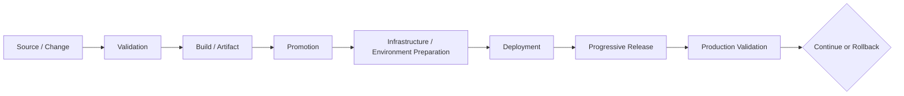

# PROD-04 — Deployment and Release Engineering

## Chapter Purpose

PROD-04 teaches how to safely and repeatedly move validated AI system changes from development toward production through controlled, repeatable, observable, and reversible deployment and release processes.

The chapter focuses on the engineering lifecycle around:

- CI/CD
- Infrastructure provisioning
- Artifact promotion
- Environment progression
- Deployment strategies
- Progressive delivery
- Release gates
- Rollout control
- Rollback
- Change safety
- Deployment validation
- Release decision mechanics

The chapter is **not** a generic CI/CD, DevOps, Kubernetes, cloud, or infrastructure tutorial.

---

## Central Engineering Question

> **How do we safely and repeatedly move an AI system change from a validated artifact to production without losing control over infrastructure, configuration, rollout, or rollback?**

The central progression is:



Two foundational distinctions drive the chapter:

> **Building an artifact and deploying an artifact are different engineering problems.**

> **A deployment is not automatically a safe release.**

---

## Chapter Scope

PROD-04 covers the engineering controls required to move production AI changes through environments and into production safely.

### PROD-04 Owns

- CI/CD for AI applications
- Artifact promotion
- Environment progression
- Infrastructure provisioning
- Infrastructure as Code concepts
- Deployment preparation
- Deployment strategies
- Progressive delivery
- Traffic and rollout control
- Release gates
- Deployment validation
- Rollback
- Change safety
- Release decision mechanics
- Deployment and release risk containment

### PROD-04 Does Not Own

| Domain | Primary Responsibility |
|---|---|
| **PROD-02** | Packaging, reproducibility, containers, runtime contracts, dependencies, environment configuration, artifact identity and provenance |
| **PROD-03** | Production inference, model serving, concurrency, queues, batching, streaming, serving routing and serving architecture |
| **PROD-05** | Observability, telemetry, logs, metrics, traces and AI operational signals |
| **PROD-06** | Reliability engineering, SLI/SLOs, error budgets, retries, timeouts, backpressure, graceful degradation and dependency failure handling |
| **PROD-07** | Scaling and capacity engineering |
| **PROD-08** | Performance and cost optimization |
| **PROD-09** | Security, identity, secrets, access control and AI/application/supply-chain security |
| **PROD-10** | Incident response and operational incident management |
| **PROD-11** | Production evaluation, regression, quality signals, evaluation gates and AI lifecycle improvement |
| **PROD-12** | Production readiness and architecture validation |

PROD-04 may **use** concepts owned by these chapters when making deployment and release decisions, but it does not re-teach their primary responsibilities.

---

## Learning Outcomes

After completing PROD-04, you should be able to:

1. Explain the difference between CI, delivery, deployment and release.
2. Explain why artifact creation and artifact promotion are separate concerns.
3. Design a conceptual CI/CD flow for an AI application.
4. Explain how infrastructure provisioning fits into a deployment pipeline.
5. Understand the role of Infrastructure as Code in reproducible environments.
6. Distinguish environment preparation from application deployment.
7. Compare rolling, blue-green, canary and staged deployment strategies.
8. Explain progressive delivery and controlled exposure.
9. Reason about blast radius and rollout scope.
10. Design release gates appropriate to technical, operational and AI-quality risks.
11. Explain when a release should continue, pause or roll back.
12. Identify rollback limitations caused by state, schema, data and external side effects.
13. Evaluate deployment and release decisions using production engineering trade-offs.
14. Apply deployment and release engineering principles specifically to AI system changes.

---

## Learning Progression

The chapter follows this progression:

```text
CI/CD
  ↓
Infrastructure Provisioning
  ↓
Artifact Promotion
  ↓
Environment Progression
  ↓
Deployment Strategies
  ↓
Progressive Delivery
  ↓
Release Gates
  ↓
Rollback
  ↓
Change Safety
```

The engineering reasoning progresses from **moving changes** to **controlling their production impact**.

---

## Teaching File Map

### 01 — AI CI/CD, Infrastructure Provisioning and Artifact Promotion

**File:**  
`01-AI-CI-CD-Infrastructure-Provisioning-and-Artifact-Promotion.md`

**Primary question:**

> How do production AI changes move from source and validated artifacts toward controlled deployment environments?

This file establishes:

- CI/CD mental models
- CI and delivery concepts
- AI-specific CI/CD concerns
- Build validation
- Artifact generation
- Artifact promotion
- Environment progression
- Infrastructure provisioning
- Infrastructure as Code concepts
- Infrastructure drift
- Environment reproducibility
- Deployment prerequisites
- Separation of build and deployment responsibilities

Core mental model:

```text
Source Change
      ↓
CI Validation
      ↓
Build
      ↓
Artifact
      ↓
Artifact Registry
      ↓
Promotion
      ↓
Environment
      ↓
Deployment
```

Infrastructure follows a related lifecycle:

```text
Infrastructure Definition
      ↓
Plan / Validate
      ↓
Provision / Change
      ↓
Environment
```

---

### 02 — Deployment Strategies and Progressive Delivery

**File:**  
`02-Deployment-Strategies-and-Progressive-Delivery.md`

**Primary question:**

> How can a production change be introduced gradually so that risk and blast radius remain controlled?

This file establishes:

- Deployment versus release
- Rolling deployment
- Blue-green deployment
- Canary deployment
- Staged rollout
- Traffic shifting
- Progressive delivery
- Rollout scope
- Blast radius
- Deployment verification
- Rollback readiness
- AI-specific deployment considerations

Core mental model:

```text
New Version
      ↓
Small Exposure
      ↓
Observe
      ↓
Increase Exposure
      ↓
Observe
      ↓
Full Release
```

The file emphasizes that progressive delivery **reduces and contains risk; it does not guarantee safety**.

---

### 03 — Release Gates, Rollback and Change Safety

**File:**  
`03-Release-Gates-Rollback-and-Change-Safety.md`

**Primary question:**

> How do we decide whether a production change should continue, stop or be reversed?

This file establishes:

- Release gates
- Pre-deployment validation
- Deployment gates
- Post-deployment validation
- Rollout health
- Change safety
- Rollback triggers
- Rollback readiness
- Rollback limitations
- State and schema compatibility
- Configuration and artifact rollback
- Traffic rollback
- Release auditability

Core decision model:

```text
Change
  ↓
Gate
  ↓
Deploy
  ↓
Validate
  ↓
Healthy?
 ├── Yes → Continue
 └── No  → Stop / Rollback
```

---

## Critical Concept Boundaries

### Packaging vs Deployment

**PROD-02** determines what the production artifact is and what it requires to run.

**PROD-04** determines how that artifact is safely promoted and deployed.

```text
PROD-02
Artifact Definition
      ↓
PROD-04
Artifact Promotion
      ↓
PROD-04
Deployment
```

---

### Deployment vs Release

A deployment places a version into an environment.

A release makes that version available to production traffic or users.

Therefore:

```text
Build
  ↓
Deploy
  ↓
Validate
  ↓
Release
  ↓
Observe
  ↓
Continue / Rollback
```

A technically successful deployment can still result in an unsafe release.

---

### Rollback vs Runtime Fallback

**Rollback** is a deployment and change-control mechanism owned by PROD-04.

**Runtime fallback** is a reliability mechanism owned primarily by PROD-06.

Rollback asks:

> Should we return the production system to a previous known acceptable change state?

Runtime fallback asks:

> How should the system continue operating when a dependency, component or runtime path fails?

These are related but different engineering mechanisms.

---

### Release Engineering vs AI Evaluation

PROD-11 owns the methodology and lifecycle for production AI evaluation, regression detection and quality assessment.

PROD-04 consumes accepted quality evidence as part of release decision-making.

```text
PROD-11
Evaluation / Quality Evidence
          ↓
PROD-04
Release Gate / Release Decision
```

PROD-04 does not become an evaluation-methodology chapter.

---

## AI-Specific Release Considerations

AI systems introduce additional change types beyond conventional application releases.

A production change may involve:

- Application code
- Model version
- Prompt or configuration
- Embedding model
- Inference runtime
- Dependencies
- Infrastructure
- Hardware requirements
- Model or artifact size
- Combined application/model changes

Release engineering therefore needs to consider more than deployment success.

Relevant release signals may include:

- Technical deployment health
- Runtime compatibility
- Latency behavior
- Capacity readiness
- Cost implications
- Model behavior
- Accepted AI quality evidence
- Regression signals
- Compatibility with dependent components

The ownership of AI evaluation methodology remains with PROD-11.

---

## Dependencies

PROD-04 builds on concepts established elsewhere in the PROD domain.

### Primary Dependencies

- **PROD-02 — AI Application Packaging and Runtime**  
  Provides the artifact, runtime contract, dependencies and reproducibility foundations used by deployment pipelines.

- **PROD-03 — Production Model and AI Serving**  
  Provides the serving/application context into which production artifacts are deployed.

### Operational Relationships

- **PROD-05 — AI Observability and Telemetry**  
  Provides operational signals that may be consumed by deployment validation and release gates.

- **PROD-06 — Production AI Reliability**  
  Provides reliability context for understanding failure behavior and recovery boundaries.

- **PROD-07 — Production AI Scaling and Capacity**  
  Provides capacity considerations relevant to deployment readiness and rollout.

- **PROD-08 — Production AI Performance and Cost Optimization**  
  Provides performance and cost considerations that may influence release decisions.

- **PROD-09 — Production AI Security**  
  Provides security controls and constraints relevant to secure deployment processes.

- **PROD-10 — AI Operations and Incident Management**  
  Handles incidents when deployment or release failures become operational incidents.

- **PROD-11 — AI Lifecycle, Evaluation and Continuous Improvement**  
  Provides AI quality and evaluation evidence that may participate in release decisions.

- **PROD-12 — Production Readiness and Architecture Validation**  
  Provides broader production-readiness and architecture-validation context.

---

## Cross-Chapter Navigation

- [PROD-02 — AI Application Packaging and Runtime](../PROD-02-AI-Application-Packaging-and-Runtime/README.md)
- [PROD-03 — Production Model and AI Serving](../PROD-03-Production-Model-and-AI-Serving/README.md)
- [PROD-05 — AI Observability and Telemetry](../PROD-05-AI-Observability-and-Telemetry/README.md)
- [PROD-06 — Production AI Reliability](../PROD-06-Production-AI-Reliability/README.md)
- [PROD-09 — Production AI Security](../PROD-09-Production-AI-Security/README.md)
- [PROD-10 — AI Operations and Incident Management](../PROD-10-AI-Operations-and-Incident-Management/README.md)
- [PROD-11 — AI Lifecycle, Evaluation and Continuous Improvement](../PROD-11-AI-Lifecycle-Evaluation-and-Continuous-Improvement/README.md)

---

## Recommended Learning Order

Complete the files in sequence:

```text
01
AI CI/CD, Infrastructure Provisioning
and Artifact Promotion
        ↓
02
Deployment Strategies
and Progressive Delivery
        ↓
03
Release Gates, Rollback
and Change Safety
```

The sequence intentionally moves from:

**How changes move**

→ **How changes are introduced**

→ **How changes are controlled**

---

## Chapter Completion Criteria

PROD-04 is complete when you can independently explain and reason about:

- Why CI/CD exists in production AI systems.
- How artifacts move between environments.
- Why artifact promotion should be distinguished from artifact creation.
- How infrastructure provisioning fits into deployment.
- Why Infrastructure as Code improves repeatability and control.
- The difference between deployment and release.
- The differences between rolling, blue-green, canary and staged deployment.
- How progressive delivery limits blast radius.
- How release gates control production change decisions.
- When a release should continue, pause or roll back.
- Why rollback is not always trivial or fully reversible.
- How AI-specific changes affect deployment and release safety.
- How PROD-04 interacts with PROD-02, PROD-03, PROD-05, PROD-06, PROD-07, PROD-08, PROD-09, PROD-10, PROD-11 and PROD-12 without duplicating their responsibilities.

The final test is not memorization.

You should be able to answer:

> **Given a proposed AI production change, how would you move it from validated artifact to production while controlling deployment risk, release exposure, and rollback?**

---

## Navigation

### Teaching Files

1. [01 — AI CI/CD, Infrastructure Provisioning and Artifact Promotion](./01-AI-CI-CD-Infrastructure-Provisioning-and-Artifact-Promotion.md)
2. [02 — Deployment Strategies and Progressive Delivery](./02-Deployment-Strategies-and-Progressive-Delivery.md)
3. [03 — Release Gates, Rollback and Change Safety](./03-Release-Gates-Rollback-and-Change-Safety.md)

### Parent Domain

[PROD — Production AI Engineering](../README.md)

---

## Chapter Principle

> **Production deployment is not merely the act of putting a new version into an environment. It is the controlled movement of change through validation, infrastructure, promotion, deployment, exposure, verification and change-reversal decisions.**
