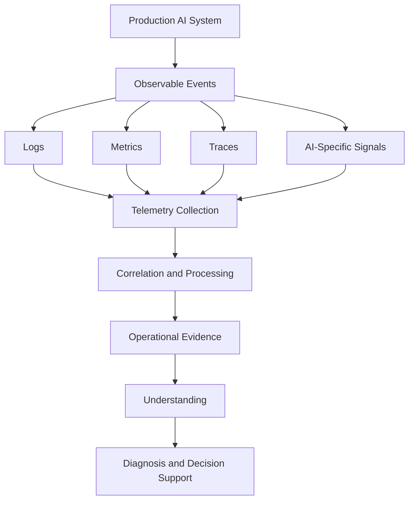
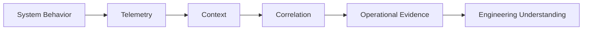
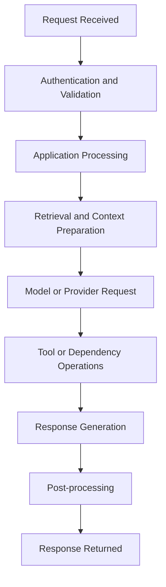
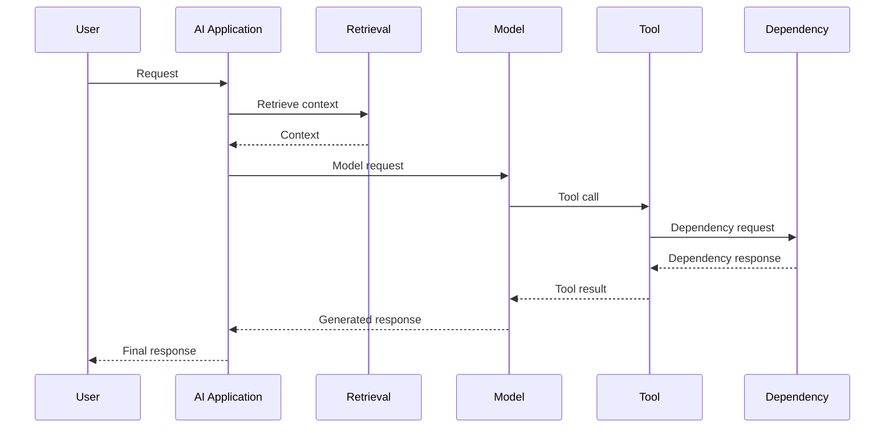
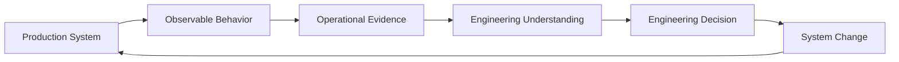
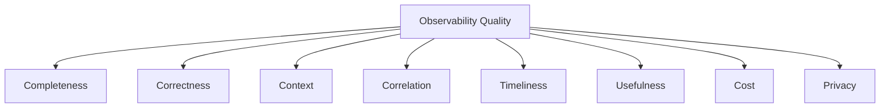
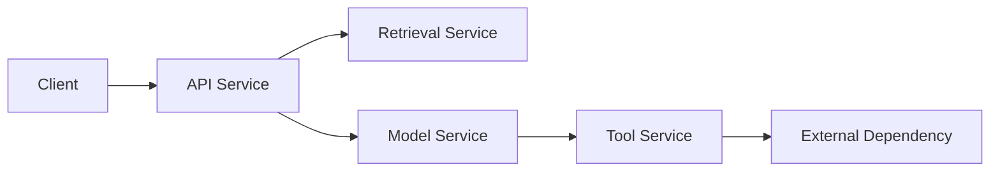
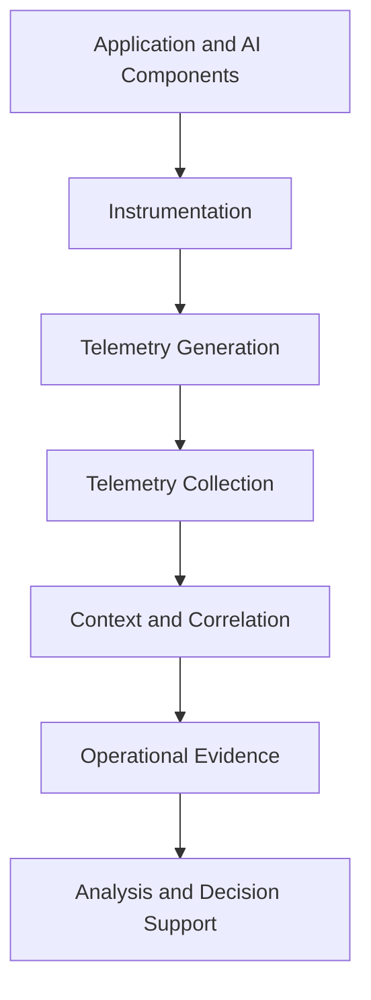
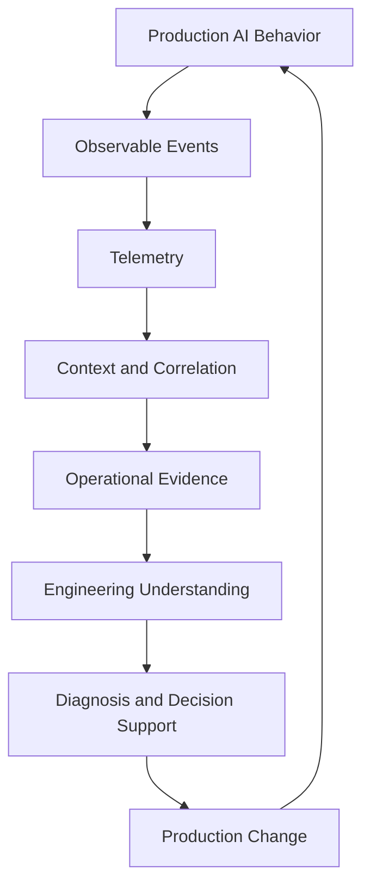

# Production AI Observability and Telemetry

## Learning Objectives

By the end of this chapter, you should be able to:

- Explain what production AI observability means and why it is an engineering capability rather than a collection of dashboards.
- Distinguish monitoring from observability.
- Explain the difference between telemetry and operational evidence.
- Identify the observable dimensions of a production AI request.
- Explain why AI systems require additional observability beyond traditional application telemetry.
- Distinguish observability from AI evaluation, reliability engineering, incident management, and optimization.
- Identify common observability gaps and understand how they affect diagnosis.
- Evaluate observability quality in terms of completeness, correctness, usefulness, cost, and privacy.
- Reason about the trade-off between diagnostic value and telemetry volume.
- Explain how observability creates a feedback mechanism for production engineering.
- Make basic engineering decisions about what should and should not be observable in an AI system.

---

## Prerequisites

You should already understand:

- Basic software engineering concepts.
- Basic production application architecture.
- The distinction between application behavior and system infrastructure.
- Basic concepts of APIs, services, requests, and dependencies.
- The role of production deployment and runtime systems.

You do not need prior expertise in observability platforms.

Detailed treatment of logs, metrics, traces, AI-specific telemetry signals, and observability architecture is covered in the following files:

- [02 — Logs, Metrics, Traces, and AI-Specific Signals](./02-Logs-Metrics-Traces-and-AI-Specific-Signals.md)
- [03 — AI Observability Architecture and Signal Design](./03-AI-Observability-Architecture-and-Signal-Design.md)

---

## Estimated Reading Time

Approximately 45–60 minutes.

The actual time required depends on how deeply you work through the practical examples and engineering questions.

---

## Before We Start

Production AI systems are difficult to understand when they fail.

A request may pass through:

- an API gateway,
- an application service,
- authentication,
- a prompt-processing layer,
- a retrieval system,
- a model provider,
- tools,
- databases,
- caches,
- queues,
- and downstream services.

The final user-visible result may be only a few hundred tokens.

The system that produced that result may have involved dozens of operations.

When something goes wrong, the important engineering question is not simply:

> "Did the request fail?"

It is:

> "What happened, where did it happen, what evidence do we have, and what can we conclude from that evidence?"

That is the problem observability addresses.

---

## Why This Exists

Traditional applications already require visibility into production behavior.

AI systems increase that requirement because important system behavior may depend on:

- model selection,
- prompt construction,
- retrieved context,
- token usage,
- model latency,
- tool calls,
- provider behavior,
- generated output,
- safety or guardrail outcomes,
- routing decisions,
- queueing,
- and multiple distributed dependencies.

Consider an AI request that takes 8 seconds.

A simple monitoring system may tell you:

```text
Request latency = 8 seconds
```

That is useful, but insufficient.

An engineer may need to determine whether the time came from:

```text
Request
   ↓
Application processing
   ↓
Retrieval
   ↓
Model request
   ↓
Tool execution
   ↓
Final response
```

The problem is therefore not simply collecting more telemetry.

The problem is producing enough trustworthy evidence to understand system behavior.

---

# Core Mental Model

The central mental model for this chapter is:



The important distinction is:

> **Observability is not merely collecting telemetry. It is designing sufficient evidence to understand system behavior.**

Telemetry is raw or processed information emitted by the system.

Evidence is telemetry placed into enough context to support a meaningful engineering conclusion.

Understanding is the ability to reason about what happened.

Diagnosis is the engineering process of identifying likely causes.

Observability supports these activities, but it does not automatically perform them.

---

# What Is Observability?

Observability is the capability of understanding the internal behavior of a system through the evidence it produces about its externally observable behavior.

For production AI systems, this means being able to answer questions such as:

- What happened?
- When did it happen?
- Which request was involved?
- Which service handled it?
- Which model or provider was used?
- Which dependencies were involved?
- How long did each important operation take?
- What failed?
- What changed?
- What resource or runtime conditions existed?
- What AI-specific behavior occurred?
- Is the available evidence sufficient to explain the behavior?

A useful mental model is:

```text
System behavior
      ↓
Observable events
      ↓
Telemetry
      ↓
Context + correlation
      ↓
Operational evidence
      ↓
Engineering understanding
```

Observability therefore describes a **system capability**, not a specific tool.

A dashboard is not observability.

A logging platform is not observability.

A metrics system is not observability.

A tracing system is not observability.

These are mechanisms that contribute to an observability capability.

---

# Observability Goals

Production AI observability should make important system behavior:

### Visible

Important production behavior should produce useful evidence.

If a critical operation leaves no useful evidence, engineers may have no way to investigate it.

### Understandable

Telemetry should contain enough context to interpret what happened.

A number without context is often insufficient.

For example:

```text
latency = 4.8 seconds
```

is less useful than:

```text
request_id = abc123
operation = model_inference
model = model-A
latency = 4.8 seconds
outcome = success
```

### Correlatable

Evidence from different components should be connected where a request crosses service boundaries.

Without correlation, engineers may see several independent events rather than one distributed request.

### Diagnosable

The available evidence should help engineers narrow down possible causes.

Observability does not guarantee automatic root-cause identification, but it should make investigation possible.

### Comparable

Engineers should be able to compare behavior across:

- requests,
- models,
- versions,
- providers,
- deployments,
- time periods,
- and workload conditions.

### Actionable

Observability should support engineering decisions.

Evidence should help determine what to investigate, change, rollback, optimize, or monitor further.

### Trustworthy

Telemetry itself must be sufficiently accurate, complete, consistent, and timely.

Incorrect observability can be worse than incomplete observability because it can lead engineers toward incorrect conclusions.

---

# Monitoring vs Observability

Monitoring and observability are related but are not interchangeable.

## Monitoring

Monitoring generally focuses on predefined signals and known conditions.

For example:

```text
CPU > 80%
Error rate > 5%
Latency > 2 seconds
Queue depth > threshold
```

Monitoring is particularly useful when the engineering team already knows what conditions matter.

It helps answer questions such as:

> "Is the system within an expected operating condition?"

## Observability

Observability focuses more broadly on understanding system behavior from available evidence.

It helps answer questions such as:

> "Why is this request behaving differently from other requests?"

The distinction can be summarized as:

```text
Monitoring
    ↓
Known questions
Known conditions
Known signals

Observability
    ↓
Broader understanding
Unexpected behavior
Investigation and diagnosis
```

Monitoring is therefore part of an observability capability, but observability is broader than monitoring.

---

# Operational Evidence

Telemetry becomes useful when it provides evidence that can support engineering reasoning.

Consider:

```text
Latency = 9.2 seconds
```

This is a signal.

Now consider:

```text
Request ID = req-4821
Total latency = 9.2s
Retrieval latency = 0.4s
Model latency = 7.9s
Tool latency = 0.6s
Outcome = success
Model = provider-A/model-X
```

This provides substantially more diagnostic context.

The second example allows an engineer to form a hypothesis:

> Most of the request latency came from model inference.

That is operational evidence.

The distinction is important because:

> **Telemetry collection alone does not guarantee observability.**

The engineering objective is useful evidence.

---

# From Telemetry to Evidence

The transformation can be understood as:



Each step matters.

### System behavior

Something happens inside the production system.

### Telemetry

The system emits information about that behavior.

### Context

The information is associated with meaningful metadata.

### Correlation

Related observations are connected.

### Operational evidence

The resulting information can support investigation or decision-making.

### Engineering understanding

An engineer can form and test hypotheses about what happened.

Observability becomes weak when one or more of these steps is missing.

---

# What Should Be Observable?

Not every internal implementation detail needs to be observable.

The question should be:

> "What evidence do engineers need to understand important production behavior?"

A useful starting point is to consider the lifecycle of an AI request.



Important observable dimensions may include:

- request identity,
- request outcome,
- latency,
- throughput,
- errors,
- dependencies,
- model/provider selection,
- token or usage information,
- retrieval-related behavior,
- tool activity,
- queueing,
- resource conditions,
- lifecycle state,
- and relevant version information.

The detailed semantics of logs, metrics, traces, and AI-specific signals are covered in [Lesson 02](./02-Logs-Metrics-Traces-and-AI-Specific-Signals.md).

---

# Why AI Systems Need Additional Observability

Traditional application telemetry remains necessary for AI systems.

It is not sufficient by itself.

An AI application may behave differently depending on:

- the model used,
- the model version,
- the provider,
- the prompt,
- retrieved context,
- token volume,
- tool usage,
- generation characteristics,
- safety or guardrail decisions,
- and routing decisions.

Two requests can therefore have similar HTTP-level behavior but very different AI-level behavior.

For example:

```text
Request A
Model = provider-A/model-X
Input tokens = 500
Output tokens = 200
Latency = 1.2s

Request B
Model = provider-A/model-X
Input tokens = 8,000
Output tokens = 2,000
Latency = 7.8s
```

At the HTTP layer, both requests may simply appear as successful `200` responses.

At the AI system level, their operational behavior is substantially different.

This creates a requirement for AI-specific observability.

---

# AI-Specific Observable Behavior

AI systems may require visibility into dimensions such as:

- model identity,
- model version,
- provider,
- model routing,
- inference latency,
- token usage,
- generation duration,
- request outcome,
- tool-call activity,
- retrieval activity,
- cache behavior,
- queueing,
- safety or guardrail outcomes,
- and relevant AI workflow state.

These signals should not be collected merely because they are available.

They should be collected because they answer meaningful operational questions.

For example:

```text
Question:
Why did this request become expensive?

Potential evidence:
- model
- input tokens
- output tokens
- request type
- retrieval size
- tool activity
```

Another:

```text
Question:
Why did requests become slower?

Potential evidence:
- request latency
- queueing time
- retrieval latency
- model latency
- tool latency
- provider/model
```

The important principle is:

> **Observe behavior that matters for operating the system.**

---

# AI Observability Is Not AI Evaluation

Observability and evaluation are related but serve different purposes.

## Observability

Observability asks:

> "What happened in the production system?"

Examples:

- model latency,
- request failure,
- token usage,
- provider selected,
- tool call count,
- retrieval latency.

## Evaluation

Evaluation asks questions such as:

> "Was the system output good enough?"

Examples may include:

- answer quality,
- factuality,
- relevance,
- safety quality,
- task success,
- retrieval quality,
- model quality.

The distinction can be represented as:

```text
Observability
    ↓
System behavior

Evaluation
    ↓
System or output quality
```

A request may be:

```text
Operationally healthy
but
Output quality is poor
```

Or:

```text
Output quality is good
but
Latency is unacceptable
```

Both dimensions matter, but they should not be collapsed into one concept.

Detailed AI evaluation and lifecycle concerns belong to PROD-11.

---

# AI Observability Is Not Reliability Engineering

Reliability engineering focuses on whether a system consistently performs within required reliability objectives.

Observability provides evidence that helps engineers understand reliability behavior.

For example:

```text
Reliability question:
Are requests succeeding reliably?

Observability evidence:
- request outcomes
- error events
- latency
- dependency behavior
- model/provider failures
```

Observability supports reliability engineering.

It does not replace it.

Detailed reliability engineering belongs to PROD-06.

---

# AI Observability Is Not Incident Management

Incident management deals with the operational response to production incidents.

Observability provides evidence used during that response.

For example:

```text
Incident management:
Who responds?
How is the incident coordinated?
What actions are taken?

Observability:
What evidence explains the system behavior?
```

Observability may support detection and investigation, but it does not define incident response processes.

Detailed incident management belongs to PROD-10.

---

# AI Observability Is Not Optimization

Observability can reveal opportunities for optimization.

For example:

```text
Observed:
Model latency increased.

Possible optimization:
Change routing strategy.
```

But the two concepts are different.

Observability answers:

> "What is happening?"

Optimization asks:

> "What should we change to improve it?"

Detailed performance, scaling, and cost optimization belong to the relevant production engineering chapters, especially PROD-07 and PROD-08.

---

# AI Observability Dimensions

A production AI system can be viewed through several observable dimensions.

| Dimension | Example Question |
|---|---|
| Identity | Which request is this? |
| Outcome | Did it succeed or fail? |
| Timing | How long did it take? |
| Dependencies | Which services were involved? |
| Model behavior | Which model/provider was used? |
| Usage | How many tokens were consumed? |
| Workflow | Which operations occurred? |
| Resources | What runtime conditions existed? |
| Routing | Which path or provider was selected? |
| Errors | What failed? |
| Lifecycle | Where in the request lifecycle did failure occur? |
| Context | What information is needed to interpret the event? |

These dimensions do not imply that every field must be collected for every request.

Observability design requires judgment.

---

## The Observable Behavior of an AI Request

Consider an AI request:



A useful observability model asks what evidence should exist around each meaningful transition.

For example:

```text
Request received
    ↓
Validation
    ↓
Retrieval
    ↓
Model request
    ↓
Tool call
    ↓
Dependency request
    ↓
Model response
    ↓
Post-processing
    ↓
Final response
```

The goal is not necessarily to capture every internal operation.

The goal is to make important behavior understandable.

---

# Observability as a Feedback Mechanism

Observability creates a feedback loop between production behavior and engineering decisions.



For example:

```text
Observed:
Model latency increased after deployment.

Evidence:
Latency increase is concentrated in model inference.

Decision:
Investigate model configuration or routing.

Change:
Modify model routing.

Observation:
Latency returns to expected range.
```

This feedback loop is one of the most important reasons observability is an engineering capability.

---

# Observability Gaps

An observability gap occurs when important system behavior cannot be sufficiently understood from available evidence.

Common examples include:

### Missing telemetry

A critical operation emits no useful information.

### Missing context

A signal exists but cannot be associated with the request or operation that produced it.

### Broken correlation

Different services generate evidence that cannot reliably be connected.

### Incorrect timestamps

Events appear in the wrong temporal order.

### Inconsistent naming

The same service, model, or operation appears under different identifiers.

### Excessive cardinality

Telemetry contains too many unique dimensions to remain practical.

### Sampling removes critical evidence

Important events disappear from the available dataset.

### Dropped telemetry

The observability pipeline loses events.

### Incorrect aggregation

Metrics are aggregated in ways that hide important behavior.

### Sensitive-data leakage

Telemetry unintentionally captures confidential or personal information.

### Excessive telemetry volume

The system produces so much telemetry that storage, processing, and investigation become expensive or impractical.

The important point is:

> **An observability system can fail even when the application itself is functioning correctly.**

---

## Observability Quality

Observability should itself be treated as a production capability.

A useful observability-quality model is:



### Completeness

Are important behaviors represented?

### Correctness

Does the telemetry accurately represent what happened?

### Context

Does the evidence contain enough information to interpret the event?

### Correlation

Can related events be connected?

### Timeliness

Does the evidence become available quickly enough to support operations?

### Usefulness

Does the telemetry help answer real engineering questions?

### Cost

Is the value of the telemetry justified by its collection, processing, storage, and query costs?

### Privacy

Does the telemetry avoid unnecessary exposure of sensitive information?

Observability quality is therefore not simply:

> "How much telemetry do we have?"

It is:

> "How useful and trustworthy is the evidence we have?"

---

# Signal vs Noise

More telemetry does not automatically create better observability.

Consider:

```text
10 million events
0 useful diagnostic relationships
```

versus:

```text
100,000 well-structured events
clear request correlation
useful context
relevant dimensions
```

The second system may be much easier to operate.

A useful principle is:

> **Telemetry should be selected for diagnostic value, not volume.**

Every signal should have a reason for existing.

Possible questions include:

- What engineering question does this answer?
- Who uses it?
- How often is it useful?
- What happens if it is missing?
- What is its collection cost?
- What is its storage cost?
- Does it introduce privacy risk?
- Does it introduce excessive cardinality?
- Can engineers interpret it correctly?

---

# Privacy and Sensitive Data

AI systems can process highly sensitive information.

Observability systems may therefore accidentally become repositories of sensitive data.

Potentially sensitive information can include:

- user messages,
- personal information,
- authentication information,
- retrieved documents,
- tool inputs,
- generated outputs,
- internal prompts,
- business information,
- or confidential application data.

The engineering principle should be:

> **Collect the minimum information required to provide useful operational evidence.**

This means observability design should consider:

```text
Diagnostic value
        vs
Privacy risk
        vs
Operational cost
```

Useful techniques may include:

- structured metadata instead of raw content,
- redaction,
- masking,
- hashing where appropriate,
- controlled access,
- retention policies,
- selective capture,
- and avoiding sensitive payloads when they are not operationally necessary.

The exact security controls belong to PROD-09.

The important point here is that observability design must consider privacy from the beginning.

---

# Observability Economics

Observability has a cost.

The cost can come from:

- instrumentation,
- telemetry generation,
- network transfer,
- processing,
- storage,
- retention,
- querying,
- indexing,
- and operational complexity.

A useful model is:

```text
Observability Value
        ↓
Diagnostic usefulness
        +
Operational usefulness
        +
Decision support

Observability Cost
        ↓
Collection
+
Processing
+
Storage
+
Querying
+
Privacy risk
+
Operational complexity
```

The engineering objective is not to minimize telemetry.

It is to maximize useful evidence for a justified cost.

This creates a recurring trade-off:

```text
More detail
    ↓
Higher diagnostic value
    ↓
Higher cost / privacy / complexity
```

versus:

```text
Less detail
    ↓
Lower cost
    ↓
Potentially weaker diagnosis
```

The correct level depends on the production workload and operational requirements.

---

# Practical Observability Scenario

Imagine an AI customer-support system.

A customer reports:

> "The assistant became very slow this morning."

The engineering team investigates.

A basic monitoring system shows:

```text
API latency increased.
```

That identifies the symptom.

A stronger observability system may provide:

```text
Request
  ↓
Application latency
  ↓
Retrieval latency
  ↓
Queueing time
  ↓
Model latency
  ↓
Tool latency
```

The team discovers:

```text
Application latency: 8.4s
Retrieval latency:   0.3s
Queueing time:       0.2s
Model latency:       7.5s
Tool latency:        0.4s
```

Now the investigation has a direction.

The observability system did not automatically identify the root cause.

It produced enough evidence to narrow the investigation.

---

# Practical Example — Latency Investigation

Suppose users report that an AI application is slow.

The first observation is:

```text
p95 latency increased from 2.1s to 5.7s.
```

That is useful but incomplete.

Further evidence might show:

```text
Request latency
    ↓
Application processing
    ↓
Retrieval
    ↓
Model inference
    ↓
Tool execution
```

If the evidence shows:

```text
Application: 0.2s
Retrieval:   0.3s
Model:       4.8s
Tools:       0.4s
```

then the model operation becomes the primary investigation target.

The observability system has provided **latency attribution**.

That is more useful than a single total-latency number.

---

# Practical Example — Model Provider Failure

Suppose an application supports multiple model providers.

A request fails.

Without model/provider context, the telemetry might show:

```text
Request failed.
```

With appropriate operational evidence:

```text
request_id = req-9012
provider = provider-A
model = model-X
operation = inference
outcome = failure
error_type = upstream_timeout
```

The engineering team can now investigate whether the failure is isolated to a provider, model, operation, or broader application behavior.

This illustrates why AI-specific context matters.

---

# Practical Example — Token Usage Visibility

Suppose application cost unexpectedly increases.

Traditional application metrics may show:

```text
Request count increased by 5%.
```

That does not explain a large cost increase.

AI-specific operational evidence may show:

```text
Request count:       +5%
Input tokens/request: +80%
Output tokens/request: +35%
Model mix:             changed
```

This provides a much stronger explanation for the operational behavior.

Observability does not itself perform cost optimization.

It provides evidence that allows engineers to understand the behavior.

---

# Practical Example — Distributed Request

Consider an AI request that crosses several services:



Suppose the final request takes 6 seconds.

If every component produces unrelated telemetry, the engineer may see:

```text
API: 6s
Retrieval: 0.4s
Model: 5.2s
Tool: 0.7s
```

but still struggle to determine whether these observations belong to the same request.

Correlation allows the evidence to be connected.

This is why request identity and distributed context are fundamental to production AI observability.

Detailed implementation of logs, metrics, traces, and correlation belongs to [Lesson 02](./02-Logs-Metrics-Traces-and-AI-Specific-Signals.md).

---

# Internal Working: From Behavior to Evidence

A simplified internal model is:



Each stage has a responsibility.

### Application and AI components

The production system performs work.

### Instrumentation

Relevant behavior is captured.

### Telemetry generation

The system produces logs, metrics, traces, and AI-specific signals.

### Telemetry collection

Telemetry is collected and transported.

### Context and correlation

Related observations are connected and enriched.

### Operational evidence

The resulting information becomes useful for investigation.

### Analysis and decision support

Engineers use the evidence to understand behavior and make decisions.

Detailed telemetry architecture is intentionally deferred to [Lesson 03](./03-AI-Observability-Architecture-and-Signal-Design.md).

---

# Engineering Decision Framework

When deciding whether something should be observable, ask:

### 1. What question does this evidence answer?

If there is no meaningful operational question, the signal may not justify its cost.

### 2. What behavior does it represent?

Understand what system behavior the signal corresponds to.

### 3. What context is required?

A signal without sufficient context may not be useful.

### 4. Can it be correlated?

If the behavior crosses service boundaries, determine how related evidence will be connected.

### 5. What happens if it is missing?

Not every signal has equal importance.

### 6. What is the diagnostic value?

Will the evidence actually help distinguish possible causes?

### 7. What is the cost?

Consider collection, processing, storage, and querying.

### 8. What is the privacy risk?

Avoid collecting sensitive information without a clear operational reason.

### 9. What is the cardinality impact?

Highly variable dimensions can become expensive and difficult to operate.

### 10. Can engineers trust it?

Incorrect or misleading telemetry can create incorrect conclusions.

A concise decision model is:

```text
Should we observe this?

        ↓

What question does it answer?

        ↓

What evidence is required?

        ↓

What context is required?

        ↓

What are the cost and privacy implications?

        ↓

Is the resulting evidence operationally useful?
```

---

# Common Mistakes and Misconceptions

## Mistake 1 — Treating dashboards as observability

A dashboard is only one way to consume operational evidence.

Observability is the broader capability.

---

## Mistake 2 — Collecting everything

More telemetry can increase:

- cost,
- noise,
- privacy risk,
- storage requirements,
- query complexity,
- and operational burden.

The objective is useful evidence, not maximum volume.

---

## Mistake 3 — Assuming telemetry automatically explains failures

Telemetry provides evidence.

Engineers still need to interpret that evidence and test hypotheses.

---

## Mistake 4 — Treating AI observability as normal API monitoring

HTTP status codes and request latency remain important.

They do not fully describe model, token, retrieval, routing, tool, or generation behavior.

---

## Mistake 5 — Logging sensitive AI payloads by default

AI requests can contain sensitive information.

Raw prompt and response capture should not become the default simply because it makes debugging easier.

---

## Mistake 6 — Ignoring correlation

A distributed AI request may involve multiple services.

Without correlation, the evidence may be fragmented.

---

## Mistake 7 — Ignoring observability quality

An observability pipeline can itself lose, corrupt, delay, or misrepresent telemetry.

Engineers must be able to trust the evidence.

---

## Mistake 8 — Confusing observability with evaluation

A system can be observable while producing poor answers.

A system can produce good answers while having poor operational visibility.

These are different dimensions.

---

## Mistake 9 — Confusing observability with optimization

Observability provides evidence.

Optimization changes the system based on evidence.

---

## Production Engineering Perspective

A production engineer should continuously ask:

- What should we observe?
- Why should we observe it?
- Where does the evidence originate?
- How will related events be correlated?
- What happens when telemetry is incomplete?
- Which signals are expensive?
- Which signals have high diagnostic value?
- Which information should never be recorded?
- Which dimensions create excessive cardinality?
- How do we know the observability pipeline itself is working?
- Can an engineer investigate a production failure with the available evidence?

The final question is particularly important.

A system can have:

```text
Many logs
Many metrics
Many traces
Many dashboards
```

and still be difficult to diagnose.

The real test is:

> **Can the available evidence help an engineer understand important production behavior?**

---

# Engineering Trade-offs

Production observability requires balancing several competing concerns.

| Concern | More Detail | Less Detail |
|---|---|---|
| Diagnostic value | Usually higher | Usually lower |
| Storage cost | Higher | Lower |
| Processing cost | Higher | Lower |
| Privacy exposure | Potentially higher | Potentially lower |
| Query complexity | Potentially higher | Lower |
| Signal noise | Potentially higher | Potentially lower |
| Investigation depth | Potentially higher | Potentially lower |

There is no universally correct telemetry level.

The appropriate design depends on:

- system criticality,
- workload,
- failure modes,
- privacy requirements,
- operational requirements,
- cost constraints,
- and engineering needs.

A production observability design should therefore optimize for:

> **Useful, trustworthy, appropriately contextualized evidence at a justified cost.**

---

## Where This Chapter Ends

This chapter establishes the conceptual foundation for production AI observability.

It intentionally does not deeply teach:

- log schema design,
- metric types and implementation,
- trace/span implementation,
- AI-specific telemetry signal catalogs,
- telemetry collection architecture,
- sampling algorithms,
- aggregation strategies,
- cardinality management techniques,
- retention architecture,
- telemetry routing,
- or observability platform implementation.

Those topics belong to the next two files.

Continue with:

1. [02 — Logs, Metrics, Traces, and AI-Specific Signals](./02-Logs-Metrics-Traces-and-AI-Specific-Signals.md)
2. [03 — AI Observability Architecture and Signal Design](./03-AI-Observability-Architecture-and-Signal-Design.md)

---

## Interview Questions

## 1. What is observability?

**Expected answer:**

Observability is the capability to understand a system's internal behavior through evidence produced by its observable behavior. In production AI systems, this includes understanding requests, dependencies, model behavior, latency, failures, usage, and other operational dimensions.

---

## 2. Is observability the same as monitoring?

**Expected answer:**

No.

Monitoring generally focuses on predefined signals and known conditions. Observability is broader and focuses on understanding system behavior, including unexpected behavior and investigation.

Monitoring is an important part of an observability capability.

---

## 3. What is the difference between telemetry and evidence?

**Expected answer:**

Telemetry is information emitted or collected from the system.

Evidence is telemetry placed into sufficient context and correlation to support engineering reasoning and operational decisions.

---

## 4. Why do AI systems require additional observability?

**Expected answer:**

AI systems have behavior that is not fully represented by traditional application telemetry. Important operational dimensions can include model/provider selection, token usage, retrieval behavior, tool calls, generation latency, routing, and safety or guardrail outcomes.

---

## 5. Does observability automatically identify root cause?

**Expected answer:**

No.

Observability provides evidence that helps engineers form and test hypotheses. Root-cause analysis still requires engineering reasoning.

---

## 6. How is observability different from AI evaluation?

**Expected answer:**

Observability focuses primarily on system behavior and operational evidence. Evaluation focuses on whether system or model outputs meet defined quality criteria.

---

## 7. Why is more telemetry not necessarily better?

**Expected answer:**

More telemetry can increase cost, noise, privacy risk, cardinality, storage requirements, and query complexity. The goal is useful diagnostic evidence rather than maximum telemetry volume.

---

## 8. What makes observability trustworthy?

**Expected answer:**

Important factors include completeness, correctness, context, correlation, timeliness, consistency, and confidence that the telemetry pipeline itself is functioning correctly.

---

## 9. Why is correlation important in distributed AI systems?

**Expected answer:**

A single AI request may cross multiple services and dependencies. Correlation allows evidence from those components to be connected so engineers can understand the behavior of the overall request.

---

## 10. What should determine whether a signal is collected?

**Expected answer:**

The signal should have meaningful operational or diagnostic value, with its usefulness evaluated against collection cost, storage cost, privacy risk, cardinality, and engineering complexity.

---

## Quick Revision

Remember these core distinctions:

```text
Monitoring
    → Known conditions and predefined signals

Observability
    → Understanding system behavior

Telemetry
    → Information emitted by the system

Operational evidence
    → Telemetry with enough context to support reasoning

AI observability
    → Traditional operational visibility + AI-specific behavior

Evaluation
    → Quality of system/model behavior

Reliability
    → Consistent acceptable system behavior

Incident management
    → Operational response to incidents

Optimization
    → Improving system behavior based on evidence
```

The central transformation is:

```text
Behavior
   ↓
Telemetry
   ↓
Context
   ↓
Correlation
   ↓
Evidence
   ↓
Understanding
   ↓
Engineering Decision
```

---

# Key Takeaways

1. Observability is an engineering capability, not a dashboard or tool.
2. Monitoring is part of observability but does not fully define it.
3. Telemetry is not automatically operational evidence.
4. Useful observability requires context and correlation.
5. AI systems require additional operational signals beyond traditional application telemetry.
6. Observability does not replace evaluation, reliability engineering, incident management, or optimization.
7. More telemetry does not necessarily mean better observability.
8. Observability quality depends on completeness, correctness, context, correlation, timeliness, usefulness, cost, and privacy.
9. Observability systems themselves must be treated as production systems.
10. The ultimate purpose of observability is to help engineers understand system behavior and make better production decisions.

---

## Further Reading

For the next stage of this chapter, continue with:

- [02 — Logs, Metrics, Traces, and AI-Specific Signals](./02-Logs-Metrics-Traces-and-AI-Specific-Signals.md)
- [03 — AI Observability Architecture and Signal Design](./03-AI-Observability-Architecture-and-Signal-Design.md)

Related production engineering topics include:

- [PROD-03 — Production Inference and Model Serving](../PROD-03-Production-Model-and-AI-Serving/Readme.md)
- [PROD-06 — AI Reliability Engineering](../PROD-06-Production-AI-Reliability/Readme.md)
- [PROD-08 — AI Performance, Optimization, and Cost Engineering](../PROD-08-AI-Performance-Optimization-and-Cost/Readme.md)
- [PROD-09 — AI Security Engineering](../PROD-09-Production-AI-Security/Readme.md)
- [PROD-10 — AI Operations and Incident Management](../PROD-10-AI-Operations-and-Incident-Management/README.md)
- [PROD-11 — AI Evaluation and Lifecycle Management](../PROD-11-AI-Lifecycle-Evaluation-and-Continuous-Improvement/Readme.md)

---

## Chapter Completion Check

Before considering this file complete, you should be able to explain:

- [ ] What production AI observability means.
- [ ] Why observability is an engineering capability.
- [ ] The difference between monitoring and observability.
- [ ] The difference between telemetry and operational evidence.
- [ ] The major observable dimensions of an AI request.
- [ ] Why AI systems require AI-specific operational signals.
- [ ] The difference between observability and evaluation.
- [ ] The difference between observability and reliability engineering.
- [ ] The difference between observability and incident management.
- [ ] The difference between observability and optimization.
- [ ] Why more telemetry does not necessarily improve observability.
- [ ] What constitutes an observability gap.
- [ ] What makes observability trustworthy.
- [ ] Why privacy must be considered during observability design.
- [ ] Why observability has economic and operational costs.
- [ ] How observability supports engineering decision-making.
- [ ] Why the observability system itself must be treated as a production system.

If you cannot confidently explain these concepts in your own words, revisit the relevant sections before moving to the next file.

---

## Final Mental Model

Keep this model in mind throughout PROD-05:



The most important principle is:

> **Good observability does not mean collecting everything. It means producing enough trustworthy evidence to understand important production behavior and make better engineering decisions.**
