# Logs, Metrics, Traces, and AI-Specific Signals

## Learning Objectives

By the end of this chapter, you should be able to:

- Explain why production AI systems need multiple telemetry signal types.
- Understand what logs represent and when they are useful.
- Design useful structured log events conceptually.
- Distinguish useful logs from noisy logs.
- Explain counters, gauges, histograms, distributions, rates, latency, throughput, errors, saturation, and resource-utilization metrics.
- Understand why metric aggregation matters.
- Explain what distributed traces and spans represent.
- Understand how traces support request-flow reconstruction and latency attribution.
- Distinguish logs, metrics, and traces by the questions they answer.
- Explain common AI-specific operational signals.
- Understand model, provider, version, token, inference, routing, retrieval, tool, queueing, cache, generation, and guardrail signals.
- Select signals based on purpose, diagnostic value, privacy, cost, cardinality, and operational usefulness.
- Recognize common telemetry design mistakes.
- Reason about which signal type should be used for a particular production question.

---

## Prerequisites

You should already understand:

- The purpose of production AI observability.
- The difference between monitoring and observability.
- The distinction between telemetry and operational evidence.
- Why observability requires context and correlation.
- Why AI systems need operational visibility beyond basic API metrics.

If these concepts are unfamiliar, review:

- [01 — Production AI Observability and Telemetry](./01-Production-AI-Observability-and-Telemetry.md)

This chapter assumes that observability is already understood as an engineering capability.

It now focuses on the **signals that make that capability possible**.

Detailed observability architecture, collection pipelines, processing, sampling, aggregation, cardinality management, retention, and routing are covered in:

- [03 — AI Observability Architecture and Signal Design](./03-AI-Observability-Architecture-and-Signal-Design.md)

---

## Estimated Reading Time

Approximately 50–70 minutes.

The time depends on how deeply you work through the signal-selection examples and practical scenarios.

---

## Before We Start

Imagine an AI request moving through a production system:

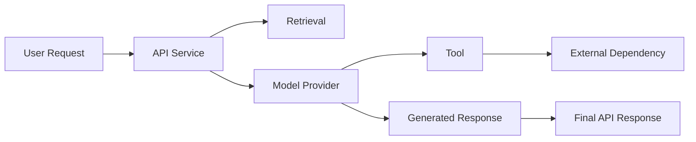

The user may experience this as one request.

The production system experiences many events.

An engineer investigating the request may need answers to very different questions:

```text id="rihldx"
Did the request fail?
        ↓
How many requests are failing?
        ↓
Where did the request spend time?
        ↓
Which model handled it?
        ↓
How many tokens were consumed?
        ↓
Did retrieval become slower?
        ↓
Was a tool called?
        ↓
Did the provider change?
```

One signal type cannot answer all of these questions equally well.

This is why production observability uses different signal types.

The four major categories covered in this chapter are:

```text id="63r1g3"
Logs
  → Detailed event context

Metrics
  → Aggregated numerical behavior

Traces
  → Request and dependency flow

AI-specific operational signals
  → Operational behavior unique or especially important to AI workloads
```

The goal is not to collect all possible signals.

The goal is to select the right signals for the questions engineers need to answer.

---

# Why Multiple Signal Types Exist

A useful starting question is:

> Why not simply collect logs for everything?

Because different operational questions have different information requirements.

Suppose an AI service receives 100,000 requests.

An engineer asks:

> "How many requests failed?"

A log search can answer this, but a metric is generally better suited to representing an aggregate count.

Another engineer asks:

> "What happened to request `req-123`?"

A metric is usually insufficient because the engineer needs detailed event context.

A third engineer asks:

> "Where did this request spend its 8 seconds?"

A trace is often the most useful representation because it can show the request's distributed path and timing.

A fourth engineer asks:

> "Why did token consumption increase?"

The answer may require AI-specific operational signals such as:

- input tokens,
- output tokens,
- model identity,
- model routing,
- request type,
- and possibly retrieval or tool behavior.

The important principle is:

> **Different signals represent different dimensions of system behavior.**

---

## Mental Model

A useful mental model is:

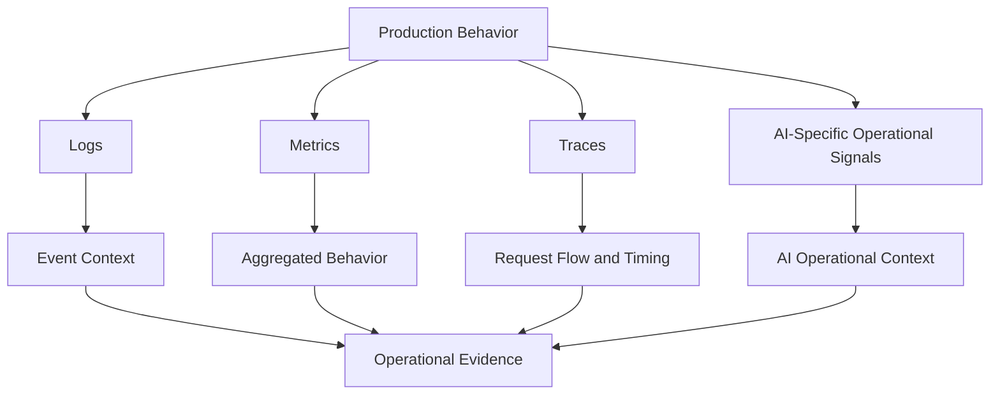

These signals are complementary.

They should not be treated as competing replacements.

A production AI system may need all of them.

---

# Core Question: What Should Each Signal Answer?

A useful first approximation is:

| Signal | Primary Question |
|---|---|
| Log | What happened? |
| Metric | How much, how often, or how broadly is something happening? |
| Trace | Where did the request go, and where was time spent? |
| AI-specific operational signal | What AI-specific behavior occurred? |

These are not strict boundaries.

A log can contain latency.

A trace can contain errors.

A metric can represent request outcomes.

An AI-specific operational signal may be represented through logs, metrics, traces, or events.

The categories describe the **meaning and operational role of the signal**, not necessarily four physically separate systems.

---

## Logs

## What Is a Log?

A log is a record of an event or observation produced by a system.

Examples include:

```text id="2a4zwo"
Request received
Authentication failed
Retrieval completed
Model request started
Model request completed
Tool call failed
Response returned
```

A log is generally useful when an engineer needs **event-level context**.

For example:

```text id="ed6i6i"
2026-11-11T10:42:18Z
request_id=req-123
operation=model_inference
model=provider-A/model-X
outcome=success
duration_ms=1840
```

This provides context about one event.

---

# Why Logs Exist

Logs are particularly useful for questions such as:

- What happened?
- Which operation occurred?
- What was the outcome?
- Which request was involved?
- Which dependency was involved?
- What error occurred?
- What state transition happened?
- What contextual information surrounded the event?

Logs are therefore useful when **specific event context matters**.

---

## Structured Logs

Production systems should generally prefer structured event records when logs are used for operational analysis.

Compare:

```text id="pmit0p"
Model request completed in 1840ms for provider A.
```

with:

```json id="905dae"
{
  "event": "model_request_completed",
  "request_id": "req-123",
  "provider": "provider-A",
  "model": "model-X",
  "duration_ms": 1840,
  "outcome": "success"
}
```

The second representation makes important fields explicit.

This allows engineers and observability systems to reason about the event more consistently.

The exact schema depends on the application.

The important principle is:

> **A production log should represent an intentional operational event, not simply arbitrary text emitted by the application.**

---

# Structured Logging

A structured log usually contains several categories of information.

### Event identity

Examples:

- event name,
- operation name,
- event type.

### Request context

Examples:

- request identifier,
- trace identifier,
- operation identifier.

### Service context

Examples:

- service name,
- service version,
- environment.

### Outcome

Examples:

- success,
- failure,
- timeout,
- rejected.

### Timing

Examples:

- duration,
- start time,
- completion time.

### Dependency context

Examples:

- provider,
- model,
- downstream service,
- external dependency.

The goal is not to include every possible field.

The goal is to include the context required to interpret the event.

---

## Log Events vs Debugging Messages

Not every message written to stdout is a useful production log.

Consider:

```text id="o3rky3"
starting...
done...
hello...
entered function...
```

These messages may help during local development.

They usually provide little durable operational value.

A useful production event has a reason to exist.

For example:

```text id="wtidb7"
event = retrieval_completed
request_id = req-123
documents_returned = 8
duration_ms = 240
outcome = success
```

This can support an operational question:

> "Did retrieval become slower or return fewer candidates?"

---

# Useful Logs vs Noisy Logs

A useful log should have operational purpose.

A noisy log may:

- repeat information already available elsewhere,
- contain no meaningful context,
- be emitted too frequently,
- contain unstable or irrelevant data,
- expose sensitive payloads,
- or make investigation harder because important events are buried.

A useful decision framework is:

```text id="hpps3o"
Should we log this event?

        ↓

What operational question does it answer?

        ↓

What context is required?

        ↓

Who will use the information?

        ↓

What is the cost and privacy impact?

        ↓

Is the event worth retaining?
```

---

# Correlation Identifiers

A distributed AI request may produce many events.

Consider:

```text id="7xfa56"
request received
retrieval completed
model request started
tool call started
tool call completed
model request completed
response returned
```

Without a shared identifier, these events may be difficult to connect.

A correlation identifier can establish the relationship:

```text id="71rmxk"
request_id = req-123
```

Now several events can be associated with the same request.

Correlation becomes particularly important when an AI application crosses:

- API services,
- retrieval services,
- model services,
- tool services,
- databases,
- external providers,
- and asynchronous components.

Detailed distributed trace context is covered later in this chapter.

---

# Error and Lifecycle Events

Logs are especially useful for representing important lifecycle transitions and errors.

Examples:

```text id="8c29d2"
request_received
request_validated
retrieval_started
retrieval_completed
model_request_started
model_request_completed
tool_call_started
tool_call_failed
response_generated
response_returned
```

The exact event vocabulary should reflect the application's actual lifecycle.

The objective is not to log every internal function call.

The objective is to make meaningful operational transitions visible.

---

# Logging Errors

A useful error event should provide enough context to investigate the failure.

Weak:

```text id="vbrwg3"
error occurred
```

Better:

```json id="so2snq"
{
  "event": "model_request_failed",
  "request_id": "req-123",
  "provider": "provider-A",
  "model": "model-X",
  "error_type": "timeout",
  "duration_ms": 30000,
  "outcome": "failure"
}
```

The second event supports more useful questions:

- Which provider?
- Which model?
- Which operation?
- What kind of failure?
- How long did the operation run?

Error details should still respect privacy and security requirements.

---

# Logs and Sensitive Data

AI systems create a special logging risk.

A request may contain:

- personal information,
- private messages,
- internal documents,
- proprietary prompts,
- confidential business data,
- tool arguments,
- generated responses.

Logging the complete request and response may appear convenient for debugging.

It can also create significant privacy and security exposure.

A safer principle is:

> **Log the operational context required to understand behavior, not sensitive payloads simply because they are available.**

Where payload capture is genuinely required, it should be deliberately designed and controlled.

---

## Metrics

## What Is a Metric?

A metric is a numerical measurement representing some aspect of system behavior.

Examples include:

```text id="9w4umf"
request_count
error_count
request_latency
active_requests
queue_depth
cpu_utilization
tokens_used
```

Metrics are especially useful for understanding **aggregate behavior over time**.

---

# Why Metrics Exist

Metrics help answer questions such as:

- How many requests occurred?
- How many failed?
- How quickly are requests completing?
- How much traffic is arriving?
- How much work is active?
- How much capacity is being consumed?
- Is behavior changing over time?

Metrics are therefore particularly useful for trends, aggregation, comparison, and threshold-based analysis.

---

## Counters

A counter represents a value that generally increases as events occur.

Examples:

```text id="877a4b"
requests_total
errors_total
model_requests_total
tool_calls_total
tokens_total
```

For example:

```text id="3tjanf"
requests_total = 1,250,000
```

The raw total is useful, but engineers often care more about the **rate of change**.

For example:

```text id="ctrccl"
requests per second
errors per minute
tokens per hour
```

A counter therefore often becomes more useful when interpreted over time.

---

# Gauges

A gauge represents a value that can move up and down.

Examples include:

```text id="hep85l"
active_requests
queue_depth
memory_usage
concurrent_inferences
```

For example:

```text id="57qe8y"
active_requests = 84
```

A gauge answers questions about the current or sampled state of a system.

---

# Histograms and Distributions

Some production behaviors cannot be represented effectively by a single average.

Latency is a classic example.

Suppose five requests have latencies:

```text id="517wul"
100ms
120ms
130ms
140ms
5000ms
```

The average may hide the fact that one request was extremely slow.

A distribution allows engineers to understand how values are spread.

This is particularly important for:

- request latency,
- model latency,
- retrieval latency,
- queueing time,
- tool latency,
- response size,
- token usage.

---

# Percentiles

Percentiles are commonly used to reason about latency distributions.

For example:

```text id="uyqnhh"
p50 = 800ms
p95 = 2.4s
p99 = 6.8s
```

A useful interpretation is:

- p50 is the latency value at or below which approximately 50% of observations fall.
- p95 is the latency value at or below which approximately 95% of observations fall; the remaining approximately 5% are slower.
- p99 is the latency value at or below which approximately 99% of observations fall; the remaining approximately 1% are slower.

The exact interpretation depends on the measurement window and aggregation method.

The important engineering point is:

> **Averages alone can hide tail behavior.**

Tail behavior is often important in production AI systems because a small subset of slow requests can create poor user experience or operational instability.

---

# Rates

A rate describes how quickly an event occurs.

Examples:

```text id="mtxw3y"
requests/second
errors/second
tokens/second
tool_calls/minute
```

Rates are often more operationally useful than raw counters.

For example:

```text id="g2b3mp"
errors_total = 50,000
```

does not immediately tell you whether the errors are:

```text id="cloen9"
10 errors/minute
```

or:

```text id="pr03ng"
10,000 errors/minute
```

The rate provides temporal context.

---

# Latency Metrics

Latency measures how long an operation takes.

Production AI systems may need multiple latency measurements.

For example:

```text id="bu5yva"
request_latency
retrieval_latency
queueing_latency
model_latency
tool_latency
dependency_latency
```

These measurements can answer different questions.

Consider:

```text id="g5ddkx"
Total request latency = 8.0s
```

That tells us the request is slow.

Now:

```text id="zc8qmw"
Queueing = 0.5s
Retrieval = 0.4s
Model = 6.7s
Tool = 0.4s
```

The latency breakdown provides much more diagnostic value.

This is one place where metrics and traces can complement each other.

---

# Throughput

Throughput measures how much work the system processes over time.

Examples include:

```text id="8waiht"
requests/second
tokens/second
documents/second
inferences/second
tool calls/second
```

Throughput is useful for understanding workload behavior.

It can also help engineers compare system behavior before and after changes.

Throughput alone, however, does not tell you whether the system is performing acceptably.

A system can have high throughput and poor latency.

---

# Error Metrics

Errors are often represented using counters and rates.

Examples:

```text id="bl2yii"
request_errors_total
model_errors_total
tool_errors_total
retrieval_errors_total
timeouts_total
```

A useful error metric should distinguish meaningful categories when that distinction supports engineering decisions.

For example:

```text id="ngh6v3"
model_timeout
model_rate_limit
model_authentication_failure
model_invalid_request
```

The right level of classification depends on operational usefulness.

Overly broad categories hide important differences.

Overly detailed categories can create unnecessary complexity.

---

# Saturation and Resource Utilization

Production systems can become constrained by resources.

Useful metrics may include:

- CPU utilization,
- memory utilization,
- GPU utilization,
- active requests,
- queue depth,
- connection usage,
- worker utilization,
- concurrency.

These signals help answer:

> "Is the system approaching a resource or concurrency limit?"

However, resource metrics alone do not explain application behavior.

They should be interpreted alongside application and AI-specific operational signals.

---

## Metric Labels and Dimensions

Metrics often need dimensions to support useful comparisons.

For example:

```text id="pdtka9"
model_request_latency
```

may need dimensions such as:

```text id="i0t1c8"
model
provider
operation
outcome
```

This allows questions such as:

> "Is model latency high for every provider or only one?"

However, every additional dimension has a cost.

A dimension with an extremely large number of unique values can create a cardinality problem.

The important distinction is:

> **High cardinality is not inherently bad. It becomes a problem when a metric representation creates too many unique time series to collect, store, query, or operate efficiently.**

For example:

```text id="2fp82f"
request_id
user_id
full_prompt
unique_document_id
```

are generally poor choices for ordinary metric dimensions because they can create enormous numbers of unique time series.

This is an important distinction:

> **A field may be useful in a log or trace without being appropriate as a metric dimension.**

Detailed cardinality engineering belongs to File 03, but signal selection must recognize the problem here.

---

# Traces

## What Is a Trace?

A trace represents the path of a request or operation through a distributed system.

Consider:

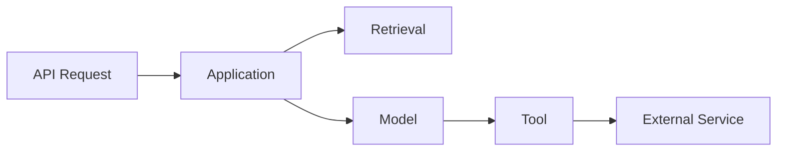

A trace can represent these operations as related spans.

The trace answers a different question from a log or metric:

> **Where did this request go, and where was time spent?**

---

# Spans

A span represents an individual operation within a trace.

For example:

```text id="dtnyba"
Trace
├── API request
├── Retrieval
├── Model inference
├── Tool call
└── External dependency
```

Each span may contain information such as:

- operation name,
- start time,
- duration,
- outcome,
- associated service,
- relevant attributes,
- parent-child relationship.

The exact implementation depends on the tracing technology.

The conceptual model is more important here.

---

# Trace Context

A distributed request may cross multiple services.

Trace context allows those services to associate their work with the same overall request trace.

Conceptually:

```text id="vyazf3"
Trace
    ↓
Request
    ↓
Service A
    ↓
Service B
    ↓
Service C
```

Without shared context:

```text id="yr3m0r"
Service A → unrelated event
Service B → unrelated event
Service C → unrelated event
```

With trace context:

```text id="r4av0d"
Trace-123
    ├── Service A
    ├── Service B
    └── Service C
```

This enables distributed request reconstruction.

---

# Trace-Based Latency Attribution

One of the strongest uses of traces is latency attribution.

Suppose:

```text id="mitz4n"
Total latency = 7.5s
```

The trace may show:

```text id="eb54ls"
API Service       0.2s
Retrieval         0.5s
Queueing             1.1s
Model             4.1s
Tool                 0.7s
Other             0.3s
```

Now the engineer can investigate the dominant contributors.

This is more informative than simply knowing:

```text id="6g4jb1"
request_latency = 7.5s
```

A trace can therefore connect **request flow** with **timing**.

---

# Traces and Dependencies

AI applications often depend on external systems.

Examples:

- vector databases,
- relational databases,
- model providers,
- object storage,
- search systems,
- external APIs,
- tool services.

A trace can help show where those dependencies appear in the request path.

For example:

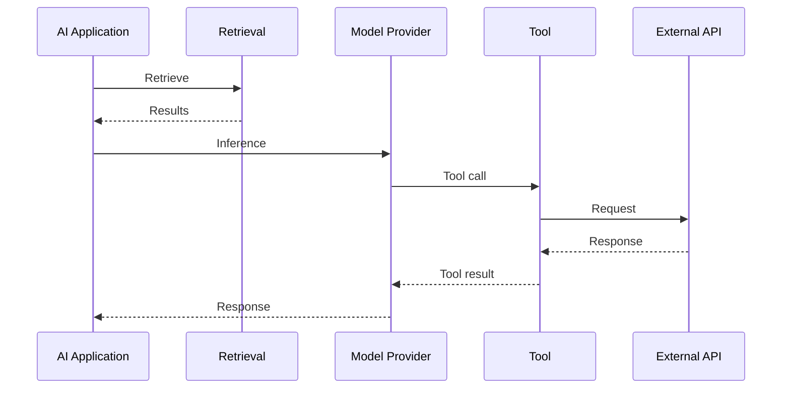

The trace representation can then associate timing and outcomes with these operations.

---

# Logs vs Metrics vs Traces

The differences can be summarized as:

| Property | Logs | Metrics | Traces |
|---|---|---|---|
| Primary unit | Event | Measurement | Request/operation |
| Main question | What happened? | How much/how often? | Where did it happen? |
| Detail | High | Aggregated | Structured request flow |
| Context | Strong | Limited by design | Strong |
| Trend analysis | Possible | Excellent | Limited |
| Individual request investigation | Excellent | Weak | Excellent |
| Fleet-level behavior | Possible | Excellent | Possible but expensive |
| Latency attribution | Possible | Partial | Strong |
| Event history | Strong | Weak | Strong for request flow |

These are complementary signals.

A mature system commonly uses all three.

---

## AI-Specific Operational Signals

Traditional logs, metrics, and traces describe general application behavior.

AI systems introduce additional operational dimensions.

Examples include:

- model identity,
- model version,
- provider,
- token usage,
- inference duration,
- generation characteristics,
- model routing,
- retrieval activity,
- tool-call activity,
- queueing,
- cache behavior,
- safety/guardrail outcomes,
- and request-level AI outcomes.

These are **AI-specific operational signals**.

They may be represented through:

- log fields,
- metric dimensions,
- trace attributes,
- events,
- or other telemetry representations.

The important concept is not the storage format.

It is the **operational meaning of the signal**.

In this chapter, "AI-specific operational signals" includes signals that are unique to AI workloads as well as general signals that become especially important for understanding AI production behavior.

---

## Model Identity

A production AI request should often be attributable to the model or model endpoint that handled it.

For example:

```text id="tzg86z"
model = model-X
```

This allows engineers to ask:

- Which model handled the request?
- Did behavior change after a model change?
- Are failures concentrated around one model?
- Are latency differences model-specific?

Model identity becomes especially important when applications support multiple models.

---

# Model Version

Model identity alone may not be sufficient.

A provider may expose multiple versions or revisions.

For example:

```text id="lk7cpz"
model = model-X
version = 2026-10
```

Version information can help correlate production behavior with changes.

For example:

```text id="vtlne6"
Before:
model-X / version-A
p95 latency = 1.8s

After:
model-X / version-B
p95 latency = 3.1s
```

The telemetry does not prove that the version caused the latency increase.

It provides evidence for investigation.

---

# Provider Information

An application may route requests across multiple providers.

For example:

```text id="fdu9ii"
provider-A
provider-B
provider-C
```

Provider visibility can answer questions such as:

- Which provider handled the request?
- Are failures concentrated on one provider?
- Did routing change?
- Did latency differ between providers?
- Did a fallback path activate?

Provider identity is therefore an important operational signal in multi-provider systems.

---

# Token Usage

Token usage is particularly important for AI workloads.

Common dimensions include:

```text id="z96mpk"
input_tokens
output_tokens
total_tokens
```

For example:

```json id="1r2foz"
{
  "input_tokens": 2400,
  "output_tokens": 680,
  "total_tokens": 3080
}
```

These signals can support questions about:

- usage,
- workload characteristics,
- model behavior,
- latency relationships,
- and abnormal request sizes.

Token telemetry should be treated as operational data, not automatically as a cost-optimization mechanism.

Detailed cost engineering belongs elsewhere.

---

# Input vs Output Tokens

Separating input and output tokens can be operationally useful.

For example:

```text id="9wh3zb"
Request A
input = 1,000
output = 300

Request B
input = 8,000
output = 400
```

Both requests have similar output sizes.

Their input workloads are very different.

This distinction may help engineers investigate:

- prompt growth,
- retrieval context size,
- workload changes,
- model latency,
- and usage anomalies.

---

# Inference Duration

Inference duration represents time spent performing model inference or a model-provider operation.

For example:

```text id="8m5b23"
inference_duration = 4.8s
```

It can be compared with:

```text id="s6dsoz"
total_request_latency = 5.7s
```

to understand how much of the request lifecycle was associated with inference.

The exact definition of "inference duration" must be consistent.

For some systems it may represent provider-side model processing.

For others it may represent the application's measured model request duration.

Those measurements should not be treated as identical without understanding their semantics.

---

# Generation Characteristics

AI generation can have operational characteristics that matter even when the request succeeds.

Examples may include:

- output token count,
- generation duration,
- streaming duration,
- completion outcome,
- stop reason where operationally available,
- number of generated segments or events where relevant.

These signals can help engineers understand workload behavior.

They should not be confused with output-quality evaluation.

For example:

```text id="yu1gc7"
output_tokens = 1200
```

does not tell you whether the generated answer was good.

It tells you something about the generation behavior.

---

# Streaming Signals

Streaming responses introduce additional timing considerations.

A non-streaming request may be represented as:

```text id="rwlbor"
request
    ↓
model processing
    ↓
complete response
```

A streaming request may involve:

```text id="1u70ps"
request
    ↓
model processing
    ↓
first output
    ↓
streamed output
    ↓
final output
```

Operationally useful signals may include:

- time to first output,
- total generation duration,
- stream duration,
- completion outcome,
- interruption or cancellation.

These signals help distinguish:

```text id="mll9u8"
Slow to start
```

from:

```text id="r5r0s0"
Fast to start but slow to finish
```

That distinction can matter significantly for user experience.

---

# Model Routing Signals

AI systems may route requests dynamically.

For example:

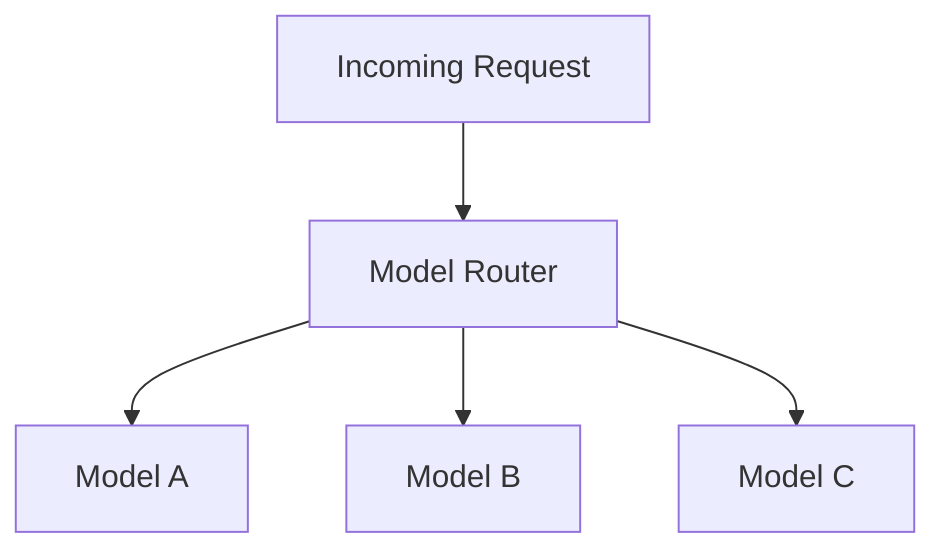

Operational signals may record:

```text id="3k6yk4"
routing_policy = latency_optimized
selected_provider = provider-B
selected_model = model-Y
fallback_used = false
```

These signals can help answer:

- Which route was selected?
- Was fallback used?
- Did routing behavior change?
- Are failures concentrated on a route?

Routing signals describe what the system did.

They do not determine whether the routing strategy is optimal.

---

# Retrieval-Related Operational Signals

AI applications often use retrieval before generation.

Operationally useful retrieval signals may include:

- retrieval duration,
- number of candidates returned,
- retrieval outcome,
- retrieval backend,
- query execution outcome,
- cache behavior,
- retrieval errors.

For example:

```text id="bc4d26"
retrieval_duration = 240ms
candidates_returned = 12
retrieval_outcome = success
```

These signals can help answer:

> "Did retrieval contribute to this request's latency or failure?"

They do not evaluate whether the retrieved documents were semantically relevant.

That distinction belongs to retrieval evaluation rather than operational observability.

---

# Tool-Call Signals

AI systems may invoke tools.

Operational signals can include:

```text id="an6po6"
tool_calls_total
tool_name
tool_duration
tool_outcome
tool_error
```

For example:

```json id="xft8l5"
{
  "event": "tool_call_completed",
  "tool": "customer_lookup",
  "duration_ms": 320,
  "outcome": "success"
}
```

These signals help answer:

- Was a tool called?
- Which tool?
- How many times?
- How long did it take?
- Did it fail?

They should not automatically capture complete tool arguments or responses if doing so creates unnecessary privacy or security risk.

---

# Queueing Time

AI systems may queue requests because of:

- concurrency limits,
- worker availability,
- provider limits,
- model capacity,
- backpressure,
- or application-level scheduling.

A request may therefore experience:

```text id="ea3bep"
Queueing = 2.0s
Inference = 3.0s
Total model operation = 5.0s
```

Without queueing visibility, an engineer may incorrectly conclude that inference itself became slower.

Queueing time is therefore an important AI-serving operational signal.

---

# Cache Hit and Miss Signals

Caching can exist in several parts of an AI system.

Examples:

- retrieval cache,
- embedding cache,
- response cache,
- prompt-related cache,
- application cache.

A basic operational signal may be:

```text id="y5lfld"
cache_hit = true
```

or:

```text id="q38bia"
cache_result = miss
```

Aggregated metrics can then represent:

```text id="8nyfaa"
cache_hit_rate
cache_miss_rate
```

Cache signals can help explain latency and workload changes.

They do not by themselves establish whether a caching strategy is correct.

---

# Safety and Guardrail Outcomes

AI systems may include operational safety or guardrail stages.

Signals may indicate:

```text id="6r9iyf"
guardrail_check = completed
guardrail_outcome = allowed
```

or:

```text id="pbymmw"
guardrail_outcome = blocked
```

These signals can help answer:

- Was a request blocked?
- Did a safety control execute?
- Did a guardrail contribute to request behavior?
- Are failures concentrated around a particular operational path?

Care must be taken not to log sensitive safety-related content unnecessarily.

The signal should capture operational outcome where possible rather than exposing the complete sensitive payload.

Detailed AI safety engineering belongs outside this chapter.

---

# Request Outcome

AI request outcome is an important signal.

Possible categories might include:

```text id="jk3x5q"
success
failure
timeout
cancelled
rejected
blocked
fallback
```

The exact taxonomy depends on the application.

A useful outcome taxonomy should distinguish operationally meaningful states without creating unnecessary complexity.

For example:

```text id="z6efh4"
success
```

and:

```text id="f77uu0"
provider_timeout
```

may be more useful than a single:

```text id="gmm4ji"
failed
```

if engineers need to distinguish provider failures from application failures.

---

# AI-Specific Signals as a Layer

AI-specific operational signals should not be thought of as a completely separate telemetry universe.

A useful mental model is:

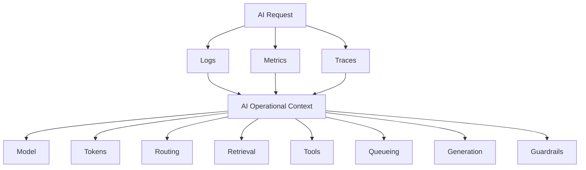

The AI-specific operational signals can enrich ordinary observability signals.

For example:

```text id="3fgnbb"
Trace span
    model = model-X
    provider = provider-A
    input_tokens = 2400
    output_tokens = 680
    inference_duration = 4.8s
```

Or:

```text id="oziot2"
Metric
    model_request_latency
    dimensions:
        provider
        model
        outcome
```

Or:

```text id="iqacs1"
Log
    event = model_request_completed
    model = model-X
    provider = provider-A
    outcome = success
```

The representation can differ.

The operational meaning remains related.

---

# Choosing the Right Signal

A common engineering mistake is to begin with:

> "What telemetry can our tool collect?"

A better question is:

> "What production question are we trying to answer?"

Consider:

### Question

> How many requests are failing?

Best primary signal:

```text id="yed0n4"
Metric
```

Supporting signal:

```text id="drn2hl"
Logs for individual failures
```

---

### Question

> What happened to request `req-123`?

Best primary signal:

```text id="aerbh9"
Logs and/or trace
```

---

### Question

> Where did request latency come from?

Best primary signal:

```text id="4endo6"
Trace
```

Supporting signals:

```text id="tqz0wk"
Latency metrics
Detailed operation logs
```

---

### Question

> Which model is consuming the most tokens?

Best primary signal:

```text id="8jygka"
AI-specific usage metric
```

Supporting signals:

```text id="2jom52"
Request-level logs
Trace attributes
```

---

### Question

> Did a provider timeout cause this request failure?

Best primary signal:

```text id="qtoznl"
Trace + structured error event
```

Supporting signal:

```text id="pnitlp"
Provider-specific error metric
```

The lesson is:

> **Signal selection should begin with operational questions, not telemetry technology.**

---

# Signal Selection Framework

A practical selection framework is:

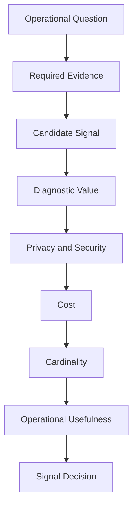

For each proposed signal, ask:

1. What question does it answer?
2. What behavior does it represent?
3. At what granularity is it needed?
4. Does it need request-level context?
5. Does it need aggregation?
6. Does it need temporal information?
7. Does it need distributed context?
8. Does it contain sensitive information?
9. What is its cardinality?
10. What is its collection and storage cost?
11. How frequently will engineers use it?
12. What happens if it is unavailable?

---

# Signal Granularity

Signals can exist at different levels.

### Request level

Example:

```text id="rrc72u"
request_id = req-123
total_tokens = 3200
```

Useful for individual investigation.

### Operation level

Example:

```text id="rmqft5"
model_request_duration = 2.4s
```

Useful for understanding a specific operation.

### Service level

Example:

```text id="ei4wpu"
service_error_rate = 2.1%
```

Useful for broader operational behavior.

### System level

Example:

```text id="tx907b"
total_requests_per_second = 12,000
```

Useful for fleet-level understanding.

The correct granularity depends on the question.

Collecting request-level detail for everything can be expensive.

Collecting only system-level aggregates can make individual investigation difficult.

---

# Signal Correlation

Signals become much more useful when they can be connected.

Consider:

```text id="a2goqf"
request_id = req-123
trace_id = trace-456
```

The request may have:

```text id="97c7jb"
Log:
model_request_completed

Metric:
model latency

Trace:
model span

AI-specific operational signal:
input_tokens = 2400
```

These observations can contribute to one operational picture.

A useful conceptual relationship is:

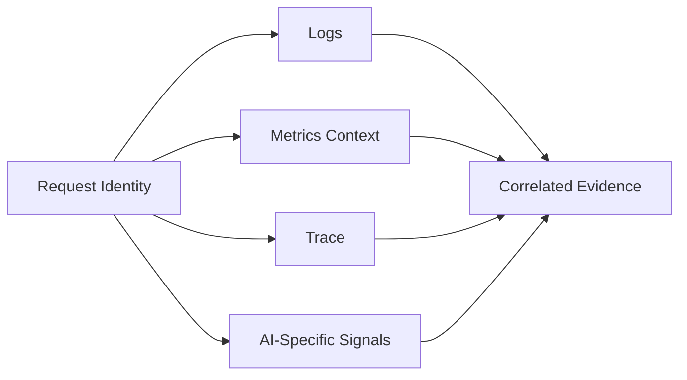

Correlation does not mean every signal must contain every identifier.

It means the observability design should provide a reliable way to relate important evidence.

---

# Practical Example — Investigating Slow AI Requests

Suppose users report that an AI assistant is slow.

The initial metric shows:

```text id="4hok0w"
p95 request latency = 6.2s
```

That establishes a production problem.

The trace shows:

```text id="og6env"
API                 0.2s
Retrieval           0.4s
Queueing             1.1s
Model                4.1s
Tool                 0.3s
Finalization         0.1s
```

Now the engineer knows that model processing and queueing dominate the request.

AI-specific operational signals add:

```text id="eugdet"
model = model-X
provider = provider-A
input_tokens = 5200
output_tokens = 900
```

The combined evidence is much stronger than any individual signal.

The engineer can now investigate whether the latency increase correlates with:

- model selection,
- provider behavior,
- token volume,
- queueing,
- or another dependency.

---

# Practical Example — Provider Failure

Suppose a request fails.

A metric shows:

```text id="tg9zt3"
model_request_error_rate = 4.2%
```

The metric detects a problem.

A trace shows:

```text id="q33sl4"
Application
    ↓
Model Provider
    ↓
Timeout
```

A structured event shows:

```json id="c1d7dg"
{
  "event": "model_request_failed",
  "provider": "provider-A",
  "model": "model-X",
  "error_type": "timeout",
  "duration_ms": 30000,
  "outcome": "failure"
}
```

The combined evidence allows engineers to investigate provider-specific behavior.

This demonstrates the complementary nature of metrics, traces, and logs.

---

# Practical Example — Token Usage Anomaly

Suppose token consumption suddenly increases.

A metric shows:

```text id="7fk7bz"
total_tokens_rate increased by 70%
```

A model-level breakdown shows:

```text id="zkwglc"
model-X = +15%
model-Y = +180%
```

Request-level AI-specific signals reveal:

```text id="s2j4h9"
model-Y
input_tokens/request = 8,500
```

A log may reveal that retrieval context became substantially larger.

The signals together support an investigation into why request size changed.

Again, the observability signals provide evidence.

They do not automatically identify the correct remediation.

---

# Practical Example — Tool-Heavy Requests

Suppose an AI agent begins taking longer to respond.

The overall request latency increases.

A trace shows:

```text id="klv96t"
Model
  ↓
Tool A
  ↓
Model
  ↓
Tool B
  ↓
Model
```

Tool-call signals show:

```text id="syse36"
tool_calls/request = 4.2
```

where previously:

```text id="6pmep0"
tool_calls/request = 1.3
```

The increase in tool activity may explain part of the latency increase.

This example demonstrates why AI-specific operational signals can reveal behavior that ordinary request metrics cannot.

---

# Practical Example — Streaming Behavior

Suppose users report that the assistant "takes too long to start answering."

Total response latency is:

```text id="as15la"
7.2s
```

But streaming telemetry shows:

```text id="bqt7pr"
time_to_first_output = 0.8s
total_stream_duration = 7.2s
```

The system starts responding quickly but continues generating for a long time.

This is operationally different from:

```text id="bcdt28"
time_to_first_output = 6.5s
total_stream_duration = 7.2s
```

The total latency is similar.

The user experience is very different.

This is why AI-specific timing signals can be important.

---

# Practical Example — Model Routing

Suppose an application uses:

```text id="p32lmz"
Model A
Model B
Model C
```

A latency metric shows that overall p95 latency increased.

A model-level breakdown shows:

```text id="9cghqq"
Model A: 1.2s
Model B: 2.0s
Model C: 4.8s
```

Routing signals show:

```text id="hv9ii9"
Model C traffic increased from 10% to 45%.
```

The engineer now has a strong lead.

The routing signal explains a behavioral change that would be difficult to see from the aggregate latency metric alone.

---

# Signal Quality Problems

Signals can be technically present and still be operationally poor.

## Missing context

```text id="hisjs0"
model request failed
```

without request or model context may be difficult to investigate.

---

## Inconsistent names

One service emits:

```text id="ndhp1p"
model_request
```

while another emits:

```text id="sd96db"
inference
```

and another:

```text id="e6lmb2"
llm_call
```

Inconsistent terminology can make analysis harder.

---

## Incorrect timestamps

If events have incorrect or inconsistent timestamps, request ordering may become misleading.

---

## Missing correlation

Events may exist but cannot be connected.

---

## Incorrect units

For example:

```text id="rii1n9"
latency = 5000
```

without knowing whether this means:

```text id="mi4qce"
5000ms
```

or:

```text id="mlgmlo"
5000s
```

creates ambiguity.

Operational schemas should make units clear.

---

## Unstable semantics

If:

```text id="str5zp"
duration
```

means model-provider duration in one service and complete application duration in another, the same field name becomes misleading.

Signal definitions must be consistent.

---

# Common Mistakes and Misconceptions

## Mistake 1 — Treating logs, metrics, and traces as interchangeable

They answer different operational questions.

Use the signal that best represents the required evidence.

---

## Mistake 2 — Logging everything

Everything is not automatically useful.

Excessive logging creates:

- noise,
- cost,
- privacy exposure,
- storage requirements,
- and investigation complexity.

---

## Mistake 3 — Using metrics for high-cardinality identifiers

Request IDs and user IDs may be useful in logs or traces but can create excessive metric cardinality.

---

## Mistake 4 — Using only average latency

Average latency can hide tail behavior.

Production systems often need distributions or percentiles.

---

## Mistake 5 — Creating one giant metric

A metric containing every possible dimension can become difficult or expensive to operate.

Signals should be designed around meaningful questions.

---

## Mistake 6 — Treating AI-specific operational signals as optional decoration

Model, provider, token, routing, and inference signals can be essential for understanding AI production behavior.

They should be selected based on actual operational requirements.

---

## Mistake 7 — Assuming every AI-specific signal belongs everywhere

Not every signal should appear in every log, metric, and trace.

Signal placement should follow purpose.

---

## Mistake 8 — Logging full prompts and responses by default

This can create serious privacy and security risks.

Operational context should be preferred over unnecessary payload capture.

---

## Mistake 9 — Confusing operational AI signals with AI evaluation

For example:

```text id="xoif8j"
output_tokens = 500
```

does not mean:

```text id="0ti2gx"
output_quality = good
```

Likewise:

```text id="l8t1k5"
retrieval_candidates = 12
```

does not mean:

```text id="6f5yj9"
retrieval_quality = good
```

Operational signals describe system behavior.

Evaluation determines whether behavior meets a quality criterion.

---

## Mistake 10 — Treating signal names as self-explanatory

A field such as:

```text id="3872xe"
latency
```

is ambiguous unless its scope and measurement semantics are defined.

Prefer precise meanings such as:

```text id="7q5q06"
model_request_duration_ms
```

when appropriate.

---

# Production Engineering Perspective

When designing telemetry signals, ask:

### What question are we answering?

Start from an operational question.

### What behavior does the signal represent?

Define the measurement precisely.

### What is the correct granularity?

Decide whether request-level, operation-level, service-level, or system-level evidence is needed.

### What context is required?

Determine which identifiers and dimensions make the signal interpretable.

### What signal type fits?

Choose logs, metrics, traces, or a combination.

### What AI-specific operational context is required?

Consider:

- model,
- provider,
- version,
- token usage,
- routing,
- retrieval,
- tools,
- queueing,
- generation,
- guardrails.

### What should not be captured?

Consider:

- sensitive payloads,
- unnecessary identifiers,
- excessive dimensions,
- irrelevant data.

### Can engineers actually use the signal?

A theoretically useful signal that is too expensive, noisy, or difficult to interpret may not be operationally useful.

---

## Engineering Decisions and Trade-offs

## Detail vs Cost

More detailed signals can improve diagnosis.

They can also increase:

- processing,
- storage,
- query cost,
- privacy exposure,
- operational complexity.

---

## Request-Level vs Aggregate Signals

Request-level signals provide detailed investigation.

Aggregate signals provide efficient system-level analysis.

A mature system usually needs both.

---

## Rich Context vs Privacy

More context can improve diagnosis.

It can also increase the risk of sensitive-data exposure.

The correct approach is intentional signal design.

---

## High Cardinality vs Analytical Flexibility

More dimensions can enable more detailed analysis.

Too many unique dimensions can make metrics expensive and difficult to operate.

This trade-off becomes particularly important for AI systems because values such as:

- request IDs,
- document IDs,
- user IDs,
- prompts,
- tool arguments,

can have extremely high uniqueness.

Detailed cardinality and telemetry architecture are covered in [03 — AI Observability Architecture and Signal Design](./03-AI-Observability-Architecture-and-Signal-Design.md).

---

## Completeness vs Simplicity

Capturing every lifecycle event may improve visibility.

It may also produce unnecessary noise.

The right design captures enough information to answer important operational questions without overwhelming the system.

---

## Signal Selection Matrix

A useful starting matrix is:

| Operational Question | Primary Signal | Supporting Signals |
|---|---|---|
| How many requests occurred? | Metric | Logs |
| How many requests failed? | Metric | Logs |
| What happened to one request? | Trace / Log | Metrics |
| Where did latency occur? | Trace | Metrics |
| Which model handled a request? | AI-specific operational signal | Log / Trace |
| How many tokens were consumed? | AI-specific usage metric | Log / Trace |
| Which provider failed? | AI-specific operational signal + metric | Log / Trace |
| Did retrieval become slower? | Metric | Trace / Log |
| Was a tool called? | Trace / Log | Metric |
| How much queueing occurred? | Metric | Trace |
| Did routing change? | AI-specific operational signal | Metric / Log |
| Did a guardrail block a request? | AI-specific operational signal | Log / Metric |
| What caused an individual error? | Log / Trace | Metrics |

This matrix is not a universal prescription.

It is a reasoning aid.

---

## A Unified AI Request Example

Consider:

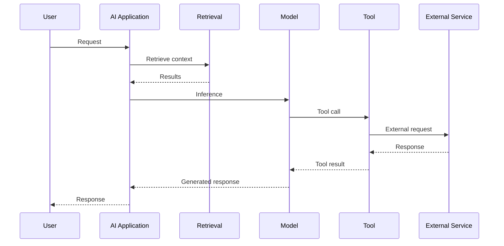

A useful signal design could produce:

### Logs

```text id="zvbr8d"
request_received
retrieval_completed
model_request_completed
tool_call_completed
response_returned
```

### Metrics

```text id="tqz4cl"
request_rate
request_error_rate
request_latency
retrieval_latency
model_latency
tool_latency
token_rate
queueing_time
```

### Traces

```text id="seu8xp"
request
 ├── retrieval
 ├── model
 │    └── tool
 │         └── external dependency
 └── response
```

### AI-specific operational context

```text id="w49ke1"
model = model-X
provider = provider-A
version = version-B
input_tokens = 2400
output_tokens = 680
routing_policy = latency_optimized
tool_calls = 1
retrieval_candidates = 12
```

The result is not "more telemetry."

It is a set of complementary signals that answer different operational questions.

---

# Internal Working: From Event to Operational Signal

A simplified model is:

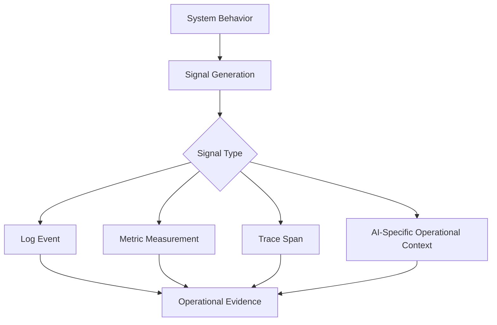

The important engineering work occurs before signal generation:

> What behavior matters, and what evidence will represent it effectively?

That question determines the signal.

The architecture for collecting, processing, routing, storing, querying, and visualizing these signals belongs to File 03.

---

# Technology-Neutral Perspective

This chapter intentionally avoids prescribing a specific observability platform.

Common technologies may provide capabilities for:

- structured logging,
- metrics,
- distributed tracing,
- telemetry collection,
- dashboards,
- querying,
- and alerting.

Examples include OpenTelemetry, Prometheus, Grafana, ELK/OpenSearch, and cloud-native observability platforms.

The important engineering concepts remain the same regardless of technology:

```text id="x2egsr"
What happened?
How much?
Where?
When?
Which request?
Which dependency?
Which model?
What AI-specific operational behavior occurred?
```

Tools implement these capabilities.

They do not replace the underlying signal-design decisions.

---

# Common Interview Questions

## 1. What is the difference between logs, metrics, and traces?

**Expected answer:**

Logs represent individual events and provide detailed context. Metrics represent numerical measurements and are useful for aggregate behavior, trends, rates, and thresholds. Traces represent the path of a request or operation through distributed components and are especially useful for request reconstruction and latency attribution.

---

## 2. Why can't metrics replace logs?

**Expected answer:**

Metrics are aggregated numerical representations. They are excellent for fleet-level behavior but usually lack the detailed event context needed to understand an individual failure or request.

---

## 3. Why can't logs replace metrics?

**Expected answer:**

Logs can represent large amounts of event detail, but aggregate analysis over large workloads is generally more efficient and consistent with metrics.

---

## 4. What is a span?

**Expected answer:**

A span represents an individual operation within a distributed trace. It typically has an operation identity, timing information, relationships to other spans, and relevant contextual attributes.

---

## 5. Why are histograms useful for latency?

**Expected answer:**

Latency is a distribution rather than a single stable value. Histograms and related distribution representations help engineers understand spread and tail behavior rather than relying only on averages.

---

## 6. Why are percentiles useful?

**Expected answer:**

Percentiles describe parts of the latency distribution and help reveal tail behavior. For example, p95 and p99 can show slow-request behavior that an average may hide.

---

## 7. Why is request ID often a poor metric dimension?

**Expected answer:**

Request IDs are usually highly unique. Using them as metric dimensions can create extremely high cardinality and make metrics expensive or difficult to operate. Request IDs are generally more appropriate in logs and traces.

---

## 8. What are AI-specific operational signals?

**Expected answer:**

They are operational signals representing AI-specific behavior, such as model/provider identity, version, token usage, inference duration, routing, retrieval activity, tool calls, queueing, generation behavior, cache outcomes, and guardrail outcomes where appropriate.

---

## 9. Why should token usage be observable?

**Expected answer:**

Token usage provides operational visibility into request size and model workload. It can help explain changes in latency, usage patterns, and operational cost, although token telemetry itself is not a substitute for cost analysis.

---

## 10. Why is model identity important?

**Expected answer:**

Production systems may use multiple models or providers. Model identity allows engineers to correlate operational behavior such as latency, errors, and usage with the model that handled the request.

---

## 11. Why is queueing time an important AI signal?

**Expected answer:**

A request can be slow because it waited before execution rather than because execution itself became slower. Queueing time helps distinguish these causes.

---

## 12. Should every AI system expose every possible AI-specific operational signal?

**Expected answer:**

No.

Signals should be selected based on operational purpose, diagnostic value, privacy, cost, cardinality, and usefulness.

---

## 13. What is the relationship between traces and logs?

**Expected answer:**

They are complementary. A trace provides request flow and timing relationships, while logs provide detailed event context. Logs can often be correlated with traces using shared identifiers.

---

## 14. Does a token count tell us whether an AI response is good?

**Expected answer:**

No.

Token count is an operational signal. Output quality requires evaluation.

---

## Quick Revision

Remember the core roles:

```text id="5hp8bm"
Logs
    → Detailed event context

Metrics
    → Aggregated numerical behavior

Traces
    → Request flow and timing

AI-specific operational signals
    → AI operational context
```

Remember the major AI-specific operational dimensions:

```text id="iz7c0n"
Model
Provider
Version
Tokens
Inference
Generation
Routing
Retrieval
Tools
Queueing
Cache
Guardrails
Outcome
```

Remember the selection principle:

```text id="jbo6sl"
Operational Question
        ↓
Required Evidence
        ↓
Signal Type
        ↓
Context
        ↓
Diagnostic Value
        ↓
Privacy
        ↓
Cost
        ↓
Cardinality
        ↓
Operational Usefulness
```

And remember:

> **Do not start with the telemetry tool. Start with the operational question.**

---

# Key Takeaways

1. Logs, metrics, and traces provide different forms of operational evidence.
2. Logs are particularly useful for detailed event context.
3. Metrics are particularly useful for aggregate behavior, trends, rates, and distributions.
4. Traces are particularly useful for distributed request flow and latency attribution.
5. AI-specific operational signals expose behavior that ordinary application telemetry may not capture.
6. Model and provider identity can be critical in multi-model and multi-provider systems.
7. Token usage provides useful operational context for AI workloads.
8. Queueing, inference duration, routing, retrieval, tool activity, and streaming behavior can materially affect AI production behavior.
9. Not every signal belongs in every telemetry type.
10. High-cardinality information may be useful in logs or traces while being inappropriate as metric dimensions.
11. Sensitive AI payloads should not be logged simply because they are available.
12. Signal selection should begin with operational questions.
13. More signals do not automatically mean better observability.
14. Signal quality depends on clear semantics, appropriate granularity, context, correlation, and operational usefulness.
15. File 02 defines the meaning and engineering role of the signals; File 03 will address how those signals are architected, collected, processed, routed, stored, and managed at scale.

---

## Further Reading

Continue with:

- [01 — Production AI Observability and Telemetry](./01-Production-AI-Observability-and-Telemetry.md)
- [03 — AI Observability Architecture and Signal Design](./03-AI-Observability-Architecture-and-Signal-Design.md)

Related production topics include:

- [PROD-03 — Production Inference and Model Serving](../PROD-03-Production-Inference-and-Model-Serving/README.md)
- [PROD-06 — AI Reliability Engineering](../PROD-06-AI-Reliability-Engineering/README.md)
- [PROD-07 — AI Scaling and Capacity Engineering](../PROD-07-AI-Scaling-and-Capacity-Engineering/README.md)
- [PROD-08 — AI Performance, Optimization, and Cost Engineering](../PROD-08-AI-Performance-Optimization-and-Cost-Engineering/README.md)
- [PROD-09 — AI Security Engineering](../PROD-09-AI-Security-Engineering/README.md)
- [PROD-10 — AI Operations and Incident Management](../PROD-10-AI-Operations-and-Incident-Management/README.md)
- [PROD-11 — AI Evaluation and Lifecycle Management](../PROD-11-AI-Evaluation-and-Lifecycle-Management/README.md)

---

## Chapter Completion Check

Before considering this file complete, you should be able to explain:

- [ ] Why production AI systems need multiple signal types.
- [ ] What logs represent.
- [ ] What makes a production log useful.
- [ ] Why structured logging is valuable.
- [ ] Why correlation identifiers matter.
- [ ] The difference between counters and gauges.
- [ ] Why distributions and percentiles matter for latency.
- [ ] What throughput represents.
- [ ] What saturation and resource-utilization metrics represent.
- [ ] Why metric dimensions require careful selection.
- [ ] What a trace represents.
- [ ] What a span represents.
- [ ] Why trace context matters.
- [ ] How traces support latency attribution.
- [ ] The difference between logs, metrics, and traces.
- [ ] What AI-specific operational signals are.
- [ ] Why model and provider identity matter.
- [ ] Why token usage is operationally useful.
- [ ] Why queueing time matters.
- [ ] Why routing visibility matters.
- [ ] What retrieval-related operational signals can tell engineers.
- [ ] What tool-call signals can tell engineers.
- [ ] Why streaming requires additional timing considerations.
- [ ] Why cache hit/miss behavior can be operationally useful.
- [ ] Why guardrail outcomes may be observable.
- [ ] How to select signals based on operational questions.
- [ ] Why high-cardinality dimensions can be problematic.
- [ ] Why sensitive payloads should not be logged by default.
- [ ] Why operational AI signals are not the same as AI evaluation.

If you cannot explain these concepts clearly in your own words, revisit the relevant sections before proceeding to File 03.

---

## Final Mental Model

The central mental model for this file is:

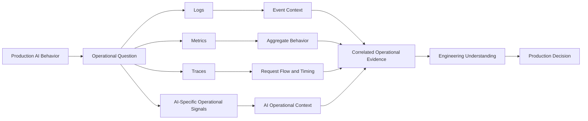

The most important principle is:

> **Choose telemetry signals because they answer meaningful production questions, not simply because the technology makes them easy to collect.**

Logs, metrics, traces, and AI-specific operational signals are complementary representations of production behavior.

A strong production AI observability system uses the right combination of them to make important system behavior understandable without collecting unnecessary information.
