# AI Observability Architecture and Signal Design

## Learning Objectives

By the end of this chapter, you should be able to:

- Explain how observability architecture turns application behavior into operational evidence.
- Identify the major stages of an AI observability pipeline.
- Explain instrumentation boundaries and where telemetry originates.
- Distinguish application instrumentation, agents, and collectors conceptually.
- Explain telemetry generation, collection, processing, enrichment, correlation, routing, storage, querying, and visualization.
- Understand how observability architecture supports production AI systems.
- Explain how sampling, aggregation, cardinality management, and retention affect observability quality and cost.
- Design observability signals around operational questions rather than collecting telemetry indiscriminately.
- Identify telemetry quality problems and understand their operational consequences.
- Design observability signals with privacy, cost, diagnostic value, and operational usefulness in mind.
- Reason about observability architecture for distributed AI systems.
- Evaluate observability architecture using production engineering trade-offs.

---

## Prerequisites

Before starting this chapter, you should understand:

- The purpose of production AI observability.
- The distinction between monitoring and observability.
- The difference between telemetry and operational evidence.
- Logs, metrics, traces, and AI-specific operational signals.
- Basic production AI service architecture.
- Basic request/response lifecycle concepts.
- Basic distributed-system concepts.

Recommended prerequisite chapters:

- [PROD-01 — Production AI Systems and Architecture](../PROD-01-Production-AI-Systems-and-Architecture/README.md)
- [PROD-03 — Production AI Model Serving](../PROD-03-Production-Model-Serving/README.md)
- [PROD-05 — AI Observability and Telemetry](./README.md)

---

## Estimated Reading Time

Approximately 60–75 minutes.

---

## Before We Start

The previous chapter sections answered:

> What should a production AI system expose as operational signals?

This chapter answers a different question:

> How should those signals be designed, collected, processed, correlated, stored, and made useful?

The goal is not to teach a particular observability product.

The goal is to understand the engineering architecture behind observability.

A production system may use different tools, platforms, agents, collectors, storage systems, and visualization systems.

The underlying architectural problems remain similar.

---

## Why This Exists

A production AI system generates a large amount of operational information.

A single request may involve:

- an API gateway,
- an application service,
- authentication,
- request validation,
- a retrieval system,
- a vector database,
- a cache,
- a model provider,
- a model invocation,
- a tool call,
- a downstream service,
- and a response stream.

If every component produces telemetry independently, the result is not automatically useful.

The system may generate enormous amounts of data while still making basic questions difficult to answer.

For example:

> Why did this request take 8 seconds?

The system may have:

- application logs,
- model latency metrics,
- database metrics,
- trace spans,
- token metrics,
- provider metrics,
- queue metrics,

but still fail to explain the request.

The problem is therefore not simply telemetry collection.

The problem is **observability architecture**.

A useful observability architecture must transform raw system activity into evidence that engineers can use to understand and diagnose production behavior.

---

## Mental Model

A useful high-level model is:

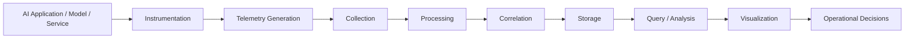

The important idea is that observability is a pipeline.

The application produces observable events.

Instrumentation turns important behavior into telemetry.

Collection moves telemetry into the observability system.

Processing and enrichment make telemetry more useful.

Correlation connects related signals.

Storage makes evidence available for later analysis.

Querying and visualization allow engineers to inspect the evidence.

Operational decisions are then made from that evidence.

This creates the following mental model:

> **System behavior → telemetry → correlated evidence → understanding → operational decision**

---

# Core Concepts

## Observability Architecture

Observability architecture is the design of the systems and processes that transform application behavior into usable operational evidence.

It answers questions such as:

- Where does telemetry originate?
- What should be instrumented?
- How is telemetry collected?
- How is telemetry transported?
- How is it processed?
- How are related signals correlated?
- Where is it stored?
- How long is it retained?
- How is it queried?
- How is it visualized?
- How is telemetry quality maintained?
- How is observability cost controlled?

Observability architecture therefore covers more than dashboards.

A dashboard is only one downstream consumer of observability data.

---

## Instrumentation Boundaries

Instrumentation is the mechanism through which a system exposes useful operational information.

A production AI application may contain many possible instrumentation boundaries.

For example:

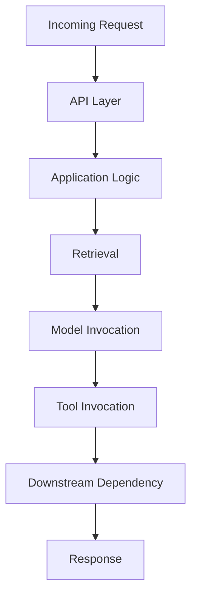

Each boundary may expose different evidence.

For example:

| Boundary | Useful operational evidence |
|---|---|
| API request | request outcome, latency, request ID |
| Authentication | authentication result, failure reason |
| Retrieval | retrieval duration, result count, cache status |
| Model invocation | model identity, latency, token usage |
| Tool invocation | tool name, duration, outcome |
| Database call | query duration, errors |
| Downstream API | dependency latency, status |
| Response | completion status, streaming behavior |

The important engineering question is not:

> Can we instrument this component?

It is:

> What operational question would this instrumentation help answer?

---

# Telemetry Generation

Instrumentation produces telemetry when relevant system behavior occurs.

For example, an AI application may generate an event when:

- a request starts,
- authentication completes,
- retrieval begins,
- retrieval completes,
- a model invocation starts,
- a model invocation completes,
- a tool call starts,
- a tool call fails,
- a response begins streaming,
- a response finishes.

Telemetry can therefore be generated at different levels of granularity.

A coarse-grained system may record only:

```text
request_started
request_completed
```

A more detailed system may record:

```text
request_started
retrieval_started
retrieval_completed
model_started
model_completed
tool_started
tool_completed
response_started
response_completed
```

More telemetry is not automatically better.

The additional telemetry must provide useful diagnostic or operational value.

---

# Collection

Telemetry must move from the application into an observability system.

Collection may happen in several ways.

At a conceptual level:

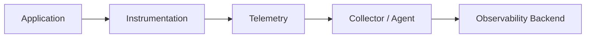

The collection layer may provide capabilities such as:

- receiving telemetry,
- buffering,
- batching,
- filtering,
- enrichment,
- transformation,
- routing,
- forwarding,
- retrying,
- and controlling transport.

Collection architecture becomes increasingly important as system scale grows.

---

# Direct vs Centralized Collection

There are multiple ways to collect telemetry.

## Direct Collection

An application may send telemetry directly to an observability backend.

Conceptually:

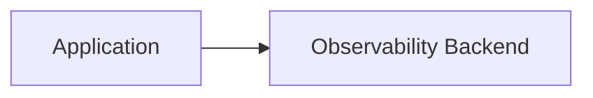

This can be simple.

However, it may couple the application more tightly to the backend.

The application may also become responsible for more telemetry transport behavior.

---

## Centralized Collection

Telemetry may instead be sent to an intermediate collector.

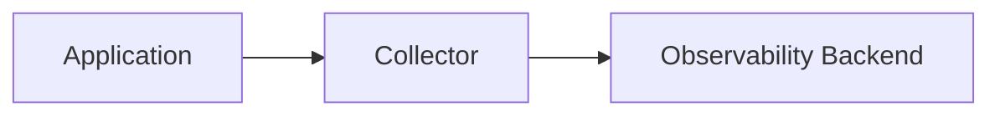

The collector can provide a separation between application instrumentation and backend systems.

This can support:

- routing,
- transformation,
- filtering,
- buffering,
- enrichment,
- backend independence,
- and centralized telemetry policy.

The appropriate architecture depends on workload characteristics, reliability requirements, operational complexity, and organizational constraints.

---

# Collectors vs Agents

The terms **agent** and **collector** are related but should not be treated as identical.

An **agent** is generally a telemetry component deployed close to the workload.

It may:

- collect local telemetry,
- receive telemetry from processes,
- forward telemetry,
- perform local processing,
- or integrate with the host/runtime environment.

A **collector** is generally a telemetry processing component responsible for receiving, processing, enriching, routing, or forwarding telemetry.

A collector may run:

- beside an application,
- on a host,
- as a centralized service,
- or as part of a distributed telemetry pipeline.

The distinction is conceptual rather than absolute.

Different architectures may combine these responsibilities.

The engineering question is:

> Where should telemetry responsibilities live, and why?

---

## Processing

Collected telemetry may require processing before it becomes useful.

Processing may include:

- parsing,
- normalization,
- transformation,
- filtering,
- enrichment,
- aggregation,
- sampling,
- redaction,
- routing,
- and validation.

For example, an application may emit a raw event:

```text
model_call_completed
duration=842
provider=provider-a
model=model-x
tokens=1842
```

A telemetry processing layer might normalize it into a consistent representation containing:

- timestamp,
- service identity,
- environment,
- request correlation,
- model identity,
- provider identity,
- duration,
- token usage,
- outcome.

Processing therefore creates consistency across telemetry sources.

---

# Enrichment

Telemetry often becomes more useful when additional context is added.

For example:

```text
Raw event:
model_call_completed
```

may be enriched with:

```text
service = inference-api
environment = production
region = ap-south
model = model-x
provider = provider-a
request_id = req-123
trace_id = trace-456
```

Enrichment should improve operational usefulness.

It should not become an excuse to attach every available attribute to every signal.

Every additional field introduces potential:

- storage cost,
- privacy risk,
- processing cost,
- cardinality,
- and operational complexity.

---

# Correlation

Individual signals become much more useful when engineers can connect them.

Suppose an API request generates:

- one application log,
- one retrieval span,
- one model invocation span,
- one tool-call event,
- several metrics.

Without correlation, engineers may see these as unrelated records.

With correlation, they can understand that they belong to the same request.

A simplified model is:

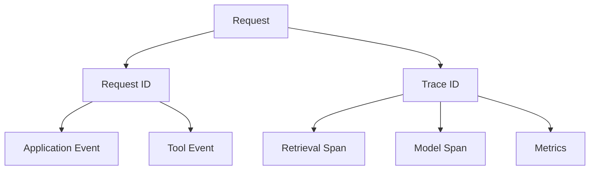

Correlation therefore transforms individual telemetry records into a connected operational story.

---

# Correlation Context

Useful correlation context may include:

- request ID,
- trace ID,
- span ID,
- service identity,
- environment,
- deployment identity,
- model identity,
- provider identity,
- and other carefully selected contextual fields.

The exact identifiers depend on the telemetry architecture.

The important principle is consistency.

If one service calls another but correlation context is lost at the boundary, the distributed request becomes difficult to reconstruct.

---

## Correlation Across Asynchronous Boundaries

Correlation becomes harder when work crosses asynchronous boundaries.

For example:

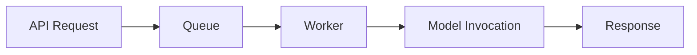

The original request may no longer be executing when the worker processes the message.

If correlation context is not propagated correctly, engineers may be unable to connect:

> API request → queue message → worker → model invocation

This is why distributed observability must consider asynchronous execution, not only synchronous HTTP request chains.

---

# Routing

Not all telemetry needs to go to the same destination.

Routing policies may depend on:

- signal type,
- environment,
- service,
- sensitivity,
- retention requirements,
- diagnostic importance,
- and cost.

For example:

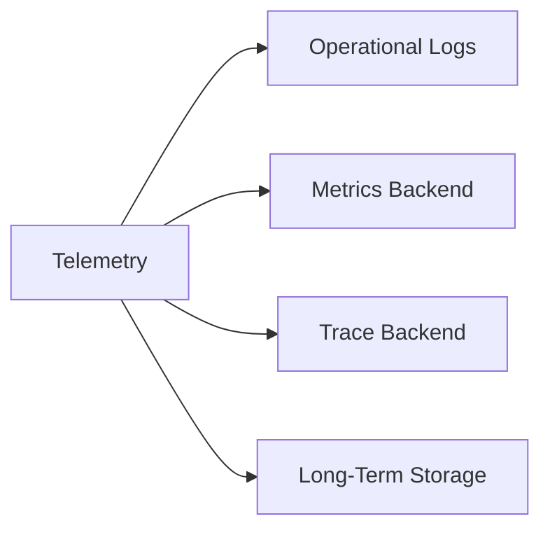

Routing allows different classes of evidence to follow different storage and retention policies.

---

# Storage

Telemetry must eventually be stored somewhere that supports the required operational use cases.

Different signal types may have different storage characteristics.

For example:

| Signal | Typical storage concern |
|---|---|
| Logs | large event volume and text/search cost |
| Metrics | time-series cardinality |
| Traces | high event volume and retention cost |
| AI-specific signals | correlation, dimensionality, and sensitive attributes |

Storage design should consider:

- query patterns,
- retention,
- volume,
- cost,
- availability,
- durability,
- access control,
- and compliance requirements.

The correct question is not:

> Where can we store telemetry?

It is:

> What storage characteristics are required for the operational questions we need to answer?

---

## Querying

Telemetry is valuable only when engineers can retrieve useful evidence from it.

Querying should support questions such as:

- Which requests are slow?
- Which model versions are failing?
- Which provider has increased latency?
- Which retrieval requests are producing unusual latency?
- Which service is responsible for the largest latency contribution?
- Which requests experienced tool failures?
- How has token usage changed?
- Are errors concentrated in a particular deployment?

Queryability is therefore part of observability design.

A signal that is collected but practically impossible to query may provide little operational value.

---

## Visualization

Visualization turns telemetry into human-readable operational views.

Examples include:

- latency distributions,
- request rates,
- error rates,
- dependency relationships,
- model usage,
- provider behavior,
- token consumption,
- request traces,
- and service health indicators.

Visualization should support operational questions.

A visually attractive dashboard that does not help engineers diagnose a problem is not necessarily useful observability.

---

## Alert-Supporting Evidence

Observability architecture may provide evidence used by alerting systems.

For example:

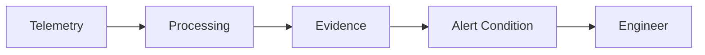

The observability system should make it possible to understand the evidence behind an alert.

An alert such as:

> Error rate increased

is more useful when engineers can investigate:

- which service,
- which model,
- which provider,
- which deployment,
- which request class,
- and which dependency

contributed to the increase.

Alerting itself belongs to operational workflows, but observability architecture must provide the evidence those workflows depend on.

---

# Sampling

High-volume systems may generate more telemetry than is practical to retain in full.

Sampling reduces the amount of telemetry retained or processed.

The trade-off is straightforward:

> Less telemetry can reduce cost and volume, but may reduce diagnostic evidence.

Sampling therefore must be designed rather than applied blindly.

---

## Uniform Sampling

Uniform sampling applies approximately the same sampling policy across telemetry.

For example:

```text
Keep approximately 10% of eligible traces.
```

This is simple.

However, uniform sampling can discard rare but important events.

Suppose:

- 99.9% of requests succeed.
- 0.1% fail.

If sampling is applied without considering request outcome, many failure traces may be lost.

This reduces diagnostic usefulness.

---

# Policy-Based Sampling

Policy-based sampling selects telemetry according to operational importance.

For example:

```text
Keep:
- all failed requests
- all high-latency requests
- a sample of successful requests
- all requests involving a critical dependency
```

This can preserve more useful evidence while controlling telemetry volume.

The exact policy depends on the system.

The principle is:

> Sampling should preserve the evidence needed to answer important operational questions.

---

# Aggregation

Aggregation combines multiple telemetry observations into a more compact representation.

For example:

```text
Individual requests:
120 ms
135 ms
142 ms
180 ms
210 ms
...

Aggregated representation:
request count
average latency
p50
p95
p99
error rate
```

Aggregation reduces volume.

However, aggregation can also remove diagnostic detail.

Therefore:

> Aggregation is a trade-off between compactness and diagnostic depth.

---

# Aggregation and Diagnostic Depth

Consider two telemetry strategies.

### Strategy A

Store only:

```text
average latency = 420 ms
```

This is compact.

But it cannot answer:

> Did a small percentage of requests become extremely slow?

### Strategy B

Preserve a latency distribution.

This provides more information about the shape of the workload.

The engineering decision therefore depends on the question being answered.

Operational telemetry should retain enough information to support important decisions without retaining unnecessary detail everywhere.

---

# Cardinality Management

Cardinality refers to the number of distinct values represented by a field or combination of fields.

For example:

```text
region
```

may have a small number of values.

But:

```text
request_id
```

may have millions of distinct values.

High cardinality is not inherently bad.

The problem occurs when high-cardinality fields are used in representations such as metric dimensions where every distinct value can create additional unique time series.

For example:

```text
http_requests{region="ap-south"}
```

may be manageable.

But:

```text
http_requests{request_id="req-123456"}
```

can create enormous numbers of unique series.

Cardinality therefore needs to be considered when designing telemetry schemas.

A useful principle is:

> Keep high-cardinality context where it provides diagnostic value, but avoid turning every unique identifier into a high-cardinality metric dimension.

---

# Retention

Telemetry does not necessarily need to be retained forever.

Retention decisions should consider:

- operational usefulness,
- compliance requirements,
- debugging needs,
- historical analysis,
- storage cost,
- sensitivity,
- and expected access frequency.

For example:

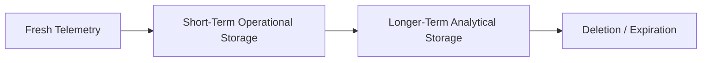

Retention should be aligned with actual operational requirements.

Keeping everything forever may be expensive and may increase privacy and security exposure.

Keeping too little may make historical diagnosis impossible.

---

# Telemetry Quality

Telemetry quality determines whether observability evidence can be trusted.

Common quality problems include:

- missing telemetry,
- dropped telemetry,
- incorrect timestamps,
- broken trace propagation,
- inconsistent service names,
- inconsistent schema,
- incomplete correlation,
- incorrect metric aggregation,
- excessive cardinality,
- unstructured logs,
- inappropriate sampling,
- and sensitive data leakage.

A system with poor telemetry quality may appear observable while remaining difficult to diagnose.

---

## Observability Completeness

Observability completeness does not mean collecting every possible signal.

It means collecting enough reliable evidence to answer the operational questions that matter.

For example:

If the question is:

> Why is model latency increasing?

Useful evidence might include:

- request latency,
- model invocation duration,
- provider identity,
- model identity,
- queueing time,
- dependency latency,
- deployment identity,
- and correlated request context.

Collecting unrelated application events does not necessarily improve the answer.

Therefore:

> Observability completeness is question-dependent.

---

## Signal Design

Signal design begins with operational questions.

A useful design sequence is:

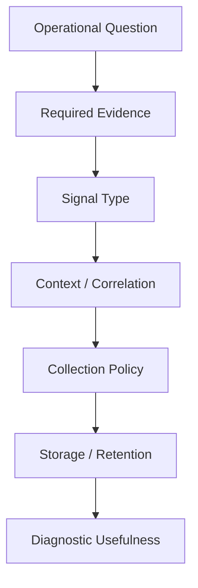

For every proposed signal, ask:

1. What question does it answer?
2. What behavior produces it?
3. What context is required?
4. Who will use it?
5. How frequently is it generated?
6. How much will it cost?
7. Does it contain sensitive information?
8. Does it create problematic cardinality?
9. How long should it be retained?
10. What happens if it is missing?

This prevents telemetry collection from becoming an uncontrolled data-generation exercise.

---

# Example: Designing Model Invocation Telemetry

Suppose an application calls a model provider.

A useful model invocation signal may include:

```json
{
  "event": "model_invocation_completed",
  "model": "model-x",
  "provider": "provider-a",
  "duration_ms": 842,
  "input_tokens": 712,
  "output_tokens": 1130,
  "outcome": "success",
  "request_id": "req-123",
  "trace_id": "trace-456"
}
```

This can support questions such as:

- Which model was used?
- Which provider handled the request?
- How long did inference take?
- How many tokens were consumed?
- Did the request succeed?
- Which distributed request did it belong to?

The design should still consider whether every field is appropriate to store.

---

# Signal Redundancy vs Useful Corroboration

Multiple signals may describe the same behavior from different perspectives.

For example:

- a trace may show model invocation duration,
- a metric may summarize model latency,
- a log may record model invocation outcome.

This is not necessarily harmful duplication.

The signals serve different purposes.

A trace may answer:

> What happened during this specific request?

A metric may answer:

> Is model latency increasing across thousands of requests?

A log may answer:

> What contextual event occurred and what additional attributes were present?

The goal is not to eliminate all overlap.

The goal is to ensure that the overlap provides useful corroboration.

---

## Privacy-Aware Signal Design

Observability can accidentally become a sensitive-data collection system.

AI applications may process:

- user prompts,
- generated responses,
- personal information,
- documents,
- retrieved content,
- authentication information,
- tool parameters,
- and business-sensitive data.

Logging everything can therefore create serious risks.

The observability architecture must distinguish between:

> information that is technically available

and:

> information that should be retained as operational evidence.

---

## Redaction and Minimization

Useful strategies include:

- avoid recording sensitive payloads unnecessarily,
- redact sensitive fields,
- tokenize or pseudonymize identifiers where appropriate,
- record metadata instead of raw content,
- restrict access to sensitive telemetry,
- apply retention policies,
- and document what is intentionally excluded.

For example, instead of storing:

```text
prompt = "Full sensitive user message..."
```

the system may record:

```text
prompt_length = 842
prompt_class = customer_support
prompt_redacted = true
```

The correct design depends on the operational question.

If the raw prompt is not required to diagnose the system, storing it may create unnecessary risk.

---

# Observability Cost

Observability has a real infrastructure cost.

Costs may come from:

- telemetry generation,
- network transfer,
- collection,
- processing,
- storage,
- indexing,
- querying,
- retention,
- and visualization.

A useful engineering model is:

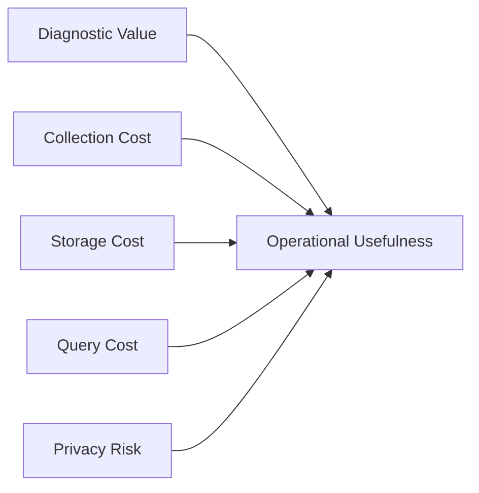

A signal should therefore be evaluated across multiple dimensions.

A signal with high diagnostic value may justify higher cost.

A low-value signal with enormous volume may not.

---

# Observability Scalability

Observability architecture must scale with the application.

As request volume increases:

- telemetry volume increases,
- storage requirements increase,
- query load increases,
- processing requirements increase,
- cardinality can increase,
- and cost increases.

A design that works for 100 requests per minute may fail at 100,000 requests per minute.

Therefore, observability architecture should consider:

- buffering,
- batching,
- asynchronous collection,
- sampling,
- aggregation,
- routing,
- scalable storage,
- retention policies,
- and query efficiency.

Observability should scale with the workload without becoming an operational bottleneck.

---

## Observability Failure Modes

The observability system can fail independently of the application.

Examples include:

### Telemetry Loss

The application works correctly, but telemetry is dropped.

### Broken Correlation

Telemetry exists, but request relationships are lost.

### Incorrect Timestamps

Events appear in the wrong order.

### Inconsistent Naming

Different services use different names for the same concept.

### Excessive Cardinality

Metric systems become overloaded with unique series.

### Over-Sampling

Too much telemetry is retained, increasing cost.

### Under-Sampling

Important failure evidence is discarded.

### Sensitive Data Leakage

Telemetry exposes information that should not have been collected.

### Telemetry Cost Explosion

Observability infrastructure becomes unexpectedly expensive.

These are production engineering failures.

Observability should therefore be designed, tested, monitored, and operated as a production system.

---

## Practical Example — Latency Investigation

Suppose users report that AI responses are slow.

The request path is:

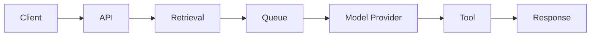

A single overall latency metric might show:

```text
p95 latency = 7.8 seconds
```

But that does not explain the cause.

Correlated telemetry may reveal:

```text
API processing       = 120 ms
Retrieval             = 180 ms
Queueing              = 2,100 ms
Model invocation      = 3,900 ms
Tool execution        = 1,200 ms
Other                 = 300 ms
```

The architecture now provides evidence.

The likely problem is not simply:

> The AI API is slow.

It is:

> Queueing and model/tool execution contribute most of the request latency.

That distinction enables better engineering decisions.

---

# Practical Example — Model Provider Failure

Suppose an AI application routes requests between two providers.

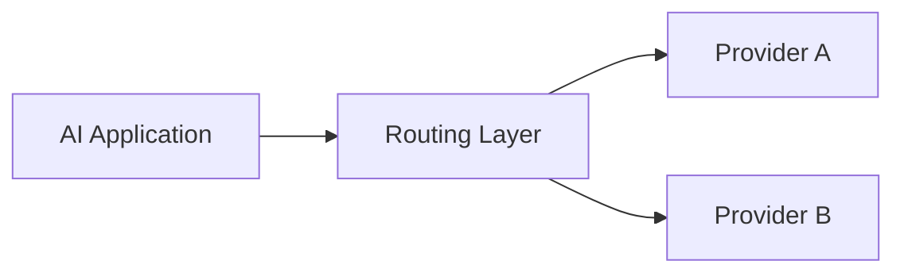

A sudden increase in failures occurs.

Useful telemetry might include:

- provider identity,
- model identity,
- request outcome,
- error classification,
- latency,
- routing decision,
- trace context.

Correlation may reveal:

```text
Provider A:
success rate = 96%

Provider B:
success rate = 99.8%
```

The application may therefore be experiencing a provider-specific problem.

Without provider identity, the evidence may only show:

```text
model requests failing
```

That is much less actionable.

---

# Practical Example — Token Usage Visibility

Suppose infrastructure cost increases.

The application is functioning normally.

Observability evidence may show:

```text
requests increased by 10%

input tokens increased by 45%

output tokens increased by 12%
```

This suggests that request volume alone does not explain the cost increase.

Additional correlation may reveal:

- prompt growth,
- retrieval context growth,
- model changes,
- output-length changes,
- or routing changes.

The operational question becomes:

> What changed in token consumption?

rather than:

> Why is the cloud bill higher?

---

# Practical Example — Distributed AI Request

Consider:

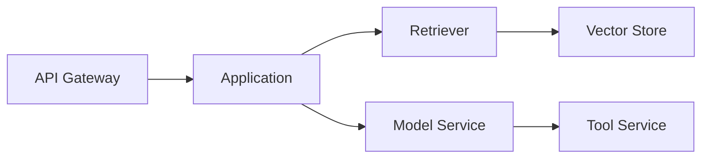

A user request may generate evidence across all these components.

A trace can connect the request across service boundaries.

Logs can provide contextual events.

Metrics can provide aggregate behavior.

AI-specific operational signals can describe model and AI-workload behavior.

The architecture therefore combines multiple signal types rather than expecting one signal type to answer every question.

---

# Practical Example — Queue Boundary

Suppose an AI service introduces asynchronous processing.

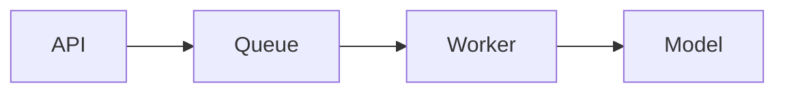

Users report high latency.

The API itself may appear healthy.

The observability architecture must therefore expose:

- request arrival,
- queue insertion,
- queue waiting time,
- worker start,
- model invocation,
- completion.

Without queue boundary telemetry, engineers may incorrectly blame the model.

This demonstrates an important principle:

> Instrumentation boundaries should follow meaningful system boundaries, not merely code modules.

---

# Engineering Decisions and Trade-offs

Observability architecture requires continuous trade-offs.

## More Telemetry vs Lower Cost

More telemetry can improve diagnosis.

But it increases:

- processing,
- storage,
- querying,
- and potentially privacy risk.

---

## Detailed Evidence vs Privacy

Detailed payloads may make debugging easier.

But raw prompts, documents, or responses may contain sensitive information.

Therefore:

> Diagnostic usefulness must be balanced against data exposure.

---

## Centralized Collection vs Simplicity

Centralized collection can provide consistent policy and routing.

But it adds infrastructure.

Direct application-to-backend telemetry may be simpler for small systems.

The appropriate choice depends on system scale and operational requirements.

---

## Sampling vs Diagnostic Coverage

Sampling reduces volume.

But aggressive sampling can remove rare failure evidence.

Important events may therefore require preferential retention.

---

## Aggregation vs Diagnostic Depth

Aggregation reduces storage and query cost.

But it removes individual-event detail.

The correct aggregation level depends on the operational question.

---

## High-Cardinality Context vs Metric Scalability

Detailed identifiers can be valuable for investigation.

But using those identifiers as metric dimensions can create excessive time-series cardinality.

A common solution is to keep high-cardinality identifiers in logs or traces while using lower-cardinality dimensions for metrics.

---

## Practical Signal-Design Framework

When designing a new signal, use the following process.

### Step 1 — Define the Operational Question

Example:

> Why are model requests becoming slower?

### Step 2 — Identify Required Evidence

Potential evidence:

- model latency,
- queueing time,
- provider,
- model version,
- dependency latency.

### Step 3 — Select Signal Types

For example:

- metrics for aggregate latency,
- traces for request-level attribution,
- structured events for contextual details.

### Step 4 — Define Correlation

Determine how the signals connect.

Examples:

- request ID,
- trace ID,
- deployment identity,
- model identity.

### Step 5 — Define Collection Policy

Determine:

- what is always collected,
- what is sampled,
- what is aggregated,
- what is filtered.

### Step 6 — Define Storage and Retention

Determine:

- where the evidence goes,
- how long it remains,
- who can access it.

### Step 7 — Validate Diagnostic Usefulness

Ask:

> Can an engineer actually answer the original operational question using the collected evidence?

If not, the signal design is incomplete.

---

## Production Perspective

A production observability architecture should be evaluated as a system in its own right.

Ask:

- Can telemetry be lost?
- Can correlation break?
- Can timestamps become inconsistent?
- Can telemetry overwhelm the application?
- Can observability infrastructure become a bottleneck?
- Can sensitive information leak?
- Can telemetry costs grow unexpectedly?
- Can engineers distinguish signal from noise?
- Can the system support diagnosis during incidents?
- Can the observability architecture evolve as the application evolves?

These questions move observability from:

> “We have monitoring.”

to:

> “We have an evidence system that supports production engineering.”

---

## Telemetry Loss

Telemetry loss is particularly dangerous because it can create false confidence.

Suppose a system reports:

```text
error rate = 0%
```

That does not necessarily mean:

> No requests failed.

It may mean:

> No failure telemetry was successfully observed.

Therefore, observability systems should consider:

- dropped telemetry,
- collector failures,
- transport failures,
- backend ingestion failures,
- sampling,
- and partial collection.

Telemetry completeness is part of observability correctness.

---

# Signal Quality and Naming Consistency

Consistent naming improves cross-service analysis.

For example, if one service uses:

```text
model_name
```

and another uses:

```text
model
```

and a third uses:

```text
llm_identifier
```

the same concept becomes harder to query consistently.

Semantic consistency should therefore be treated as an architectural concern.

Useful standards may define:

- service naming,
- environment naming,
- model identity,
- provider identity,
- request correlation,
- timestamps,
- event names,
- outcome categories,
- and error classifications.

---

# Time Semantics

Time is fundamental to observability.

Engineers often need to reconstruct:

> What happened first?

Incorrect or inconsistent timestamps can make a healthy system appear broken.

Observability design should therefore consider:

- event time,
- collection time,
- processing time,
- clock differences,
- duration measurement,
- and ordering across distributed systems.

A telemetry record should have clear semantics for the time it represents.

---

## Observability Architecture for a Production AI API

A simplified production architecture might look like:

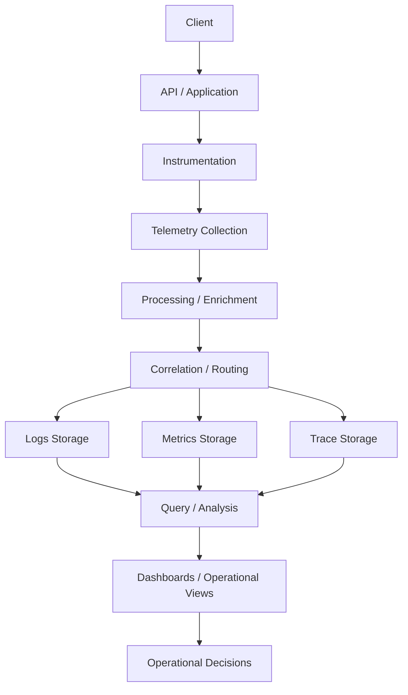

The architecture is intentionally technology-neutral.

Different organizations may implement these stages with different products.

The underlying responsibilities remain similar.

---

# Technology-Neutral Implementation Perspective

A production implementation may use technologies such as:

- OpenTelemetry,
- Prometheus,
- Grafana,
- ELK/OpenSearch-style logging systems,
- cloud-native telemetry platforms,
- managed tracing systems,
- custom collectors,
- or combinations of these.

These technologies solve different parts of the observability problem.

The engineering principles remain:

- instrument meaningful boundaries,
- generate useful telemetry,
- preserve correlation,
- control volume,
- protect sensitive information,
- maintain semantic consistency,
- retain sufficient evidence,
- and optimize observability for operational questions.

Technology selection should follow architectural requirements rather than the other way around.

---

## Common Mistakes and Misconceptions

## Mistake 1 — Collecting Everything

More telemetry does not guarantee better observability.

Without signal selection, telemetry becomes noise.

---

## Mistake 2 — Treating Dashboards as Observability

Dashboards are consumers of observability evidence.

They are not the observability architecture itself.

---

## Mistake 3 — Ignoring Correlation

Independent logs, metrics, and traces are much less useful when they cannot be connected.

---

## Mistake 4 — Using High-Cardinality Identifiers as Metric Dimensions

Request IDs and similar unique identifiers can create excessive metric series.

They may be better suited to logs or traces.

---

## Mistake 5 — Sampling Without Considering Failures

Uniform sampling can accidentally discard rare but important failure evidence.

---

## Mistake 6 — Logging Sensitive AI Content

Prompts, responses, retrieved documents, and tool parameters may contain sensitive information.

Operational usefulness does not automatically justify storing raw content.

---

## Mistake 7 — Ignoring Asynchronous Boundaries

Queues and workers can break request context if correlation is not propagated correctly.

---

## Mistake 8 — Ignoring Telemetry Quality

Incorrect timestamps, inconsistent names, and missing context can make telemetry actively misleading.

---

## Mistake 9 — Treating Observability as Free

Telemetry has infrastructure and operational costs.

---

## Mistake 10 — Making Observability Vendor-Dependent

Tools change.

The underlying engineering principles should remain understandable independently of a specific vendor.

---

## Interview Questions with Expected Answers

## 1. What is observability architecture?

**Expected answer:**

Observability architecture is the design of how system behavior is instrumented, converted into telemetry, collected, processed, correlated, stored, queried, and visualized so that engineers can understand and diagnose production behavior.

---

## 2. Why isn't collecting telemetry enough?

**Expected answer:**

Raw telemetry may be incomplete, disconnected, noisy, expensive, or difficult to query. Observability requires designing sufficient evidence to answer operational questions, not merely generating data.

---

## 3. What is the role of instrumentation?

**Expected answer:**

Instrumentation defines where and how meaningful system behavior becomes observable. It should be designed around operational questions and meaningful system boundaries.

---

## 4. What is the difference between an agent and a collector?

**Expected answer:**

An agent generally runs close to the workload and performs local telemetry collection or forwarding. A collector is a telemetry processing component that can receive, transform, enrich, route, or forward telemetry. Their exact responsibilities may overlap depending on architecture.

---

## 5. Why is correlation important?

**Expected answer:**

Correlation connects telemetry from different components and signal types to the same request or execution flow, allowing engineers to reconstruct distributed behavior.

---

## 6. Why can sampling be dangerous?

**Expected answer:**

Sampling reduces telemetry volume but can discard rare events, including failures or high-latency requests. Sampling policies should preserve important diagnostic evidence.

---

## 7. Is high cardinality always bad?

**Expected answer:**

No. High-cardinality data can be useful for diagnosis. The problem occurs when high-cardinality fields are used in systems such as metric dimensions where they create excessive unique time series.

---

## 8. Why should AI observability consider privacy?

**Expected answer:**

AI workloads may process prompts, responses, documents, personal information, and tool parameters. Recording all of this can create privacy, security, compliance, and cost risks.

---

## 9. Why is telemetry schema consistency important?

**Expected answer:**

Consistent semantics and naming allow telemetry from different services to be correlated and queried consistently. Inconsistent schemas make cross-service analysis difficult.

---

## 10. How would you investigate high AI request latency?

**Expected answer:**

Start with aggregate latency metrics, then use traces and correlated operational signals to decompose the request into stages such as queueing, retrieval, model invocation, tool execution, and downstream dependencies. The goal is to identify where latency is actually being introduced.

---

## Quick Revision

Remember the observability architecture pipeline:

```mermaid
flowchart LR
    A["System Behavior"]
    B["Instrumentation"]
    C["Telemetry"]
    D["Collection"]
    E["Processing"]
    F["Correlation"]
    G["Storage"]
    H["Query / Analysis"]
    I["Operational Evidence"]
    J["Decision"]

    A --> B
    B --> C
    C --> D
    D --> E
    E --> F
    F --> G
    G --> H
    H --> I
    I --> J
```

Key relationships:

- Instrumentation determines what becomes observable.
- Collection moves telemetry.
- Processing makes telemetry consistent and useful.
- Correlation connects related signals.
- Sampling controls volume.
- Aggregation controls detail and storage.
- Cardinality management controls dimensional explosion.
- Retention controls historical availability and cost.
- Signal design connects telemetry to operational questions.
- Privacy controls what should be collected.
- Telemetry quality determines whether evidence can be trusted.

---

# Key Takeaways

1. Observability architecture is an evidence pipeline, not merely a dashboard system.
2. Instrumentation should follow meaningful operational questions and system boundaries.
3. Telemetry must be collected, processed, correlated, stored, and made queryable.
4. Agents and collectors are architectural components with potentially overlapping responsibilities.
5. Correlation is essential for reconstructing distributed AI requests.
6. Sampling reduces volume but can remove important evidence.
7. Aggregation reduces cost but may reduce diagnostic depth.
8. High cardinality is not inherently bad; unmanaged cardinality in metric dimensions is a scalability problem.
9. Retention should balance operational usefulness, cost, privacy, and compliance.
10. AI observability requires signals such as model identity, provider, token usage, model latency, routing, retrieval, tool calls, and outcomes to be represented within the broader observability architecture.
11. Observability signals should be designed around operational questions rather than collected indiscriminately.
12. Privacy-aware observability is essential for AI systems because telemetry may contain sensitive information.
13. Telemetry quality is part of observability correctness.
14. The observability system itself must be engineered as a production system.
15. The ultimate goal is not more telemetry. It is **better operational evidence**.

---

## Further Reading

For related production engineering concepts, continue with:

- [PROD-03 — Production AI Model Serving](../PROD-03-Production-Model-Serving/README.md)
- [PROD-06 — Production AI Reliability](../PROD-06-Production-AI-Reliability/README.md)
- [PROD-07 — AI Scaling and Capacity Engineering](../PROD-07-AI-Scaling-and-Capacity-Engineering/README.md)
- [PROD-08 — AI Performance Optimization and Cost](../PROD-08-AI-Performance-Optimization-and-Cost/README.md)
- [PROD-09 — Production AI Security](../PROD-09-Production-AI-Security/README.md)
- [PROD-10 — AI Operations and Incident Management](../PROD-10-AI-Operations-and-Incident-Management/README.md)
- [PROD-11 — AI Lifecycle, Evaluation, and Continuous Improvement](../PROD-11-AI-Lifecycle-Evaluation-and-Continuous-Improvement/README.md)

These chapters provide related production engineering perspectives without replacing the observability architecture concepts taught here.

---

## Chapter Completion Check

You should consider this chapter complete when you can confidently explain:

### Understand

- What observability architecture is.
- Why telemetry collection alone is insufficient.
- The major stages of an observability pipeline.
- The roles of instrumentation, agents, and collectors.
- Why correlation matters.
- Why sampling and aggregation exist.
- What cardinality means.
- Why telemetry quality matters.

### Explain

You should be able to explain:

- How an AI request becomes observable.
- How telemetry moves from application to backend.
- How distributed request context is preserved.
- How sampling affects diagnostic evidence.
- How signal design balances usefulness, cost, and privacy.

### Implement

You should be able to implement or configure a basic observability pipeline that:

- instruments meaningful application boundaries,
- emits structured operational signals,
- propagates correlation context,
- collects telemetry,
- processes telemetry,
- and stores it for analysis.

### Apply

You should be able to investigate:

- latency problems,
- provider failures,
- token usage anomalies,
- queueing problems,
- distributed request failures,
- and telemetry-quality problems.

### Design

You should be able to design an observability architecture for a production AI API and justify:

- instrumentation boundaries,
- collection architecture,
- correlation strategy,
- signal selection,
- sampling,
- aggregation,
- cardinality management,
- retention,
- privacy controls,
- and storage choices.

### Teach

You should be able to explain to another engineer:

> Why production AI observability is not about collecting the maximum amount of telemetry, but about designing reliable operational evidence that allows engineers to understand system behavior.

---

## Final Mental Model

The most important idea from this chapter is:

```mermaid
flowchart LR
    A["Production AI Behavior"]
    B["Meaningful Instrumentation"]
    C["Telemetry"]
    D["Collection"]
    E["Processing + Enrichment"]
    F["Correlation"]
    G["Operational Evidence"]
    H["Understanding"]
    I["Engineering Decision"]

    A --> B
    B --> C
    C --> D
    D --> E
    E --> F
    F --> G
    G --> H
    H --> I
```

The purpose of observability architecture is not to create telemetry for its own sake.

It is to create a reliable path from:

> **production behavior → evidence → understanding → engineering decision**

That is the core engineering principle behind production AI observability.
