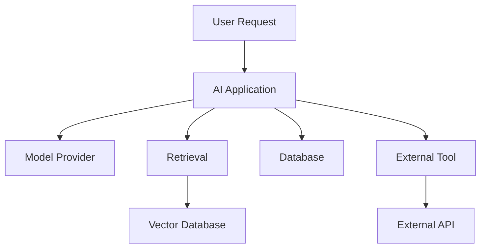

# PROD-06.03 — Graceful Degradation, Fallbacks, and Dependency Failure

## Learning Objectives

By the end of this chapter, you should be able to:

- Explain how dependency failures affect production AI systems.
- Distinguish complete failure from partial failure.
- Identify critical and non-critical dependencies.
- Explain graceful degradation and degraded operating modes.
- Distinguish retry, fallback, and degraded behavior.
- Design fallback strategies for AI models, retrieval systems, tools, and external providers.
- Evaluate alternative providers and models as fallback candidates.
- Reason about cached and stale responses as reliability mechanisms.
- Use asynchronous deferral when synchronous completion is not required.
- Make fail-open and fail-closed decisions deliberately.
- Prevent fallback paths from creating new overload or failure cascades.
- Design recovery-oriented behavior after dependency recovery.
- Evaluate reliability trade-offs between availability, correctness, freshness, functionality, and AI quality.
- Test degraded modes and fallback behavior before production.
- Make reliability decisions based on user-visible consequences rather than dependency status alone.

---

## Prerequisites

You should understand:

- Reliability, availability, SLI, SLO, and error budgets from [Lesson 01](./01-AI-Service-Reliability-SLIs-SLOs-and-Error-Budgets.md).
- Failure isolation, timeouts, retries, circuit breaking, concurrency limits, queues, backpressure, admission control, and load shedding from [Lesson 02](./02-Failure-Isolation-Timeouts-Retries-and-Backpressure.md).
- Basic distributed-system concepts such as services, dependencies, requests, latency, partial failure, and resource exhaustion.

---

## Estimated Reading Time

**50–65 minutes**

---

## Before We Start

Production AI systems rarely consist of one component.

A user request may depend on:

```text
Client
   ↓
API
   ↓
Application Logic
   ↓
 ┌───────────────┬───────────────┬───────────────┬───────────────┐
 ↓               ↓               ↓               ↓
Model         Retrieval        Database        Tool
Provider         ↓               ↓               ↓
              Vector DB       Metadata       External API
```

A request can therefore fail even when the primary application process is healthy.

For example:

- the model provider may be unavailable;
- retrieval may time out;
- a tool may exceed its quota;
- a database may become slow;
- an external API may return errors;
- a cache may contain stale information;
- a downstream service may accept traffic but fail to complete requests.

The reliability question is not only:

> "Can the system work?"

It is also:

> **"What useful behavior can the system provide when some part of it cannot work normally?"**

That question is the focus of this chapter.

---

# Why This Exists

A production system cannot assume that every dependency will always be healthy.

If a dependency fails and the application has only two states:

```text
Everything works
        ↓
Everything fails
```

then a relatively small dependency failure can create a complete user-visible outage.

A more resilient system recognizes intermediate states:

```text
Normal Operation
       ↓
Dependency Degradation
       ↓
Partial Failure
       ↓
Degraded Operation
       ↓
Controlled Failure
       ↓
Recovery
       ↓
Normal Operation
```

The goal is not to hide every failure.

The goal is to **control the consequences of failure**.

Graceful degradation is therefore a reliability strategy, not merely a user-interface technique.

---

# Mental Model

A useful mental model is:

```text
Dependency Failure
        ↓
What capability is affected?
        ↓
Is that capability required?
        ↓
       / \
     No   Yes
     ↓      ↓
Continue   Is a valid fallback available?
without       ↓
it          Yes / No
             ↓
       Reduced capability?
             ↓
        Yes / No
             ↓
   Degraded / Controlled Failure
             ↓
          Recovery
             ↓
   Controlled restoration
```

The key idea is:

> **Dependency failure does not automatically imply complete request failure.**

The correct response depends on the capability the dependency provides and the consequences of losing it.

---

# 1. Complete Failure vs Partial Failure

## Complete Failure

Complete failure for an affected capability or request occurs when the system cannot provide the required service for that capability or request.

Example:

```text
User request
     ↓
Required model unavailable
     ↓
No valid fallback
     ↓
Request cannot complete
```

The correct response may be a controlled failure.

---

## Partial Failure

Partial failure occurs when some functionality remains available while another capability is unavailable.

Example:

```text
Profile request
 ├── Core profile data      → available
 ├── Recommendations        → unavailable
 └── Optional enrichment    → unavailable
```

The system may still provide the core profile instead of failing the entire request.

This is one of the most important properties of distributed systems:

> **A failure in one component does not necessarily mean every capability must fail.**

---

# 2. Dependency Failure

A dependency is any external or internal component required to provide part of the system's behavior.

Examples include:

- model providers;
- embedding services;
- vector databases;
- relational databases;
- object storage;
- authentication services;
- payment systems;
- external APIs;
- search services;
- agent tools;
- feature stores;
- queues.

A dependency can fail in several ways.

### Hard Failure

The dependency returns explicit errors.

```text
HTTP 500
Connection refused
Unavailable
Quota exceeded
```

### Slow Failure

The dependency remains reachable but does not respond within the required time.

```text
Request
   ↓
Dependency
   ↓
Very long latency
   ↓
Caller timeout
```

### Quality Failure

The dependency technically responds but does not provide usable behavior.

For example:

- a provider returns an invalid response;
- retrieval returns no usable evidence;
- a model produces an incompatible response;
- a tool returns incomplete data.

### Capacity Failure

The dependency becomes overloaded.

Examples:

- concurrency limit exceeded;
- queue saturation;
- provider quota exhaustion;
- GPU resource exhaustion.

The reliability strategy must consider more than simple HTTP errors.

---

# 3. Dependency Criticality

Not every dependency has equal importance.

A useful classification is:

```text
Critical Dependency
→ Required for the core request

Important Dependency
→ Strongly affects usefulness but may be bypassed

Optional Dependency
→ Enhances the response but is not required
```

However, dependency criticality is **workload-specific**.

A dependency may be critical for one request and optional for another.

For example:

```text
Question A
→ Retrieval required for factual response

Question B
→ Retrieval optional because the answer is independent of private data
```

Therefore, avoid assigning criticality globally without considering request semantics.

---

# 4. Dependency Graph Thinking

Instead of viewing the application as a single service, model its dependency graph.



Each node can fail independently.

The engineering question becomes:

> Which user-visible capabilities depend on which nodes?

This allows the system to establish degradation boundaries.

For example:

```text
Model Provider
   ↓
Core Generation
   ↓
Cannot generate normally

Retrieval
   ↓
Evidence enrichment
   ↓
May be optional for some requests

External Tool
   ↓
Optional action
   ↓
May be omitted
```

The dependency graph therefore becomes a map for deciding where degradation is possible.

---

# 5. Graceful Degradation

Graceful degradation means deliberately reducing system functionality while preserving as much useful behavior as possible when normal operation is not available.

The key word is **deliberately**.

A system that accidentally produces incomplete responses is not necessarily gracefully degrading.

A graceful system knows:

- what functionality is unavailable;
- what functionality remains available;
- what behavior is acceptable;
- what behavior must not occur;
- when to fail instead.

A useful model is:

```text
Normal Capability
       ↓
Reduced Capability
       ↓
Minimal Useful Capability
       ↓
Controlled Failure
```

---

# 6. Degraded Modes

A degraded mode is a predefined operating state in which the system intentionally provides reduced functionality.

Examples:

```text
Normal Mode
→ full model + retrieval + personalization

Degraded Mode
→ model + cached personalization

Minimal Mode
→ model response without optional enrichment

Failure Mode
→ controlled error because required capability is unavailable
```

A degraded mode should define:

1. What functionality is removed?
2. What functionality remains?
3. What quality or freshness is sacrificed?
4. What safety or correctness boundaries remain mandatory?
5. What resource limits apply?
6. How does the system return to normal operation?

Without these boundaries, "degraded mode" can become an uncontrolled collection of exceptions.

---

# 7. Retry vs Fallback vs Degraded Mode

These mechanisms address different problems.

## Retry

A retry repeats the same operation, usually against the same dependency.

```text
Primary Operation
      ↓
Transient failure
      ↓
Retry same operation
```

Retry is useful when the failure may be transient and the operation can safely be repeated.

Detailed retry policy, backoff, jitter, retry amplification, and retry ownership are covered in Lesson 02.

## Fallback

A fallback stops relying on the failed path and uses an alternative behavior or dependency.

```text
Primary Provider
      ↓
failure
      ↓
Alternative Provider
```

## Degraded Mode

A degraded mode provides less capability because the normal capability cannot be provided.

```text
Full response
     ↓
Personalization unavailable
     ↓
Generic response
```

The distinction can therefore be summarized as:

```text
Retry:
"Try the same operation again."

Fallback:
"Use another way to provide the capability."

Degraded Mode:
"Provide less capability because the normal capability cannot be provided."
```

These mechanisms can interact.

For example:

```text
Primary dependency
      ↓
Bounded retry
      ↓
Still unavailable
      ↓
Fallback
      ↓
Fallback unavailable
      ↓
Degraded mode or controlled failure
```

---

# 8. Degradation Boundaries

A degradation boundary defines where the system is allowed to reduce functionality.

For example:

```text
Required:
- authentication
- authorization
- core response

Optional:
- recommendations
- personalization
- enrichment
```

If personalization fails:

```text
Personalization
      ↓
Unavailable
      ↓
Return generic result
```

If authorization fails:

```text
Authorization
      ↓
Unavailable
      ↓
Do not proceed
```

The system therefore needs explicit boundaries between:

- must-have capabilities;
- optional capabilities;
- capabilities that can be substituted;
- capabilities that must cause controlled failure.

---

# 9. Fallback Strategies

Common fallback strategies include:

### Alternative Provider

```text
Provider A
    ↓
failure
    ↓
Provider B
```

### Alternative Model

```text
Primary Model
    ↓
unavailable
    ↓
Smaller or alternate model
```

### Cached Response

```text
Live Data
    ↓
unavailable
    ↓
Previously stored data
```

### Reduced Functionality

```text
Full feature
    ↓
optional component unavailable
    ↓
core feature only
```

### Asynchronous Deferral

```text
Immediate completion
       ↓
not required
       ↓
accept work
       ↓
complete later
```

### Controlled Failure

```text
No valid fallback
       ↓
clear bounded failure
```

These are alternatives, not a universal ranking.

The correct fallback depends on:

- semantics;
- correctness requirements;
- freshness requirements;
- safety constraints;
- capacity;
- latency;
- cost;
- user expectations.

---

# 10. Example Fallback Hierarchy

A possible fallback chain is:

```text
Primary Model
      ↓
Alternative Model
      ↓
Cached Result
      ↓
Reduced Functionality
      ↓
Controlled Failure
```

This should be interpreted as an **example decision sequence**, not a universal "best-to-worst" ordering.

For some workloads, an alternative model may be unacceptable while a cached answer is valid.

For others, stale data may be more harmful than controlled failure.

Fallback selection is therefore a semantic decision.

---

# 11. Fallback Selection Framework

Before selecting a fallback, evaluate it systematically.

```text
Fallback Candidate
       ↓
Is the capability semantically valid?
       ↓
Does it preserve the required contract?
       ↓
Does it preserve safety and correctness boundaries?
       ↓
Is its capacity sufficient?
       ↓
Is latency acceptable?
       ↓
Is freshness acceptable?
       ↓
Is cost acceptable?
       ↓
Is it preferable to controlled failure?
```

A fallback should not be selected merely because it is technically available.

The important question is:

> **Can this fallback provide acceptable behavior for this specific workload?**

---

# 12. Alternative Providers

Using an alternative provider can preserve functionality during a provider outage.

Example:

```text
Provider A
   ↓
Outage
   ↓
Provider B
   ↓
Continue generation
```

This introduces new considerations:

- API compatibility;
- authentication;
- model differences;
- output differences;
- latency;
- quotas;
- pricing;
- capacity;
- data-handling requirements.

Provider redundancy is therefore not automatically reliability.

It becomes reliability only when the alternative is actually usable under the required operating conditions.

---

# 13. Alternative Models

An alternative model may be:

- smaller;
- faster;
- cheaper;
- less capable;
- hosted by another provider;
- specialized for a subset of workloads.

Example:

```text
Primary Model
      ↓
Unavailable
      ↓
Smaller Model
      ↓
Reduced capability
      ↓
Continue service
```

This can be effective when the product can tolerate reduced model capability.

However, the alternative model must preserve required behavioral contracts.

---

# 14. Fallback Contract Compatibility

A fallback must be compatible with the contract expected by the caller.

Suppose the application expects:

```text
{
  "answer": "...",
  "citations": [...]
}
```

If the fallback produces:

```text
"Here is your answer..."
```

the model may be operationally available while the application is still broken.

Compatibility can include:

- input format;
- output schema;
- required fields;
- semantic meaning;
- error behavior;
- latency expectations;
- safety requirements.

Therefore:

> **Provider availability is not the same as application compatibility.**

---

# 15. Reduced Functionality

Sometimes the safest fallback is to remove optional functionality.

Example:

```text
Normal
→ answer + recommendations + personalization

Degraded
→ answer + recommendations

Minimal
→ answer
```

This is often preferable to introducing a low-quality or incompatible substitute.

Reduced functionality is especially useful when:

- optional dependencies fail;
- personalization is unavailable;
- enrichment services fail;
- external tools are unavailable.

The core capability remains intact.

---

# 16. Cached Responses

Caching can provide useful fallback behavior when live data is temporarily unavailable.

Example:

```text
Live Service
     ↓
Unavailable
     ↓
Cache
     ↓
Previously available result
```

Caching can improve:

- availability;
- latency;
- dependency load;
- resilience during temporary outages.

But cached data has a critical limitation:

> **It may be stale.**

Therefore, cache fallback requires a freshness policy.

---

# 17. Stale Data as a Reliability Trade-off

The decision is not simply:

```text
Cache = good
```

Instead:

```text
Freshness requirement
        ↓
Can stale data still be valid?
        ↓
      Yes / No
```

For example:

```text
Static product description
→ stale for minutes may be acceptable

Account balance
→ stale data may be unacceptable

Live market information
→ stale data may be actively misleading
```

A cache fallback should therefore define:

- maximum acceptable staleness;
- data type;
- business impact;
- freshness expectations;
- invalidation behavior.

---

# 18. Asynchronous Deferral

Not every task needs to complete during the user's request.

If work can safely happen later:

```text
User Request
     ↓
Accept Work
     ↓
Queue
     ↓
Background Processing
     ↓
Result
```

This can reduce dependence on synchronous availability.

Examples:

- report generation;
- document processing;
- batch embeddings;
- notifications;
- analytics processing;
- long-running enrichment.

However, asynchronous deferral must remain bounded.

A dependency outage should not produce:

```text
Dependency Failure
      ↓
Everything becomes asynchronous
      ↓
Queue grows
      ↓
Resource exhaustion
      ↓
System failure
```

Async deferral therefore interacts directly with the bounded queues and backpressure mechanisms discussed in Lesson 02.

---

# 19. Dependency Prioritization

Not every dependency deserves equal protection.

A system may classify dependencies as:

```text
Tier 1
→ core request capability

Tier 2
→ important functionality

Tier 3
→ optional enrichment
```

During failure, the system can prioritize resources accordingly.

Example:

```text
Available capacity
       ↓
Protect Tier 1
       ↓
Reduce Tier 2
       ↓
Disable Tier 3
```

This allows the system to preserve the most important user-visible behavior under constrained conditions.

---

# 20. Dependency Isolation and Degradation

Failure isolation and graceful degradation work together.

Lesson 02 focuses on preventing failure propagation:

```text
Dependency Failure
       ↓
Timeout
Retry Control
Circuit Breaker
Concurrency Limit
Backpressure
       ↓
Contain Failure
```

Lesson 03 then asks:

```text
Contained Dependency Failure
       ↓
What useful behavior can remain?
       ↓
Fallback / Degraded Mode / Controlled Failure
```

The combined model is:

```text
Detect
  ↓
Contain
  ↓
Protect
  ↓
Degrade
  ↓
Recover
```

This is the broader reliability control loop.

---

# 21. Fail-Open vs Fail-Closed

When a dependency fails, the system may need to decide whether to continue without it.

This is often described as:

### Fail Open

Continue operation despite the dependency failure.

```text
Dependency unavailable
        ↓
Continue
        ↓
Reduced or alternative behavior
```

### Fail Closed

Stop the affected operation when the dependency cannot provide its required function.

```text
Dependency unavailable
        ↓
Do not continue
        ↓
Controlled failure
```

Neither approach is universally correct.

The decision depends on what happens if the system:

- continues incorrectly;
- stops unnecessarily;
- exposes invalid behavior;
- violates safety or correctness requirements.

---

# 22. Fail-Open Example

Suppose an optional recommendation service fails.

```text
Recommendation Service
        ↓
Unavailable
        ↓
Return core response
```

Failing open may be appropriate because recommendations are optional.

The user still receives the primary service.

---

# 23. Fail-Closed Example

Suppose an authorization dependency cannot determine whether the user is permitted to access protected data.

```text
Authorization Service
        ↓
Unavailable
        ↓
Cannot establish authorization
        ↓
Do not expose protected data
```

Failing closed is more appropriate because continuing could violate a critical correctness or security boundary.

This example also demonstrates why fail-open/fail-closed decisions must consider consequences beyond availability.

---

# 24. Fail-Open and Fail-Closed Are Reliability Decisions

The decision can be viewed as a trade-off:

```text
Fail Open
→ potentially higher availability
→ potentially lower correctness or safety

Fail Closed
→ potentially lower availability
→ potentially stronger correctness or safety
```

The correct engineering question is:

> **Which failure mode creates the smaller unacceptable consequence?**

The answer must be workload-specific.

---

# 25. Partial Failure

Partial failure deserves explicit treatment because it is common in distributed AI systems.

Consider:

```text
Request
 ├── Model         → healthy
 ├── Retrieval     → failed
 ├── Database      → healthy
 └── Tool          → failed
```

The request is neither completely healthy nor completely unavailable.

The system must determine:

- which capabilities are affected;
- whether affected capabilities are required;
- what fallback exists;
- whether a degraded response remains valid.

This is why dependency graphs and degradation boundaries matter.

---

# 26. Partial Failure and User Experience

Technical partial failure must be translated into a meaningful user-visible behavior.

For example:

```text
Backend:
Retrieval service unavailable

User:
"Answer available, but source-backed response is unavailable."
```

The exact user experience depends on the product.

The system should avoid pretending that full functionality was provided when it was not.

At the same time, it should avoid turning every optional dependency failure into a complete error.

The goal is honest, bounded degradation.

---

# 27. Controlled Failure

A controlled failure is an intentional, bounded failure response used when the system cannot provide valid behavior while preserving required correctness, safety, or reliability boundaries.

For example:

```text
Required Dependency
       ↓
Unavailable
       ↓
No valid fallback
       ↓
Controlled Failure
```

Controlled failure is different from an uncontrolled system failure.

The system may still:

- return a defined error;
- preserve resource boundaries;
- avoid exposing invalid data;
- avoid unbounded retries;
- avoid cascading failure;
- record the failure for operational handling.

A controlled failure is therefore sometimes the **most reliable available outcome** when valid service cannot be preserved.

---

# 28. Fallback Failure

A fallback can fail too.

```text
Primary Provider
      ↓
failure
      ↓
Fallback Provider
      ↓
failure
      ↓
Fallback exhausted
```

Therefore:

> **A fallback is another dependency path, not magic recovery.**

Fallback paths need their own:

- timeouts;
- concurrency limits;
- capacity assumptions;
- failure handling;
- observability;
- recovery behavior.

Fallback logic must not bypass the reliability controls established in Lesson 02.

---

# 29. Fallback Overload

A fallback can become overloaded precisely because it is healthy.

Example:

```text
Provider A
    ↓
Outage
    ↓
10,000 requests
    ↓
Provider B
    ↓
Capacity exceeded
    ↓
Provider B failure
```

This is a common reliability failure mode.

The fallback must therefore have:

- bounded concurrency;
- capacity limits;
- admission control;
- appropriate timeouts;
- controlled routing;
- protection from retry amplification.

Otherwise, redundancy can create correlated failure.

---

# 30. Hidden Quality Degradation

A system may remain operational while user-visible quality becomes substantially worse.

Example:

```text
Primary model unavailable
        ↓
Fallback model available
        ↓
Requests succeed
        ↓
Answer quality decreases
```

Operationally:

```text
Availability = high
```

But:

```text
Useful behavior = lower
```

This illustrates:

> **Reliability is not identical to AI quality.**

PROD-06 addresses the reliability consequences of degraded behavior.

The detailed evaluation of model quality and AI lifecycle behavior belongs to the relevant AI quality/evaluation domain.

---

# 31. Fallbacks Must Preserve Safety and Correctness Boundaries

A fallback must not bypass requirements that are mandatory in normal operation.

For example:

```text
Normal path
→ authorization required

Fallback path
→ authorization skipped
```

This is unacceptable.

Similarly:

```text
Normal model
→ required output validation

Fallback model
→ validation skipped
```

can create a reliability problem even if the fallback technically works.

Fallbacks should preserve mandatory:

- authorization;
- validation;
- safety controls;
- data-access boundaries;
- contractual requirements;
- correctness constraints.

Reliability does not justify violating a critical system boundary.

---

# 32. Recovery-Oriented Behavior

A degraded system should have a path back to normal operation.

A useful lifecycle is:

```text
Healthy
   ↓
Dependency Failure
   ↓
Degraded
   ↓
Dependency Recovery
   ↓
Recovery Validation
   ↓
Gradual Restoration
   ↓
Healthy
```

Recovery should not necessarily mean:

```text
Dependency returns
        ↓
Immediately send all traffic
```

The dependency may be technically reachable but still unstable or overloaded.

---

# 33. Recovery and Traffic Restoration

Traffic can be restored gradually.

For example:

```text
Recovered Dependency
        ↓
Small traffic percentage
        ↓
Observe behavior
        ↓
Increase traffic
        ↓
Observe again
        ↓
Full traffic
```

This reduces the risk of converting recovery into another outage.

The exact traffic-control mechanism belongs to the deployment and serving architecture, but the reliability principle belongs here:

> **Recovery should be controlled when abrupt restoration can recreate failure.**

---

# 34. Recovery and Fallback Removal

When the primary dependency recovers, the system should eventually stop using the fallback.

A useful model is:

```text
Primary Healthy
      ↓
Fallback active
      ↓
Recovery detected
      ↓
Limited primary traffic
      ↓
Primary stable
      ↓
Return normal traffic
      ↓
Disable fallback
```

The system should avoid permanently remaining in a degraded state simply because the fallback path continues to work.

Otherwise, the system may develop hidden quality or cost degradation.

---

# 35. Dependency Recovery State

Recovery can be treated as a state transition:

```text
Healthy
   ↓
Degraded
   ↓
Unavailable
   ↓
Recovering
   ↓
Healthy
```

The `Recovering` state is important.

A dependency may be:

- reachable;
- responding;
- technically healthy;

while still being unsuitable for full production traffic.

Recovery validation should therefore consider actual service behavior, not only reachability.

---

# 36. Graceful Degradation Decision Framework

For each dependency, ask:

```text
1. What capability does it provide?

2. Is that capability required?

3. What happens if it fails?

4. Can another dependency provide the capability?

5. Can functionality be reduced safely?

6. Can cached data be used?

7. Can work be deferred?

8. Should the system fail open or closed?

9. Can the fallback handle expected traffic?

10. What safety/correctness boundaries must remain?

11. How will recovery be detected?

12. How will normal behavior be restored?
```

This turns graceful degradation from ad-hoc exception handling into an architectural decision.

---

# 37. Dependency Failure Decision Matrix

| Dependency condition | Dependency role | Preferred response | Possible alternative |
|---|---|---|---|
| Optional service unavailable | Optional | Continue without it | Degraded mode |
| Primary provider unavailable | Core | Use validated fallback | Controlled failure |
| Retrieval unavailable | Request-dependent | Continue only if retrieval is not required | Cached or reduced response |
| Tool unavailable | Optional | Omit tool-dependent functionality | Async deferral |
| Cache available but stale | Request-dependent | Use only if freshness is acceptable | Controlled failure |
| Authorization unavailable | Critical | Fail closed | None |
| Fallback overloaded | Core fallback | Protect fallback capacity | Load shedding |
| Primary dependency recovering | Core | Gradual restoration | Continue fallback temporarily |

The matrix is an example decision aid, not a universal policy.

---

## 38. Production Scenario: Retrieval Failure

Suppose an AI assistant normally uses:

```text
User
 ↓
Application
 ↓
Retrieval
 ↓
Vector Database
 ↓
Context
 ↓
Model
```

The vector database becomes unavailable.

Possible responses include:

### Option A — Fail Completely

```text
Retrieval unavailable
      ↓
Request fails
```

Appropriate when retrieval is mandatory.

### Option B — Cached Retrieval

```text
Retrieval unavailable
      ↓
Use acceptable cached context
      ↓
Generate response
```

Appropriate when the cached information remains within the required freshness boundary.

### Option C — Reduced Capability

```text
Retrieval unavailable
      ↓
Answer without retrieval
```

Appropriate only when the request can remain valid without retrieved evidence.

The correct choice depends on request semantics.

---

# 39. Production Scenario: Model Provider Failure

Suppose:

```text
Primary Model Provider
        ↓
Unavailable
```

The system has an alternative provider.

Before routing traffic, the system should verify:

- API compatibility;
- model capability;
- response contract;
- safety requirements;
- capacity;
- latency;
- cost;
- data-handling requirements.

A fallback provider is useful only if it satisfies the application's actual requirements.

---

# 40. Production Scenario: Optional Tool Failure

Suppose an AI assistant uses:

```text
Model
 ├── Search Tool
 ├── Calendar Tool
 └── Notification Tool
```

The notification service fails.

If notification is optional:

```text
Notification unavailable
        ↓
Complete primary task
        ↓
Omit notification
```

The system does not need to fail the entire request.

If notification is the requested core action, however, the system may need to report controlled failure or defer the operation.

The same dependency can therefore be optional in one workflow and critical in another.

---

# 41. Production Scenario: Cache as Fallback

Suppose a profile service is temporarily unavailable.

```text
Live Profile Service
        ↓
Unavailable
        ↓
Cache
```

Before using cached data, the system evaluates:

```text
Is the cached data fresh enough?
        ↓
Yes → use cache
No  → controlled degradation/failure
```

The cache therefore acts as a reliability mechanism only within an explicitly acceptable freshness boundary.

---

# 42. Production Scenario: Fallback Overload

Suppose Provider A normally handles:

```text
10,000 requests/minute
```

Provider B can safely handle:

```text
3,000 requests/minute
```

If Provider A fails and all traffic moves immediately to Provider B:

```text
10,000
   ↓
Provider B
   ↓
3,000 capacity
   ↓
Overload
   ↓
Failure
```

The fallback architecture therefore needs traffic protection.

Possible controls include:

- concurrency limits;
- admission control;
- load shedding;
- priority handling;
- bounded retries;
- controlled routing.

These mechanisms come from the reliability controls established in Lesson 02.

---

# 43. Production Scenario: Recovery

Suppose the primary provider recovers.

A safe sequence might be:

```text
Primary Provider
      ↓
Recovery detected
      ↓
Limited traffic
      ↓
Observe success/latency/error behavior
      ↓
Increase traffic
      ↓
Return to normal routing
```

The fallback remains available during recovery until the primary provider demonstrates stable behavior.

---

# 44. Reliability Controls Working Together

Graceful degradation is not an isolated mechanism.

A production AI system may use:

```text
Timeout
   ↓
Retry
   ↓
Circuit Breaker
   ↓
Concurrency Limit
   ↓
Backpressure
   ↓
Admission Control
   ↓
Fallback
   ↓
Degraded Mode
   ↓
Controlled Failure
   ↓
Recovery
```

Each mechanism addresses a different problem.

For example:

```text
Timeout
→ prevents indefinite waiting

Retry
→ handles selected transient failures

Circuit Breaker
→ stops repeated calls to an unhealthy dependency

Concurrency Limit
→ protects resources

Backpressure
→ controls overload propagation

Admission Control
→ decides which work should enter the system

Fallback
→ provides an alternative behavior

Degraded Mode
→ preserves reduced functionality

Controlled Failure
→ limits damage when useful behavior cannot continue

Recovery
→ restores normal operation
```

The reliability architecture comes from the interaction of these controls.

---

# 45. Reliability vs Availability Trade-off

Graceful degradation often creates a trade-off between availability and functionality.

For example:

```text
Full functionality
→ unavailable

Reduced functionality
→ available
```

The system may therefore remain available while providing less capability.

This can be the correct reliability decision.

However, availability alone does not prove that the system is behaving acceptably.

---

# 46. Reliability vs Correctness

A degraded response can be operationally available but incorrect.

For example:

```text
Database unavailable
      ↓
Use stale cached value
      ↓
Response returned
```

The service is available.

But if the stale value causes a materially incorrect decision, the fallback may be unacceptable.

Therefore:

```text
Availability
      ≠
Correctness
```

Reliability design must define the acceptable boundary between them.

---

# 47. Reliability vs AI Quality

AI systems introduce another distinction.

A fallback model may:

- respond successfully;
- satisfy latency requirements;
- remain available;

while producing lower-quality outputs.

Therefore:

```text
Operational Reliability
        ≠
AI Quality
```

A reliability architecture may intentionally accept some quality degradation to preserve service continuity.

The decision must be explicit.

AI quality measurement, evaluation, lifecycle management, and model improvement belong to the appropriate AI quality/evaluation domain rather than being re-taught here.

---

# 48. Fallback Design Principles

A production fallback should generally follow these principles:

### 1. Prefer Validity Over Availability

Do not return an invalid response merely to avoid an error.

### 2. Preserve Mandatory Boundaries

Fallbacks must not bypass required safety, authorization, or correctness controls.

### 3. Keep Fallbacks Bounded

A fallback must have capacity and resource limits.

### 4. Avoid Cascading Failure

The fallback must not amplify the original failure.

### 5. Make Degradation Explicit

Know what functionality is being sacrificed.

### 6. Preserve User-Meaningful Behavior

Prefer a smaller useful response over a technically successful but misleading response.

### 7. Define Recovery

Know how the system returns to normal operation.

### 8. Avoid Permanent Degradation

Temporary fallback behavior should not silently become the permanent operating state.

---

## 49. Common Failure Modes in Fallback Design

## Fallback Without Capacity Planning

A fallback exists but cannot handle production traffic.

```text
Primary failure
      ↓
Fallback overload
      ↓
Secondary failure
```

## Fallback With Incompatible Semantics

The fallback responds successfully but does not satisfy the caller's contract.

## Fallback Amplification

The fallback receives:

- original traffic;
- retries;
- traffic from other failed dependencies.

This can create overload.

## Stale Data Misuse

Cached information is returned despite unacceptable freshness.

## Hidden Quality Degradation

The system remains available while silently providing materially worse behavior.

## Recovery Blindness

The system enters degraded mode but never returns to normal operation.

## Safety Boundary Bypass

Fallback logic skips mandatory validation or authorization.

---

# 50. Testing Graceful Degradation

Degraded behavior should be tested intentionally.

Testing should include scenarios such as:

```text
Dependency unavailable
Dependency slow
Dependency rate-limited
Dependency returns invalid response
Fallback unavailable
Fallback overloaded
Cache stale
Cache unavailable
Partial dependency failure
Primary dependency recovery
Recovery instability
```

The goal is not simply to verify that an exception is handled.

The goal is to verify that:

```text
Failure
   ↓
Expected degradation
   ↓
Bounded behavior
   ↓
Recovery
```

actually occurs.

Tests should also verify that mandatory safety and correctness boundaries remain active during degraded operation.

---

# 51. Reliability Evidence and Observability Boundary

PROD-06 defines which degraded behaviors matter for reliability decisions, such as:

- fallback activation;
- degraded-mode activation;
- dependency failure affecting service behavior;
- controlled-failure behavior;
- recovery state.

PROD-05 defines how these behaviors are instrumented, collected, correlated, and exposed through observability architecture.

The boundary is therefore:

```text
PROD-06
What degraded behavior must be understood
for reliability decisions?

        ↓

PROD-05
How do we instrument, collect, correlate,
and expose evidence about that behavior?
```

The purpose here is not to design the telemetry system.

The purpose is to ensure that degradation behavior is an explicit part of the reliability design.

---

# 52. Engineering Trade-offs

Graceful degradation introduces trade-offs.

| Decision | Benefit | Cost / Risk |
|---|---|---|
| Alternative provider | Preserves functionality | More operational complexity |
| Alternative model | Preserves availability | Potential quality reduction |
| Cached response | Low latency, dependency independence | Staleness |
| Reduced functionality | Simple and predictable | Less capability |
| Async deferral | Avoids synchronous dependency | Delayed completion and queue management |
| Fail open | Higher availability | Potential correctness/safety risk |
| Fail closed | Stronger correctness boundary | Lower availability |
| Multiple fallbacks | More options | More complexity and failure paths |
| Aggressive fallback | Higher continuity | Greater risk of hidden quality degradation |
| Conservative fallback | Better correctness control | More visible failures |

There is no universally optimal fallback architecture.

The correct design depends on the workload and the consequences of failure.

---

## 53. Common Mistakes and Misconceptions

### 1. "A fallback always improves reliability."

False.

A fallback can introduce overload, incompatibility, stale data, or lower-quality behavior.

### 2. "If a dependency fails, the whole request must fail."

False.

Optional or replaceable dependencies can often be degraded or bypassed.

### 3. "Fallback means another provider."

Not necessarily.

Fallback can also mean cached data, reduced functionality, async deferral, or controlled failure.

### 4. "Degraded mode and fallback mean the same thing."

Not exactly.

Fallback attempts to provide the capability another way. Degraded mode accepts reduced capability.

### 5. "Retry and fallback are the same thing."

False.

Retry repeats the same operation. Fallback changes the dependency or behavior used to satisfy the request.

### 6. "Cached data is always better than no data."

False.

Stale information can be more harmful than controlled failure.

### 7. "A fallback does not need the same reliability controls."

False.

Fallback paths need their own limits and protection.

### 8. "More fallback layers mean more reliability."

Not necessarily.

Each additional layer adds complexity and another possible failure path.

### 9. "Fail open is always more available and therefore better."

False.

Availability may increase while correctness or safety decreases.

### 10. "Recovery means the dependency is immediately safe for full traffic."

False.

Recovery may require validation and gradual restoration.

### 11. "A successful fallback response means the system is fully healthy."

False.

The system may remain operational while quality or functionality is degraded.

### 12. "Graceful degradation means hiding failures from users."

False.

Degradation should provide honest, bounded behavior rather than misleading users.

### 13. "Async deferral removes reliability problems."

False.

It moves the problem into queues, workers, and resource management and therefore still requires bounded processing.

---

## 54. Interview Questions

## Question 1

**What is graceful degradation?**

### Expected Answer

Graceful degradation is the deliberate reduction of system functionality during failure while preserving as much useful and valid behavior as possible.

---

## Question 2

**What is the difference between retry, fallback, and degraded mode?**

### Expected Answer

A retry repeats the same operation, usually against the same dependency. A fallback uses another dependency or behavior to provide the capability. A degraded mode provides less capability because the normal capability cannot be provided.

---

## Question 3

**When should a dependency failure cause the entire request to fail?**

### Expected Answer

When the dependency provides a capability that is mandatory for the correctness, safety, authorization, or semantic validity of the request and no valid fallback exists.

---

## Question 4

**Why can a fallback make reliability worse?**

### Expected Answer

The fallback can be overloaded, incompatible, slower, lower quality, stale, or capable of creating additional failure propagation.

---

## Question 5

**Why is a fallback provider not automatically a valid fallback?**

### Expected Answer

It must satisfy the application's required contract, semantics, safety constraints, capacity, latency, freshness, and other workload-specific requirements.

---

## Question 6

**When would you use cached data as a fallback?**

### Expected Answer

When the cached data remains within the workload's acceptable freshness and correctness boundaries and is safer than failing or returning no data.

---

## Question 7

**When should a system fail closed?**

### Expected Answer

When continuing without the dependency could violate a mandatory correctness, authorization, safety, or other critical boundary.

---

## Question 8

**How can fallback traffic overload a healthy dependency?**

### Expected Answer

A dependency failure can redirect a large amount of traffic to the fallback. If the fallback has lower capacity, it can become overloaded and fail as well.

---

## Question 9

**Why should recovery be gradual?**

### Expected Answer

A recovered dependency may still be unstable or have limited capacity. Gradual restoration reduces the risk of immediately recreating the failure.

---

## Question 10

**How can an AI system remain available while becoming less reliable from the user's perspective?**

### Expected Answer

The system can continue returning responses while using lower-quality models, stale data, missing retrieval, or reduced functionality. Operational availability remains high while useful or correct behavior declines.

---

## Question 11

**How would you design degradation for a request with multiple dependencies?**

### Expected Answer

Map each dependency to the capability it provides, classify whether that capability is required, identify valid fallbacks, define degradation boundaries, protect fallback resources, and define recovery behavior.

---

## Question 12

**What is the relationship between failure isolation and graceful degradation?**

### Expected Answer

Failure isolation limits how far a dependency failure can propagate. Graceful degradation determines what useful behavior can continue after the failure has been contained.

---

## Quick Revision

Remember these distinctions:

```text
Dependency Failure
→ A required or optional component cannot behave normally.

Partial Failure
→ Some capabilities work while others do not.

Retry
→ Repeat the same operation.

Fallback
→ Use another way to provide a capability.

Graceful Degradation
→ Deliberately provide reduced but useful behavior.

Degraded Mode
→ Accept reduced capability.

Fail Open
→ Continue despite dependency failure.

Fail Closed
→ Stop the affected operation when continuation is unsafe or invalid.

Controlled Failure
→ Intentionally provide a bounded failure response when valid service cannot be preserved.

Fallback Overload
→ A fallback becomes the next failure point.

Recovery
→ Restore normal behavior in a controlled manner.
```

The complete reliability lifecycle is:

```text
Failure
   ↓
Contain
   ↓
Protect
   ↓
Fallback / Degrade
   ↓
Controlled Operation
   ↓
Recover
   ↓
Restore
```

---

# Key Takeaways

1. Dependency failure is normal in distributed production systems.
2. A dependency failure does not automatically require complete request failure.
3. Dependency criticality is workload-specific.
4. Graceful degradation preserves useful behavior by intentionally reducing functionality.
5. Retry repeats an operation; fallback changes the capability path; degradation accepts reduced capability.
6. Fallback selection must consider semantics, contracts, safety, capacity, latency, freshness, and cost.
7. Cached data is useful only when its freshness remains acceptable.
8. Async deferral can improve resilience but must remain bounded.
9. Fail-open and fail-closed decisions are workload-specific reliability decisions.
10. Fallbacks require their own resource protection.
11. Fallback overload can transform one dependency failure into another outage.
12. Operational availability does not guarantee correctness or AI quality.
13. Recovery must be validated and may require gradual traffic restoration.
14. Reliability controls work together rather than as isolated patterns.
15. The best reliability architecture preserves the most important user-visible behavior while preventing failure from spreading.

---

## Further Reading

For related concepts, continue with:

- **PROD-05 — Production AI Observability**
- **PROD-07 — Production AI Capacity and Scaling**
- **PROD-08 — Production AI Performance and Cost Optimization**
- **PROD-09 — Production AI Security**
- **PROD-10 — Production AI Operations and Incident Response**
- **PROD-11 — Production AI Evaluation, Quality, and Lifecycle**
- **AGT-11 — Agent Reliability and Safety**

These chapters have different ownership boundaries. This chapter should not be used to replace their detailed treatment of observability, capacity planning, performance optimization, security, operations, AI evaluation, or agent-specific reliability.

---

## Completion Check

You should now be able to answer:

- What happens when a production AI dependency fails?
- How do you distinguish complete failure from partial failure?
- How do you determine whether a dependency is critical?
- What is graceful degradation?
- What is the difference between retry, fallback, and degraded mode?
- How do you choose between alternative providers, models, cached data, reduced functionality, and controlled failure?
- When is stale data acceptable?
- When should a system defer work asynchronously?
- When should a system fail open or fail closed?
- How can a fallback become overloaded?
- How do you prevent fallback paths from bypassing safety or correctness boundaries?
- How should recovery and traffic restoration work?
- How do reliability controls from Lesson 02 interact with graceful degradation?
- How can a system remain operational while providing lower-quality AI behavior?

If you can answer these questions and design a degradation strategy for an unfamiliar AI system, you have completed the core reliability reasoning expected from PROD-06.
