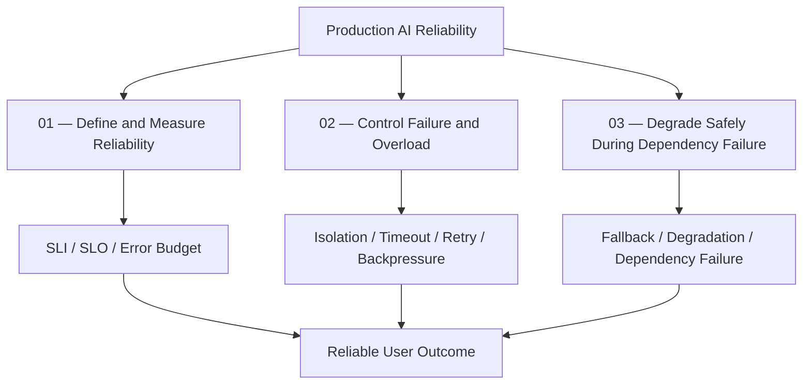
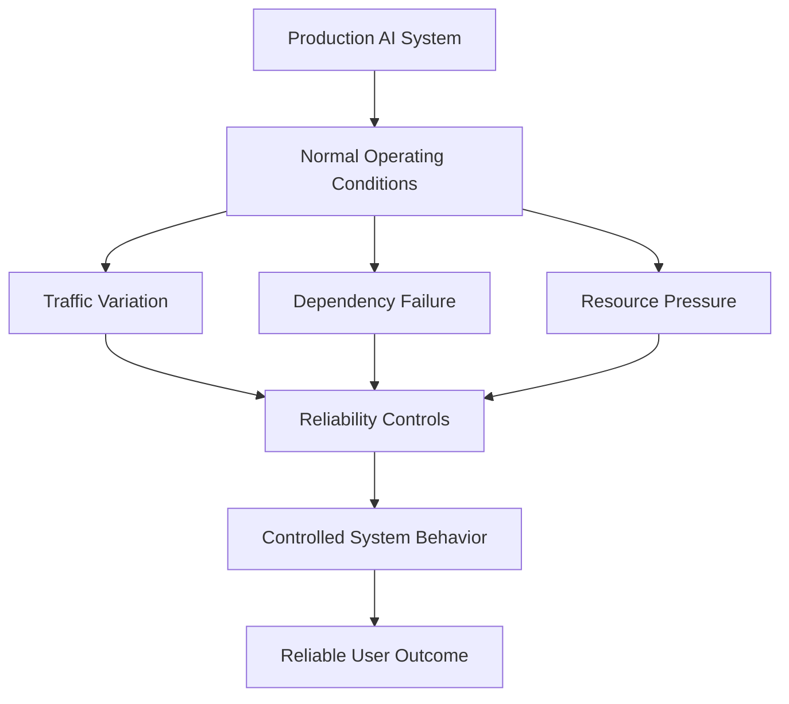

# PROD-06 — Production AI Reliability

Production AI systems operate under changing traffic, variable workloads, dependency failures, resource pressure, model-provider failures, and partial system failures.

**PROD-06 — Production AI Reliability** establishes how production AI systems should behave when these conditions occur.

The central engineering question is:

> **How do we keep a production AI system reliable when traffic, latency, dependencies, models, and infrastructure do not behave as expected?**

This chapter treats reliability as a **system property produced by engineering objectives, architecture, and interacting control mechanisms**.

Reliability does not mean that every request always succeeds. It means the system can provide acceptable and predictable behavior despite expected workload variation and failure.

---

## Chapter Scope

PROD-06 covers:

- Production AI reliability
- Reliability objectives
- Availability and reliability
- Service-level indicators (SLIs)
- Service-level objectives (SLOs)
- Error budgets
- Reliability measurement
- Production failure modes
- Partial failure
- Failure propagation
- Failure isolation
- Timeouts and deadline concepts
- Retry policies
- Exponential backoff and jitter
- Retry amplification and retry storms
- Circuit-breaking concepts
- Concurrency protection
- Backpressure
- Admission control
- Load shedding
- Dependency failure
- Graceful degradation
- Fallback strategies
- Degraded operating modes
- Dependency isolation
- Resilience patterns
- Recovery-oriented system behavior
- Reliability trade-offs
- Reliability architecture decisions

The chapter remains **architecture-first, framework-neutral, cloud-neutral, and vendor-neutral**.

Technology examples may be used to illustrate concepts, but implementation tutorials belong outside this chapter.

---

## Learning Path

PROD-06 contains exactly three lessons.

The files form a deliberate progression:

```text
Define and Measure Reliability
              │
              ▼
Control Failure and Overload
              │
              ▼
Degrade Safely During Dependency Failure
              │
              ▼
Protect the User-Visible Outcome
```

---

# Lesson 01 — AI Service Reliability, SLIs, SLOs and Error Budgets

**Lesson:**

AI Service Reliability SLIs SLOs and Error Budgets

### Primary Question

> **How do we define and measure whether a production AI service is reliable enough?**

This lesson establishes the reliability foundation.

### Related Chapters
- Reliability definition
- Availability
- Reliability vs availability
- User-visible reliability
- Service-level indicators
- SLI design
- Service-level objectives
- SLO boundaries
- Reliability targets
- Error budgets
- Error-budget consumption
- Reliability objectives
- AI-specific reliability considerations
- Latency SLIs
- Success/failure SLIs
- Freshness where applicable
- Correctness-related reliability boundaries
- Reliability measurement trade-offs

The file establishes how reliability becomes an engineering objective rather than a vague aspiration.

It also establishes the boundary between:

```text
System Reliability
        ≠
AI Quality
```

AI evaluation methodology is not the purpose of this lesson.

---

# Lesson 02 — Failure Isolation, Timeouts, Retries and Backpressure

**Lesson:**

Failure Isolation Timeouts Retries and Backpressure

### Primary Question

> **How do we prevent one failure or overloaded component from destabilizing the entire AI system?**

This lesson focuses on failure propagation, overload protection, and reliability controls.

### Related Chapters
**Failure isolation**

- Failure domains
- Blast radius
- Isolation boundaries
- Dependency isolation
- Bulkhead concepts
- Cascading-failure prevention

**Timeouts**

- Timeout boundaries
- Deadline propagation
- Connection, request, and dependency timeout concepts
- Timeout budgets
- Consequences of missing timeouts

**Retries**

- Transient vs persistent failure
- Retry safety
- Bounded retries
- Exponential backoff
- Jitter
- Retry amplification
- Retry storms
- Idempotency considerations

**Backpressure**

- Overload
- Queue pressure
- Producer/consumer imbalance
- Backpressure
- Admission control
- Load shedding
- Bounded queues
- Concurrency limits

The file teaches these mechanisms as **interacting reliability controls**, rather than unrelated patterns.

---

## Lesson 03 — Graceful Degradation, Fallbacks and Dependency Failure

**Lesson:**

Graceful Degradation Fallbacks and Dependency Failure

### Primary Question

> **What should the system do when a component or dependency cannot provide the normal service?**

This lesson focuses on controlled behavior during dependency failure and partial system failure.

### Related Chapters
- Dependency failure
- Partial failure
- Graceful degradation
- Degraded modes
- Fallback strategies
- Alternative providers or models where appropriate
- Reduced functionality
- Cached or stale-but-acceptable responses where appropriate
- Asynchronous deferral
- Dependency prioritization
- Critical vs non-critical dependencies
- Fail-open vs fail-closed decisions where relevant
- Recovery-oriented system behavior
- Reliability trade-offs during degraded operation

The file treats fallback as an architectural decision rather than simply:

> “If service A fails, call service B.”

It also addresses the reliability risks introduced by fallback paths themselves.

---

## Chapter Relationship

The three files answer different reliability questions:



The intended learning progression is:

```text
What does reliable mean?
        ↓
How do we measure it?
        ↓
What can make the system unreliable?
        ↓
How do we control failure propagation?
        ↓
What happens when normal service is impossible?
        ↓
How do we provide a controlled degraded outcome?
```

---

# Chapter-Level Mental Model

PROD-06 uses the following high-level model:



The detailed mechanisms represented by **reliability controls** are developed in Lessons 02 and 03.

The reliability objectives used to determine whether the outcome is acceptable are established in Lesson 01.

---

# AI-Specific Reliability Context

AI systems may introduce reliability considerations that differ from conventional services.

Depending on the workload, these may include:

- Variable model inference latency
- Streaming responses
- External model providers
- Provider rate limits
- Quota exhaustion
- Model-provider outages
- Model routing
- Long-running inference
- Token-dependent processing time
- Retrieval dependency failures
- Tool dependency failures
- GPU or accelerator resource exhaustion
- Queue buildup
- Large request-size variability
- Asynchronous AI workloads

These characteristics are **workload-dependent**.

The chapter should therefore teach engineers to identify which characteristics actually apply to their system rather than assuming that every AI application has the same reliability profile.

---

## Reliability and AI Quality

A production AI system can be:

```text
Highly available
but
produce poor AI answers.
```

A system can also be:

```text
High-quality AI behavior
but
be unreliable as a service.
```

Therefore:

```text
System Reliability
        ≠
AI Quality
text
PROD-05
What evidence tells us what the system is doing?

PROD-06
How should the system behave reliably under normal and failure conditions?
text
PROD-06
How do we prevent overload from becoming cascading failure?

PROD-07
Why is the system overloaded?
How much capacity is required?
How should capacity scale?
```

Backpressure, admission control, and load shedding may appear in both chapters, but their primary treatment differs:

```text
PROD-06 → Reliability under overload
PROD-07 → Capacity and scaling engineering
```

---

## PROD-08 — AI Performance, Optimization and Cost

PROD-06 may discuss latency, throughput limitations, and resource pressure when they affect reliability.

PROD-08 owns:

- Performance optimization
- Inference optimization
- Benchmarking
- Resource efficiency
- Performance-cost trade-offs

PROD-06 should not become a performance optimization chapter.

---

## PROD-09 — Production AI Security

PROD-06 owns operational reliability.

PROD-09 owns production security.

For example:

```text
PROD-06
What happens when a dependency becomes unavailable?

PROD-09
How do we protect that dependency and its credentials?
text
PROD-06
How should the system behave during failure?

PROD-10
How do operators detect, diagnose, coordinate,
mitigate, and recover from production incidents?
```

PROD-06 owns system reliability behavior and resilience mechanisms.

PROD-10 owns operational response.

---

## PROD-11 — AI Lifecycle, Evaluation and Continuous Improvement

PROD-06 owns production system reliability.

PROD-11 owns areas such as:

- AI lifecycle
- Production evaluation
- Regression
- Drift
- Quality signals
- Evaluation gates
- Continuous improvement

Reliability must not be confused with model-quality evaluation.

---

## AGT-11 — Agent Reliability and Safety

AGT-11 owns agent-specific reliability and safety behavior.

The distinction is:

```text
Agent-specific failure or unsafe action
        ↓
AGT-11

Production service or infrastructure failure
        ↓
PROD-06
```

An agent may run on a reliable production platform while still having agent-specific safety or reliability problems.

---

# Reliability Engineering Focus

The chapter is designed to develop the ability to reason about:

```text
Failure
   ↓
Impact
   ↓
Control
   ↓
System Behavior
   ↓
User-Visible Outcome
   ↓
Reliability Trade-off
```

The detailed reasoning frameworks and failure-control mechanisms are intentionally developed inside the lessons rather than duplicated here.

---

# Reliability Trade-offs

Reliability decisions involve trade-offs among:

- User experience
- Availability
- Functionality
- Latency
- Infrastructure cost
- Resource utilization
- Operational complexity
- Failure isolation
- Accepted traffic
- Recovery behavior

For example:

```text
Retries
    ↔
Additional load

Timeouts
    ↔
User-visible failure

Fallbacks
    ↔
Reduced functionality or quality

Redundancy
    ↔
Higher cost and complexity

Admission control
    ↔
Reduced accepted traffic
```

The lessons develop these trade-offs in the context of the reliability mechanisms they own.

---

# Prerequisites

Before studying PROD-06, the learner should have a working understanding of:

- Distributed systems fundamentals
- HTTP and API request-response behavior
- Application and service boundaries
- Basic concurrency concepts
- Queues and asynchronous processing
- Production deployment concepts
- Basic observability concepts
- AI inference and model-serving architecture

Earlier PROD chapters and related engineering domains provide the relevant foundations.

---

## How to Study This Chapter

Study the files in order:

```text
01 — Define and Measure Reliability
          ↓
02 — Control Failure and Overload
          ↓
03 — Degrade Safely During Dependency Failure
```

For each file, focus on four questions:

```text
1. What reliability problem is being addressed?

2. Why does that problem occur?

3. How does the proposed mechanism change system behavior?

4. What trade-offs or new failure modes does it introduce?
```

Do not memorize reliability patterns independently of the failure modes they address.

---

# Completion Criteria

After completing PROD-06, the learner should be able to:

- Define reliability for a production AI service.
- Distinguish reliability from availability.
- Design meaningful AI-service SLIs.
- Explain SLOs and error budgets.
- Identify AI-specific reliability concerns.
- Reason about partial and dependency failure.
- Identify failure propagation and blast radius.
- Design appropriate timeout boundaries.
- Determine when retries are safe.
- Explain retry amplification and retry storms.
- Reason about failure isolation and concurrency protection.
- Explain backpressure, admission control, and load shedding.
- Design graceful degradation strategies.
- Evaluate fallback strategies and their risks.
- Distinguish critical and non-critical dependencies.
- Reason about fallback failure.
- Analyze reliability trade-offs.
- Design interacting reliability controls.
- Distinguish reliability from observability, scaling, performance, security, operations, and AI evaluation.

Most importantly, the learner should be able to answer:

> **When something fails in a production AI system, what should happen next, why, and what are the consequences of that decision?**

---

# Chapter Objective

PROD-06 should develop an engineering mental model of reliability as:

> **Controlled system behavior under normal variation, overload, partial failure, and dependency failure.**

The chapter is not intended to maximize the number of reliability patterns documented.

Its purpose is to teach engineers how to:

- define meaningful reliability objectives,
- recognize failure modes,
- control blast radius,
- prevent cascading failure,
- protect systems under pressure,
- degrade deliberately when normal service is unavailable,
- and make explicit reliability trade-offs.

The final engineering question remains:

> **How do we design production AI systems that remain reliable when workloads, dependencies, and system components do not behave as expected?**
