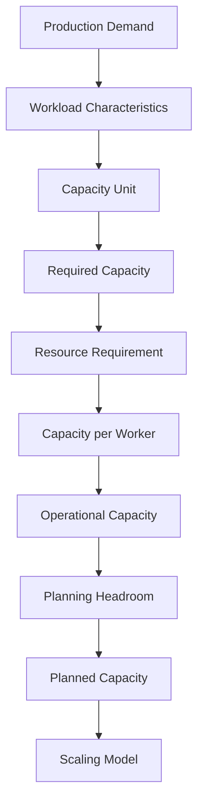

# AI Capacity Planning and Scaling Models

## Learning Objectives

By the end of this chapter, you should be able to:

- explain what capacity means for a production AI workload,
- distinguish capacity from scaling and performance optimization,
- characterize workload demand using meaningful capacity dimensions,
- reason about request rate, concurrency, request size, processing time, and throughput,
- identify the resource that actually limits workload capacity,
- define appropriate capacity units for different AI workloads,
- estimate required capacity using explicit assumptions,
- understand the difference between theoretical and operational capacity,
- reason about utilization, saturation, and headroom,
- size CPU, memory, GPU, accelerator, network, and storage resources at a planning level,
- distinguish horizontal scaling from vertical scaling,
- choose a scaling model based on workload characteristics,
- understand why capacity cannot be derived from a single metric or universal formula,
- account for workload variability, bursts, dependencies, and scaling delay,
- make capacity decisions that are defensible, measurable, and testable.

The primary engineering question is:

> **How do we estimate how much capacity a production AI workload requires and choose an appropriate scaling model?**

---

## Prerequisites

Before studying this chapter, you should be comfortable with:

- basic application architecture,
- CPU and memory concepts,
- processes and threads,
- HTTP/API request-response behavior,
- basic databases and network communication,
- basic AI inference concepts,
- basic understanding of model serving.

You should also understand that production systems are constrained by finite resources.

A useful prerequisite mental model is:

```text
Workload
   ↓
Application
   ↓
Resources
   ↓
Finite Capacity
```

PROD-07 builds on this model and extends it into demand characterization, resource sizing, and scaling decisions.

For serving architecture and inference mechanisms, refer to [PROD-03 — Production Inference and Model Serving](../PROD-03-Production-Inference-and-Model-Serving/README.md).

For observability concepts used as capacity inputs, refer to [PROD-05 — AI Observability and Telemetry](../PROD-05-AI-Observability-and-Telemetry/README.md).

---

## Estimated Reading Time

**30–40 minutes**

The chapter is intentionally engineering-oriented. Reading time alone is not sufficient for mastery; the capacity examples and decision framework should be worked through using realistic workload assumptions.

---

## Before We Start

A common first reaction to capacity problems is:

> “If traffic increases, add more servers.”

That statement is directionally correct but operationally incomplete.

Before adding capacity, an engineer must answer:

- What is increasing?
- How is demand measured?
- What does one worker actually handle?
- What resource is limiting the workload?
- At what operating point does the system stop behaving acceptably?
- How much demand is expected?
- How much demand is possible during a burst?
- How quickly can additional capacity become usable?
- What dependencies constrain the system?
- How much headroom is required?
- What evidence supports the capacity estimate?

Capacity engineering therefore starts with **understanding demand**, not infrastructure.

---

# Why This Exists

Production AI systems operate under changing workloads.

A system may experience:

- predictable business-hour traffic,
- periodic traffic peaks,
- sudden traffic spikes,
- variable prompt sizes,
- variable output lengths,
- long-running requests,
- streaming connections,
- batch workloads,
- asynchronous jobs,
- uneven resource consumption,
- dependency quotas,
- limited accelerator availability.

A capacity decision that works for one workload may fail for another.

Consider two systems:

```text
System A
100 requests/second
small inputs
short processing time
CPU-bound

System B
100 requests/second
large prompts
long generated outputs
GPU-bound
```

The request rate is identical.

The capacity requirement is not.

This is why:

> **Request rate alone is not a capacity model.**

Capacity planning translates workload behavior into resource requirements.

The engineering chain is:

```text
Demand
   ↓
Workload Characteristics
   ↓
Required Capacity
   ↓
Resource Requirement
   ↓
Headroom
   ↓
Scaling Strategy
```

---

# Mental Model

The core PROD-07 capacity model is:

```text
                    Production Demand
                          │
                          ▼
              Workload Characteristics
       ┌──────────────┬──────────────┬──────────────┐
       ▼              ▼              ▼
 Request Rate     Concurrency     Request Size
       │              │              │
       └──────────────┼──────────────┘
                      ▼
              Processing Behavior
                      │
                      ▼
                Capacity Unit
                      │
                      ▼
              Required Capacity
                      │
                      ▼
              Resource Requirements
       ┌──────────────┼──────────────┐
       ▼              ▼              ▼
      CPU           Memory           GPU
       │              │              │
       └──────────────┼──────────────┘
                      ▼
                Capacity Model
                      │
                      ▼
               Operational Capacity
                      │
                      ▼
                  Headroom
                      │
                      ▼
               Scaling Strategy
```

The central idea is:

> **Scaling should be driven by workload demand and resource constraints, not by arbitrary infrastructure growth.**

Capacity planning answers:

> **How much capacity do we need?**

Scaling answers:

> **How should available capacity change as demand changes?**

---

# Core Concepts

## 1. Capacity

Capacity is the amount of workload a system can handle within defined constraints.

The constraints matter.

A system might theoretically process more requests, but that does not mean that operating at that level is acceptable.

For example:

```text
Theoretical maximum:
150 requests/second

Operationally acceptable:
100 requests/second

Expected peak:
80 requests/second
```

The 150 requests/second figure is not necessarily the production capacity.

The operational capacity may be closer to 100 requests/second because beyond that point:

- latency becomes unstable,
- queues grow,
- CPU or GPU saturation occurs,
- memory pressure increases,
- downstream dependencies become constrained,
- or failure probability increases.

Therefore:

> **Capacity is not simply the maximum number the hardware can theoretically produce.**

It is the amount of workload the system can sustain within the constraints that matter.

---

## 2. Capacity vs Scaling

These concepts are related but different.

### Capacity

Capacity asks:

> How much workload can the system handle?

Examples:

- requests/second,
- concurrent requests,
- tokens/second,
- jobs/hour,
- documents/hour,
- concurrent streams,
- embedding vectors/second.

### Scaling

Scaling asks:

> How does available capacity change as demand changes?

Examples:

- add replicas,
- remove replicas,
- increase instance size,
- add GPU workers,
- increase worker count,
- allocate additional accelerator capacity.

The relationship is:

```text
Capacity Planning
        ↓
Determine Required Capacity
        ↓
Scaling Strategy
        ↓
Make Available Capacity Match Demand
```

A system cannot have a sensible scaling strategy if its required capacity has never been understood.

---

## 3. Demand and Workload Characterization

Demand is not simply “how many requests arrive.”

A useful workload characterization describes the properties that determine how much resource capacity the workload consumes.

A practical model is:

```text
Workload Characterization
=
Arrival Pattern
+ Request Size
+ Processing Time
+ Concurrency
+ Resource Profile
+ Variability
+ Burst Behavior
```

The exact dimensions depend on the workload.

For example:

### Synchronous AI API

```text
requests/second
request size
processing time
concurrency
CPU/GPU usage
burst pattern
```

### Streaming AI

```text
concurrent streams
stream duration
bandwidth
connection behavior
resource occupancy
```

### Batch AI

```text
job volume
processing window
parallelism
completion deadline
```

### Embedding Pipeline

```text
documents
tokens
batch size
throughput
storage requirements
```

### Long-Running Workflow

```text
concurrent executions
execution duration
worker occupancy
resource usage
```

This characterization should happen before selecting infrastructure.

---

## 4. Demand Profiles

Production demand should be described using more than one number.

Useful demand profiles include:

| Demand Profile | Meaning |
|---|---|
| Average demand | Typical workload over a representative period |
| Peak sustained demand | Highest workload expected to persist for a meaningful period |
| Burst demand | Short-duration sudden increase |
| Growth demand | Expected future workload increase |
| Recovery demand | Additional workload that may occur while catching up after delay or backlog |

These profiles answer different capacity questions.

For example:

```text
Average:
40 req/s

Peak sustained:
100 req/s

Burst:
300 req/s

Expected growth:
+50% over six months
```

A capacity model based only on the average would be inadequate.

### Sustained Capacity vs Burst Capacity

Sustained demand and burst demand should not automatically be treated as the same capacity requirement.

For example:

```text
Normal demand
     ↓
Peak sustained demand
     ↓
Short burst
```

A system may absorb a short burst using existing headroom, temporary additional capacity, or controlled queueing, while sustained demand may require permanently available capacity or a scaling strategy.

The important planning question is:

> **How will the system absorb the burst, and how quickly must additional capacity become usable?**

The detailed mechanics of autoscaling response, queue behavior, and load shedding are covered in File 02 and the relevant reliability chapters.

---

## 5. Request Rate

Request rate describes how frequently requests arrive.

```text
Request Rate = Requests / Time
```

For example:

```text
600 requests / minute
= 10 requests / second
```

Request rate is useful but insufficient by itself.

Two workloads can have the same request rate but dramatically different resource requirements.

```text
10 req/s × 100 ms processing
```

is fundamentally different from:

```text
10 req/s × 10 s processing
```

The second workload keeps resources occupied for much longer.

---

## 6. Concurrency

Concurrency describes how much work is simultaneously in progress.

For capacity planning, concurrency matters because active work occupies resources for some period of time.

For a stable workload, a useful first-order approximation is:

```text
Average Concurrency ≈ Arrival Rate × Average Time in System
```

For example:

```text
Arrival rate = 20 requests/second
Average processing time = 2 seconds

Approximate active work:
20 × 2 = 40
```

This is a planning approximation, not a universal instantaneous relationship.

Observed concurrency can differ because of:

- bursts,
- queueing,
- retries,
- variable processing times,
- resource contention,
- changes in workload behavior.

The important planning distinction is:

```text
Request Rate
= How quickly work arrives

Concurrency
= How much work is simultaneously in progress
```

Detailed concurrency limits, contention behavior, queue interactions, and concurrency-based scaling are covered in [02 — Autoscaling, Capacity, Concurrency, Queues, and GPU Resources](./02-Autoscaling-Capacity-Concurrency-Queues-and-GPU-Resources.md).

---

## 7. Request Size

AI requests can vary significantly in size.

For an LLM workload, request size may include:

- system instructions,
- user prompt,
- conversation history,
- retrieved context,
- tool results,
- multimodal content.

A request containing 500 tokens and a request containing 50,000 tokens are not equivalent workloads.

Request size can affect:

- memory consumption,
- preprocessing time,
- network transfer,
- model execution,
- context handling,
- processing duration.

Therefore:

> **Capacity planning should model workload size, not just request count.**

---

## 8. Processing Time

Processing time describes how long resources remain occupied while handling work.

For AI systems, processing time can vary because of:

- input size,
- output length,
- model architecture,
- hardware,
- batching behavior,
- retrieval work,
- external service calls,
- tool execution,
- multimodal processing.

This variability matters because capacity is often constrained by **resource occupancy**, not merely request arrival.

A workload with highly variable processing time can require more planning margin than a workload with predictable processing time even when average request rate is identical.

---

## 9. Throughput

Throughput describes how much work a system can complete per unit time.

Examples:

```text
requests / second
tokens / second
documents / second
jobs / hour
vectors / second
```

Throughput is one possible capacity dimension.

However, not every workload should be modeled primarily through throughput.

For example:

- streaming workloads may be constrained by concurrent active streams,
- long-running workflows may be constrained by concurrent executions,
- batch workloads may be constrained by completion windows,
- interactive inference may be constrained by latency and resource occupancy.

Therefore:

> **Throughput is a capacity measure, not a universal capacity model.**

---

# Capacity Units

A capacity model becomes easier to reason about when capacity is expressed in an appropriate unit.

Examples:

| Workload | Useful Capacity Units |
|---|---|
| Synchronous API | Requests/second, concurrent requests |
| LLM inference | Requests/second, input tokens/second, output tokens/second, concurrent generations |
| Streaming AI | Concurrent streams, bandwidth, active connections |
| Embeddings | Documents/second, tokens/second, vectors/second |
| Batch processing | Jobs/hour, records/hour, completion window |
| Long-running workflows | Concurrent executions, executions/hour, worker occupancy |

The correct unit depends on what actually consumes resources.

### Example

Suppose an embedding system processes:

```text
10 documents/second
```

That number is useful only if document size is reasonably consistent.

If one document contains 100 tokens and another contains 100,000 tokens, document rate alone is misleading.

A better model might be:

```text
documents/second
+
tokens/second
```

Capacity should be expressed using units that correlate with resource consumption.

---

# Capacity Modeling

A simplified capacity model can be represented as:

```text
Incoming Demand
       ↓
Workload Characteristics
       ↓
Capacity Unit
       ↓
Required Capacity
       ↓
Resource Requirement
       ↓
Capacity per Worker
       ↓
Operational Capacity
       ↓
Planning Headroom
       ↓
Planned Capacity
       ↓
Scaling Model
```

A simplified estimate is:

```text
Required Capacity ≈ Peak Demand / Capacity per Worker
```

This estimates a **baseline capacity requirement** under the stated workload assumptions.

It does not by itself determine production capacity because the final decision must still account for:

- acceptable operating point,
- workload variability,
- concurrency,
- queueing,
- burst behavior,
- failure margin,
- scaling delay,
- resource contention,
- dependency capacity.

For example:

```text
Peak demand = 100 requests/second

One worker:
25 requests/second

Baseline workers:
100 / 25 = 4
```

Four workers are therefore a baseline estimate, not automatically the final production capacity.

---

# Capacity Planning Assumptions

Every capacity model contains assumptions.

Examples:

```text
Peak request rate = 200 req/s
Average input = 2,000 tokens
Average output = 500 tokens
Average processing time = 1.5 s
Worker capacity = 20 req/s
Dependency capacity = 250 req/s
```

These assumptions must be visible.

A capacity estimate without assumptions is difficult to review and difficult to maintain.

A useful capacity document should answer:

- Where did the demand number come from?
- Is it average, peak, or burst demand?
- How variable is request size?
- How was per-worker capacity measured?
- What operating point was considered acceptable?
- What dependencies were included?
- What planning margin was considered?
- How quickly can additional capacity become available?

---

# AI-Specific Capacity Considerations

AI workloads introduce additional capacity dimensions.

## Variable Input and Output

LLM workloads may have variable:

- prompt length,
- retrieved context,
- conversation history,
- generated output length.

A request with a large context and long generation can occupy resources significantly longer than a short request.

Therefore:

```text
Requests/s
```

may need to be combined with:

```text
Tokens/s
Concurrency
Processing Time
```

---

## Token Generation Rate

For generative models, output generation is often incremental.

The workload may therefore be influenced by:

- generation rate,
- number of active generations,
- output length,
- model size,
- hardware capability.

For capacity planning, the important question is not merely:

> How many requests arrive?

It is:

> How much model work is being generated by those requests?

Detailed inference concurrency and accelerator-resource behavior are covered in File 02.

---

## Model Size

Model size can influence:

- memory requirements,
- loading time,
- accelerator selection,
- number of models that fit on a device,
- capacity per worker.

A larger model may require fewer or more workers depending on workload characteristics and hardware, so model size alone is not a capacity formula.

---

## GPU Memory vs GPU Compute

GPU capacity has multiple relevant dimensions, including:

```text
GPU Memory
+
GPU Compute
```

A model may fit into GPU memory while compute capacity remains insufficient.

Conversely, compute utilization may be moderate while memory limits prevent additional work.

Therefore:

> **GPU utilization alone does not define GPU capacity.**

For File 01, the important planning question is simply whether GPU memory, GPU compute, or another resource is likely to constrain capacity.

Detailed GPU capacity, allocation, scheduling, multi-GPU behavior, fragmentation, warm/cold GPU capacity, and other accelerator-management concerns belong in [02 — Autoscaling, Capacity, Concurrency, Queues, and GPU Resources](./02-Autoscaling-Capacity-Concurrency-Queues-and-GPU-Resources.md).

---

## Model Loading and Warm Capacity

AI models can require significant time and resources to load.

This matters to capacity planning because:

```text
Requested Capacity
      ↓
Infrastructure Provisioned
      ↓
Model Loaded
      ↓
Worker Ready
      ↓
Traffic Can Be Served
```

Provisioned resources are not necessarily immediately usable resources.

For File 01, the important capacity-planning implication is:

> **Available infrastructure and usable serving capacity are not always the same thing.**

Detailed warm/cold capacity behavior and scaling delays are covered in File 02.

---

## CPU/GPU Imbalance

An AI workload can be GPU-heavy without being entirely GPU-bound.

For example:

```text
Request
   ↓
API handling
   ↓
Tokenization
   ↓
Retrieval
   ↓
Model inference
   ↓
Post-processing
```

The model may consume GPU resources while another stage consumes CPU, memory, network, or storage.

Scaling only the GPU workers may therefore fail to increase end-to-end capacity.

The correct question remains:

> **Which resource or stage limits the useful capacity of the workload?**

---

# Resource Sizing

Capacity planning must translate workload requirements into resource requirements.

## CPU Capacity

CPU capacity may be consumed by:

- request handling,
- tokenization,
- preprocessing,
- post-processing,
- retrieval,
- orchestration,
- serialization,
- networking,
- embedding computation,
- supporting services.

CPU capacity is therefore not limited to traditional web request handling.

---

## Memory Capacity

Memory may be consumed by:

- application processes,
- model weights,
- intermediate tensors,
- request context,
- retrieved documents,
- caches,
- concurrent requests,
- runtime overhead.

For AI systems, concurrency can increase memory requirements even when CPU utilization remains relatively stable.

---

## GPU Capacity

At the planning level, GPU requirements may depend on:

- model size,
- model architecture,
- batch size,
- request characteristics,
- workload concurrency,
- input and output volume,
- memory requirements,
- compute requirements.

A useful planning model is:

```text
Workload Demand
      ↓
Model Work
      ↓
GPU Compute / Memory Requirement
      ↓
Capacity per GPU Worker
      ↓
Required GPU Capacity
```

The key point is:

```text
GPU utilization
≠
Complete GPU capacity model
```

The actual limiting resource must be identified.

Detailed GPU resource engineering is covered in File 02.

---

## Network Capacity

Network capacity can matter when the workload includes:

- large prompts,
- multimodal inputs,
- large retrieved contexts,
- streaming responses,
- model downloads,
- large embedding payloads,
- high-volume service-to-service communication.

For streaming AI systems, bandwidth and connection capacity may become more important than request rate.

---

## Storage Capacity

Storage capacity may matter for:

- model artifacts,
- temporary data,
- document processing,
- embedding pipelines,
- checkpoints,
- batch datasets,
- cached content.

Storage can constrain throughput even when compute resources remain available.

---

# Identifying the Bottleneck

A capacity model must identify the limiting resource.

Consider:

```text
Application
    │
    ├── CPU
    ├── Memory
    ├── GPU
    ├── Network
    ├── Storage
    └── Dependencies
```

The bottleneck may change as workload conditions change.

For example:

```text
Small workload
    ↓
CPU is limiting

Large prompt workload
    ↓
Memory becomes limiting

High generation workload
    ↓
GPU compute becomes limiting

High dependency demand
    ↓
Dependency becomes limiting
```

Therefore:

> **Capacity is workload-dependent.**

A resource that is not limiting at one workload level may become limiting later.

---

# Horizontal and Vertical Scaling

## Horizontal Scaling

Horizontal scaling increases the number of workers or instances.

```text
1 Worker
   ↓
2 Workers
   ↓
4 Workers
   ↓
8 Workers
```

Each worker contributes additional capacity.

### Advantages

- distributes workload,
- can provide fault isolation,
- often supports incremental capacity growth,
- can match stateless request-processing architectures,
- can provide more flexible capacity changes.

### Limitations

- additional coordination may be required,
- dependencies must also support increased load,
- each replica may carry fixed overhead,
- stateful workloads can be harder to scale,
- GPU workloads may face allocation constraints,
- capacity does not necessarily increase linearly.

---

## Vertical Scaling

Vertical scaling increases the resources available to a worker.

For example:

```text
Instance A
4 CPU
16 GB memory

        ↓

Instance B
8 CPU
32 GB memory
```

For GPU workloads, this may involve moving to a more capable accelerator configuration.

### Advantages

- can simplify some architectures,
- may increase per-worker capacity,
- can be useful for workloads that cannot easily distribute work across workers,
- can increase available memory or compute per worker.

### Limitations

- larger instances may be more expensive,
- scaling granularity may be coarse,
- there are physical resource limits,
- larger instances can increase replacement or startup costs,
- some workloads do not scale efficiently with additional resources.

---

# Scale-Up vs Scale-Out

The terms are often used interchangeably with vertical and horizontal scaling.

```text
Scale Up
= Increase resources per worker

Scale Out
= Increase number of workers
```

The correct choice depends on workload characteristics.

### Example

Suppose a model requires:

```text
40 GB GPU memory
```

and a worker has:

```text
24 GB GPU memory
```

Adding more 24 GB workers does not automatically allow that model to fit into one worker.

The constraint is per-worker memory.

A larger accelerator or a different execution strategy may therefore be required.

This illustrates an important principle:

> **Horizontal scaling cannot solve every resource constraint.**

---

# Workload-Dependent Scaling

There is no universally correct scaling model.

## Synchronous AI API

Important dimensions:

- request rate,
- latency,
- concurrency,
- CPU/GPU capacity,
- burst demand.

A horizontally scalable worker pool may be appropriate when requests can be distributed independently.

---

## Streaming AI

Important dimensions:

- concurrent streams,
- connection capacity,
- bandwidth,
- stream duration,
- resource occupancy.

A system receiving fewer requests per second may still require substantial capacity if each request remains active for a long time.

---

## Batch AI

Important dimensions:

- job volume,
- processing window,
- throughput,
- parallelism,
- completion deadline.

The capacity question becomes:

> Can the available workers complete the workload within the required window?

---

## Embedding Pipeline

Important dimensions:

- document volume,
- document size,
- batch size,
- throughput,
- CPU/accelerator capacity,
- storage throughput.

A document-count-only model may be misleading when document sizes vary widely.

---

## Long-Running Agent or Workflow

Important dimensions:

- concurrent executions,
- execution duration,
- worker occupancy,
- queue depth,
- resource usage per execution.

A workload with 100 active workflows may require more capacity than a workload with 1,000 short-lived requests depending on execution duration and resource consumption.

Detailed queue and concurrency-management behavior is covered in File 02.

---

## Capacity Headroom

A production system should not be planned around its absolute theoretical maximum.

A more precise planning model is:

```text
Demand Profile
      +
Operational Capacity per Worker
      +
Known Constraints
      ↓
Baseline Capacity Requirement
      ↓
Planning Headroom
      ↓
Planned Capacity
```

### Why headroom exists

Demand is uncertain.

Other uncertainties include:

- traffic bursts,
- request-size variability,
- processing-time variability,
- resource contention,
- failures,
- dependency constraints,
- noisy neighbors,
- provisioning delays,
- workload growth.

Headroom provides room for these uncertainties.

### Do not use a universal percentage

There is no single headroom percentage that is correct for every production system.

A system with:

- highly predictable traffic,
- fast scaling,
- short startup time,

may require a different approach from a system with:

- unpredictable bursts,
- slow accelerator provisioning,
- expensive model loading,
- strict latency requirements.

Headroom is therefore an engineering decision, not a fixed constant.

---

# Dependency Capacity

Application capacity does not exist in isolation.

Consider:

```text
Application
     ↓
Retriever
     ↓
Database
     ↓
Model Provider
```

If the application can process:

```text
500 requests/s
```

but the database can safely support only:

```text
200 requests/s
```

then increasing application replicas does not create 500 requests/s of useful end-to-end capacity.

The usable system capacity is constrained by the relevant dependency.

Possible constraints include:

- database connection limits,
- database throughput,
- provider quotas,
- API rate limits,
- retrieval throughput,
- queue capacity,
- downstream service saturation.

This leads to an important principle:

> **Scaling one component does not automatically scale the entire system.**

Dependency failure behavior belongs to PROD-06; this chapter focuses on dependency capacity constraints.

See [PROD-06 — Production AI Reliability](../PROD-06-Production-AI-Reliability/README.md) for reliability behavior around dependency failures.

---

# Capacity Planning for Different Workload Types

| Workload | Demand Model | Primary Capacity Concerns |
|---|---|---|
| Synchronous AI API | Requests/s + concurrency | CPU/GPU, processing time, latency, bursts |
| Streaming AI | Concurrent streams + bandwidth | Long-lived resources, connections, bandwidth |
| Batch AI | Jobs + completion window | Throughput, parallelism, deadlines |
| Embedding Pipeline | Documents/tokens + throughput | CPU/accelerator, batch size, storage |
| Long-Running Agent/Workflow | Concurrent executions | Worker occupancy, execution duration, queue pressure |

The purpose of this classification is not to create separate scaling architectures.

It is to prevent engineers from applying the same capacity model to fundamentally different workloads.

---

## Capacity Trade-offs

Capacity engineering is a constrained engineering decision involving demand, resources, risk, and cost.

Several recurring trade-offs exist.

| Decision | Benefit | Cost / Risk |
|---|---|---|
| More capacity | More demand absorption | Higher infrastructure cost |
| Higher utilization | Better resource efficiency | Less headroom |
| More concurrency | Potentially higher throughput | More contention |
| More replicas | More distributed capacity | More overhead |
| Scale-to-zero | Lower idle cost | Cold-start latency |
| Warm capacity | Faster response to demand | Idle resource cost |
| Aggressive scaling | Faster demand response | Potential instability/cost |
| Conservative scaling | Lower scaling churn | Risk of under-capacity |
| Larger instances | More per-worker capacity | Higher unit cost and coarser scaling |
| More workers | Incremental capacity | Coordination and dependency load |

A good capacity decision explicitly states which trade-off is being accepted.

Detailed autoscaling trade-offs are covered in File 02.

---

## Internal Working: From Demand to Capacity

The capacity planning process can be represented as:



Each stage answers a different question.

### 1. Production Demand

What workload is expected?

```text
100 req/s
20 concurrent streams
1 million documents/day
```

### 2. Workload Characteristics

What does each unit of work look like?

```text
2,000 input tokens
500 output tokens
1.5 s processing time
```

### 3. Capacity Unit

What measurement best represents resource consumption?

```text
requests/s
tokens/s
concurrent executions
```

### 4. Required Capacity

How much capacity must be available to handle the relevant demand profile?

### 5. Resource Requirement

Which resources are required?

```text
CPU
Memory
GPU
Network
Storage
Dependencies
```

### 6. Capacity per Worker

How much useful workload can one worker handle?

This should ideally come from measurement or credible production evidence rather than assumption.

### 7. Operational Capacity

What portion of theoretical capacity is acceptable under production constraints?

### 8. Planning Headroom

How much additional capacity is justified by uncertainty and risk?

### 9. Planned Capacity

What capacity should be provisioned or made available?

### 10. Scaling Model

How should capacity change as demand changes?

---

# Example: Capacity Estimate for an AI API

Consider a hypothetical synchronous AI API.

Assume:

```text
Expected peak demand = 120 requests/s

Measured capacity per worker = 20 requests/s

Operational capacity target = 20 requests/s per worker
```

A simplified estimate is:

```text
Baseline workers
≈ 120 / 20
≈ 6 workers
```

This is only the starting estimate.

Suppose the engineer expects:

- burst traffic,
- request-size variability,
- worker failures,
- dependency limits,
- provisioning delay.

The production decision may therefore require capacity beyond six workers.

The reasoning should look like:

```text
120 req/s peak
      ↓
20 req/s operational worker capacity
      ↓
6 workers baseline
      ↓
Evaluate uncertainty and failure margin
      ↓
Add appropriate planning headroom
      ↓
Define planned capacity
```

The important engineering artifact is not the number six.

It is the chain of assumptions that produced the number.

---

# Example: Why Request Rate Alone Fails

Consider two AI workloads.

### Workload A

```text
50 requests/s
500 input tokens
200 output tokens
short processing time
```

### Workload B

```text
50 requests/s
10,000 input tokens
2,000 output tokens
long processing time
```

The request rate is identical.

But Workload B may consume significantly more:

- memory,
- compute,
- accelerator time,
- network bandwidth,
- resource occupancy.

Therefore:

```text
Request Rate
     ≠
Complete Capacity Model
```

A better model includes workload characteristics that correlate with resource consumption.

---

# Example: Dependency Capacity

Suppose:

```text
Application worker capacity = 50 req/s
Database capacity = 200 req/s
```

With four workers:

```text
Application capacity = 4 × 50
                     = 200 req/s
```

Adding more workers may not increase useful system capacity if the database remains limited to 200 requests/s.

For example:

```text
8 workers
→ 400 req/s theoretical application capacity

Database
→ 200 req/s
```

The application is now capable of generating demand that its dependency cannot absorb.

This is why capacity planning must include relevant dependencies.

---

# Example: Vertical Scaling vs Horizontal Scaling

Suppose an AI model requires:

```text
30 GB GPU memory
```

and a worker has:

```text
16 GB GPU memory
```

Adding more 16 GB workers does not make the model fit into one worker.

The constraint is:

```text
Per-worker memory
```

A larger accelerator or a different execution strategy may therefore be required.

By contrast, if the model fits comfortably on each worker and requests can be distributed independently, horizontal scaling may provide a better capacity model.

The decision depends on the workload architecture.

---

# Production Perspective

A production capacity plan should not be a single number.

It should be a documented model.

A useful capacity record might contain:

| Dimension | Example |
|---|---|
| Workload | Synchronous LLM API |
| Expected demand | 60 req/s |
| Peak demand | 120 req/s |
| Burst behavior | 120 → 300 req/s |
| Input size | 2k tokens average |
| Output size | 500 tokens average |
| Processing time | 1.5 s average |
| Capacity unit | Requests/s + token rate |
| Worker capacity | 20 req/s operational |
| Limiting resource | GPU compute |
| Dependency constraint | Provider quota |
| Headroom rationale | Burst + failure margin |
| Scaling model | Horizontal workers |
| Provisioning delay | Measured during validation |
| Evidence source | Capacity/load testing |

The exact values will differ by system.

The structure is what matters.

---

## Production Capacity Is a Model, Not a Permanent Truth

Capacity changes over time.

The model may become invalid when:

- traffic grows,
- request sizes change,
- model versions change,
- hardware changes,
- retrieval volume increases,
- dependencies change,
- concurrency patterns change,
- business behavior changes.

Therefore:

```text
Capacity Model
      ↓
Production Evidence
      ↓
Compare Assumptions vs Reality
      ↓
Update Model
      ↓
Revalidate
```

Capacity engineering is continuous.

A capacity estimate should therefore be treated as a versioned engineering assumption that can be revisited.

---

# Engineering Decisions and Trade-offs

## Decision 1: What Should Be the Capacity Unit?

Ask:

- What actually consumes resources?
- Is request count sufficient?
- Does input size vary?
- Does output size vary?
- Is concurrency more important than request rate?
- Is this a batch or streaming workload?

### Good reasoning

> “Requests per second is useful, but because request size varies significantly, we will also track token throughput and concurrency.”

### Weak reasoning

> “The API gets 100 requests per second, so capacity is 100 requests per second.”

---

## Decision 2: Which Resource Should Determine Capacity?

Do not assume CPU.

Ask:

```text
CPU?
Memory?
GPU compute?
GPU memory?
Network?
Storage?
Dependency?
```

The bottleneck should be supported by workload evidence.

---

## Decision 3: Horizontal or Vertical Scaling?

Choose based on:

- workload distribution,
- per-worker resource requirements,
- statefulness,
- model memory requirements,
- hardware availability,
- dependency behavior,
- scaling granularity,
- operational complexity.

Do not select horizontal scaling merely because it is a common cloud pattern.

---

## Decision 4: How Much Headroom?

Ask:

- How predictable is demand?
- How large are bursts?
- How quickly can capacity be added?
- How long does model loading take?
- What failure margin is required?
- How constrained are dependencies?
- What is the consequence of temporary under-capacity?

Do not use a universal percentage without workload evidence.

---

## Decision 5: What Is the Scaling Boundary?

An application may scale independently from:

- databases,
- retrievers,
- model providers,
- queues,
- GPUs,
- storage,
- network infrastructure.

The scaling boundary must therefore be explicitly understood.

---

# Common Mistakes and Misconceptions

## Mistake 1 — “Capacity Equals CPU Utilization”

CPU utilization is only one signal.

A workload may be constrained by:

- memory,
- GPU,
- network,
- storage,
- dependency limits,
- concurrency,
- queueing.

---

## Mistake 2 — “100% Utilization Is the Goal”

Maximum utilization may leave no room for:

- bursts,
- variability,
- failures,
- scaling delay.

The goal is not maximum utilization.

The goal is acceptable workload behavior with appropriate efficiency and headroom.

---

## Mistake 3 — “More Replicas Always Increase Capacity”

Not necessarily.

Capacity may be limited by:

```text
Database
Provider quota
Network
GPU allocation
Memory
Per-worker constraints
```

Adding replicas may increase application-side capacity while leaving end-to-end capacity unchanged.

---

## Mistake 4 — “Request Rate Is Enough”

Request rate ignores:

- request size,
- processing time,
- concurrency,
- token volume,
- streaming duration.

---

## Mistake 5 — “GPU Utilization Defines GPU Capacity”

GPU compute utilization does not necessarily tell you:

- whether GPU memory is exhausted,
- whether allocation is constrained,
- whether another stage is limiting useful capacity.

Detailed GPU resource analysis belongs in File 02.

---

## Mistake 6 — “Theoretical Capacity Is Production Capacity”

A benchmark maximum is not automatically a safe operating point.

Production capacity must account for operational constraints.

---

## Mistake 7 — “Headroom Means Pick 20%”

There is no universal headroom percentage.

Headroom should follow:

- workload variability,
- burst behavior,
- scaling delay,
- failure assumptions,
- dependency constraints,
- business consequences.

---

## Mistake 8 — “Scaling Solves Performance Problems”

Scaling and performance optimization are different.

If one worker is inefficient, adding more inefficient workers may increase cost without solving the underlying performance problem.

PROD-08 owns performance optimization and cost engineering.

See [PROD-08 — AI Performance, Optimization and Cost](../PROD-08-AI-Performance-Optimization-and-Cost/README.md).

---

## Mistake 9 — “Capacity Is a Fixed Number”

Capacity changes as:

- workload changes,
- models change,
- hardware changes,
- dependencies change,
- traffic patterns change.

A capacity model must therefore be revisited.

---

# Capacity Decision Framework

Use the following sequence when designing capacity.

```text
1. What workload are we serving?
        ↓
2. What demand is expected?
        ↓
3. What is the peak demand?
        ↓
4. What does the burst pattern look like?
        ↓
5. What is the appropriate capacity unit?
        ↓
6. Which resource is the bottleneck?
        ↓
7. What capacity does one worker provide?
        ↓
8. What is the operational capacity?
        ↓
9. How much headroom is justified?
        ↓
10. What dependencies constrain capacity?
        ↓
11. Should we scale up or scale out?
        ↓
12. How will capacity change as demand changes?
        ↓
13. What assumptions must be validated?
        ↓
14. What evidence will prove the model?
```

This framework is intentionally separate from the autoscaling control loop covered in File 02.

---

# Capacity vs Performance vs Reliability

These concepts frequently overlap, but they are not identical.

## Capacity

> How much workload can the system handle?

## Performance

> How efficiently and quickly can the system process the workload?

## Reliability

> How consistently does the system meet its required behavior under expected and unexpected conditions?

A simple distinction is:

```text
Capacity
   ↓
How much?

Performance
   ↓
How efficiently / how quickly?

Reliability
   ↓
How consistently and safely?
```

A capacity problem may be caused by poor performance.

A performance improvement may reduce required capacity.

A reliability mechanism may constrain capacity intentionally.

But these are different engineering responsibilities.

PROD-07 focuses on capacity and scaling implications.

---

# Relationship to Autoscaling

Capacity planning comes before autoscaling.

```text
Capacity Planning
      ↓
Understand required capacity
      ↓
Understand capacity per worker
      ↓
Understand workload variation
      ↓
Choose scaling model
      ↓
Define scaling signals
      ↓
Autoscaling
```

Autoscaling is therefore not the capacity model itself.

An autoscaler can only react to the rules and signals it has been given.

If the underlying capacity model is wrong, automation can simply automate the wrong decision.

Detailed autoscaling control loops, target selection, scaling delays, queue-based scaling, and GPU scaling belong in [02 — Autoscaling, Capacity, Concurrency, Queues, and GPU Resources](./02-Autoscaling-Capacity-Concurrency-Queues-and-GPU-Resources.md).

---

# Engineering Example: Building a Capacity Model

Imagine a production AI API with:

```text
Expected peak:
200 requests/s

Average processing time:
2 seconds

Average input:
2,000 tokens

Average output:
500 tokens

Measured operational worker capacity:
25 requests/s
```

Start with request-based capacity:

```text
Required workers
≈ 200 / 25
≈ 8 workers
```

Now challenge the estimate.

### Question 1: Is 25 requests/s a theoretical or operational number?

If it was measured under acceptable latency and resource conditions, it is more useful than a raw benchmark maximum.

### Question 2: Is 200 requests/s the true peak?

If traffic can burst to 400 requests/s, the model must account for that burst behavior.

### Question 3: Does request size vary?

If some requests are much larger than average, request rate alone may understate capacity requirements.

### Question 4: Are dependencies capable of handling the resulting load?

If the database or model provider has a lower capacity limit, the application cannot simply scale independently.

### Question 5: How quickly can new workers become usable?

If workers take significant time to initialize and load the model, the system may need warm capacity.

The final decision is therefore not:

> “We need eight workers.”

It is:

> “Under these workload assumptions, eight workers provide the baseline operational capacity. Additional planned capacity and scaling behavior must account for burst demand, variability, dependency constraints, worker readiness time, and failure margin.”

That is capacity engineering.

---

# Interview Questions with Expected Answers

## 1. What is the difference between capacity planning and autoscaling?

**Expected answer:**

Capacity planning determines how much capacity the workload requires and what resources provide that capacity. Autoscaling dynamically changes available capacity as demand changes. Autoscaling depends on a sound capacity model.

---

## 2. How would you estimate capacity for an AI inference API?

**Expected answer:**

First characterize demand using request rate, request size, processing time, and relevant concurrency or workload dimensions. Then identify the limiting resource, measure operational capacity per worker, estimate required capacity, account for headroom and dependencies, and validate the assumptions under representative workloads.

---

## 3. Why is request rate alone insufficient for AI capacity planning?

**Expected answer:**

Requests can vary significantly in input size, output length, processing time, and resource consumption. Two workloads with the same request rate can require very different CPU, memory, GPU, network, or concurrency capacity.

---

## 4. What is the relationship between concurrency and throughput?

**Expected answer:**

Concurrency describes how much work is simultaneously in progress, while throughput describes how much work completes per unit time. They are related, but increasing concurrency does not automatically increase throughput because resource constraints can become limiting.

Detailed concurrency behavior is covered in File 02.

---

## 5. How would you identify the true bottleneck in an AI system?

**Expected answer:**

Examine workload behavior and resource constraints across the complete path: CPU, memory, GPU compute, GPU memory, network, storage, and dependencies. The bottleneck should be identified from evidence showing which constraint limits useful capacity or acceptable workload behavior.

---

## 6. Why might CPU utilization be a poor capacity signal for a GPU workload?

**Expected answer:**

The application may be GPU-bound while CPU utilization remains moderate. CPU utilization therefore may not represent the resource limiting inference capacity.

---

## 7. What is the difference between horizontal and vertical scaling?

**Expected answer:**

Horizontal scaling adds or removes workers, while vertical scaling increases or decreases resources available to an individual worker.

---

## 8. When might horizontal scaling fail to solve a capacity problem?

**Expected answer:**

When the bottleneck is per-worker, such as insufficient GPU memory for a model, or when a shared dependency such as a database or provider quota limits total useful capacity.

---

## 9. Why is headroom necessary?

**Expected answer:**

Because production demand and resource behavior are variable. Headroom provides room for bursts, uncertainty, failures, scaling delay, contention, and dependency constraints.

---

## 10. How would you design capacity for streaming AI requests?

**Expected answer:**

Model concurrent streams, stream duration, bandwidth, connection capacity, and per-stream resource occupancy rather than relying only on requests per second.

---

## 11. How can a dependency constrain application capacity?

**Expected answer:**

If the application can process more work than a dependency can safely handle, scaling the application further does not increase useful end-to-end capacity. The dependency becomes the limiting constraint.

---

## 12. What is the difference between theoretical and operational capacity?

**Expected answer:**

Theoretical capacity is the maximum that may be achievable under benchmark or resource conditions. Operational capacity is the amount that can be sustained while remaining within required workload constraints such as latency, resource utilization, and dependency limits.

---

## 13. How would you determine whether an AI system is under-capacity or simply inefficient?

**Expected answer:**

First determine whether the workload is resource-constrained relative to its demand. Then examine whether the resource consumption and throughput are appropriate for the workload. If a worker performs poorly because of inefficient execution, adding capacity may hide rather than solve the underlying performance problem.

---

## 14. Why can a capacity model become invalid over time?

**Expected answer:**

Traffic patterns, request sizes, model versions, hardware, dependencies, concurrency, and workload behavior can change. Capacity planning therefore requires periodic validation and model updates.

---

## Quick Revision

### Capacity

> How much workload can the system handle within defined constraints?

### Scaling

> How does available capacity change as demand changes?

### Workload Characterization

> What properties of incoming and active work determine resource consumption?

### Request Rate

> How quickly does work arrive?

### Concurrency

> How much work is simultaneously in progress?

### Throughput

> How much work is completed per unit time?

### Processing Time

> How long does each unit of work occupy resources?

### Utilization

> How much of a resource is being used?

### Saturation

> When does additional demand stop being absorbed effectively?

### Capacity Unit

> What measurement best represents the workload's resource consumption?

### Operational Capacity

> How much workload can be sustained while meeting required constraints?

### Headroom

> How much additional capacity is justified by uncertainty and risk?

### Horizontal Scaling

> Add workers.

### Vertical Scaling

> Increase resources per worker.

### Bottleneck

> The constraint limiting useful system capacity.

---

## Key Takeaways

1. **Capacity is not the same as infrastructure size.**

2. **Capacity describes how much workload can be handled within defined constraints.**

3. **Scaling describes how available capacity changes as demand changes.**

4. **Workload characterization must go beyond request count.**

5. **Request rate alone is rarely sufficient for AI capacity planning.**

6. **Concurrency matters because active work occupies resources for some period of time.**

7. **Request size and processing time can materially change capacity requirements.**

8. **Capacity should be expressed using workload units that correlate with resource consumption.**

9. **The limiting resource may be CPU, memory, GPU compute, GPU memory, network, storage, or a dependency.**

10. **GPU utilization alone does not define GPU capacity.**

11. **Theoretical capacity is not automatically operational capacity.**

12. **Headroom is an engineering decision, not a universal percentage.**

13. **Horizontal scaling cannot solve every resource constraint.**

14. **Scaling one component does not automatically scale the entire system.**

15. **Capacity planning must make assumptions explicit.**

16. **Autoscaling should be built on top of a capacity model, not used as a substitute for one.**

17. **Capacity models must be revisited as workload, models, hardware, and dependencies change.**

18. **Capacity engineering is about making defensible decisions using workload evidence rather than guessing.**

---

## Further Reading

For the next stage of PROD-07, continue with:

[02 — Autoscaling, Capacity, Concurrency, Queues, and GPU Resources](./02-Autoscaling-Capacity-Concurrency-Queues-and-GPU-Resources.md)

That chapter extends the static capacity model into dynamic capacity management, including:

- autoscaling control loops,
- scaling signals,
- concurrency,
- queue capacity,
- scaling delay,
- warm and cold capacity,
- GPU resource constraints.

For capacity validation and testing, continue afterward with:

[03 — Load Testing, Burst Traffic, and Scaling Failure](./03-Load-Testing-Burst-Traffic-and-Scaling-Failure.md)

For related production disciplines:

- [PROD-03 — Production Inference and Model Serving](../PROD-03-Production-Inference-and-Model-Serving/README.md)
- [PROD-05 — AI Observability and Telemetry](../PROD-05-AI-Observability-and-Telemetry/README.md)
- [PROD-06 — Production AI Reliability](../PROD-06-Production-AI-Reliability/README.md)
- [PROD-08 — AI Performance, Optimization and Cost](../PROD-08-AI-Performance-Optimization-and-Cost/README.md)

---

## Engineering Check

Before moving to the next file, you should be able to defend the following statement:

> **“I can characterize this workload, translate its demand into an appropriate capacity requirement, identify the resource that limits useful capacity, estimate capacity per worker, justify planning headroom, choose between scale-up and scale-out, account for dependency constraints, and state which assumptions must be validated before production.”**

If you cannot defend that statement with a concrete workload example, the capacity-planning concepts in this chapter are not yet complete.
