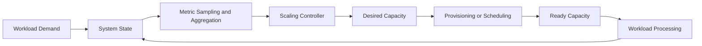
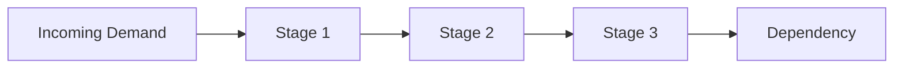

# Autoscaling, Capacity, Concurrency, Queues, and GPU Resources

## Learning Objectives

By the end of this chapter, you should be able to:

- Explain why static capacity is insufficient for many production AI workloads.
- Explain autoscaling as a feedback-control problem.
- Distinguish a scaling signal, scaling policy, and scaling mechanism.
- Select appropriate scaling signals for different AI workloads.
- Understand target utilization and why utilization alone is often insufficient.
- Reason about concurrency as a capacity and scaling signal.
- Explain how queue depth and queue waiting time can drive scaling decisions.
- Understand scaling delay, warm-up time, cooldown, and stabilization.
- Define safe minimum and maximum capacity.
- Understand scaling-rate limits and why capacity should not always change instantly.
- Explain scale-to-zero and its trade-offs.
- Understand GPU compute, GPU memory, allocation, fragmentation, and usable accelerator capacity.
- Distinguish desired, available, and ready capacity.
- Identify autoscaling failure modes such as delayed reaction, oscillation, over-scaling, under-scaling, and dependency saturation.
- Design a practical autoscaling policy for an AI workload.
- Explain how autoscaling interacts with workload characteristics, dependencies, and operational constraints.
- Evaluate scaling policies using engineering trade-offs rather than relying on a single metric.

---

## Prerequisites

You should already understand:

- Basic CPU, memory, GPU, and infrastructure concepts.
- Request rate, throughput, latency, and concurrency.
- Capacity per worker.
- Demand profiles and workload characterization.
- Baseline capacity and planning headroom.
- Horizontal scaling and vertical scaling.
- Basic production reliability concepts.

This chapter builds directly on **[01 — AI Capacity Planning and Scaling Models](./01-AI-Capacity-Planning-and-Scaling-Models.md)**.

Lesson 01 answered:

> **How much capacity does this workload require?**

This chapter answers:

> **How should available capacity change as demand changes, and how can those changes be controlled safely?**

---

## Estimated Reading Time

**60–75 minutes**

---

## Before We Start

Capacity planning and autoscaling are related, but they solve different engineering problems.

**Capacity planning** determines how much capacity is required for a workload and under which assumptions.

**Autoscaling** determines how the system should adjust available capacity as workload conditions change.

For example, Lesson 01 may establish that a workload requires approximately 10 workers during peak sustained demand.

That does not answer:

- When should the system add workers?
- How many should it add?
- How quickly should it add them?
- When should it remove them?
- What happens if new workers take 60 seconds to become ready?
- What happens if the dependency cannot absorb the additional traffic?

Those are autoscaling questions.

A useful progression is:

```text
Capacity Planning
        ↓
Required Capacity
        ↓
Scaling Strategy
        ↓
Autoscaling Policy
        ↓
Dynamic Capacity Changes
        ↓
Observed System State
        ↓
Next Scaling Decision
```

Autoscaling therefore builds on the capacity model established in Lesson 01 rather than replacing it.

---

# 1. Why Autoscaling Exists

Production workloads are rarely constant.

A workload may move through:

```text
Low demand
    ↓
Normal demand
    ↓
Traffic increase
    ↓
Peak demand
    ↓
Burst
    ↓
Traffic decrease
    ↓
Low demand
```

A static deployment must choose a fixed capacity level.

If it is sized for peak demand, resources may remain underused during normal periods.

If it is sized for normal demand, the system may become under-capacity during peaks.

Autoscaling provides a mechanism for changing capacity as conditions change.

A simplified model is:

```text
Changing Demand
       ↓
Scaling Signal
       ↓
Scaling Decision
       ↓
Capacity Change
       ↓
New System State
       ↓
New Measurement
       ↓
Next Scaling Decision
```

The important point is that autoscaling is not simply:

> “CPU is high, so add machines.”

It is a **feedback-control process operating with incomplete information, sampling delay, provisioning delay, and changing workload conditions**.

---

# 2. Autoscaling as a Feedback Control System

A useful mental model is to treat autoscaling as a control loop.



The controller does not directly observe the future workload.

It observes measurements of the current or recent system state and uses those measurements to determine the next capacity action.

The loop therefore contains:

| Component | Meaning |
|---|---|
| Workload | Incoming demand |
| System state | Current resource and workload condition |
| Signal | Measurement representing pressure |
| Controller | Logic evaluating the signal |
| Policy | Rules determining the desired response |
| Desired capacity | Capacity the controller wants |
| Mechanism | Infrastructure action that changes capacity |
| Ready capacity | Capacity actually able to process work |
| Feedback | New measurements after the change |

This leads to an important principle:

> **Autoscaling is a control system, not a one-time infrastructure configuration.**

---

# 3. Scaling Signal, Scaling Policy, and Scaling Mechanism

These three concepts should remain distinct.

```text
Scaling Signal
"What is happening?"

        ↓

Scaling Policy
"What should we do?"

        ↓

Scaling Mechanism
"How do we change capacity?"
```

For example:

```text
Signal:
Queue waiting time is 45 seconds.

Policy:
Increase desired workers when sustained waiting time
exceeds the target.

Mechanism:
Provision or activate additional workers.
```

Another example:

```text
Signal:
GPU memory pressure is persistently high.

Policy:
Increase capacity when the workload cannot safely
operate within the configured memory target.

Mechanism:
Schedule additional GPU-backed workers.
```

The distinction matters because the same mechanism can support different policies, and the same signal can be interpreted differently by different policies.

---

# 4. Scaling Signals

An autoscaler needs a signal that represents workload pressure.

Common signals include:

- CPU utilization
- memory utilization
- GPU compute utilization
- GPU memory utilization
- request rate
- active requests
- concurrency
- queue depth
- queue waiting time
- processing latency
- token processing rate
- custom application metrics
- external demand signals

There is no universally correct scaling signal.

The correct question is:

> **Which signal best represents the workload pressure that additional capacity can actually relieve?**

A signal should ideally have a meaningful relationship with useful capacity.

Latency deserves special care. High latency may indicate capacity pressure, but latency is often an **outcome of saturation or dependency behavior**, not a direct measure of demand. It is therefore useful as a scaling signal only when its relationship to capacity pressure has been validated.

---

## 5. CPU Utilization

CPU utilization can be useful when CPU consumption closely tracks workload pressure.

Conceptually:

```text
CPU pressure increases
        ↓
Available CPU capacity decreases
        ↓
Additional CPU capacity may help
```

However, CPU may not be the limiting resource in an AI system.

For example:

```text
CPU = 30%
GPU = 95%
```

If the workload is GPU-bound, scaling based only on CPU could produce an incorrect decision.

CPU utilization is therefore a useful signal when CPU is actually part of the capacity constraint.

---

# 6. Memory Utilization

Memory can be an important capacity signal when workload size affects memory consumption.

Examples include:

- large document processing,
- multimodal workloads,
- embedding pipelines,
- large intermediate representations,
- model runtime memory requirements.

However, memory utilization does not automatically represent active workload pressure.

A process may reserve memory without actively processing more work.

Therefore:

> **A resource metric is useful as a scaling signal only when its relationship to workload pressure is understood.**

---

## 7. GPU Utilization

GPU compute utilization can be useful for GPU-bound workloads.

For example:

```text
GPU compute pressure
        ↑
Useful GPU compute capacity decreases
        ↓
Additional GPU capacity may help
```

But GPU utilization alone does not describe every GPU constraint.

A GPU may show:

```text
Compute utilization = high
Memory utilization = low
```

or:

```text
Compute utilization = low
Memory utilization = high
```

These represent different capacity conditions.

Therefore GPU autoscaling may need to consider multiple signals.

---

# 8. Request-Rate-Based Scaling

A system can scale according to incoming request rate.

For example:

```text
20 requests/sec
      ↓
4 workers

60 requests/sec
      ↓
8 workers

120 requests/sec
      ↓
16 workers
```

This can work when requests have reasonably predictable resource requirements.

However, AI requests can vary substantially.

For example:

```text
Request A → 100 tokens
Request B → 10,000 tokens
```

Both count as one request, but their resource requirements may be very different.

Therefore:

> **Request count is useful only when request count is a sufficiently good proxy for workload intensity.**

---

# 9. Concurrency as a Scaling Signal

Concurrency represents work currently in progress.

For an AI workload, this may represent:

- active inference work,
- active embedding work,
- active workflow executions,
- active asynchronous processing.

Concurrency can be useful as a scaling signal because it represents how much work is occupying the system.

For example:

```text
Target useful concurrency per worker = 4

Current concurrency = 16

Approximate worker requirement:
16 / 4 = 4 workers
```

This is a planning approximation.

The actual useful concurrency depends on:

- request size,
- processing time,
- memory requirements,
- GPU capacity,
- CPU capacity,
- dependency behavior.

The important boundary is:

> **PROD-07 uses concurrency to reason about capacity and scaling. Detailed serving-side concurrency mechanisms belong to PROD-03.**

---

# 10. Concurrency Does Not Increase Useful Capacity Indefinitely

Increasing concurrency can improve utilization when resources are underused.

But beyond some operating region, additional concurrency may create contention.

Conceptually:

```text
Low concurrency
      ↓
Resources underutilized

Moderate concurrency
      ↓
Better resource utilization

High concurrency
      ↓
Resource contention
      ↓
Queueing
      ↓
Latency increases
      ↓
Useful capacity may decrease
```

Therefore:

> **More concurrent work does not automatically mean more useful capacity.**

The capacity model should identify the operating region in which additional concurrency contributes positively to useful work.

---

# 11. Queue-Based Scaling

Queues provide a natural scaling signal for asynchronous workloads.

Conceptually:

```text
Producers
    ↓
  Queue
    ↓
Workers
```

If work arrives faster than workers can process it:

```text
Arrival rate > Processing capacity
```

the queue grows.

Queue growth therefore indicates that current capacity is insufficient for the incoming workload.

A scaling policy may respond by increasing worker capacity.

This is particularly useful for:

- document processing,
- batch inference,
- embedding pipelines,
- media processing,
- long-running AI jobs,
- asynchronous agent workflows.

---

# 12. Queue Depth

Queue depth measures the amount of work waiting.

For example:

```text
Queue depth = 20
```

versus:

```text
Queue depth = 2,000
```

A growing queue can indicate insufficient capacity.

However, queue depth alone does not tell us how quickly the queue can be drained.

Consider:

```text
Queue = 1,000 jobs
Processing capacity = 100 jobs/minute
```

The backlog represents approximately 10 minutes of work if conditions remain stable.

Now consider:

```text
Queue = 1,000 jobs
Processing capacity = 1,000 jobs/minute
```

The same queue represents approximately one minute of work.

Therefore:

> **Queue depth should be interpreted relative to processing capacity and waiting-time requirements.**

---

# 13. Queue Waiting Time

Queue waiting time measures how long work has been waiting.

This can be more directly connected to user or business requirements.

For example:

```text
Target waiting time = 30 seconds
Observed waiting time = 90 seconds
```

A scaling policy may interpret sustained excess waiting as evidence that additional capacity is needed.

Conceptually:

```text
Observed waiting time
        ↓
Compare with target
        ↓
Scaling pressure
        ↓
Capacity adjustment
```

Waiting time is especially useful when job size varies or when the business objective is expressed in terms of how long users/jobs can wait.

---

# 14. Choosing a Scaling Signal

A useful starting framework is:

| Workload characteristic | Potential signal |
|---|---|
| CPU-bound | CPU utilization |
| GPU-compute-bound | GPU compute utilization |
| Memory-constrained | Memory pressure |
| Predictable request cost | Request rate |
| Predictable active work | Concurrency |
| Asynchronous jobs | Queue depth |
| User-visible waiting | Queue waiting time |
| Token-driven workload | Token processing rate |
| Complex workload | Composite/custom signal |
| External demand | External/custom metric |

The signal should be selected based on the workload's actual capacity relationship.

Do not select a metric simply because it is easy to collect.

For latency, the same rule applies: use it only when measured latency has a validated causal relationship with capacity pressure and the scaling action can actually improve that pressure.

---

## 15. Target Utilization

Many autoscaling systems operate around a target.

For example:

```text
Target CPU utilization = 60%
```

The controller attempts to maintain an operating region around that target.

A simplified conceptual model is:

```text
Signal above desired operating region
        ↓
Potential scale up

Signal near desired operating region
        ↓
Maintain capacity

Signal below desired operating region
        ↓
Potential scale down
```

This is a conceptual model.

Actual production autoscalers may use:

- sampled metrics,
- averaging windows,
- threshold logic,
- desired-replica calculations,
- stabilization,
- rate limits,
- multiple metrics,
- platform-specific reconciliation.

Therefore:

> **Do not assume that every autoscaler literally implements a single instantaneous “metric > target” rule.**

---

# 16. Why 100% Utilization Is Usually a Poor Operating Target

Suppose:

```text
100% utilization = hard saturation
```

Operating continuously at that level leaves little room for:

- workload variation,
- short bursts,
- uneven distribution,
- scaling delay,
- dependency variation.

A lower target can preserve operating headroom.

For example:

```text
Target operating point
        +
Planning headroom
        +
Scaling reaction time
```

creates a more resilient capacity envelope.

The appropriate target is workload-specific and should be validated rather than chosen arbitrarily.

---

# 17. Autoscaling Does Not Create Capacity Instantly

One of the most important properties of autoscaling is **scaling delay**.

Suppose:

```text
Demand increases
      ↓
Metric changes
      ↓
Metric is sampled
      ↓
Controller makes decision
      ↓
New capacity is requested
      ↓
Infrastructure starts
      ↓
Runtime initializes
      ↓
Model loads
      ↓
Readiness succeeds
      ↓
Capacity becomes usable
```

The delay between demand change and useful capacity can be significant.

A useful planning decomposition is:

```text
Total Scaling Delay
=
Detection Delay
+
Decision Delay
+
Provisioning Delay
+
Startup Delay
+
Readiness Delay
```

In a real platform, some phases may overlap, so this is a planning decomposition rather than a universal literal wall-clock equation.

For AI workloads, additional initialization may include:

```text
Model loading
+
Runtime initialization
+
Cache warm-up
```

---

# 18. Scaling Delay and Burst Duration

Scaling speed must be evaluated against the shape of demand.

Suppose:

```text
Scaling delay = 60 seconds
Burst duration = 20 seconds
```

Reactive scaling may provide little benefit because the additional capacity becomes ready after the burst ends.

Now consider:

```text
Scaling delay = 20 seconds
Burst duration = 10 minutes
```

Reactive scaling has much more opportunity to absorb the sustained increase.

Therefore:

> **Autoscaling policy must be designed relative to demand duration and scaling delay, not just peak magnitude.**

This connects directly to the burst-capacity distinction established in Lesson 01.

---

# 19. Warm Capacity

Warm capacity is already available and ready to process workload.

For example:

```text
4 workers running
4 workers ready
```

When demand increases, those workers can immediately contribute capacity.

Warm capacity reduces scaling latency.

The trade-off is that resources remain active even when demand is low.

Therefore:

> **Warm capacity trades resource cost for responsiveness.**

---

# 20. Cold Capacity

Cold capacity must be started and initialized before becoming useful.

For an AI worker:

```text
Provision resource
      ↓
Start runtime
      ↓
Load model
      ↓
Initialize dependencies
      ↓
Pass readiness
      ↓
Accept workload
```

Cold capacity can reduce idle resource usage but increases reaction time.

This is particularly important for large models and GPU-backed workloads.

---

# 21. Warm Pools and Pre-Provisioned Capacity

A system may intentionally maintain a pool of warm resources.

For example:

```text
Minimum warm capacity = 4
Maximum capacity = 20
```

Normal demand may use 4 workers.

As demand increases:

```text
4 → 8 → 12 → 20
```

The first expansion can be faster if some resources are already initialized or can be activated quickly.

This is a capacity-control strategy, not merely an autoscaler configuration detail.

---

# 22. Minimum and Maximum Capacity

Autoscaling should generally have explicit capacity bounds.

### Minimum capacity

Defines the lowest capacity the system should maintain.

Reasons may include:

- baseline demand,
- predictable latency,
- model warm-up avoidance,
- availability,
- avoiding repeated cold starts.

### Maximum capacity

Defines the upper bound.

Reasons may include:

- infrastructure limits,
- dependency limits,
- provider quotas,
- GPU availability,
- cost controls,
- safety boundaries.

Conceptually:

```text
Minimum Capacity
       │
       │  Allowed operating range
       ↓
[========================]
       ↑
       │
Maximum Capacity
```

These bounds are part of the autoscaling policy.

Importantly, reaching the maximum is a **policy boundary**, not automatically an infrastructure failure. The system may have deliberately chosen that limit to protect dependencies, costs, or other operational constraints.

---

# 23. Capacity Limits vs Scaling-Rate Limits

Two different constraints should be distinguished.

### Capacity limit

Controls **how much capacity may exist**.

```text
Minimum = 4
Maximum = 20
```

### Scaling-rate limit

Controls **how quickly capacity may change**.

For example:

```text
Maximum scale-up:
+4 workers per control interval

Maximum scale-down:
-2 workers per control interval
```

These solve different problems.

Without capacity bounds:

```text
4 → 20 → 50 → 100
```

may be possible.

Without rate limits:

```text
4 → 20
```

may happen too abruptly.

Therefore:

> **Capacity limits bound the destination; scaling-rate limits bound the speed of movement.**

---

# 24. Why Scaling-Rate Limits Matter

Suppose a noisy signal briefly indicates severe demand.

Without rate limiting:

```text
Signal spike
    ↓
Large scale-up
    ↓
Infrastructure pressure
    ↓
Demand disappears
    ↓
Large scale-down
```

This can amplify instability.

Rate limits can make the response more controlled:

```text
4 → 8 → 12 → 16
```

rather than:

```text
4 → 20
```

The appropriate rate depends on:

- scaling delay,
- workload urgency,
- infrastructure availability,
- dependency capacity,
- cost,
- burst behavior.

---

# 25. Scale-to-Zero

Some workloads can reduce capacity to zero when no work exists.

Conceptually:

```text
No demand
    ↓
0 workers

New demand
    ↓
Start workers
    ↓
Initialize
    ↓
Process work
```

This can be useful for:

- infrequent jobs,
- batch workloads,
- event-driven processing,
- development environments,
- low-volume asynchronous services.

The trade-off is startup latency.

For AI workloads, startup may include:

```text
GPU allocation
+
Runtime startup
+
Model loading
+
Readiness
```

Therefore:

> **Scale-to-zero is a latency-versus-resource-usage decision.**

---

# 26. Scale-Up and Scale-Down Are Not Symmetric

Scaling up primarily asks:

> **Can additional capacity become useful quickly enough?**

Scaling down asks:

> **Can capacity be removed without creating future instability or unnecessary cold starts?**

Aggressive scale-down can cause:

```text
Capacity decreases
      ↓
Demand returns
      ↓
Capacity becomes insufficient
      ↓
Scale up again
      ↓
Cold-start delay
```

Therefore scale-down is often designed more conservatively.

---

# 27. Cooldown and Stabilization

Cooldown and stabilization are related but distinct.

### Cooldown

A cooldown period can restrict or delay another scaling action after a previous scaling event.

Its purpose is to avoid immediately reacting again while the previous action is still taking effect.

### Stabilization

Stabilization uses recent behavior or a defined stabilization window to avoid making decisions based on short-lived fluctuations.

Its purpose is to reduce oscillation caused by noisy or rapidly changing signals.

Conceptually:

```text
Metric changes
      ↓
Observe recent behavior
      ↓
Determine whether change is sustained
      ↓
Scaling decision
```

These mechanisms are platform-specific, but the engineering objective is general:

> **Do not make large capacity changes based solely on transient noise or an incomplete response to the previous action.**

---

# 28. Oscillation

Consider a system with unstable scaling behavior:

```text
10 workers
    ↓
Metric high
    ↓
15 workers
    ↓
Metric falls
    ↓
8 workers
    ↓
Metric rises
    ↓
15 workers
```

This repeated expansion and contraction is often called **flapping** or **oscillation**.

Possible causes include:

- noisy signals,
- aggressive scale-up,
- aggressive scale-down,
- insufficient stabilization,
- long provisioning delays,
- scaling on downstream effects,
- poorly chosen targets.

Autoscaling should therefore be designed as a control problem rather than as a collection of independent thresholds.

---

# 29. Reactive Scaling

Reactive scaling responds to observed conditions.

Example:

```text
Queue waiting time increases
        ↓
Controller detects sustained pressure
        ↓
Increase desired capacity
```

Advantages:

- relatively simple,
- based on actual demand,
- broadly applicable.

Limitations:

- reacts after demand changes,
- detection takes time,
- provisioning takes time,
- poor for very short bursts when startup is slow.

Reactive scaling works best when the workload and scaling delay make delayed response acceptable.

---

# 30. Scheduled Scaling

Scheduled scaling anticipates known demand patterns.

Example:

```text
08:00 → 10 workers
13:00 → 20 workers
18:00 → 8 workers
```

This can be useful for predictable patterns such as:

- business-hour traffic,
- scheduled batch jobs,
- known campaign launches,
- recurring processing windows.

The advantage is that capacity can be prepared before demand arrives.

The limitation is that schedules cannot reliably predict unexpected demand.

---

# 31. Predictive Scaling

Predictive scaling uses historical or forecasting information to anticipate future demand.

Conceptually:

```text
Historical demand
       ↓
Forecast
       ↓
Expected future demand
       ↓
Pre-scale capacity
```

Prediction introduces uncertainty.

Overprediction can waste resources.

Underprediction can leave the system under-capacity.

Therefore predictive scaling should be treated as an engineering decision involving forecast quality and operational risk.

---

# 32. Event-Driven Scaling

Some workloads can scale in response to external events.

For example:

```text
New jobs arrive
      ↓
Queue grows
      ↓
Worker capacity increases
```

or:

```text
New files uploaded
      ↓
Processing demand increases
      ↓
Capacity increases
```

Event-driven scaling is particularly useful for asynchronous workloads because the event itself provides a demand signal.

---

# 33. Composite Scaling Signals

Some AI workloads cannot be represented well by one metric.

A conceptual composite signal might consider:

```text
Request rate
+
Token processing rate
+
Active work
+
GPU memory pressure
+
Queue waiting time
```

The goal is to better represent useful capacity pressure.

However, more metrics do not automatically produce a better autoscaler.

There is a trade-off:

```text
Single signal
    ↓
Simple
    ↓
Potentially incomplete

Composite signal
    ↓
Richer
    ↓
More difficult to interpret and tune
```

Composite signals can also disagree.

For example:

```text
GPU utilization → high
Queue depth → stable
Request rate → decreasing
```

A production policy therefore needs explicit rules for how multiple signals are combined, prioritized, or allowed to trigger scaling.

---

# 34. Scaling by Tokens

AI workloads often expose an important limitation of request-rate scaling.

Consider:

```text
Request A → 100 input tokens
Request B → 100,000 input tokens
```

or:

```text
Request A → 20 output tokens
Request B → 2,000 output tokens
```

Request count treats these as equal units.

Token volume may sometimes provide a better approximation of workload intensity.

Potential signals include:

- input tokens/sec,
- output tokens/sec,
- total tokens/sec,
- model-specific work units.

However, token count remains a proxy.

Its relationship to resource consumption can vary with:

- model,
- hardware,
- input versus output processing,
- implementation,
- batching,
- context size.

Therefore:

> **Token-based scaling is useful when empirical evidence shows that token volume is a meaningful proxy for the resource pressure being scaled.**

---

# 35. Model-Specific Scaling

Different models can have very different capacity characteristics.

For example:

```text
Model A
→ small CPU workload

Model B
→ medium GPU workload

Model C
→ large GPU workload
```

Their differences may include:

- memory requirements,
- compute requirements,
- startup time,
- processing time,
- concurrency behavior,
- request-size sensitivity.

A single scaling policy may therefore be inappropriate for all models.

Scaling policy may need to be model-specific or workload-class-specific.

---

# 36. AI-Specific Challenge: Model Loading

AI workers may require substantial initialization before they can contribute useful capacity.

For example:

```text
Process starts
      ↓
Runtime initializes
      ↓
Model weights load
      ↓
Memory allocated
      ↓
Caches initialize
      ↓
Readiness passes
      ↓
Worker becomes useful
```

Therefore:

> **A provisioned worker is not necessarily a ready worker.**

This distinction is central to AI autoscaling.

---

# 37. GPU Capacity

GPU-backed AI workloads introduce multiple capacity dimensions.

Important dimensions include:

- GPU compute capacity,
- GPU memory,
- available devices,
- allocation constraints,
- model placement,
- workload concurrency,
- multi-GPU requirements,
- resource fragmentation,
- warm/cold accelerator capacity.

The key principle is:

> **GPU capacity is multidimensional.**

A simple count such as “20 GPUs available” does not necessarily mean that 20 GPUs represent 20 equivalent units of usable capacity for every workload.

---

## 38. GPU Compute vs GPU Memory

Consider:

```text
GPU compute utilization = 40%
GPU memory utilization = 95%
```

The workload may have substantial unused compute capacity but insufficient memory for additional placement.

Conversely:

```text
GPU compute utilization = 95%
GPU memory utilization = 40%
```

The workload may be compute-bound.

These are different constraints.

Therefore GPU scaling decisions may need to distinguish:

```text
Compute pressure
vs
Memory pressure
```

---

# 39. GPU Memory as a Capacity Constraint

GPU memory may be consumed by:

- model weights,
- activations,
- runtime state,
- intermediate tensors,
- input context,
- output generation,
- caching,
- concurrent requests.

A workload can therefore hit a memory constraint before compute reaches maximum utilization.

Conceptually:

```text
GPU memory exhausted
        ↓
Additional work cannot be placed safely
        ↓
Useful capacity constrained
```

GPU memory is therefore a capacity dimension in its own right.

---

# 40. GPU Allocation

A production system may have a shared accelerator pool:

```text
GPU Pool
 ├── Model A
 ├── Model A
 ├── Model B
 └── Embedding workload
```

The relevant question is not only:

> “How many GPUs exist?”

It is:

> **“How much usable GPU capacity is available to this workload under current allocation constraints?”**

A device can be technically present but unavailable to the workload because it is already allocated or unsuitable for the required placement.

---

# 41. Multi-GPU Capacity

Some workloads require multiple GPUs simultaneously.

For example:

```text
Model
  ↓
GPU 0 + GPU 1 + GPU 2 + GPU 3
```

Four individually available GPUs are not always equivalent to one available four-GPU placement.

The workload may require:

- simultaneous allocation,
- compatible placement,
- sufficient memory,
- appropriate interconnect characteristics.

Therefore:

> **Resource availability and resource suitability are different concepts.**

Detailed GPU scheduling algorithms are outside the scope of this chapter.

---

# 42. GPU Fragmentation

A GPU pool may contain partially usable capacity:

```text
GPU 1 → partially available
GPU 2 → partially available
GPU 3 → fully available
GPU 4 → partially available
```

The aggregate unused capacity may appear large.

But a workload requiring one complete GPU may only be placeable on GPU 3.

This creates a distinction between:

```text
Nominal capacity
```

and:

```text
Usable capacity
```

Autoscaling should reason about the latter.

Detailed GPU scheduler internals remain outside the scope of this chapter.

---

# 43. Warm vs Cold GPU Capacity

A cold GPU-backed worker may require:

```text
GPU allocation
      ↓
Runtime startup
      ↓
Model loading
      ↓
Memory initialization
      ↓
Readiness
```

A warm worker may already have:

```text
GPU allocated
+
Runtime active
+
Model loaded
```

Therefore:

```text
Warm GPU
→ faster reaction

Cold GPU
→ lower idle resource usage
→ higher scaling delay
```

This is especially important for latency-sensitive AI inference.

---

# 44. GPU Autoscaling Signals

Potential signals include:

- GPU compute utilization,
- GPU memory utilization,
- active work,
- request rate,
- token processing rate,
- queue depth,
- queue waiting time,
- accelerator allocation pressure,
- custom workload metrics.

A production policy may combine multiple signals when a single signal does not adequately represent capacity pressure.

The signal should still be validated against actual workload behavior.

---

## 45. Desired, Available, and Ready Capacity

These concepts should remain separate.

### Desired capacity

What the autoscaler wants.

```text
Desired = 10 workers
```

### Available capacity

What infrastructure has successfully allocated.

```text
Available = 8 workers
```

### Ready capacity

What can actually process workload.

```text
Ready = 6 workers
```

Therefore:

```text
Desired = 10
Available = 8
Ready = 6
```

The system effectively has only 6 useful workers.

For AI workloads, model initialization can create a meaningful gap between available and ready capacity.

---

# 46. Autoscaling and Dependency Capacity

Scaling application workers does not automatically scale dependencies.

For example:

```text
10 AI workers
      ↓
Database
```

Scaling to:

```text
50 AI workers
```

may increase database traffic substantially.

The result can be:

```text
Application capacity ↑
        ↓
Dependency pressure ↑
        ↓
Dependency saturation
        ↓
End-to-end useful capacity stops increasing
```

Therefore:

> **Scaling one layer can expose a different bottleneck rather than increasing end-to-end capacity.**

The capacity-planning reasoning from Lesson 01 should be reused here rather than re-taught.

---

# 47. Scaling the Wrong Layer

Consider:

```text
API
 ↓
Retriever
 ↓
Reranker
 ↓
Model
 ↓
Database
```

Suppose retrieval is the bottleneck.

Increasing model workers may not improve end-to-end capacity.

Similarly, increasing retrieval workers may not help if the database is saturated.

The correct question is:

> **Which component currently limits useful system capacity?**

Autoscaling should target the component whose additional capacity can actually improve the system's useful capacity.

---

# 48. Scaling Failure Mode: Delayed Reaction

Consider:

```text
Demand spike
     ↓
Metric changes
     ↓
Controller reacts
     ↓
Capacity requested
     ↓
Resource starts
     ↓
Model loads
     ↓
Worker becomes ready
```

If this takes 60 seconds but the burst lasts 20 seconds, the new capacity may arrive too late.

The result may be:

- queue growth,
- latency increase,
- rejected work,
- temporary saturation.

The solution may involve:

- more warm capacity,
- faster startup,
- scheduled scaling,
- predictive scaling,
- a different workload strategy.

The correct choice depends on workload characteristics.

---

# 49. Scaling Failure Mode: Over-Scaling

Suppose:

```text
10 → 30 workers
```

because of a temporary spike.

If demand disappears immediately:

```text
30 workers
      ↓
Low utilization
      ↓
Unnecessary resource usage
```

If scale-down is too aggressive, the system may then oscillate.

Therefore scale-up and scale-down policies should be designed together.

---

# 50. Scaling Failure Mode: Oscillation

A system may behave like:

```text
10 workers
   ↓
Metric high
   ↓
15 workers
   ↓
Metric low
   ↓
8 workers
   ↓
Metric high
   ↓
15 workers
```

Possible causes include:

- noisy metrics,
- aggressive scale-up,
- aggressive scale-down,
- insufficient stabilization,
- long scaling delays,
- poorly chosen targets.

The control policy should account for the fact that the system response itself changes the metric being observed.

---

# 51. Scaling Failure Mode: Positive Feedback

Autoscaling can sometimes create additional pressure on another component.

For example:

```text
Application demand increases
        ↓
Application scales out
        ↓
More database traffic
        ↓
Database latency increases
        ↓
Application latency increases
        ↓
Autoscaler interprets latency as more demand
        ↓
Application scales out again
```

This can create a positive feedback loop.

The lesson is:

> **A scaling signal should be causally connected to capacity demand and should be evaluated against the effects of the scaling action itself.**

Dependency constraints are therefore part of scaling-policy design.

---

# 52. Scaling Failure Mode: Maximum Capacity Reached

Suppose:

```text
Required capacity = 50 workers
Maximum capacity = 20 workers
```

The autoscaler cannot satisfy demand beyond its configured limit.

Reaching maximum capacity does not automatically mean the autoscaler is broken.

It may indicate:

- unexpected demand,
- intentionally conservative capacity limits,
- infrastructure scarcity,
- dependency constraints,
- provider quotas,
- deliberate cost or safety limits.

The important distinction is:

```text
Scaling requested
        vs
Scaling possible
        vs
Scaling completed
```

Maximum capacity is therefore a **policy boundary**. It becomes an operational problem when the boundary is too low for the intended workload or when the system has no appropriate behavior after reaching it.

---

# 53. Scaling Failure Mode: No Available GPU Capacity

Suppose the controller determines:

```text
Need 4 additional GPUs
```

but infrastructure can provide only:

```text
1 additional GPU
```

The scaling decision may be correct while the scaling action remains incomplete.

This creates:

```text
Desired capacity
        ≠
Available capacity
        ≠
Ready capacity
```

GPU scarcity is therefore a capacity-management condition that the autoscaler must be designed to handle explicitly.

---

# 54. Autoscaling Policy Design

A production autoscaling policy should define at least:

```text
Workload
Capacity unit
Scaling signal
Target operating point
Minimum capacity
Maximum capacity
Scale-up behavior
Scale-down behavior
Scaling-rate limits
Stabilization
Cooldown, where applicable
Readiness criteria
Dependency constraints
Failure behavior
```

This is more complete than:

```text
IF metric high
THEN add capacity
```

---

# 55. Practical Example: Interactive AI Inference

Assume an interactive AI inference service:

- latency-sensitive,
- variable request sizes,
- GPU-backed,
- changing traffic throughout the day.

A conceptual policy might be:

```text
Minimum GPU workers = 4
Maximum GPU workers = 20

Primary signals:
- active work
- request rate

Supporting signals:
- GPU memory pressure
- queue waiting time

Scale-up:
rapid enough to absorb sustained pressure

Scale-down:
more conservative

Readiness:
worker must have model loaded and pass readiness checks
```

The exact values require measurement.

The engineering reasoning is:

```text
Latency sensitivity
      ↓
Warm capacity matters

Variable workload
      ↓
One signal may be insufficient

GPU startup delay
      ↓
Scaling speed matters

Dependency constraints
      ↓
Maximum capacity must be bounded
```

---

# 56. Practical Example: Batch Document Processing

Consider an asynchronous document-processing system.

Characteristics:

- jobs arrive through a queue,
- jobs may take minutes,
- moderate waiting time is acceptable,
- cold starts may be tolerable.

A conceptual policy might be:

```text
Minimum workers = 0 or small baseline
Maximum workers = bounded by infrastructure and dependencies

Primary signal:
queue depth + queue waiting time

Scale-up:
when backlog or waiting time grows

Scale-down:
when backlog remains low

Cold start:
acceptable within the processing objective
```

This is fundamentally different from interactive inference.

The key lesson is:

> **Autoscaling policy should be derived from workload behavior rather than copied from another service.**

---

# 57. Practical Example: Embedding Pipeline

Consider:

```text
Documents
    ↓
Chunking
    ↓
Embedding
    ↓
Vector Storage
```

Embedding workers may scale based on:

- chunks waiting,
- token volume,
- worker processing rate,
- queue waiting time.

But increasing embedding capacity may increase vector-database write pressure.

Therefore:

```text
Embedding capacity ↑
        ↓
Write rate ↑
        ↓
Database pressure ↑
```

The scaling policy must account for the downstream capacity constraint.

---

# 58. Multi-Stage Capacity

For a pipeline:



Each stage has its own useful capacity.

Conceptually:

```text
C1
C2
C3
C4
```

If one stage becomes the limiting constraint, scaling another stage may only increase backlog.

Therefore:

> **Autoscaling should increase capacity where additional resources can improve useful end-to-end capacity.**

This is the autoscaling application of the bottleneck reasoning established in Lesson 01.

---

# 59. Autoscaling and Headroom

Lesson 01 established headroom as part of planned capacity.

In autoscaling, the engineering question becomes:

> **How much headroom should be kept warm, and how much can be obtained through additional capacity after a scaling decision?**

Possible forms include:

### Warm headroom

Already-ready unused capacity.

### Rapidly available headroom

Capacity that can become ready quickly.

### Cold headroom

Capacity requiring provisioning and initialization.

The appropriate balance depends on:

- demand volatility,
- scaling delay,
- latency requirements,
- resource cost,
- workload criticality.

Autoscaling therefore changes how headroom is managed; it does not eliminate the need for it.

---

## 60. Autoscaling and Cost

Autoscaling affects resource consumption.

Scaling too aggressively can increase resource usage.

Scaling too slowly can increase:

- latency,
- queueing,
- failed requests,
- customer impact.

Therefore the objective is not:

> **Minimize infrastructure.**

Nor is it:

> **Always maintain maximum capacity.**

The objective is:

> **Maintain sufficient useful capacity within acceptable operational, reliability, and economic constraints.**

Detailed performance and cost optimization belongs to PROD-08.

---

## 61. Autoscaling Design Framework

Use the following sequence when designing an autoscaling policy:

```text
1. Characterize the workload
             ↓
2. Identify the useful capacity unit
             ↓
3. Identify the limiting resource or constraint
             ↓
4. Select the scaling signal
             ↓
5. Define the target operating point
             ↓
6. Estimate scaling delay
             ↓
7. Define minimum and maximum capacity
             ↓
8. Define scale-up behavior
             ↓
9. Define scale-down behavior
             ↓
10. Define scaling-rate limits
             ↓
11. Define stabilization and cooldown behavior
             ↓
12. Define readiness criteria
             ↓
13. Validate dependency capacity
             ↓
14. Test under realistic demand
```

The final step belongs to Lesson 03.

The purpose of this chapter is to design the control policy; Lesson 03 validates whether that policy behaves correctly under load.

---

# 62. Common Mistakes

## Mistake 1 — Scaling on CPU by Default

CPU is easy to measure but may not represent AI workload pressure.

### Better approach

Identify the resource or workload signal that actually limits useful capacity.

---

## Mistake 2 — Treating Every Request as Equal

One request may contain:

```text
100 tokens
```

while another contains:

```text
100,000 tokens
```

### Better approach

Consider workload size when request rate is insufficient to represent resource demand.

---

## Mistake 3 — Assuming Autoscaling Is Instant

A scaling decision does not immediately create ready capacity.

### Better approach

Account for:

```text
Detection
+
Decision
+
Provisioning
+
Startup
+
Model loading
+
Readiness
```

---

## Mistake 4 — Targeting Maximum Utilization

Operating near saturation leaves little room for variation and scaling delay.

### Better approach

Choose an operating target that preserves appropriate headroom.

---

## Mistake 5 — Ignoring Scale-Down Behavior

Aggressive scale-down can create repeated cold starts and oscillation.

### Better approach

Design scale-down behavior separately from scale-up behavior.

---

## Mistake 6 — Ignoring Scaling-Rate Limits

A large capacity jump can overload infrastructure or dependencies.

### Better approach

Bound how quickly capacity can change.

---

## Mistake 7 — Confusing Cooldown and Stabilization

They both reduce excessive reactions, but they are not identical mechanisms.

### Better approach

Understand whether the platform is delaying another action or evaluating recent history before changing capacity.

---

## Mistake 8 — Ignoring Dependencies

Adding workers can increase downstream load.

### Better approach

Evaluate the capacity chain before increasing maximum capacity.

---

## Mistake 9 — Treating Provisioned Resources as Ready Capacity

A GPU may be allocated but still loading the model.

### Better approach

Distinguish desired, available, and ready capacity.

---

## Mistake 10 — Assuming More GPUs Always Mean More Capacity

GPU availability can be constrained by memory, allocation, placement, or fragmentation.

### Better approach

Reason about usable accelerator capacity.

---

## Mistake 11 — Using a Single Metric for a Complex Workload

A single metric may hide important constraints.

### Better approach

Use composite signals only when workload behavior justifies the additional complexity.

---

## Mistake 12 — Ignoring Maximum Capacity

An autoscaler without a bounded upper limit can create excessive resource consumption or dependency overload.

### Better approach

Define explicit capacity limits and understand what happens when they are reached.

---

## Mistake 13 — Scaling on a Metric Caused by the Scaling Action

Scaling may increase downstream pressure, which can increase the very metric that triggered scaling.

### Better approach

Understand causal relationships between scaling actions, dependencies, and observed signals.

---

# 63. Production Perspective

An autoscaling configuration should be treated as an engineering artifact.

It should document at least:

| Dimension | Example |
|---|---|
| Workload | Interactive LLM inference |
| Capacity unit | Ready GPU worker |
| Primary signal | Active work |
| Supporting signal | GPU memory pressure |
| Target | Defined operating range |
| Minimum | 4 workers |
| Maximum | 20 workers |
| Scale-up | Aggressive within rate limit |
| Scale-down | Conservative |
| Rate limit | Defined |
| Stabilization | Defined |
| Cooldown | Defined if applicable |
| Startup time | Measured |
| Model load time | Measured |
| Readiness condition | Model loaded and health checks pass |
| Dependency constraint | Database/provider quota |
| Failure behavior | Bounded at maximum |
| Validation | Load and burst testing |

The values should come from workload measurements and operational requirements.

---

## 64. Autoscaling Is a Control Policy, Not a Magic Feature

It is tempting to think:

```text
Enable autoscaling
        ↓
Problem solved
```

Production systems are more complicated.

Autoscaling depends on:

```text
Workload characterization
        +
Capacity model
        +
Scaling signal
        +
Scaling policy
        +
Scaling mechanism
        +
Resource availability
        +
Dependency capacity
        +
Startup characteristics
        +
Validation
```

If any of these assumptions are wrong, autoscaling may behave poorly.

Therefore:

> **Autoscaling is an engineering control mechanism built on top of a capacity model.**

---

# 65. Relationship to Lesson 01

Lesson 01 established:

```text
Demand
   ↓
Workload Characteristics
   ↓
Required Capacity
   ↓
Resource Requirement
   ↓
Headroom
   ↓
Scaling Strategy
```

Lesson 02 extends the final part of that reasoning:

```text
Scaling Strategy
       ↓
Scaling Signal
       ↓
Scaling Policy
       ↓
Desired Capacity
       ↓
Capacity Adjustment
       ↓
Ready Capacity
       ↓
Feedback
```

Therefore:

```text
PROD-07 Lesson 01
Capacity Planning
        ↓
"What capacity should exist?"

PROD-07 Lesson 02
Autoscaling
        ↓
"How should capacity change?"

PROD-07 Lesson 03
Load & Scaling Validation
        ↓
"Does the scaling strategy actually work?"
```

This boundary should remain explicit.

---

# 66. Relationship to PROD-03

PROD-03 owns:

- inference serving,
- serving architecture,
- concurrency mechanisms,
- queues as serving mechanisms,
- batching,
- streaming,
- model routing.

PROD-07 does not re-teach those mechanisms.

Instead, PROD-07 asks:

> **What capacity and scaling implications do those mechanisms create?**

For example:

```text
Concurrency
→ affects active work and resource occupancy.

Queueing
→ exposes backlog and waiting pressure.

Batching
→ can change effective capacity per worker.

Streaming
→ can change connection and resource occupancy characteristics.
```

The serving implementation remains owned by PROD-03.

---

# 67. Relationship to PROD-05

PROD-05 owns observability and telemetry architecture.

This chapter may use signals such as:

- CPU utilization,
- GPU utilization,
- queue depth,
- latency,
- concurrency,
- request rate.

But the questions differ.

PROD-05 asks:

> **How should production systems collect, structure, and operate these signals?**

PROD-07 asks:

> **Which signals should influence capacity and scaling decisions?**

---

## 68. Relationship to PROD-06

PROD-06 owns:

- reliability objectives,
- failure isolation,
- timeouts,
- retries,
- backpressure,
- graceful degradation,
- fallbacks,
- dependency failure.

PROD-07 may encounter:

```text
Queue pressure
Resource exhaustion
Capacity limits
Overload
```

but focuses on the scaling and capacity response.

For example:

```text
Capacity insufficient
      ↓
Autoscaling attempts expansion
```

is primarily a PROD-07 concern.

Whereas:

```text
Capacity insufficient
      ↓
Backpressure / load shedding / graceful degradation
```

belongs primarily to PROD-06.

---

# 69. Relationship to PROD-08

PROD-07 asks:

> **How much capacity is required, and how should that capacity change?**

PROD-08 asks:

> **How can the workload be made faster, more efficient, or less resource-intensive?**

For example:

```text
PROD-07:
Current workload requires 20 GPU workers.

PROD-08:
Can optimization reduce the requirement to 12?
```

Optimization may change the capacity model, but optimization techniques themselves belong to PROD-08.

---

# 70. Interview Questions

## Question 1

**Why is CPU utilization often insufficient as the only autoscaling signal for an AI workload?**

### Expected answer

AI workloads may be constrained by GPU compute, GPU memory, model processing, external providers, queues, or dependencies while CPU utilization remains low. The scaling signal should represent the resource or workload pressure that limits useful capacity.

---

## Question 2

**Why is request rate sometimes a poor scaling signal for LLM workloads?**

### Expected answer

Requests can vary substantially in input and output size. One request may require far more compute and memory than another. Request count may therefore be a poor proxy for actual workload intensity.

---

## Question 3

**What is the difference between a scaling signal, scaling policy, and scaling mechanism?**

### Expected answer

The signal describes what is happening, such as queue waiting time. The policy determines what should happen in response, such as increasing desired workers when waiting time remains above target. The mechanism performs the infrastructure action, such as provisioning additional workers.

---

## Question 4

**What is the difference between capacity limits and scaling-rate limits?**

### Expected answer

Capacity limits define how much capacity may exist, such as minimum and maximum workers. Scaling-rate limits define how quickly capacity may change, such as limiting the number or percentage of workers added or removed during an interval.

---

## Question 5

**Why is scale-down often more conservative than scale-up?**

### Expected answer

Removing capacity can create queueing, cold-start delays, and repeated scale-up events if demand returns. Scale-down therefore needs to account for future demand and the cost of re-acquiring capacity.

---

## Question 6

**What is the difference between cooldown and stabilization?**

### Expected answer

Cooldown can delay another scaling action after a previous action. Stabilization considers recent behavior or a defined window to avoid reacting to transient changes. The exact implementation is platform-specific.

---

## Question 7

**Why can scaling take effect too late for a burst?**

### Expected answer

The system must detect the demand change, make a decision, provision resources, initialize them, load the model if necessary, and pass readiness checks. If this total delay exceeds burst duration, reactive scaling may arrive too late.

---

## Question 8

**What is the difference between desired, available, and ready capacity?**

### Expected answer

Desired capacity is what the autoscaler wants. Available capacity is what infrastructure has allocated. Ready capacity is what can actually process workload. AI systems can have a significant gap because model initialization may delay readiness.

---

## Question 9

**Why doesn't adding more workers always increase end-to-end throughput?**

### Expected answer

Another component may already be the bottleneck. For example, a database or external provider may saturate before application workers do. Additional workers may then increase pressure without increasing useful end-to-end capacity.

---

## Question 10

**Why can GPU memory be a capacity constraint when GPU compute utilization is low?**

### Expected answer

The workload may require GPU memory for model weights, activations, context, or concurrent requests. Memory exhaustion can prevent additional work from being placed even when compute capacity remains available.

---

## Question 11

**Why can an autoscaling policy become unstable?**

### Expected answer

Noisy signals, aggressive scaling, insufficient stabilization, long scaling delays, and feedback from downstream dependencies can cause repeated scale-up and scale-down behavior.

---

## Question 12

**How would you choose between queue depth and queue waiting time as a scaling signal?**

### Expected answer

Queue depth measures accumulated work, while waiting time measures how long work is actually waiting. Waiting time may be more meaningful when job sizes vary or when the business objective is expressed as an acceptable waiting period. Both should be interpreted alongside processing capacity.

---

## 71. Quick Revision

### Autoscaling

Automatically adjusts available capacity based on workload or resource signals.

### Scaling signal

A measurement representing workload or resource pressure.

### Scaling policy

Rules that translate observed signals into desired capacity changes.

### Scaling mechanism

Infrastructure action that changes actual capacity.

### Target

Desired operating region for a scaling signal.

### Warm capacity

Already-ready capacity that can accept work immediately.

### Cold capacity

Capacity that must be started and initialized before becoming useful.

### Scale-to-zero

Reducing capacity to zero when there is no active workload.

### Scaling-rate limit

A constraint on how quickly capacity may increase or decrease.

### Stabilization

Use of recent behavior or a stabilization window to avoid reacting to transient changes.

### Cooldown

A period that may restrict or delay another scaling action after a previous scaling event.

### Queue depth

Amount of work waiting in a queue.

### Queue waiting time

How long queued work has been waiting.

### Desired capacity

Capacity the autoscaler wants.

### Available capacity

Capacity successfully allocated by infrastructure.

### Ready capacity

Capacity actually capable of processing workload.

### GPU compute capacity

Available accelerator computation capability.

### GPU memory capacity

Available device memory for model and workload state.

### Usable capacity

Capacity that can actually process the workload under current constraints.

---

## 72. Key Takeaways

1. Autoscaling is a feedback-control problem, not simply a resource toggle.
2. A scaling signal should represent workload pressure that additional capacity can relieve.
3. A scaling signal, scaling policy, and scaling mechanism are different concepts.
4. CPU utilization is not automatically the correct signal for AI workloads.
5. Request rate can hide large differences in AI request size.
6. Concurrency can be a useful scaling signal but should remain at the capacity/scaling level in this chapter.
7. Queue depth and queue waiting time are powerful signals for asynchronous workloads.
8. Latency can be a useful signal only when its relationship to capacity pressure is validated.
9. Target utilization should leave appropriate operating headroom.
10. Autoscaling does not create capacity instantly.
11. Scaling delay must be evaluated relative to burst duration.
12. Desired, available, and ready capacity are different states.
13. Minimum and maximum capacity provide important operating boundaries.
14. Scaling-rate limits control how quickly capacity changes.
15. Scale-up and scale-down have different engineering risks.
16. Stabilization and cooldown help prevent excessive reactions, but they are not identical mechanisms.
17. Scale-to-zero trades lower idle resource usage for higher startup latency.
18. GPU capacity is multidimensional: compute, memory, allocation, placement, and availability all matter.
19. More workers do not guarantee more useful system capacity if a dependency is already the bottleneck.
20. Composite signals can be useful but introduce additional complexity, tuning requirements, and potentially conflicting measurements.
21. Token-based scaling can help when token volume is a validated proxy for workload pressure.
22. Autoscaling policies should be derived from workload behavior rather than copied from another service.
23. A capacity model provides the foundation; autoscaling operationalizes that model under changing demand.
24. Autoscaling must account for the effects its own actions can have on dependencies and observed signals.
25. Lesson 03 will validate whether the scaling strategy actually works under realistic load, burst, and failure conditions.
26. **The goal is not maximum utilization or minimum infrastructure. The goal is sufficient useful capacity with controlled risk and predictable behavior.**

---

## Further Reading

For deeper study, investigate:

- Feedback control systems
- Queueing theory
- Horizontal Pod Autoscaling
- Cluster autoscaling
- Event-driven autoscaling
- Predictive scaling
- GPU resource management
- Accelerator scheduling
- Workload-aware autoscaling
- Queue-based worker systems
- Model-serving resource management

Platform-specific documentation should be consulted when implementing these concepts because autoscaling behavior varies significantly between infrastructure environments.

---

## Engineering Check

Before considering this chapter complete, you should be able to answer:

> **Given a production AI workload with changing demand, can I identify the appropriate scaling signal, explain why it represents workload pressure, separate the signal from the scaling policy and scaling mechanism, define appropriate targets and capacity/rate limits, account for scaling delay and warm/cold capacity, reason about concurrency and queues, identify GPU-specific capacity constraints, protect dependencies from uncontrolled scale-out, and explain how I would validate that the autoscaling policy actually works?**

If you cannot confidently answer this, revisit:

- Autoscaling as a Feedback Control System
- Scaling Signal, Scaling Policy, and Scaling Mechanism
- Scaling Delay
- Capacity Limits vs Scaling-Rate Limits
- Cooldown and Stabilization
- Queue-Based Scaling
- GPU Capacity
- Desired, Available, and Ready Capacity
- Autoscaling Failure Modes
- Autoscaling Design Framework
